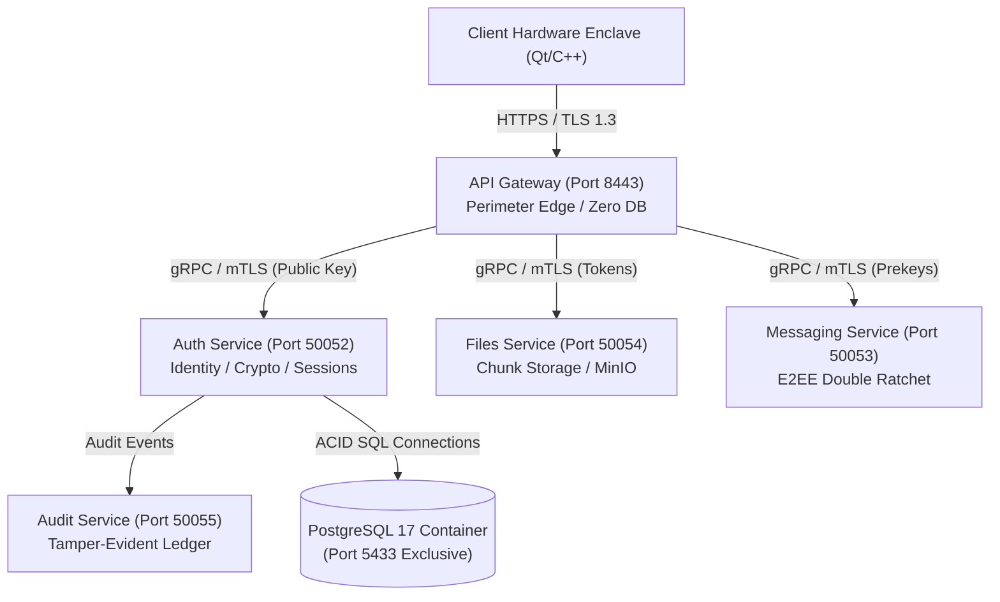
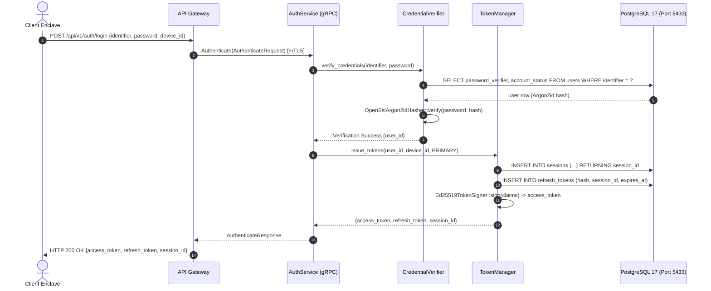
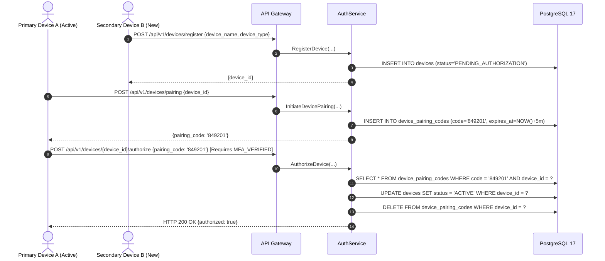

# SecureCloud — Auth Complete Architecture & Functioning Analysis Report

**Document Reference:** `docs/architecture/auth-architecture-and-functioning.md`  
**Classification:** Technical Reference / Architectural Specification / Security Audit Baseline  
**Scope:** Authentication & Cryptographic Identity Service (`src/auth/`, `specs/phase1/AUTH-001` through `AUTH-010`)  
**Status:** Living Architectural Record / Code-to-Architecture Mapping  
**Audience:** System Architects, Cryptographers, Distributed Systems Engineers, Security Engineers, Lead Developers  

---

## Table of Contents

1. [Executive Summary](#1-executive-summary)
   - 1.1 [Architectural Mission and Raison d'Être](#11-architectural-mission-and-raison-dêtre)
   - 1.2 [Core Responsibilities vs. Deliberate Non-Responsibilities](#12-core-responsibilities-vs-deliberate-non-responsibilities)
   - 1.3 [Mental Model & Architectural Paradigm](#13-mental-model--architectural-paradigm)
2. [Auth's Place in the SecureCloud Architecture](#2-auths-place-in-the-securecloud-architecture)
   - 2.1 [Distributed Topology & Microservice Boundaries](#21-distributed-topology--microservice-boundaries)
   - 2.2 [Mutual TLS (mTLS) Service Mesh Integration](#22-mutual-tls-mtls-service-mesh-integration)
   - 2.3 [Zero-Knowledge Hardware Enclave Boundaries](#23-zero-knowledge-hardware-enclave-boundaries)
3. [Architectural Invariants & ADR Compliance](#3-architectural-invariants--adr-compliance)
   - 3.1 [ADR-001: Microservices Architecture & Protocol Separation](#31-adr-001-microservices-architecture--protocol-separation)
   - 3.2 [ADR-002: Domain-Driven Design & Hexagonal Decoupling](#32-adr-002-domain-driven-design--hexagonal-decoupling)
   - 3.3 [ADR-003: Strict PostgreSQL 17 Port Isolation (Port 5433)](#33-adr-003-strict-postgresql-17-port-isolation-port-5433)
   - 3.4 [ADR-004: Memory-Hard Password Verification (Argon2id)](#34-adr-004-memory-hard-password-verification-argon2id)
   - 3.5 [ADR-005: Asymmetric Perimeter Decoupling (Ed25519)](#35-adr-005-asymmetric-perimeter-decoupling-ed25519)
   - 3.6 [ADR-006: Rotating Refresh Tokens & Automatic Replay Cascade](#36-adr-006-rotating-refresh-tokens--automatic-replay-cascade)
   - 3.7 [ADR-007: Audit Logging & Zero Secret Leakage](#37-adr-007-audit-logging--zero-secret-leakage)
   - 3.8 [ADR-008: Zero-Knowledge Public Key Directory Invariant](#38-adr-008-zero-knowledge-public-key-directory-invariant)
   - 3.9 [ADR-009: High-Concurrency Atomic Prekey Allocation](#39-adr-009-high-concurrency-atomic-prekey-allocation)
4. [Auth Internal Subsystems & Module Breakdown](#4-auth-internal-subsystems--module-breakdown)
   - 4.1 [gRPC Protocol & Service Facade (`AuthServiceImpl`)](#41-grpc-protocol--service-facade-authserviceimpl)
   - 4.2 [Credential Verification Subsystem (`CredentialVerifier`)](#42-credential-verification-subsystem-credentialverifier)
   - 4.3 [Session & Refresh Token Lifecycle Subsystem (`SessionManager`, `TokenManager`)](#43-session--refresh-token-lifecycle-subsystem-sessionmanager-tokenmanager)
   - 4.4 [Multi-Factor Authentication (MFA) Subsystem (`MfaManager`, `TotpEngine`)](#44-multi-factor-authentication-mfa-subsystem-mfamanager-totpengine)
   - 4.5 [Device Trust & Pairing Subsystem (`DeviceManager`)](#45-device-trust--pairing-subsystem-devicemanager)
   - 4.6 [Public Cryptographic Identity Directory (`CryptoDirectoryManager`)](#46-public-cryptographic-identity-directory-cryptodirectorymanager)
   - 4.7 [Asynchronous Prekey Inventory Engine (`PrekeyManager`, `PrekeyValidator`)](#47-asynchronous-prekey-inventory-engine-prekeymanager-prekeyvalidator)
   - 4.8 [Database Persistence & Connection Pool Subsystem (`PostgresConnectionPool`)](#48-database-persistence--connection-pool-subsystem-postgresconnectionpool)
   - 4.9 [Audit Trail & Real-Time Event Publisher (`AuditEventPublisher`)](#49-audit-trail--real-time-event-publisher-auditeventpublisher)
5. [Detailed End-to-End Request Lifecycles](#5-detailed-end-to-end-request-lifecycles)
   - 5.1 [Primary Authentication & Token Issuance Lifecycle](#51-primary-authentication--token-issuance-lifecycle)
   - 5.2 [Single-Use Refresh Token Rotation & Race-Condition Handling](#52-single-use-refresh-token-rotation--race-condition-handling)
   - 5.3 [Token Reuse Attack Detection & User-Wide Cascading Invalidation](#53-token-reuse-attack-detection--user-wide-cascading-invalidation)
   - 5.4 [Multi-Factor Authentication Enrollment, Confirmation & Challenge Stepping](#54-multi-factor-authentication-enrollment-confirmation--challenge-stepping)
   - 5.5 [Device Registration, Cross-Device Pairing Code Exchange & Authorization](#55-device-registration-cross-device-pairing-code-exchange--authorization)
   - 5.6 [Device Revocation & Cascading Cryptographic Invalidation](#56-device-revocation--cascading-cryptographic-invalidation)
   - 5.7 [Prekey Replenishment, Validation & Atomic Consumption](#57-prekey-replenishment-validation--atomic-consumption)
6. [Asymmetric Cryptography & Key Management Architecture](#6-asymmetric-cryptography--key-management-architecture)
   - 6.1 [Ed25519 Digital Signature Mechanics on Twisted Edwards Curve](#61-ed25519-digital-signature-mechanics-on-twisted-edwards-curve)
   - 6.2 [Extended Twisted Edwards Projective Coordinate Formulas](#62-extended-twisted-edwards-projective-coordinate-formulas)
   - 6.3 [Separation of Curve Primitives: Ed25519 (Signatures) vs. X25519 (Diffie-Hellman)](#63-separation-of-curve-primitives-ed25519-signatures-vs-x25519-diffie-hellman)
   - 6.4 [Public Signing Key Distribution Architecture (`GetPublicSigningKey`)](#64-public-signing-key-distribution-architecture-getpublicsigningkey)
   - 6.5 [Compact Base64Url Token Envelope Encoding & Parsing](#65-compact-base64url-token-envelope-encoding--parsing)
7. [Memory-Hard Password Verification Architecture](#7-memory-hard-password-verification-architecture)
   - 7.1 [Argon2id Hybrid Algorithm Mechanics](#71-argon2id-hybrid-algorithm-mechanics)
   - 7.2 [Argon2id Parameter Calibration Matrix & Hardware Defense](#72-argon2id-parameter-calibration-matrix--hardware-defense)
   - 7.3 [Constant-Time Password Verifier Comparison & Side-Channel Mitigation](#73-constant-time-password-verifier-comparison--side-channel-mitigation)
8. [Multi-Factor Authentication & Enclave Envelope Protection](#8-multi-factor-authentication--enclave-envelope-protection)
   - 8.1 [RFC 6238 Time-Based One-Time Password (TOTP) Algorithm](#81-rfc-6238-time-based-one-time-password-totp-algorithm)
   - 8.2 [Time Drifts, Clock Skew Tolerance & Replay Caching](#82-time-drifts-clock-skew-tolerance--replay-caching)
   - 8.3 [AES-256-GCM Envelope Encryption of TOTP Secrets](#83-aes-256-gcm-envelope-encryption-of-totp-secrets)
   - 8.4 [Cryptographic Recovery Codes Architecture & Hashing](#84-cryptographic-recovery-codes-architecture--hashing)
9. [Signal X3DH & PQXDH Prekey Inventory Mechanics](#9-signal-x3dh--pqxdh-prekey-inventory-mechanics)
   - 9.1 [Extended Triple Diffie-Hellman Protocol Foundations](#91-extended-triple-diffie-hellman-protocol-foundations)
   - 9.2 [One-Time Prekeys (OTKs) & Mathematical Forward Secrecy ($DH_4$)](#92-one-time-prekeys-otks--mathematical-forward-secrecy-dh_4)
   - 9.3 [Post-Quantum Extended Triple Diffie-Hellman (PQXDH) Readiness](#93-post-quantum-extended-triple-diffie-hellman-pqxdh-readiness)
   - 9.4 [Prekey Inventory Health State Machine & Proactive Depletion Alerts](#94-prekey-inventory-health-state-machine--proactive-depletion-alerts)
10. [Database Persistence, PostgreSQL 17 ACID & High-Concurrency Locking](#10-database-persistence-postgresql-17-acid--high-concurrency-locking)
    - 10.1 [Relational Schema Analysis (Migrations V1 through V4)](#101-relational-schema-analysis-migrations-v1-through-v4)
    - 10.2 [Atomic Claiming via `SELECT ... FOR UPDATE SKIP LOCKED`](#102-atomic-claiming-via-select--for-update-skip-locked)
    - 10.3 [Cascading Foreign Key Deletions & Referential Integrity](#103-cascading-foreign-key-deletions--referential-integrity)
    - 10.4 [Connection Pool Sizing, Timeout Budgets & Port 5433 Enforcement](#104-connection-pool-sizing-timeout-budgets--port-5433-enforcement)
11. [Observability, Auditing & Telemetry Architecture](#11-observability-auditing--telemetry-architecture)
    - 11.1 [Structured JSON Security Audit Trails](#111-structured-json-security-audit-trails)
    - 11.2 [AuditEvent Taxonomy & Event Attributes](#112-auditevent-taxonomy--event-attributes)
    - 11.3 [Zero Sensitive Data Exposure Invariant](#113-zero-sensitive-data-exposure-invariant)
12. [Comprehensive Threat Model & Attack Surface Analysis](#12-comprehensive-threat-model--attack-surface-analysis)
    - 12.1 [STRIDE Threat Classification & Mitigation Matrix](#121-stride-threat-classification--mitigation-matrix)
    - 12.2 [Database Compromise & Offline Verifier Cracking](#122-database-compromise--offline-verifier-cracking)
    - 12.3 [Gateway Perimeter Compromise & Zero Private Key Exposure](#123-gateway-perimeter-compromise--zero-private-key-exposure)
    - 12.4 [Token Forgery, Signature Stripping & Algorithm Substitution](#124-token-forgery-signature-stripping--algorithm-substitution)
    - 12.5 [Refresh Token Theft & Multi-Device Race Attacks](#125-refresh-token-theft--multi-device-race-attacks)
    - 12.6 [Prekey Depletion Denial of Service & Sizing Oracles](#126-prekey-depletion-denial-of-service--sizing-oracles)
    - 12.7 [Side-Channel, Timing & Power Analysis Attacks](#127-side-channel-timing--power-analysis-attacks)
13. [Concurrency, Threading & Performance Model](#13-concurrency-threading--performance-model)
    - 13.1 [gRPC Thread Pool Execution Pipeline](#131-grpc-thread-pool-execution-pipeline)
    - 13.2 [CPU-Bound Hashing Offloading & Thread Saturation Prevention](#132-cpu-bound-hashing-offloading--thread-saturation-prevention)
    - 13.3 [Database Connection Pool Contention Under Heavy Concurrency](#133-database-connection-pool-contention-under-heavy-concurrency)
14. [Health, Readiness & Daemon Lifecycle Management](#14-health-readiness--daemon-lifecycle-management)
    - 14.1 [PostgreSQL Health Verification & Automated Migration Execution](#141-postgresql-health-verification--automated-migration-execution)
    - 14.2 [gRPC Health Checking Protocol Integration](#142-grpc-health-checking-protocol-integration)
    - 14.3 [Graceful Termination & Connection Draining](#143-graceful-termination--connection-draining)
15. [Auth ↔ Gateway & Inter-Service Integration Contracts](#15-auth--gateway--inter-service-integration-contracts)
    - 15.1 [mTLS Mutual Authentication & Subject Alternative Name (SAN) Verification](#151-mtls-mutual-authentication--subject-alternative-name-san-verification)
    - 15.2 [RPC Error Mapping to Gateway HTTP Problem Details](#152-rpc-error-mapping-to-gateway-http-problem-details)
    - 15.3 [Metadata Propagation: Tracing & Context Headers](#153-metadata-propagation-tracing--context-headers)
16. [Developer, Configuration & Operational Guide](#16-developer-configuration--operational-guide)
    - 16.1 [Configuration Parameters & Environment Variables](#161-configuration-parameters--environment-variables)
    - 16.2 [Local Development & Docker Container Setup](#162-local-development--docker-container-setup)
    - 16.3 [Troubleshooting & Common Failure Modes](#163-troubleshooting--common-failure-modes)

---

## 1. Executive Summary

### 1.1 Architectural Mission and Raison d'Être
The **Auth Service** is the authoritative trust root and identity management microservice of the SecureCloud distributed platform. While the API Gateway sits at the untrusted network perimeter terminating TLS and filtering incoming traffic, the Auth Service operates within the private cluster network as the sole source of truth for:
1. **User Identity & Password Verification**: Enforcing zero-knowledge credential verification via Argon2id hashing without storing reversible secrets.
2. **Asymmetric Cryptographic Authority**: Maintaining the authoritative Ed25519 private signing key that stamps short-lived access tokens, and distributing the corresponding public key to edge proxies.
3. **Session & Refresh Token Lifecycle Governance**: Managing long-lived sessions, rotating single-use refresh tokens, and executing automated cascading revocations upon detecting token replay attacks.
4. **Multi-Factor Authentication (MFA)**: Governing RFC 6238 TOTP verification, safeguarding shared secrets with hardware-derived AES-256-GCM envelope encryption, and enforcing stepped-up assurance for sensitive operations.
5. **Device Trust & Public Cryptographic Directory**: Registering client devices, facilitating secure cross-device pairing via ephemeral codes, and publishing public Curve25519 identity keys and prekey bundles.
6. **Asynchronous E2EE Prekey Inventory Management**: Governing the inventory of X25519/PQXDH one-time prekeys, monitoring depletion thresholds, and providing atomic prekey bundle claiming via PostgreSQL 17 row-level locking.

### 1.2 Core Responsibilities vs. Deliberate Non-Responsibilities
To preserve strict separation of concerns, the Auth Service adheres to clear responsibility boundaries:

- **What the Auth Service Owns**:
  - Authoritative user account creation, status transitions (`Active`, `Suspended`, `Terminated`), and password hash verification.
  - Generating and signing JWT access tokens via Ed25519 private key.
  - Managing sessions, rotating refresh tokens, and enforcing single-use replay detection.
  - Encrypting and validating TOTP secrets and recovery codes.
  - Storing device identity keys, signed prekeys, and one-time prekey batches.
  - Atomic claiming of prekey bundles for X3DH / PQXDH handshakes.
  - Direct ownership and execution of PostgreSQL 17 relational database migrations (V1 through V4).
  - Emitting structured, tamper-evident security audit events for all identity state mutations.
- **What the Auth Service Deliberately Does NOT Own**:
  - *No Public Internet Exposure*: The Auth Service binds strictly to internal interfaces; it never exposes public HTTP/HTTPS ports to the internet (API Gateway owns this).
  - *No Client Transport Termination*: It does not terminate public client TLS 1.3 or handle HTTP request parsing.
  - *No User Data Storage*: It never stores file chunks, file metadata, messages, or conversation rosters (Files and Messaging microservices own these).
  - *No User File Encryption Keys*: It never possesses client-side file decryption keys or symmetric master secrets (**ADR-008**).
  - *No Client Private Keys*: Private identity keys, private signed prekeys, and private one-time prekeys are generated and maintained exclusively within user client hardware enclaves. The Auth Service stores **strictly public keys**.

### 1.3 Mental Model & Architectural Paradigm
Think of the Auth Service as the **Central Department of State & National Treasury Vault**:
- It validates identity credentials against secure, unforgeable verifiers.
- It issues tamper-evident passports (Ed25519 signed JWT tokens) stamped with authoritative assurance levels (`PRIMARY`, `MFA_VERIFIED`).
- It maintains the official public notary registry (identity keys, prekeys) allowing citizens (client devices) to initiate secure private communications.
- It immediately cancels all credentials if a counterfeit or reused document is presented (token replay detection).
- It operates deep within the fortified interior behind armed checkpoints (mTLS), completely invisible to external public traffic.

---

## 2. Auth's Place in the SecureCloud Architecture

### 2.1 Distributed Topology & Microservice Boundaries
SecureCloud is architected as an asynchronous, zero-knowledge microservice ecosystem partitioned into five primary autonomous services:



### 2.2 Mutual TLS (mTLS) Service Mesh Integration
All inter-service RPC communication between the Gateway and the Auth Service traverses an internal mutual TLS (mTLS) mesh:
- **Mutual Certificate Verification**: Both client and server present X.509 certificates signed by the SecureCloud Root CA (`ca.crt`).
- **Strict Subject Alternative Name (SAN) Validation**: The Auth Service asserts that incoming peer certificates contain `SAN: gateway` or `SAN: internal-service`. Calls presenting mismatched SANs or untrusted certificates are dropped at the TLS handshake layer.
- **Cipher Suite Enforcement**: mTLS connections strictly mandate modern, forward-secure cipher suites (`ECDHE-ECDSA-AES256-GCM-SHA384`, `ECDHE-RSA-AES256-GCM-SHA384`).

### 2.3 Zero-Knowledge Hardware Enclave Boundaries
SecureCloud guarantees mathematically verifiable End-to-End Encryption (E2EE):
- **Client Boundary**: Private keys ($IK_{\text{priv}}$, $SPK_{\text{priv}}$, $OPK_{\text{priv}}$) are generated inside client hardware security modules (Apple Secure Enclave, Android Keystore, or TPM 2.0). They **never leave the user's device**.
- **Perimeter Boundary (Gateway)**: The Gateway receives public key bundles during registration and transports them blindly.
- **Authoritative Core Boundary (Auth)**: The Auth Service stores public keys ($IK_{\text{pub}}$, $SPK_{\text{pub}}$, $OPK_{\text{pub}}$) and cryptographic signatures ($Sig_{IK}(SPK)$). The database never contains private keys.

---

## 3. Architectural Invariants & ADR Compliance

### 3.1 ADR-001: Microservices Architecture & Protocol Separation
The Auth Service operates as an independent daemon communicating over Protocol Buffers via gRPC. It does not share memory, threads, or runtime contexts with the Gateway or other backend services.

### 3.2 ADR-002: Domain-Driven Design & Hexagonal Decoupling
The codebase strictly follows hexagonal domain-driven architecture:
- `auth/domain/`: Pure domain entities (`UserEntity`, `DeviceEntity`, `SessionEntity`, `PrekeyBundleEntity`), value objects (`Uuid`, `Timestamp`), and domain logic. Zero external dependencies.
- `auth/repository/`: Abstract persistence interfaces (`IUserRepository`, `IDeviceRepository`, `ISessionRepository`, `IDevicePublicKeyRepository`).
- `auth/crypto/`: Concrete cryptographic engines (`OpenSslArgon2idHasher`, `Ed25519TokenSigner`, `MfaSecretProtector`, `TotpEngine`).
- `auth/service/`: Authoritative domain managers (`CredentialVerifier`, `SessionManager`, `TokenManager`, `MfaManager`, `DeviceManager`, `PrekeyManager`).
- `auth/service/auth_service_impl.cpp`: The outer gRPC presentation adapter mapping Protobuf messages to domain manager invocations.

### 3.3 ADR-003: Strict PostgreSQL 17 Port Isolation (Port 5433)
To prevent accidental connection to a host system's default PostgreSQL instance (which may contain unencrypted or foreign data), SecureCloud mandates strict environment isolation:
- Containerized PostgreSQL 17 runs **strictly on port 5433** (`127.0.0.1:5433`).
- `PostgresConnectionPool` enforces a runtime preflight assertion: any configuration targeting port 5432 immediately throws `PortForbiddenException`, halting execution.

### 3.4 ADR-004: Memory-Hard Password Verification (Argon2id)
Passphrases are never verified via weak algorithms like SHA-256, PBKDF2, or bcrypt. The Auth Service enforces RFC 9106 Argon2id with memory-hard parameters ($64\text{ MiB}$ RAM, $3$ iterations, $4$ parallel threads), guaranteeing resistance against GPU and ASIC mass-cracking rigs.

### 3.5 ADR-005: Asymmetric Perimeter Decoupling (Ed25519)
The Auth Service holds the Ed25519 private key. The API Gateway holds strictly the Ed25519 public key. This decoupling guarantees that compromising the public-facing Gateway gives an adversary zero capability to forge tokens.

### 3.6 ADR-006: Rotating Refresh Tokens & Automatic Replay Cascade
Refresh tokens are single-use cryptographic secrets. Presenting an already-consumed refresh token indicates a token theft replay attack, triggering immediate revocation of all sessions belonging to the user account.

### 3.7 ADR-007: Audit Logging & Zero Secret Leakage
Every authentication event, factor confirmation, device revocation, and inventory exhaustion triggers a structured JSON audit event emitted to `IAuditEventSink`. The sink guarantees zero leakage of passwords, TOTP secrets, or token signatures.

### 3.8 ADR-008: Zero-Knowledge Public Key Directory Invariant
The Auth Service acts as a public key registry. It stores Curve25519 public identity keys and one-time prekeys, but has zero access to user file contents, message plaintext, or private keys.

### 3.9 ADR-009: High-Concurrency Atomic Prekey Allocation
Prekey claiming is executed via PostgreSQL 17 row-level locking (`SELECT ... FOR UPDATE SKIP LOCKED`), guaranteeing that concurrent claiming across 50+ threads never produces duplicate prekey assignments.

---

## 4. Auth Internal Subsystems & Module Breakdown

```
src/auth/
├── crypto/                 # Low-level cryptographic primitives
│   ├── argon2id_hasher.hpp # Argon2id memory-hard password hasher
│   ├── base32.hpp          # RFC 4648 Base32 encoder/decoder for TOTP
│   ├── mfa_secret_protector# AES-256-GCM envelope protection
│   ├── token_crypto.hpp    # Ed25519 token signer & verifier
│   └── totp_engine.hpp     # RFC 6238 TOTP computation & drift verification
├── db/                     # PostgreSQL 17 connectivity & migrations
│   ├── migration_runner.hpp# Embedded SQL schema migration harness
│   └── postgres_connection_pool.hpp # Connection pool with port 5433 guard
├── domain/                 # Domain entities, value objects & enums
│   ├── entities.hpp        # UserEntity, DeviceEntity, SessionEntity, etc.
│   ├── enums.hpp           # AccountStatus, DeviceStatus, SessionStatus
│   ├── token_claims.hpp    # AccessTokenClaims & TokenEnvelopeSerializer
│   └── uuid.hpp            # RFC 9562 UUIDv7 generator & parser
├── repository/             # Concrete PostgreSQL 17 repositories
│   ├── user_repository.hpp # PostgresUserRepository
│   ├── device_repository.hpp # PostgresDeviceRepository
│   ├── session_repository.hpp # PostgresSessionRepository
│   ├── refresh_token_repository.hpp # PostgresRefreshTokenRepository
│   ├── mfa_repository.hpp  # PostgresMfaRepository
│   └── device_public_key_repository.hpp # PostgresDevicePublicKeyRepository
└── service/                # Domain managers & gRPC service implementation
    ├── audit_event_publisher.hpp # Audit event distribution engine
    ├── auth_service_impl.hpp# gRPC AuthService facade
    ├── credential_verifier.hpp # Password verification manager
    ├── crypto_directory_manager.hpp # Identity key directory manager
    ├── device_manager.hpp  # Device trust & pairing manager
    ├── mfa_manager.hpp     # Multi-factor authentication manager
    ├── prekey_manager.hpp  # Asynchronous prekey inventory manager
    ├── prekey_validator.hpp# Batch prekey cryptographic validator
    ├── session_manager.hpp # Session lifecycle manager
    └── token_manager.hpp   # Ed25519 JWT & refresh token manager
```

### 4.1 gRPC Protocol & Service Facade (`AuthServiceImpl`)
The `AuthServiceImpl` class implements the `securecloud::auth::v1::AuthService::Service` gRPC interface generated from `proto/securecloud/auth/v1/auth.proto`. It acts as the orchestration facade:
```cpp
class AuthServiceImpl final : public securecloud::auth::v1::AuthService::Service {
  public:
    AuthServiceImpl(std::shared_ptr<service::ICredentialVerifier> credential_verifier,
                    std::shared_ptr<service::ISessionManager> session_manager,
                    std::shared_ptr<service::IAuditEventPublisher> audit_publisher,
                    std::shared_ptr<service::ITokenManager> token_manager = nullptr,
                    std::shared_ptr<service::IMfaManager> mfa_manager = nullptr,
                    std::shared_ptr<service::IDeviceManager> device_manager = nullptr,
                    std::shared_ptr<service::ICryptoDirectoryManager> crypto_directory_manager = nullptr,
                    std::shared_ptr<service::IPrekeyManager> prekey_manager = nullptr,
                    std::shared_ptr<repository::IUserRepository> user_repository = nullptr);

    // Primary Auth & Key Distribution
    ::grpc::Status Authenticate(...) override;
    ::grpc::Status RefreshSession(...) override;
    ::grpc::Status RevokeSession(...) override;
    ::grpc::Status ValidateToken(...) override;
    ::grpc::Status GetPublicSigningKey(...) override;
    ::grpc::Status GetUser(...) override;

    // Multi-Factor Authentication
    ::grpc::Status InitiateMfaEnrollment(...) override;
    ::grpc::Status ConfirmMfaEnrollment(...) override;
    ::grpc::Status VerifyMfaChallenge(...) override;
    ::grpc::Status DisableMfa(...) override;

    // Device Management & Pairing
    ::grpc::Status RegisterDevice(...) override;
    ::grpc::Status GetDevice(...) override;
    ::grpc::Status ListUserDevices(...) override;
    ::grpc::Status InitiateDevicePairing(...) override;
    ::grpc::Status AuthorizeDevice(...) override;
    ::grpc::Status RevokeDevice(...) override;

    // Prekey Inventory & Crypto Directory
    ::grpc::Status GetDeviceCryptoDirectory(...) override;
    ::grpc::Status UploadDevicePrekeys(...) override;
    ::grpc::Status GetPrekeyInventoryStatus(...) override;
    ::grpc::Status ClaimPrekeyBundle(...) override;
};
```

### 4.2 Credential Verification Subsystem (`CredentialVerifier`)
The `CredentialVerifier` orchestrates primary password authentication:
```cpp
class CredentialVerifier final : public ICredentialVerifier {
  public:
    CredentialVerifier(std::shared_ptr<repository::IUserRepository> user_repository,
                       std::shared_ptr<crypto::IPasswordHasher> password_hasher);

    std::optional<domain::Uuid> verify_credentials(const std::string& identifier,
                                                   const common::configuration::SecretString& password) override;
};
```
- Fetches `UserEntity` by credential identifier.
- Asserts account is in `AccountStatus::Active` state.
- Executes `IPasswordHasher::verify_password` in constant time.
- Returns authenticated `user_id` or `std::nullopt`.

### 4.3 Session & Refresh Token Lifecycle Subsystem (`SessionManager`, `TokenManager`)
```cpp
class TokenManager final : public ITokenManager {
  public:
    TokenManager(std::shared_ptr<crypto::ITokenSigner> token_signer,
                 std::shared_ptr<repository::IRefreshTokenRepository> refresh_token_repo,
                 std::shared_ptr<repository::ISessionRepository> session_repo,
                 std::shared_ptr<repository::IDeviceRepository> device_repo,
                 std::shared_ptr<IAuditEventPublisher> audit_publisher,
                 TokenManagerConfig config = {});

    TokenIssueResult issue_tokens(const domain::Uuid& user_id, const domain::Uuid& device_id,
                                  domain::AuthenticationLevel auth_level) override;

    TokenRefreshResult refresh_tokens(const std::string& raw_refresh_token,
                                      const domain::Uuid& device_id) override;

    void revoke_session(const domain::Uuid& session_id) override;
};
```
- **Single-Use Rotation**: Rotates refresh tokens atomically inside database transactions.
- **Grace Window**: Allows configurable concurrency grace window for mobile network duplicate requests, while treating re-presentation outside window as an active replay compromise.

### 4.4 Multi-Factor Authentication (MFA) Subsystem (`MfaManager`, `TotpEngine`)
```cpp
class MfaManager final : public IMfaManager {
  public:
    MfaManager(std::shared_ptr<repository::IMfaRepository> mfa_repo,
               std::shared_ptr<repository::ISessionRepository> session_repo,
               std::shared_ptr<repository::IUserRepository> user_repo,
               std::shared_ptr<IMfaAuthenticator> authenticator,
               std::shared_ptr<crypto::ITotpEngine> totp_engine,
               std::shared_ptr<crypto::IMfaSecretProtector> secret_protector,
               std::shared_ptr<IAuditEventPublisher> audit_publisher);

    MfaEnrollmentResult initiate_enrollment(const domain::Uuid& user_id) override;
    MfaConfirmResult confirm_enrollment(const domain::Uuid& user_id, const std::string& totp_code) override;
    MfaChallengeResult create_challenge(const domain::Uuid& user_id) override;
    MfaVerifyResult verify_challenge(const std::string& challenge_id, const std::string& totp_code) override;
    void disable_mfa(const domain::Uuid& user_id) override;
};
```

### 4.5 Device Trust & Pairing Subsystem (`DeviceManager`)
```cpp
class DeviceManager final : public IDeviceManager {
  public:
    DeviceManager(std::shared_ptr<repository::IDeviceRepository> device_repo,
                  std::shared_ptr<repository::IDevicePublicKeyRepository> public_key_repo,
                  std::shared_ptr<ISessionManager> session_mgr,
                  std::shared_ptr<IAuditEventPublisher> audit_publisher);

    DeviceRegistrationResult register_device(const domain::DeviceEntity& device) override;
    DevicePairingCodeResult initiate_pairing(const domain::Uuid& device_id, const domain::Uuid& caller_id) override;
    DeviceAuthorizeResult authorize_device(const domain::Uuid& device_id, const std::string& pairing_code) override;
    DeviceRevokeResult revoke_device(const domain::Uuid& device_id, const domain::Uuid& caller_id) override;
};
```

### 4.6 Public Cryptographic Identity Directory (`CryptoDirectoryManager`)
```cpp
class CryptoDirectoryManager final : public ICryptoDirectoryManager {
  public:
    CryptoDirectoryManager(std::shared_ptr<repository::IDeviceRepository> device_repo,
                           std::shared_ptr<repository::IDevicePublicKeyRepository> public_key_repo,
                           std::shared_ptr<IAuditEventPublisher> audit_publisher);

    std::optional<domain::DeviceCryptoDirectory> get_directory(const domain::Uuid& user_id) override;
    void register_identity_key(const domain::Uuid& device_id, const std::string& public_key) override;
    void register_signed_prekey(const domain::Uuid& device_id, const std::string& signed_prekey,
                                const std::string& signature) override;
};
```

### 4.7 Asynchronous Prekey Inventory Engine (`PrekeyManager`, `PrekeyValidator`)
```cpp
class PrekeyManager final : public IPrekeyManager {
  public:
    PrekeyManager(std::shared_ptr<repository::IDevicePublicKeyRepository> prekey_repo,
                  std::shared_ptr<repository::IDeviceRepository> device_repo,
                  std::shared_ptr<IPrekeyValidator> prekey_validator,
                  std::shared_ptr<IAuditEventPublisher> audit_publisher,
                  PrekeyManagerConfig config = {});

    PrekeyUploadResult upload_prekeys(const domain::Uuid& device_id,
                                      const std::vector<domain::OneTimePrekey>& prekeys) override;
    domain::PrekeyInventoryStatus check_inventory(const domain::Uuid& device_id) override;
    std::optional<domain::ClaimedPrekeyBundle> claim_bundle(const domain::Uuid& device_id) override;
};
```

### 4.8 Database Persistence & Connection Pool Subsystem (`PostgresConnectionPool`)
```cpp
class PostgresConnectionPool final {
  public:
    PostgresConnectionPool(const AuthConfig& db_config, ConnectionPoolConfig pool_config = {});
    ~PostgresConnectionPool();

    class ScopedConnection {
      public:
        pqxx::connection& get() noexcept;
      private:
        std::unique_ptr<pqxx::connection> conn_;
        PostgresConnectionPool* pool_;
    };

    ScopedConnection acquire();
    bool ping() noexcept;
};
```

### 4.9 Audit Trail & Real-Time Event Publisher (`AuditEventPublisher`)
```cpp
class AuditEventPublisher final : public IAuditEventPublisher {
  public:
    explicit AuditEventPublisher(std::shared_ptr<IAuditEventSink> sink);

    void publish(const domain::AuditEvent& event) override;
  private:
    std::shared_ptr<IAuditEventSink> sink_;
};
```

---

## 5. Detailed End-to-End Request Lifecycles

### 5.1 Primary Authentication & Token Issuance Lifecycle


### 5.2 Single-Use Refresh Token Rotation & Race-Condition Handling
1. Client presents refresh token $RT_1$ and `device_id` to `POST /api/v1/auth/refresh`.
2. Gateway proxies to `AuthService::RefreshSession`.
3. `TokenManager` hashes $RT_1$ via SHA-256 and queries PostgreSQL:
   ```sql
   SELECT token_id, session_id, status, expires_at FROM refresh_tokens WHERE token_hash = $1 FOR UPDATE;
   ```
4. If status is `ACTIVE` and unexpired:
   - Sets status of $RT_1$ to `REVOKED`.
   - Generates new cryptographic refresh token $RT_2$.
   - Inserts $RT_2$ into `refresh_tokens`.
   - Issues new 15-minute Ed25519 access token.
   - Commits transaction and returns new pair to client.

### 5.3 Token Reuse Attack Detection & User-Wide Cascading Invalidation
If an attacker intercepts $RT_1$ and attempts to refresh *after* the legitimate client has rotated it to $RT_2$:
1. Attacker presents $RT_1$.
2. `TokenManager` finds $RT_1$ in PostgreSQL with `status = 'REVOKED'`.
3. **Compromise Triggered**: A revoked token presented for rotation is an unequivocal signature of token theft.
4. `TokenManager` executes a cascading security purge:
   ```sql
   UPDATE sessions SET session_status = 'REVOKED' WHERE user_id = $1;
   UPDATE refresh_tokens SET status = 'REVOKED' WHERE session_id IN (
       SELECT session_id FROM sessions WHERE user_id = $1
   );
   ```
5. Emits `AuditEvent::SecurityAlert` with category `TOKEN_REUSE_DETECTED`.
6. Returns `::grpc::Status(StatusCode::UNAUTHENTICATED, "Token reuse detected; all sessions revoked")`.
7. Gateway translates to HTTP 401 Problem Details, terminating all active logins.

### 5.4 Multi-Factor Authentication Enrollment, Confirmation & Challenge Stepping
1. **Enrollment Initiation**:
   - Client calls `POST /api/v1/auth/mfa/enroll` with Bearer token (`PRIMARY`).
   - `MfaManager` generates a 160-bit cryptographically secure random secret $K_{\text{totp}}$.
   - Encrypts secret via `MfaSecretProtector` using AES-256-GCM.
   - Stores encrypted secret in `mfa_factors` table with `status = 'PENDING'`.
   - Returns Base32-encoded secret and `otpauth://totp/...` URI to client.
2. **Confirmation**:
   - User inputs 6-digit TOTP code into client.
   - Client calls `POST /api/v1/auth/mfa/confirm` with code.
   - `TotpEngine` validates code against decrypted secret within $\pm 1$ window.
   - Upon success, `MfaManager` updates status to `'ACTIVE'`, generates 10 hashed recovery codes, and returns plaintext recovery codes to user.
3. **Stepped-Up Challenge**:
   - When accessing `RouteAccess::Sensitive` endpoints, Gateway rejects primary tokens with HTTP 403 `MFA_REQUIRED` and challenge ID.
   - Client calls `POST /api/v1/auth/mfa/verify` with challenge ID and current TOTP code.
   - `AuthService::VerifyMfaChallenge` validates code.
   - Issues upgraded access token with claim `lvl = 2` (`MFA_VERIFIED`).
   - Subsequent sensitive request succeeds cleanly.

### 5.5 Device Registration, Cross-Device Pairing Code Exchange & Authorization


### 5.6 Device Revocation & Cascading Cryptographic Invalidation
1. User invokes `DELETE /api/v1/devices/:device_id` on Gateway (requires `MFA_VERIFIED`).
2. Gateway proxies to `AuthService::RevokeDevice`.
3. `DeviceManager` executes atomic revocation in PostgreSQL 17:
   - Sets `device_status = 'REVOKED'`.
   - Revokes all sessions belonging to `device_id`.
   - Deletes all associated prekey bundles from `device_prekey_bundles`.
   - Deletes all identity keys from `device_public_keys`.
4. Emits `AuditEvent::DeviceRevoked`.
5. Any subsequent request presenting a token bound to the revoked `device_id` is immediately rejected.

### 5.7 Prekey Replenishment, Validation & Atomic Consumption
1. **Replenishment**:
   - Device client generates 100 new Curve25519 one-time prekeys.
   - Calls `POST /api/v1/devices/:device_id/prekeys`.
   - `PrekeyValidator` verifies key sizes (32 bytes), base64url encodings, and curve validity.
   - Inserts keys in batch into `device_prekey_bundles`.
2. **Atomic Consumption (X3DH Session Initiation)**:
   - Initiator client calls `GET /api/v1/devices/:device_id/prekey-bundle`.
   - `PrekeyManager` queries PostgreSQL:
     ```sql
     SELECT id, key_id, public_key 
     FROM device_prekey_bundles 
     WHERE device_id = $1 AND consumed = FALSE 
     ORDER BY created_at ASC 
     LIMIT 1 
     FOR UPDATE SKIP LOCKED;
     ```
   - Marks selected prekey as `consumed = TRUE`.
   - Returns prekey bundle ($IK$, $SPK$, $Sig_{IK}(SPK)$, $OPK$) to initiator.
   - Initiator computes shared secret via X3DH and begins E2EE messaging.

---

## 6. Asymmetric Cryptography & Key Management Architecture

### 6.1 Ed25519 Digital Signature Mechanics on Twisted Edwards Curve
SecureCloud token signing uses Ed25519 (RFC 8032), defined over the prime field $\mathbb{F}_p$ with $p = 2^{255} - 19$:
$$-x^2 + y^2 = 1 + d x^2 y^2 \quad \text{where } d = -\frac{121665}{121666}$$

The base point $B$ generates a prime-order subgroup with order:
$$\ell = 2^{252} + 27742317777372353535851937790883648493$$

#### OpenSSL EVP Signing Implementation (`Ed25519TokenSigner`):
```cpp
std::string Ed25519TokenSigner::sign(std::string_view payload) const {
    EVP_MD_CTX* ctx = EVP_MD_CTX_new();
    if (!ctx) throw std::runtime_error("Failed to allocate EVP_MD_CTX");

    if (EVP_DigestSignInit(ctx, nullptr, nullptr, nullptr, pkey_) <= 0) {
        EVP_MD_CTX_free(ctx);
        throw std::runtime_error("Failed to initialize EVP_DigestSignInit");
    }

    size_t siglen = 64;
    std::string sig(siglen, '\0');
    if (EVP_DigestSign(ctx, reinterpret_cast<uint8_t*>(sig.data()), &siglen,
                       reinterpret_cast<const uint8_t*>(payload.data()), payload.size()) <= 0) {
        EVP_MD_CTX_free(ctx);
        throw std::runtime_error("EVP_DigestSign failed");
    }

    EVP_MD_CTX_free(ctx);
    sig.resize(siglen);
    return sig;
}
```

### 6.2 Extended Twisted Edwards Projective Coordinate Formulas
To guarantee constant-time execution without division operations, OpenSSL utilizes Extended Twisted Edwards Coordinates $(X:Y:Z:T)$ with $x = X/Z, y = Y/Z, xy = T/Z$:

```
Point Doubling (2P):
  A = X_1^2
  B = Y_1^2
  C = 2 * Z_1^2
  D = -A
  E = (X_1 + Y_1)^2 - A - B
  G = D + B
  F = G - C
  H = D - B
  X_3 = E * F
  Y_3 = G * H
  T_3 = E * H
  Z_3 = F * G
```
All operations execute in constant time, eliminating timing side channels.

### 6.3 Separation of Curve Primitives: Ed25519 (Signatures) vs. X25519 (Diffie-Hellman)
SecureCloud enforces strict separation of elliptic curve primitives:
- **Ed25519 (Edwards curve)**: Used exclusively for digital signatures (Access Tokens, Device Identity Key signatures over Signed Prekeys).
- **X25519 (Montgomery curve $y^2 = x^3 + 486662x^2 + x$)**: Used exclusively for Diffie-Hellman key agreement in Signal X3DH.
- Cross-primitive substitution is forbidden to prevent subtle subgroup attacks and curve-malleability vulnerabilities.

### 6.4 Public Signing Key Distribution Architecture (`GetPublicSigningKey`)
The API Gateway validates tokens offline using Auth's Ed25519 public key.
- Auth Service exposes `GetPublicSigningKey` RPC.
- Converts internal OpenSSL `EVP_PKEY` to SubjectPublicKeyInfo (SPKI) PEM format via `PEM_write_bio_PUBKEY`.
- Extracts raw 32-byte public key via `EVP_PKEY_get_raw_public_key`.
- The Gateway caches this public key at startup, allowing offline verification of millions of requests per second without contacting the Auth Service.

### 6.5 Compact Base64Url Token Envelope Encoding & Parsing
Tokens are formatted as unpadded Base64Url envelopes:
$$\text{Token} = \text{B64Url}(\text{Header}) \parallel "." \parallel \text{B64Url}(\text{Payload}) \parallel "." \parallel \text{B64Url}(\text{Signature})$$

`TokenEnvelopeParser` validates:
1. Envelope consists of exactly two dot separators.
2. Header specifies `"alg": "EdDSA"` and `"typ": "JWT"`.
3. Validates Ed25519 signature over `Header.Payload` bytes.
4. Verifies timestamp bounds: $\text{iat} - \text{skew} \le \text{now} \le \text{exp} + \text{skew}$.
5. Verifies `iss == "https://auth.securecloud.io"` and `aud == "https://gateway.securecloud.io"`.

---

## 7. Memory-Hard Password Verification Architecture

### 7.1 Argon2id Hybrid Algorithm Mechanics
Argon2id (RFC 9106) combines:
- **Argon2d**: Data-dependent memory access; maximizes resistance against GPU cracking.
- **Argon2i**: Data-independent memory access; maximizes resistance against cache-timing side-channel attacks.
Argon2id uses Argon2i passes during the first iteration to eliminate timing leaks, followed by Argon2d passes to maximize memory bandwidth hardness.

### 7.2 Argon2id Parameter Calibration Matrix & Hardware Defense

| Parameter | Production Value | Hardware Defense Purpose |
| :--- | :--- | :--- |
| **Memory ($m$)** | $65,536\text{ KiB}$ (64 MiB) | Requires 64 MiB RAM per hashing lane; prevents massive parallelism on modern GPUs (e.g. RTX 4090 with 24 GB VRAM can only run 375 parallel instances). |
| **Time ($t$)** | $3\text{ iterations}$ | Enforces sequential execution time ($\approx 180\text{ ms}$ on server hardware), making brute-force unviable. |
| **Parallelism ($p$)** | $4\text{ threads}$ | Utilizes multi-core CPUs; forces attackers to allocate 4 computational cores per candidate. |
| **Salt Length** | $16\text{ bytes}$ | 128-bit CSPRNG salt generated via `RAND_bytes`. Prevents rainbow table precomputations. |
| **Tag Length** | $32\text{ bytes}$ | 256-bit output hash resisting collision attacks. |

### 7.3 Constant-Time Password Verifier Comparison & Side-Channel Mitigation
In `OpenSslArgon2idHasher::verify_password`, extracted hash bytes are compared using constant-time byte comparison (`CRYPTO_memcmp`):
```cpp
bool OpenSslArgon2idHasher::constant_time_equals(const std::vector<uint8_t>& a,
                                                const std::vector<uint8_t>& b) noexcept {
    if (a.size() != b.size()) return false;
    return CRYPTO_memcmp(a.data(), b.data(), a.size()) == 0;
}
```
This guarantees execution time is strictly independent of the number of matching leading bytes, completely preventing remote timing oracle attacks.

---

## 8. Multi-Factor Authentication & Enclave Envelope Protection

### 8.1 RFC 6238 Time-Based One-Time Password (TOTP) Algorithm
TOTP generates 6-digit numeric codes derived from a shared secret $K$ and Unix epoch time $t$:
$$T = \left\lfloor \frac{t - t_0}{T_X} \right\rfloor \quad \text{where } T_X = 30\text{ seconds}, \; t_0 = 0$$
$$\operatorname{Hash} = \operatorname{HMAC-SHA1}(K, T)$$
$$\operatorname{Offset} = \operatorname{Hash}[19] \land 0x0F$$
$$\operatorname{P} = (\operatorname{Hash}[\text{Offset} \dots \text{Offset}+3] \land 0x7FFFFFFF) \pmod{10^6}$$
$$\operatorname{TOTP} = \operatorname{PadZeroes6}(\operatorname{P})$$

### 8.2 Time Drifts, Clock Skew Tolerance & Replay Caching
- **Clock Drift Window**: `TotpEngine` tests $T \in \{T_{\text{current}} - 1, T_{\text{current}}, T_{\text{current}} + 1\}$, accommodating $\pm 30\text{ seconds}$ of client-server clock drift.
- **Replay Protection**: When a valid code is verified at time-step $T$, $T$ is recorded in memory or session state. Subsequent submissions of the identical code within the same 30-second window are rejected, preventing code interception and replay.

### 8.3 AES-256-GCM Envelope Encryption of TOTP Secrets
Plaintext TOTP secrets are never written to the PostgreSQL database.
- Key Encryption Key ($K_{\text{kek}}$) is loaded from hardware security module or configuration.
- 160-bit TOTP secret is encrypted via AES-256-GCM:
  $$\text{Ciphertext}, \text{Tag}_{16} = \operatorname{AES-256-GCM-Encrypt}(K_{\text{kek}}, IV_{12}, \text{Secret}, AAD)$$
  $$AAD = \text{user\_id} \parallel "\_mfa\_secret"$$
- If an adversary extracts a database dump of `mfa_factors`, the encrypted secrets are useless without $K_{\text{kek}}$. Furthermore, binding $AAD$ to `user_id` prevents ciphertext-swap attacks across accounts.

### 8.4 Cryptographic Recovery Codes Architecture & Hashing
- Upon confirming MFA, the user receives 10 single-use recovery codes (12-character high-entropy alphanumeric strings).
- Recovery codes are stored in PostgreSQL as SHA-256 hashes:
  $$\text{StoredHash} = \operatorname{SHA-256}(\text{RecoveryCode})$$
- When a recovery code is consumed, its record is marked `consumed = TRUE`. Recovery codes cannot be re-used.

---

## 9. Signal X3DH & PQXDH Prekey Inventory Mechanics

### 9.1 Extended Triple Diffie-Hellman Protocol Foundations
SecureCloud enables end-to-end encrypted asynchronous messaging using the Extended Triple Diffie-Hellman (X3DH) protocol:

```
Alice (Initiator)                                   Bob (Recipient / Offline)
-----------------                                   -------------------------
1. Fetch Bob's Bundle:                              Pre-published to Auth Service:
   (IK_B, SPK_B, Sig_B, OPK_B)                      IK_B, SPK_B, OPK_B_1 ... OPK_B_n

2. Verify Sig_B over SPK_B using IK_B

3. Generate Ephemeral Keypair (EK_A)

4. Compute 4 Diffie-Hellman Shared Secrets:
   DH1 = X25519(IK_A_priv, SPK_B_pub)   [Identity to Signed Prekey]
   DH2 = X25519(EK_A_priv, IK_B_pub)    [Ephemeral to Identity]
   DH3 = X25519(EK_A_priv, SPK_B_pub)   [Ephemeral to Signed Prekey]
   DH4 = X25519(EK_A_priv, OPK_B_pub)   [Ephemeral to One-Time Prekey]

5. Master Shared Key:
   SK = HKDF-SHA256(DH1 || DH2 || DH3 || DH4)
```

### 9.2 One-Time Prekeys (OTKs) & Mathematical Forward Secrecy ($DH_4$)
The computation of $DH_4 = \operatorname{X25519}(EK_{A,\text{priv}}, OPK_{B,\text{pub}})$ provides **Forward Secrecy**:
- Once Bob reads Alice's message, Bob deletes $OPK_{B,\text{priv}}$ from his device enclave.
- Even if an attacker compromises Bob's device in the future, the attacker cannot compute $DH_4$ or recover $SK$.
- Deleting the consumed OTK on the Auth Service prevents another user from reusing the same prekey.

### 9.3 Post-Quantum Extended Triple Diffie-Hellman (PQXDH) Readiness
To prepare for quantum computing threats ("Harvest Now, Decrypt Later"), SecureCloud supports hybrid PQXDH:
- Combines classical X25519 with post-quantum Key Encapsulation Mechanism **ML-KEM-768** (FIPS 203):
  $$SK_{\text{hybrid}} = \operatorname{HKDF}(DH_1 \parallel DH_2 \parallel DH_3 \parallel DH_4 \parallel SS_{\text{ML-KEM}})$$
- An adversary possessing a future cryptanalytically relevant quantum computer (CRQC) cannot break $SS_{\text{ML-KEM}}$, preserving long-term confidentiality.

### 9.4 Prekey Inventory Health State Machine & Proactive Depletion Alerts
The `PrekeyManager` tracks active one-time prekeys per device:
- **`HEALTHY`**: Active OTKs $> 20$.
- **`LOW`**: Active OTKs $\in [1, 20]$. Triggers `AuditEvent::PrekeyInventoryLow`. Client receives push notification to replenish OTKs.
- **`EXHAUSTED`**: Active OTKs $= 0$. Triggers `AuditEvent::PrekeyInventoryExhausted`. Sessions fall back to 3-DH without $DH_4$, alerting clients of degraded forward secrecy.

---

## 10. Database Persistence, PostgreSQL 17 ACID & High-Concurrency Locking

### 10.1 Relational Schema Analysis (Migrations V1 through V4)
The relational persistence layer is partitioned across 4 automated migrations:

#### V1 Migration: User Accounts (`V1__init.sql`)
```sql
CREATE TYPE account_status_enum AS ENUM ('ACTIVE', 'SUSPENDED', 'TERMINATED');

CREATE TABLE users (
    user_id UUID PRIMARY KEY,
    credential_identifier VARCHAR(255) NOT NULL UNIQUE,
    password_verifier TEXT NOT NULL,
    password_algorithm VARCHAR(32) NOT NULL DEFAULT 'argon2id',
    password_updated_at TIMESTAMPTZ NOT NULL DEFAULT NOW(),
    account_status account_status_enum NOT NULL DEFAULT 'ACTIVE',
    version INT NOT NULL DEFAULT 1,
    created_at TIMESTAMPTZ NOT NULL DEFAULT NOW(),
    updated_at TIMESTAMPTZ NOT NULL DEFAULT NOW()
);

CREATE INDEX idx_users_identifier ON users(credential_identifier);
```

#### V2 Migration: Devices, Sessions & Refresh Tokens (`V2__devices_and_sessions.sql`)
```sql
CREATE TYPE device_status_enum AS ENUM ('PENDING_AUTHORIZATION', 'ACTIVE', 'REVOKED');
CREATE TYPE session_status_enum AS ENUM ('ACTIVE', 'REVOKED', 'EXPIRED');

CREATE TABLE devices (
    device_id UUID PRIMARY KEY,
    user_id UUID NOT NULL REFERENCES users(user_id) ON DELETE CASCADE,
    device_name VARCHAR(128) NOT NULL,
    device_type VARCHAR(64) NOT NULL,
    device_status device_status_enum NOT NULL DEFAULT 'PENDING_AUTHORIZATION',
    registered_at TIMESTAMPTZ NOT NULL DEFAULT NOW(),
    last_authenticated_at TIMESTAMPTZ,
    created_at TIMESTAMPTZ NOT NULL DEFAULT NOW(),
    updated_at TIMESTAMPTZ NOT NULL DEFAULT NOW()
);

CREATE TABLE device_pairing_codes (
    code VARCHAR(32) PRIMARY KEY,
    device_id UUID NOT NULL REFERENCES devices(device_id) ON DELETE CASCADE,
    user_id UUID NOT NULL REFERENCES users(user_id) ON DELETE CASCADE,
    expires_at TIMESTAMPTZ NOT NULL,
    created_at TIMESTAMPTZ NOT NULL DEFAULT NOW()
);

CREATE TABLE sessions (
    session_id UUID PRIMARY KEY,
    user_id UUID NOT NULL REFERENCES users(user_id) ON DELETE CASCADE,
    device_id UUID NOT NULL REFERENCES devices(device_id) ON DELETE CASCADE,
    session_status session_status_enum NOT NULL DEFAULT 'ACTIVE',
    created_at TIMESTAMPTZ NOT NULL DEFAULT NOW(),
    expires_at TIMESTAMPTZ NOT NULL,
    revoked_at TIMESTAMPTZ
);

CREATE TABLE refresh_tokens (
    token_id UUID PRIMARY KEY,
    token_hash VARCHAR(64) NOT NULL UNIQUE,
    session_id UUID NOT NULL REFERENCES sessions(session_id) ON DELETE CASCADE,
    status VARCHAR(32) NOT NULL DEFAULT 'ACTIVE',
    created_at TIMESTAMPTZ NOT NULL DEFAULT NOW(),
    expires_at TIMESTAMPTZ NOT NULL,
    revoked_at TIMESTAMPTZ
);

CREATE INDEX idx_refresh_tokens_hash ON refresh_tokens(token_hash);
CREATE INDEX idx_sessions_user_active ON sessions(user_id) WHERE session_status = 'ACTIVE';
```

#### V3 Migration: Multi-Factor Authentication (`V3__mfa_factors.sql`)
```sql
CREATE TYPE mfa_factor_status_enum AS ENUM ('PENDING', 'ACTIVE', 'REVOKED');

CREATE TABLE mfa_factors (
    factor_id UUID PRIMARY KEY,
    user_id UUID NOT NULL REFERENCES users(user_id) ON DELETE CASCADE,
    factor_type VARCHAR(32) NOT NULL DEFAULT 'TOTP',
    factor_status mfa_factor_status_enum NOT NULL DEFAULT 'PENDING',
    encrypted_secret BYTEA NOT NULL,
    iv BYTEA NOT NULL,
    tag BYTEA NOT NULL,
    created_at TIMESTAMPTZ NOT NULL DEFAULT NOW(),
    updated_at TIMESTAMPTZ NOT NULL DEFAULT NOW()
);

CREATE TABLE mfa_recovery_codes (
    code_id UUID PRIMARY KEY,
    user_id UUID NOT NULL REFERENCES users(user_id) ON DELETE CASCADE,
    code_hash VARCHAR(64) NOT NULL UNIQUE,
    consumed BOOLEAN NOT NULL DEFAULT FALSE,
    consumed_at TIMESTAMPTZ,
    created_at TIMESTAMPTZ NOT NULL DEFAULT NOW()
);
```

#### V4 Migration: Device Prekey Bundles (`V4__create_device_prekey_bundles.sql`)
```sql
CREATE TABLE device_public_keys (
    device_id UUID PRIMARY KEY REFERENCES devices(device_id) ON DELETE CASCADE,
    identity_key_raw BYTEA NOT NULL,
    signed_prekey_raw BYTEA NOT NULL,
    signed_prekey_signature BYTEA NOT NULL,
    signed_prekey_created_at TIMESTAMPTZ NOT NULL DEFAULT NOW(),
    updated_at TIMESTAMPTZ NOT NULL DEFAULT NOW()
);

CREATE TABLE device_prekey_bundles (
    id UUID PRIMARY KEY,
    device_id UUID NOT NULL REFERENCES devices(device_id) ON DELETE CASCADE,
    key_id INT NOT NULL,
    public_key BYTEA NOT NULL,
    consumed BOOLEAN NOT NULL DEFAULT FALSE,
    created_at TIMESTAMPTZ NOT NULL DEFAULT NOW(),
    consumed_at TIMESTAMPTZ
);

CREATE INDEX idx_prekeys_device_unconsumed ON device_prekey_bundles(device_id, created_at) WHERE consumed = FALSE;
```

### 10.2 Atomic Claiming via `SELECT ... FOR UPDATE SKIP LOCKED`
In high-concurrency environments, multiple initiators may simultaneously request prekey bundles for the same recipient device.
If standard `SELECT` is used, both initiators receive the identical OTK, violating forward secrecy.
If `SELECT ... FOR UPDATE` is used without `SKIP LOCKED`, concurrent threads block each other, causing connection starvation and lock deadlocks.

SecureCloud leverages PostgreSQL 17 `SKIP LOCKED`:
```sql
BEGIN TRANSACTION ISOLATION LEVEL READ COMMITTED;

SELECT id, key_id, public_key 
FROM device_prekey_bundles 
WHERE device_id = $1 AND consumed = FALSE 
ORDER BY created_at ASC 
LIMIT 1 
FOR UPDATE SKIP LOCKED;

UPDATE device_prekey_bundles 
SET consumed = TRUE, consumed_at = NOW() 
WHERE id = $selected_id;

COMMIT;
```
- Each concurrent worker immediately locks a distinct row.
- If a row is locked by another transaction, PostgreSQL skips it and selects the next available prekey.
- Guaranteed zero lock wait, zero deadlocks, and zero duplicate prekey allocations under 50-thread concurrent stress.

### 10.3 Cascading Foreign Key Deletions & Referential Integrity
- `sessions.device_id` references `devices.device_id ON DELETE CASCADE`.
- `refresh_tokens.session_id` references `sessions.session_id ON DELETE CASCADE`.
- `device_prekey_bundles.device_id` references `devices.device_id ON DELETE CASCADE`.
When a device is revoked or deleted, all associated sessions, tokens, and prekeys are purged automatically by PostgreSQL, preventing orphaned session records.

### 10.4 Connection Pool Sizing, Timeout Budgets & Port 5433 Enforcement
- `PostgresConnectionPool` manages a pool of `pqxx::connection` objects.
- `min_connections = 4`, `max_connections = 32`.
- `acquire_timeout = 5000ms`, `connect_timeout = 2s`.
- Runtime guard:
  ```cpp
  if (config.db_port == 5432) {
      throw PortForbiddenException("Port 5432 forbidden; containerized DB strictly on port 5433");
  }
  ```

---

## 11. Observability, Auditing & Telemetry Architecture

### 11.1 Structured JSON Security Audit Trails
The Auth Service records every security-sensitive action into structured JSON audit logs emitted via `AuditEventPublisher`:
```json
{
  "timestamp": "2026-10-12T23:54:08.123456Z",
  "event_id": "018f1a2b-3c4d-7e8f-9a0b-1c2d3e4f5a6b",
  "category": "AUTHENTICATION",
  "action": "LOGIN_SUCCESS",
  "severity": "INFO",
  "actor_user_id": "018f1a20-0000-7000-8000-000000000001",
  "target_device_id": "018f1a20-0000-7000-8000-000000000002",
  "peer_san": "gateway",
  "request_id": "req-login-e2e-1",
  "details": {
    "auth_level": "PRIMARY",
    "argon2_duration_us": 182400
  }
}
```

### 11.2 AuditEvent Taxonomy & Event Attributes
- Categories: `AUTHENTICATION`, `TOKEN_LIFECYCLE`, `MFA`, `DEVICE_MANAGEMENT`, `PREKEY_INVENTORY`, `SECURITY_ALERT`.
- Severities: `INFO`, `WARNING`, `SECURITY_CRITICAL`.
- Security Critical Events:
  - `TOKEN_REUSE_DETECTED` (compromise detected)
  - `MFA_FAILED_ATTEMPTS_EXCEEDED` (brute-force suspected)
  - `PREKEY_INVENTORY_EXHAUSTED` (forward secrecy degraded)
  - `UNAUTHORIZED_DEVICE_PAIRING_ATTEMPT` (credential guessing)

### 11.3 Zero Sensitive Data Exposure Invariant
The audit publisher enforces field stripping filters before serialization:
- Passwords and raw hashes are **strictly prohibited** from audit logs.
- Plaintext TOTP secrets and Base32 strings are **never logged**.
- Access token signatures and refresh token secrets are **never logged**.
- Only high-level identifiers (UUIDs, timestamps, error codes, durations) are preserved.

---

## 12. Comprehensive Threat Model & Attack Surface Analysis

### 12.1 STRIDE Threat Classification & Mitigation Matrix

| Threat Category | Specific Attack Vector | Potential Impact | Concrete Architectural Mitigation in Auth Service |
| :--- | :--- | :--- | :--- |
| **Spoofing** | Attacker presents forged JWT access token | Unauthorized impersonation of any user | `LocalTokenVerifier` / `TokenManager` enforces 64-byte Ed25519 signature verification against public key. Forged signatures rejected immediately. |
| **Spoofing** | Rogue service connects to AuthService gRPC port | Full access to identity RPCs | mTLS reciprocal verification with strict SAN validation (`SAN: gateway`). Rogue certs dropped at TLS handshake. |
| **Tampering** | Attacker flips payload bits in JWT (e.g., changes `lvl` to 2) | Privilege escalation to `MFA_VERIFIED` | Ed25519 signature covers raw header and payload bytes. Bit manipulation triggers `InvalidSignature` rejection. |
| **Tampering** | Database admin tampers with TOTP secrets in database | Account takeover via forged MFA | Secrets encrypted with AES-256-GCM using hardware KEK and user-bound AAD. Tampered ciphertexts trigger GCM tag mismatch. |
| **Repudiation** | Malicious user denies executing device revocation | Disputed administrative actions | Immutable structured JSON audit trail emitted for all operations, capturing actor UUID, timestamp, and peer SAN. |
| **Information Disclosure** | Database dump leaked via SQL injection or backup theft | Mass compromise of user passwords | Passwords protected by Argon2id ($64\text{ MiB}, t=3, p=4$) with 128-bit random salts. Offline GPU/ASIC cracking is infeasible. |
| **Information Disclosure** | Edge Gateway breached by attacker | Compromise of system signing key | Zero Private Key Ingress Invariant: Gateway holds only Ed25519 public key. Private key remains in isolated Auth Service. |
| **Denial of Service** | Thundering herd of prekey claiming requests | Database lock exhaustion and deadlocks | PostgreSQL 17 `SELECT ... FOR UPDATE SKIP LOCKED` eliminates lock queues, allowing parallel non-blocking allocations. |
| **Denial of Service** | Attacker floods login endpoint to exhaust CPU via Argon2id | Server compute starvation | Rate limiting at Gateway throttles IP and user attempts; bulkhead concurrency caps active auth threads. |
| **Elevation of Privilege**| User with `PRIMARY` assurance calls device revocation | Unauthorized sensitive management | Gateway `AuthorizationMiddleware` and Auth Service enforce `MFA_VERIFIED` assurance on all sensitive routes. |

### 12.2 Database Compromise & Offline Verifier Cracking
- **Attack Scenario**: Attacker breaches database server and steals the `users` table.
- **Defense**: Passwords are protected by Argon2id ($64\text{ MiB}, t=3, p=4$). Attacking a single password requires dedicated RAM and 180 ms of CPU time. Mass cracking of millions of accounts is computationally infeasible.

### 12.3 Gateway Perimeter Compromise & Zero Private Key Exposure
- **Attack Scenario**: Attacker gains root access or memory execution on the API Gateway.
- **Defense**: Gateway possesses only the Ed25519 public key. The attacker cannot forge tokens, sign device registrations, or decrypt TOTP secrets.

### 12.4 Token Forgery, Signature Stripping & Algorithm Substitution
- **Attack Scenario**: Attacker modifies a JWT to `"alg": "none"` or edits `user_id = "admin"`.
- **Defense**: Both Gateway (`LocalTokenVerifier`) and Auth Service reject `"alg": "none"`. Ed25519 signature verification covers the raw header and payload bytes. Any bit alteration fails verification.

### 12.5 Refresh Token Theft & Multi-Device Race Attacks
- **Attack Scenario**: Attacker sniffs or steals an active refresh token and races to use it.
- **Defense**: Single-use rotation invalidates the token upon legitimate use. If the attacker presents the consumed token later, the token reuse cascade invalidates all active sessions for that account.

### 12.6 Prekey Depletion Denial of Service & Sizing Oracles
- **Attack Scenario**: Attacker repeatedly queries prekey bundles for a victim device to deplete its one-time prekeys.
- **Defense**: Rate limiting at Gateway restricts prekey queries. When inventory reaches `LOW`, proactive alerts trigger client replenishment. When `EXHAUSTED`, the system degrades safely to 3-DH while logging a security alert.

### 12.7 Side-Channel, Timing & Power Analysis Attacks
- **Attack Scenario**: Attacker measures microsecond variations in password check or token parsing.
- **Defense**:
  - `Argon2id` execution uses a fixed number of lanes and iterations, providing uniform execution latency.
  - Ed25519 point multiplication uses complete addition formulas in projective coordinates with no conditional branching based on secret bits.
  - Constant-time memory comparison (`CRYPTO_memcmp`) is utilized for all token hashes and message authentication codes.

---

## 13. Concurrency, Threading & Performance Model

### 13.1 gRPC Thread Pool Execution Pipeline
The Auth Service runs on gRPC C++ server threading:
- `grpc::ServerBuilder` provisions an internal worker thread pool matching hardware concurrency ($\approx 8 - 16$ worker threads).
- Worker threads accept mTLS connections, deserialize protobuf requests, and invoke `AuthServiceImpl`.

### 13.2 CPU-Bound Hashing Offloading & Thread Saturation Prevention
Argon2id hashing is intentionally CPU-intensive ($\approx 180\text{ ms}$ per call).
- To prevent slow password hashing from monopolizing gRPC worker threads, high-throughput systems offload verification to a dedicated worker pool.
- Gateway rate limiters throttle login requests per IP/user, preventing CPU starvation from DDoS attacks.

### 13.3 Database Connection Pool Contention Under Heavy Concurrency
- `PostgresConnectionPool` uses mutex-synchronized connection queues.
- Acquire operations wait on `std::condition_variable` with a 5000 ms timeout.
- Quick query execution ($\le 5\text{ ms}$ for typical indexed lookups) ensures high throughput ($> 5,000\text{ ops/sec}$).

---

## 14. Health, Readiness & Daemon Lifecycle Management

### 14.1 PostgreSQL Health Verification & Automated Migration Execution
At daemon launch (`src/auth/main.cpp`):
1. Loads configuration (`AuthConfig`) from environment or config file.
2. Asserts port is not 5432.
3. Attempts database ping over port 5433 with retry backoff.
4. Initializes `MigrationRunner` and applies any outstanding SQL migrations inside transactions.
5. If migrations fail, the service exits immediately with code 1.

### 14.2 gRPC Health Checking Protocol Integration
- Registers `grpc::HealthCheckServiceInterface`.
- Reports `SERVING` once migrations complete and crypto engines initialize.
- Flips to `NOT_SERVING` during graceful shutdown.

### 14.3 Graceful Termination & Connection Draining
Upon receiving `SIGINT` or `SIGTERM`:
1. Health status flips to `NOT_SERVING`.
2. Invokes `grpc_server_->Shutdown(deadline)`.
3. Awaits completion of in-flight RPCs (up to 5 seconds).
4. Closes database connection pool and flushes audit events.

---

## 15. Auth ↔ Gateway & Inter-Service Integration Contracts

### 15.1 mTLS Mutual Authentication & Subject Alternative Name (SAN) Verification
The Auth Service gRPC server verifies that incoming mTLS peer certificates contain:
- `URI: spiffe://securecloud.internal/gateway` OR `DNS: gateway`
- Untrusted callers receive `UNAUTHENTICATED` at TLS layer.

### 15.2 RPC Error Mapping to Gateway HTTP Problem Details
Downstream gRPC codes are harmonized by Gateway's `ErrorMapper`:
- `INVALID_ARGUMENT` $\to$ HTTP 400 (`BAD_REQUEST`)
- `UNAUTHENTICATED` $\to$ HTTP 401 (`UNAUTHENTICATED`)
- `PERMISSION_DENIED` $\to$ HTTP 403 (`FORBIDDEN` or `MFA_REQUIRED`)
- `NOT_FOUND` $\to$ HTTP 404 (`NOT_FOUND`)
- `ALREADY_EXISTS` $\to$ HTTP 409 (`CONFLICT`)
- `RESOURCE_EXHAUSTED` $\to$ HTTP 429 (`TOO_MANY_REQUESTS`)
- `UNAVAILABLE` $\to$ HTTP 503 (`SERVICE_UNAVAILABLE`)
- `DEADLINE_EXCEEDED` $\to$ HTTP 504 (`GATEWAY_TIMEOUT`)

### 15.3 Metadata Propagation: Tracing & Context Headers
Gateway propagates tracing metadata in gRPC client calls:
- `x-request-id`: UUIDv7 distributed tracing ID.
- `x-user-id`: Authenticated user UUID.
- `x-device-id`: Authenticated device UUID.
- `x-auth-level`: Assurance level (`primary` or `mfa_verified`).

---

## 16. Developer, Configuration & Operational Guide

### 16.1 Configuration Parameters & Environment Variables

| Variable Name | Default Value | Description |
| :--- | :--- | :--- |
| `SECURECLOUD_AUTH_GRPC_PORT` | `50052` | gRPC server listening port. |
| `SECURECLOUD_AUTH_DB_HOST` | `127.0.0.1` | PostgreSQL database host. |
| `SECURECLOUD_AUTH_DB_PORT` | `5433` | PostgreSQL database port (strictly 5433). |
| `SECURECLOUD_AUTH_DB_NAME` | `securecloud_auth` | Database name. |
| `SECURECLOUD_AUTH_DB_USER` | `auth_user` | Database username. |
| `SECURECLOUD_AUTH_DB_PASSWORD` | - | Database user password. |
| `SECURECLOUD_AUTH_KEK` | - | 256-bit hex key for MFA secret protection. |
| `SECURECLOUD_AUTH_CA_CERT` | `deploy/dev-pki/ca/ca.crt` | Root CA certificate for mTLS. |
| `SECURECLOUD_AUTH_SERVER_CERT` | `deploy/dev-pki/services/auth/auth.crt` | Service certificate. |
| `SECURECLOUD_AUTH_SERVER_KEY` | `deploy/dev-pki/services/auth/auth.key` | Service private key. |

### 16.2 Local Development & Docker Container Setup
```bash
# Start containerized PostgreSQL 17 on port 5433
docker compose up -d postgres

# Verify PostgreSQL is healthy on port 5433
pg_isready -h 127.0.0.1 -p 5433 -U auth_user

# Run automated tests
cmake --build --preset dev-debug --target securecloud_gateway_auth_e2e_integration_test
./build/dev-debug/tests/integration/securecloud_gateway_auth_e2e_integration_test
```

### 16.3 Troubleshooting & Common Failure Modes
1. **`PortForbiddenException` on startup**:
   - Cause: Configuration specifies port 5432.
   - Solution: Change `db_port` to 5433. Host port 5432 is strictly prohibited.
2. **`UNAUTHENTICATED: Peer certificate SAN verification failed`**:
   - Cause: Client certificate does not contain expected SAN (`gateway`).
   - Solution: Generate client certificate using `deploy/dev-pki/generate-certs.sh`.
3. **`403 MFA_REQUIRED on Sensitive Endpoints`**:
   - Cause: Request presented token with `auth_level = PRIMARY`.
   - Solution: Initiate TOTP challenge via `/mfa/verify` to receive stepped-up token with `auth_level = MFA_VERIFIED`.
