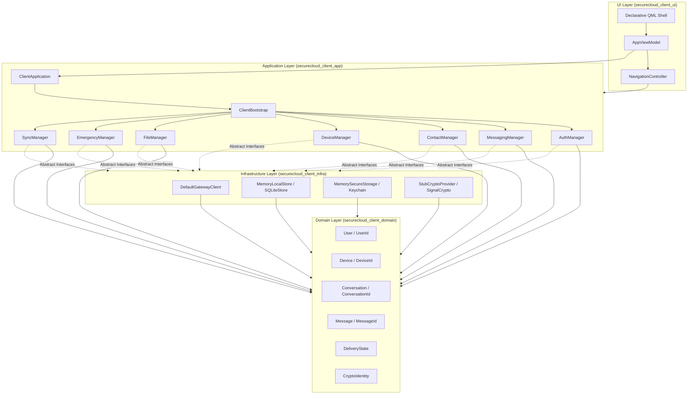
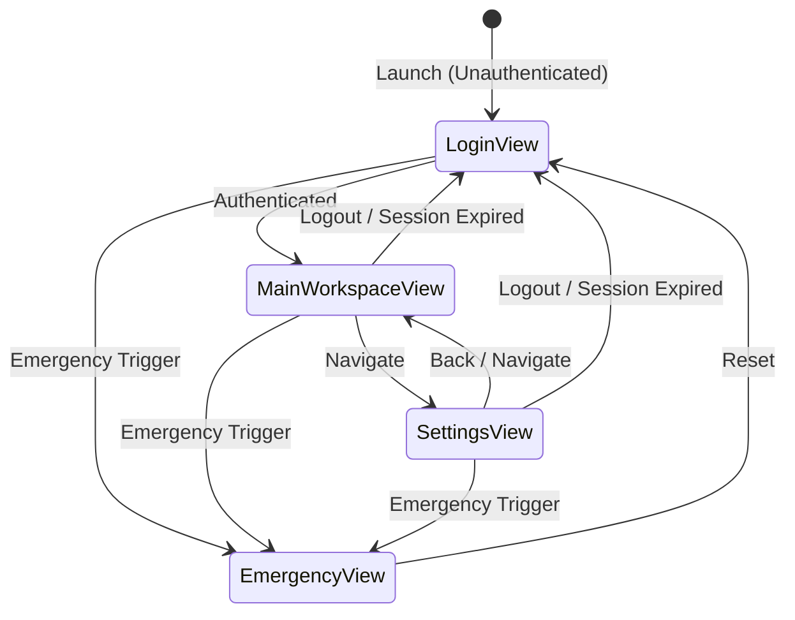
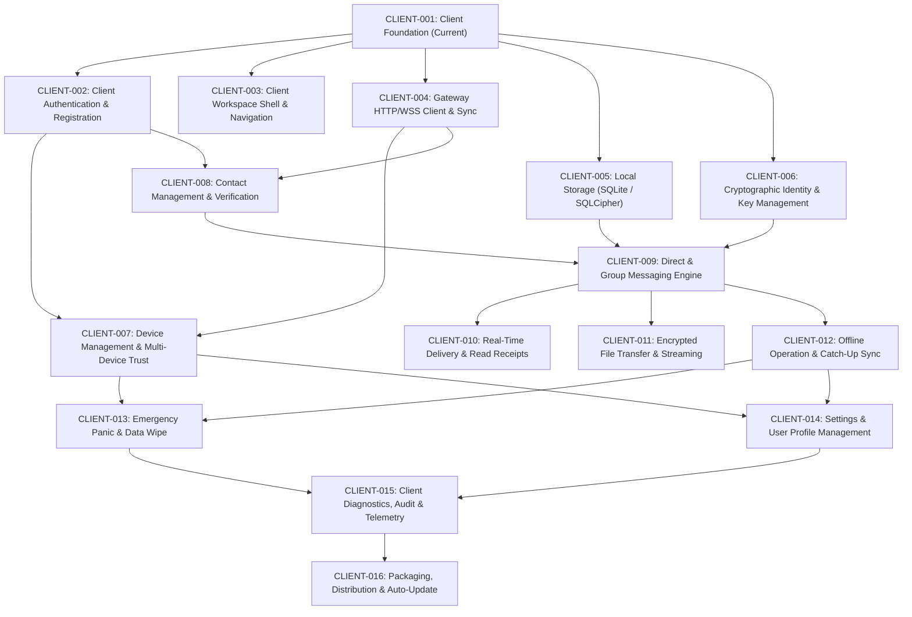

# SecureCloud Desktop Client — Architecture & Application Foundation

**Document Reference:** `docs/architecture/client-architecture-and-foundation.md`  
**Classification:** Technical Reference / Architectural Specification / Security Baseline  
**Scope:** SecureCloud Desktop Client (`src/client/`, `CLIENT-001`)  
**Status:** Canonical Living Architectural Record  
**Audience:** Desktop Engineers, Cryptographers, System Architects, Security Engineers  

---

## Table of Contents

1. [Executive Summary & Architectural Mission](#1-executive-summary--architectural-mission)
   - 1.1 [Mission & Raison d'Être](#11-mission--raison-dêtre)
   - 1.2 [Core Responsibilities vs. Non-Responsibilities](#12-core-responsibilities-vs-non-responsibilities)
   - 1.3 [Architectural Tenets & Guardrails](#13-architectural-tenets--guardrails)
2. [Four-Layer Architecture & Decoupling](#2-four-layer-architecture--decoupling)
   - 2.1 [Layering Overview & Topological Order](#21-layering-overview--topological-order)
   - 2.2 [Layer Responsibilities & Boundary Enforcement](#22-layer-responsibilities--boundary-enforcement)
   - 2.3 [Target Topologies & CMake Build Graph](#23-target-topologies--cmake-build-graph)
3. [Canonical Domain Model & Core Abstraction Interfaces](#3-canonical-domain-model--core-abstraction-interfaces)
   - 3.1 [Pure C++20 Domain Entities & Value Objects](#31-pure-c20-domain-entities--value-objects)
   - 3.2 [Core Infrastructure Abstraction Interfaces](#32-core-infrastructure-abstraction-interfaces)
4. [Composition Root, Application Lifecycle & Clean Shutdown](#4-composition-root-application-lifecycle--clean-shutdown)
   - 4.1 [Composition Root Pattern (`ClientBootstrap`)](#41-composition-root-pattern-clientbootstrap)
   - 4.2 [Deterministic Application Lifecycle Engine (`ClientApplication`)](#42-deterministic-application-lifecycle-engine-clientapplication)
   - 4.3 [Application Managers & Responsibility Separation](#43-application-managers--responsibility-separation)
   - 4.4 [Clean Teardown, Signal Trapping & Emergency Wipe](#44-clean-teardown-signal-trapping--emergency-wipe)
5. [Navigation State Machine & Declarative Presentation Shell](#5-navigation-state-machine--declarative-presentation-shell)
   - 5.1 [Deterministic Navigation Router (`NavigationController`)](#51-deterministic-navigation-router-navigationcontroller)
   - 5.2 [Presentation Coordinator (`AppViewModel`)](#52-presentation-coordinator-appviewmodel)
   - 5.3 [Declarative QML Shell & Resource Packaging](#53-declarative-qml-shell--resource-packaging)
6. [Security & Sanitization Blueprint](#6-security--sanitization-blueprint)
   - 6.1 [Zero-Plaintext & Credential Sanitization (ADR-008 §28)](#61-zero-plaintext--credential-sanitization-adr-008-28)
   - 6.2 [Single Network Path via Gateway](#62-single-network-path-via-gateway)
   - 6.3 [Local Storage & Cryptographic Boundaries](#63-local-storage--cryptographic-boundaries)
7. [Automated Testing & Headless Verification Harness](#7-automated-testing--headless-verification-harness)
   - 7.1 [Unit Test Architecture](#71-unit-test-architecture)
   - 7.2 [Headless Execution Harness (`QT_QPA_PLATFORM=offscreen`)](#72-headless-execution-harness-qt_qpa_platformoffscreen)
   - 7.3 [Smoke Testing & CTest Integration](#73-smoke-testing--ctest-integration)
8. [Client Feature Evolution & Extension Blueprint](#8-client-feature-evolution--extension-blueprint)
   - 8.1 [Extension Guide: Adding New Features](#81-extension-guide-adding-new-features)
   - 8.2 [Architectural Mapping for Upcoming Client Cards](#82-architectural-mapping-for-upcoming-client-cards)

---

## 1. Executive Summary & Architectural Mission

### 1.1 Mission & Raison d'Être

The **SecureCloud Desktop Client** (`securecloud-client`) is a native C++20 / Qt 6 desktop application serving as the primary user-facing interface for the SecureCloud zero-trust, end-to-end encrypted messaging and file transfer platform.

In the SecureCloud architecture, the client occupies a unique, security-critical position:
- **The Client is the Sole Custodian of Plaintext and Private Cryptographic State.** All encryption keys (identity keys, signed prekeys, one-time prekeys, ratchet tree states) and plaintext message/file content originate, terminate, and remain exclusively within the client boundary.
- **The Backend Microservices (Gateway, Auth, Messaging, Files, Audit) Never See Plaintext.** The backend operates strictly on ciphertext, opaque capability tokens, encrypted envelopes, and blinded metadata.

Consequently, the client application foundation established in **CLIENT-001** must provide cryptographic-grade software isolation, deterministic lifecycle control, crash resilience, secret-safe logging, and clean architectural separation.

### 1.2 Core Responsibilities vs. Non-Responsibilities

| Architectural Dimension | Client Foundation Responsibilities | Strict Non-Responsibilities (Deferred / Prohibited) |
| :--- | :--- | :--- |
| **Domain Logic** | Value objects (`UserId`, `DeviceId`, `MessageId`), conversation aggregates, delivery states. Pure C++20. | Direct networking, SQLite queries, Qt GUI dependencies inside domain headers. |
| **Application Layer** | Explicit composition root (`ClientBootstrap`), lifecycle engine (`ClientApplication`), 7 specialized Managers. | Direct instantiation of UI controls, hardcoded network addresses, persistent global state. |
| **Infrastructure** | Concrete adapters implementing abstract interfaces (`IGatewayClient`, `ILocalStore`, `ISecureStorage`, `ICryptoProvider`). | Unrestricted raw socket communication, bypassing the API Gateway, unencrypted disk writes. |
| **UI Presentation** | Deterministic navigation router (`NavigationController`), view presentation (`AppViewModel`), declarative QML shell. | Business logic inside QML, direct cryptographic key handling in UI components, bypassing C++ ViewModels. |
| **Security & Logging** | Redaction of tokens, private keys, passwords (`ClientLogger`); emergency local wipe triggers. | Outputting session tokens, private keys, or plaintext messages in console logs or crash dumps. |

### 1.3 Architectural Tenets & Guardrails

1. **Zero Business Logic in QML:** QML is strictly a presentation layer. It reflects properties exposed by C++ ViewModels and triggers `Q_INVOKABLE` methods or signals. All state transitions, validation, and authorization decisions occur in C++.
2. **Pure C++20 Domain Layer:** The domain layer (`src/client/domain/`) has zero dependencies on Qt, OS platform APIs, or network libraries. It relies solely on the C++20 standard library.
3. **Explicit Composition Root (Zero Service Locators / Singletons):** All components receive their dependencies via constructor injection. No global mutable singletons or service locator registries are permitted.
4. **Single Ingress/Egress Network Boundary:** The client communicates with backend infrastructure exclusively through the API Gateway via the `IGatewayClient` interface over HTTPS/WSS with mTLS. Direct communication with internal backend services (`auth`, `messaging`, `files`, `audit`) is architecturally forbidden.
5. **Zero-Secret Logging (ADR-008 §28):** All logging passes through `ClientLogger`, which guarantees regex-based redaction of Bearer tokens, passwords, private keys, and session tokens before emitting to standard output or sinks.

---

## 2. Four-Layer Architecture & Decoupling

### 2.1 Layering Overview & Topological Order

The client strictly adheres to Clean/Hexagonal Architecture partitioned into four isolated layers:

```
┌────────────────────────────────────────────────────────┐
│                        UI Layer                        │
│       (NavigationController, AppViewModel, QML)        │
└───────────────────────────┬────────────────────────────┘
                            │ depends on
┌───────────────────────────▼────────────────────────────┐
│                   Application Layer                    │
│      (ClientBootstrap, ClientApplication, Managers)     │
└─────────────┬────────────────────────────┬─────────────┘
              │ depends on                 │ depends on
┌─────────────▼──────────────┐ ┌───────────▼─────────────┐
│        Domain Layer        │ │   Infrastructure Layer  │
│  (Pure C++20 Models & IDs) │ │   (Gateway, Store,      │
│                            │ │    Crypto, KeyStore)    │
└────────────────────────────┘ └─────────────────────────┘
```

The dependency relationship is strictly unidirectional:
- **UI** depends on **Application** and **Domain**.
- **Application** depends on **Domain** and defines abstract interfaces implemented by **Infrastructure**.
- **Infrastructure** depends on **Application** (interfaces) and **Domain** (models).
- **Domain** depends on **nothing** except the C++20 Standard Library.

### 2.2 Layer Responsibilities & Boundary Enforcement



### 2.3 Target Topologies & CMake Build Graph

To strictly prevent architectural erosion at compile-time, each layer is compiled into an isolated CMake target with enforced include directory and link boundaries:

```cmake
# 1. Pure C++20 Domain Target (Zero Qt / OS dependencies)
add_library(securecloud_client_domain STATIC ...)
target_link_libraries(securecloud_client_domain PUBLIC
    securecloud::compiler_flags
)

# 2. Infrastructure Target (Adapters, Platform APIs, SQLite, Gateway Client)
add_library(securecloud_client_infra STATIC ...)
target_link_libraries(securecloud_client_infra PUBLIC
    securecloud_client_domain
    securecloud::common
    securecloud::compiler_flags
)

# 3. Application Target (Composition Root, Lifecycle, Managers)
add_library(securecloud_client_app STATIC ...)
target_link_libraries(securecloud_client_app PUBLIC
    securecloud_client_domain
    securecloud_client_infra
    securecloud::common
    securecloud::compiler_flags
)

# 4. UI Layer (ViewModels, Navigation Router, QML Bindings)
add_library(securecloud_client_ui STATIC ...)
target_link_libraries(securecloud_client_ui PUBLIC
    securecloud_client_app
    securecloud_client_domain
    Qt6::Core
    Qt6::Gui
    Qt6::Qml
    Qt6::Quick
)

# 5. Executable Target (Application Entry Point)
add_executable(securecloud-client main.cpp ui/qml.qrc)
target_link_libraries(securecloud-client PRIVATE
    securecloud_client_ui
    securecloud_client_app
    securecloud_client_infra
    securecloud_client_domain
    Qt6::Core
    Qt6::Gui
    Qt6::Qml
    Qt6::Quick
    Qt6::QuickControls2
)
```

---

## 3. Canonical Domain Model & Core Abstraction Interfaces

### 3.1 Pure C++20 Domain Entities & Value Objects

All domain entities reside in `src/client/domain/` and enforce strict value semantics, strong type safety, and domain invariants:

1. **Strongly-Typed Identifiers:**
   - `UserId`: Validates non-empty, RFC 5322 email formatting, lowercase normalization.
   - `DeviceId`: Validates non-empty, alphanumeric and hyphen constraints (UUID or device descriptor format).
   - `ConversationId`: Unique opaque conversation identifier (`conv-<uuid>`).
   - `MessageId`: Unique message tracking identifier (`msg-<uuid>`).
2. **Domain Entities:**
   - `User`: Logical identity holding `UserId`, display name, avatar URL, creation timestamp, and blocked state.
   - `Device`: Endpoint representation holding `DeviceId`, user binding, human-readable name, active state, registration timestamp, and last seen timestamp.
   - `CryptoIdentity`: Cryptographic key metadata holding `DeviceId`, Base64-encoded Ed25519 identity key, verification status (`UNVERIFIED`, `VERIFIED`, `REVOKED`), and safety numbers.
   - `Contact`: Address book record binding a local contact with their `UserId`, local alias, verification state, and blocked status.
   - `Conversation`: Channel entity modeling `DIRECT` (1-on-1) or `GROUP` conversations, participant set, active title, last activity timestamp, and unread counts.
   - `Message`: Immutable message aggregate holding `MessageId`, conversation binding, sender `UserId`, sender `DeviceId`, plaintext content (in-memory only), creation timestamp, and lifecycle state.
   - `DeliveryState`: Enum representing delivery progression: `Pending` $\to$ `Sent` $\to$ `Delivered` $\to$ `Read` (or `Failed`).

### 3.2 Core Infrastructure Abstraction Interfaces

To allow testing and multi-platform implementation without leaking infrastructure details into business logic, four abstract interfaces are defined in `src/client/application/interfaces/`:

1. **`IGatewayClient`:**
   - Represents the sole external network boundary.
   - Exposes methods for health probing (`probe()`), user authentication (`authenticate()`, `logout()`), message transmission (`send_message()`, `pull_messages()`), and connection state inspection.
2. **`ILocalStore`:**
   - Contract for durable local storage (SQLite in production, in-memory for unit testing).
   - Manages encrypted persistence of contacts, conversations, and messages.
3. **`ISecureStorage`:**
   - Contract for hardware-backed or OS-provided secure key storage (macOS Keychain, Windows DPAPI / Credential Manager, Linux Secret Service).
   - Securely persists device private keys, identity keys, and persistent session tokens.
4. **`ICryptoProvider`:**
   - Contract for end-to-end cryptographic operations (Signal protocol Double Ratchet, X3DH, libsodium).
   - Encapsulates key generation, session establishment, envelope encryption, and decryption.

---

## 4. Composition Root, Application Lifecycle & Clean Shutdown

### 4.1 Composition Root Pattern (`ClientBootstrap`)

The application replaces ad-hoc singletons and global accessors with an explicit composition root: [`ClientBootstrap`](file:///Users/sergeychukhno/Desktop/C:C++/SecureCloud/src/client/application/client_bootstrap.hpp).

- **Dependency Graph Ownership:** `ClientBootstrap` owns all infrastructure adapters and application managers as `std::unique_ptr` members.
- **Deterministic Destruction Order:** Because C++ destroys class members in reverse order of declaration, adapters outlive managers, preventing dangling pointer dereferences during teardown.
- **Factory Method for Testing:** Allows unit and integration tests to inject custom mock adapters:
  ```cpp
  auto bootstrap = ClientBootstrap::create_with_adapters(
      config,
      std::move(mock_gateway),
      std::move(mock_store),
      std::move(mock_secure_storage),
      std::move(mock_crypto)
  );
  ```

### 4.2 Deterministic Application Lifecycle Engine (`ClientApplication`)

The application lifecycle is coordinated by [`ClientApplication`](file:///Users/sergeychukhno/Desktop/C:C++/SecureCloud/src/client/application/client_application.hpp) through an explicit state machine:

```
┌─────────────────┐       initialize()       ┌─────────────────┐
│  Uninitialized  │ ───────────────────────> │   Initializing  │
└─────────────────┘                          └────────┬────────┘
                                                      │ start()
                                                      ▼
┌─────────────────┐       shutdown()         ┌─────────────────┐
│   Terminated    │ <─────────────────────── │     Running     │
└─────────────────┘                          └─────────────────┘
```

- `initialize()`: Validates configuration, constructs the `ClientBootstrap` container, and verifies subsystem readiness.
- `start()`: Transitions state to `Running`, initiates background synchronization via `SyncManager`, and begins polling.
- `shutdown(timeout)`: Transitions to `ShuttingDown`, stops background workers, flushes pending state, and resets to `Terminated`.

### 4.3 Application Managers & Responsibility Separation

The application layer distributes domain use-cases across seven specialized managers:

1. **`AuthManager`:** Coordinates user registration, authentication, MFA verification, session token storage, and logout.
2. **`MessagingManager`:** Coordinates direct and group conversation management, message composition, outbound queueing, and incoming message ingestion.
3. **`ContactManager`:** Coordinates local address book operations, contact verification, public key lookups, and contact blocking.
4. **`DeviceManager`:** Coordinates device registration, device list discovery, device revocation, and active device state.
5. **`FileManager`:** Coordinates chunked file upload/download sessions, capability token validation, and file transfer cancellation.
6. **`EmergencyManager`:** Coordinates local emergency data wipes, zeroizing all local SQLite databases and clearing Keychain tokens.
7. **`SyncManager`:** Coordinates background synchronization between the backend Gateway and the local store, managing poll timers and offline recovery.

### 4.4 Clean Teardown, Signal Trapping & Emergency Wipe

- **Signal Handling:** `ClientApplication` intercepts OS signals (`SIGINT`, `SIGTERM`) and Qt's `QCoreApplication::aboutToQuit` signal to trigger a graceful, non-blocking drain.
- **Emergency Wipe:** When triggered (either by user action or remote wipe command), `EmergencyManager` performs immediate memory zeroization, closes all active database connections, deletes local SQLite databases, purges Keychain credentials, and terminates the session.

---

## 5. Navigation State Machine & Declarative Presentation Shell

### 5.1 Deterministic Navigation Router (`NavigationController`)

Navigation transitions are managed by [`NavigationController`](file:///Users/sergeychukhno/Desktop/C:C++/SecureCloud/src/client/ui/navigation_controller.hpp). Rather than permitting QML to switch arbitrary views, all transitions are validated in C++:



- **Route Guards:** If an unauthenticated user attempts to navigate to `MainWorkspaceView` or `SettingsView`, the router rejects the request, returns `false`, and retains the current view.
- **Automatic Route Reset:** If the active session is revoked or logged out while in a protected view, `NavigationController` automatically resets the route to `LoginView`.
- **History Stack:** Maintains a stack of visited routes with `canGoBack()` and `goBack()` for smooth breadcrumb and back-button navigation.

### 5.2 Presentation Coordinator (`AppViewModel`)

[`AppViewModel`](file:///Users/sergeychukhno/Desktop/C:C++/SecureCloud/src/client/ui/app_view_model.hpp) acts as the primary presentation adapter between the C++ application engine and the QML presentation shell:
- Exposes observable `Q_PROPERTY` attributes: `currentView`, `isAuthenticated`, `connectionStatus`, `activeUserId`, `statusMessage`.
- Exposes `Q_INVOKABLE` action slots: `login(username, password)`, `logout()`, `triggerEmergencyWipe()`, `navigateTo(view)`, `goBack()`.
- Guarantees thread affinity: property updates occur on the main Qt GUI thread.

### 5.3 Declarative QML Shell & Resource Packaging

The presentation shell is organized into modular QML components compiled into binary resources via `qml.qrc` and `AUTORCC`:

```
src/client/ui/qml/
├── Main.qml                    # Window root, geometry, dark theme styling
├── NavigationShell.qml         # Header bar, dynamic view Loader, status bar
├── LoginPlaceholder.qml        # Authentication credentials entry view
├── WorkspacePlaceholder.qml    # Primary messaging and file workspace view
├── SettingsPlaceholder.qml     # Device management and user settings view
└── EmergencyPlaceholder.qml    # Panic/wipe trigger view
```

The QML presentation shell strictly follows a declarative paradigm:
```qml
// Example from NavigationShell.qml: strictly declarative binding
Loader {
    id: viewLoader
    anchors.fill: parent
    source: {
        switch (appViewModel.currentView) {
            case "LoginView": return "LoginPlaceholder.qml";
            case "MainWorkspaceView": return "WorkspacePlaceholder.qml";
            case "SettingsView": return "SettingsPlaceholder.qml";
            case "EmergencyView": return "EmergencyPlaceholder.qml";
            default: return "LoginPlaceholder.qml";
        }
    }
}
```

---

## 6. Security & Sanitization Blueprint

### 6.1 Zero-Plaintext & Credential Sanitization (ADR-008 §28)

To eliminate the risk of accidental secret leaks in application logs, diagnostics, or telemetry, all logging uses [`ClientLogger`](file:///Users/sergeychukhno/Desktop/C:C++/SecureCloud/src/client/application/client_logger.hpp):

- **Automatic Regex Sanitization:** The logger automatically scrubs:
  - `Bearer <token>` $\to$ `Bearer [REDACTED]`
  - `"password": "..."` $\to$ `"password": "[REDACTED]"`
  - `"token": "..."` / `"access_token": "..."` $\to$ `"...": "[REDACTED]"`
  - `?token=...` / `&password=...` $\to$ `token=[REDACTED]`
  - `-----BEGIN [A-Z ]*PRIVATE KEY-----` $\to$ `[REDACTED PRIVATE KEY]`
- **Configuration Sanitization:** `ClientConfig::to_safe_string()` explicitly masks sensitive fields before printing or logging configuration dumps.

### 6.2 Single Network Path via Gateway

- Direct connections to backend microservices (`auth:50051`, `messaging:50052`, `files:50053`, `audit:50054`) are completely forbidden by policy and firewall rules.
- The client binds strictly to the external Gateway (`https://gateway.securecloud:8443`).
- All requests use mTLS with TLS 1.3, client certificates, and strict certificate validation.

### 6.3 Local Storage & Cryptographic Boundaries

- **Key Material:** Secret identity keys and session ratchets are stored in OS-provided secure storage (`ISecureStorage`), never in plaintext files.
- **Message Cache:** Message history and contact caches are stored in an encrypted SQLite database via SQLCipher (`ILocalStore`).
- **Memory Zeroization:** Sensitive buffers are scrubbed using `OPENSSL_cleanse` or `memset_s` upon deallocation.

---

## 7. Automated Testing & Headless Verification Harness

### 7.1 Unit Test Architecture

The client test suite in `tests/unit/client/` provides comprehensive coverage across all foundation layers:

| Test File | Target Modules Under Test | Key Scenarios Covered |
| :--- | :--- | :--- |
| `client_config_test.cpp` | `ClientConfig` | Default validity, URL/port/timeout validation, environment variable overrides (`SECURECLOUD_GATEWAY_URL`, `SECURECLOUD_SESSION_TOKEN`), token redaction. |
| `client_error_test.cpp` | `ClientError`, `ClientResult<T>` | Error domains, codes, string formatting, monadic chaining (`and_then`, `transform`), void and value results. |
| `client_domain_test.cpp` | `domain::*` entities & IDs | Strongly typed ID validation (`UserId`, `DeviceId`, `ConversationId`, `MessageId`), value semantics, immutability, entity constructors, delivery states. |
| `client_lifecycle_test.cpp` | `ClientBootstrap`, `ClientApplication` | Composition root dependency injection, adapter substitution, full lifecycle transitions, error branches, emergency wipe execution, sync polling. |
| `navigation_controller_test.cpp` | `NavigationController`, `AppViewModel` | Route state machine, authentication guard enforcement, history stack traversal, unauthenticated route reset, UI signal emission. |

### 7.2 Headless Execution Harness (`QT_QPA_PLATFORM=offscreen`)

To guarantee seamless execution on CI/CD build agents (Linux containers, GitHub Actions, macOS headless runners) without an active window manager or display server:
- Qt Quick tests and smoke tests execute using the `offscreen` QPA platform plugin.
- In CMake / CTest:
  ```cmake
  set_tests_properties(client_startup_smoke_test PROPERTIES
      ENVIRONMENT "QT_QPA_PLATFORM=offscreen"
  )
  ```

### 7.3 Smoke Testing & CTest Integration

The executable `securecloud-client` supports a non-blocking diagnostic smoke test flag:
```bash
./securecloud-client --smoke-test
```
When invoked with `--smoke-test`:
1. The engine constructs `ClientApplication` and validates configuration.
2. Initializes `ClientBootstrap` and all seven managers.
3. Initializes `QQmlApplicationEngine` and loads `qrc:/qml/Main.qml`.
4. Asserts that the root QML window created successfully.
5. Initiates graceful shutdown and terminates with exit code 0.

---

## 8. Client Feature Evolution & Extension Blueprint

### 8.1 Extension Guide: Adding New Features

When implementing subsequent feature cards on top of this foundation, engineers must adhere to the following extension recipe:

1. **Domain Extensions (`src/client/domain/`):**
   - Add pure C++20 models, value types, or domain events.
   - Zero Qt, OS, or network headers allowed.
2. **Infrastructure Adapters (`src/client/infrastructure/`):**
   - Implement or extend concrete adapters satisfying `IGatewayClient`, `ILocalStore`, `ISecureStorage`, or `ICryptoProvider`.
3. **Application Managers (`src/client/application/managers/`):**
   - Implement use-case methods in the appropriate Manager (`AuthManager`, `MessagingManager`, etc.).
   - Accept dependencies strictly via constructor injection.
4. **UI ViewModels & QML (`src/client/ui/`):**
   - Create specialized ViewModels (e.g., `ConversationsViewModel`, `ContactsViewModel`) inheriting `QObject`.
   - Inject the required Manager from `ClientBootstrap`.
   - Bind properties and slots to declarative QML components.

### 8.2 Architectural Mapping for Upcoming Client Cards

The client application roadmap consists of 16 planned milestone cards. The foundation established in **CLIENT-001** directly prepares the extension points for each:



This modular foundation guarantees that each subsequent card can be implemented, tested, and reviewed in isolation without breaking existing layers or introducing architectural regressions.

