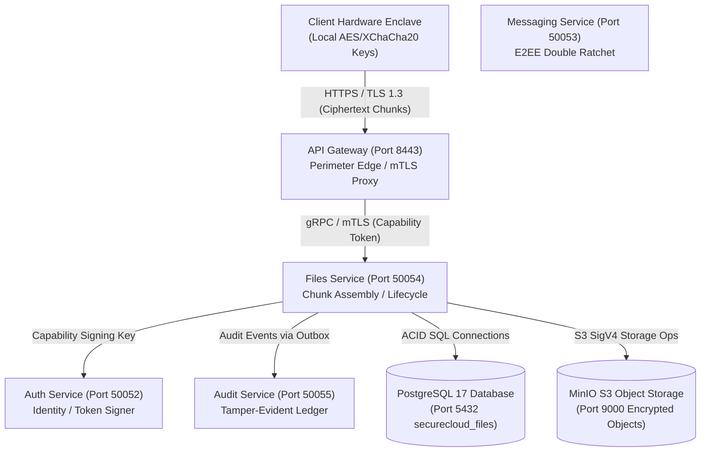
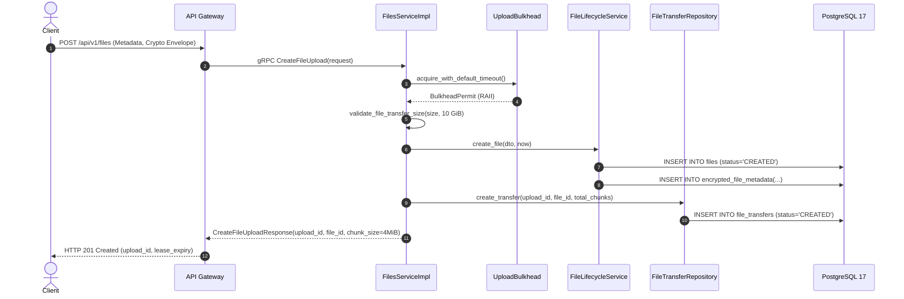
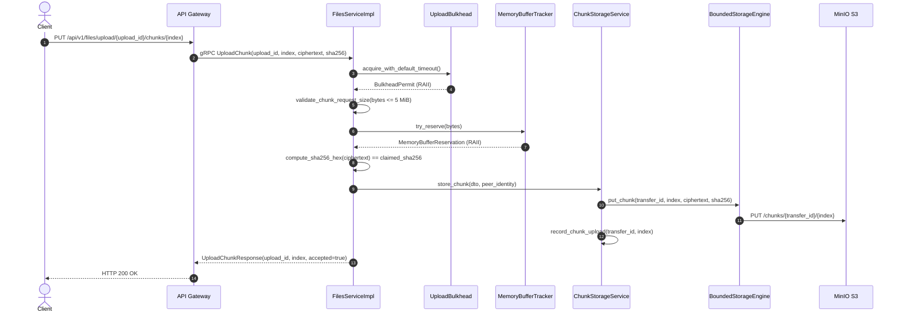
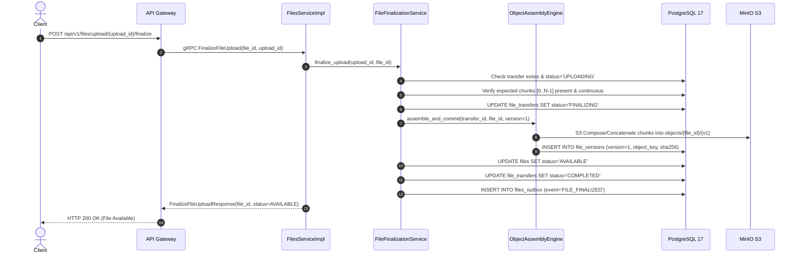
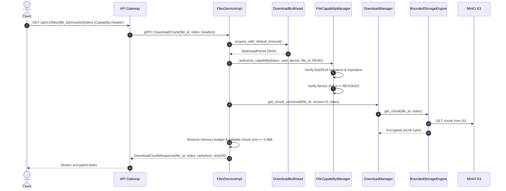
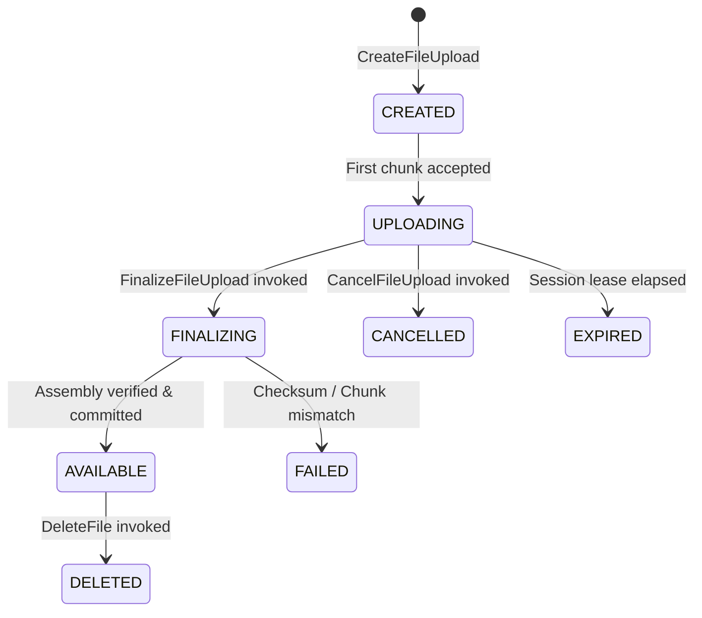
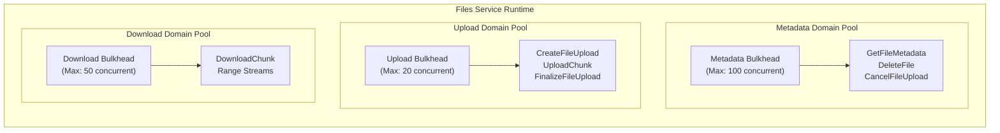

# SecureCloud — Files Complete Architecture & Functioning Analysis Report

**Document Reference:** `docs/architecture/files-architecture-and-functioning.md`  
**Classification:** Technical Reference / Architectural Specification / Security Audit Baseline  
**Scope:** Secure Cloud Object Storage, Chunk Assembly & Capability Authorization Service (`src/files/`, `specs/phase5/FILES-001` through `FILES-009`)  
**Status:** Living Architectural Record / Code-to-Architecture Mapping  
**Audience:** System Architects, Cryptographers, Distributed Systems Engineers, Security Engineers, Lead Developers  

---

## Table of Contents

1. [Executive Summary](#1-executive-summary)
   - 1.1 [Architectural Mission and Raison d'Être](#11-architectural-mission-and-raison-dêtre)
   - 1.2 [Core Responsibilities vs. Deliberate Non-Responsibilities](#12-core-responsibilities-vs-deliberate-non-responsibilities)
   - 1.3 [Mental Model & Architectural Paradigm](#13-mental-model--architectural-paradigm)
2. [Files' Place in the SecureCloud Architecture](#2-files-place-in-the-securecloud-architecture)
   - 2.1 [Distributed Topology & Microservice Boundaries](#21-distributed-topology--microservice-boundaries)
   - 2.2 [Mutual TLS (mTLS) Service Mesh Integration](#22-mutual-tls-mtls-service-mesh-integration)
   - 2.3 [Zero-Plaintext & Zero-Knowledge Invariant](#23-zero-plaintext--zero-knowledge-invariant)
3. [Architectural Invariants & ADR Compliance](#3-architectural-invariants--adr-compliance)
   - 3.1 [ADR-001: Microservices Architecture & Protocol Separation](#31-adr-001-microservices-architecture--protocol-separation)
   - 3.2 [ADR-002: Domain-Driven Design & Hexagonal Decoupling](#32-adr-002-domain-driven-design--hexagonal-decoupling)
   - 3.3 [ADR-003: Strict Database Isolation (Port 5432, Database `securecloud_files`)](#33-adr-003-strict-database-isolation-port-5432-database-securecloud_files)
   - 3.4 [ADR-004: Zero Plaintext Retention & Opaque Ciphertext Storage](#34-adr-004-zero-plaintext-retention--opaque-ciphertext-storage)
   - 3.5 [ADR-005: Ed25519 Capability Tokens Bound to User, Device & File](#35-adr-005-ed25519-capability-tokens-bound-to-user-device--file)
   - 3.6 [ADR-006: Cryptographic Integrity Assertions (SHA-256 Digest Verification)](#36-adr-006-cryptographic-integrity-assertions-sha-256-digest-verification)
   - 3.7 [ADR-007: Outbox Pattern & Tamper-Evident Audit Trails](#37-adr-007-outbox-pattern--tamper-evident-audit-trails)
   - 3.8 [ADR-008: Canonical Resume & Chunked Streaming (Zero Whole-File Buffering)](#38-adr-008-canonical-resume--chunked-streaming-zero-whole-file-buffering)
   - 3.9 [ADR-009: Separate Bounded Concurrency Bulkheads & Dynamic Backpressure](#39-adr-009-separate-bounded-concurrency-bulkheads--dynamic-backpressure)
4. [Files Internal Subsystems & Module Breakdown](#4-files-internal-subsystems--module-breakdown)
   - 4.1 [gRPC Protocol & Service Facade (`FilesServiceImpl`)](#41-grpc-protocol--service-facade-filesserviceimpl)
   - 4.2 [Metadata Management & File Lifecycle Subsystem (`FileLifecycleService`, `LifecycleStateMachine`)](#42-metadata-management--file-lifecycle-subsystem-filelifecycleservice-lifecyclestatemachine)
   - 4.3 [Chunk Storage & Upload Session Management Subsystem (`ChunkStorageService`, `UploadSessionManager`)](#43-chunk-storage--upload-session-management-subsystem-chunkstorageservice-uploadsessionmanager)
   - 4.4 [Object Assembly & Finalization Engine (`ObjectAssemblyEngine`, `FileFinalizationService`)](#44-object-assembly--finalization-engine-objectassemblyengine-filefinalizationservice)
   - 4.5 [Chunk Download & Streaming Engine (`ChunkDownloadEngine`, `DownloadManager`)](#45-chunk-download--streaming-engine-chunkdownloadengine-downloadmanager)
   - 4.6 [File Access Capability Subsystem (`FileCapabilityManager`, `CapabilityValidator`, `FileCapabilitySerializer`)](#46-file-access-capability-subsystem-filecapabilitymanager-capabilityvalidator-filecapabilityserializer)
   - 4.7 [Device Revocation Provider Subsystem (`DeviceRevocationProvider`)](#47-device-revocation-provider-subsystem-devicerevocationprovider)
   - 4.8 [Storage Engine & MinIO S3 Abstraction (`StorageEngine`, `BoundedStorageEngine`, `S3Client`)](#48-storage-engine--minio-s3-abstraction-storageengine-boundedstorageengine-s3client)
   - 4.9 [Database Persistence & Connection Pool Subsystem (`FilesDbConnectionPool`, `MigrationRunner`)](#49-database-persistence--connection-pool-subsystem-filesdbconnectionpool-migrationrunner)
   - 4.10 [Transactional Outbox Subsystem (`FilesOutboxRepository`, `FilesOutboxEntity`)](#410-transactional-outbox-subsystem-filesoutboxrepository-filesoutboxentity)
   - 4.11 [Concurrency Bulkheads & Memory Budget Subsystem (`ConcurrencyBulkhead`, `MemoryBufferTracker`)](#411-concurrency-bulkheads--memory-budget-subsystem-concurrencybulkhead-memorybuffertracker)
5. [Detailed End-to-End Request Lifecycles](#5-detailed-end-to-end-request-lifecycles)
   - 5.1 [File Upload Initiation Lifecycle (`CreateFileUpload`)](#51-file-upload-initiation-lifecycle-createfileupload)
   - 5.2 [Encrypted Chunk Ingestion Lifecycle (`UploadChunk`)](#52-encrypted-chunk-ingestion-lifecycle-uploadchunk)
   - 5.3 [Multipart Finalization & Consistency Verification Lifecycle (`FinalizeFileUpload`)](#53-multipart-finalization--consistency-verification-lifecycle-finalizefileupload)
   - 5.4 [Encrypted File Metadata Retrieval Lifecycle (`GetFileMetadata`)](#54-encrypted-file-metadata-retrieval-lifecycle-getfilemetadata)
   - 5.5 [Canonical Resumable Chunk Download Lifecycle (`DownloadChunk`)](#55-canonical-resumable-chunk-download-lifecycle-downloadchunk)
   - 5.6 [Upload Session Cancellation & Abandonment Lifecycle (`CancelFileUpload`)](#56-upload-session-cancellation--abandonment-lifecycle-cancelfileupload)
   - 5.7 [File Deletion & Storage Purge Lifecycle (`DeleteFile`)](#57-file-deletion--storage-purge-lifecycle-deletefile)
6. [Asymmetric Capability Token Architecture](#6-asymmetric-capability-token-architecture)
   - 6.1 [Cryptographic Capability Invariant & Token Binding](#61-cryptographic-capability-invariant--token-binding)
   - 6.2 [Ed25519 Capability Signature Mechanics](#62-ed25519-capability-signature-mechanics)
   - 6.3 [Compact Binary/Base64Url Serialization & Claims Encoding](#63-compact-binarybase64url-serialization--claims-encoding)
   - 6.4 [Permission Scope Enforcement Matrix (Read, Write, Admin)](#64-permission-scope-enforcement-matrix-read-write-admin)
   - 6.5 [Cascading Revocation via Device Status Checks](#65-cascading-revocation-via-device-status-checks)
7. [Zero-Plaintext Cryptographic Storage & Object Keying](#7-zero-plaintext-cryptographic-storage--object-keying)
   - 7.1 [Client-Side AEAD Architecture (XChaCha20-Poly1305)](#71-client-side-aead-architecture-xchacha20-poly1305)
   - 7.2 [Encrypted Metadata Envelopes (Filename, MIME, IV, Tag)](#72-encrypted-metadata-envelopes-filename-mime-iv-tag)
   - 7.3 [Opaque Deterministic Key Derivation (`chunks/` vs. `objects/`)](#73-opaque-deterministic-key-derivation-chunks-vs-objects)
   - 7.4 [Multi-Version Storage Keying & Immutability](#74-multi-version-storage-keying--immutability)
8. [Object Assembly, Finalization & Concurrency Invariants](#8-object-assembly-finalization--concurrency-invariants)
   - 8.1 [Transition State Machine: `UPLOADING` $\to$ `FINALIZING` $\to$ `AVAILABLE`](#81-transition-state-machine-uploading-to-finalizing-to-available)
   - 8.2 [Chunk Completeness, Ordering & Checksum Integrity Verification](#82-chunk-completeness-ordering--checksum-integrity-verification)
   - 8.3 [Zero Plaintext Assembly & S3 Server-Side Concatenation](#83-zero-plaintext-assembly--s3-server-side-concatenation)
   - 8.4 [Race Conditions & Idempotent Multi-Client Finalization Handling](#84-race-conditions--idempotent-multi-client-finalization-handling)
   - 8.5 [Safe Recovery and Durable State Failure Rules](#85-safe-recovery-and-durable-state-failure-rules)
9. [Canonical Resume Model & Chunked Streaming Backpressure](#9-canonical-resume-model--chunked-streaming-backpressure)
   - 9.1 [Canonical Resume Coordinates: `(file_id, version, starting_chunk)`](#91-canonical-resume-coordinates-file_id-version-starting_chunk)
   - 9.2 [On-Demand Chunk Streaming Mechanics](#92-on-demand-chunk-streaming-mechanics)
   - 9.3 [Anti-Pattern Violations Forbidden: No Whole-File Buffering & No Thread-Per-Transfer](#93-anti-pattern-violations-forbidden-no-whole-file-buffering--no-thread-per-transfer)
   - 9.4 [Dynamic Backpressure Propagation (Slow Client $\to$ Storage Throttling)](#94-dynamic-backpressure-propagation-slow-client-to-storage-throttling)
10. [Bounded Concurrency Bulkheads & Resource Controls](#10-bounded-concurrency-bulkheads--resource-controls)
    - 10.1 [Three Separate Concurrency Domains (Metadata, Uploads, Downloads)](#101-three-separate-concurrency-domains-metadata-uploads-downloads)
    - 10.2 [Storage (MinIO) Active Permit Guard (`BoundedStorageEngine`)](#102-storage-minio-active-permit-guard-boundedstorageengine)
    - 10.3 [Global Memory Buffer Budget Tracker (`MemoryBufferTracker`)](#103-global-memory-buffer-budget-tracker-memorybuffertracker)
    - 10.4 [Size Cap Enforcement (5 MiB Chunk Request, 10 GiB File Transfer)](#104-size-cap-enforcement-5-mib-chunk-request-10-gib-file-transfer)
    - 10.5 [Fail-Fast Backpressure Mapping (`RESOURCE_EXHAUSTED`)](#105-fail-fast-backpressure-mapping-resource_exhausted)
11. [Database Persistence, PostgreSQL 17 ACID & Outbox Pattern](#11-database-persistence-postgresql-17-acid--outbox-pattern)
    - 11.1 [Relational Schema Analysis (`V001__create_files_schema.sql`)](#111-relational-schema-analysis-v001create_files_schemasql)
    - 11.2 [Optimized B-Tree and Partial Indexes](#112-optimized-b-tree-and-partial-indexes)
    - 11.3 [Connection Pool Architecture (`FilesDbConnectionPool`)](#113-connection-pool-architecture-filesdbconnectionpool)
    - 11.4 [Transactional Outbox Pattern for Audit/Event Publishing](#114-transactional-outbox-pattern-for-auditevent-publishing)
12. [Comprehensive Threat Model & Attack Surface Analysis](#12-comprehensive-threat-model--attack-surface-analysis)
    - 12.1 [STRIDE Threat Classification & Mitigation Matrix](#121-stride-threat-classification--mitigation-matrix)
    - 12.2 [Storage Provider Compromise & Zero Plaintext Exposure](#122-storage-provider-compromise--zero-plaintext-exposure)
    - 12.3 [Metadata Snooping & Filename Privacy](#123-metadata-snooping--filename-privacy)
    - 12.4 [Capability Forgery, Token Replay & Stale Token Injection](#124-capability-forgery-token-replay--stale-token-injection)
    - 12.5 [Cross-Tenant Unauthorized File Access (User A $\to$ User B)](#125-cross-tenant-unauthorized-file-access-user-a-to-user-b)
    - 12.6 [Denial of Service via Unbounded Uploads / Memory Flooding](#126-denial-of-service-via-unbounded-uploads--memory-flooding)
    - 12.7 [Corrupted Chunk Injection & Cryptographic Hash Poisoning](#127-corrupted-chunk-injection--cryptographic-hash-poisoning)
13. [Concurrency, Threading & Performance Model](#13-concurrency-threading--performance-model)
    - 13.1 [gRPC Thread Pool Execution Pipeline](#131-grpc-thread-pool-execution-pipeline)
    - 13.2 [Non-Blocking Permit Limiting & Semaphore Mechanics](#132-non-blocking-permit-limiting--semaphore-mechanics)
    - 13.3 [Database Connection Pool Contention Under Concurrent Chunks](#133-database-connection-pool-contention-under-concurrent-chunks)
14. [Health, Readiness & Daemon Lifecycle Management](#14-health-readiness--daemon-lifecycle-management)
    - 14.1 [Database & S3 Dependency Health Evaluation (`FilesHealthEvaluator`)](#141-database--s3-dependency-health-evaluation-fileshealthevaluator)
    - 14.2 [gRPC Health Checking Protocol Integration](#142-grpc-health-checking-protocol-integration)
    - 14.3 [Graceful Termination & Transfer Draining](#143-graceful-termination--transfer-draining)
15. [Files ↔ Gateway & Inter-Service Integration Contracts](#15-files--gateway--inter-service-integration-contracts)
    - 15.1 [mTLS Mutual Authentication & Subject Alternative Name (SAN) Verification](#151-mtls-mutual-authentication--subject-alternative-name-san-verification)
    - 15.2 [RPC Error Mapping to Gateway HTTP Problem Details](#152-rpc-error-mapping-to-gateway-http-problem-details)
    - 15.3 [Metadata Propagation: Tracing, Auth & Capability Headers](#153-metadata-propagation-tracing-auth--capability-headers)
16. [Developer, Configuration & Operational Guide](#16-developer-configuration--operational-guide)
    - 16.1 [Configuration Parameters & Environment Variables](#161-configuration-parameters--environment-variables)
    - 16.2 [Local Development, MinIO & PostgreSQL 17 Setup](#162-local-development-minio--postgresql-17-setup)
    - 16.3 [Troubleshooting & Common Failure Modes](#163-troubleshooting--common-failure-modes)

---

## 1. Executive Summary

### 1.1 Architectural Mission and Raison d'Être
The **Files Service** is the authoritative object storage, chunk aggregation, lifecycle governance, and capability-authorized distribution microservice of the SecureCloud distributed platform. Sitting securely behind the perimeter API Gateway within the internal service mesh, the Files Service operates as the system of record for:
1. **Encrypted File Lifecycle Management**: Governing immutable file records and version transitions (`CREATED` $\to$ `UPLOADING` $\to$ `FINALIZING` $\to$ `AVAILABLE` $\to$ `EXPIRED` $\to$ `DELETED`) across PostgreSQL 17.
2. **Chunk-Level Transfer Orchestration**: Managing parallel or sequential multipart encrypted chunk uploads and downloads while enforcing byte-for-byte SHA-256 cryptographic integrity verifications.
3. **Zero-Plaintext Object Storage**: Interfacing with S3/MinIO to store exclusively client-encrypted ciphertext objects. The Files Service possesses zero knowledge of plaintext data, symmetric encryption keys, filenames, or MIME types (**ADR-004**, **ADR-008**).
4. **Fine-Grained Capability Authorization**: Validating short-lived, Ed25519-signed capability tokens cryptographically bound to an authenticated user, authenticated device, and specific file before permitting byte-level operations.
5. **Durable Assembly & Finalization**: Assembling uploaded chunk parts into finalized immutable file versions without whole-file buffering, ensuring absolute concurrency safety against race conditions and network drops.
6. **Bounded Concurrency Bulkheads & Dynamic Backpressure**: Enforcing strict runtime resource ceilings across separate concurrency pools (Metadata, Uploads, Downloads, Storage, and Memory Buffers) to guarantee high-performance streaming without out-of-memory (OOM) failures or thread exhaustion (**ADR-009**).

### 1.2 Core Responsibilities vs. Deliberate Non-Responsibilities
To preserve a clean separation of concerns and an uncompromising zero-knowledge architecture, the Files Service establishes rigorous functional boundaries:

- **What the Files Service Owns**:
  - Authoritative lifecycle state transitions for files, versions, and transfer sessions.
  - Chunk ingestion, SHA-256 checksum validation, and opaque S3 object key derivation.
  - Verification of capability tokens and device status revocation checking.
  - Multipart object assembly, finalization idempotency, and version commitment.
  - Execution of PostgreSQL 17 relational migrations (`V001__create_files_schema.sql`).
  - Strict resource ceiling enforcement, bulkhead permit management, and memory buffer reservations.
  - Emitting transactional outbox events for all file lifecycle mutations.
- **What the Files Service Deliberately Does NOT Own**:
  - *No Plaintext Data or Keys*: The Files Service never possesses file encryption keys, user master keys, or plaintext data. All payloads are treated as opaque binary ciphertext.
  - *No Decryption or Plaintext Search*: The Files Service does not decrypt chunks, cannot perform server-side full-text searches, and cannot inspect media content.
  - *No Direct Public Internet Exposure*: The Files Service listens exclusively on internal gRPC interfaces (port 50054); client connections are terminated at the API Gateway.
  - *No User Authentication Authority*: User password hashing, session tokens, and MFA are owned exclusively by the Auth Service.
  - *No Whole-File Buffering*: The Files Service never loads an entire file into system RAM. Transfers operate strictly over bounded chunk streams.

### 1.3 Mental Model & Architectural Paradigm
Think of the Files Service as an **Ultra-Secure, Blind Bonded Warehouse with Automated Deposit Lockers**:
- Clients deliver sealed, tamper-evident containers (encrypted chunks) marked with exact cryptographic hashes.
- The warehouse staff verifies the outer seal (SHA-256) and files each chunk into a numbered slot (`chunks/{transfer_id}/{chunk_index}`) without ever looking inside.
- To access or retrieve a locker, the client must present an unforgeable, notarized capability ticket signed by the system authority, proving that *this specific person*, on *this specific hardware device*, has permission to inspect *this specific locker*.
- When all pieces are present, the warehouse seamlessly links the parts into a permanent vault (`objects/{file_id}/{version}`) and issues a completion certificate.
- The warehouse operates separate queue lanes (bulkheads): delivery trucks (uploads), pickup vans (downloads), and clerical queries (metadata) each have dedicated stalls, ensuring that a traffic jam in one lane never halts operations in another.

---

## 2. Files' Place in the SecureCloud Architecture

### 2.1 Distributed Topology & Microservice Boundaries
SecureCloud is architected as an asynchronous, zero-knowledge microservice ecosystem partitioned into autonomous services:



### 2.2 Mutual TLS (mTLS) Service Mesh Integration
All inter-service gRPC communication reaching the Files Service traverses a mutual TLS mesh:
- **Peer Identity Verification**: The Files Service strictly verifies the peer certificate presented by the caller. Peer certificates must be rooted in the SecureCloud Root CA (`ca.crt`) and possess the Subject Alternative Name (SAN) `DNS:gateway` or `URI:spiffe://securecloud.internal/gateway`.
- **Cipher Suite Enforcement**: Direct TLS handshakes require modern, forward-secure ciphers (`TLS_AES_256_GCM_SHA384`, `ECDHE-ECDSA-AES256-GCM-SHA384`).
- **Fail-Closed Perimeter Assertions**: Invocations lacking valid mTLS authentication or presenting untrusted SAN identities are rejected with `grpc::StatusCode::UNAUTHENTICATED` before invoking service handlers.

### 2.3 Zero-Plaintext & Zero-Knowledge Invariant
SecureCloud guarantees complete zero-knowledge data privacy:
- **Client-Side Encryption**: File contents are chunked and encrypted on the client device using **XChaCha20-Poly1305** or **AES-256-GCM** prior to network transmission.
- **Opaque Payloads**: Payloads ingested by `UploadChunk` are stored verbatim into S3 as opaque binary streams.
- **Encrypted Metadata**: The file's human-readable name, extension, and MIME type are encrypted by the client and stored in `encrypted_file_metadata` as ciphertext bytes (`encrypted_filename`, `encrypted_mime_type`) with client nonces and authentication tags.

---

## 3. Architectural Invariants & ADR Compliance

### 3.1 ADR-001: Microservices Architecture & Protocol Separation
The Files Service runs as an independent daemon communicating over Protocol Buffers (`proto/securecloud/files/v1/files.proto`) via gRPC. It shares no memory, threads, or runtime state with other microservices.

### 3.2 ADR-002: Domain-Driven Design & Hexagonal Decoupling
The codebase enforces strict hexagonal separation:
- `files/domain/`: Pure domain entities (`FileEntity`, `FileChunkEntity`, `FileTransferEntity`), value objects, and deterministic state machines. Zero external network or storage dependencies.
- `files/repository/`: Abstract persistence contracts (`IFileRepository`, `IFileChunkRepository`, `IFileTransferRepository`, `IFileAccessRepository`) and PostgreSQL implementations.
- `files/storage/`: S3 client abstractions (`S3Client`, `BoundedStorageEngine`).
- `files/service/`: Business domain engines (`FileLifecycleService`, `UploadSessionManager`, `ChunkStorageService`, `ObjectAssemblyEngine`, `DownloadManager`, `FileCapabilityManager`).
- `files/concurrency/`: Bulkhead permit limiters, memory trackers, and resource configuration models.

### 3.3 ADR-003: Strict Database Isolation (Port 5432, Database `securecloud_files`)
The Files Service maintains complete database schema autonomy:
- Connects exclusively to its own database (`securecloud_files`) on PostgreSQL 17.
- Tables, migrations, and transactions are completely segregated from Auth and Messaging databases.
- Database access utilizes `FilesDbConnectionPool` enforcing connection limits and query timeouts.

### 3.4 ADR-004: Zero Plaintext Retention & Opaque Ciphertext Storage
At no point does the Files Service possess decryption keys. Ciphertext is stored with zero inspection. Log statements record strictly method names, UUIDs, byte counts, and cryptographic hashes; payload ciphertext bytes and credentials are never logged.

### 3.5 ADR-005: Ed25519 Capability Tokens Bound to User, Device & File
File operations require short-lived, tamper-evident capability tokens signed with Ed25519. Each capability cryptographically binds `user_id`, `device_id`, `file_id`, allowed operation (`READ`, `WRITE`, `ADMIN`), and expiration timestamp, preventing cross-tenant access.

### 3.6 ADR-006: Cryptographic Integrity Assertions (SHA-256 Digest Verification)
Every chunk upload carries a client-claimed SHA-256 checksum. The Files Service independently computes the SHA-256 digest over the received bytes; any mismatch triggers an immediate fail-fast rejection (`INVALID_ARGUMENT`).

### 3.7 ADR-007: Outbox Pattern & Tamper-Evident Audit Trails
All lifecycle mutations (file created, chunk accepted, transfer finalized, file deleted) are recorded atomically within the same PostgreSQL transaction using the `files_outbox` table, ensuring guaranteed at-least-once audit emission without distributed transaction overhead.

### 3.8 ADR-008: Canonical Resume & Chunked Streaming (Zero Whole-File Buffering)
File downloads are indexed by `(file_id, version_number, starting_chunk)`. Encrypted chunks (default 4 MiB) are streamed on demand. Whole-file buffering in RAM is strictly prohibited.

### 3.9 ADR-009: Separate Bounded Concurrency Bulkheads & Dynamic Backpressure
Runtime concurrency is partitioned into isolated bulkheads (Metadata, Uploads, Downloads). MinIO storage operations are throttled via permit guards, and memory buffers are constrained by an overarching budget (default 64 MiB). Saturated domains fail-fast with `RESOURCE_EXHAUSTED` rather than creating unbounded queues.

---

## 4. Files Internal Subsystems & Module Breakdown

```
src/files/
├── concurrency/             # Bounded concurrency & resource limiters
│   ├── concurrency_bulkhead.hpp/cpp   # Bulkhead permit limiter & RAII handles
│   ├── memory_buffer_tracker.hpp/cpp  # Memory budget manager & size validators
│   └── resource_config.hpp/cpp        # FilesResourceConfig schema & loader
├── db/                     # PostgreSQL 17 persistence & migrations
│   ├── files_connection_pool.hpp/cpp  # Connection pool manager
│   ├── migration_runner.hpp/cpp       # SQL schema migration executor
│   ├── migrations/                    # Schema migrations (V001)
│   ├── pooled_connection.hpp          # RAII connection wrapper
│   ├── pqxx_compat.hpp                # libpqxx abstraction & mapping layer
│   └── pqxx_mappers.hpp/cpp           # Row-to-entity domain mappers
├── domain/                 # Pure domain entities, value objects & validators
│   ├── capability_validator.hpp/cpp   # Capability authorization validator
│   ├── chunk_validator.hpp/cpp        # Chunk payload & SHA-256 validator
│   ├── download_validator.hpp/cpp     # Download precondition validator
│   ├── file_capability_entity.hpp     # FileAccessCapability model & DTOs
│   ├── file_capability_serializer.hpp/cpp # Base64Url & binary serializer
│   ├── file_entity.hpp / file_version_entity.hpp # Domain entities
│   ├── file_transfer_entity.hpp / file_chunk_entity.hpp
│   ├── finalization_validator.hpp/cpp # Multipart assembly state validator
│   ├── lifecycle_state_machine.hpp/cpp# FileStatus transition state machine
│   └── metadata_validator.hpp/cpp     # Request metadata & UUIDv7 validator
├── health/                 # Health check & readiness evaluators
│   └── files_health_evaluator.hpp/cpp # PostgreSQL & S3 ping checks
├── repository/             # Relational data repositories
│   ├── device_revocation_provider.hpp/cpp # Device status verification
│   ├── file_access_repository.hpp/cpp     # ACL permissions repository
│   ├── file_chunk_repository.hpp/cpp      # Transfer chunk tracking repository
│   ├── file_repository.hpp/cpp            # File aggregate repository
│   ├── file_transfer_repository.hpp/cpp   # Transfer session repository
│   ├── file_version_repository.hpp/cpp    # Immutable version repository
│   └── files_outbox_repository.hpp/cpp    # Transactional outbox repository
├── service/                # Business domain engines & gRPC service
│   ├── chunk_download_engine.hpp/cpp  # S3 chunk fetcher engine
│   ├── chunk_storage_service.hpp/cpp  # Chunk ingestion & persistence engine
│   ├── download_manager.hpp/cpp       # Resumable download coordinator
│   ├── file_capability_manager.hpp/cpp# Capability issuance & auth manager
│   ├── file_finalization_service.hpp/cpp # Multipart finalization coordinator
│   ├── file_lifecycle_service.hpp/cpp # File lifecycle & metadata manager
│   ├── files_service_impl.hpp/cpp     # Outer gRPC service implementation
│   ├── object_assembly_engine.hpp/cpp # Multi-chunk S3 assembly engine
│   ├── storage_engine.hpp/cpp         # S3Client wrapper & key derivation
│   └── upload_session_manager.hpp/cpp # Upload session tracking manager
└── storage/                # S3 MinIO storage client & decorators
    ├── bounded_storage_engine.hpp/cpp # Concurrency-bounded storage decorator
    ├── s3_client.hpp/cpp              # SigV4 HTTP storage client
    └── s3_exceptions.hpp              # Storage exception hierarchy
```

### 4.1 gRPC Protocol & Service Facade (`FilesServiceImpl`)
The `FilesServiceImpl` class implements `securecloud.files.v1.FilesService::Service`. It orchestrates security validation, domain bulkheads, and business engine execution across all 7 RPC endpoints:
```cpp
class FilesServiceImpl final : public v1::FilesService::Service {
  public:
    grpc::Status CreateFileUpload(...) override;
    grpc::Status UploadChunk(...) override;
    grpc::Status FinalizeFileUpload(...) override;
    grpc::Status GetFileMetadata(...) override;
    grpc::Status DownloadChunk(...) override;
    grpc::Status CancelFileUpload(...) override;
    grpc::Status DeleteFile(...) override;
};
```

### 4.2 Metadata Management & File Lifecycle Subsystem
- **`FileLifecycleService`**: Governs file creation, metadata retrieval, soft deletion, and status transitions.
- **`LifecycleStateMachine`**: Asserts deterministic status progressions and prevents invalid transitions (e.g., transitioning from `DELETED` to `UPLOADING`).
- **`MetadataValidator`**: Validates RFC 9562 UUIDv7 formats, chunk counts, ciphertext size limits, and client crypto metadata JSON envelopes.

### 4.3 Chunk Storage & Upload Session Management Subsystem
- **`UploadSessionManager`**: Manages upload transfer sessions (`file_transfers`), tracking accepted chunk counts, transferred bytes, and session leases.
- **`ChunkStorageService`**: Validates chunk offsets and cryptographic checksums, checks for duplicate chunk conflicts, and delegates persistence to the storage layer.

### 4.4 Object Assembly & Finalization Engine
- **`FileFinalizationService`**: Coordinates transfer completion. Validates that all expected chunks $[0, N-1]$ are present and continuous, updates transfer state to `FINALIZING`, and invokes object assembly.
- **`ObjectAssemblyEngine`**: Combines chunk parts into a unified encrypted file object in S3 and registers an active version in `file_versions`.
- **`FinalizationValidator`**: Performs deep verification of transfer state and chunk metadata consistency prior to committing version availability.

### 4.5 Chunk Download & Streaming Engine
- **`DownloadManager`**: Coordinates download sessions, enforcing authorization, version resolution, and starting chunk offsets.
- **`ChunkDownloadEngine`**: Fetches chunk payloads from S3, verifies ciphertext integrity, and formats download DTOs.
- **`DownloadValidator`**: Ensures starting chunk indices are within the valid range $[0, \text{total\_chunks}-1]$ and asserts file lifecycle availability.

### 4.6 File Access Capability Subsystem
- **`FileCapabilityManager`**: Generates and authorizes short-lived, Ed25519-signed capability tokens (`FileAccessCapability`).
- **`CapabilityValidator`**: Asserts signature validity, checks expiration, and validates exact cryptographic binding to `(user_id, device_id, file_id, operation)`.
- **`FileCapabilitySerializer`**: Serializes and deserializes capability tokens into URL-safe, compact Base64Url strings.

### 4.7 Device Revocation Provider Subsystem
- **`DeviceRevocationProvider`**: Queries device status records to ensure capabilities issued to a device that has since been revoked (`REVOKED`, `SUSPENDED`) are rejected immediately, even if the token signature is mathematically valid.

### 4.8 Storage Engine & MinIO S3 Abstraction
- **`StorageEngine`**: Implements `IStorageEngine`, mapping logical file coordinates to opaque S3 bucket keys:
  - Chunks: `chunks/{transfer_id}/{chunk_index}`
  - Objects: `objects/{file_id}/{version_number}`
- **`BoundedStorageEngine`**: Decorator that intercepts all storage calls with a permit guard from the storage bulkhead, preventing socket exhaustion.
- **`S3Client`**: High-performance HTTP/1.1 client implementing AWS Signature Version 4 (SigV4) authentication against MinIO.

### 4.9 Database Persistence & Connection Pool Subsystem
- **`FilesDbConnectionPool`**: Manages a bounded pool of thread-safe PostgreSQL connections, preventing connection leaks.
- **`MigrationRunner`**: Automatically executes schema migrations (`V001__create_files_schema.sql`) on daemon startup inside atomic transactions.

### 4.10 Transactional Outbox Subsystem
- **`FilesOutboxRepository`**: Persists audit and lifecycle events (`FILE_CREATED`, `CHUNK_UPLOADED`, `FILE_FINALIZED`, `FILE_DELETED`) to `files_outbox` within the primary database transaction, guaranteeing reliable audit delivery.

### 4.11 Concurrency Bulkheads & Memory Budget Subsystem
- **`ConcurrencyBulkhead`**: Semaphore-based permit limiter isolating Metadata, Uploads, and Downloads domains with configurable limits and timeouts.
- **`MemoryBufferTracker`**: Global memory budget tracker enforcing RAII memory reservations (`MemoryBufferReservation`) to prevent memory exhaustion during heavy streaming.

---

## 5. Detailed End-to-End Request Lifecycles

### 5.1 File Upload Initiation Lifecycle (`CreateFileUpload`)



1. Gateway terminates client HTTPS, extracts authenticated user/device metadata, and invokes `CreateFileUpload`.
2. `FilesServiceImpl` acquires a permit from the **Upload Bulkhead** and validates `encrypted_size_bytes <= max_file_transfer_bytes` (10 GiB).
3. `MetadataValidator` validates UUIDv7 formats, algorithm compatibility (`XChaCha20-Poly1305`), and unpacks the client crypto metadata JSON envelope.
4. `FileLifecycleService` creates the root file record with status `CREATED` and stores the client-encrypted metadata envelope.
5. `FileTransferRepository` registers an active upload transfer session with an expiration lease (default: 24 hours).
6. Returns `CreateFileUploadResponse` containing the `upload_id` and authoritative `chunk_size_bytes`.

### 5.2 Encrypted Chunk Ingestion Lifecycle (`UploadChunk`)



1. `FilesServiceImpl` acquires an **Upload Bulkhead** permit and validates that the chunk payload is $\le 5\text{ MiB}$.
2. `MemoryBufferTracker` reserves the chunk's memory size from the service memory budget.
3. Cryptographic integrity check: Computes SHA-256 over ciphertext bytes and asserts strict equality with `claimed_sha256`.
4. `UploadSessionManager` verifies the transfer session is active (`CREATED` or `TRANSFERRING`), unexpired, and not cancelled.
5. `ChunkStorageService` checks for conflicting chunks. If the chunk was previously accepted with the identical SHA-256 hash, it returns idempotent success. If content conflicts, it rejects with `FAILED_PRECONDITION`.
6. `BoundedStorageEngine` acquires a storage permit and persists the chunk to MinIO at key `chunks/{transfer_id}/{chunk_index}`.
7. Database updates: Records chunk metadata in `file_chunks` and increments `transferred_bytes` and `accepted_chunks` in `file_transfers`.

### 5.3 Multipart Finalization & Consistency Verification Lifecycle (`FinalizeFileUpload`)



1. Client signals upload completion.
2. `FileFinalizationService` enforces the strict transition:
   $$\text{UPLOADING} \longrightarrow \text{FINALIZING} \longrightarrow \text{AVAILABLE}$$
3. Concurrency check: If another request has already transitioned the transfer to `FINALIZING` or `COMPLETED`, the service returns deterministic, idempotent success without duplicating assembly.
4. Consistency verification: Asserts all expected chunks $[0, N-1]$ exist in `file_chunks`, byte counts match the root file's `encrypted_size`, and checksums are verified.
5. `ObjectAssemblyEngine` concatenates the chunk objects in S3 into the permanent versioned object `objects/{file_id}/{version_number}`.
6. The database transaction marks the new immutable `file_versions` record as active, updates `files.status` to `AVAILABLE`, marks the transfer as `COMPLETED`, and emits a `FILE_FINALIZED` event to `files_outbox`.
7. **Failure Rule**: If any check fails, status `AVAILABLE` is never reported, preserving durable state for retry or safe recovery.

### 5.4 Encrypted File Metadata Retrieval Lifecycle (`GetFileMetadata`)
1. Client requests metadata for a `file_id`.
2. `FilesServiceImpl` acquires a **Metadata Bulkhead** permit and validates UUIDv7 syntax.
3. `FileLifecycleService` fetches file summary records, including active version details, creation timestamps, retention leases, and encrypted metadata blobs.
4. Returns `GetFileMetadataResponse` containing ciphertext attributes and checksums. Plaintext filename and MIME type remain encrypted.

### 5.5 Canonical Resumable Chunk Download Lifecycle (`DownloadChunk`)



1. Client presents request specifying `file_id` and `chunk_index`, along with caller identity and the signed capability token in metadata headers (`x-file-access-capability`).
2. `FilesServiceImpl` acquires a **Download Bulkhead** permit.
3. `FileCapabilityManager` verifies the capability token:
   - Validates Ed25519 signature against authoritative signing key.
   - Asserts token is within valid lifetime ($T_{\text{now}} < T_{\text{exp}}$).
   - Asserts exact cryptographic match: `token.user_id == caller.user_id`, `token.device_id == caller.device_id`, and `token.file_id == request.file_id`.
   - Validates that the device has not been revoked via `DeviceRevocationProvider`.
4. `DownloadManager` resolves the active version and delegates to `ChunkDownloadEngine`.
5. `BoundedStorageEngine` fetches the requested chunk from MinIO.
6. `FilesServiceImpl` validates chunk size $\le 5\text{ MiB}$, reserves memory buffer budget, and populates `DownloadChunkResponse`.
7. Zero decryption: Ciphertext bytes are streamed directly to the gateway and client.

### 5.6 Upload Session Cancellation & Abandonment Lifecycle (`CancelFileUpload`)
1. Client requests upload cancellation.
2. Acquires **Metadata Bulkhead** permit.
3. `UploadSessionManager` updates transfer status to `CANCELLED` and records cancellation reason.
4. Any in-flight or subsequent `UploadChunk` calls targeting this `upload_id` are rejected immediately with `FAILED_PRECONDITION`.
5. Background storage cleanup purges uncommitted chunk parts from S3.

### 5.7 File Deletion & Storage Purge Lifecycle (`DeleteFile`)
1. Client requests file deletion.
2. Acquires **Metadata Bulkhead** permit.
3. `FileLifecycleService` executes soft deletion: updates `files.status` to `DELETED`, sets `updated_at`, and deletes active version records.
4. Emits `FILE_DELETED` outbox event.
5. Asynchronous storage worker purges associated MinIO objects (`objects/{file_id}/*` and `chunks/*`).

---

## 6. Asymmetric Capability Token Architecture

### 6.1 Cryptographic Capability Invariant & Token Binding
To prevent confused-deputy attacks, perimeter token leakage, and unauthorized access across tenants, access to file content requires a short-lived **File Access Capability**. 

A capability is cryptographically bound to:
$$\text{Capability} = \operatorname{Sign}_{K_{\text{auth}}}\Big(\text{user\_id} \,\|\, \text{device\_id} \,\|\, \text{file\_id} \,\|\, \text{permission} \,\|\, \text{version} \,\|\, \text{expires\_at}\Big)$$

Security guarantees:
- **User Isolation**: User A cannot use a capability to access User B's files ($A \not\to B$).
- **Device Confinement**: Device A cannot use an authorization granted to Device B.
- **File Confinement**: A capability for `file_1` cannot be reused for `file_2`.
- **Operation Confinement**: A `READ` capability cannot be used for `WRITE` or `ADMIN` operations.

### 6.2 Ed25519 Capability Signature Mechanics
Capabilities are digitally signed using an authoritative **Ed25519** private key managed by `FileCapabilityManager` or the Auth Service:
- Signatures are computed over the deterministic binary or JSON serialization of the capability claims.
- Signature verification uses libsodium/OpenSSL constant-time point multiplication on Curve25519.
- Invalid signatures, malformed payloads, or expired lifetimes trigger an immediate `UNAUTHENTICATED` rejection.

### 6.3 Compact Binary/Base64Url Serialization & Claims Encoding
Capabilities are encoded as compact Base64Url strings for transport over gRPC headers and HTTP query parameters:
```
[Header: sc-cap-v1].[Claims: Base64Url(JSON)].[Signature: Base64Url(64-byte Ed25519 Sig)]
```
Serialized claims structure:
```json
{
  "cap_id": "0191ec4d-91b4-7b4d-b6a9-8e41e3d36000",
  "uid": "0191ec4d-91b4-7b4d-b6a9-8e41e3d36001",
  "did": "0191ec4d-91b4-7b4d-b6a9-8e41e3d36002",
  "fid": "0191ec4d-91b4-7b4d-b6a9-8e41e3d36003",
  "op": "READ",
  "ver": 1,
  "exp": 1729864000
}
```

### 6.4 Permission Scope Enforcement Matrix
| Requested Operation | Required Permission | Allowed Capability Claims |
| :--- | :--- | :--- |
| `DownloadChunk` / Stream | Read Content | `READ`, `WRITE`, `ADMIN` |
| `GetFileMetadata` | Read Metadata | `READ`, `WRITE`, `ADMIN` |
| `UploadChunk` / Finalize | Modify Content | `WRITE`, `ADMIN` |
| `DeleteFile` | Destructive Admin | `ADMIN` |

### 6.5 Cascading Revocation via Device Status Checks
Even if a capability token's cryptographic signature is valid and its expiration has not elapsed, access is revoked immediately if the issuing device has been revoked:
1. `CapabilityValidator` queries `DeviceRevocationProvider`.
2. If `device_status != ACTIVE` (e.g., `REVOKED`, `SUSPENDED`, `LOST`), authorization fails with `PERMISSION_DENIED`.

---

## 7. Zero-Plaintext Cryptographic Storage & Object Keying

### 7.1 Client-Side AEAD Architecture (XChaCha20-Poly1305)
All file encryption is executed client-side using Authenticated Encryption with Associated Data (AEAD):
- **Algorithm**: `XChaCha20-Poly1305` (IETF draft standard) with a 256-bit key and an extended 192-bit (24-byte) random nonce.
- **Nonce Misuse Resistance**: The 192-bit nonce eliminates collision risk, enabling safe random nonce generation across multiple client devices without state synchronization.
- **Authentication Tag**: Each encrypted chunk carries a 16-byte Poly1305 MAC tag guaranteeing ciphertext authenticity and preventing ciphertext malleability.

### 7.2 Encrypted Metadata Envelopes (Filename, MIME, IV, Tag)
Sensitive file metadata is protected via client envelope encryption:
- `encrypted_filename`: Raw ciphertext bytes of the human-readable filename.
- `encrypted_mime_type`: Raw ciphertext bytes of the original MIME classification.
- `metadata_nonce` & `metadata_tag`: 24-byte nonce and 16-byte Poly1305 tag used to encrypt the metadata envelope.
- `client_encryption_metadata`: JSON string holding client key derivation parameters (e.g., Argon2id salt, key derivation iterations).

### 7.3 Opaque Deterministic Key Derivation (`chunks/` vs. `objects/`)
MinIO object storage keys are derived deterministically and opaquely:
- In-progress chunks:
  $$\operatorname{Key}_{\text{chunk}} = \texttt{chunks/} \,\|\, \text{transfer\_id} \,\|\, \texttt{/} \,\|\, \text{chunk\_index}$$
- Finalized objects:
  $$\operatorname{Key}_{\text{object}} = \texttt{objects/} \,\|\, \text{file\_id} \,\|\, \texttt{/} \,\|\, \text{version\_number}$$

No user IDs, filenames, or conversation IDs appear in S3 storage paths, ensuring total bucket anonymity.

### 7.4 Multi-Version Storage Keying & Immutability
Every file modification produces a new immutable version in `file_versions`:
- Existing version records are never overwritten in place.
- Rollback or historical inspection is supported by referencing prior version numbers.

---

## 8. Object Assembly, Finalization & Concurrency Invariants

### 8.1 Transition State Machine: `UPLOADING` $\to$ `FINALIZING` $\to$ `AVAILABLE`



State rules:
- `AVAILABLE` is a terminal success state for a version. It is **never** reported if assembly or verification encounters any error.
- Transitions must satisfy the allowed path defined in `LifecycleStateMachine`. Illegal transitions throw `InvalidLifecycleTransitionException`.

### 8.2 Chunk Completeness, Ordering & Checksum Integrity Verification
Prior to committing finalization, `FinalizationValidator` asserts:
1. `accepted_chunks == total_chunks`.
2. Chunk indices in `file_chunks` form an unbroken contiguous sequence: $[0, 1, 2, \dots, N-1]$.
3. Sum of all chunk byte sizes equals `file_transfers.total_bytes`.
4. The composite checksum computed over assembled chunks matches the version's claimed SHA-256.

### 8.3 Zero Plaintext Assembly & S3 Server-Side Concatenation
Assembly concatenates the encrypted chunks into a single S3 object:
- Concatenation is executed directly in S3 using multipart part copy or server-side composition.
- The Files Service does not load the chunks into RAM or decrypt them during assembly.

### 8.4 Race Conditions & Idempotent Multi-Client Finalization Handling
When two finalization requests for the same transfer arrive concurrently (e.g., network retry or duplicate client calls):
- The first request atomically transitions the transfer status to `FINALIZING` using row-level locking (`SELECT ... FOR UPDATE`).
- The second request observes status `FINALIZING` or `COMPLETED` and returns the existing result idempotently without executing redundant assembly or generating conflicting database state.

### 8.5 Safe Recovery and Durable State Failure Rules
If assembly fails due to storage or network timeout:
- The transfer remains in a durable, recoverable state (`FINALIZING` or `UPLOADING`).
- The client may safely retry finalization without re-uploading chunks.

---

## 9. Canonical Resume Model & Chunked Streaming Backpressure

### 9.1 Canonical Resume Coordinates: `(file_id, version, starting_chunk)`
Network interruptions during downloads are handled via the canonical resume tuple:
$$\text{ResumeCoordinates} = \big(\text{file\_id}, \, \text{version\_number}, \, \text{starting\_chunk}\big)$$
- The client resumes by requesting chunks beginning from `starting_chunk = K`.
- The encrypted chunk remains the authoritative, immutable resume unit.

### 9.2 On-Demand Chunk Streaming Mechanics
- Chunks are fetched from S3 and streamed to the gateway only when requested.
- No preemptive caching or look-ahead chunk pulling is performed.

### 9.3 Anti-Pattern Violations Forbidden
The following patterns are **explicitly forbidden** in the Files Service architecture:
- ❌ **No Thread-Per-Transfer**: Worker threads are never dedicated to a single long-lived transfer.
- ❌ **No Unbounded Queues**: Ingestion queues are bounded; excess requests are rejected.
- ❌ **No Whole-File Buffering**: Memory allocations are capped to individual chunks ($\le 5\text{ MiB}$).
- ❌ **No Unlimited MinIO Connections**: Storage concurrency is governed by a permit limiter.
- ❌ **No Unlimited DB Connections**: Database queries use a bounded connection pool.

### 9.4 Dynamic Backpressure Propagation
The streaming pipeline enforces end-to-end backpressure:
$$\text{Slow Client} \longrightarrow \text{Stream Slows} \longrightarrow \text{Files Halts Chunk Fetching} \longrightarrow \text{MinIO Pressure Bounded}$$

If a downstream client stops consuming data, the Files Service ceases pulling chunks from S3, ensuring zero memory buffer inflation.

---

## 10. Bounded Concurrency Bulkheads & Resource Controls

### 10.1 Three Separate Concurrency Domains
To prevent heavy streaming workloads from starving metadata lookups or vice versa, the Files Service partitions concurrency into three independent bulkheads:



- **Domain Isolation Guarantee**: Complete saturation of the Upload Domain (20 concurrent transfers) has zero impact on the Metadata Domain (100 permits available), ensuring metadata and deletion operations proceed without latency degradation.

### 10.2 Storage (MinIO) Active Permit Guard (`BoundedStorageEngine`)
All S3 operations pass through `BoundedStorageEngine`:
- Constrained by `max_storage_concurrency` (default: 30 concurrent operations).
- Acquires an active permit before initiating S3 socket I/O.
- If storage permits are saturated and the acquisition times out (default: 1000 ms), throws `StorageCapacityExhaustedException`.

### 10.3 Global Memory Buffer Budget Tracker (`MemoryBufferTracker`)
- Enforces a service-wide RAM ceiling for chunk processing (default: 64 MiB).
- `UploadChunk` and `DownloadChunk` must reserve their chunk byte size via RAII `MemoryBufferReservation` prior to buffer allocation.
- When the 64 MiB budget is reached, new chunk requests are rejected immediately rather than causing process OOM crashes.

### 10.4 Size Cap Enforcement
- **Chunk Request Cap**: $\le 5\text{ MiB}$ per chunk request. Rejects oversized chunks before buffer allocation.
- **File Transfer Cap**: $\le 10\text{ GiB}$ per file transfer. Rejects oversized files at `CreateFileUpload`.

### 10.5 Fail-Fast Backpressure Mapping (`RESOURCE_EXHAUSTED`)
When any bulkhead permit, storage limiter, or memory reservation fails, the service returns:
$$\text{Status} = \texttt{grpc::StatusCode::RESOURCE_EXHAUSTED}$$
This instructs the API Gateway and clients to back off without queuing unbounded memory requests.

---

## 11. Database Persistence, PostgreSQL 17 ACID & Outbox Pattern

### 11.1 Relational Schema Analysis (`V001__create_files_schema.sql`)
The Files Service schema consists of 7 core tables:
1. `files`: File aggregate root with owner IDs, size, status, and retention leases.
2. `file_versions`: Immutable version records with S3 object keys and checksums.
3. `encrypted_file_metadata`: Client-encrypted filename, MIME type, nonces, and crypto metadata.
4. `file_transfers`: Multipart upload and download transfer sessions with chunk progress counters.
5. `file_chunks`: Individual chunk metadata, byte offsets, hashes, and S3 chunk keys.
6. `file_access`: Access control grants (`READ`, `WRITE`, `ADMIN`) mapped to users.
7. `files_outbox`: Transactional outbox for event publishing.

### 11.2 Optimized B-Tree and Partial Indexes
- `idx_files_owner`: B-Tree index on `(owner_user_id, status)` for fast owner file queries.
- `idx_files_conversation`: Partial index on `(conversation_id)` where not null.
- `idx_files_retention`: Partial index on `(retention_until)` where status is not `DELETED`.
- `idx_file_transfers_file`: Index on `(file_id, status)` for transfer lookups.
- `idx_file_chunks_transfer`: Index on `(transfer_id, chunk_index)` for sequential chunk verification.
- `idx_files_outbox_pending`: Partial index on `(created_at)` where status is `PENDING`.

### 11.3 Connection Pool Architecture (`FilesDbConnectionPool`)
- Implements thread-safe connection pooling over `libpqxx`.
- Sized via configuration (`max_db_connections`, default: 10).
- Uses RAII `PooledConnection` handles that return connections automatically upon destruction.

### 11.4 Transactional Outbox Pattern for Audit/Event Publishing
To eliminate dual-write hazards between database state and event messaging:
- File state mutations write an event record directly to `files_outbox` in the same SQL transaction.
- An asynchronous relay reads `PENDING` outbox records and publishes them to the Audit Service.

---

## 12. Comprehensive Threat Model & Attack Surface Analysis

### 12.1 STRIDE Threat Classification & Mitigation Matrix

| Threat Category | Specific Attack Vector | Files Service Defense & Mitigation |
| :--- | :--- | :--- |
| **Spoofing** | Attacker impersonates the API Gateway | mTLS mandatory peer verification with strict `DNS:gateway` SAN checking. |
| **Tampering** | Attacker alters encrypted chunk bytes in transit | SHA-256 integrity verification rejects any modified byte sequence. |
| **Repudiation** | Attacker denies uploading or deleting a file | Transactional outbox emits tamper-evident audit records for every mutation. |
| **Information Disclosure** | Cloud storage admin reads user files | Zero-Plaintext storage; files are encrypted with client keys unknown to server. |
| **Denial of Service** | Attacker sends massive chunks to crash service | 5 MiB chunk request cap and 64 MiB global memory buffer budget reject requests. |
| **Elevation of Privilege** | User A accesses User B's private files | Short-lived Ed25519 capabilities cryptographically bind `user_id` and `file_id`. |

### 12.2 Storage Provider Compromise & Zero Plaintext Exposure
- **Scenario**: Rogue administrator gains full root access to the MinIO cluster.
- **Impact**: Zero plaintext exposure. The attacker observes only opaque random ciphertext chunks. File decryption keys and human-readable filenames exist only on user client devices.

### 12.3 Metadata Snooping & Filename Privacy
- **Scenario**: Network attacker analyzes metadata tables to infer user document titles.
- **Impact**: Filenames and MIME types are encrypted client-side using AEAD envelopes (`encrypted_filename`, `metadata_nonce`, `metadata_tag`). The database stores zero plaintext names.

### 12.4 Capability Forgery, Token Replay & Stale Token Injection
- **Scenario**: Attacker generates a fake capability token or replays an expired token.
- **Impact**: Ed25519 signature verification fails immediately. Stale tokens are rejected by expiration timestamps ($T_{\text{now}} > T_{\text{exp}}$).

### 12.5 Cross-Tenant Unauthorized File Access (User A $\to$ User B)
- **Scenario**: User A obtains a valid capability for `file_A` and attempts to use it to download `file_B`.
- **Impact**: Cryptographic binding check asserts `token.file_id == request.file_id`. Mismatch fails authorization with `PERMISSION_DENIED`.

### 12.6 Denial of Service via Unbounded Uploads / Memory Flooding
- **Scenario**: Malicious actor floods upload endpoints with gigabyte payloads.
- **Impact**: Fast size validator rejects payloads $> 5\text{ MiB}$ before memory reservation. Memory tracker caps total concurrent in-flight bytes to 64 MiB, failing fast with `RESOURCE_EXHAUSTED`.

### 12.7 Corrupted Chunk Injection & Cryptographic Hash Poisoning
- **Scenario**: Attacker submits a chunk with an invalid SHA-256 hash or mismatched size.
- **Impact**: `ChunkValidator` recomputes the SHA-256 digest and compares with claimed hash; mismatches are rejected immediately before storage write.

---

## 13. Concurrency, Threading & Performance Model

### 13.1 gRPC Thread Pool Execution Pipeline
- Built on `grpc::ServerBuilder` with internal worker threads.
- Worker threads decode protobuf requests, acquire domain permits, and delegate to domain managers.

### 13.2 Non-Blocking Permit Limiting & Semaphore Mechanics
- `ConcurrencyBulkhead` utilizes condition variables with timed waits.
- Fast non-blocking path: `try_acquire()` provides zero-latency permit checks under standard load.

### 13.3 Database Connection Pool Contention Under Concurrent Chunks
- Bulkhead limits (20 upload permits, 50 download permits) prevent database connection pool starvation by keeping concurrent active transactions within the configured database pool bounds.

---

## 14. Health, Readiness & Daemon Lifecycle Management

### 14.1 Database & S3 Dependency Health Evaluation (`FilesHealthEvaluator`)
The `FilesHealthEvaluator` evaluates subsystem readiness:
- **PostgreSQL**: Executes a lightweight `SELECT 1` ping.
- **MinIO S3**: Validates bucket existence via head-bucket query.
- Both checks must succeed for the service to report healthy.

### 14.2 gRPC Health Checking Protocol Integration
- Registers standard `grpc::HealthCheckServiceInterface`.
- Reports `SERVING` upon successful startup and schema migration.
- Transitions to `NOT_SERVING` during graceful shutdown.

### 14.3 Graceful Termination & Transfer Draining
Upon receiving `SIGINT` or `SIGTERM`:
1. Health status flips to `NOT_SERVING`.
2. gRPC server initiates graceful shutdown with a timeout deadline.
3. In-flight chunk uploads are allowed to complete.
4. Database connection pool and S3 client connections are drained cleanly.

---

## 15. Files ↔ Gateway & Inter-Service Integration Contracts

### 15.1 mTLS Mutual Authentication & Subject Alternative Name (SAN) Verification
The Files Service verifies that incoming peer certificates contain:
- `DNS: gateway` OR `URI: spiffe://securecloud.internal/gateway`
- Unauthenticated or non-gateway callers are rejected at the TLS handshake layer.

### 15.2 RPC Error Mapping to Gateway HTTP Problem Details
Downstream gRPC status codes are mapped to RFC 7807 Problem Details by the API Gateway:
- `INVALID_ARGUMENT` $\to$ HTTP 400 (`Bad Request`)
- `UNAUTHENTICATED` $\to$ HTTP 401 (`Unauthorized`)
- `PERMISSION_DENIED` $\to$ HTTP 403 (`Forbidden`)
- `NOT_FOUND` $\to$ HTTP 404 (`Not Found`)
- `FAILED_PRECONDITION` $\to$ HTTP 412 (`Precondition Failed`)
- `RESOURCE_EXHAUSTED` $\to$ HTTP 429 (`Too Many Requests / Capacity Exhausted`)
- `UNAVAILABLE` $\to$ HTTP 503 (`Service Unavailable`)
- `DEADLINE_EXCEEDED` $\to$ HTTP 504 (`Gateway Timeout`)

### 15.3 Metadata Propagation: Tracing, Auth & Capability Headers
Gateway propagates request context via gRPC metadata headers:
- `x-request-id`: UUIDv7 distributed tracing transaction ID.
- `x-user-id`: Authenticated user UUID.
- `x-device-id`: Authenticated device UUID.
- `x-file-access-capability`: Ed25519-signed capability token string.

---

## 16. Developer, Configuration & Operational Guide

### 16.1 Configuration Parameters & Environment Variables

| Variable Name | Default Value | Description |
| :--- | :--- | :--- |
| `SECURECLOUD_FILES_GRPC_PORT` | `50054` | Files service gRPC listening port. |
| `SECURECLOUD_FILES_DB_HOST` | `postgres` | PostgreSQL host. |
| `SECURECLOUD_FILES_DB_PORT` | `5432` | PostgreSQL port. |
| `SECURECLOUD_FILES_DB_NAME` | `securecloud_files` | Database name. |
| `SECURECLOUD_FILES_DB_USER` | `files_user` | Database user. |
| `SECURECLOUD_FILES_DB_PASSWORD` | - | Database password (required). |
| `SECURECLOUD_FILES_S3_ENDPOINT` | `http://minio:9000`| MinIO / S3 endpoint URL. |
| `SECURECLOUD_FILES_S3_BUCKET` | `securecloud-files-encrypted` | S3 bucket for encrypted chunks and objects. |
| `SECURECLOUD_FILES_S3_ACCESS_KEY`| `files_minio_user` | S3 access key ID. |
| `SECURECLOUD_FILES_S3_SECRET_KEY`| - | S3 secret access key (required). |
| `SECURECLOUD_FILES_METADATA_MAX_CONCURRENCY` | `100` | Max concurrent metadata operations. |
| `SECURECLOUD_FILES_UPLOAD_MAX_CONCURRENCY` | `20` | Max concurrent active uploads. |
| `SECURECLOUD_FILES_DOWNLOAD_MAX_CONCURRENCY` | `50` | Max concurrent active downloads. |
| `SECURECLOUD_FILES_STORAGE_MAX_CONCURRENCY` | `30` | Max concurrent MinIO storage operations. |
| `SECURECLOUD_FILES_MAX_MEMORY_BUFFER_BYTES` | `67108864` | Max global memory budget (64 MiB). |
| `SECURECLOUD_FILES_MAX_CHUNK_REQUEST_BYTES` | `5242880` | Max request chunk size (5 MiB). |
| `SECURECLOUD_FILES_MAX_FILE_TRANSFER_BYTES` | `10737418240` | Max file transfer size (10 GiB). |

### 16.2 Local Development, MinIO & PostgreSQL 17 Setup
```bash
# Start containerized PostgreSQL 17 and MinIO S3
docker compose up -d postgres minio

# Verify PostgreSQL is accepting connections
pg_isready -h 127.0.0.1 -p 5432 -U files_user

# Build Files service and integration test suites
cmake --build --preset dev-debug --target securecloud-files
cmake --build --preset dev-debug --target securecloud_files_concurrency_integration_test

# Execute concurrency integration tests
./build/dev-debug/tests/integration/securecloud_files_concurrency_integration_test
```

### 16.3 Troubleshooting & Common Failure Modes
1. **`RESOURCE_EXHAUSTED: Upload concurrency capacity exhausted`**:
   - Cause: Active uploads have exceeded `SECURECLOUD_FILES_UPLOAD_MAX_CONCURRENCY`.
   - Solution: Scale service replicas or increase `UPLOAD_MAX_CONCURRENCY` configuration if server capacity permits.
2. **`PERMISSION_DENIED: Capability bound to user X but invoked by Y`**:
   - Cause: Capability token presented by caller was issued to a different user or device.
   - Solution: Request a fresh, correctly bound capability token from the capability issuance endpoint.
3. **`INVALID_ARGUMENT: SHA-256 digest mismatch`**:
   - Cause: Network corruption or tampered chunk payload during upload.
   - Solution: Client must recompute local SHA-256 and retransmit the corrupted chunk.
4. **`RESOURCE_EXHAUSTED: Global memory buffer budget exhausted`**:
   - Cause: In-flight streaming memory has reached the 64 MiB ceiling.
   - Solution: Downstream clients must consume read streams promptly to allow memory release.
