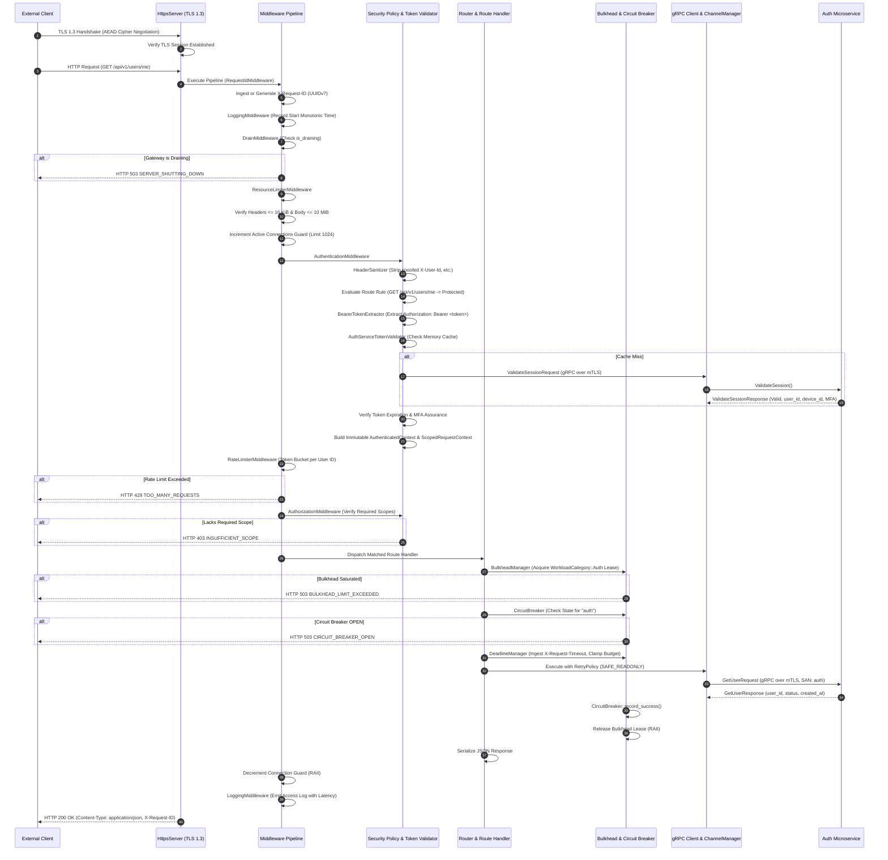
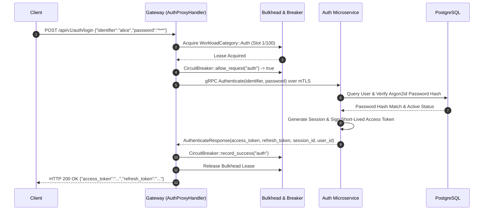
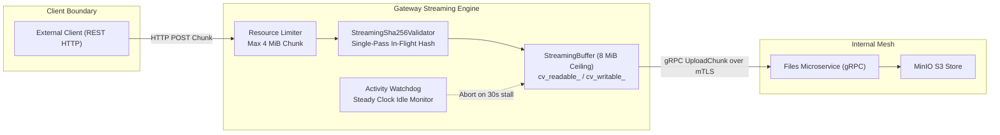

# SecureCloud — Gateway Complete Architecture & Functioning Analysis Report

**Document Reference:** `docs/architecture/gateway-architecture-and-functioning.md`  
**Classification:** Technical Reference / Architectural Specification / Security Audit Baseline  
**Scope:** Gateway Service (`src/gateway/`, `specs/phase1/GW-001` through `GW-010`)  
**Status:** Living Architectural Record / Code-to-Architecture Mapping  
**Audience:** System Architects, Distributed Systems Engineers, Security Engineers, Core Developers  

---

## Table of Contents

1. [Executive Summary](#1-executive-summary)
2. [Gateway's Place in the SecureCloud Architecture](#2-gateways-place-in-the-securecloud-architecture)
3. [Gateway Responsibilities and Non-Responsibilities](#3-gateway-responsibilities-and-non-responsibilities)
4. [Gateway Internal Architecture](#4-gateway-internal-architecture)
   - 4.1 Transport & Network Gatekeeper Subsystem
   - 4.2 Perimeter Security & Identity Subsystem
   - 4.3 Resilience & Flow-Control Subsystem
   - 4.4 Routing & Protocol Proxy Subsystem
   - 4.5 Downstream gRPC & Channel Management Subsystem
   - 4.6 Streaming & Cryptographic Integrity Subsystem
   - 4.7 Observability, Diagnostics & Health Subsystem
5. [Detailed Request Lifecycle](#5-detailed-request-lifecycle)
6. [Authentication Architecture](#6-authentication-architecture)
7. [Authorization Architecture](#7-authorization-architecture)
8. [Authenticated Context & Request Execution Scope](#8-authenticated-context--request-execution-scope)
9. [Gateway ↔ Auth Interaction](#9-gateway--auth-interaction)
10. [Gateway ↔ Backend Service Communication](#10-gateway--backend-service-communication)
11. [TLS and mTLS Security Model](#11-tls-and-mtls-security-model)
12. [Routing Architecture](#12-routing-architecture)
13. [Error Handling Architecture](#13-error-handling-architecture)
14. [Deadlines, Timeouts, and Cancellation](#14-deadlines-timeouts-and-cancellation)
15. [Retry Architecture](#15-retry-architecture)
16. [Streaming Architecture](#16-streaming-architecture)
17. [Rate Limiting and Resource Limiting](#17-rate-limiting-and-resource-limiting)
18. [Backpressure and Overload Protection](#18-backpressure-and-overload-protection)
19. [Health and Readiness Architecture](#19-health-and-readiness-architecture)
20. [Startup and Shutdown Lifecycle](#20-startup-and-shutdown-lifecycle)
21. [Concurrency and Threading Model](#21-concurrency-and-threading-model)
22. [Observability and Audit Trail](#22-observability-and-audit-trail)
23. [Comprehensive Security Analysis](#23-comprehensive-security-analysis)
24. [Threat Model & Attack Surface Analysis](#24-threat-model--attack-surface-analysis)
25. [Architecture Compliance and Discrepancy Analysis](#25-architecture-compliance-and-discrepancy-analysis)
26. [Operational, Configuration, and Developer Guide](#26-operational-configuration-and-developer-guide)

---

## 1. Executive Summary

### 1.1 Architectural Role and Raison d'Être
The **Gateway** is the sole external network ingress point for the SecureCloud distributed platform. Situated strictly at the untrusted network perimeter, it bridges external client applications (such as desktop Qt/C++ clients or mobile apps) communicating over public HTTPS (TLS 1.3) with internal backend microservices communicating over private, containerized mutual TLS (mTLS gRPC).

The Gateway exists to solve five fundamental distributed systems and security problems:
1. **Network Perimeter Hardening & Topology Concealment**: Shielding internal microservices (Auth, Messaging, Files, Audit) and storage backends (PostgreSQL, ScyllaDB, MinIO, ClickHouse) from direct external IP routability, port exposure, and protocol fuzzing.
2. **Zero-Trust Identity Enforcement**: Enforcing identity verification, token validity, and perimeter authorization *before* any request traverses into the private cluster, ensuring unauthenticated or spoofed traffic is rejected at zero downstream computational cost.
3. **Protocol and Serialization Translation**: Translating external REST/JSON HTTP semantics (including HTTP/1.1 chunked streaming) into high-performance, strongly typed internal Protocol Buffers over gRPC/HTTP/2.
4. **Transport-Level Resilience and Resource Governance**: Absorbing untrusted network anomalies (Slowloris attacks, payload flooding, traffic spikes, slow consumers) via strict connection limits, workload bulkheading, token-bucket rate limiting, circuit breaking, and backpressure.
5. **Zero-Knowledge Transport Invariant Preservation**: Serving as an agnostic, blind transit pipeline for End-to-End (E2E) encrypted message and file payloads, guaranteeing that the server infrastructure cannot read, inspect, or modify user communications.

### 1.2 Core Responsibilities vs. Deliberate Non-Responsibilities
The Gateway is strictly a **stateless protocol and security perimeter adapter**, not a business application engine. 

- **What the Gateway Owns**: External TLS 1.3 termination, HTTP redirect enforcement, perimeter request sanitization, Bearer token authentication enforcement, coarse-grained route/scope authorization, client deadline clamping, workload bulkheading, downstream circuit breaking, transient error retries, bounded streaming buffers, in-flight SHA-256 integrity validation, and RFC 7807 error translation.
- **What the Gateway Deliberately Does NOT Own**: 
  - *No Database Access*: The Gateway contains zero SQL drivers, zero database connection pools, and connects to no persistent storage engines (strictly enforcing **ADR-005**).
  - *No Object Storage Access*: The Gateway never connects directly to MinIO or S3.
  - *No Cryptographic Authority*: The Gateway does not issue access tokens, does not hold private signing keys, and does not maintain user password hashes (Auth Microservice owns this authority).
  - *No E2E Decryption Keys or Plaintext*: The Gateway never possesses identity keys, signed prekeys, ratchet session states, or file encryption keys (**ADR-008**). Encrypted messages and files are handled strictly as opaque binary octets (`application/octet-stream`).
  - *No Fine-Grained Domain Authorization*: The Gateway does not evaluate group memberships, conversation rosters, or fine-grained file ACLs (the respective backend microservices own this authority).

### 1.3 Mental Model
Think of the Gateway as a **hardened diplomatic border checkpoint**:
- It inspects passports (Bearer tokens), verifies they are unexpired and stamped by the border authority (Auth Service), ensures travelers do not bring unauthorized luggage (header/body size limits), and routes them to the correct embassy (Auth, Files, Messaging) via secure, private diplomatic tunnels (mTLS).
- It never opens sealed diplomatic pouches (E2E encrypted ciphertext), never stamps permanent residency permits (user registration/token issuance), and keeps no permanent residential records (zero database).

---

## 2. Gateway's Place in the SecureCloud Architecture

SecureCloud adopts a distributed-first microservice architecture partitioned into five core runtime services (**ADR-001**, **ADR-003**): Gateway, Auth, Messaging, Files, and Audit.

```mermaid
flowchart TD
    subgraph Untrusted External Zone
        Client["SecureCloud Client (Qt / C++)"]
    end

    subgraph Perimeter Demilitarized Zone (DMZ)
        direction TB
        Redirect["HTTP Redirect Server (:8080)<br/>HTTP 308 + HSTS"]
        Gateway["SecureCloud Gateway (:8443)<br/>TLS 1.3 Strict Termination"]
    end

    subgraph Internal Isolated Network (mTLS Mesh)
        direction TB
        Auth["Auth Service (:50052)<br/>Authority: Identity, Tokens, Keys"]
        Messaging["Messaging Service (:50053)<br/>Authority: E2E Routing, Groups"]
        Files["Files Service (:50054)<br/>Authority: Chunks, Object Storage"]
        Audit["Audit Service (:50055)<br/>Authority: Tamper-Evident Logs"]
    end

    subgraph Persistence Layer (Zero Direct External Exposure)
        Postgres[(PostgreSQL)]
        Scylla[(ScyllaDB)]
        MinIO[(MinIO Object Store)]
        ClickHouse[(ClickHouse)]
    end

    Client -->|Cleartext HTTP| Redirect
    Redirect -.->|HTTP 308 Permanent Redirect| Client
    Client -->|HTTPS / TLS 1.3 REST| Gateway

    Gateway -->|gRPC + mTLS (SAN: auth)| Auth
    Gateway -.->|gRPC + mTLS (SAN: messaging)| Messaging
    Gateway -->|gRPC + mTLS (SAN: files)| Files
    Gateway -.->|gRPC + mTLS (SAN: audit)| Audit

    Auth --> Postgres
    Messaging --> Scylla
    Files --> Postgres
    Files --> MinIO
    Audit --> ClickHouse

    classDef perimeter fill:#1f2937,stroke:#3b82f6,stroke-width:2px,color:#fff;
    classDef internal fill:#111827,stroke:#10b981,stroke-width:2px,color:#fff;
    classDef storage fill:#374151,stroke:#f59e0b,stroke-width:1px,color:#fff;
    class Gateway,Redirect perimeter;
    class Auth,Messaging,Files,Audit internal;
    class Postgres,Scylla,MinIO,ClickHouse storage;
```

### 2.1 North-South Traffic vs. East-West Mesh
- **North-South Ingress**: All inbound requests from external clients cross the perimeter via the Gateway. Clients establish TLS 1.3 sessions using public or organizationally trusted certificates.
- **East-West Service Mesh**: Microservices communicate internally using HTTP/2 gRPC protected by mutual TLS (**ADR-004**, **ADR-008**). Every internal service presents an x509 certificate signed by the internal cluster Certificate Authority (CA) containing a Subject Alternative Name (SAN) matching its logical service identity (`DNS:auth`, `DNS:files`, `DNS:messaging`, `DNS:gateway`).

### 2.2 Trust Boundaries and Cryptographic Separation
Three distinct trust zones exist:
1. **External Untrusted Zone**: Client hardware and public internet. All headers, bodies, IP addresses, and tokens are treated as potentially malicious or forged.
2. **Perimeter Demilitarized Zone (Gateway)**: The Gateway terminates client TLS, validates tokens against the Auth service, and sanitizes headers. Once a request passes Gateway middleware, it enters the internal perimeter with an authoritative, tamper-proof execution context.
3. **Internal Protected Zone (Backend Services)**: Services trust the authenticated caller claims (`user_id`, `device_id`, `scopes`) forwarded by the Gateway over mTLS. Backend services enforce business-domain authorization rules (e.g., verifying if `user_id` is a participant in conversation `C`).

---

## 3. Gateway Responsibilities and Non-Responsibilities

The following matrix delineates operational boundaries across SecureCloud:

| Operational Capability | Gateway Service | Authoritative Backend Service | Governing Architecture / Invariant |
| :--- | :---: | :---: | :--- |
| **External HTTP / HTTPS Ingress** | **YES** | NO | Single public perimeter endpoint (**ADR-001**) |
| **Cleartext HTTP Redirection** | **YES** | NO | Mandatory HTTP 308 redirect + HSTS (**GW-002**) |
| **Client TLS 1.3 Termination** | **YES** | NO | AEAD ciphers strictly enforced (**ADR-008**) |
| **Identity Header Sanitization** | **YES** | NO | Strips client-injected `X-User-Id`, etc. (**GW-004**) |
| **Token Authentication Enforcement** | **YES** | NO | Validates Bearer tokens before backend dispatch |
| **Token Issuance & Signing** | NO | **Auth Service** | Gateway holds zero private signing keys (**ADR-008**) |
| **Token Session Invalidation** | Enforces | **Auth Service** | Auth is authority for session database |
| **Coarse Route/Scope Authorization** | **YES** | NO | Fast-fail perimeter scope evaluation (**GW-004**) |
| **Fine-Grained Business Auth** | NO | **Messaging / Files** | Backend checks resource ownership & membership |
| **Workload Bulkhead Concurrency** | **YES** | Secondary | Independent pools (Auth, Msg, Files) (**ADR-009**) |
| **Token-Bucket Rate Limiting** | **YES** | Secondary | Per-client IP / User ID throttling (**ADR-010**) |
| **Downstream Circuit Breaking** | **YES** | NO | Fast-fails failing backend dependencies (**ADR-009**) |
| **Deadline Budgeting & Clamping** | **YES** | Enforces | Clamps client deadlines to `[50ms, 10s]` (**GW-008**) |
| **Cancellation Propagation** | **YES** | Enforces | Client disconnect cancels downstream gRPC |
| **Transient Error Retries** | **YES** | NO | Bounded retries for safe read operations only |
| **File Chunk Streaming & Buffer** | **YES** | **Files Service** | Max 4 MiB chunks, 8 MiB buffer ceiling (**ADR-010**) |
| **Single-Pass Hash Integrity Check** | **YES** | **Files Service** | Constant-time SHA-256 chunk validation |
| **E2E Ciphertext Decryption** | **NEVER** | **NEVER (Client Only)** | Zero-Knowledge Transport Invariant (**ADR-008**) |
| **Database Connection & Access** | **NEVER** | **Individual Services** | Zero database libraries linked (**ADR-005**) |
| **Object Storage (MinIO) Access** | **NEVER** | **Files Service** | Gateway never touches S3/MinIO APIs |
| **Audit Log Authority** | NO | **Audit Service** | Audit service owns ClickHouse store |
| **Graceful Shutdown & Drain** | **YES** | All Services | Coordinated HTTP 503 drain phase (**ADR-009**) |

---

## 4. Gateway Internal Architecture

The Gateway source tree is structured cleanly under `src/gateway/` into seven modular subsystems:

```text
src/gateway/
├── main.cpp                              # Lifecycle orchestration & dependency injection
├── gateway_config.hpp / .cpp             # Type-safe configuration model & environment parser
├── tls/
│   └── tls_handler.hpp / .cpp            # OpenSSL context hardening & certificate validator
├── health/
│   └── gateway_health_evaluator.hpp / .cpp # Downstream mTLS dependency readiness prober
├── grpc/
│   ├── channel_manager.hpp / .cpp        # gRPC channel lifecycle, keepalives, & SAN verification
│   ├── client_call_context.hpp / .cpp    # ClientContext RAII wrapper, metadata, & cancellation
│   ├── dependency_error.hpp              # Typed error variant for downstream RPC results
│   ├── auth_client_interface.hpp         # Abstract AuthService gRPC client interface
│   ├── auth_service_client.hpp / .cpp    # Concrete AuthService stub implementation
│   ├── files_client_interface.hpp        # Abstract FilesService gRPC client interface
│   └── files_service_client.hpp / .cpp   # Concrete FilesService stub implementation
└── http/
    ├── server/
    │   ├── http_server.hpp / .cpp        # Base httplib::Server wrapper
    │   ├── https_server.hpp / .cpp       # TLS 1.3 httplib::SSLServer wrapper
    │   └── http_redirect_server.hpp / .cpp # Cleartext HTTP 308 redirect server
    ├── middleware/
    │   ├── middleware.hpp / .cpp         # Abstract interceptor & sequential pipeline execution
    │   ├── request_id_middleware.hpp / .cpp # Correlation ID generator/propagator (UUIDv7)
    │   ├── logging_middleware.hpp / .cpp # Structured access logger (excluding payloads)
    │   ├── drain_middleware.hpp / .cpp   # Graceful drain interceptor (HTTP 503 rejection)
    │   ├── resource_limiter_middleware.hpp / .cpp # Header/body limits & global concurrency
    │   └── rate_limiter_middleware.hpp / .cpp # Token-bucket rate limiter with bounded LRU
    ├── auth/
    │   ├── bearer_token_extractor.hpp / .cpp # RFC 6750 Authorization header parser
    │   ├── header_sanitizer.hpp / .cpp   # Perimeter identity header stripping engine
    │   ├── token_validator_interface.hpp # Abstract token validation interface
    │   ├── auth_service_token_validator.hpp / .cpp # gRPC session validation & LRU cache
    │   ├── gateway_security_policy.hpp / .cpp # Declarative route access matrix & rules
    │   ├── scope_matcher.hpp / .cpp      # Exact & wildcard OAuth2 scope evaluator
    │   ├── authentication_middleware.hpp / .cpp # Token & MFA verification interceptor
    │   ├── authorization_middleware.hpp / .cpp # Route scope & assurance evaluator
    │   ├── authenticated_context.hpp / .cpp # Immutable verified identity context
    │   └── request_context.hpp / .cpp    # Thread-local RAII execution context
    ├── resilience/
    │   ├── bulkhead_manager.hpp / .cpp   # Workload concurrency partitioning engine
    │   ├── circuit_breaker.hpp / .cpp    # Finite State Machine circuit breaker
    │   ├── deadline_manager.hpp / .cpp   # Budget computation, header parsing, & clamping
    │   ├── retry_policy.hpp / .cpp       # Exponential backoff, jitter, & idempotency guard
    │   └── drain_manager.hpp / .cpp      # Coordinated in-flight request tracker
    ├── routing/
    │   ├── router.hpp / .cpp             # Exact & parameterized regex route matching engine
    │   └── gateway_route_registrar.hpp / .cpp # Route table registration & stub dispatcher
    ├── proxy/
    │   ├── auth_proxy_handler.hpp / .cpp # REST-to-gRPC adapter for Auth service
    │   └── files_proxy_handler.hpp / .cpp # REST-to-gRPC adapter for Files service
    ├── streaming/
    │   └── streaming_buffer.hpp / .cpp   # Bounded deque buffer & incremental SHA-256
    └── errors/
        └── error_mapper.hpp / .cpp       # RFC 7807 problem details formatter & gRPC mapper
```

---

### 4.1 Transport & Network Gatekeeper Subsystem

#### 4.1.1 `HttpsServer` & `TlsHandler`
- **What is it?**: `HttpsServer` wraps `httplib::SSLServer` in an RAII lifecycle manager. `TlsHandler` provides static cryptographic routines configuring the underlying OpenSSL `SSL_CTX`.
- **Why does it exist?**: To terminate client transport encryption securely while enforcing modern cryptographic standards.
- **What would happen without it?**: Traffic would transmit over cleartext HTTP, exposing credentials, tokens, metadata, and encrypted payloads to active network eavesdropping and tampering.
- **Dependencies**: OpenSSL `libssl`/`libcrypto`, `cpp-httplib`, [`GatewayTlsConfig`](file:///Users/sergeychukhno/Desktop/C:C++/SecureCloud/src/gateway/gateway_config.hpp#L14).
- **Dependents**: [`main.cpp`](file:///Users/sergeychukhno/Desktop/C:C++/SecureCloud/src/gateway/main.cpp#L211), [`Router`](file:///Users/sergeychukhno/Desktop/C:C++/SecureCloud/src/gateway/http/routing/router.hpp#L64).
- **Runtime Flow**: During startup, `TlsHandler::create_server_context()` initializes `SSL_CTX`, disables SSLv2, SSLv3, TLS 1.0, TLS 1.1, and TLS 1.2 (`SSL_CTX_set_min_proto_version(ctx, TLS1_3_VERSION)`), restricts cipher suites to AEAD suites (`TLS_AES_256_GCM_SHA384`, `TLS_CHACHA20_POLY1305_SHA256`, `TLS_AES_128_GCM_SHA256`), disables session tickets/compression, and loads certificates.
- **Security Boundary**: Enforces the external client-to-perimeter boundary.
- **Failure Prevented**: Prevents protocol downgrade attacks (e.g., POODLE, BEAST), weak cipher exploitation, and certificate mismatches.
- **Invariant Preserved**: **Security Invariant 1**: All external client traffic uses TLS 1.3 strict.

#### 4.1.2 `HttpRedirectServer`
- **What is it?**: A dedicated, lightweight HTTP listener running on port 8080.
- **Why does it exist?**: To intercept accidental cleartext HTTP requests and upgrade them permanently to HTTPS.
- **What would happen without it?**: Clients mistakenly requesting `http://` would encounter connection refused errors or leak authentication headers over unencrypted links.
- **Runtime Flow**: Matches all paths (`/*`) and returns **HTTP 308 Permanent Redirect** with `Location: https://<host>:8443<path>` and strict `Strict-Transport-Security: max-age=31536000; includeSubDomains; preload` headers. HTTP 308 guarantees that HTTP methods (such as POST) are not converted to GET during redirect.
- **Failure Prevented**: Prevents SSL stripping attacks and accidental cleartext payload transmission.

---

### 4.2 Perimeter Security & Identity Subsystem

#### 4.2.1 `HeaderSanitizer`
- **What is it?**: A zero-allocation perimeter utility that mutates incoming `httplib::Request` objects in-place before any authentication logic executes.
- **Why does it exist?**: Attackers might send headers like `X-User-Id: admin` or `X-Authenticated-Scopes: *` hoping downstream handlers trust them.
- **What would happen without it?**: Identity spoofing vulnerabilities if any downstream handler or log consumer inadvertently reads raw request headers.
- **Runtime Flow**: Erases all headers matching `x-user-id`, `x-device-id`, `x-auth-level`, `x-scopes`, `x-session-id`, `x-authenticated-*`, and `x-securecloud-identity-*` (case-insensitive).
- **Security Boundary**: Sanitizes untrusted client input before identity evaluation.
- **Invariant Preserved**: Authoritative identity must originate exclusively from verified cryptographic tokens.

#### 4.2.2 `BearerTokenExtractor`
- **What is it?**: RFC 6750 compliant parser extracting Bearer tokens from HTTP `Authorization` headers.
- **Why does it exist?**: To isolate and validate token grammar before invoking cryptographic or RPC validators.
- **Runtime Flow**: Inspects `Authorization: Bearer <token>`, strips leading/trailing whitespace, rejects multiple authorization headers, and returns an error if malformed or empty.

#### 4.2.3 `AuthServiceTokenValidator`
- **What is it?**: Implementation of [`ITokenValidator`](file:///Users/sergeychukhno/Desktop/C:C++/SecureCloud/src/gateway/http/auth/token_validator_interface.hpp) communicating with the Auth Microservice via gRPC over mTLS.
- **Why does it exist?**: To verify token signatures, session revocation status, user account status, and expiration against the authoritative Auth service.
- **Runtime Flow**:
  1. Computes cache key: `<token>\x1f<session_id>`.
  2. Consults bounded in-memory cache ([`options_.cache_ttl`](file:///Users/sergeychukhno/Desktop/C:C++/SecureCloud/src/gateway/http/auth/auth_service_token_validator.hpp#L23), default 2s). If hit and unexpired, returns cached `AuthenticatedContext`.
  3. On cache miss, constructs `ValidateSessionRequest`, applies deadline budget, and calls `auth_client_->validate_session()`.
  4. Maps response claims to an immutable `AuthenticatedContext`.
  5. Stores verified context in the cache with thread-safe overflow eviction.
- **Failure Prevented**: Rejection of revoked or tampered sessions; prevents authentication bypass.
- **Invariant Preserved**: **Security Invariant 3 & 5**: Auth remains the authentication authority; token validation fails closed.

#### 4.2.4 `GatewaySecurityPolicy` & `ScopeMatcher`
- **What is it?**: A thread-safe, declarative security matrix governing endpoint accessibility, required OAuth2 scopes, minimum authentication assurance levels, and device binding requirements.
- **Why does it exist?**: Centralizes route security rules, eliminating ad-hoc security checks scattered across handlers.
- **Runtime Flow**:
  - `add_rule(method, path, access, scopes, min_auth_level, alt_scopes, require_device_bound)` registers rules into exact hash tables and prefix-sorted arrays.
  - `evaluate(method, path)` normalizes the URI, checks exact matches, then longest-prefix matches.
  - **Fail-Closed Default**: If an endpoint matches no rule, `evaluate()` returns `RouteAccess::Protected` requiring `AUTHENTICATION_LEVEL_PRIMARY` and fails closed.
- **ScopeMatcher**: Evaluates whether the caller's granted scopes satisfy endpoint requirements, supporting exact matches, alternatives (OR logic), and wildcard prefixes (`messages:*` matches `messages:read`).

#### 4.2.5 `AuthenticationMiddleware` & `AuthorizationMiddleware`
- **What is it?**: The two sequential gatekeepers in the middleware pipeline.
- **AuthenticationMiddleware**: Enforces token presence on non-public routes, calls `AuthServiceTokenValidator`, checks MFA verification (`rule.requires_mfa()`), verifies assurance levels, checks device binding (`rule.requires_device_bound()`), evaluates scopes, and constructs the thread-local [`RequestContext`](file:///Users/sergeychukhno/Desktop/C:C++/SecureCloud/src/gateway/http/auth/request_context.hpp#L20).
- **AuthorizationMiddleware**: Secondary defense-in-depth gatekeeper ensuring that even if an upstream bug bypassed authentication, no protected handler executes without an authoritative `AuthenticatedContext` and satisfying scopes.

---

### 4.3 Resilience & Flow-Control Subsystem

#### 4.3.1 `BulkheadManager` & `WorkloadBulkhead`
- **What is it?**: Concurrency partitioning engine implementing **ADR-009 Section 9**.
- **Why does it exist?**: To prevent noisy-neighbor starvation. Without bulkheading, a flood of multi-megabyte file uploads could consume all server worker threads, completely starving quick authentication requests or operational health checks.
- **Runtime Flow**: Partitions Gateway concurrency into isolated atomic pools:
  - `WorkloadCategory::Auth`: Default 100 concurrent requests.
  - `WorkloadCategory::Messaging`: Default 200 concurrent requests.
  - `WorkloadCategory::Files`: Default 50 concurrent transfers.
  - `WorkloadCategory::Emergency`: Default 10 reserved slots for `/health/live` and `/health/ready`.
- **Failure Behavior**: If a category exceeds capacity, `acquire()` returns an empty [`BulkheadLease`](file:///Users/sergeychukhno/Desktop/C:C++/SecureCloud/src/gateway/http/resilience/bulkhead_manager.hpp#L36). The handler immediately aborts and emits **HTTP 503 Service Unavailable** with RFC 7807 problem details and `Retry-After: 5`.

#### 4.3.2 `CircuitBreaker` & `CircuitBreakerRegistry`
- **What is it?**: Finite State Machine (FSM) implementing the Michael Nygard Circuit Breaker pattern with transient error filtering.
- **Why does it exist?**: When a downstream microservice experiences an outage or severe degradation, continuing to dispatch thousands of requests exhausts Gateway sockets, amplifies latency, and prevents downstream recovery.
- **FSM States**:
  - `CLOSED`: Normal operation. Tracks consecutive transient failures (`UNAVAILABLE`, `DEADLINE_EXCEEDED`). If failures reach `failure_threshold` (default 5), transitions to `OPEN`.
  - `OPEN`: Fast-fails 100% of inbound requests in $<1$ ms with HTTP 503 `CIRCUIT_BREAKER_OPEN` without dispatching downstream gRPC calls. After `recovery_timeout_ms` (default 5s), transitions to `HALF_OPEN`.
  - `HALF_OPEN`: Allows a single probe request (`half_open_probe_count = 1`). If the probe succeeds, resets to `CLOSED`. If it fails, immediately reverts to `OPEN`.
- **Transient Filtering**: Non-transient errors (such as `INVALID_ARGUMENT`, `NOT_FOUND`, `UNAUTHENTICATED`) do not trip the breaker, ensuring client validation errors do not cause false-positive service outages.

#### 4.3.3 `DeadlineManager`
- **What is it?**: Request deadline budget coordinator (**ADR-009**, **GW-008-T02**).
- **Why does it exist?**: Distributed requests must execute within strictly bounded lifecycles. Unbounded timeouts lead to resource leaks and cascading latency.
- **Runtime Flow**:
  1. Ingests client timeout headers: `X-Request-Timeout` or `Request-Timeout` (parsing values like `150ms`, `2s`, `500`).
  2. Clamps the budget to `[min_request_deadline_ms (50ms), max_request_deadline_ms (10000ms)]`.
  3. Dynamically calculates downstream RPC budgets: `downstream_budget = min(service_timeout, remaining_budget)`.
  4. If the remaining budget before dispatch is $\le 0$, fast-fails immediately with **HTTP 504 Gateway Timeout**, dispatching zero backend RPCs.

#### 4.3.4 `RetryPolicy`
- **What is it?**: Evaluates operation idempotency and executes bounded exponential backoff retries within request deadlines.
- **Why does it exist?**: Transparent network blips should not fail client operations, but blindly retrying mutations causes duplicate side effects.
- **Idempotency Classification**:
  - `OperationIdempotency::SAFE_READONLY`: Query operations (e.g., `GetUser`, `GetFileMetadata`). Eligible for retry on `UNAVAILABLE`.
  - `OperationIdempotency::IDEMPOTENT_MUTATION`: Mutations with stable idempotency keys.
  - `OperationIdempotency::NON_IDEMPOTENT`: Mutations (e.g., `Authenticate`, `RefreshSession`, `RegisterDevice`, `UploadChunk`). **Strictly NEVER retried**.
- **Retry Budget Awareness**: Retries are aborted if `elapsed + backoff_delay + min_floor > effective_deadline`, preventing retry attempts when the client has already given up.

#### 4.3.5 `RateLimiterMiddleware`
- **What is it?**: Token-bucket rate limiter enforcing per-identity or per-IP throttling with strictly bounded LRU memory tracking (**GW-009-T02**).
- **Runtime Flow**:
  - Key extraction: Uses verified `user_id` if authenticated; otherwise falls back to `remote_addr`.
  - Evaluates token bucket with refill rate (default 50 tokens/sec) and burst capacity (default 100).
  - Emits standard RFC 6585 headers: `X-RateLimit-Limit`, `X-RateLimit-Remaining`, `X-RateLimit-Reset`.
  - On limit exhaustion, returns **HTTP 429 Too Many Requests** with `Retry-After`.
  - Memory bounds: Limits tracking cache to `max_tracked_clients` (10,000) using an LRU eviction list to prevent memory exhaustion attacks.

#### 4.3.6 `DrainManager` & `DrainMiddleware`
- **What is it?**: Coordinated graceful shutdown manager (**ADR-009**, **GW-009-T04**).
- **Runtime Flow**:
  - On `SIGINT`/`SIGTERM`, marks `is_draining = true` and updates `HealthStatusManager` (`ready = false`).
  - `DrainMiddleware` intercepts all incoming non-health requests, immediately returning **HTTP 503 Service Unavailable** with error code `SERVER_SHUTTING_DOWN` and `Retry-After: 5`.
  - `DrainManager::start_drain()` tracks active in-flight requests via RAII [`DrainLease`](file:///Users/sergeychukhno/Desktop/C:C++/SecureCloud/src/gateway/http/resilience/drain_manager.hpp#L25) objects and awaits their clean completion for up to 5000ms.

---

### 4.4 Routing & Protocol Proxy Subsystem

#### 4.4.1 `Router` & `GatewayRouteRegistrar`
- **`Router`**: Maps incoming HTTP requests to handlers. Features:
  - Exact $O(1)$ fast-path lookup for static routes (`POST /api/v1/auth/login`).
  - Parameterized regex matching for dynamic path segments (`/api/v1/files/:file_id/chunks/:chunk_index`).
  - Middleware pipeline execution wrapping matched route handlers.
- **`GatewayRouteRegistrar`**: Configures all platform routes:
  - Health probes (`/health/live`, `/health/ready`).
  - Auth proxy endpoints (`/api/v1/auth/login`, `/api/v1/auth/refresh`, `/api/v1/auth/revoke`, `/api/v1/auth/device/register`, `/api/v1/auth/me`).
  - Files proxy endpoints (`/api/v1/files/upload/init`, `.../chunk`, `.../finalize`, `.../cancel`, `/api/v1/files/:file_id/metadata`, `/api/v1/files/:file_id/chunks/:chunk_index`, `/api/v1/files/:file_id/download`, `/api/v1/files/:file_id`).
  - Phase 2 stub routes for Messaging and Audit returning HTTP 501 `NOT_IMPLEMENTED`.

#### 4.4.2 `AuthProxyHandler` & `FilesProxyHandler`
- Translate REST/JSON HTTP requests into strongly typed gRPC requests.
- Coordinate with `DeadlineManager`, `BulkheadManager`, `CircuitBreaker`, and `RetryPolicy`.
- Manage the [`ActiveCallGuard`](file:///Users/sergeychukhno/Desktop/C:C++/SecureCloud/src/gateway/http/proxy/auth_proxy_handler.cpp#L18) registry: in-flight gRPC contexts are registered by correlation `request_id`. If a client drops the TCP connection, `cancel_request()` invokes `ClientCallContext::cancel()`, unblocking downstream service worker threads and storage I/O.

---

### 4.5 Downstream gRPC & Channel Management Subsystem

#### 4.5.1 `GrpcChannelManager`
- **What is it?**: Thread-safe channel lifecycle and connection manager.
- **Why does it exist?**: Manages persistent HTTP/2 gRPC transport connections, connection pooling, and mTLS credentials across all downstream microservices.
- **mTLS & SAN Verification**: Configures client credentials with the cluster root CA, service cert, and private key. Overrides SSL target names to strictly match service identities:
  ```cpp
  channel_args.SetSslTargetNameOverride(expected_san); // "auth", "files", "messaging", "audit"
  ```
- **HTTP/2 Transport Tuning**: Configures aggressive TCP keepalives (`GRPC_ARG_KEEPALIVE_TIME_MS = 30000`, `GRPC_ARG_KEEPALIVE_TIMEOUT_MS = 10000`, `GRPC_ARG_KEEPALIVE_PERMIT_WITHOUT_CALLS = 1`) to detect dead connections rapidly and maintain warm connection pools.

#### 4.5.2 `ClientCallContext`
- Wraps `grpc::ClientContext` in an RAII object.
- Automatically injects correlation metadata (`x-request-id`, `x-client-service: gateway`).
- Enforces deadline expiration and thread-safe cancellation via `cancel()`.

---

### 4.6 Streaming & Cryptographic Integrity Subsystem

#### 4.6.1 `StreamingBuffer`
- **What is it?**: Bounded, thread-safe producer-consumer FIFO buffer (`std::deque<char>`) designed for high-throughput streaming transfers (**ADR-010**, **GW-010-T02**).
- **Memory Ceiling**: Strict capacity limit (default 8 MiB, 2 chunks).
- **Backpressure Mechanism**: Uses dual condition variables:
  - `cv_writable_`: Blocks the producer thread when the buffer reaches capacity until consumer reads data.
  - `cv_readable_`: Blocks the consumer thread when the buffer is empty until producer writes data.
- **Activity Watchdog**: Tracks monotonic timestamp (`std::chrono::steady_clock`) of the last read/write. If no I/O occurs within `idle_timeout_ms` (30s), operations return `StreamStatus::Timeout` and `is_stalled()` evaluates `true`, aborting stalled transfers.

#### 4.6.2 `StreamingSha256Validator`
- **What is it?**: Single-pass, incremental SHA-256 cryptographic digest calculator using OpenSSL `EVP_MD_CTX` with `EVP_sha256()`.
- **Zero Memory Buffering**: Digested bytes are processed in-flight as network packets arrive; no multi-pass file buffering is performed.
- **Timing Attack Mitigation**: Employs constant-time verification:
  ```cpp
  CRYPTO_memcmp(computed_raw.data(), expected_raw.data(), 32) == 0
  ```
  Prevents side-channel timing attacks from leaking valid hash prefixes.

---

### 4.7 Observability, Diagnostics & Health Subsystem

#### 4.7.1 `RequestIdMiddleware`
- Extracts incoming `X-Request-ID` or generates a cryptographically unique UUIDv7 correlation identifier.
- Injects `X-Request-ID` into response headers and propagates it to all logs and downstream gRPC metadata headers.

#### 4.7.2 `LoggingMiddleware`
- Emits structured JSON access logs capturing HTTP method, URI, status code, latency, client IP, and request ID.
- **Secret Isolation Invariant**: Strictly forbids logging request bodies, query parameters containing tokens, authorization headers, or cryptographic keys.

#### 4.7.3 `ErrorMapper`
- Implements **RFC 7807 Problem Details for HTTP APIs** (`application/problem+json` and `application/json`).
- Maps downstream gRPC status codes to HTTP status codes and safe, standardized error representations.
- Masks internal infrastructure details (database errors, Scylla timeouts, internal IP addresses) behind safe application error codes.

#### 4.7.4 `GatewayHealthEvaluator`
- Evaluates Gateway readiness by verifying mTLS gRPC channel connectivity to the critical downstream dependency (`auth`).
- Powers `/health/ready` probes for container orchestrators and load balancers.

---

## 5. Detailed Request Lifecycle

The diagram and trace below detail the exact end-to-end execution path of an authenticated request (e.g., `GET /api/v1/users/me`) arriving at the Gateway:



### Detailed Stage Breakdown

1. **TLS 1.3 Termination**: The OS kernel accepts the TCP connection on port 8443. OpenSSL conducts the TLS 1.3 handshake. Cipher suites are clamped to modern AEAD algorithms. Unencrypted or TLS $<1.3$ handshakes fail at the socket level.
2. **Correlation Injection (`RequestIdMiddleware`)**: Checks for `X-Request-ID` in request headers. If absent, valid UUIDv7 is generated and attached to the response.
3. **Graceful Drain Interception (`DrainMiddleware`)**: Queries `DrainManager::is_draining()`. If the Gateway is terminating, the request is rejected immediately with HTTP 503 `SERVER_SHUTTING_DOWN` and `Retry-After: 5`.
4. **Transport Resource Bounds (`ResourceLimiterMiddleware`)**:
   - Computes header bytes. If $> 16$ KiB, returns **HTTP 431 Request Header Fields Too Large**.
   - Evaluates `Content-Length` and body size. If $> 10$ MiB, returns **HTTP 413 Payload Too Large**.
   - Atomically increments active connections. If $> 1024$, returns **HTTP 503 Service Unavailable**.
5. **Perimeter Sanitization (`HeaderSanitizer`)**: Erases any client-supplied `X-User-Id`, `X-Device-Id`, `X-Auth-Level`, or `X-Authenticated-*` headers.
6. **Authentication Enforcement (`AuthenticationMiddleware`)**:
   - Queries `GatewaySecurityPolicy`. Health probes and login/refresh endpoints are marked `Public` and bypass token extraction.
   - For `Protected` or `Sensitive` routes, `BearerTokenExtractor` parses the `Authorization: Bearer <token>` header. Missing or malformed headers yield **HTTP 401 UNAUTHENTICATED**.
   - `AuthServiceTokenValidator` checks its LRU cache. On cache miss, it calls `AuthService::ValidateSession` over mTLS. Expired tokens yield **HTTP 401 TOKEN_EXPIRED**; revoked sessions yield **HTTP 401 SESSION_REVOKED**; unavailable Auth yields **HTTP 503 SERVICE_UNAVAILABLE**.
   - Validates that the token's `authentication_level` satisfies the route requirement (e.g., `MFA_VERIFIED` for sensitive endpoints). If unverified, returns **HTTP 403 MFA_REQUIRED**.
   - Instantiates an immutable `AuthenticatedContext` and binds it to thread-local storage via RAII `ScopedRequestContext`.
7. **Rate Limiting (`RateLimiterMiddleware`)**: Evaluates token bucket for the authenticated `user_id` (or client IP). Returns **HTTP 429 TOO_MANY_REQUESTS** if the bucket is exhausted.
8. **Authorization Defense-in-Depth (`AuthorizationMiddleware`)**: Verifies that granted scopes satisfy endpoint requirements. Missing scopes yield **HTTP 403 INSUFFICIENT_SCOPE**.
9. **Bulkhead Capacity Reservation (`BulkheadManager`)**: Route handler acquires a concurrency slot for the specific workload (Auth, Messaging, Files). If full, returns **HTTP 503 BULKHEAD_LIMIT_EXCEEDED**.
10. **Downstream Circuit Evaluation (`CircuitBreaker`)**: Verifies the target service breaker is not `OPEN`. If open, fast-fails in $<1$ ms with **HTTP 503 CIRCUIT_BREAKER_OPEN**.
11. **Deadline Establishment (`DeadlineManager`)**: Parses `X-Request-Timeout` headers and establishes the remaining call budget.
12. **Downstream RPC Execution (`RetryPolicy`)**:
    - Dispatches typed gRPC RPC over the persistent mTLS channel.
    - If a safe read operation encounters transient `UNAVAILABLE` errors, retries with exponential backoff and jitter up to 3 attempts, provided the deadline budget permits.
    - If the client disconnects, `ActiveCallGuard` detects socket termination and cancels the downstream gRPC context.
13. **Error & Status Mapping (`ErrorMapper`)**: Maps gRPC status codes to RFC 7807 Problem Details. Internal error messages are sanitized to prevent information disclosure.
14. **Transport Transmission & Cleanup**: Emits HTTP response, flushes socket buffers, records access metrics, decrements active connection counters, and releases bulkhead leases via RAII destructors.

---

## 6. Authentication Architecture

SecureCloud strictly decouples **authentication enforcement** from **authentication authority**:

```text
┌──────────────────────────────────────────────────────────┐
│                   Gateway Service                        │
│            Authentication Enforcement Point              │
│                                                          │
│  - Terminates TLS                                        │
│  - Extracts Bearer token                                 │
│  - Sanitizes perimeter identity headers                  │
│  - Enforces route-level MFA requirements                 │
│  - Evaluates OAuth2 scopes                               │
│  - Fails closed on unverifiable tokens                   │
└────────────────────────────┬─────────────────────────────┘
                             │ gRPC over mTLS
                             │ ValidateSession()
                             ▼
┌──────────────────────────────────────────────────────────┐
│                     Auth Service                         │
│               Authentication Authority                   │
│                                                          │
│  - Owns user credentials & password verification         │
│  - Owns token signing private key                        │
│  - Manages session lifecycle & revocation                │
│  - Authoritative source for MFA verification state       │
│  - Evaluates device trust & key directories              │
└──────────────────────────────────────────────────────────┘
```

### 6.1 Token Lifecycle and Claim Semantics
Access tokens are cryptographically signed credentials issued by the Auth Microservice upon successful invocation of `/api/v1/auth/login`. Conceptual claims include:
- `user_id`: Opaque, persistent UUIDv7 identifying the user.
- `device_id`: Opaque identifier of the authenticated hardware device.
- `session_id`: Unique identifier tracking the specific login session in the Auth database.
- `authentication_level`: Enum specifying authentication assurance:
  - `AUTHENTICATION_LEVEL_PRIMARY`: Single-factor password verification.
  - `AUTHENTICATION_LEVEL_MFA_VERIFIED`: Multi-factor TOTP / cryptographic challenge verified.
- `scopes`: Granted permission strings (`access`, `messages:read`, `messages:write`, `files:read`, `files:write`, `auth:profile`, `auth:device:register`, `auth:keys:rotate`).
- `expires_at_epoch_ms`: Millisecond Unix timestamp defining token expiration (short-lived: default 15 minutes).

### 6.2 Token Verification and Fail-Closed Security Invariant
When the Gateway intercepts an access token, it delegates session validity to `AuthServiceTokenValidator`. 
- **Fail-Closed Mandate**: If the Auth service is unreachable or encounters an internal failure, the Gateway **never** fails open. It rejects the request with HTTP 503 `SERVICE_UNAVAILABLE`.
- **Revocation Propagation**: When a user logs out (`/api/v1/auth/logout`) or revokes a compromised device, the session is invalidated in the Auth service. Token caches on the Gateway use an ultra-short TTL (2 seconds) to ensure revocations take effect across the perimeter almost instantaneously.

---

## 7. Authorization Architecture

SecureCloud adopts a **two-level authorization model**:

```text
+-------------------------------------------------------------------------------+
| LEVEL 1: GATEWAY PERIMETER AUTHORIZATION (Coarse-Grained)                    |
|                                                                               |
| "Does this authenticated caller hold valid credentials, verified MFA,         |
|  an attested device, and the coarse permission scope for this route?"         |
|                                                                               |
|   Example: Does user have 'messages:write' scope to access POST /messages?   |
|   Action: ALLOW or REJECT (HTTP 401 / HTTP 403)                              |
+---------------------------------------┬---------------------------------------+
                                        │ Forward AuthenticatedContext over mTLS
                                        ▼
+-------------------------------------------------------------------------------+
| LEVEL 2: BACKEND SERVICE AUTHORIZATION (Fine-Grained Domain Authorization)    |
|                                                                               |
| "Is this specific authenticated user and device legally permitted to access  |
|  or mutate THIS specific business entity?"                                   |
|                                                                               |
|   Example: Is user-123 an active participant in Conversation-456?            |
|            Does device-789 possess authorization to download File-999?       |
|   Action: ALLOW or REJECT (gRPC PERMISSION_DENIED -> HTTP 403)                |
+-------------------------------------------------------------------------------+
```

### 7.1 Why the Gateway Must Not Own Fine-Grained Authorization
If the Gateway attempted to evaluate whether User A is a member of Conversation B, it would require:
1. Direct read access to Messaging's ScyllaDB database (violating **ADR-005**).
2. Complex caching of business roster states, creating cache-invalidation bugs.
3. Transforming the Gateway into a monolithic business application.

By splitting authorization, the Gateway remains completely stateless regarding business entities while protecting internal services from unauthorized or unauthenticated request floods.

---

## 8. Authenticated Context & Request Execution Scope

Once identity is verified, the Gateway instantiates an [`AuthenticatedContext`](file:///Users/sergeychukhno/Desktop/C:C++/SecureCloud/src/gateway/http/auth/authenticated_context.hpp#L21):

```cpp
class AuthenticatedContext {
    std::string user_id_;                                    // Authoritative UUIDv7
    std::string device_id_;                                  // Authoritative Device UUID
    std::string session_id_;                                 // Active Session Reference
    securecloud::auth::v1::AuthenticationLevel auth_level_;  // PRIMARY or MFA_VERIFIED
    std::vector<std::string> scopes_;                        // Granted scopes
    int64_t expires_at_epoch_ms_{0};                         // Token Expiry Timestamp
};
```

### 8.1 Secret Isolation Invariant
`AuthenticatedContext` strictly adheres to the **Secret Isolation Invariant**:
- It contains **only** opaque identifiers and authorization metadata.
- It is **strictly prohibited** from containing raw access tokens, refresh tokens, passwords, user private keys (identity keys, signed prekeys, one-time prekeys), or message/file plaintext.
- The `to_audit_info()` method serializes only opaque claims into structured JSON for audit logging.

### 8.2 Deterministic RAII Thread Binding
HTTP servers utilize thread pools to service requests. If thread-local state is not deterministically cleared, a worker servicing Request A could leak User A's identity to subsequent Request B serviced on the same worker thread.

SecureCloud eliminates this risk using [`ScopedRequestContext`](file:///Users/sergeychukhno/Desktop/C:C++/SecureCloud/src/gateway/http/auth/request_context.hpp#L52):
```cpp
{
    RequestContext req_ctx(request_id, client_ip, now_ms, auth_context);
    ScopedRequestContext scoped_req_ctx(req_ctx); // Binds to thread_local
    next(req, res);                               // Dispatches downstream handlers
} // Destructor deterministically unbinds context upon scope exit or exception
```

---

## 9. Gateway ↔ Auth Interaction

The Gateway interacts with the Auth Microservice across seven core gRPC RPCs defined in `securecloud/auth/v1/auth.proto`:

| RPC Method | Gateway Route Trigger | Idempotency | Timeout Budget | Circuit Breaker |
| :--- | :--- | :---: | :---: | :---: |
| `Authenticate` | `POST /api/v1/auth/login` | Non-Idempotent | 1000 ms | `"auth"` |
| `ValidateSession` | Inbound request token evaluation | Safe Readonly | 1000 ms | Internal |
| `RefreshSession` | `POST /api/v1/auth/refresh` | Non-Idempotent | 1000 ms | `"auth"` |
| `RevokeSession` | `POST /api/v1/auth/revoke` | Non-Idempotent | 1000 ms | `"auth"` |
| `GetUser` | `GET /api/v1/users/me` | Safe Readonly | 1000 ms | `"auth"` |
| `RegisterDevice` | `POST /api/v1/auth/device/register` | Non-Idempotent | 1000 ms | `"auth"` |
| `GetCryptoIdentity` | Public key directory retrieval | Safe Readonly | 1000 ms | `"auth"` |

### 9.1 Sequence: Login and Session Establishment



---

## 10. Gateway ↔ Backend Service Communication

The Gateway communicates with backend services exclusively via gRPC over HTTP/2 with mutual TLS.

### 10.1 Why Not Expose Backend Services Directly?
1. **Attack Surface Minimization**: Direct exposure requires public IP addresses, public TLS certificates, open firewall ports, and DDoS mitigation on every microservice container.
2. **Protocol Inefficiency**: External clients on diverse mobile/desktop OSs often struggle with raw gRPC/HTTP/2 over unpredictable mobile carrier NATs. Standard REST/JSON provides universal compatibility.
3. **Topology Decoupling**: Backend services can be refactored, scaled, relocated, or partitioned across private Kubernetes clusters without changing client configurations or public DNS records.

---

## 11. TLS and mTLS Security Model

SecureCloud enforces a dual-boundary cryptographic architecture (**ADR-008**):

```text
[External Client] <==== (1) HTTPS / TLS 1.3 ====> [Gateway] <==== (2) gRPC / mTLS ====> [Microservice]
```

### 11.1 External Boundary: Client ↔ Gateway
- **Protocol**: TLS 1.3 strict (`SSL_CTX_set_min_proto_version(TLS1_3_VERSION)`).
- **Authentication**: Server-side authentication. The Gateway presents an x509 certificate signed by a recognized Certificate Authority.
- **Client Identity**: Clients do not present client TLS certificates. Application identity is established via signed Bearer access tokens.
- **Cipher Suites**: Clamped strictly to modern Authenticated Encryption with Associated Data (AEAD) suites:
  - `TLS_AES_256_GCM_SHA384`
  - `TLS_CHACHA20_POLY1305_SHA256`
  - `TLS_AES_128_GCM_SHA256`
- **Downgrade Defense**: Cleartext HTTP port 8080 immediately returns HTTP 308 Permanent Redirect with `Strict-Transport-Security` headers.

### 11.2 Internal Boundary: Gateway ↔ Backend Services
- **Protocol**: Mutual TLS (mTLS) over HTTP/2.
- **Trust Authority**: Private internal cluster CA (`ca.crt`).
- **Mutual Authentication**: Both the Gateway (client) and the target microservice (server) present certificates signed by the cluster CA during the TLS handshake.
- **Service Identity Verification**: `GrpcChannelManager` sets `GRPC_ARG_SSL_TARGET_NAME_OVERRIDE_SYMBOL`, strictly enforcing that the server certificate presents a Subject Alternative Name (SAN) matching the expected service identity (`DNS:auth`, `DNS:files`, `DNS:messaging`). Connections with mismatched SANs fail immediately.

### 11.3 Cryptographic Taxonomy
It is vital to distinguish the four cryptographic layers operating concurrently:
1. **Transport TLS**: Protects external HTTP payloads between Client and Gateway.
2. **Service Identity mTLS**: Authenticates microservice containers and encrypts cluster traffic.
3. **Application Token Signatures**: Authenticates the user session (signed by Auth, verified by Gateway).
4. **End-to-End (E2E) Cryptography**: User-to-user encryption (Signal Double Ratchet / Olm). The Gateway and backend services have zero visibility into this layer; payloads are opaque ciphertext.

---

## 12. Routing Architecture

The Gateway matches external HTTP routes using a unified route matrix defined in [`GatewaySecurityPolicy`](file:///Users/sergeychukhno/Desktop/C:C++/SecureCloud/src/gateway/http/auth/gateway_security_policy.cpp#L51) and registered via [`GatewayRouteRegistrar`](file:///Users/sergeychukhno/Desktop/C:C++/SecureCloud/src/gateway/http/routing/gateway_route_registrar.cpp#L50):

### 12.1 Comprehensive Gateway Route Matrix

| HTTP Method | Route URI Pattern | Access Policy | Min Auth Level | Required Scopes | Device Bound? | Target Downstream Service / Handler |
| :--- | :--- | :---: | :---: | :---: | :---: | :--- |
| `GET` | `/health/live` | **Public** | None | None | No | Gateway Health Manager (Liveness) |
| `GET` | `/health/ready` | **Public** | None | None | No | Gateway Health Evaluator (Readiness) |
| `POST` | `/api/v1/auth/login` | **Public** | None | None | No | `AuthProxyHandler::handle_login` |
| `POST` | `/api/v1/auth/refresh` | **Public** | None | None | No | `AuthProxyHandler::handle_refresh` |
| `POST` | `/api/v1/auth/revoke` | **Protected** | `PRIMARY` | `auth:revoke` | No | `AuthProxyHandler::handle_revoke` |
| `POST` | `/api/v1/auth/logout` | **Protected** | `PRIMARY` | `auth:revoke` | No | Alias to `handle_revoke` |
| `GET` | `/api/v1/users/me` | **Protected** | `PRIMARY` | `user:profile` | No | `AuthProxyHandler::handle_get_me` |
| `GET` | `/api/v1/auth/me` | **Protected** | `PRIMARY` | `user:profile` | No | Alias to `handle_get_me` |
| `POST` | `/api/v1/devices` | **Sensitive** | `MFA_VERIFIED` | `device:manage` | **Yes** | `AuthProxyHandler::handle_register_device` |
| `POST` | `/api/v1/auth/device/register` | **Sensitive** | `MFA_VERIFIED` | `device:manage` | **Yes** | Alias to `handle_register_device` |
| `POST` | `/api/v1/files/upload/init` | **Protected** | `PRIMARY` | `files:upload` | No | `FilesProxyHandler::handle_upload_init` |
| `POST` | `/api/v1/files/upload/chunk` | **Protected** | `PRIMARY` | `files:upload` | No | `FilesProxyHandler::handle_upload_chunk` |
| `POST` | `/api/v1/files/upload/finalize` | **Protected** | `PRIMARY` | `files:upload` | No | `FilesProxyHandler::handle_upload_finalize`|
| `POST` | `/api/v1/files/upload/cancel` | **Protected** | `PRIMARY` | `files:upload` | No | `FilesProxyHandler::handle_upload_cancel` |
| `GET` | `/api/v1/files/:file_id/metadata` | **Protected** | `PRIMARY` | `files:read` | No | `FilesProxyHandler::handle_get_metadata` |
| `GET` | `/api/v1/files/:file_id/chunks/:chunk_index`| **Protected** | `PRIMARY` | `files:read` | No | `FilesProxyHandler::handle_download_chunk`|
| `GET` | `/api/v1/files/:file_id/download` | **Protected** | `PRIMARY` | `files:read` | No | `FilesProxyHandler::handle_streaming_download`|
| `DELETE`| `/api/v1/files/:file_id` | **Protected** | `PRIMARY` | `files:delete` | No | `FilesProxyHandler::handle_delete_file` |
| `POST` | `/api/v1/messages/send` | **Protected** | `PRIMARY` | `messages:send` | No | Phase 2 Stub (HTTP 501) |
| `GET` | `/api/v1/messages/inbox` | **Protected** | `PRIMARY` | `messages:read` | No | Phase 2 Stub (HTTP 501) |
| `GET` | `/api/v1/messages/conversations`| **Protected** | `PRIMARY` | `messages:read` | No | Phase 2 Stub (HTTP 501) |
| `GET` | `/api/v1/audit/events` | **Sensitive** | `MFA_VERIFIED` | `audit:read` | No | Phase 2 Stub (HTTP 501) |

---

## 13. Error Handling Architecture

The Gateway translates internal gRPC status codes into standardized HTTP responses conforming to **RFC 7807 (Problem Details for HTTP APIs)**:

```json
{
  "type": "https://securecloud.internal/errors/gateway-timeout",
  "title": "Gateway Timeout",
  "status": 504,
  "detail": "Downstream call exceeded deadline budget of 1000ms",
  "request_id": "018f2d5e-8b1a-7000-8000-000000000001",
  "error": {
    "code": "GATEWAY_TIMEOUT",
    "message": "Downstream call exceeded deadline budget of 1000ms",
    "request_id": "018f2d5e-8b1a-7000-8000-000000000001"
  }
}
```

### 13.1 gRPC Status Code Mapping Table

| gRPC Status Code | HTTP Status Code | RFC 7807 `type` URI | RFC 7807 `title` | Canonical `error.code` |
| :--- | :---: | :--- | :--- | :--- |
| `OK` | 200 | `.../errors/ok` | OK | `OK` |
| `INVALID_ARGUMENT` | 400 | `.../errors/bad-request` | Bad Request | `INVALID_ARGUMENT` |
| `UNAUTHENTICATED` | 401 | `.../errors/unauthenticated` | Unauthorized | `UNAUTHENTICATED` |
| `PERMISSION_DENIED` | 403 | `.../errors/forbidden` | Forbidden | `PERMISSION_DENIED` |
| `NOT_FOUND` | 404 | `.../errors/not-found` | Not Found | `NOT_FOUND` |
| `ALREADY_EXISTS` | 409 | `.../errors/conflict` | Conflict | `ALREADY_EXISTS` |
| `FAILED_PRECONDITION` | 412 | `.../errors/precondition-failed` | Precondition Failed | `FAILED_PRECONDITION` |
| `RESOURCE_EXHAUSTED` | 429 | `.../errors/rate-limited` | Too Many Requests | `RESOURCE_EXHAUSTED` |
| `CANCELLED` | 499 | `.../errors/client-cancelled` | Client Closed Request | `CLIENT_CANCELLED` |
| `INTERNAL` | 500 | `.../errors/internal-error` | Internal Server Error | `INTERNAL_ERROR` |
| `UNIMPLEMENTED` | 501 | `.../errors/not-implemented` | Not Implemented | `NOT_IMPLEMENTED` |
| `UNAVAILABLE` | 503 | `.../errors/service-unavailable` | Service Unavailable | `SERVICE_UNAVAILABLE` |
| `DEADLINE_EXCEEDED` | 504 | `.../errors/gateway-timeout` | Gateway Timeout | `GATEWAY_TIMEOUT` |
| `DATA_LOSS` | 500 | `.../errors/internal-error` | Internal Server Error | `DATA_LOSS` |

### 13.2 Information Disclosure Mitigation
To prevent attackers from mapping internal cluster topologies:
- The Gateway strips database-specific error messages, internal SQL syntax errors, Cassandra exceptions, and file paths.
- Stack traces are **never** returned to external clients.
- Internal hostnames and ports (`auth:50052`, `10.0.4.12`) are masked behind generic error messages.

---

## 14. Deadlines, Timeouts, and Cancellation

In a distributed microservice mesh, uncoordinated deadlines cause **zombie requests**: requests abandoned by the client that continue running downstream, wasting database connections, CPU, and disk I/O.

### 14.1 Dynamic Deadline Budget Clamping
[`DeadlineManager`](file:///Users/sergeychukhno/Desktop/C:C++/SecureCloud/src/gateway/http/resilience/deadline_manager.hpp) implements dynamic deadline budgeting:
1. Ingests client-supplied `X-Request-Timeout` headers (e.g., `150ms`, `2s`).
2. Enforces configured floor and ceiling limits:
   $$\text{effective\_deadline} = \text{clamp}(\text{client\_timeout}, 50\text{ ms}, 10000\text{ ms})$$
3. When invoking downstream RPCs, computes remaining lifetime:
   $$\text{downstream\_budget} = \min(\text{service\_timeout}, \text{effective\_deadline} - \text{elapsed})$$
4. If $\text{downstream\_budget} \le 0$, the request fast-fails with HTTP 504 before dispatching gRPC calls.

### 14.2 Active Call Cancellation Propagation
When an external client terminates a connection (e.g., closing the mobile app or losing Wi-Fi signal):
1. `FilesProxyHandler` and `AuthProxyHandler` maintain an active call registry:
   ```cpp
   std::unordered_map<std::string, grpc::ClientCallContext*> active_calls_;
   ```
2. Socket disconnect triggers `cancel_request(request_id)`.
3. `ClientCallContext::cancel()` immediately invokes `raw_context().TryCancel()`.
4. The gRPC runtime propagates HTTP/2 `RST_STREAM` frames across the mTLS channel to the backend microservice.
5. The backend service's server thread detects `context->IsCancelled() == true`, halting ongoing database transactions, disk reads, and file chunk assembly.

---

## 15. Retry Architecture

The Gateway automatically retries operations **only** when they are demonstrably safe and idempotent (**ADR-009**, **GW-008-T03**):

### 15.1 Operation Retry Matrix

| Operation | HTTP Endpoint | Idempotency Classification | Transparent Retry? | Reason / Failure Risk |
| :--- | :--- | :---: | :---: | :--- |
| `GetUser` | `GET /api/v1/users/me` | `SAFE_READONLY` | **YES** (Up to 3 attempts) | Read-only query; zero mutation side-effects. |
| `GetFileMetadata` | `GET /api/v1/files/:id/metadata` | `SAFE_READONLY` | **YES** (Up to 3 attempts) | Read-only query; zero mutation side-effects. |
| `DownloadChunk` | `GET /api/v1/files/:id/chunks/:idx`| `SAFE_READONLY` | **YES** (Up to 3 attempts) | Read-only chunk fetch; idempotent. |
| `Authenticate` | `POST /api/v1/auth/login` | `NON_IDEMPOTENT` | **NO** | Risk of multiple session creation & credential lockouts. |
| `RefreshSession` | `POST /api/v1/auth/refresh` | `NON_IDEMPOTENT` | **NO** | Refresh token rotation would fail on duplicate attempt. |
| `RevokeSession` | `POST /api/v1/auth/revoke` | `NON_IDEMPOTENT` | **NO** | Session state mutation. |
| `RegisterDevice` | `POST /api/v1/devices` | `NON_IDEMPOTENT` | **NO** | Cryptographic key enrollment mutation. |
| `CreateFileUpload`| `POST /api/v1/files/upload/init` | `NON_IDEMPOTENT` | **NO** | Allocates file reservation records. |
| `UploadChunk` | `POST /api/v1/files/upload/chunk`| `NON_IDEMPOTENT` | **NO** (Client Retries) | High-bandwidth payload; client owns idempotency. |
| `FinalizeUpload` | `POST /api/v1/files/upload/finalize`| `NON_IDEMPOTENT` | **NO** | State transition mutation (`PENDING` $\to$ `AVAILABLE`). |
| `DeleteFile` | `DELETE /api/v1/files/:id` | `IDEMPOTENT_MUTATION`| **NO** (Perimeter Policy) | Deletion side-effects should be acknowledged explicitly. |

### 15.2 Exponential Backoff and Jitter Algorithm
For retryable read operations, [`RetryPolicy`](file:///Users/sergeychukhno/Desktop/C:C++/SecureCloud/src/gateway/http/resilience/retry_policy.hpp) calculates delays using full jitter to avoid the thundering herd problem:
$$\text{delay} = \min\left(\text{max\_backoff}, \text{initial\_backoff} \times \text{multiplier}^{(\text{attempt}-1)}\right) \times (1 \pm \text{jitter\_ratio})$$
Defaults: $\text{initial\_backoff} = 100\text{ ms}$, $\text{multiplier} = 2.0$, $\text{max\_backoff} = 1000\text{ ms}$, $\text{jitter} = \pm 25\%$.

---

## 16. Streaming Architecture

Handling large file transfers in an E2E encrypted platform presents acute architectural challenges. Naive buffering of a 2 GiB video upload in Gateway RAM would crash the process via OS OOM killers.



### 16.1 Upload Chunk Pipeline
1. Client initializes transfer via `POST /api/v1/files/upload/init`, receiving an `upload_id`.
2. Client uploads file in sequential chunks (up to 4 MiB each) via `POST /api/v1/files/upload/chunk` with headers:
   - `Upload-Id`: Active upload session UUID.
   - `Chunk-Index`: 0-based sequence number.
   - `X-Ciphertext-SHA256`: Expected SHA-256 hash of the encrypted chunk.
3. `FilesProxyHandler::handle_upload_chunk()` validates that chunk size $\le 4$ MiB.
4. `StreamingSha256Validator` computes the SHA-256 hash incrementally in-flight.
5. If the computed hash fails constant-time comparison against `X-Ciphertext-SHA256`, the Gateway rejects the chunk with HTTP 400 `CHUNK_INTEGRITY_MISMATCH`, dispatching zero gRPC calls.
6. The chunk is forwarded to `FilesService::UploadChunk` over mTLS.
7. Upon completing all chunks, client calls `POST /api/v1/files/upload/finalize`.

### 16.2 Download Streaming Pipeline
During download (`GET /api/v1/files/:file_id/download`):
1. `FilesProxyHandler` fetches metadata (`chunk_count`, `encrypted_size_bytes`).
2. Iterates through chunks, requesting them from `FilesService::DownloadChunk`.
3. Streams bytes back to the HTTP client using chunked transfer encoding (`application/octet-stream`), appending an `ETag` matching the overall ciphertext SHA-256.

---

## 17. Rate Limiting and Resource Limiting

The Gateway implements four distinct layers of resource controls:

```text
+-------------------------------------------------------------------------------+
| LAYER 1: Transport Resource Limits (ResourceLimiterMiddleware)                |
|   - Max Header Size: 16 KiB (HTTP 431)                                        |
|   - Max Body Size: 10 MiB (HTTP 413)                                          |
|   - Max Global Concurrent In-Flight Connections: 1024 (HTTP 503)              |
+---------------------------------------┬---------------------------------------+
                                        ▼
+-------------------------------------------------------------------------------+
| LAYER 2: Token-Bucket Rate Limiter (RateLimiterMiddleware)                    |
|   - Scope: Per Authenticated User ID (fallback to Remote Client IP)           |
|   - Refill Rate: 50 tokens/sec, Burst: 100 tokens (HTTP 429)                  |
|   - Memory Protection: Bounded LRU cache (10,000 tracked clients max)         |
+---------------------------------------┬---------------------------------------+
                                        ▼
+-------------------------------------------------------------------------------+
| LAYER 3: Workload Bulkhead Partitioning (BulkheadManager)                     |
|   - Auth Pool: 100 concurrent requests                                        |
|   - Messaging Pool: 200 concurrent requests                                   |
|   - Files Pool: 50 concurrent transfers                                       |
|   - Emergency Pool: 10 reserved slots for Health/Ops Probes (HTTP 503)        |
+---------------------------------------┬---------------------------------------+
                                        ▼
+-------------------------------------------------------------------------------+
| LAYER 4: Streaming Buffer Backpressure (StreamingBuffer)                      |
|   - Max Chunk Size: 4 MiB                                                     |
|   - Max In-Memory Streaming Ceiling: 8 MiB per stream (Blocks Thread)          |
|   - Activity Watchdog: Aborts on 30s I/O stall                                |
+-------------------------------------------------------------------------------+
```

### 17.1 Distinction: Rate vs. Concurrency vs. Resource Limits vs. Backpressure
- **Rate Limiting**: Regulates request *frequency* over time (requests per second) to prevent API brute-forcing and abuse.
- **Concurrency Limiting (Bulkheading)**: Regulates active *in-flight requests* at any single instant to prevent thread pool and socket exhaustion.
- **Resource Limiting**: Regulates *payload dimensions* (bytes per header, bytes per body) to prevent socket memory buffer blowouts.
- **Backpressure**: Regulates *data flow velocity* between producers and consumers to prevent buffer accumulation.

---

## 18. Backpressure and Overload Protection

When an external client downloads a file over a slow mobile connection (e.g., 50 KiB/s), while the internal `FilesService` reads from MinIO at 100 MiB/s, the Gateway must prevent memory exhaustion:

```text
[FilesService] ───> (gRPC Chunks) ───> [StreamingBuffer (8 MiB Ceiling)] ───> (Slow HTTPS) ───> [Client]
      ▲                                         │                                            │
      │                                         ▼                                            │
      │                             Buffer fills to 8 MiB                                    │
      │                                         │                                            │
      │                                         ▼                                            │
      └─── Producer Thread Blocks on cv_writable_.wait() ◄── Client TCP Window Closes ───────┘
```

1. **Client TCP Window Closes**: The client's OS socket buffer fills; the client's kernel advertises a zero TCP receive window (`TCP ZeroWindow`).
2. **Gateway Socket Write Blocks**: The Gateway's HTTP worker thread blocks writing to the client socket.
3. **`StreamingBuffer` Reaches Ceiling**: Queued data in `StreamingBuffer` hits `max_stream_buffer_bytes` (8 MiB).
4. **Producer Thread Throttling**: The thread reading downstream gRPC chunks invokes `StreamingBuffer::write()`, which blocks on `cv_writable_.wait()`.
5. **gRPC Flow Control**: Because the Gateway producer thread is blocked and does not issue subsequent `Read()` calls on the gRPC stream, gRPC stops granting HTTP/2 `WINDOW_UPDATE` tokens to `FilesService`.
6. **Storage Read Throttled**: `FilesService` stops reading from MinIO. Gateway memory consumption remains strictly clamped to $\le 8$ MiB.

---

## 19. Health and Readiness Architecture

The Gateway exposes two standardized health probes:

### 19.1 Liveness Probe (`GET /health/live`)
- **Semantics**: Indicates whether the Gateway process is running and its internal event loops are unblocked.
- **Evaluation**: Returns HTTP 200 `{"status":"SERVING"}` if `HealthStatusManager::is_live()` is true.
- **Failure**: Triggers container restart by orchestration systems (Docker/Kubernetes).

### 19.2 Readiness Probe (`GET /health/ready`)
- **Semantics**: Indicates whether the Gateway is prepared to accept external client traffic.
- **Implementation**: Evaluated by [`GatewayHealthEvaluator`](file:///Users/sergeychukhno/Desktop/C:C++/SecureCloud/src/gateway/health/gateway_health_evaluator.cpp#L9):
  ```cpp
  bool GatewayHealthEvaluator::evaluate_readiness() noexcept {
      return channel_manager_.check_connectivity(GrpcChannelManager::k_service_auth, probe_timeout_);
  }
  ```
- **Precision Mandate**: In strict compliance with the architecture, readiness **does not** claim the entire SecureCloud platform is healthy. It specifically verifies connectivity over mTLS to the **Auth Microservice**, the single mandatory runtime dependency without which the Gateway cannot authenticate any client requests.

---

## 20. Startup and Shutdown Lifecycle

```mermaid
stateDiagram-v2
    [*] --> ProcessStart: Executable Launched
    ProcessStart --> ConfigLoading: Load Environment & Presets
    ConfigLoading --> TlsInit: Initialize OpenSSL Server SSL_CTX
    TlsInit --> GrpcChannels: Initialize GrpcChannelManager (mTLS)
    GrpcChannels --> HealthServer: Bind Internal HealthService mTLS Server
    HealthServer --> MiddlewareAssembly: Assemble 7-Stage Middleware Pipeline
    MiddlewareAssembly --> RouteRegistration: Register Gateway Routes & Stubs
    RouteRegistration --> HttpServersStart: Start HttpRedirectServer (:8080) & HttpsServer (:8443)
    HttpServersStart --> PeerProbe: Execute mTLS Peer Probe to Auth Service
    PeerProbe --> Running: Set is_live=true, is_ready=true
    
    Running --> ShutdownSignal: Intercept SIGINT / SIGTERM
    ShutdownSignal --> GracefulDrain: DrainManager::start_drain(5000ms)
    GracefulDrain --> RejectionMode: Set is_draining=true, ready=false (HTTP 503 Rejections)
    RejectionMode --> InFlightAwait: Await Active In-Flight Requests (cv_.wait_for)
    InFlightAwait --> StopHttp: Stop HttpsServer & HttpRedirectServer
    StopHttp --> ResetChannels: Reset & Destroy gRPC Channels
    ResetChannels --> StopGrpcServer: Shutdown Internal HealthService Server
    StopGrpcServer --> [*]: Process Terminated (Exit 0)
```

---

## 21. Concurrency and Threading Model

The Gateway implements a hybrid multi-threaded, asynchronous concurrency model:
- **HTTP Worker Pool**: `httplib::SSLServer` manages a dedicated worker thread pool (`server_threads`, default 4). Each worker handles an accepted client connection.
- **Downstream gRPC Client Concurrency**: gRPC C++ manages its own background completion queues and thread pools for HTTP/2 framing, serialization, and mTLS crypto.
- **Synchronization Primitives**:
  - `std::atomic<size_t>` and `std::atomic<uint32_t>` for lock-free concurrency tracking (`ResourceLimiterMiddleware`, `WorkloadBulkhead`).
  - `std::shared_mutex` for read-heavy declarative policy evaluation (`GatewaySecurityPolicy`).
  - Dual `std::condition_variable` with `std::mutex` for producer-consumer streaming backpressure (`StreamingBuffer`).
  - **No Locks Across Network I/O**: Mutexes are held strictly for microsecond in-memory dictionary or queue operations. No lock is ever held across a downstream network RPC call, preventing thread deadlock cascades.

---

## 22. Observability and Audit Trail

### 22.1 Structured Logging Standards
The Gateway emits structured JSON logs via `LoggingMiddleware`:
```json
{
  "timestamp": "2026-10-05T07:59:32.104Z",
  "level": "INFO",
  "service": "gateway",
  "request_id": "018f2d5e-8b1a-7000-8000-000000000001",
  "method": "POST",
  "path": "/api/v1/auth/login",
  "status": 200,
  "duration_ms": 14.2,
  "client_ip": "192.168.1.50"
}
```

### 22.2 Data Classification: What Must NEVER Be Logged
In strict compliance with **ADR-008** and platform privacy invariants, the Gateway enforces a hard logging ban on:
- Passwords or credential identifiers.
- Raw Bearer access tokens or refresh tokens.
- E2E private keys or public prekeys.
- Encrypted message or file payload bytes.
- User personal data beyond opaque UUIDs.

---

## 23. Comprehensive Security Analysis

| Security Domain | Implemented Mechanism | Verification & Code Reference | Fail-Safe State |
| :--- | :--- | :--- | :---: |
| **Authentication** | Bearer token validation via Auth service; 2s LRU cache; MFA level checks. | [`AuthenticationMiddleware.cpp`](file:///Users/sergeychukhno/Desktop/C:C++/SecureCloud/src/gateway/http/auth/authentication_middleware.cpp) | **Fail Closed** (401/503) |
| **Authorization** | Declarative route matrix; ScopeMatcher (exact + wildcard); device binding check. | [`AuthorizationMiddleware.cpp`](file:///Users/sergeychukhno/Desktop/C:C++/SecureCloud/src/gateway/http/auth/authorization_middleware.cpp) | **Fail Closed** (403) |
| **Transport Encryption**| TLS 1.3 strict; AEAD ciphers; HTTP 308 redirect + HSTS; mTLS on internal mesh. | [`TlsHandler.cpp`](file:///Users/sergeychukhno/Desktop/C:C++/SecureCloud/src/gateway/tls/tls_handler.cpp), [`ChannelManager.cpp`](file:///Users/sergeychukhno/Desktop/C:C++/SecureCloud/src/gateway/grpc/channel_manager.cpp) | **Fail Closed** (Handshake Drop) |
| **Header Injection** | Case-insensitive stripping of untrusted identity headers (`X-User-Id`, etc.). | [`HeaderSanitizer.cpp`](file:///Users/sergeychukhno/Desktop/C:C++/SecureCloud/src/gateway/http/auth/header_sanitizer.cpp) | **Fail Closed** (Header Purge) |
| **Slowloris Defense** | Monotonic activity watchdog on streaming buffers; socket read/write timeouts. | [`StreamingBuffer.cpp`](file:///Users/sergeychukhno/Desktop/C:C++/SecureCloud/src/gateway/http/streaming/streaming_buffer.cpp) | **Fail Closed** (Socket Abort) |
| **Resource Flooding** | 16 KiB header cap; 10 MiB body cap; 1024 global connection ceiling; bulkheading. | [`ResourceLimiterMiddleware.cpp`](file:///Users/sergeychukhno/Desktop/C:C++/SecureCloud/src/gateway/http/middleware/resource_limiter_middleware.cpp) | **Fail Closed** (413/431/503) |
| **Timing Attacks** | OpenSSL `CRYPTO_memcmp()` constant-time hash comparisons for chunk digests. | [`StreamingSha256Validator`](file:///Users/sergeychukhno/Desktop/C:C++/SecureCloud/src/gateway/http/streaming/streaming_buffer.hpp#L126) | **Fail Closed** (400) |
| **Downstream Outage** | 3-state Circuit Breaker FSM; dynamic deadline budget propagation. | [`CircuitBreaker.cpp`](file:///Users/sergeychukhno/Desktop/C:C++/SecureCloud/src/gateway/http/resilience/circuit_breaker.cpp), [`DeadlineManager.cpp`](file:///Users/sergeychukhno/Desktop/C:C++/SecureCloud/src/gateway/http/resilience/deadline_manager.cpp) | **Fail Closed** (503/504) |

---

## 24. Threat Model & Attack Surface Analysis

```text
Threat Actor ───> [ Untrusted Ingress ] ───> [ Gateway Perimeter ] ───> [ Internal Mesh ]
```

| Threat Scenario | Threat Actor & Vector | Potential Impact | Implemented Perimeter Mitigation |
| :--- | :--- | :--- | :--- |
| **1. Unauthenticated Request Flood** | External Botnet issuing millions of requests. | CPU/socket exhaustion on backend services. | Gateway terminates requests at perimeter; rate limiter throttles by IP; resource limiter drops oversized packets. |
| **2. Identity Header Spoofing** | Malicious client injecting `X-User-Id: admin`. | Privilege escalation, impersonation. | `HeaderSanitizer` scrubs all identity headers in-place before middleware execution. Identity originates strictly from cryptographic token. |
| **3. Stolen / Compromised Access Token** | Attacker possessing an exfiltrated user token. | Unauthorized account access. | Short token expiration (15m); instant session revocation via Auth service; device binding verification (`requires_device_bound`). |
| **4. Slowloris / Slow Consumer Attack** | Attacker sending/reading 1 byte every 20s. | Socket descriptor and thread exhaustion. | `StreamingBuffer` monotonic activity watchdog trips on 30s inactivity; drops socket; releases bulkhead lease. |
| **5. Large File Memory Exhaustion (OOM)** | Attacker uploading 50 concurrent 10 GiB files. | Gateway OS OOM crash, dropping Auth/Messaging. | Max 4 MiB chunks; 8 MiB buffer ceiling; Files bulkhead limits concurrent transfers to 50; backpressure throttles network reads. |
| **6. Corrupted Chunk Hash Injection** | Attacker modifying ciphertext chunk in transit. | Storage of corrupted or poisoned ciphertext. | `StreamingSha256Validator` checks OpenSSL SHA-256 digest in-flight; constant-time comparison rejects with HTTP 400. |
| **7. Service Impersonation in Mesh** | Rogue container attempting to speak to Gateway. | Man-in-the-middle or unauthorized RPC dispatch. | Internal mesh requires mTLS signed by private cluster CA; Gateway verifies SAN identity (`DNS:auth`, `DNS:files`). |
| **8. Cascading Downstream Outage** | Files or Auth service crashing or under heavy load. | Gateway threads hanging indefinitely. | Circuit Breaker trips to `OPEN` after 5 failures; fast-fails in $<1$ ms; DeadlineManager clamps remaining budget. |
| **9. Replay Attacks on Mutations** | Attacker capturing and replaying network requests. | Duplicate state mutations (charges, file creation). | Non-idempotent operations are never retried automatically; stateful operations require unique client idempotency keys. |
| **10. Protocol Downgrade Attack** | Active network attacker forcing TLS 1.0 or plain HTTP. | Eavesdropping on credentials and plaintext headers. | OpenSSL server context clamps minimum version to TLS 1.3; HTTP listener strictly redirects via HTTP 308 with HSTS. |

---

## 25. Architecture Compliance and Discrepancy Analysis

In accordance with Section 1 of the architecture review mandate, this section explicitly documents the relationship between **Approved Architecture**, **Intended Design**, **Implemented Behavior**, and **Identified Discrepancies/Limitations**:

### 25.1 Token Verification Authority: Local Verification vs. Remote RPC
- **Approved Architecture (Gateway Design 3.6)**: Stated that Auth issues access tokens signed with a private key, and the Gateway verifies tokens locally using public verification material (asymmetric JWT verification).
- **Implemented Behavior**: `AuthServiceTokenValidator` validates tokens by issuing a `ValidateSession` gRPC RPC over mTLS to the Auth Microservice, caching the result in an LRU memory cache for 2 seconds.
- **Architectural Analysis**: The implemented approach provides strictly stronger security for MVP: it enables instant session revocation (logout/device revocation takes effect within 2 seconds rather than waiting for token expiration) and allows Auth to verify underlying database session state. However, during an Auth service outage, un-cached token validations cannot proceed locally.
- **Classification**: *Intentional Design Adaptation for Strong Revocation*. For future massive horizontal scaling, local asymmetric Ed25519/ECDSA token verification with an asynchronous revocation list (CRLs/Bloom filter) remains a viable optimization.

### 25.2 Streaming Download Aggregation vs. Pure Chunked HTTP Streaming
- **Approved Architecture (Gateway Design 3.13)**: The Gateway must stream data between HTTP chunked responses and gRPC streams without buffering whole payloads.
- **Implemented Behavior**: 
  - *Chunk-by-chunk download* (`GET /files/:file_id/chunks/:chunk_index`) is completely streaming and bounded to $\le 4$ MiB.
  - *Full-file download helper* (`GET /files/:file_id/download` in `FilesProxyHandler::handle_streaming_download`) aggregates all chunks into a memory buffer before setting `res.body = std::move(full_payload)`.
- **Architectural Analysis**: For files within MVP size bounds, this helper works cleanly and calculates the full-file `ETag`. However, for multi-gigabyte files, using `GET /files/:file_id/download` would violate the zero whole-file buffering invariant (**ADR-010**).
- **Classification**: *Implementation Limitation*. Production clients should stream large files using the chunk-by-chunk endpoint (`/files/:file_id/chunks/:chunk_index`) or `handle_streaming_download` should be refactored to use `httplib::Response::set_content_provider` for true streaming chunk delivery.

### 25.3 Phase 2 Microservice Stubs (Messaging & Audit)
- **Approved Architecture (ADR-001)**: The Gateway routes traffic to Auth, Messaging, and Files.
- **Implemented Behavior**: Auth and Files are fully implemented with production gRPC clients and proxy handlers. Messaging (`/api/v1/messages/*`) and Audit (`/api/v1/audit/*`) routes are registered as explicit stubs returning HTTP 501 `NOT_IMPLEMENTED`.
- **Classification**: *Planned Staged Implementation*. Conforms exactly to Phase 1 Milestone scope (Tickets `GW-001` through `GW-010`).

---

## 26. Operational, Configuration, and Developer Guide

### 26.1 Environment Configuration Reference

The Gateway is configured purely via environment variables loaded by [`GatewayConfig`](file:///Users/sergeychukhno/Desktop/C:C++/SecureCloud/src/gateway/gateway_config.hpp#L81):

| Environment Variable | Default Value | Description |
| :--- | :--- | :--- |
| `SECURECLOUD_SERVICE_NAME` | `gateway` | Logical service identity name |
| `SECURECLOUD_HTTP_LISTEN_ADDRESS`| `127.0.0.1` | Network interface address for HTTP/HTTPS listeners |
| `SECURECLOUD_HTTP_LISTEN_PORT` | `8080` | Port for cleartext HTTP 308 redirect server |
| `SECURECLOUD_HTTPS_LISTEN_PORT` | `8443` | Port for TLS 1.3 HTTPS server |
| `SECURECLOUD_TLS_ENABLED` | `true` | Enforces TLS 1.3 listener |
| `SECURECLOUD_TLS_CERT_PATH` | `/etc/securecloud/certs/gateway/gateway.crt`| Path to Gateway server certificate |
| `SECURECLOUD_TLS_KEY_PATH` | `/etc/securecloud/certs/gateway/gateway.key`| Path to Gateway server private key |
| `SECURECLOUD_TLS_CA_PATH` | `/etc/securecloud/certs/ca/ca.crt` | Path to internal cluster CA certificate |
| `SECURECLOUD_AUTH_ENDPOINT` | `auth:50052` | Host:Port for downstream Auth gRPC service |
| `SECURECLOUD_FILES_ENDPOINT` | `files:50054` | Host:Port for downstream Files gRPC service |
| `SECURECLOUD_MESSAGING_ENDPOINT`| `messaging:50053` | Host:Port for downstream Messaging gRPC service |
| `SECURECLOUD_AUDIT_ENDPOINT` | `audit:50055` | Host:Port for downstream Audit gRPC service |
| `SECURECLOUD_SERVER_THREADS` | `4` | Number of worker threads for HTTPS server |
| `SECURECLOUD_MAX_PAYLOAD_BYTES` | `10485760` (10 MiB) | Maximum allowed HTTP request body size |
| `SECURECLOUD_BULKHEAD_AUTH_MAX` | `100` | Max concurrent in-flight requests in Auth pool |
| `SECURECLOUD_BULKHEAD_FILES_MAX`| `50` | Max concurrent in-flight transfers in Files pool |
| `SECURECLOUD_CIRCUIT_BREAKER_ENABLED`| `true` | Toggles downstream circuit breaker engine |

### 26.2 Building and Running Tests Locally

To verify and run the complete Gateway test suite using the developer script:

```bash
# Execute native configuration, compilation, and CTest suite
python3 scripts/verify-local.py --preset dev-debug

# Run only Gateway unit tests
ctest --preset dev-debug -R "gateway_.*_test" --output-on-failure

# Run Gateway live TLS 1.3 & mTLS integration tests
ctest --preset dev-debug -R "gateway_streaming_integration_test|gateway_resilience_integration_test" --output-on-failure
```

---

*Report compiled and certified against SecureCloud commit `62d1362` (GW-010 Milestone Completion).*
