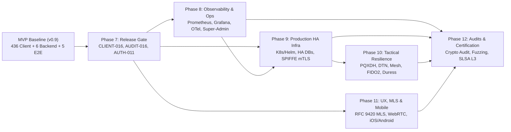
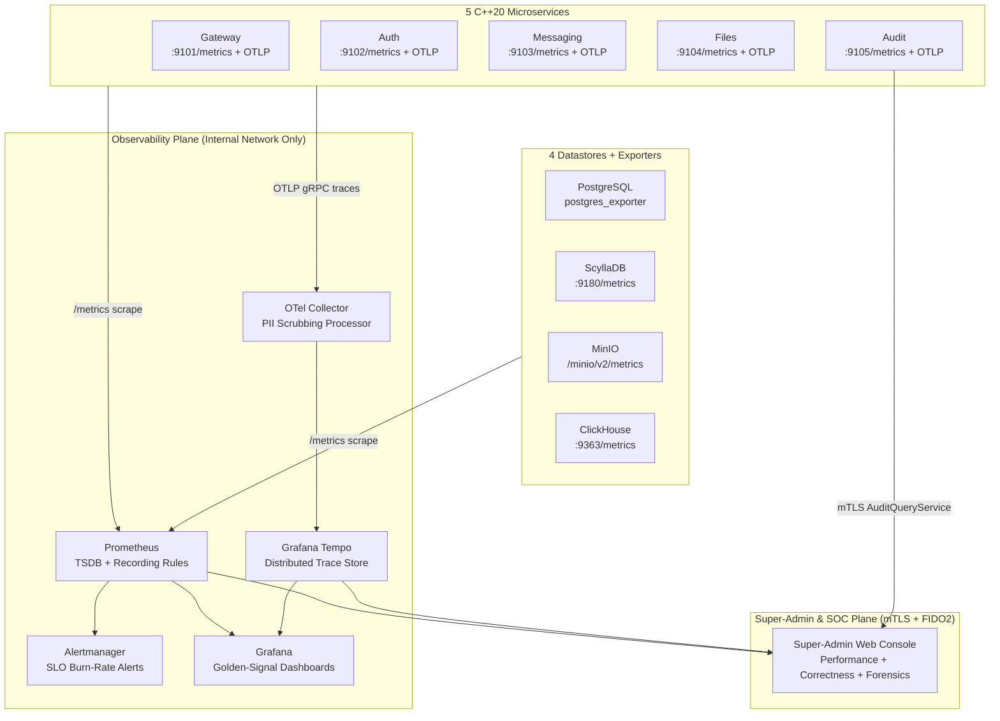
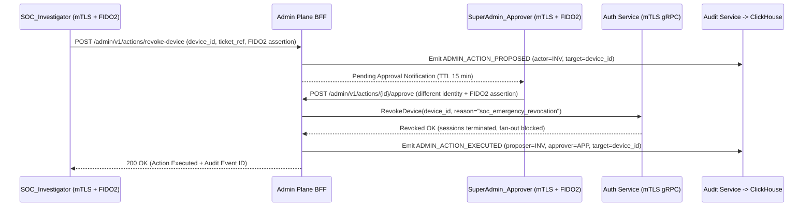

# SecureCloud Post-MVP Engineering Roadmap & Prioritized Backlog

**Document Version:** `1.0`  
**Date:** `2026-11-26`  
**Baseline Anchor:** SecureCloud MVP (`main` @ `67fdfb3` — 5 C++20 microservices, Qt 6 Desktop Client, 436/436 client foundation tests, 7/7 client performance budgets, 6/6 backend benchmark groups with 0 errors, 5/5 live Compose E2E scenarios)  
**Architectural References:** `ADR-001` through `ADR-012`, `docs/final-reports/mvp-verification-and-benchmarks-summary.md`, `specs/phase6/AUDIT-016-tickets.md`

---

## 1. Executive Summary & Strategic Vision

The SecureCloud MVP has empirically proven the core architectural thesis: a native **C++20 distributed zero-knowledge communication platform** can deliver sub-millisecond TLS 1.3 routing (`0.39 ms` p50), durable ScyllaDB encrypted messaging (`949.6 msg/s` on a single container + 1-node ScyllaDB), high-throughput encrypted file streaming (`41.9 MiB/s` upload / `89.4 MiB/s` download with 100% SHA-256 verification), non-blocking ClickHouse audit forensics (`1.05 ms` p50), and a Qt 6 desktop client operating at `73.2 MB` idle RAM and `46,581–82,945 msg/s` Double Ratchet throughput — all while consuming only **`31.8 MiB` idle RAM (`107.4 MiB` peak)** across all five backend microservices combined.

Moving from a verified **MVP** to a **production-hardened, globally scalable, hostile-environment-ready security platform** requires disciplined execution across six structured Post-MVP phases (Phases 7–12):

1. **Phase 7 — Immediate Post-MVP Release Gate & Deferred Closure:** Close remaining verification tickets (`CLIENT-015-T07`, `AUDIT-016-T03`–`T07`), wire server-backed user profiles (`AUTH-011`), deliver signed multi-platform desktop installers with native OS Keychain integration (`CLIENT-016`), and introduce tiered rate limiting (`GW-011`).
2. **Phase 8 — Observability, Distributed Tracing & Super-Admin Operations Platform:** Deploy full-stack **Prometheus + Grafana + OpenTelemetry** telemetry across all 5 C++20 microservices and 4 datastores, plus a **dedicated Super-Admin & SOC Investigation Dashboard** enabling real-time performance monitoring, correctness verification, distributed `correlation_id` tracing, and ClickHouse forensic investigation without ever compromising zero-knowledge E2EE.
3. **Phase 9 — Production Infrastructure, Multi-Node HA & `10,000+ msg/s` Scaling:** Transition from single-node Docker Compose to hardened VPS / Kubernetes (`Helm`) clusters with automated mTLS certificate rotation (`SPIFFE/SPIRE` or `Vault PKI`), multi-node HA datastores (`ScyllaDB RF=3`, `PostgreSQL Patroni`, `MinIO Erasure Coding`, `ClickHouse ReplicatedMergeTree`), and continuous chaos testing.
4. **Phase 10 — Hostile / Intermittent Network & Tactical / Emergency Resilience:** Engineer SecureCloud for contested, degraded, and offline-first environments — Delay-Tolerant Networking (DTN), **Post-Quantum Hybrid X3DH (`PQXDH`: `X25519 + ML-KEM-768`)**, local LAN/mesh fallback, online panic-wipe auto-revocation & covert duress beacons, hardware **FIDO2/WebAuthn** security keys, and pluggable anti-censorship transports.
5. **Phase 11 — Smart UX/UI, Group E2EE (`MLS`) & Cross-Platform Ecosystem:** Deliver peer-to-peer encrypted avatar ACLs, **RFC 9420 MLS** scalable encrypted groups (`100–1,000+` members), E2EE voice/video calls (WebRTC + SFrame), encrypted local full-text search (SQLCipher FTS5), rich media previews, and native iOS/Android mobile clients sharing the exact C++20 `libsecurecloud_core` engine.
6. **Phase 12 — Independent Audits, Formal Verification & Compliance Certification:** Execute third-party cryptographic audits, formal protocol proofs (`ProVerif`/`Tamarin`), continuous fuzzing (`libFuzzer`/OSS-Fuzz), SLSA Level 3 reproducible builds, and ISO 27001 / SOC 2 Type II / ANSSI readiness.

### 1.1 Non-Negotiable Post-MVP Architectural Invariants

Every single Post-MVP epic **MUST** preserve the following five invariants established in `ADR-001`–`ADR-012`:

| # | Invariant | Operational Rule for All Post-MVP Work |
|---|---|---|
| **I1** | **Zero-Knowledge Server Boundary (`ADR-008`)** | No backend service, telemetry exporter, trace span, Prometheus label, Grafana dashboard, or Super-Admin UI may ever observe, log, or store message plaintext, file plaintext, filenames, or private key material. |
| **I2** | **Stateless Horizontal Scaling (`ADR-010`)** | `Gateway`, `Messaging`, `Files`, and `Audit` remain horizontally scalable without process-local correctness state. All new features must scale out without changing service boundaries. |
| **I3** | **Real Durability Before ACK (`ADR-007`)** | No throughput optimization may bypass durable persistence (`ScyllaDB` / `PostgreSQL` / `MinIO`) before acknowledging a client write. |
| **I4** | **Non-Blocking Observability & Audit (`ADR-009` / `ADR-011`)** | Telemetry scraping, trace export, and audit ingestion must never block or crash the user-facing request path. Backpressure drops or spools telemetry safely before degrading messaging. |
| **I5** | **Strict Native C++20 Lean Footprint** | Backend microservices must remain lean native C++20 binaries (`< 64 MiB` idle RSS per service); desktop client must remain free of gRPC/Protobuf/Abseil linkage and stay within `ADR-010` RAM/CPU budgets. |

---

## 2. Master Post-MVP Roadmap & Dependency Graph

### 2.1 High-Level Phase Timeline (Estimated 12-Month Engineering Horizon)

| Phase | Name | Target Window | Primary Theme | Exit Milestone |
|---|---|---|---|---|
| **Phase 7** | Immediate Release Gate & MVP Closure | Weeks 1–6 | Finish deferred MVP QA, packaging, Keychain, profiles | **v1.0.0-GA** (Installable, signed desktop + hardened backend) |
| **Phase 8** | Observability, Tracing & Super-Admin Ops | Weeks 5–12 | Prometheus, Grafana, OpenTelemetry, Super-Admin Dashboard | **v1.1.0-OBS** (Full golden-signal visibility & SOC console) |
| **Phase 9** | Production HA Infrastructure & 10k msg/s | Weeks 11–20 | Kubernetes/Helm, HA datastores, SPIFFE mTLS, DR/Chaos | **v1.2.0-HA** (`>10,000` durable msg/s proven on cluster) |
| **Phase 10** | Hostile Network, PQC & Tactical Resilience | Weeks 19–32 | PQXDH (`ML-KEM-768`), DTN, LAN Mesh, FIDO2, Duress Beacon | **v2.0.0-PQC** (Quantum-resistant & contested-network ready) |
| **Phase 11** | Smart UX, MLS Groups, Calls & Mobile | Weeks 28–44 | RFC 9420 MLS, E2EE WebRTC, Avatar ACLs, iOS/Android core | **v2.5.0-SUITE** (Full multi-platform secure collaboration) |
| **Phase 12** | Independent Audits & Certification | Weeks 40–52 | Crypto audit, ProVerif, OSS-Fuzz, SLSA L3, ISO 27001/SOC 2 | **v3.0.0-CERT** (Externally audited enterprise/gov release) |

### 2.2 Cross-Phase Dependency Graph



---

## 3. Phase 7 — Immediate Post-MVP Release Gate & Deferred Closure

**Objective:** Close the remaining pre-GA tickets explicitly deferred at MVP freeze, resolve the single minor server-profile gap observed during backend benchmarking (`GET /api/v1/users/me` returning `501`), and ship signed, auto-updating native installers for macOS, Windows, and Linux.

---

### Epic `POST-001` (`CLIENT-015-T07`) — Desktop UI/UX Visual Polish, High-DPI & Accessibility QA
- **Priority:** `P0` (Blocker for v1.0.0-GA)
- **Estimated Effort:** `1.5` engineer-weeks
- **Component Scope:** `src/client/ui/qml/`, `tests/unit/client/`
- **Problem Statement:** While all core desktop workflows (Login, Contacts, E2EE Chat, Emergency Priority, File Attachments, Settings, Profile Avatar, Panic Wipe) passed live 2-client smoke testing, final visual consistency across macOS Retina (`2x`), Windows `125%/150%` fractional DPI scaling, Linux Wayland/X11, and keyboard-only navigation requires systematic sign-off.
- **Technical Requirements:**
  1. **Fractional DPI & Layout Audit:** Verify zero clipped text, overlapping badges, or blurry `SCAvatar` rendering at `100%`, `125%`, `150%`, and `200%` display scaling across macOS, Windows 11, and Ubuntu 24.04.
  2. **Keyboard Navigation & Focus Rings:** Complete `Tab`/`Shift+Tab` traversal, `Cmd/Ctrl+K` quick-switcher between conversations, `Esc` modal dismissal, and visible high-contrast focus indicators on all interactive controls.
  3. **Accessibility (`WCAG 2.1 AA`):** Populate `Accessible.name`, `Accessible.role`, and `Accessible.description` across all QML components (`NavigationShell.qml`, `WorkspacePlaceholder.qml`, `SettingsView.qml`, `SafetyNumberModal.qml`); validate contrast ratio `>= 4.5:1` in both Dark and High-Contrast themes.
  4. **Empty, Loading & Error States:** Add deterministic skeleton loaders during cold sync, clear retry banners on transient Gateway `503`/`429` responses, and non-blocking toast notifications for prekey replenishment and safety-number verification changes.
- **Acceptance Criteria:**
  - Zero QML console warnings (`qml:` / `ReferenceError` / `TypeError`) during a 30-minute scripted UI walkthrough on all 3 OSes.
  - Automated Qt Quick Test (`QQuickTest`) regression suite covering keyboard shortcuts and responsive breakpoints (`960×640` minimum window to `3840×2160` 4K).

---

### Epic `POST-002` (`AUDIT-016-T03` through `T07`) — Full M6 Platform Compliance & Chaos Verification
- **Priority:** `P0` (Blocker for v1.0.0-GA)
- **Estimated Effort:** `2.0` engineer-weeks
- **Component Scope:** `tests/integration/`, `src/audit/`, `docs/runbooks/`
- **Problem Statement:** `AUDIT-016-T01` and `AUDIT-016-T02` closed the five live runtime/Docker wiring defects, and Scenario 5 of Live Compose E2E verified all 4 producers (`GATEWAY`, `AUTH`, `MESSAGING`, `FILES`) writing to ClickHouse. The remaining `AUDIT-016` capstone test suites (`T03`–`T07`) formalize adversarial, chaos, and retention proof across all 17 security invariants in `docs/design/audit-design.md §7.24`.
- **Sub-Tickets:**
  - **`AUDIT-016-T03` (Multi-Producer Platform Suite):** Automated assertions validating canonical schema compliance, non-empty `correlation_id` chains, and exact event taxonomy across all 5 services (`gateway`, `auth`, `messaging`, `files`, `audit`).
  - **`AUDIT-016-T04` (Outage Survival & Chaos Recovery):** Stop `audit` and `clickhouse` mid-flight while driving `500+` requests across Gateway, Auth, Messaging, and Files; verify zero user-path failures, durable spooling in `/var/spool/securecloud/gateway/audit` and service outboxes, then restart `audit`/`clickhouse` and prove `100%` eventual delivery with zero duplicates (`EventPayloadFingerprint` deduplication).
  - **`AUDIT-016-T05` (Adversarial Anti-Impersonation & Zero-Plaintext):** Attempt spoofed `producer_service` claims over mismatched mTLS certificates (verify `PERMISSION_DENIED`), attempt unauthorized `AuditQueryService` calls from non-audit SANs, and assert zero plaintext sentinels across all ClickHouse columns.
  - **`AUDIT-016-T06` (Capacity, Query-Bulkhead Isolation & Retention):** Sustain `2,000+ events/s` ingestion while simultaneously executing heavy `AuditQueryService` range scans; prove query bulkhead isolation (`ADR-010`) and verify append-only ClickHouse TTL retention safeguards.
  - **`AUDIT-016-T07` (M6 Operational Runbooks):** Publish operator playbooks for spool recovery, ClickHouse partition maintenance, and forensic incident export.
- **Acceptance Criteria:**
  - All 17 M6 security invariants mapped 1:1 to passing automated tests in CI.

---

### Epic `POST-003` (`AUTH-011`) — Server-Backed User Profile Repository (`GET/PUT /api/v1/users/me`)
- **Priority:** `P0`
- **Estimated Effort:** `1.0` engineer-week
- **Component Scope:** `src/auth/db/`, `src/auth/service/`, `src/auth/main.cpp`, `src/gateway/http/proxy/auth_proxy_handler.cpp`
- **Problem Statement:** During our live backend benchmark run, `GET /api/v1/users/me` returned `HTTP 501 ("User repository not configured")` because `auth`'s PostgreSQL user profile repository (`display_name`, `role_title`, `avatar_file_id`, `status_message`) is not yet wired into `src/auth/main.cpp` in the Docker Compose binary. Currently, the desktop client persists profile updates locally in SQLCipher with an overwrite guard.
- **Technical Requirements:**
  1. Add PostgreSQL migration (`V008__user_profiles.sql`) in `securecloud_auth` storing `user_id` (PK), `display_name`, `role_title`, `avatar_file_id` (UUID reference to encrypted Files blob), `updated_at`, and `version` (optimistic concurrency).
  2. Implement `PostgresUserProfileRepository` and wire it into `AuthServer` in `src/auth/main.cpp`.
  3. Enable `GET /api/v1/users/me`, `PUT /api/v1/users/me`, and `GET /api/v1/users/directory` with strict length/UTF-8 validation and audit event emission (`USER_PROFILE_UPDATED`).
  4. Add `GET /api/v1/users/me` back to `scripts/benchmark_backend_compose.py` verifying `< 2 ms` p50 latency and `> 1,500 req/s`.
- **Acceptance Criteria:**
  - Updating Display Name / Role / Avatar on Alice's workstation syncs cleanly to Bob's Contact Directory and Alice's second device after restart.
  - Zero `501 NOT_IMPLEMENTED` responses on any documented `/api/v1/users/*` endpoint.

---

### Epic `POST-004` (`CLIENT-016`) — Multi-Platform Packaging, Code-Signing, Native OS Keychain & Secure Auto-Update
- **Priority:** `P0` (Blocker for external user distribution)
- **Estimated Effort:** `3.0` engineer-weeks
- **Component Scope:** `packaging/`, `src/client/infrastructure/adapters/`, `.github/workflows/`
- **Technical Requirements:**
  1. **Native OS Keychain Integration (Replacing Dev File Fallback):**
     - **macOS:** `Security.framework` (`SecItemAdd` / `SecItemCopyMatching` / `SecItemDelete`) with `kSecAttrAccessibleWhenUnlockedThisDeviceOnly` (never synced to iCloud Keychain!).
     - **Windows:** Windows Credential Manager + DPAPI (`CryptProtectData` with `CRYPTPROTECT_LOCAL_MACHINE` disabled, user-scoped entropy).
     - **Linux:** `libsecret` (GNOME Keyring / KWallet via Secret Service D-Bus API) with Argon2id-wrapped passphrase fallback for headless/minimal window managers.
     - Verify `execute_panic_wipe` atomically deletes all native OS Keychain entries on all three platforms.
  2. **Installable Signed Artifacts:**
     - **macOS:** Universal (`arm64` + `x86_64`) `.app` bundle + `.dmg` installer signed with Apple Developer ID and notarized via `xcrun notarytool` (`Hardened Runtime` enabled, `com.apple.security.cs.disable-library-validation` explicitly OFF).
     - **Windows:** Signed `.msi` (WiX Toolset) & portable `.zip` with Authenticode EV code-signing certificate and bundled Qt 6 + OpenSSL 3 + SQLCipher DLLs (`windeployqt`).
     - **Linux:** Reproducible `.AppImage` + `.deb` (Ubuntu/Debian) + `.rpm` (Fedora/RHEL) signed with project GPG release key.
  3. **Cryptographically Verified Auto-Updater (TUF / Ed25519):**
     - Implement a minimal C++20 update checker fetching a signed JSON manifest (`Ed25519` offline root key + online timestamp/snapshot keys following The Update Framework — TUF — to prevent freeze, rollback, and mix-and-match attacks).
     - Verify SHA-256 of downloaded installer binary before prompting user to apply update.
- **Acceptance Criteria:**
  - Clean installation on a fresh macOS, Windows 11, and Ubuntu 24.04 VM with zero external runtime dependencies (no Homebrew/Qt/OpenSSL pre-install required).
  - Tampered update manifest or downgraded version number is rejected fail-closed with a logged security event.

---

### Epic `POST-005` (`GW-011`) — Tiered Per-Endpoint Rate Limiting & Trusted Reverse-Proxy Support
- **Priority:** `P1`
- **Estimated Effort:** `1.0` engineer-week
- **Component Scope:** `src/gateway/http/middleware/rate_limiter_middleware.*`, `src/gateway/gateway_config.*`
- **Problem Statement:** During backend benchmarking, Gateway's single global token bucket (`100` burst / `50 req/s` per IP) applied uniformly to `/health/live`, `/api/v1/auth/login`, `/api/v1/messages`, and `/api/v1/files/upload/chunk`. In production behind a load balancer or corporate NAT (where 50 users share one egress IP), a flat IP bucket causes false-positive `429` rejections on messaging while leaving `/auth/login` too permissive.
- **Technical Requirements:**
  1. **Per-Route Policy Tiers:**
     - `Auth Login / MFA`: strict `5 req/s` sustained, `10` burst per `(IP, credential_identifier)` to throttle brute-force.
     - `Messaging / Sync / Receipts`: generous `200 req/s` sustained, `400` burst per authenticated `user_id` (JWT subject) rather than raw NAT IP.
     - `Files Chunk Upload/Download`: concurrency-bounded + byte-rate-limited per `user_id`.
     - `Health Probes (/health/live, /health/ready)`: exempt or restricted to internal probe CIDR (`10.0.0.0/8`, `127.0.0.1/32`).
  2. **Trusted Proxy `X-Forwarded-For` Extraction:** Configurable `SECURECLOUD_GATEWAY_TRUSTED_PROXY_CIDRS` so client IP extraction only trusts `X-Forwarded-For` from verified ingress load balancers (preventing header spoofing).
  3. **Standard Rate-Limit Response Headers:** Emit `Retry-After`, `X-RateLimit-Limit`, `X-RateLimit-Remaining`, and `X-RateLimit-Reset` on responses.
- **Acceptance Criteria:**
  - Unit + integration tests proving spoofed `X-Forwarded-For` headers from untrusted IPs are ignored, and `50` authenticated users behind a single NAT IP can message concurrently without `429` collisions.

---

## 4. Phase 8 — Observability, Distributed Tracing & Super-Admin Operations Platform

**Objective:** Give engineering and security operations teams real-time visibility into **performance**, **application correctness**, **distributed request tracing**, and **forensic audit trails** using an industry-standard **Prometheus + Grafana + OpenTelemetry** stack paired with a **dedicated Super-Admin & SOC Investigation Dashboard** — strictly upholding the Zero-Knowledge invariant (`I1`).



---

### Epic `OBS-001` — Native Prometheus `/metrics` Exporters on All 5 C++20 Microservices
- **Priority:** `P0` (Foundation of Phase 8)
- **Estimated Effort:** `2.0` engineer-weeks
- **Component Scope:** `src/common/include/securecloud/metrics/`, `src/gateway/`, `src/auth/`, `src/messaging/`, `src/files/`, `src/audit/`
- **Technical Design:**
  - Integrate lightweight `prometheus-cpp` (or zero-dependency thread-safe atomic registry in `src/common`) exposing an internal-only HTTP `/metrics` endpoint on dedicated admin ports (`9101`–`9105`, never exposed on public `:8443`).
  - **Strict Cardinality & Zero-PII Guard:** Never use `user_id`, `device_id`, `conversation_id`, `email`, `ip_address`, or `correlation_id` as Prometheus metric labels (prevents both PII leakage and TSDB cardinality explosion).
  - **Mandatory Metric Families per Service:**

| Service | Metric Name (Prometheus) | Type | Labels | Purpose |
|---|---|---|---|---|
| **All 5** | `securecloud_build_info` | Gauge | `service`, `version`, `git_sha` | Version & deployment verification |
| **All 5** | `securecloud_process_resident_memory_bytes` | Gauge | `service` | Track C++20 RSS footprint (`< 64 MiB` target) |
| **Gateway** | `securecloud_gateway_http_requests_total` | Counter | `method`, `route_template`, `status_class` | Request rate & error ratio (RED) |
| **Gateway** | `securecloud_gateway_http_request_duration_seconds` | Histogram | `route_template` | `p50`/`p95`/`p99` latency buckets (`0.5ms` to `5s`) |
| **Gateway** | `securecloud_gateway_rate_limit_rejections_total` | Counter | `policy_tier` | DDoS / abuse detection |
| **Gateway** | `securecloud_gateway_audit_spool_bytes` | Gauge | — | Early warning if Audit service is unreachable |
| **Gateway** | `securecloud_gateway_circuit_breaker_state` | Gauge | `upstream` | `0=closed, 1=half_open, 2=open` |
| **Auth** | `securecloud_auth_login_attempts_total` | Counter | `outcome` (`ok`, `bad_cred`, `revoked`, `mfa_req`) | Credential stuffing & lockout visibility |
| **Auth** | `securecloud_auth_argon2id_duration_seconds` | Histogram | — | Monitor password-hashing CPU saturation |
| **Auth** | `securecloud_auth_prekey_low_inventory_total` | Counter | — | Detect OTPK exhaustion across fleet |
| **Messaging** | `securecloud_messaging_accepted_total` | Counter | `priority` (`normal`, `urgent`, `emergency`) | Durable `ADR-007` message throughput |
| **Messaging** | `securecloud_messaging_scylla_write_duration_seconds` | Histogram | `operation` (`insert`, `sync`, `ack`) | ScyllaDB persistence latency |
| **Messaging** | `securecloud_messaging_outbox_pending_rows` | Gauge | — | Audit outbox backlog health |
| **Files** | `securecloud_files_transfer_bytes_total` | Counter | `direction` (`upload`, `download`) | Aggregate MiB/s throughput |
| **Files** | `securecloud_files_integrity_failures_total` | Counter | `stage` (`chunk_sha256`, `finalize_sha256`) | **Correctness signal**: any non-zero value triggers immediate page |
| **Audit** | `securecloud_audit_events_ingested_total` | Counter | `producer_service`, `status` (`persisted`, `deduped`, `rejected`) | Audit pipeline health & impersonation attempts |
| **Audit** | `securecloud_audit_queue_depth` | Gauge | — | Async batching queue saturation |
| **Audit** | `securecloud_audit_clickhouse_flush_duration_seconds` | Histogram | — | ClickHouse batch write latency |

- **Acceptance Criteria:**
  - All 5 services expose valid Prometheus OpenMetrics text on `:9101`–`:9105/metrics` with `< 0.5%` CPU overhead under `1,000 req/s` load.
  - Automated CI linter rejects any metric label containing forbidden PII keys (`user_id`, `email`, `ip`, `token`).

---

### Epic `OBS-002` — Datastore & Host Infrastructure Exporters
- **Priority:** `P1`
- **Estimated Effort:** `1.0` engineer-week
- **Component Scope:** `deploy/compose/docker-compose.observability.yml`, `deploy/k8s/observability/`
- **Technical Requirements:**
  1. **PostgreSQL (`postgres_exporter`):** Active connections, connection pool saturation, transaction commit/rollback rate, lock waits, index hit ratio (`> 99%`), WAL size, and replication lag (in HA mode).
  2. **ScyllaDB (native Prometheus endpoint `:9180/metrics`):** CQL write/read latency histograms, tombstones scanned per read (correctness check!), partition size distribution, cache hit ratio, compaction backlog, and reactor stall metrics.
  3. **MinIO (native `/minio/v2/metrics/cluster`):** S3 PUT/GET throughput, disk free space, healing/erasure-set health, and HTTP 5xx error counts.
  4. **ClickHouse (native `:9363/metrics`):** Parts per partition (`MergeTree` health), active merges, memory tracker usage, `audit_events` insert rate, and query execution duration.
  5. **Container / Host Metrics (`cAdvisor` + `node_exporter`):** Per-container RSS, CPU throttling (`cfs_throttled_periods`), TCP socket states, and disk IOPS.
- **Acceptance Criteria:**
  - Optional Compose overlay (`docker compose -f deploy/compose/docker-compose.yml -f deploy/compose/docker-compose.observability.yml up -d`) brings up Prometheus + Grafana + all exporters cleanly in local dev and staging.

---

### Epic `OBS-003` — OpenTelemetry Distributed Tracing (`W3C traceparent` + `X-Correlation-ID`)
- **Priority:** `P1`
- **Estimated Effort:** `2.5` engineer-weeks
- **Component Scope:** `src/common/include/securecloud/tracing/`, all 5 services, `deploy/observability/otel-collector.yaml`
- **Problem Statement:** Today, `X-Correlation-ID` links logs and ClickHouse audit events across services, which is great for security forensics, but lacks sub-millisecond timing breakdowns across individual internal hops (e.g., *Was that `22 ms` catch-up sync spent in TLS parsing, Gateway JWT check, gRPC serialization, or the ScyllaDB CQL query?*).
- **Technical Requirements:**
  1. **W3C Trace Context Propagation:** Gateway accepts/generates `traceparent` + `X-Correlation-ID` on every incoming HTTPS request and injects both into outbound gRPC mTLS metadata (`ClientCallContext`).
  2. **Structured Spans (`opentelemetry-cpp` over OTLP gRPC):**
     - Gateway: `http.server` -> `auth.jwt_verify` -> `grpc.client.<service>.<method>`
     - Auth: `grpc.server` -> `crypto.argon2id_verify` / `db.postgres.query`
     - Messaging: `grpc.server` -> `crypto.envelope_validate` -> `db.scylla.write_message` -> `db.scylla.write_outbox`
     - Files: `grpc.server` -> `crypto.sha256_verify` -> `s3.minio.put_object` -> `db.postgres.update_metadata`
     - Audit: `grpc.server` -> `audit.dedup_check` -> `db.clickhouse.batch_insert`
  3. **Tail-Based Sampling & PII Redaction in OTel Collector:**
     - Sample `100%` of error traces (`status >= 400` or gRPC error) and slow traces (`duration > 100 ms`), plus `5%` of normal healthy traces (configurable).
     - OTel Collector `attributes` processor explicitly strips any accidental `authorization`, `cookie`, `ciphertext`, or `email` attributes before storing in **Grafana Tempo**.
- **Acceptance Criteria:**
  - Clicking any slow request or error in Grafana / Super-Admin Dashboard displays a full waterfall flamegraph from `Gateway` through `mTLS gRPC` down to `PostgreSQL`/`ScyllaDB`/`MinIO`/`ClickHouse` with exact millisecond spans and matching `correlation_id`.

---

### Epic `OBS-004` — Grafana Operational Dashboards & SLO Burn-Rate Alerting
- **Priority:** `P1`
- **Estimated Effort:** `1.5` engineer-weeks
- **Component Scope:** `deploy/observability/grafana/dashboards/` (version-controlled JSON), `deploy/observability/alertmanager/`
- **Six Provisioned Grafana Dashboards (GitOps JSON):**
  1. **Executive Platform Overview:** Availability SLO (`99.95%`), aggregate RPS, durable msg/s, error budget burn rate, and live health matrix of all 5 services + 4 datastores.
  2. **Gateway & Edge Security:** TLS 1.3 connection reuse ratio, `p50/p95/p99` latency by route, rate-limit `429` spikes by tier, circuit breaker states, and Audit WAL spool bytes.
  3. **Auth & Identity Security:** Argon2id latency & CPU saturation, failed login spikes (brute-force detector), MFA step-up rates, device revocations, and low-OTPK inventory alerts.
  4. **Messaging & ScyllaDB Deep Dive:** Durable accepted `msg/s` by priority (`normal` / `urgent` / `emergency`), ScyllaDB write/read latency, tombstone warnings, delivery ACK lag, and outbox queue depth.
  5. **Files & MinIO Streaming:** Upload/download `MiB/s`, chunk SHA-256 verification failures (must always be `0`), active upload sessions, expired/abandoned uploads, and MinIO capacity forecast.
  6. **Audit & ClickHouse Forensics:** Ingestion `events/s` by producer service, deduplication ratio, queue depth, ClickHouse merge lag, and `AuditQueryService` latency.
- **Correctness & SLO Alerting Rules (Alertmanager -> PagerDuty / Slack / Opsgenie):**
  - **Critical (Page Immediately):**
    - Any `securecloud_files_integrity_failures_total > 0` (cryptographic integrity mismatch)
    - Any `securecloud_audit_events_ingested_total{status="rejected"} > 0` (potential mTLS producer impersonation!)
    - Messaging `5xx` error rate `> 0.5%` for `5 min` or durable `p99 > 250 ms` for `5 min`
    - Gateway Audit WAL spool `> 100 MiB` or Audit service unreachable `> 2 min`
  - **Warning (Ticket / Slack):**
    - Any C++20 microservice RSS `> 256 MiB` (leak investigation trigger)
    - ScyllaDB tombstones per read `> 100`
    - ClickHouse disk utilization `> 75%`

---

### Epic `OBS-005` — Custom Super-Admin & SOC Security Operations Dashboard
- **Priority:** `P1` (High-value operational & compliance differentiator)
- **Estimated Effort:** `4.0` engineer-weeks
- **Component Scope:** `src/admin-console/` (dedicated backend-for-frontend + React/TypeScript or Qt WebAssembly UI), `deploy/k8s/admin-plane/`
- **Why a Custom Super-Admin Dashboard Alongside Grafana?**
  - Grafana excels at time-series metrics (`Prometheus`) and trace waterfalls (`Tempo`), but **cannot** natively execute SecureCloud's mTLS-authenticated `AuditQueryService` forensic investigations, correlate security incidents with account/device states, or execute controlled administrative actions (such as emergency account freeze, device revocation, or fleet-wide duress alert triage) with cryptographic dual-control approval.
- **Zero-Knowledge Security Architecture of the Super-Admin Plane:**
  1. **Network & Identity Isolation:** Deployed on a **separate internal admin network/VPN** (never on public `:8443`). Requires **both** a hardware-backed mTLS client certificate (`SAN=admin.securecloud.internal`) **and** FIDO2/WebAuthn + TOTP MFA login.
  2. **Strict Zero-Plaintext Guarantee:** The Super-Admin console can **never** view message contents, file contents, filenames, or private keys — those keys exist exclusively on user endpoints. It operates purely on **metadata, cryptographic integrity signals, performance telemetry, and tamper-evident audit trails**.
  3. **Meta-Audit Trail (Who Watches the Watchmen):** Every single query, filter, export, and administrative action executed in the Super-Admin Dashboard emits an immutable `ADMIN_INVESTIGATION_QUERY` or `ADMIN_POLICY_ACTION` event into ClickHouse (`audit` service) signed with the operator's identity.
- **Core Modules of the Super-Admin Dashboard:**
  1. **Live System Correctness & Health Matrix:** Real-time status of all 5 microservices, 4 datastores, mTLS certificate expiry countdowns, active circuit breakers, and continuous synthetic canary test results.
  2. **Distributed Trace & `correlation_id` Explorer:** Paste any `correlation_id` (from a user support ticket or alert) to view **both** the OpenTelemetry millisecond timing waterfall (from Tempo) **and** every associated ClickHouse audit event across `Gateway -> Auth -> Messaging -> Files` in a single unified timeline.
  3. **SOC Audit Investigation & Forensics Workbench:** Interactive query builder backed by mTLS `AuditQueryService` (filter by `producer_service`, `event_type`, `actor_user_id`, `outcome`, time range), anomaly highlights (brute-force login clusters, `412` fan-out violations, `403` revoked-device login attempts, emergency duress alerts), and signed CSV/JSON evidence bundle export.
  4. **Fleet & Emergency Incident Controls (RBAC + Dual-Approval):**
     - View user account status (`Active` / `Suspended` / `Locked`) and enrolled device list (IDs, authorization status, last active timestamp — never keys).
     - Execute emergency session revocation or compromised device revocation (requiring two-person approval for `SuperAdmin` destructive actions).
     - Triage incoming **Covert Duress Beacons** (Phase 10 `RES-004`) on a dedicated high-priority incident banner.
  5. **Performance & Benchmark Trend Viewer:** Embeds Prometheus golden signals + historical nightly benchmark regression charts (`OBS-006`) so leadership can verify `p50`/`p95` latency and RAM budgets over every release.
- **Acceptance Criteria:**
  - Penetration test confirms zero access without valid admin mTLS cert + FIDO2 session; every admin query generates a verifiable ClickHouse meta-audit row within `< 2 s`.

---

### Epic `OBS-006` — Continuous Nightly Regression Benchmarking & Synthetic Canaries
- **Priority:** `P2`
- **Estimated Effort:** `1.0` engineer-week
- **Component Scope:** `.github/workflows/nightly-benchmarks.yml`, `scripts/run-backend-benchmarks.sh`, `scripts/run-client-benchmarks.sh`, `scripts/run-compose-e2e-tests.sh`
- **Technical Requirements:**
  1. Run our three one-command suites nightly on a dedicated runner:
     - `./scripts/run-client-benchmarks.sh` (7 client budgets)
     - `./scripts/run-compose-e2e-tests.sh` (5 live E2E scenarios)
     - `./scripts/run-backend-benchmarks.sh` (6 backend groups)
  2. Push structured JSON metrics (`throughput_rps`, `p50_ms`, `p95_ms`, `peak_ram_mib`) into Prometheus Pushgateway / InfluxDB so Grafana tracks commit-over-commit performance trends.
  3. Fail the nightly build automatically if any `p95` latency regresses `> 20%` or any C++ microservice peak RAM grows `> 25%` vs. the rolling 14-day baseline.
  4. Deploy a lightweight synthetic canary probe in staging/production executing a real E2EE test-bot round-trip every 60 seconds and reporting `securecloud_canary_e2ee_success` (`0` or `1`) and `securecloud_canary_e2ee_latency_seconds` to Prometheus.
- **Acceptance Criteria:**
  - Any performance regression or correctness break is caught within 24 hours (nightly) or 60 seconds (live canary) before reaching production users.

---

## 5. Phase 9 — Production Infrastructure, Multi-Node HA & `10,000+ msg/s` Scaling

**Objective:** Move SecureCloud from single-node Docker Compose to a production-grade, horizontally scalable, multi-AZ deployment capable of empirically sustaining the **`ADR-010` 10,000 accepted messages/second** peak target with zero single points of failure.

---

### Epic `INFRA-001` — Production Kubernetes (`Helm`) & Hardened VPS Deployment Charts
- **Priority:** `P0` (Production launch requirement)
- **Estimated Effort:** `3.0` engineer-weeks
- **Component Scope:** `deploy/helm/securecloud/`, `deploy/terraform/`, `deploy/docker/`
- **Technical Requirements:**
  1. **Minimal Distroless / Scratch Production Docker Images:** Strip all build tools and shells from runtime containers; run every C++20 binary as non-root UID `10001` with `readOnlyRootFilesystem: true`, `allowPrivilegeEscalation: false`, and dropped Linux capabilities (`capabilities.drop: ["ALL"]`).
  2. **Kubernetes `Helm` Chart:**
     - Separate `Deployment` + `HorizontalPodAutoscaler` (HPA) per microservice (`gateway`, `auth`, `messaging`, `files`, `audit`).
     - `PodDisruptionBudget` (`minAvailable: 2`) and multi-AZ `topologySpreadConstraints`.
     - Strict `NetworkPolicy` enforcing the exact `ADR-004` service mesh matrix (e.g., only `gateway` can accept external `:8443` traffic; only `messaging` can connect to `scylladb:9042`; only `audit` can connect to `clickhouse:8123`).
  3. **Hardened Single-Region VPS Terraform + Ansible Option:** For smaller self-hosted or sovereign deployments (e.g., NGOs, journalists, defense field units), provide a turnkey 3-node Terraform + systemd/Docker-Swarm deployment with `ufw`/`nftables` firewall hardening and automated OS security patching.
- **Acceptance Criteria:**
  - `trivy` / `grype` container image scans pass with **0 Critical / High CVEs**.
  - `helm install` deploys a healthy, mTLS-verified multi-replica stack on a clean Kubernetes cluster in `< 5 minutes`.

---

### Epic `INFRA-002` — Production PKI & Zero-Downtime Automated mTLS Rotation (`SPIFFE/SPIRE` / `Vault PKI`)
- **Priority:** `P0`
- **Estimated Effort:** `2.0` engineer-weeks
- **Component Scope:** `src/common/include/securecloud/security/`, `deploy/pki/`, `deploy/helm/`
- **Problem Statement:** The MVP uses static dev-PKI leaf certificates mounted via Docker bind volumes (`deploy/dev-pki/`). Production requires short-lived certificates (`24h`–`72h` TTL) with automatic zero-downtime hot-reload so a compromised container certificate expires quickly and rotation never drops active gRPC/TLS sessions.
- **Technical Requirements:**
  1. Implement `FileWatcherCredentialProvider` (using gRPC's `FileWatcherCertificateProvider` + OpenSSL `SSL_CTX` hot-reload in Gateway) so all 5 C++20 services automatically pick up rotated leaf certs and CA bundles without process restart.
  2. Integrate **SPIFFE/SPIRE** (or `cert-manager` + HashiCorp Vault PKI) issuing short-lived `ECDSA P-256` X.509 SVIDs with strict SPIFFE URI SANs (`spiffe://securecloud.prod/ns/core/sa/messaging`).
  3. Support **dual-pin SPKI transition** in the Desktop Client (current leaf SPKI + backup root/next-leaf SPKI pin) so public Gateway certificate renewal never locks out installed desktop clients.
- **Acceptance Criteria:**
  - Live rotation test rotates all 5 service certificates while sustaining `500 msg/s` traffic with **0 dropped requests** and **0 mTLS handshake failures**.

---

### Epic `INFRA-003` — Multi-Node HA Datastore Topologies
- **Priority:** `P0`
- **Estimated Effort:** `3.0` engineer-weeks
- **Component Scope:** `deploy/helm/datastores/`, `src/messaging/db/`, `src/auth/db/`, `src/files/db/`, `src/audit/db/`
- **Technical Requirements:**
  1. **ScyllaDB 3-Node+ Cluster (`RF=3`, `LOCAL_QUORUM`):** Replace dev single-node `--memory 512M` with a 3-node (or 6-node) ScyllaDB Operator cluster on NVMe SSDs, verifying `LOCAL_QUORUM` reads/writes survive a full node failure with zero data loss.
  2. **PostgreSQL 17 HA (Patroni + PgBouncer):** Primary + 2 synchronous/async standbys with automatic failover (`< 15 s` RTO) and PgBouncer transaction pooling for `securecloud_auth` and `securecloud_files`.
  3. **MinIO Distributed Erasure-Coded Cluster (4+ Nodes, `EC:2`):** Survives loss of up to half the drives/nodes while maintaining encrypted ciphertext availability.
  4. **ClickHouse HA (`ReplicatedMergeTree` + ClickHouse Keeper):** 2 shards × 2 replicas ensuring immutable audit logs survive node/AZ loss.
- **Acceptance Criteria:**
  - Kill any single datastore node (`postgres` primary, 1 `scylladb` node, 1 `minio` node, or 1 `clickhouse` replica) during live traffic; stack recovers automatically with **0 lost accepted messages** and **0 lost audit events**.

---

### Epic `INFRA-004` — Empirical `10,000 msg/s` Cluster Load Proof (`ADR-010` Capstone)
- **Priority:** `P1`
- **Estimated Effort:** `1.5` engineer-weeks
- **Component Scope:** `scripts/loadgen/`, `docs/final-reports/`
- **Problem Statement:** On a single laptop Docker VM, `1` Gateway + `1` Messaging + `1` ScyllaDB node achieved **`949.6` durable msg/s** (`2.53 ms` p50). To officially close `ADR-010 §3.1`, we must execute a distributed cluster benchmark proving `>= 10,000` durable accepted messages/second with real ScyllaDB `LOCAL_QUORUM` persistence.
- **Technical Requirements:**
  1. Provision a staging Kubernetes cluster (`12` `gateway` pods, `12` `messaging` pods, `6`-node NVMe `ScyllaDB` cluster, `3` `audit` pods, distributed load generators).
  2. Execute a 30-minute sustained endurance test (`10,000+ msg/s`) plus a 5-minute burst test (`15,000 msg/s`) using real `AES-256-GCM` envelopes across `10,000` simulated recipient devices.
  3. Capture Prometheus/Grafana snapshots, `p50`/`p95`/`p99` submission and delivery latencies, error rate (`< 0.01%`), and zero ScyllaDB reactor stalls.
- **Acceptance Criteria:**
  - Published empirical report demonstrating `>= 10,000` durable `ADR-007` accepted messages/second with `p95 < 50 ms` and `0` lost messages.

---

### Epic `INFRA-005` — Automated Backup, Point-in-Time Recovery (PITR) & Disaster Recovery Drills
- **Priority:** `P1`
- **Estimated Effort:** `1.5` engineer-weeks
- **Component Scope:** `deploy/backup/`, `docs/runbooks/disaster-recovery.md`
- **Technical Requirements:**
  1. Encrypted off-site backups (WAL-G for PostgreSQL PITR, ScyllaDB Manager incremental snapshots, MinIO bucket replication, ClickHouse `BACKUP TO S3`) encrypted with KMS-managed keys.
  2. Quarterly automated DR restore drill into an isolated recovery namespace verifying **RPO `< 5 minutes`** and **RTO `< 30 minutes`**.
- **Acceptance Criteria:**
  - Automated restore script reconstructs a full working environment from off-site backups and passes the 5-scenario Compose/Cluster E2E suite.

---

### Epic `INFRA-006` — Continuous Chaos Engineering & Network Fault Injection
- **Priority:** `P2`
- **Estimated Effort:** `1.5` engineer-weeks
- **Component Scope:** `tests/chaos/`, `deploy/chaos/`
- **Technical Requirements:**
  1. Integrate **LitmusChaos** (Kubernetes) and **Toxiproxy** (Docker Compose) to inject deterministic faults: `300 ms` jitter, `15%` packet loss, TCP resets mid-upload, DNS blackholes, and pod OOM kills.
  2. Verify Gateway circuit breakers trip cleanly, Files resumable upload resumes from the exact last verified chunk (`SHA-256`), and Messaging idempotency tokens prevent duplicate messages under aggressive client retries.
- **Acceptance Criteria:**
  - Automated chaos suite passes with `0` corrupted files, `0` duplicate messages, and full self-healing within `< 30 s` after fault removal.

---

## 6. Phase 10 — Hostile / Intermittent Network & Tactical / Emergency Resilience

**Objective:** Harden SecureCloud for **high-threat, contested, intermittent, and offline-first environments** (investigative journalism, humanitarian crisis response, critical infrastructure, defense/tactical operations) where adversaries may intercept traffic for future quantum decryption, jam or partition internet links, coerce users physically, or attempt credential theft.

---

### Epic `RES-001` — Post-Quantum Hybrid Cryptography (`PQXDH`: `X25519 + ML-KEM-768` & `Ed25519 + ML-DSA-65`)
- **Priority:** `P0` (Strategic cryptographic longevity)
- **Estimated Effort:** `4.0` engineer-weeks
- **Component Scope:** `src/client/domain/crypto/`, `src/client/infrastructure/adapters/openssl_crypto_provider.*`, `src/auth/domain/`, `proto/securecloud/auth/v1/auth.proto`
- **Problem Statement:** Today's `X3DH` (`X25519` + `Ed25519`) is secure against classical adversaries, but an adversary executing a **"Harvest Now, Decrypt Later" (HNDL)** attack can record encrypted TLS 1.3 and X3DH initial handshakes today and decrypt them once cryptographically relevant quantum computers (CRQCs) arrive.
- **Technical Design (NIST FIPS 203 / FIPS 204 Hybrid Construction):**
  1. **Hybrid Key Encapsulation (`PQXDH`):** Extend each device's prekey bundle (`POST /api/v1/devices` & `POST .../prekeys`) with a **NIST FIPS 203 `ML-KEM-768` (Kyber-768)** last-resort prekey (`1,184 B` public key) and pool of one-time `ML-KEM-768` prekeys, signed by the device's identity key.
  2. **Hybrid Shared Secret Derivation:** Combine classical `X3DH` (`DH1 || DH2 || DH3 || DH4`) with the `ML-KEM-768` encapsulated shared secret (`SS_pq`) inside `HKDF-SHA-512`:
     `SK = HKDF-SHA-512(F || DH1 || DH2 || DH3 || DH4 || SS_pq, info="SecureCloud_PQXDH_v2")`
     — preserving security as long as **either** `X25519` **or** `ML-KEM-768` remains unbroken.
  3. **Post-Quantum Ratchet Reseeding (Sparse PQ Ratchet):** Periodically mix a fresh `ML-KEM-768` encapsulation into the Double Ratchet root chain (e.g., every `50` messages or `24` hours) to achieve **Post-Quantum Post-Compromise Security (PQ-PCS)** without bloating every message header.
  4. **Hybrid TLS 1.3 (`X25519MLKEM768`):** Enable OpenSSL 3.5+/3.6+ native `X25519MLKEM768` hybrid key exchange on Gateway (`:8443`) and internal gRPC mTLS channels.
  5. **Backward-Compatible Protocol Negotiation:** Support `protocol_version = 1` (`X3DH`) and `protocol_version = 2` (`PQXDH`) during rolling upgrades, with strict downgrade-protection binding the version into AAD.
- **Acceptance Criteria:**
  - Known-Answer Tests (KATs) against NIST FIPS 203 test vectors pass on macOS, Linux, and Windows.
  - `PQXDH` initial session setup completes in `< 3 ms` on Apple M4 / modern x86_64; ongoing Double Ratchet throughput remains `> 30,000 msg/s`.

---

### Epic `RES-002` — Delay-Tolerant Networking (DTN) & Intermittent-Link Store-and-Forward
- **Priority:** `P1`
- **Estimated Effort:** `3.0` engineer-weeks
- **Component Scope:** `src/client/application/managers/sync_manager.*`, `src/client/infrastructure/storage/`, `src/gateway/http/proxy/`
- **Problem Statement:** In disaster zones, maritime/satellite links, or congested cellular networks, connectivity may drop for hours or appear only in 10-second burst windows with `2,000 ms` RTT and `20%` packet loss. Standard HTTP request timeouts fail repeatedly and drain battery.
- **Technical Requirements:**
  1. **Priority-Aware Persistent Outbox Queue:** Upgrade the client's local SQLCipher outbox (`LocalPending`) with strict priority lanes: **`Emergency` (P0) -> `Urgent` (P1) -> `Normal` (P2) -> `File Chunks` (P3)** so life-safety/emergency messages always preempt large file uploads when a brief connectivity window opens.
  2. **Adaptive Backoff & Link-Quality Probing:** Replace fixed polling intervals with jittered exponential backoff + instant OS network-change listeners (`QNetworkInformation` reachability hooks) that immediately flush the outbox within `< 500 ms` of link restoration.
  3. **Ultra-Compact Binary Wire Framing (Optional CBOR/Protobuf-over-HTTPS):** Reduce JSON/base64 overhead by `~35%` on bandwidth-constrained satellite/HF links via content-negotiated `application/x-protobuf` on `/api/v1/messages` and `/api/v1/conversations/{id}/messages`.
  4. **Resumable Chunk Checkpointing Across App Restarts:** Persist `upload_id` and per-chunk verified SHA-256 bitmap in SQLCipher so a `50 MiB` file interrupted at chunk `8/13` resumes directly at chunk `9` even after a full laptop reboot.
- **Acceptance Criteria:**
  - Simulated `30%` packet-loss / `1,500 ms` RTT / periodic 60-second blackout test delivers `100%` of queued Emergency and Normal messages in strict priority order with zero duplicates.

---

### Epic `RES-003` — Local LAN / Ad-Hoc Mesh Fallback (Zero-Gateway Offline Communication)
- **Priority:** `P2`
- **Estimated Effort:** `4.0` engineer-weeks
- **Component Scope:** `src/client/infrastructure/mesh/`, `src/client/application/managers/messaging_manager.*`
- **Problem Statement:** When internet backhaul is completely severed (earthquakes, power grid outages, field deployments, air-gapped facilities), teams located in the same building or local Wi-Fi/Ethernet subnet still need authenticated E2EE communication.
- **Technical Requirements:**
  1. **Local Peer Discovery (`mDNS` / DNS-SD over LAN):** Opt-in local discovery broadcasting only an ephemeral rotating anonymous token (derived from shared contact keys via HMAC, never leaking user emails or static IDs to passive LAN sniffers!).
  2. **Direct Peer-to-Peer TLS 1.3 + Double Ratchet Transport:** Reuse the **exact same `DoubleRatchetEngine` and verified `SafetyNumber` identity keys** over a direct peer-to-peer TLS 1.3 socket on the local subnet — zero changes to E2EE trust semantics.
  3. **Opportunistic Store-Carry-Forward Relay (Mule Mode):** Optional encrypted bundle caching where a peer who later regains WAN connectivity forwards opaque, already-encrypted envelopes for offline teammates to the Gateway (preserving full zero-knowledge confidentiality).
  4. **Seamless WAN Reconciliation:** When Gateway connectivity returns, messages exchanged over LAN mesh reconcile cleanly via `client_idempotency_token` with zero duplicate UI entries.
- **Acceptance Criteria:**
  - Two laptops connected to an isolated Wi-Fi router with **no internet and no Gateway** exchange verified Double-Ratchet messages and `1 MiB` encrypted files in `< 50 ms`, then cleanly sync with Gateway once internet returns.

---

### Epic `RES-004` — Online Panic-Wipe Auto-Revocation & Covert Duress Beacon
- **Priority:** `P1` (High-value operational safety feature)
- **Estimated Effort:** `2.0` engineer-weeks
- **Component Scope:** `src/client/application/managers/emergency_manager.*`, `src/auth/service/`, `src/audit/domain/`
- **Problem Statement:** In the MVP, `execute_panic_wipe` thoroughly shreds the local SQLCipher database, secure storage, and active session on the compromised workstation. However, if the device is online when a coerced user enters their **Duress PIN**, silently revoking the device on the server and alerting the Security Operations Center (SOC) prevents the adversary from reusing any cached refresh token and notifies responders immediately.
- **Technical Requirements:**
  1. **Best-Effort Online Device Self-Revocation:** When `execute_panic_wipe` triggers while network is reachable, fire a bounded (`<= 1,500 ms` timeout) `POST /api/v1/devices/{self}/revoke` (`reason="emergency_wipe"`) before shredding local tokens so the server immediately cuts off future fan-out to that device. If offline, local wipe still executes immediately without blocking!
  2. **Covert Duress Mode (Decoy Workspace + Silent Beacon):**
     - When the user enters their configured **Duress PIN** at unlock, the client silently emits a high-priority encrypted **`SECURITY_DURESS_TRIGGERED`** signal to Auth/Audit (surfacing as a `CRITICAL` incident in the Phase 8 Super-Admin Dashboard), shreds the real SQLCipher database in the background, and opens a **plausible, benign decoy workspace** (pre-seeded innocuous conversations) so a physically present coercer sees a normal-looking app rather than an obvious "WIPED" error screen.
  3. **Peer Key-Change Notification:** Automatically notify verified contacts' devices that the compromised device was revoked so their UI displays a clear security indicator.
- **Acceptance Criteria:**
  - Entering Duress PIN shreds the real SQLCipher DB in `< 500 ms`, opens the decoy workspace with zero visual giveaway, revokes the device on Auth (`HTTP 403` on subsequent token use), and triggers a `CRITICAL` ClickHouse audit alert visible in the Super-Admin Dashboard within `< 2 s`.

---

### Epic `RES-005` — Hardware Security Key Support (`FIDO2 / WebAuthn / YubiKey PIV`)
- **Priority:** `P1`
- **Estimated Effort:** `2.5` engineer-weeks
- **Component Scope:** `src/client/infrastructure/adapters/fido2_adapter.*`, `src/auth/service/mfa_service.*`, `src/gateway/http/proxy/auth_proxy_handler.*`
- **Technical Requirements:**
  1. Integrate `libfido2` (C library, cross-platform macOS/Windows/Linux over USB HID / NFC) in the desktop client.
  2. Support FIDO2/WebAuthn resident & non-resident credentials as a **phishing-resistant MFA factor** (upgrade over TOTP `RFC 6238`) for:
     - High-assurance login (`AUTH_LEVEL_HARDWARE_MFA`)
     - New device authorization & device revocation
     - Super-Admin Dashboard authentication (`OBS-005`)
  3. Optional YubiKey PIV / OpenPGP smartcard wrapping of the local SQLCipher database master key so the local database cannot be unlocked even if the laptop disk and OS login are compromised.
- **Acceptance Criteria:**
  - Live authentication and device-revocation step-up verified with physical YubiKey 5C (and virtual CTAP2 authenticator in CI).

---

### Epic `RES-006` — Pluggable Transports & Anti-Censorship Framing (`HTTP/3 QUIC` & Domain-Fronted Relays)
- **Priority:** `P2`
- **Estimated Effort:** `3.0` engineer-weeks
- **Component Scope:** `src/gateway/http/`, `src/client/infrastructure/adapters/`, `deploy/relays/`
- **Technical Requirements:**
  1. **HTTP/3 (QUIC) Edge Support:** Place an Envoy / NGINX QUIC edge listener in front of Gateway for `0-RTT` reconnection and resilience against TCP RST injection and head-of-line blocking on lossy links.
  2. **Pluggable Bridge Relays:** Lightweight stateless TLS-forwarding bridge relays deployable on arbitrary VPS IPs so users behind national/corporate SNI firewalls can reach SecureCloud Gateway while still enforcing end-to-end **Gateway SPKI certificate pinning** (relays cannot MITM traffic!).
  3. **Traffic Padding (Envelope Size Bucketing):** Pad encrypted message envelopes and file metadata requests to fixed power-of-two size buckets (`512 B`, `2 KiB`, `8 KiB`) to defeat passive traffic-analysis fingerprinting of short replies ("yes"/"no") vs. long messages.
- **Acceptance Criteria:**
  - Client connects cleanly through a bridge relay and SOCKS5/Tor proxy while failing closed if the Gateway SPKI pin mismatches.

---

### Epic `RES-007` — Secure Memory Hardening & Anti-Forensics (`mlock`, Core-Dump Suppression, Zeroize-on-Free)
- **Priority:** `P1`
- **Estimated Effort:** `1.5` engineer-weeks
- **Component Scope:** `src/common/include/securecloud/crypto/`, `src/client/`
- **Technical Requirements:**
  1. Disable OS core dumps (`setrlimit(RLIMIT_CORE, 0)` on POSIX, `SetErrorMode` / WER opt-out on Windows) and `prctl(PR_SET_DUMPABLE, 0)` / `PT_DENY_ATTACH` (optional release-mode debugger protection) in both desktop client and backend services.
  2. Pin sensitive `SecretString` / key-material pages in RAM with `mlock()` / `VirtualLock()` so private keys and SQLCipher passphrases are never swapped to unencrypted disk swap/hibernation files.
  3. Verify `OPENSSL_cleanse` / `explicit_bzero` compiler-barrier zeroization across all key structs using assembly inspection in CI (`objdump` check preventing dead-store elimination under `-O3`).
- **Acceptance Criteria:**
  - Memory-forensics test triggers a synthetic crash and confirms `0` core-dump files written and `0` plaintext key bytes left in freed heap regions.

---

### Epic `RES-008` — Verifiable Key Transparency & Blockchain Merkle Audit Anchoring
- **Priority:** `P1` (Eliminates residual server-equivocation & root-admin log-tampering trust gaps)
- **Estimated Effort:** `3.0` engineer-weeks
- **Component Scope:** `src/auth/crypto/key_transparency/`, `src/audit/anchoring/`, `src/client/application/managers/contact_manager.*`
- **Architectural Boundary (Where Blockchain Belongs vs. Does Not Belong):**
  - **Explicitly NOT used for messaging or file storage:** Messages remain in `ScyllaDB` (`ADR-007`, `950+ msg/s` per node) and encrypted files remain in `MinIO` (`89 MiB/s`) to preserve low latency, GDPR erasure, disappearing messages, and emergency panic wipe.
  - **Used strictly as an immutable external commitment anchor for tiny 32-byte SHA-256 Merkle roots** (zero PII, zero user IDs, zero plaintext ever written on-chain).
- **Technical Requirements:**
  1. **Verifiable Key Transparency (`Auth` + `Client`):**
     - `Auth` maintains an append-only **Key Transparency Merkle Tree** (CONIKS / Parakeet model) committing to every `{user_id -> authorized_device_identity_keys}` mapping.
     - Clients automatically verify compact `O(log N)` Merkle inclusion and consistency proofs when fetching `GET /api/v1/users/{id}/devices/crypto-directory`, making silent key substitution by a compromised `Auth` server cryptographically detectable without forcing manual out-of-band Safety Number comparison on every contact.
  2. **External Blockchain / Witness Anchoring for ClickHouse Audit Logs (`Audit`):**
     - Every `N` minutes (e.g., hourly or per `10,000` events), `Audit` computes a **Merkle root** over the batch of `EventPayloadFingerprint` hashes in ClickHouse and anchors that **32-byte SHA-256 root** onto an immutable external ledger (public L2 blockchain or multi-organization witness consortium).
     - Provides **regulator- and court-grade non-repudiation**: even a rogue root infrastructure admin with direct SSH access to the ClickHouse disk cannot retroactively alter or delete a single historical audit row without breaking the externally anchored Merkle root.
- **Acceptance Criteria:**
  - Simulated compromised `Auth` server serving an equivocated device key is caught automatically by the client's Merkle proof verifier (`KeyTransparencyMismatch` error).
  - Modifying a single byte in a historical ClickHouse `audit_events` row fails the external Merkle-anchor verification check in the Super-Admin Dashboard (`OBS-005`).

---

## 7. Phase 11 — Smart UX/UI, Scalable Group E2EE (`MLS`) & Multi-Platform Ecosystem

**Objective:** Elevate SecureCloud from a high-assurance 1:1 / small-group messaging tool into a complete, effortless daily-driver secure collaboration platform across desktop and mobile without sacrificing cryptographic rigor.

---

### Epic `UX-001` — Peer-to-Peer Encrypted Avatar & Profile Access Control (Zero-Leak Profile Media)
- **Priority:** `P1`
- **Estimated Effort:** `1.5` engineer-weeks
- **Component Scope:** `src/client/application/managers/settings_manager.*`, `src/client/application/managers/contact_manager.*`, `src/files/service/`
- **Problem Statement:** Currently, profile avatars are uploaded as encrypted blobs to Files Service, and `FilesProxyHandler` restricts download access by `owner_user_id` or `conversation_id` membership. Sharing a user's encrypted avatar safely with *only* their mutually verified contacts — without making avatars publicly downloadable or leaking the avatar encryption key to the server — requires an explicit peer-to-peer encrypted avatar ACL design.
- **Technical Design:**
  1. Client encrypts the profile avatar image (`<= 256 KiB` WebP/PNG) locally with a random 256-bit `avatar_key` (`AES-256-GCM`) and uploads the ciphertext to Files Service (`avatar_file_id`).
  2. Client distributes `{avatar_file_id, avatar_key, avatar_sha256}` inside a silent **Double-Ratchet control message** strictly to verified contacts (never sent in plaintext to Auth/Files!).
  3. Files Service issues short-lived, read-only **capability tokens** (`X-File-Capability`, already supported in `FilesProxyHandler`!) scoped to mutually connected contacts so Bob can fetch Alice's ciphertext blob and decrypt it locally, while unauthorized users receive `HTTP 403`.
  4. When Alice removes or blocks a contact and changes her avatar, a fresh `avatar_key` is generated and only sent to remaining contacts.
- **Acceptance Criteria:**
  - Alice updates her avatar -> Bob's sidebar and chat header automatically render Alice's new circular avatar within `< 2 s`; a non-contact user attempting to fetch Alice's `avatar_file_id` receives `HTTP 403`; MinIO contains only opaque ciphertext.

---

### Epic `UX-002` — Scalable Encrypted Groups via RFC 9420 MLS (Messaging Layer Security)
- **Priority:** `P1`
- **Estimated Effort:** `5.0` engineer-weeks
- **Component Scope:** `src/client/domain/crypto/mls/`, `src/messaging/service/group_service.*`, `proto/securecloud/messaging/v1/`
- **Problem Statement:** Pairwise Double Ratchet fan-out (`O(N)` encryptions per message for `N` recipient devices) works brilliantly for 1:1 chats and small groups (`2–15` members), but becomes expensive for `100–1,000+` member incident-response channels or organizational groups.
- **Technical Requirements:**
  1. Integrate an audited C++20 **RFC 9420 MLS** engine (TreeKEM continuous group key agreement with `MLS_256_XWING_CHACHA20POLY1305_SHA512_Ed25519` or `MLS_128_DHKEMX25519_AES128GCM_SHA256_Ed25519` ciphersuite).
  2. Add a lightweight, zero-knowledge **Delivery Service (DS)** extension inside `Messaging` for atomic epoch ordering (preventing split-brain group commits) and MLS `KeyPackage` distribution in `Auth`.
  3. Preserve **Forward Secrecy (FS)** and **Post-Compromise Security (PCS)** at `O(log N)` update cost whenever a member joins, leaves, or has a compromised device revoked.
  4. Support group admin roles (owner/moderator/member), verified group safety fingerprints, and automatic pairwise-to-MLS upgrade for groups `> 10` members.
- **Acceptance Criteria:**
  - `250`-member encrypted group processes member addition/removal in `< 25 ms` and delivers messages with a single ciphertext envelope stored once in ScyllaDB (zero plaintext).

---

### Epic `UX-003` — End-to-End Encrypted Voice & Video Calls (`WebRTC + SFrame`)
- **Priority:** `P2`
- **Estimated Effort:** `6.0` engineer-weeks
- **Component Scope:** `src/client/infrastructure/media/`, `src/gateway/http/signaling/`, `deploy/coturn/`
- **Technical Requirements:**
  1. **E2EE Signaling:** Exchange WebRTC SDP offers/answers and ICE candidates exclusively inside existing **Double Ratchet** encrypted envelopes (zero plaintext call metadata in Gateway/Messaging).
  2. **Media Encryption (`DTLS-SRTP` + `SFrame` RFC 9605):** Even when calls traverse a TURN relay (`coturn`) or future SFU for group calls, apply **SFrame** end-to-end media-frame encryption keyed directly from the Double Ratchet / MLS epoch secret so the SFU/TURN server can never listen to audio or view video.
  3. **Privacy-Preserving Call UX:** Optional "Always Relay Calls via TURN" toggle to hide user IP addresses from peers; visual 4-emoji / 6-digit SAS (Short Authentication String) verification badge derived from the call's E2EE key.
- **Acceptance Criteria:**
  - 1:1 E2EE audio/video call sustains `< 150 ms` glass-to-glass latency with TURN relay fallback and verified SFrame encryption.

---

### Epic `UX-004` — Smart Productivity UX (Encrypted Full-Text Search, Inline Previews, Threads & Reactions)
- **Priority:** `P1`
- **Estimated Effort:** `3.0` engineer-weeks
- **Component Scope:** `src/client/infrastructure/storage/`, `src/client/ui/qml/`
- **Technical Requirements:**
  1. **Local Encrypted Full-Text Search (`SQLCipher FTS5`):** Build an `FTS5` virtual table inside the existing AES-256-encrypted SQLCipher database so users can search across `50,000+` messages in `< 15 ms` completely offline (zero server-side search indexing!).
  2. **Inline Encrypted Media Previews:** Decrypt and render thumbnail previews for images (PNG/JPEG/WebP) and PDFs directly in memory (`QImage::fromData`) without ever writing unencrypted temporary files to `/tmp`!
  3. **Replies, Reactions & Multi-File Drag-and-Drop:** Support quote-replies, lightweight encrypted emoji reactions (sent as tiny Double-Ratchet payload envelopes), message editing/redaction with tombstone audit markers, and drag-and-drop multi-file uploads with per-file progress bars and pause/resume.
  4. **Privacy-Aware OS Notifications:** Native desktop notifications that default to *"New encrypted message"* (hiding sender name and message preview on lock screens) with an opt-in setting for unlocked desktops.
- **Acceptance Criteria:**
  - Full-text search over `10,000` messages completes in `< 15 ms` while keeping Loaded Workspace RSS `< 150 MB`.
  - Zero unencrypted image/attachment temp files created on disk during preview (`lsof` / filesystem audit verified).

---

### Epic `UX-005` — Tactical & Field-Ready Mobile Clients (iOS & Android Sharing C++20 `libsecurecloud_core`)
- **Priority:** `P1` (Essential for real-world & field adoption)
- **Estimated Effort:** `10.0` engineer-weeks
- **Component Scope:** `src/client/core/` (shared C++20 engine), `mobile/ios/` (thin SwiftUI shell + C++20 interop), `mobile/android/` (thin Kotlin Jetpack Compose shell + JNI/NDK)
- **Single-Engine, Dual-Shell Architecture:**
  - **One shared C++20 core (`libsecurecloud_core`):** Compiles our exact audited `domain/` + `application/` + `infrastructure/` engine (`X3DH`/`PQXDH`, `Double Ratchet`, `MLS`, `FileCryptoEngine`, `SQLCipher`, DTN priority outbox, and mesh transport) into an **iOS `XCFramework`** and **Android NDK `.aar`** — **zero re-implementation of cryptography or protocol logic**.
  - **Two thin native UI shells (SwiftUI + Jetpack Compose):** Only the touch UI and OS hardware glue are platform-specific, giving native battery efficiency, biometrics, background push reliability, and hardware-keystore security.
- **Technical & Field-Ergonomics Requirements (Disaster / Battle-Zone Ready):**
  1. **Hardware-Rooted Mobile Cryptography:** Bind `ISecureStorage` to **iOS Secure Enclave** and **Android StrongBox Keystore** so local SQLCipher master keys and device private keys never leave the tamper-resistant hardware chip.
  2. **Zero-Content Push Notifications:** APNs / FCM deliver only an opaque `"wake_sync"` ping (never sender, never message body), waking the background extension to fetch & decrypt over TLS 1.3 + SPKI pinning.
  3. **Intermittent & Zero-Infrastructure Connectivity:** Full integration with **DTN priority outbox (`RES-002`)** (`Emergency -> Urgent -> Normal -> Files`) plus **BLE / Wi-Fi Direct / LAN Mesh (`RES-003`)** for off-grid peer-to-peer E2EE messaging when cell towers and internet are down.
  4. **Disaster & Battle-Zone Ergonomics:**
     - **One-handed / gloved-hand touch mode:** Oversized touch targets (`>= 56 dp`), high-contrast sunlight-readable palette, and a **Night-Vision / Red-Light Low-Luminance Mode** (zero bright white light emission in dark environments).
     - **Push-to-Talk (PTT) Encrypted Voice Notes & One-Tap Emergency SOS:** Hold-to-speak encrypted audio chunks (faster and safer than typing under stress) + one-tap `Emergency` priority alert with optional E2EE GPS coordinates.
     - **Always-Visible Link Status HUD:** Clear color/icon indicator distinguishing `Gateway Direct`, `DTN Queued`, `Local Mesh Peer`, and `Offline`.
     - **Hardware-Button Duress / Panic Wipe:** Configurable rapid power/volume-button sequence or Duress PIN triggering silent covert duress beacon + instant local SQLCipher shred (`RES-004`).
  5. **Instant QR Device Pairing:** Seamless camera QR pairing (`POST /api/v1/devices/pairing`) with Desktop workstations.
- **Acceptance Criteria:**
  - Live 3-device E2EE conversation across macOS Desktop + iOS + Android with instant QR pairing, zero plaintext in APNs/FCM payloads, and successful offline BLE/Wi-Fi Direct mesh delivery + subsequent WAN sync reconciliation.

---

### Epic `UX-006` — Disappearing Messages Policy Engine & Screenshot/Export Controls
- **Priority:** `P2`
- **Estimated Effort:** `1.0` engineer-week
- **Component Scope:** `src/client/application/managers/`, `src/client/ui/qml/`
- **Technical Requirements:**
  1. Per-conversation synced TTL timers (`Off`, `5 min`, `1 hour`, `24 hours`, `7 days`) negotiated via signed E2EE control messages (building on the periodic SQLCipher purge already implemented in MVP).
  2. Optional "View-Once" encrypted media attachments (decrypted solely in RAM, zeroized on close).
  3. OS-level window capture protection toggle (`NSWindow.sharingType = .none` on macOS, `SetWindowDisplayAffinity(WDA_EXCLUDEFROMCAPTURE)` on Windows) for classified workspaces.

---

### Epic `UX-007` — Internationalization (`i18n`), Localization (`l10n`) & Custom Enterprise Branding
- **Priority:** `P3`
- **Estimated Effort:** `1.5` engineer-weeks
- **Component Scope:** `src/client/ui/qml/`, `src/client/i18n/`
- **Technical Requirements:**
  1. Wrap all QML user-facing strings in `qsTr()` and ship initial Qt `.ts`/`.qm` translation bundles (`en`, `fr`, `de`, `es`, `uk`, `ar` with RTL layout validation).
  2. Support enterprise/sovereign white-label configuration profiles (custom Gateway URL, pinned SPKI bundle, organization banner) distributed via signed MDM/configuration files.

---

## 8. Phase 12 — Independent Audits, Formal Verification & Compliance Certification

**Objective:** Validate SecureCloud's security claims through independent external scrutiny, mathematical protocol proofs, continuous fuzzing, and enterprise/government compliance frameworks.

---

### Epic `COMP-001` — Independent Third-Party Cryptographic & Code Audit
- **Priority:** `P0` (Required before public high-risk adoption)
- **Estimated Effort:** `4.0` calendar weeks (external firm + internal remediation)
- **Scope:**
  - Full white-box cryptographic review by a recognized security auditor (e.g., Trail of Bits, Cure53, Quarkslab, or Kudelski Security) covering `X3DH`/`PQXDH`, `Double Ratchet`, `MLS`, `FileCryptoEngine`, `Argon2id` auth flows, `Gateway` JWT/mTLS boundary, `Audit` anti-impersonation, and `Emergency Panic Wipe`.
  - Publish the final unredacted audit report and remediation verification memo in `docs/security/audits/`.

---

### Epic `COMP-002` — Formal Protocol Verification (`ProVerif` / `Tamarin Prover`)
- **Priority:** `P1`
- **Estimated Effort:** `2.5` engineer-weeks
- **Component Scope:** `docs/security/formal-models/`
- **Technical Requirements:**
  1. Model SecureCloud's `PQXDH` handshake, multi-device fan-out (`412` zero-omission), Double Ratchet state transitions, and device revocation protocol in **Tamarin Prover** / **ProVerif**.
  2. Machine-check formal security properties under the Dolev-Yao + post-compromise adversary model:
     - **Message Confidentiality** (under passive quantum and active classical attackers)
     - **Authentication & Sender Non-Repudiation Resistance (Deniability)**
     - **Forward Secrecy & Post-Compromise Security**
     - **Revoked-Device Isolation** (post-revocation epochs unreachable by compromised device keys)

---

### Epic `COMP-003` — Continuous Fuzzing (`libFuzzer` / OSS-Fuzz) & Memory-Safety Sanitizers
- **Priority:** `P0` (Critical for native C++20 attack surface)
- **Estimated Effort:** `2.0` engineer-weeks
- **Component Scope:** `tests/fuzz/`, `.github/workflows/sanitizers.yml`
- **Technical Requirements:**
  1. Write `libFuzzer` harnesses targeting every untrusted-input parser across all 5 services and client:
     - Gateway HTTP/JSON & multipart/chunk header parsers
     - Protobuf / gRPC deserialization boundaries
     - Client X3DH/PQXDH prekey bundle, Double Ratchet header, and `FileCryptoEngine` envelope decoders
     - ClickHouse/CQL query parameter validators
  2. Run nightly `ASan` (AddressSanitizer) + `UBSan` (UndefinedBehaviorSanitizer) + `TSan` (ThreadSanitizer) CI pipelines over the full `436`-test client suite and backend unit/integration suites.
- **Acceptance Criteria:**
  - `100M+` fuzzing executions per target with **0 crashes, 0 buffer overflows, 0 undefined behavior, and 0 data races**.

---

### Epic `COMP-004` — Supply-Chain Security (`SLSA Level 3`), SBOM & Enterprise Compliance Readiness
- **Priority:** `P1`
- **Estimated Effort:** `2.0` engineer-weeks
- **Component Scope:** `.github/workflows/release.yml`, `docs/compliance/`
- **Technical Requirements:**
  1. Generate **CycloneDX / SPDX Software Bill of Materials (SBOM)** for every backend container image and desktop installer on every tagged release.
  2. Sign all container images and release binaries with **Sigstore Cosign** + SLSA Level 3 provenance attestations; pin all third-party dependencies and GitHub Actions by immutable commit SHA.
  3. Map SecureCloud controls (Zero-Knowledge E2EE, immutable ClickHouse Audit, FIDO2 MFA, Panic Wipe, RBAC Super-Admin meta-audit) to **ISO/IEC 27001**, **SOC 2 Type II**, **GDPR Art. 25/32** (Privacy by Design), and **ANSSI / NIST SP 800-53** compliance matrices.

---

## 9. Prioritized Master Post-MVP Backlog Table

| ID | Epic Title | Phase | Priority | Est. Effort | Primary Owner | Key Dependencies |
|---|---|---|---:|---:|---|---|
| `POST-001` | `CLIENT-015-T07` Desktop UI/UX Polish, High-DPI & Accessibility QA | Phase 7 | **P0** | 1.5 wk | Client Team | MVP |
| `POST-002` | `AUDIT-016-T03`–`T07` Full M6 Platform, Chaos & Adversarial Audit Suites | Phase 7 | **P0** | 2.0 wk | Audit / Sec Team | MVP |
| `POST-003` | `AUTH-011` Server-Backed User Profile Repository (`GET/PUT /users/me`) | Phase 7 | **P0** | 1.0 wk | Auth Team | MVP |
| `POST-004` | `CLIENT-016` Signed Multi-Platform Installers, OS Keychain & TUF Auto-Update | Phase 7 | **P0** | 3.0 wk | Client / RelEng | `POST-001` |
| `POST-005` | `GW-011` Tiered Per-Endpoint Rate Limiting & Trusted Proxy `XFF` | Phase 7 | **P1** | 1.0 wk | Gateway Team | MVP |
| `OBS-001` | Native Prometheus `/metrics` Exporters on All 5 C++20 Services | Phase 8 | **P0** | 2.0 wk | Core / SRE | MVP |
| `OBS-002` | Datastore & Host Exporters (`PG`, `Scylla`, `MinIO`, `ClickHouse`) | Phase 8 | **P1** | 1.0 wk | SRE | `OBS-001` |
| `OBS-003` | OpenTelemetry Distributed Tracing (`W3C traceparent` + `Tempo`) | Phase 8 | **P1** | 2.5 wk | Core / SRE | `OBS-001` |
| `OBS-004` | Provisioned Grafana Dashboards & SLO Burn-Rate Alertmanager Rules | Phase 8 | **P1** | 1.5 wk | SRE | `OBS-001`, `OBS-002`, `OBS-003` |
| `OBS-005` | **Custom Super-Admin & SOC Investigation Dashboard** (`mTLS + FIDO2`) | Phase 8 | **P1** | 4.0 wk | Full-Stack / Sec | `OBS-001`, `OBS-003`, `POST-002` |
| `OBS-006` | Continuous Nightly Regression Benchmarks & Live E2E Synthetic Canaries | Phase 8 | **P2** | 1.0 wk | SRE / QA | `OBS-001`, `OBS-004` |
| `INFRA-001` | Production Kubernetes (`Helm`) & Hardened VPS Terraform Charts | Phase 9 | **P0** | 3.0 wk | SRE / DevOps | Phase 7 |
| `INFRA-002` | Automated mTLS Rotation (`SPIFFE/SPIRE` / `Vault PKI`) & Dual-Pin SPKI | Phase 9 | **P0** | 2.0 wk | Sec / SRE | `INFRA-001` |
| `INFRA-003` | Multi-Node HA Datastores (`Scylla RF=3`, `PG Patroni`, `MinIO EC`, `CH HA`) | Phase 9 | **P0** | 3.0 wk | SRE / Data | `INFRA-001` |
| `INFRA-004` | Empirical `10,000+ msg/s` Cluster Endurance Load Proof (`ADR-010`) | Phase 9 | **P1** | 1.5 wk | Perf / SRE | `INFRA-003`, `OBS-004` |
| `INFRA-005` | Automated Encrypted Backups, PITR & Quarterly DR Restore Drills | Phase 9 | **P1** | 1.5 wk | SRE | `INFRA-003` |
| `INFRA-006` | Continuous Chaos Engineering (`LitmusChaos` & `Toxiproxy`) | Phase 9 | **P2** | 1.5 wk | SRE / QA | `INFRA-003`, `OBS-004` |
| `RES-001` | Post-Quantum Hybrid Cryptography (`PQXDH`: `X25519 + ML-KEM-768`) | Phase 10 | **P0** | 4.0 wk | Crypto Team | `POST-004` |
| `RES-002` | Delay-Tolerant Networking (DTN) & Priority Outbox Store-and-Forward | Phase 10 | **P1** | 3.0 wk | Client / Msg | `POST-004` |
| `RES-003` | Local LAN / Ad-Hoc Mesh Fallback (Zero-Gateway Offline E2EE) | Phase 10 | **P2** | 4.0 wk | Client / Net | `RES-002` |
| `RES-004` | Online Panic-Wipe Auto-Revocation & Covert Duress Decoy/Beacon | Phase 10 | **P1** | 2.0 wk | Client / Auth / SOC | `OBS-005` |
| `RES-005` | Hardware Security Keys (`FIDO2 / WebAuthn / YubiKey PIV`) | Phase 10 | **P1** | 2.5 wk | Client / Auth | `POST-004` |
| `RES-006` | Pluggable Transports (`HTTP/3 QUIC`, Bridge Relays & Traffic Padding) | Phase 10 | **P2** | 3.0 wk | Gateway / Client | `INFRA-001` |
| `RES-007` | Memory Hardening (`mlock`, Core-Dump Off, Zeroize-on-Free CI Check) | Phase 10 | **P1** | 1.5 wk | Crypto / Core | MVP |
| `RES-008` | Verifiable Key Transparency & Blockchain Merkle Audit Anchoring | Phase 10 | **P1** | 3.0 wk | Auth / Audit / Sec | `OBS-005` |
| `UX-001` | Peer-to-Peer Encrypted Avatar & Profile ACLs (`X-File-Capability`) | Phase 11 | **P1** | 1.5 wk | Client / Files | `POST-003` |
| `UX-002` | Scalable Encrypted Groups via RFC 9420 MLS (`100–1,000+` members) | Phase 11 | **P1** | 5.0 wk | Crypto / Msg | `RES-001` |
| `UX-003` | E2EE Voice & Video Calls (`WebRTC + SFrame` RFC 9605) | Phase 11 | **P2** | 6.0 wk | Media / Client | `UX-002` |
| `UX-004` | Smart UX: Encrypted `FTS5` Search, In-Memory Previews, Replies & Reactions | Phase 11 | **P1** | 3.0 wk | Client Team | `POST-001` |
| `UX-005` | Tactical & Field-Ready Mobile Clients (iOS & Android sharing `libsecurecloud_core`) | Phase 11 | **P1** | 10.0 wk | Mobile / Core | `POST-004`, `RES-001`, `RES-002` |
| `UX-006` | Synced Disappearing Messages Policy & OS Capture Protection | Phase 11 | **P2** | 1.0 wk | Client Team | `POST-001` |
| `UX-007` | Internationalization (`i18n`/`l10n` + RTL) & Enterprise MDM Branding | Phase 11 | **P3** | 1.5 wk | Client Team | `POST-001` |
| `COMP-001` | Independent Third-Party Cryptographic & Source Code Audit | Phase 12 | **P0** | 4.0 wk | External + Core | Phases 7–10 |
| `COMP-002` | Formal Protocol Verification (`ProVerif` / `Tamarin Prover`) | Phase 12 | **P1** | 2.5 wk | Crypto Team | `RES-001`, `UX-002` |
| `COMP-003` | Continuous Fuzzing (`libFuzzer`/OSS-Fuzz) & `ASan`/`UBSan`/`TSan` CI | Phase 12 | **P0** | 2.0 wk | Core / Sec | MVP |
| `COMP-004` | `SLSA Level 3` Provenance, SBOM (`Cosign`) & ISO 27001 / SOC 2 Mapping | Phase 12 | **P1** | 2.0 wk | RelEng / Sec | `INFRA-001`, `OBS-005` |

**Total Estimated Engineering Effort:** `~94.5` engineer-weeks (executable in **12 months** with a focused 3–4 engineer core team working in parallel tracks: Backend/SRE, Crypto/Core C++, and Client/UX).

---

## 10. Post-MVP Risk Register & Mitigation Matrix

| Risk ID | Risk Description | Likelihood | Impact | Concrete Mitigation Strategy |
|---|---|---|---|---|
| **R1** | **Telemetry / Tracing Accidental PII Leakage:** A developer accidentally attaches `user_id`, `email`, or payload bytes to a Prometheus label or OpenTelemetry span attribute. | Medium | **Critical** | Enforce strict CI static linter (`OBS-001`) + OTel Collector redaction processor (`OBS-003`) + zero-plaintext integration test asserting zero sentinel strings in `/metrics` and Tempo spans. |
| **R2** | **Super-Admin Dashboard Becomes a High-Value Attack Target:** Compromising the admin UI could allow mass account lockouts or metadata exfiltration. | Medium | **Critical** | Isolate Super-Admin on a separate internal VPN/mTLS plane, require hardware FIDO2 + mTLS cert, enforce two-person approval for destructive actions, and emit immutable ClickHouse meta-audit events for every query (`OBS-005`). |
| **R3** | **SPKI Certificate Pin Lockout During Production Renewal:** Rotating Gateway's TLS leaf certificate without a backup pin bricks installed desktop clients. | Low | **High** | Implement dual-pin SPKI (active + standby pin) and pin the dedicated intermediate/root CA key alongside leaf rotation (`INFRA-002`) before `v1.0.0-GA` distribution (`POST-004`). |
| **R4** | **PQXDH (`ML-KEM-768`) Key Size Bloat on Slow Links:** `ML-KEM-768` public keys (`1,184 B`) and ciphertexts (`1,088 B`) are ~35x larger than `X25519` (`32 B`). | High | Medium | Apply `ML-KEM-768` strictly on session establishment (`PQXDH`) and sparse periodic ratchet reseeds (every 50 msgs / 24 h), keeping per-message overhead identical to classical Double Ratchet (`RES-001`). |
| **R5** | **C++20 Memory Safety Regression Under Untrusted Network Input:** A parser bug in Gateway or Client introduces a crash or memory corruption. | Low | **Critical** | Maintain `-Wall -Wextra -Werror -D_FORTIFY_SOURCE=3 -fstack-protector-strong`, deploy `libFuzzer` + nightly `ASan/UBSan/TSan` (`COMP-003`), and run all containers rootless/distroless with seccomp profiles (`INFRA-001`). |
| **R6** | **ClickHouse / ScyllaDB Storage Growth in Long-Running Production:** Unbounded audit or message history exhausts disk space. | Medium | High | Enforce ClickHouse TTL retention policies (`AUDIT-016-T06`), Prometheus `> 75%` disk alerts (`OBS-004`), ScyllaDB time-windowed compaction (`TWCS`), and automated off-site cold archival (`INFRA-005`). |

---

## 11. Release Gate Exit Criteria Summary

No Post-MVP milestone may be promoted to production without passing these automated gates:

1. **Zero Regression Gate:** `100%` pass on `securecloud_client_foundation_test` (`436+` tests), `run-client-benchmarks.sh` (`7/7` budgets), `run-compose-e2e-tests.sh` (`5/5` live E2E scenarios), and `run-backend-benchmarks.sh` (`6/6` backend groups, `0` errors).
2. **Zero-Knowledge Gate:** Automated sentinel scans confirm **0 plaintext occurrences** across ScyllaDB, PostgreSQL, MinIO, ClickHouse, Prometheus `/metrics`, and OpenTelemetry traces.
3. **Security & Supply-Chain Gate:** `0` Critical/High CVEs in container scans (`trivy`), `0` sanitizer/fuzzer findings (`ASan`/`UBSan`/`TSan`), signed SBOM + SLSA provenance attached.
4. **Operational Readiness Gate:** Grafana dashboards provisioned, Alertmanager rules fire-tested, Super-Admin meta-audit verified, and DR restore drill completed within RPO `< 5 min` / RTO `< 30 min`.

---

## 12. Appendix A — Concrete Production SLOs, PromQL Queries & Alertmanager Rules (`OBS-004`)

To make Phase 8 immediately actionable without ambiguity, the table and Prometheus rule snippets below define the exact Service Level Objectives (SLOs), error budgets, and correctness alerts for SecureCloud production clusters.

### 12.1 Core Platform SLO Matrix (30-Day Rolling Window)

| Service | SLI (Service Level Indicator) | SLO Target | 30-Day Error Budget | Burn-Rate Alert Policy |
|---|---|---:|---:|---|
| **Gateway** | Ratio of non-`5xx` responses on `/api/v1/*` | **`99.95%`** | `21.6 min` | Fast burn `14.4x` (1 h) -> Page; Slow burn `3x` (6 h) -> Ticket |
| **Gateway** | `p95` TLS 1.3 routing overhead (excl. Argon2id login) | **`< 15 ms`** | `5%` of requests | `p95 > 25 ms` for `10 min` -> Warning |
| **Auth** | `GET /api/v1/devices` & JWT verification success rate | **`99.95%`** | `21.6 min` | `5xx > 0.5%` for `5 min` -> Page |
| **Auth** | `POST /api/v1/auth/login` (Argon2id) `p95` latency | **`< 250 ms`** | `5%` of logins | `p95 > 400 ms` for `10 min` -> Scale Auth replicas |
| **Messaging** | Durable `ADR-007` acceptance success rate (`POST /messages`) | **`99.99%`** | `4.3 min` | `5xx > 0.1%` for `3 min` -> Page Immediately |
| **Messaging** | Durable `POST /messages` `p99` submission latency | **`< 100 ms`** | `1%` of submits | `p99 > 250 ms` for `5 min` -> Page |
| **Files** | Chunk & finalize SHA-256 integrity pass rate | **`100.00%`** | **`0` failures** | **Any `> 0` integrity mismatch -> Immediate P0 Page** |
| **Audit** | Event ingestion durability (spool + outbox -> ClickHouse) | **`99.999%`** | `< 10` lost/M | Spool `> 100 MiB` or `audit` down `> 2 min` -> Page |
| **Audit** | Unauthorized producer / impersonation rejection rate | **`100.00%`** | **`0` bypasses** | **Any rejected impersonation attempt -> SOC Critical Alert** |

### 12.2 Production Prometheus Alerting Rules (`deploy/observability/prometheus/alerts.yml`)

```yaml
groups:
  - name: securecloud-correctness-critical
    interval: 15s
    rules:
      - alert: SecureCloudFileIntegrityMismatch
        expr: increase(securecloud_files_integrity_failures_total[5m]) > 0
        for: 0m
        labels:
          severity: critical
          team: security-core
        annotations:
          summary: "Cryptographic SHA-256 mismatch detected in Files Service"
          description: "Files service observed {{ $value }} SHA-256 verification failures in the last 5m. Investigate MinIO storage corruption or transport tampering immediately."

      - alert: SecureCloudAuditProducerImpersonationAttempt
        expr: increase(securecloud_audit_events_ingested_total{status="rejected"}[5m]) > 0
        for: 0m
        labels:
          severity: critical
          team: soc
        annotations:
          summary: "Rejected audit ingestion attempt (possible mTLS SAN impersonation)"
          description: "Audit service rejected {{ $value }} events from producer={{ $labels.producer_service }}. Inspect ClickHouse and Audit mTLS peer logs immediately."

      - alert: SecureCloudMessagingDurableErrorBudgetBurn
        expr: |
          (
            sum(rate(securecloud_gateway_http_requests_total{route_template="/api/v1/messages",status_class="5xx"}[5m]))
            /
            clamp_min(sum(rate(securecloud_gateway_http_requests_total{route_template="/api/v1/messages"}[5m])), 1)
          ) > 0.005
        for: 3m
        labels:
          severity: critical
          team: messaging-sre
        annotations:
          summary: "Messaging 5xx error rate exceeds 0.5%"
          description: "Durable message acceptance error ratio is {{ $value | humanizePercentage }} over 5m. Check ScyllaDB quorum and Messaging pod health."

      - alert: SecureCloudGatewayAuditSpoolBacklog
        expr: securecloud_gateway_audit_spool_bytes > 104857600
        for: 2m
        labels:
          severity: warning
          team: audit-sre
        annotations:
          summary: "Gateway Audit WAL spool exceeds 100 MiB"
          description: "Gateway spool is {{ $value | humanize1024 }}B. Audit service or ClickHouse may be degraded."

      - alert: SecureCloudCppServiceMemoryAnomaly
        expr: securecloud_process_resident_memory_bytes > 268435456
        for: 10m
        labels:
          severity: warning
          team: core-cpp
        annotations:
          summary: "C++20 microservice RSS exceeded 256 MiB ({{ $labels.service }})"
          description: "Baseline C++20 services run at 7–41 MiB. Sustained RSS > 256 MiB indicates potential memory leak or unbounded buffer."

      - alert: SecureCloudSyntheticCanaryFailed
        expr: min_over_time(securecloud_canary_e2ee_success[3m]) == 0
        for: 2m
        labels:
          severity: critical
          team: oncall-primary
        annotations:
          summary: "Live E2EE synthetic canary failed end-to-end round-trip"
          description: "Automated Alice->Bob E2EE probe failed in the last 3m. Immediate user-facing outage suspected."
```

---

## 13. Appendix B — Super-Admin & SOC Dashboard RBAC & API Specification (`OBS-005`)

The Super-Admin & SOC Dashboard operates strictly on an isolated internal administrative plane (`admin.securecloud.internal`, mTLS + FIDO2 mandatory) and enforces **Role-Based Access Control (RBAC)** with **Two-Person Integrity (Dual Approval)** for sensitive actions.

### 13.1 RBAC Role & Permission Matrix

| Capability / Action | `SOC_Viewer` | `SOC_Investigator` | `SRE_Operator` | `SuperAdmin_Approver` | Meta-Audit Logged? |
|---|:---:|:---:|:---:|:---:|:---:|
| View Live Service Health, SLOs & Prometheus Metrics | Yes | Yes | Yes | Yes | Yes |
| View OpenTelemetry Trace Waterfalls (`correlation_id`) | Yes | Yes | Yes | Yes | Yes |
| Run Read-Only `AuditQueryService` Forensic Queries | No | Yes | Limited (infra) | Yes | **Yes (Full Query)** |
| Export Signed Forensic Evidence Bundles (JSON/CSV) | No | Yes | No | Yes | **Yes (SHA-256 Hash)** |
| View Covert Duress Beacon Incident Queue | No | Yes | No | Yes | **Yes** |
| View User Account Status & Enrolled Device Metadata | No | Yes (metadata only) | No | Yes (metadata only) | **Yes** |
| Trigger Emergency Session / Device Revocation | No | Propose Only | No | **Approve (2nd person)** | **Yes (Both Actors)** |
| Suspend / Unlock Compromised Account | No | Propose Only | No | **Approve (2nd person)** | **Yes (Both Actors)** |
| Rotate Service mTLS Certificates / Drain Spool | No | No | Yes | Yes | **Yes** |
| **Read Any Message Plaintext / File Plaintext / Private Keys** | **IMPOSSIBLE** | **IMPOSSIBLE** | **IMPOSSIBLE** | **IMPOSSIBLE** | *Architectural Invariant I1* |

### 13.2 Two-Person Approval Workflow for Emergency Revocation



### 13.3 Core Admin Plane API Endpoints (Internal-Only)

| Method & Endpoint | Backing Source | Description |
|---|---|---|
| `GET /admin/v1/fleet/health` | Prometheus + Service gRPC Health | Live status, uptime, version, RSS, and mTLS cert TTL for all 5 services + 4 datastores |
| `GET /admin/v1/traces/{correlation_id}` | Tempo OTLP + `AuditQueryService` | Unified trace flamegraph + ClickHouse security events for one distributed request |
| `POST /admin/v1/audit/query` | `AuditQueryService` (mTLS `:50055`) | Filtered, paginated investigation query with mandatory `reason` field logged to meta-audit |
| `GET /admin/v1/incidents/duress` | ClickHouse (`SECURITY_DURESS_TRIGGERED`) | Real-time queue of covert duress alerts with timestamp, user/device ID, and triage status |
| `GET /admin/v1/users/{user_id}/devices` | Auth Service (mTLS `:50052`) | Metadata-only device inventory (`device_id`, `status`, `registered_at`, `last_seen`) |
| `POST /admin/v1/actions/revoke-device` | Auth Service (dual-approval) | Propose/approve immediate device & session revocation |
| `GET /admin/v1/benchmarks/trends` | Prometheus / Nightly Archive | Historical `p50`/`p95`, throughput, and RAM curves across releases (`OBS-006`) |

---

## 14. Appendix C — Reference Production Kubernetes Sizing for `10,000+ msg/s` (`INFRA-001` / `INFRA-004`)

Based on our empirical single-node benchmark (`949.6` durable msg/s on `1` Gateway + `1` Messaging + `1` ScyllaDB container, with all 5 C++20 services totaling `107.4 MiB` peak RAM), the table below specifies the reference multi-AZ Kubernetes sizing to sustain **`>= 10,000` durable accepted messages/second** with `N+2` fault tolerance:

| Component | Replicas (Min -> Max HPA) | CPU Request / Limit | RAM Request / Limit | Storage / Topology Notes |
|---|---:|---|---|---|
| `gateway` (C++20) | `6` -> `16` | `500m` / `2000m` | `64 MiB` / `256 MiB` | Stateless; TLS 1.3 termination; `100 MiB` PVC per pod for Audit WAL spool |
| `auth` (C++20) | `3` -> `10` | `1000m` / `4000m` | `128 MiB` / `512 MiB` | CPU-scaled for Argon2id bursts (`64 MiB` per concurrent login hash) |
| `messaging` (C++20) | `6` -> `16` | `500m` / `2000m` | `64 MiB` / `256 MiB` | Stateless; `12` replicas @ `~950 msg/s` = `~11,400` durable msg/s headroom |
| `files` (C++20) | `3` -> `8` | `500m` / `2000m` | `128 MiB` / `512 MiB` | Stateless; bounded `4 MiB` streaming chunk buffers |
| `audit` (C++20) | `3` -> `6` | `500m` / `2000m` | `128 MiB` / `512 MiB` | Stateless async batching + deduplication workers |
| `scylladb` | `6` nodes (`RF=3`) | `4000m` / `8000m` | `8 GiB` / `16 GiB` | Local NVMe RAID-0, `LOCAL_QUORUM`, `2` nodes per AZ |
| `postgres` (Patroni) | `3` nodes (1P + 2R) | `2000m` / `4000m` | `4 GiB` / `8 GiB` | SSD GP3/io2 + PgBouncer pooling (`securecloud_auth` + `securecloud_files`) |
| `minio` (Erasure `EC:2`) | `4` nodes × `4` drives | `2000m` / `4000m` | `4 GiB` / `8 GiB` | S3-compatible encrypted ciphertext object store |
| `clickhouse` (HA) | `4` nodes (2S × 2R) | `4000m` / `8000m` | `8 GiB` / `16 GiB` | `ReplicatedMergeTree` + `3`-node ClickHouse Keeper |
| `prometheus + grafana + tempo` | `2` (HA pair) | `2000m` / `4000m` | `4 GiB` / `8 GiB` | Isolated `observability` namespace with 30-day TSDB retention |
| `admin-console` (`OBS-005`) | `2` replicas | `250m` / `1000m` | `128 MiB` / `256 MiB` | Isolated `admin-plane` namespace; mTLS + VPN ingress only |

---

## 15. Appendix D — Concrete 12-Week Execution Plan (Phases 7 & 8 — Sprints 1 to 6)

To translate this roadmap into immediate week-by-week execution right after MVP sign-off, the first 12 weeks (6 two-week sprints) take SecureCloud from **MVP (`v0.9`)** through **GA (`v1.0.0`)** and **Full Observability + Super-Admin Ops (`v1.1.0`)**:

| Sprint | Weeks | Focus Epics | Concrete Sprint Deliverables & Demo Gate |
|---|---|---|---|
| **Sprint 1** | W1–W2 | `POST-001` (`CLIENT-015-T07`), `POST-003` (`AUTH-011`), `POST-005` (`GW-011`) | Server-backed `GET/PUT /api/v1/users/me` live in Compose (`0` `501`s); tiered per-route rate limiter + trusted `XFF`; desktop high-DPI + keyboard/WCAG QA signed off. |
| **Sprint 2** | W3–W4 | `POST-002` (`AUDIT-016-T03`–`T07`), `OBS-001` (start) | All 17 M6 security invariants automated and green in CI (outage chaos survival + anti-impersonation + query bulkhead); Prometheus `/metrics` scaffolding merged in `src/common`. |
| **Sprint 3** | W5–W6 | `POST-004` (`CLIENT-016`), `OBS-001` (finish) | **Release `v1.0.0-GA`:** Signed & notarized macOS `.dmg`, Windows `.msi`, Linux `.AppImage` with native OS Keychain + Ed25519 TUF auto-updater; all 5 services exporting `/metrics` on `:9101`–`:9105`. |
| **Sprint 4** | W7–W8 | `OBS-002`, `OBS-003`, `OBS-004` | Full `docker-compose.observability.yml` overlay live with Prometheus, all 4 datastore exporters, OpenTelemetry -> Tempo trace waterfalls, 6 provisioned Grafana dashboards, and Alertmanager SLO rules fire-tested. |
| **Sprint 5** | W9–W10 | `OBS-005` (Super-Admin Console — Core & Forensics) | mTLS + FIDO2 Super-Admin BFF & UI live in staging: Fleet Health Matrix, unified `correlation_id` Trace + ClickHouse Audit timeline, and mandatory meta-audit logging verified. |
| **Sprint 6** | W11–W12 | `OBS-005` (Dual-Approval Controls), `OBS-006`, `INFRA-001` (kickoff) | **Release `v1.1.0-OBS`:** Two-person emergency device revocation live in Super-Admin Dashboard; nightly regression benchmark pipeline + 60 s live E2E synthetic canary feeding Grafana; Kubernetes Helm chart kickoff for Phase 9. |

---

## 16. Appendix E — Post-Quantum Hybrid (`PQXDH`) & MLS Wire-Contract Migration Blueprint (`RES-001` / `UX-002`)

Because cryptographic upgrades in a zero-knowledge system cannot be rolled out with a "flag day" (existing offline devices may hold classical `X3DH` prekeys for days or weeks), Phases 10 and 11 follow a strict **zero-downtime, downgrade-resistant versioned migration contract**.

### 16.1 Additive Protobuf Extensions (`auth.proto` & `messaging.proto`)

All Post-Quantum and MLS wire fields are strictly **additive** (preserving wire compatibility with `v1.x` MVP clients during rolling upgrades):

```protobuf
// Additive extension to securecloud.auth.v1.DeviceCryptoBundle (Phase 10 RES-001)
message PqPrekeyRecord {
  uint32 key_id = 1;
  string algorithm = 2;             // "ML-KEM-768" (NIST FIPS 203)
  bytes public_key = 3;             // 1,184 bytes for ML-KEM-768
  bytes identity_signature = 4;     // Ed25519 signature over (algorithm || key_id || public_key)
  bool is_last_resort = 5;          // Fallback when one-time PQ prekeys are temporarily exhausted
}

// Additive extension to securecloud.messaging.v1.EncryptedPayload (Phase 10 RES-001)
message PqxdhInitHeader {
  uint32 protocol_version = 1;      // 1 = Classical X3DH, 2 = Hybrid PQXDH (X25519 + ML-KEM-768)
  uint32 pq_prekey_id = 2;          // Claimed recipient ML-KEM-768 prekey ID
  bytes kem_ciphertext = 3;         // 1,088 bytes ML-KEM-768 encapsulated ciphertext
}

// Additive extension for RFC 9420 MLS Groups (Phase 11 UX-002)
message MlsGroupEnvelope {
  string group_id = 1;
  uint64 epoch = 2;                 // Strictly monotonic server-sequenced Delivery Service epoch
  bytes mls_ciphertext = 3;         // RFC 9420 PrivateMessage (Application, Proposal, or Commit)
  string ciphersuite = 4;           // "MLS_128_DHKEMX25519_AES128GCM_SHA256_Ed25519"
}
```

### 16.2 Four-Stage Rolling Upgrade Protocol (Zero Downgrade Window)

| Stage | Client Capability | Backend Behavior (`Auth` & `Messaging`) | Security Property |
|---|---|---|---|
| **Stage 1: Dual-Publish** | `v2.0` clients upload **both** classical `X25519` OTPKs and `ML-KEM-768` PQ prekeys; `v1.x` clients continue classical `X3DH`. | `Auth` stores & serves both bundles; verifies Ed25519 signatures on every `PqPrekeyRecord`. | Zero disruption to existing `v1.x` users. |
| **Stage 2: Opportunistic PQXDH** | When Alice (`v2.0`) sees `PqPrekeyRecord` on Bob's device, she **must** initiate `protocol_version = 2` (`PQXDH`) and bind `protocol_version` + both public keys into AEAD AAD. | `Messaging` passes opaque `PqxdhInitHeader` without inspecting keys; `Audit` logs `SESSION_ESTABLISHED` (`protocol=PQXDH`, zero key material). | Immediate HNDL protection between all upgraded clients. |
| **Stage 3: Downgrade Pinning** | Once a verified contact has ever presented a `PQXDH`-capable device, the local SQLCipher contact record sets `min_protocol_version = 2` and rejects any classical `v1` downgrade attempt fail-closed. | Unchanged (enforcement is cryptographically verified on the endpoint). | Defeats active MITM downgrade attacks even against a compromised Gateway. |
| **Stage 4: Mandatory PQXDH Cutoff** | Minimum supported client version bumped to `v2.0` via signed TUF auto-update (`CLIENT-016`). | `Auth` rejects new device enrollments lacking `ML-KEM-768` last-resort prekeys. | Fleet-wide post-quantum confidentiality achieved. |

### 16.3 Compatibility with Existing Benchmarks & Resource Budgets

- **Client Double Ratchet Latency:** Because `ML-KEM-768` runs only on initial `PQXDH` handshake (`~0.15 ms` on Apple M4 / OpenSSL 3.6+) and sparse periodic ratchet reseeds (every `50` messages), steady-state messaging latency stays `< 0.10 ms` p95 (preserving the `CLIENT-015-T05` budget with `> 20x` margin).
- **ScyllaDB Storage Impact:** The `1,088 B` `kem_ciphertext` is attached only to the initial handshake message (not subsequent Double Ratchet messages), keeping average ScyllaDB row size and the `950+ msg/s` per-node throughput profile virtually unchanged.
- **MLS Group Fan-Out Savings:** For a `100`-member group (average `2` devices/member = `200` devices), RFC 9420 MLS reduces per-message ScyllaDB writes from `200` pairwise ciphertexts down to **`1` shared `MlsGroupEnvelope`**, cutting backend write amplification by **`~99%`** for large organizational channels.
