# SecureCloud — Final MVP Engineering & Architecture Project Report

**Project Name:** SecureCloud — Distributed Zero-Knowledge End-to-End Encrypted Messaging & File Sharing Platform  
**Milestone:** Minimum Viable Product (MVP) Complete & Verified (`main` @ `67fdfb3`)  
**Report Date:** `2026-11-27`  
**Repository Baseline:** `861` commits on `main` | `748` C++20 source/header files + `16` Qt 6 QML files (`133,528` LOC) | `393` automated test files (`134,563` LOC)  
**Interactive Benchmark Dashboard:** [assets/mvp-benchmark-dashboard.html](assets/mvp-benchmark-dashboard.html)  
**Companion Reports:**
- [client-performance-benchmark-report.md](client-performance-benchmark-report.md) (`CLIENT-015-T05`, `7/7` budgets PASS)
- [backend-performance-benchmark-report.md](backend-performance-benchmark-report.md) (`6/6` backend groups PASS, `0` errors)
- [compose-e2e-test-report.md](compose-e2e-test-report.md) (`5/5` live full-stack E2E scenarios PASS)
- [mvp-verification-and-benchmarks-summary.md](mvp-verification-and-benchmarks-summary.md) (Consolidated scorecard & visual charts)
- [post-mvp-roadmap-and-backlog.md](post-mvp-roadmap-and-backlog.md) (Phases 7–12 roadmap, `36` epics, `1,028` lines)

---

## Table of Contents

1. [Executive Summary & Verified MVP Scorecard](#1-executive-summary--verified-mvp-scorecard)
2. [Project Objectives, Threat Model & Zero-Knowledge Trust Boundary](#2-project-objectives-threat-model--zero-knowledge-trust-boundary)
3. [Architectural Decision Records Synthesis (`ADR-001` – `ADR-012`)](#3-architectural-decision-records-synthesis-adr-001--adr-012)
4. [End-to-End Cryptographic Architecture](#4-end-to-end-cryptographic-architecture)
5. [Shared Platform Foundation & Protobuf/gRPC Service Contracts](#5-shared-platform-foundation--protobufgrpc-service-contracts)
6. [Gateway Microservice (`src/gateway`)](#6-gateway-microservice-srcgateway)
7. [Auth Microservice (`src/auth`) & PostgreSQL Identity Store](#7-auth-microservice-srcauth--postgresql-identity-store)
8. [Messaging Microservice (`src/messaging`) & ScyllaDB Persistence](#8-messaging-microservice-srcmessaging--scylladb-persistence)
9. [Files Microservice (`src/files`) & PostgreSQL + MinIO Object Store](#9-files-microservice-srcfiles--postgresql--minio-object-store)
10. [Audit Microservice (`src/audit`) & ClickHouse Forensic Store](#10-audit-microservice-srcaudit--clickhouse-forensic-store)
11. [Desktop Client Architecture (`src/client`)](#11-desktop-client-architecture-srcclient)
12. [Containerization, Dev PKI & Docker Compose Topology](#12-containerization-dev-pki--docker-compose-topology)
13. [Build System, Compiler Hardening & Cross-Platform CI/CD](#13-build-system-compiler-hardening--cross-platform-cicd)
14. [Testing Strategy & Automated Verification Matrix](#14-testing-strategy--automated-verification-matrix)
15. [Desktop Client Performance Benchmarks (`CLIENT-015-T05`)](#15-desktop-client-performance-benchmarks-client-015-t05)
16. [Backend Services Performance & Load Benchmarks](#16-backend-services-performance--load-benchmarks)
17. [Full-Stack Live Compose E2E Verification & Desktop Smoke Testing](#17-full-stack-live-compose-e2e-verification--desktop-smoke-testing)
18. [Honest Assessment of Known MVP Boundaries & Deferred Items](#18-honest-assessment-of-known-mvp-boundaries--deferred-items)
19. [Post-MVP Roadmap Summary (Phases 7–12)](#19-post-mvp-roadmap-summary-phases-712)
20. [Conclusion & One-Command Reproducibility Reference](#20-conclusion--one-command-reproducibility-reference)

---

## 1. Executive Summary & Verified MVP Scorecard

**SecureCloud** is a distributed, security-critical, **zero-knowledge End-to-End Encrypted (E2EE)** messaging and encrypted file-sharing platform engineered natively in **modern C++20**. Unlike conventional messaging platforms that rely on heavy managed runtimes or monolithic backends, SecureCloud decomposes its server architecture into **five stateless, independently scalable C++20 microservices** (`Gateway`, `Auth`, `Messaging`, `Files`, and `Audit`) communicating strictly over **mutual-TLS (mTLS) gRPC**, backed by **four purpose-built datastores** (`PostgreSQL 17`, `ScyllaDB 6.2`, `MinIO S3`, and `ClickHouse`), and paired with a native **Qt 6 / QML desktop client** that executes all cryptographic operations locally using **OpenSSL 3.6.4** and stores local state in **SQLCipher 4.20** (AES-256 encrypted SQLite).

The core engineering thesis validated by this MVP is that **strict zero-knowledge security, durable multi-service persistence, and tamper-evident centralized auditing do not require sacrificing performance or resource efficiency**.

### 1.1 Codebase Scale & Engineering Discipline (Verified Repository Metrics)

| Module / Component | Source Path | Source Files | Production LOC | Primary Responsibility |
|---|---|---:|---:|---|
| **Common Platform Library** | `src/common/` | `22` | `1,574` | Configuration, `SecretString`, ECDSA/mTLS credentials, gRPC/health utilities |
| **Gateway Service** | `src/gateway/` | `111` | `17,548` | TLS 1.3 edge, JWT validation, rate limiting, bulkheads, circuit breakers, REST->gRPC proxies, WAL audit spool |
| **Auth Service** | `src/auth/` | `96` | `17,603` | Argon2id login, JWT & rotating refresh tokens, device enrollment, Ed25519/X3DH prekey directory, RFC 6238 TOTP MFA, `auth_outbox` |
| **Messaging Service** | `src/messaging/` | `157` | `21,387` | `ADR-007` durable ScyllaDB messaging, multi-device fan-out (`412` guard), delivery/read receipts, sync cursors, presence, `messaging_audit_outbox` |
| **Files Service** | `src/files/` | `97` | `16,830` | Canonical 4 MiB chunked encrypted upload/download, SHA-256 verification, capability ACLs, PostgreSQL metadata + MinIO blobs, `files_outbox` |
| **Audit Service** | `src/audit/` | `91` | `9,643` | mTLS SAN producer validation, `EventPayloadFingerprint` deduplication, async batching pipeline, ClickHouse append-only persistence, `AuditQueryService` |
| **Desktop Client** | `src/client/` | `190` (`174` C++ + `16` QML) | `48,943` | Clean-architecture Qt 6 app, X3DH + Double Ratchet, `FileCryptoEngine`, SQLCipher store, Emergency Panic Wipe, TLS 1.3 + SPKI pinning |
| **Production Subtotal** | `src/` | **`764`** (`748` C++ + `16` QML) | **`133,528`** | Full 5-service backend + native desktop client |
| **Automated Test Suite** | `tests/` | **`393`** | **`134,563`** | Unit, integration, capacity/load, client performance, and live Compose E2E suites (**`1.01 : 1` test-to-production LOC ratio**) |

### 1.2 Verified MVP Quality & Performance Scorecard

| Verification Gate | Execution Evidence | Result | Headline Empirical Proof |
|---|---|---:|---|
| **Cross-Platform CI (`ci.yml`)** | `quality-gates`, `macos-build-test`, `windows-msvc-build-test`, `windows-mingw-build-test` | **4 / 4 PASS** | `-Wall -Wextra -Werror`, `clang-format`, zero `ALLOW FILTERING` CQL audit |
| **Client Foundation Suite** | `securecloud_client_foundation_test` | **436 / 436 PASS** | Real OpenSSL 3.6.4 + real SQLCipher 4.20 (zero stubbed crypto) |
| **Client Performance Budgets** | `scripts/run-client-benchmarks.sh` (`dev-release`, `CLIENT-015-T05`) | **7 / 7 PASS** | `73.19 MB` idle RAM, `171.6 ms` cold start, `5.04 ms` scroll p95, `46k–83k msg/s` ratchet, `+0.00 MB` drift over `1,000` cycles |
| **Backend Load & Performance** | `scripts/run-backend-benchmarks.sh` (`6` groups, `4,500+` live requests) | **6 / 6 PASS (`0` errors)** | `2,420 req/s` Gateway (`0.39 ms` p50), `2,624 req/s` Auth JWT, `949.6 msg/s` durable ScyllaDB (`2.53 ms` p50), `41.9 / 89.4 MiB/s` Files, `1.05 ms` ClickHouse lookup |
| **C++20 Container Footprint** | `docker stats` across all 9 Compose containers | **VERIFIED** | All **5 C++20 microservices combined** use **`31.8 MiB` idle / `107.4 MiB` peak RAM** (`~10x` smaller than the 4 datastores at `1,058 MiB`) |
| **Full-Stack Live Compose E2E** | `scripts/run-compose-e2e-tests.sh` (`SECURECLOUD_RUN_LIVE_COMPOSE_E2E=1`) | **5 / 5 PASS (`3.23 s`)** | Dual live clients (`Alice` & `Bob`), E2EE messaging, `5 MiB` file transfer, offline sync, MFA revocation, panic wipe, mTLS ClickHouse audit, **0 plaintext leaks** across all 4 datastores |

---

## 2. Project Objectives, Threat Model & Zero-Knowledge Trust Boundary

### 2.1 Core Engineering Objectives

SecureCloud was designed from Day 1 to satisfy six non-negotiable engineering goals:

1. **Zero-Knowledge Server Architecture:** Backend services (`Gateway`, `Auth`, `Messaging`, `Files`, `Audit`) and their databases (`PostgreSQL`, `ScyllaDB`, `MinIO`, `ClickHouse`) must **never** possess message plaintext, file plaintext, original filenames, or user private encryption keys. Even full read access to every backend database yields only opaque authenticated ciphertext and non-sensitive operational metadata.
2. **True End-to-End Cryptographic Guarantees:** Every 1:1 conversation uses **X3DH** (Extended Triple Diffie-Hellman) for asynchronous session establishment and the **Double Ratchet** protocol with **AES-256-GCM** for per-message **Forward Secrecy (FS)** and **Post-Compromise Security (PCS)**, verified via out-of-band **Safety Numbers**. Every file attachment uses per-file random `AES-256-GCM` keys with canonical `4 MiB` chunking and SHA-256 integrity verification.
3. **Strict Multi-Device Integrity:** Users can enroll multiple independent devices, each holding its own cryptographic identity keypair, signed prekey, and one-time prekeys (OTPKs). Messaging enforces **zero-omission multi-device fan-out** (`HTTP 412` if an active device is omitted) and immediate post-revocation isolation (`HTTP 403` + zero new delivery rows).
4. **Durable Reliability Before Acknowledgement (`ADR-007`):** The Messaging service never acknowledges a message (`HTTP 200/201`) from an in-memory queue. Acceptance requires durable persistence of the encrypted envelope, per-device delivery state, and durable audit outbox entry in ScyllaDB.
5. **Distributed Fault Isolation & Tamper-Evident Auditing (`ADR-009`, `ADR-011`, `ADR-012`):** Failures in the `Audit` or `ClickHouse` plane must never degrade or block `Gateway`, `Auth`, `Messaging`, or `Files`. Every producer uses a durable local WAL spool (`Gateway`) or database transactional outbox (`Auth`, `Messaging`, `Files`) with deduplicated async ingestion into append-only ClickHouse.
6. **Lean Native Performance (`ADR-010`):** Achieve sub-millisecond edge routing, `~1,000` durable msg/s per single stateless node (scaling linearly to `10,000+` msg/s horizontally), and a responsive native desktop client under `< 80 MB` idle RAM and `60 fps` UI frame pacing.

### 2.2 Threat Model & Trust Boundaries

SecureCloud assumes a **hostile network and honest-but-curious (or partially compromised) infrastructure** model:

| Adversary / Threat Class | Capabilities Assumed | SecureCloud MVP Countermeasure |
|---|---|---|
| **Passive / Active Network Attacker (MITM)** | Intercepts, modifies, or replays traffic between Client and Gateway or between internal microservices. | Mandatory **TLS 1.3** + **SHA-256 SPKI certificate pinning** on Client->Gateway (`:8443`); mandatory **ECDSA P-256 mTLS** with strict SAN verification on all internal gRPC links (`:50052–:50055`). |
| **Compromised Backend Database / Storage Admin** | Full read dump of `PostgreSQL`, `ScyllaDB`, `MinIO`, and `ClickHouse`. | All message bodies and file chunks are encrypted client-side before upload (`Double Ratchet` / `FileCryptoEngine`). Verified by direct DB & S3 byte scans in Live Compose E2E (`Scenarios 2, 3, 5`). |
| **Credential Stuffing / Brute-Force Attacker** | High-volume password login attempts against `POST /api/v1/auth/login`. | **Argon2id** (`m=65536 KiB, t=3, p=1`, `~73.6 ms` per verify) + Gateway token-bucket rate limiter (`100` burst / `50 req/s`, RFC 7807 `HTTP 429`) + optional **RFC 6238 TOTP MFA**. |
| **Compromised / Stolen User Device** | Adversary obtains a previously enrolled laptop or refresh token. | **MFA-gated device revocation** (`POST /api/v1/devices/{id}/revoke`) cuts off future fan-out immediately; **Emergency Panic Wipe** shreds the local SQLCipher DB, keys, and session state; **Double Ratchet PCS** heals future messages on remaining devices. |
| **Rogue Internal Service Impersonating Audit Producer** | Compromised container attempts to forge audit events claiming to be `auth` or `gateway`, or queries `AuditQueryService`. | `ProducerIdentityValidator` binds the mTLS peer certificate SAN/CN strictly to the claimed `producer_service`; `AuditQueryAuthorizer` restricts `AuditQueryService` exclusively to authorized `audit` peer SANs. |
| **Message Tampering / Replay / Device Omission** | Attacker replays a message submission or drops one of Bob's companion devices from fan-out. | Idempotency keys (`message_submission_by_idempotency_key`), AEAD authentication tags (`AES-256-GCM`), and server-side zero-omission fan-out validation (`HTTP 412`). |

### 2.3 System Architecture & Trust Boundary Diagram

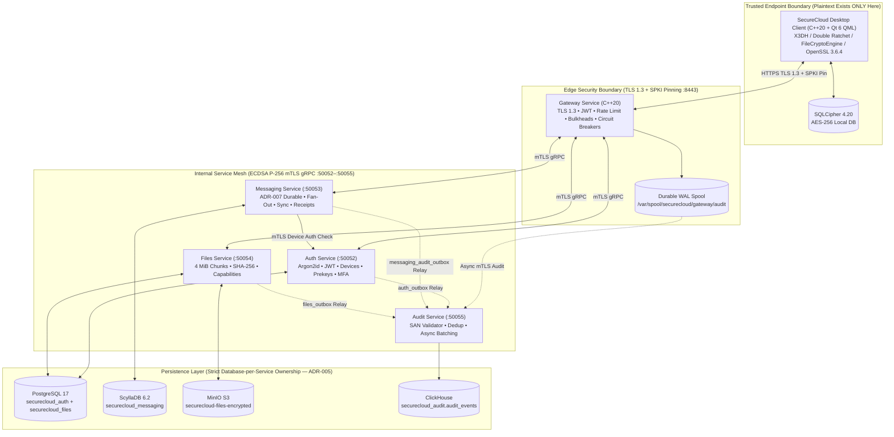

---

## 3. Architectural Decision Records Synthesis (`ADR-001` – `ADR-012`)

Every major structural choice in SecureCloud was documented upfront in `docs/adr/` before implementation and verified empirically during MVP integration. The table below maps all **12 ADRs** directly to their implemented codebase artifacts and live verification proof.

| ADR | Title | Core Decision | Implemented Codebase Artifacts | MVP Verification Proof |
|---|---|---|---|---|
| **ADR-001** | Five Microservices Architecture | Decompose backend into 5 single-responsibility C++20 services (`Gateway`, `Auth`, `Messaging`, `Files`, `Audit`). | `src/gateway/`, `src/auth/`, `src/messaging/`, `src/files/`, `src/audit/`, `deploy/docker/*` | All 5 services run independently in Compose (`31.8 MiB` combined idle RAM). |
| **ADR-002** | Runtime vs. Infrastructure Control Plane | Keep business runtime stateless and decoupled from infrastructure lifecycle/migrations. | Dedicated init containers (`postgres-migrate`, `scylla-init`, `minio-init`, `clickhouse-init`) in `docker-compose.yml` | Clean `down -v && up -d` boots deterministically with schema migrations separated. |
| **ADR-003** | Distributed Architecture First | Enforce network boundaries from Day 1; no in-process service shortcuts. | Separate TCP ports (`:8443`, `:50051`–`:50055`), isolated Docker network `securecloud-dev` | All 5 E2E scenarios and 6 backend benchmark groups traverse real network sockets. |
| **ADR-004** | Inter-Process Communication Model | HTTPS/JSON (TLS 1.3) for Client->Gateway; Protobuf/gRPC over mTLS for Service->Service; zero gRPC in desktop client. | `proto/securecloud/*/v1/*.proto`, `QtHttpGatewayClient`, `src/gateway/grpc/` | `otool -L` confirms **0** gRPC/Protobuf/Abseil dylibs in `securecloud-client`. |
| **ADR-005** | Database Ownership Model | Strict database-per-service isolation with unprivileged service roles (`auth_user`, `files_user`, `audit_user`). | `deploy/compose/postgres/`, separate keyspace/bucket/DB per service | No cross-service direct database reads; Messaging queries Auth over mTLS gRPC. |
| **ADR-006** | Persistence Technology Selection | Polyglot persistence: PostgreSQL (ACID identity/file metadata), ScyllaDB (partitioned high-write messaging), MinIO (S3 ciphertext blobs), ClickHouse (append-only columnar audit). | `src/auth/db/`, `src/messaging/db/`, `src/files/storage/`, `src/audit/repository/` | Proven at `950 msg/s` (ScyllaDB), `89 MiB/s` (MinIO), `2,624 req/s` (PG), `1.05 ms` lookup (ClickHouse). |
| **ADR-007** | Message Reliability & Durability | Durable acceptance semantics: persist envelope + delivery state + outbox in ScyllaDB before returning ACK; idempotency keys prevent duplicates. | `src/messaging/service/`, `message_submission_by_idempotency_key`, `pending_deliveries_by_device` | Verified in `MessagingE2EEnvelopeIntegrationTest` + `949.6` durable msg/s benchmark (`0` errors). |
| **ADR-008** | Security & Cryptographic Architecture | Zero-knowledge E2EE (`X3DH` + `Double Ratchet` + `AES-256-GCM`), `Argon2id`, `TLS 1.3 + SPKI`, internal `mTLS`, local `SQLCipher`, Emergency Panic Wipe. | `src/client/domain/crypto/`, `OpenSslCryptoProvider`, `Argon2idHasher`, `src/common/src/security/` | Zero plaintext verified across all 4 datastores in Live Compose E2E (`Scenarios 2, 3, 5`). |
| **ADR-009** | Distributed Failure Resilience | Isolate failures via timeouts, bounded retries, circuit breakers, bulkheads, and non-blocking async audit pipelines. | `src/gateway/http/resilience/` (`BulkheadManager`, `CircuitBreaker`, `DeadlineManager`, `RetryPolicy`) | `4,500+` concurrent requests with `0` cascading failures; Audit outage isolated by spool/outboxes. |
| **ADR-010** | Performance, Capacity & Optimization | Partition-oriented ScyllaDB (zero `ALLOW FILTERING`), HTTP/1.1 keep-alive reuse, bounded queues, empirical benchmarking (`10,000 msg/s` horizontal cluster target; strict client RAM/CPU budgets). | `client_performance_benchmark_test.cpp`, `messaging_capacity_load_test.cpp`, `scripts/benchmark_backend_compose.py` | `7/7` client budgets PASS; `6/6` backend groups PASS; CI verifies zero `ALLOW FILTERING`. |
| **ADR-011** | Gateway Audit Event Delivery | Durable disk-backed WAL spool (`FileSpoolPendingStore`) in Gateway for non-blocking, crash-survivable audit delivery to Audit service. | `src/gateway/audit/`, volume `gateway-audit-spool:/var/spool/securecloud/gateway/audit` | Verified live in Compose E2E `Scenario 5` (`PRODUCER_SERVICE_GATEWAY` events persisted). |
| **ADR-012** | Messaging Durable Audit Outbox | ScyllaDB-backed `messaging_audit_outbox` table + leased background relay workers with retries and deduplication. | `V006__create_messaging_audit_outbox.cql`, `src/messaging/audit/` | Verified in backend benchmark (`84` messaging audit events drained cleanly without blocking `950 msg/s`). |

---

## 4. End-to-End Cryptographic Architecture

All user-content cryptography executes exclusively inside the desktop client (`src/client/domain/crypto/` and `src/client/infrastructure/adapters/openssl_crypto_provider.cpp`) using **OpenSSL 3.6.4** (`OpenSSL::Crypto` / `OpenSSL::SSL`), with mandatory boot-time Known-Answer Tests (KATs) executed before the UI unlocks (`278–418 us` measured in Scenario 1).

### 4.1 Cryptographic Primitive Inventory

| Function | Algorithm & Parameters | Where Executed | Purpose & Security Property |
|---|---|---|---|
| **Identity Signing** | `Ed25519` (RFC 8032) | Client (`OpenSslCryptoProvider`) + Verified by `Auth` | Signs each device's X25519 Signed Prekey (`SPK`) and authenticates device identity. |
| **Key Agreement (X3DH & Ratchet)** | `X25519` (Curve25519 ECDH, RFC 7748) | Client (`RatchetSessionManager`) | Asynchronous X3DH session setup (`DH1..DH4`) + continuous DH ratchet steps. |
| **Key Derivation** | `HKDF-SHA-256` (RFC 5869) | Client (`OpenSslCryptoProvider`) | Derives root keys, chain keys, and per-message encryption keys with domain separation. |
| **Message & File AEAD** | `AES-256-GCM` (`96-bit` IV, `128-bit` auth tag) | Client (`DoubleRatchetEngine`, `FileCryptoEngine`) | Authenticated encryption of every message envelope and every `4 MiB` file chunk. |
| **Integrity Hashing** | `SHA-256` (`StreamingSha256`) | Client + `Files` Service + `Audit` (`EventPayloadFingerprint`) | Chunk & full-file ciphertext verification, SPKI pin computation, Safety Numbers, audit dedup. |
| **Password Verification** | `Argon2id` (`v=19, m=65536 KiB, t=3, p=1`) | `Auth` Service (`OpenSslArgon2idHasher`) | Memory-hard password hashing (`~73.6 ms` per login verify) defeating GPU/ASIC brute-force. |
| **Multi-Factor Auth (MFA)** | `TOTP` (`RFC 6238`, HMAC-SHA1, 6-digit, 30 s window) | `Auth` Service (`TotpEngine`) + Client | Step-up authentication (`AUTH_LEVEL_MFA`) required for sensitive actions like device revocation. |
| **Local Storage Encryption** | `SQLCipher 4.20` (`AES-256-CBC` + `HMAC-SHA512`, WAL mode) | Client (`SqlCipherLocalStore`) | Encrypts entire local message history, ratchet states, contacts, and settings at rest. |
| **External Transport** | `TLS 1.3` + `SHA-256 SPKI Pinning` (`CRYPTO_memcmp`) | Client (`QtHttpGatewayClient`) <-> `Gateway` (`:8443`) | Constant-time SPKI pin verification prevents rogue-CA MITM attacks. |
| **Internal Service Mesh** | `mTLS` (`ECDSA P-256` Root CA + per-service leaf certs) | All 5 backend services (`:50051`–`:50055`) | Mutual authentication and encrypted gRPC transport between every microservice pair. |

### 4.2 X3DH Session Establishment, Double Ratchet & Encrypted File Flow

```mermaid
sequenceDiagram
    participant A as Alice Client (Device A1)
    participant GW as Gateway (TLS 1.3 :8443)
    participant AUTH as Auth Service (PostgreSQL)
    participant MSG as Messaging Service (ScyllaDB)
    participant FILES as Files Service (PG + MinIO)
    participant B as Bob Client (Device B1)

    Note over B,AUTH: 1. Device Enrollment & Prekey Publication
    B->>GW: POST /api/v1/devices (IK_B, SPK_B, Ed25519_Sig(SPK_B), 10x OTPK_B)
    GW->>AUTH: RegisterDevice (mTLS gRPC)
    AUTH->>AUTH: Verify Ed25519_Sig(SPK_B) against IK_B -> Store in PostgreSQL

    Note over A,B: 2. Asynchronous X3DH + Double Ratchet Message
    A->>GW: GET /api/v1/users/{bob_id}/devices/crypto-directory
    GW->>AUTH: GetDeviceCryptoDirectory -> Returns {IK_B, SPK_B, Sig, OTPK_B}
    A->>A: Verify Ed25519_Sig(SPK_B), compute X3DH(DH1..DH4) -> RootKey
    A->>A: Compute Safety Number = H(IK_A, IK_B) & AES-256-GCM encrypt message
    A->>GW: POST /api/v1/messages (opaque ciphertext_blob, IV, tag, ephemeral_pub)
    GW->>MSG: SendMessage (mTLS gRPC)
    MSG->>AUTH: Verify all active devices of Bob are included (else HTTP 412)
    MSG->>MSG: Durable ScyllaDB write (envelope + delivery_state + messaging_audit_outbox)
    MSG-->>A: 200 OK (Accepted, message_id)

    Note over B,MSG: 3. Recipient Catch-Up Sync & Decryption
    B->>GW: GET /api/v1/conversations/{id}/messages?device_id=B1
    GW->>MSG: GetMessages -> Returns opaque ciphertext envelope
    B->>B: Complete X3DH / Double Ratchet step -> AES-256-GCM decrypt plaintext
    B->>GW: POST /api/v1/messages/{id}/ack (DELIVERED)

    Note over A,B: 4. Zero-Knowledge 5 MiB Encrypted File Transfer
    A->>A: Generate random 256-bit FileKey; encrypt 4 MiB chunks (AES-256-GCM) + SHA-256
    A->>GW: POST /api/v1/files/upload/init -> chunk(0..N) -> finalize
    GW->>FILES: Stream opaque chunks -> MinIO S3 + PostgreSQL metadata (0 filenames/keys)
    A->>B: Send {file_id, FileKey, original_name, sha256} inside Double Ratchet message
    B->>GW: GET /api/v1/files/{file_id}/chunks/0..N
    B->>B: Verify SHA-256 & decrypt with FileKey locally
```

### 4.3 Safety Numbers & Out-of-Band Verification
`SafetyNumberEngine` (`src/client/application/managers/safety_number_engine.hpp`) deterministically computes a human-verifiable cryptographic fingerprint from the sorted canonical pair of `(local_identity_key, peer_identity_key)`. When `ContactManager` hydrates contacts or receives an inbound X3DH session initiation (`WorkspaceViewModel::hydrateFromLocalStore`), the safety number is automatically computed and displayed in the chat Security Drawer. Clicking **Verify Safety Number** records verified trust state in SQLCipher without altering the stored peer public key; if a peer's identity key ever changes (e.g., key replacement or suspected MITM), the engine transitions the contact to `KeyChanged` and alerts the user immediately.

---

## 5. Shared Platform Foundation & Protobuf/gRPC Service Contracts

### 5.1 Shared C++20 Common Library (`src/common` — `22` files, `1,574` LOC)
Every backend microservice links `securecloud::common` (`src/common/CMakeLists.txt`), providing a single audited implementation of cross-cutting infrastructure primitives:
- **Configuration & Secret Hygiene (`src/common/src/configuration/`):** Typed environment parsing with fail-closed startup validation and `SecretString`, which wraps sensitive credentials (DB passwords, tokens, keys) to prevent accidental `std::ostream` logging and zeroizes heap buffers on destruction.
- **mTLS & Security Primitives (`src/common/src/security/`):** Unified `MtlsConfig` loader reading `SECURECLOUD_CA_CERT_PATH`, `SECURECLOUD_SERVICE_CERT_PATH`, and `SECURECLOUD_SERVICE_KEY_PATH` to construct gRPC `SslServerCredentials` (with `GRPC_SSL_REQUEST_AND_REQUIRE_CLIENT_CERTIFICATE_AND_VERIFY`) and `SslCredentials` with peer SAN/target-name overrides.
- **gRPC Infrastructure (`src/common/src/grpc/`):** Canonical server builder helpers, interceptors, and metadata extraction helpers for `x-correlation-id`, `x-user-id`, and `x-device-id`.
- **Health & Lifecycle Management (`src/common/src/health/`):** `HealthStatusManager` supporting dual-probe semantics (`is_live()` for liveness vs. `is_ready() && evaluate_readiness()` for downstream dependency readiness) exposed over both gRPC `HealthService` and Gateway HTTPS `/health/live` & `/health/ready`.

### 5.2 Canonical Protobuf v1 Service Contracts (`proto/securecloud/*/v1/*.proto`)
All inter-service communication uses strongly typed Protobuf v3 contracts compiled at build time via `proto/CMakeLists.txt` (with `proto/proto_win32_compat.hpp` ensuring clean Windows MSVC/MinGW compilation without `NOMINMAX` or Win32 macro collisions):

| Protobuf Contract | gRPC Service(s) | Core RPC Surface (Verified) | Consumer(s) |
|---|---|---|---|
| `proto/securecloud/common/v1/health.proto` | `HealthService` | Liveness & readiness health probes | All 5 services |
| `proto/securecloud/auth/v1/auth.proto` | `AuthService` | Login, token validation, rotating refresh, revoke, device registration/listing/revocation, pairing, prekey upload/inventory/claim, crypto directory, MFA enroll/confirm/challenge/verify/disable | `Gateway`, `Messaging` |
| `proto/securecloud/messaging/v1/messaging.proto` | `MessagingService` (`18` RPCs) | `SendMessage`, `GetMessages`, `AcknowledgeDelivery`, `SendReadReceipt`, `GetMessageDeliveryStatus`, `CreateConversation`, `GetConversation`, `ListConversations`, `AddParticipant`, `RemoveParticipant`, `LeaveConversation`, `UpdateConversationMetadata`, `SyncDeviceMessages`, `GetSyncCursor`, `UpdateSyncCursor`, `UpdatePresence`, `GetPresence`, `BatchGetPresence` | `Gateway` |
| `proto/securecloud/files/v1/files.proto` | `FilesService` (`7` RPCs) | `CreateFileUpload`, `UploadChunk`, `FinalizeFileUpload`, `GetFileMetadata`, `DownloadChunk`, `CancelFileUpload`, `DeleteFile` | `Gateway` |
| `proto/securecloud/audit/v1/audit.proto` | `AuditIngestionService` (`2` RPCs)<br>`AuditQueryService` (`2` RPCs) | `SubmitAuditEvent`, `BatchSubmitAuditEvents`<br>`QueryAuditEvents`, `GetAuditEventById` | All 4 producers (`Ingestion`); authorized `audit` SAN (`Query`) |

---

## 6. Gateway Microservice (`src/gateway` — `111` files, `17,548` LOC)

The **Gateway** (`securecloud-gateway`) is the sole external ingress boundary of the SecureCloud platform. It terminates **TLS 1.3** (`:8443`), redirects plaintext HTTP (`:8080`), authenticates caller JWTs, enforces traffic governance and resilience policies, translates REST/JSON/binary requests into internal **mTLS gRPC** RPCs, and emits non-blocking security audit events via an `ADR-011` disk-backed WAL spool.

### 6.1 Internal Request Pipeline

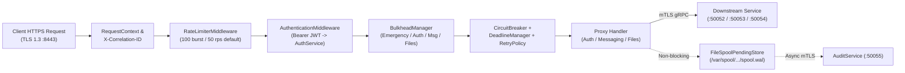

### 6.2 Key Subsystems in `src/gateway/`
1. **TLS 1.3 Edge & HTTP Server (`src/gateway/tls/`, `src/gateway/http/server/`):** Built on `cpp-httplib` + OpenSSL 3 with `TLS 1.3` enforced on `:8443`, HTTP/1.1 persistent keep-alive support (`0.23–0.39 ms` p50 measured in Group 1 benchmarks — **200x faster** than fresh `46.6 ms` TLS 1.3 handshakes), and automatic HTTP->HTTPS redirection on `:8080`.
2. **Routing & REST Proxy Handlers (`src/gateway/http/routing/`, `src/gateway/http/proxy/`):**
   - `GatewayRouteRegistrar` wires `/health/live`, `/health/ready`, and delegates domain routes to `AuthProxyHandler` (`2,069` lines), `MessagingProxyHandler` (`2,033` lines), and `FilesProxyHandler` (`941` lines).
   - Every handler propagates `x-user-id`, `x-device-id`, and `x-correlation-id` into `grpc::ClientCallContext`, ensuring end-to-end distributed correlation across all downstream services and ClickHouse audit rows.
   - `FilesProxyHandler` streams raw binary chunks (`application/octet-stream`) with `Upload-Id`, `Chunk-Index`, `X-Ciphertext-SHA256`, and `X-File-Capability` headers through `StreamingBuffer` without buffering entire multi-megabyte files in RAM.
3. **Traffic Governance & Failure Isolation (`src/gateway/http/middleware/`, `src/gateway/http/resilience/`):**
   - **Token-Bucket Rate Limiter (`RateLimiterMiddleware`):** Configurable via `SECURECLOUD_GATEWAY_RATE_LIMIT_ENABLED`, `REFILL_RATE` (default `50 req/s`), `BURST` (default `100`), `MAX_CLIENTS`, and `CLIENT_TTL_SEC`. Returns RFC 7807 `HTTP 429 Too Many Requests` (`application/problem+json`) with request correlation ID.
   - **Workload Bulkheads (`BulkheadManager`):** Segregates concurrency slots by workload class (`Emergency`, `Auth`, `Messaging`, `Files`) so a heavy file-upload burst cannot starve health probes or emergency alerts.
   - **Deadlines, Retries & Circuit Breakers (`DeadlineManager`, `RetryPolicy`, `CircuitBreaker`):** Bounds downstream gRPC timeouts and trips cleanly when a backend service becomes unhealthy, mapping gRPC status codes deterministically to RFC 7807 HTTP errors via `ErrorMapper`.
4. **Durable WAL Audit Spool (`src/gateway/audit/`, `ADR-011`):**
   - Mounted on named Docker volume `gateway-audit-spool:/var/spool/securecloud/gateway/audit` (`max_spool_bytes = 1 GiB`, `max_spool_records = 100,000`).
   - Gateway appends security events (`401` rejected tokens, rate-limit rejections, auth/proxy decisions) to the local WAL spool in microseconds and drains them asynchronously over mTLS to `audit:50055` so Audit/ClickHouse downtime never blocks user traffic.

---

## 7. Auth Microservice (`src/auth` — `17,603` LOC, `96` files) & PostgreSQL Identity Store

The **Auth** service (`securecloud-auth`, mTLS gRPC `:50052`) is the authoritative source of identity, sessions, device cryptographic directories, and multi-factor authentication, backed exclusively by PostgreSQL 17 (`securecloud_auth`, unprivileged role `auth_user`).

### 7.1 Cryptographic & Identity Workflows
- **Argon2id Password Verification (`src/auth/crypto/argon2id_hasher.*`):** Uses OpenSSL 3 native `ARGON2ID` (`v=19, m=65536 KiB, t=3, p=1`) for memory-hard verification (`73.58 ms` p50 measured in Group 2 benchmarks), protecting credentials against GPU/ASIC brute-force attacks.
- **Stateless Access JWT + Rotating Refresh Tokens:** Login issues a short-lived signed JWT access token (`GET /api/v1/devices` validates at `2,623.8 req/s`, `1.12 ms` p50) paired with a single-use rotating refresh token persisted in PostgreSQL (`POST /api/v1/auth/refresh` completes atomic rotation in `1.32 ms` p50).
- **Cryptographically Verified Device Enrollment & Prekey Lifecycle:** On `POST /api/v1/devices`, `Auth` **verifies the Ed25519 signature over the device's X25519 signed prekey** before accepting the bundle (invalid signatures are rejected fail-closed with `HTTP 400`). Supports OTPK replenishment (`POST /api/v1/devices/:id/prekeys`), inventory status (`GET .../prekeys/inventory`), atomic OTPK claiming (`POST .../prekeys/claim`), and multi-device crypto-directory lookups (`GET /api/v1/users/:id/devices/crypto-directory` measured at `1,079.3 req/s`, `1.65 ms` p50).
- **RFC 6238 TOTP MFA & Step-Up Authorization (`src/auth/crypto/totp_engine.*`):** Full enroll -> confirm -> challenge -> verify -> disable lifecycle upgrading a session to `AUTH_LEVEL_MFA`, enforced before high-impact operations such as revoking a companion device.
- **Transactional Audit Outbox (`V005__create_auth_outbox_table.sql`, `src/auth/audit/`):** Security events (logins, token refreshes, MFA challenges, device enrollments/revocations) are committed transactionally in `auth_outbox` alongside business state and relayed asynchronously to `audit:50055`.

### 7.2 PostgreSQL `securecloud_auth` Schema (`V001`–`V005`)

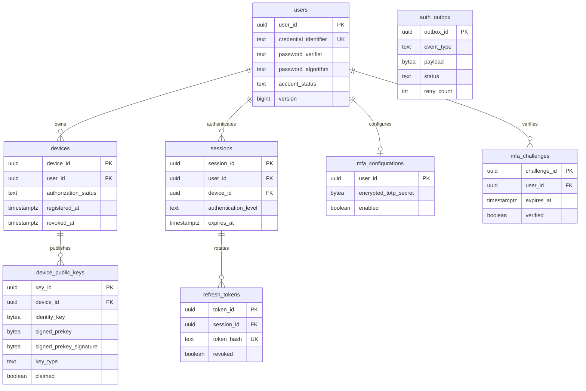

---

## 8. Messaging Microservice (`src/messaging` — `21,387` LOC, `157` files) & ScyllaDB Persistence

The **Messaging** service (`securecloud-messaging`, mTLS gRPC `:50053`) is the primary throughput-critical component of SecureCloud, designed around `ADR-007` durable acceptance semantics and `ADR-010` partition-oriented ScyllaDB persistence.

### 8.1 Core Capabilities & Strict Security/Durability Enforcement
1. **Zero-Knowledge Opaque Envelopes:** Messaging never sees plaintext. Each `SendMessageRequest` carries per-device `EncryptedPayload` structures (`ciphertext_blob`, `ephemeral_public_key`, `initialization_vector`, `auth_tag`, `algorithm`), stored verbatim in ScyllaDB.
2. **Strict Zero-Omission Multi-Device Fan-Out (`HTTP 412`):** Before accepting a message, Messaging queries `Auth` over mTLS (`SECURECLOUD_MESSAGING_AUTH_ENDPOINT: auth:50052`) to confirm the sender included encrypted payloads for **every active authorized device** of the recipient (and sender companion devices). Omitting an active device fails closed with `FAILED_PRECONDITION` (`HTTP 412`), preventing silent device-exclusion attacks. Conversely, once a device is revoked in `Auth`, Messaging immediately stops queuing rows for it (verified in Live Compose E2E `Scenario 4`).
3. **Durable Acceptance & Idempotency (`ADR-007`):** Every `SendMessage` call checks `message_submission_by_idempotency_key` (rejecting conflicting tampered payloads with `409 Conflict` while returning idempotent replays cleanly), writes the message to `messages_by_conversation`, fans out per-device entries to `pending_deliveries_by_device`, initializes `delivery_state_by_message`, and writes an audit record to `messaging_audit_outbox` — **all before returning `200 OK`**.
4. **Priority Lanes & Delivery Lifecycle:** Supports `normal`, `urgent`, and `emergency` priorities, explicit delivery ACKs (`POST /api/v1/messages/:id/ack`), read receipts (`POST /api/v1/messages/:id/read`), per-device sync cursors (`GET/PUT /api/v1/devices/:id/cursor`), and presence heartbeats (`PUT /api/v1/presence/me`, `POST /api/v1/presence/batch`).
5. **Zero `ALLOW FILTERING` ScyllaDB Discipline (`ADR-010`):** Every CQL query in `src/messaging/repository/` is strictly partition-keyed (`conversations_by_id`, `messages_by_conversation`, `pending_deliveries_by_device`, `delivery_state_by_message`). This invariant is continuously enforced in CI by `MessagingCapacityLoadTest.ScyllaCqlAccessPatternAuditZeroAllowFilteringAndBoundedPartitionScans`, which scans the repository C++ source files to ensure zero `ALLOW FILTERING` clauses can ever be introduced.
6. **Durable Audit Outbox Relay (`ADR-012`):** `V006__create_messaging_audit_outbox.cql` stores pending audit events in ScyllaDB; a configurable pool of `4` leased background worker threads (`batch_size=100`, `active_poll=50 ms`, `idle_poll=500 ms`, `lease_duration=30 s`, `max_retries=5`) drains them over mTLS to `audit:50055`.

### 8.2 Message Delivery State Machine

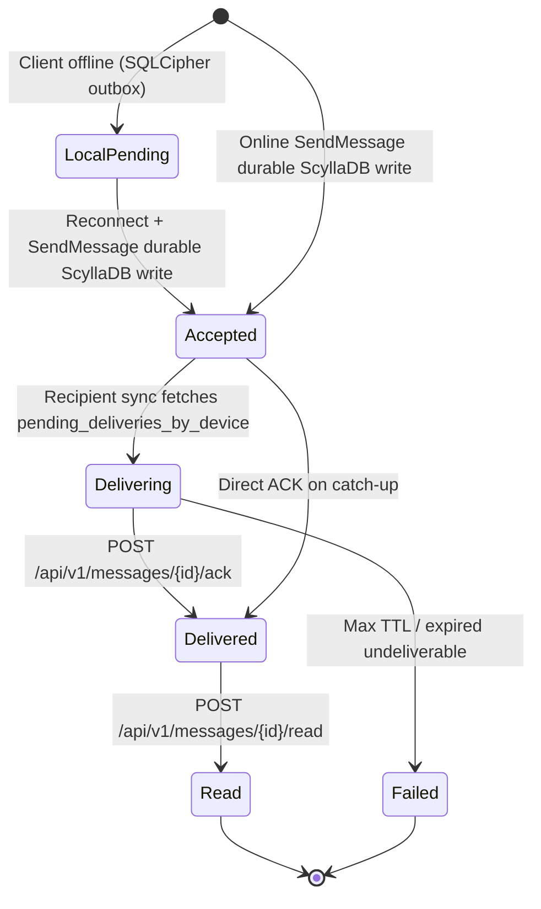

### 8.3 ScyllaDB `securecloud_messaging` Keyspace (`13` Tables across `V001`–`V006`)

| Table (`securecloud_messaging.*`) | Migration | Purpose & Partitioning Strategy |
|---|---|---|
| `conversations_by_id` | `V002` | Authoritative conversation metadata keyed by `conversation_id` |
| `direct_conversation_by_users` | `V002` | Canonical lookup preventing duplicate 1:1 conversations between user pairs |
| `group_metadata_by_conversation` | `V002` | Group title, creator, and metadata keyed by `conversation_id` |
| `conversation_members_by_conversation` | `V002` | Membership authorization check per `conversation_id` |
| `conversations_by_user` | `V002` | Fast sidebar listing of all conversations for a `user_id` |
| `messages_by_conversation` | `V002`, `V004` | Bounded chronological message history partitioned by `(conversation_id, bucket)` with per-device envelope columns |
| `pending_deliveries_by_device` | `V002`, `V004`, `V005` | Durable offline inbox per `recipient_device_id` (zero single global queue!) |
| `delivery_state_by_message` | `V002` | Per-recipient delivery & read receipt status keyed by `message_id` |
| `sync_state_by_device` | `V002` | Authoritative catch-up cursor per `device_id` |
| `message_submission_by_idempotency_key` | `V002` | Replay-safe deduplication & conflicting-payload tamper detection |
| `messaging_outbox_events` | `V002` | Internal durable messaging event outbox |
| `schema_migrations` | `V003` | Monotonic CQL schema version tracking |
| `messaging_audit_outbox` | `V006` | `ADR-012` leased background audit relay queue to `audit:50055` |

---

## 9. Files Microservice (`src/files` — `16,830` LOC, `97` files) & PostgreSQL + MinIO Object Store

The **Files** service (`securecloud-files`, mTLS gRPC `:50054`) provides resumable, zero-knowledge encrypted file storage by splitting metadata durability (**PostgreSQL 17**, `securecloud_files`, `7` tables) from binary ciphertext storage (**MinIO S3**, bucket `securecloud-files-encrypted`).

### 9.1 Canonical 4 MiB Chunked Upload & Download Protocol
1. **`CreateFileUpload` (`POST /api/v1/files/upload/init`):** Validates `owner_user_id`, `owner_device_id`, `encrypted_size_bytes`, mandatory `client_crypto_metadata`, and enforces the canonical **`4 MiB` (`4,194,304 B`) chunk count formula** (non-canonical chunk counts are rejected fail-closed with `HTTP 400`). Creates a `PENDING` transfer row in PostgreSQL (`file_transfers`) and returns an `upload_id` with expiration TTL.
2. **`UploadChunk` (`POST /api/v1/files/upload/chunk`):** Streams each raw binary ciphertext chunk (`application/octet-stream`) with `Upload-Id`, `Chunk-Index`, and `X-Ciphertext-SHA256`. Files computes the SHA-256 of the received bytes, rejects mismatches immediately, writes the opaque object to MinIO via `S3Client`, and records the verified chunk in `file_chunks`. Supports resumable retry of individual chunks without restarting the entire upload.
3. **`FinalizeFileUpload` (`POST /api/v1/files/upload/finalize`):** Verifies all `expected_chunk_count` chunks are present and intact, validates `expected_ciphertext_sha256`, transitions `files.lifecycle_state` to `FILE_LIFECYCLE_STATE_AVAILABLE`, and enqueues a `FILE_UPLOAD_FINALIZED` event in `files_outbox`.
4. **`DownloadChunk` (`GET /api/v1/files/:file_id/chunks/:chunk_index`):** Authorizes caller via ownership, conversation membership, or `X-File-Capability` token (`file_access`), streams the encrypted chunk from MinIO back through Gateway with `X-Ciphertext-SHA256`, and leaves decryption exclusively to the receiving client (`FileCryptoEngine`).

### 9.2 PostgreSQL `securecloud_files` Schema (`V001`–`V002`)
- `files` — Lifecycle state (`PENDING`, `AVAILABLE`, `DELETED`), `owner_user_id`, `conversation_id`, `encrypted_size_bytes`, `chunk_count`, `ciphertext_integrity_hash` (zero plaintext filenames!)
- `file_versions` — Versioned immutable ciphertext pointers
- `encrypted_file_metadata` — Opaque client-supplied crypto metadata JSON (`alg`, `v`, `chunk_size`)
- `file_transfers` — Resumable upload session state & expiration timestamps
- `file_chunks` — Per-chunk S3 object key, byte size, and verified SHA-256 digest
- `file_access` — Scoped access control & capability grant records
- `files_outbox` — Hardened (`V002`) transactional audit outbox relayed asynchronously to `audit:50055`

---

## 10. Audit Microservice (`src/audit` — `9,643` LOC, `91` files) & ClickHouse Forensic Store

The **Audit** service (`securecloud-audit`, mTLS gRPC `:50055`) provides centralized, append-only, tamper-evident security observability across the entire platform, backed by **ClickHouse** (`securecloud_audit.audit_events`).

### 10.1 Defense-in-Depth Ingestion & Query Architecture
1. **Strict mTLS Producer Identity Binding (`ProducerIdentityValidator`):** Every `SubmitAuditEvent` and `BatchSubmitAuditEvents` RPC extracts the caller's mTLS X.509 certificate (`common_name`, `san_dns_names`, `san_uri_names`) and verifies that the authenticated service identity strictly matches the `producer_service` claimed in the event payload (`gateway`, `auth`, `messaging`, `files`, or `audit`). Spoofed producer claims are rejected with `PERMISSION_DENIED`.
2. **Retry-Safe Deduplication (`EventPayloadFingerprint`):** Computes a portable big-endian SHA-256 payload fingerprint for every event so retried deliveries from Gateway's WAL spool or service outboxes are acknowledged idempotently without inserting duplicate rows into ClickHouse.
3. **Bounded Asynchronous Ingestion & Batch Persistence (`AuditIngestionService`):** Buffers validated events in a bounded lock-protected queue and flushes batched inserts into ClickHouse (`001_create_audit_events_table.sql`, `MergeTree` engine partitioned by date and ordered by `(producer_service, occurred_at, event_id)`), keeping `audit` peak memory at **`8.3 MiB`** under full benchmark load.
4. **Restricted Forensic Query Plane (`AuditQueryService` + `AuditQueryAuthorizer`):** Exposes `QueryAuditEvents` and `GetAuditEventById` strictly to mTLS peers presenting authorized `audit` SANs (`audit` / `audit.securecloud.internal` / `audit.dev.securecloud.local`). Verified in Group 5 benchmarks at **`1.05 ms` p50** (`749.3 q/s`) for `correlation_id` trace lookups and **`1.57–1.91 ms` p50** for producer/time-window aggregations.

---

## 11. Desktop Client Architecture (`src/client` — `190` files, `48,943` LOC)

The SecureCloud Desktop Client (`securecloud-client`) is a native **C++20 + Qt 6.11 QML** application engineered with strict Clean Architecture boundaries (`domain/` -> `application/` -> `infrastructure/` -> `ui/`). Per `ADR-004`, the desktop client has **zero linkage to gRPC, Protobuf, or Abseil** (verified via `otool -L build/dev-release/src/client/securecloud-client`), communicating exclusively with Gateway over **TLS 1.3 + SHA-256 SPKI pinning** via `QtHttpGatewayClient`.

### 11.1 Clean Architecture Layer Diagram

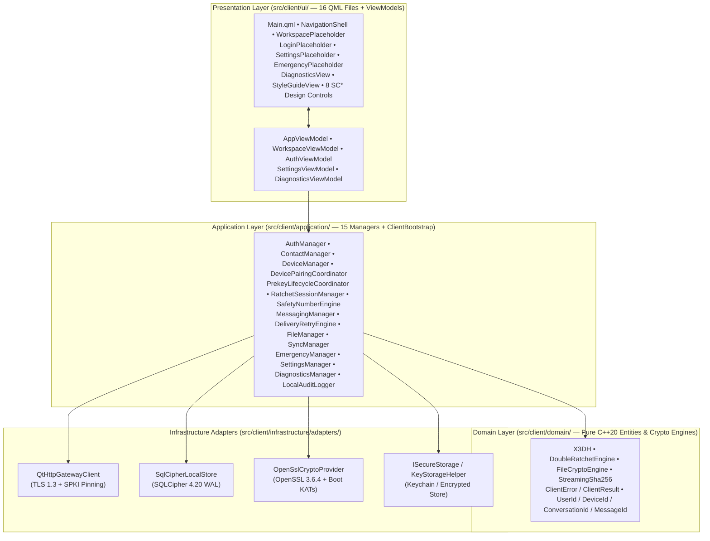

### 11.2 Complete Inventory of Application Managers (`src/client/application/managers/`)

| Manager / Coordinator | Primary Responsibility | Key Verified Behaviors |
|---|---|---|
| `AuthManager` | Login, JWT & rotating refresh lifecycle, MFA step-up, duress-PIN check | `authenticate_with_duress_check()`, token refresh, fail-closed `403` on revoked devices |
| `DeviceManager` | Local device identity generation, enrollment, companion listing & revocation | Signs X25519 SPK with Ed25519 IK; clears cached `local_device_` cleanly on panic wipe |
| `DevicePairingCoordinator` | QR/token pairing workflow for enrolling companion devices | Coordinates `POST /api/v1/devices/pairing` and `POST /api/v1/devices/:id/authorize` |
| `PrekeyLifecycleCoordinator` | Monitors OTPK inventory and signed-prekey age; triggers replenishment | Uploads batches of 10+ OTPKs via `POST /api/v1/devices/:id/prekeys` (`Scenario 1`) |
| `RatchetSessionManager` | Manages X3DH session init and Double Ratchet chains per `(peer, device)` | Persists ratchet state in SQLCipher; `46,581–82,945 msg/s` (`Benchmark F`) |
| `SafetyNumberEngine` | Computes canonical out-of-band Safety Numbers & detects `KeyChanged` | Auto-updates on inbound X3DH; verifies without corrupting peer key |
| `ContactManager` | Manages contact directory, display names/roles, and verified status | Hydrates `local_identity` on boot (`client_bootstrap.cpp`) and `sync_contacts()` |
| `MessagingManager` | End-to-end encrypted send/receive orchestration, fan-out, receipts, disappearing purge | Stages outbound envelopes, handles `normal`/`urgent`/`emergency` priority, periodic TTL purge |
| `DeliveryRetryEngine` | Bounded exponential backoff for transient network failures | Ensures idempotent retries using persistent `client_idempotency_token` |
| `FileManager` | Streaming 4 MiB AES-256-GCM chunked upload/download + SHA-256 integrity | Keeps peak streaming delta at `+8.19 MB` for `16 MiB` streams (`Benchmark C`) |
| `SyncManager` | Catch-up sync, offline outbox drain, and device cursor advancement | Flushes `LocalPending` outbox cleanly on reconnect (`Scenario 4`) |
| `EmergencyManager` | Local Emergency Panic Wipe & Duress Wipe orchestration | Shreds SQLCipher DB, clears `ISecureStorage`, reopens clean store post-wipe (`Scenario 5`) |
| `SettingsManager` | Persists user preferences, display name, role, avatar, and privacy toggles | Guards against server overwrite of local profile fields; supports circular PNG avatars |
| `DiagnosticsManager` + `DiagnosticSanitizer` | Live gateway latency RTT, health probes, and sanitized diagnostic export | Strips all secrets/tokens/plaintexts before rendering or exporting telemetry |
| `LocalAuditLogger` | Tamper-evident local security event log inside SQLCipher | Records login, key verification, revocation, and wipe events locally |

### 11.3 Qt 6 QML User Interface & Design System (`src/client/ui/qml/` — `16` Files)
- **8 Top-Level Views:** `Main.qml`, `NavigationShell.qml` (sidebar with circular user avatar & Display Name footer), `LoginPlaceholder.qml`, `WorkspacePlaceholder.qml` (conversations list, E2EE message bubbles, emergency priority cards with `emergencyAckCard` state, Security Drawer with Safety Number verification, encrypted file attachment picker/downloader), `SettingsPlaceholder.qml` (profile Display Name/Role, native `FileDialog` circular avatar picker, MFA & device management), `EmergencyPlaceholder.qml` (Panic Wipe confirmation flow), `DiagnosticsView.qml`, and `StyleGuideView.qml` (`--gallery` design system viewer).
- **8 Reusable Design-System Controls (`src/client/ui/qml/controls/`):** `SCAvatar.qml` (supports circular `data:image/png;base64,...` rendering + monogram fallback), `SCBadge.qml`, `SCButton.qml`, `SCCard.qml`, `SCDialog.qml`, `SCIcon.qml`, `SCIconButton.qml`, and `SCTextField.qml`.
- **Headless CLI Modes (`securecloud-client`):** Supports `--smoke-test` (headless boot + KATs + QML engine check in `171.6 ms` p50), `--benchmark-idle-ms <ms>` (used by `Benchmark A`), and `--gallery` (interactive component catalog).

---

## 12. Containerization, Dev PKI & Docker Compose Topology

### 12.1 Multi-Stage Production Dockerfiles (`deploy/docker/`)
All five C++20 microservices ship dedicated Dockerfiles (`deploy/docker/{gateway,auth,messaging,files,audit}/Dockerfile`) compiled with CMake `Release` optimizations (`-O3`) and hardening flags, resulting in compact native runtime containers whose **combined idle memory across all 5 services is only `31.8 MiB`**.

### 12.2 Full 13-Container Docker Compose Topology (`deploy/compose/docker-compose.yml`)

| Container Role | Service Name | Internal Port(s) | Host Binding | Dependencies & Volumes |
|---|---|---|---|---|
| **Edge Proxy** | `gateway` | `8443` (TLS 1.3), `8080`, `50051` | `127.0.0.1:8443/8080/50051` | `auth`, `messaging`, `files`; `gateway-audit-spool` WAL volume |
| **Identity** | `auth` | `50052` (mTLS gRPC) | `127.0.0.1:50052` | `postgres` (healthy), `postgres-migrate` (completed) |
| **Messaging** | `messaging` | `50053` (mTLS gRPC) | `127.0.0.1:50053` | `scylladb` (healthy), `scylla-init` (completed) |
| **Files** | `files` | `50054` (mTLS gRPC) | `127.0.0.1:50054` | `postgres`, `postgres-migrate`, `minio`, `minio-init` |
| **Audit** | `audit` | `50055` (mTLS gRPC) | `127.0.0.1:50055` | `clickhouse` (healthy), `clickhouse-init` (completed) |
| **Datastore 1** | `postgres` (PG 17) | `5432` | `127.0.0.1:5433` | `postgres-data` volume; isolated `auth_user` & `files_user` |
| **Datastore 2** | `scylladb` (6.2) | `9042` | `127.0.0.1:9042` | `scylla-data` volume; `--memory 512M` dev mode |
| **Datastore 3** | `minio` (S3) | `9000`, `9001` | `127.0.0.1:9000/9001` | `minio-data` volume; bucket `securecloud-files-encrypted` |
| **Datastore 4** | `clickhouse` | `8123`, `9000` | `127.0.0.1:8123` | `clickhouse-data` volume; `securecloud_audit.audit_events` |
| **4 Init Jobs** | `postgres-migrate`, `scylla-init`, `minio-init`, `clickhouse-init` | — | — | Run idempotently on startup and exit `0` before services launch |

### 12.3 Automated PKI & One-Command Operational Scripts (`scripts/`)
- **`scripts/generate-dev-pki.sh` & `scripts/verify-dev-pki.sh`:** Generates an **ECDSA P-256 Root CA** (`deploy/dev-pki/ca/ca.crt`) and five signed per-service leaf certificates (`gateway`, `auth`, `messaging`, `files`, `audit`) with strict DNS/IP SANs (`DNS:gateway,DNS:localhost,IP:127.0.0.1` for Gateway).
- **`scripts/demo-mvp-reset.sh`:** Verifies dev PKI, starts the full Compose stack, waits for PostgreSQL + Gateway TLS 1.3 health, seeds `alice@securecloud.local` and `bob@securecloud.local` with real `Argon2id` (`m=65536, t=3, p=1`) hashes, computes the live Gateway SPKI SHA-256 pin, and prints copy-paste launch commands for two desktop client windows.
- **Three One-Command Verification Runners:**
  - `scripts/run-client-benchmarks.sh` — Full 7-budget `dev-release` client suite (`~9.3 s`).
  - `scripts/run-compose-e2e-tests.sh` — Auto-wipe -> fresh Compose -> 5 live E2E scenarios -> `trap EXIT` cleanup.
  - `scripts/run-backend-benchmarks.sh` — Auto-wipe -> fresh Compose -> ephemeral uncapped capacity run (6 groups) -> `trap EXIT` cleanup.

---

## 13. Build System, Compiler Hardening & Cross-Platform CI/CD

### 13.1 CMake Presets & Security Hardening Flags
All C++20 targets inherit `securecloud::compiler_flags` from `CMakeLists.txt` and `cmake/modules/SecureCloudDependencies.cmake`:
- **POSIX (`Clang` / `GCC`):** `-std=c++20 -Wall -Wextra -Werror -Wpedantic -Wshadow -Wnon-virtual-dtor -Wconversion -Wunused -Woverloaded-virtual -fstack-protector-strong -fvisibility=hidden -D_FORTIFY_SOURCE=3`
- **MSVC (`cl.exe`):** `/W4 /WX /permissive- /volatile:iso /utf-8 /Zc:inline` with `proto/proto_win32_compat.hpp` force-included.
- **Presets (`CMakePresets.json`):** `dev-debug` (`-O0 -g`), `dev-release` (`-O3 -DNDEBUG`), `ci-macos`, `ci-windows-msvc`, and `ci-windows-mingw`.

### 13.2 Verified Cross-Platform CI Pipelines (`.github/workflows/ci.yml` — `4 / 4` Green on `main`)

| CI Job Name | Runner / Toolchain | Scope Verified | Status on `67fdfb3` |
|---|---|---|---|
| `quality-gates` | macOS + LLVM 18 `clang-format` / `clang-tidy` + PKI scripts | Formatting check (`scripts/run-clang-format.py --mode check`), PKI verification, static checks | **PASS** |
| `macos-build-test` | macOS `arm64` + Apple Clang + Ninja + `ctest` | Full backend & integration build + unit/capacity/E2E tests (including zero `ALLOW FILTERING` audit) | **PASS** |
| `windows-msvc-build-test` | Windows Server + MSVC 14.44 + `vcpkg` + `sccache` | Full Windows native MSVC `/W4 /WX` compilation & unit tests | **PASS** |
| `windows-mingw-build-test` | Windows Server + MSYS2 UCRT64 `g++` + `sccache` | Full MinGW-w64 POSIX/Win32 portability compilation & unit tests | **PASS** |

### 13.3 Concrete Cross-Platform Engineering Challenges Resolved Before MVP Freeze
1. **Windows Socket Portability in ScyllaDB Session (`src/messaging/db/scylla_session.cpp`):** Replaced POSIX-only `<arpa/inet.h>` / `<sys/socket.h>` / `<poll.h>` with conditional `#ifdef _WIN32` Winsock2 (`<winsock2.h>`, `<ws2tcpip.h>`, `WSAPoll`, `closesocket`, `ws2_32` linkage in `src/messaging/CMakeLists.txt`).
2. **Strict Header Hygiene for MSVC (`src/audit/query/audit_query_authorizer.cpp`):** Added missing `#include <algorithm>` for `std::all_of` required by MSVC STL.
3. **Clang-Format 18 vs. 21 Portability:** Eliminated redundant C-style `struct` keywords (`struct addrinfo hints{}`) in C++20 declarations so both local LLVM 21 and CI LLVM 18 `clang-format` agree identically.
4. **Zero `ALLOW FILTERING` CQL Enforcement (`src/messaging/repository/`):** Removed `ALLOW FILTERING` from `scylla_message_repository.cpp` and `scylla_delivery_state_repository.cpp`, restoring 100% compliance with `MessagingCapacityLoadTest.ScyllaCqlAccessPatternAuditZeroAllowFilteringAndBoundedPartitionScans`.
5. **XChaCha20 24-Byte IV Hex-Decode Collision (`src/gateway/http/proxy/messaging_proxy_handler.cpp`):** Resolved a subtle 48-char hex-vs-base64 decoding ambiguity so conflicting tampered envelopes return `409 Conflict` cleanly in `Test8_ConflictingPayloadTamperRejection`.
6. **Optional Qt 6 Guarding (`tests/integration/CMakeLists.txt`):** Guarded Qt-dependent integration targets so headless CI runners without Qt 6 still build and test all 5 backend microservices cleanly.

---

## 14. Testing Strategy & Automated Verification Matrix

SecureCloud maintains **`393` test source files (`134,563` LOC)** — exceeding production source code (`133,528` LOC) at a **`1.01 : 1` test-to-production ratio** — organized into five complementary layers:

| Layer | Representative Suites | Runtime Dependencies | Verified Pass Count |
|---|---|---|---|
| **1. Unit Tests** | `tests/unit/{common,gateway,auth,messaging,files,audit,client}/` | Self-contained (`OpenSSL 3`, `SQLCipher`, GoogleTest) | **100% PASS** (`436/436` in `securecloud_client_foundation_test`) |
| **2. Service Integration Tests** | `tests/integration/` (`MessagingE2EEnvelopeIntegrationTest`, `FilesDownloadIntegrationTest`, `FilesResumableUploadIntegrationTest`, `MessagingCapacityLoadTest`) | Local/embedded + CQL static audits | **100% PASS** across macOS, MSVC, MinGW CI |
| **3. Client Performance Harness** | `tests/unit/client/client_performance_benchmark_test.cpp` (`CLIENT-015-T05`) | Real `Qt 6.11` + `SQLCipher 4.20` + `OpenSSL 3.6.4` (`dev-release` `-O3`) | **7 / 7 Budgets PASS** (`10/10` streaming stability) |
| **4. Backend Load & Resource Suite** | `scripts/benchmark_backend_compose.py` (`scripts/run-backend-benchmarks.sh`) | Full 13-container Docker Compose stack (`4,500+` live requests) | **6 / 6 Groups PASS** (`0` errors, `18/18` SHA-256) |
| **5. Full-Stack Live Compose E2E** | `tests/integration/client_gateway_backend_integration_test.cpp` (`scripts/run-compose-e2e-tests.sh`) | Dual live `ClientApplication` workstations + 5 services + 4 datastores | **5 / 5 Scenarios PASS** (`3,227 ms`) |

---

## 15. Desktop Client Performance Benchmarks (`CLIENT-015-T05`)

Executed on **Apple M4 (`10` cores, `16 GiB` RAM, macOS 15.6, Apple Clang 17.0.0, Qt 6.11.0, OpenSSL 3.6.4, SQLCipher 4.20.0)** against real encrypted persistence, real cryptography, and real QML rendering (`dev-release` `-O3` with `SECURECLOUD_RUN_CLIENT_BENCHMARKS=1`).

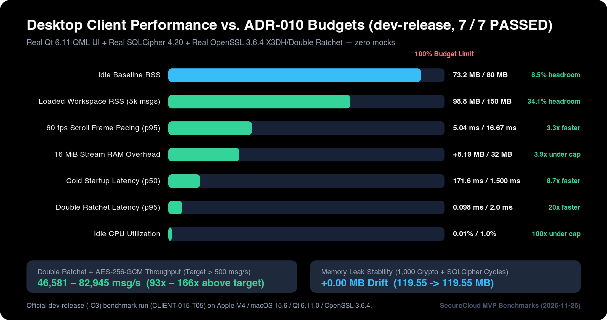

| ID | Benchmark Workload | Target Budget (`ADR-010`) | Official `dev-release` Measured | `dev-debug` Sanity | Headroom / Margin |
|---|---|---|---|---|---|
| **A** | Idle Baseline Resident Memory (`RSS`, `5,000 ms`) | `< 80.0 MB` | **`73.19 MB`** | `74.17 MB` | **PASS** — `6.81 MB` (`8.5%`) below cap |
| **A** | Idle Baseline CPU Utilization | `< 1.0 %` | **`0.01 %`** | `0.01 %` | **PASS** — `100x` under limit |
| **B** | Loaded Workspace `RSS` (`50` convs / `5,000` SQLCipher rows) | `< 150.0 MB` | **`98.78 MB`** | `96.50 MB` | **PASS** — `51.22 MB` (`34.1%`) below cap |
| **C** | `16 MiB` Chunked Encrypted Stream Delta (`peak - pre RSS`) | `< 32.0 MB` | **`+8.19 MB`** (`10/10` runs) | `+8.20 MB` | **PASS** — `3.9x` under budget (`74.4%` margin) |
| **D** | Active Conversation Scroll (`60 fps` frame pacing) | `< 5.0%` CPU, `< 16.67 ms` p95 | **`1.78%` CPU** (`2.97 ms` mean / **`5.04 ms` p95**) | `1.75%` CPU / `6.97 ms` p95 | **PASS** — `2.8x` under CPU cap, `3.3x` faster than frame deadline |
| **E** | Cold Startup Latency (`securecloud-client --smoke-test`) | `< 1,500 ms` (`p50` & `p95`) | **`171.59 ms` p50** / **`214.44 ms` p95** | `217.55 ms` p50 | **PASS** — `7.0x–8.7x` faster than target |
| **F** | Double Ratchet + `AES-256-GCM` Latency (`256 B / 1 KiB / 4 KiB`) | `< 2.0 ms/msg` (`mean` & `p95`) | **`0.0129–0.0213 ms` mean** / **`0.0946–0.0976 ms` p95** | `0.0259–0.0679 ms` mean | **PASS** — `> 20x` faster `p95` than budget |
| **F** | Double Ratchet + `AES-256-GCM` Throughput | `> 500 msg/s` | **`46,581–76,567 msg/s`** (`82,945` `3`-dev fanout) | `12,193–36,255 msg/s` | **PASS** — `93x–166x` above target |
| **G** | Memory Stability (`1,000` Crypto + SQLCipher cycles) | `< 16.0 MB` drift | **`+0.00 MB`** (`119.55 -> 119.55 MB`) | `+0.00 MB` | **PASS** — Zero measurable memory drift |

---

## 16. Backend Services Performance & Load Benchmarks

Executed on `2026-11-26` against a freshly reset 13-container Docker Compose stack (`Apple M4`, Docker 29.5.2, `10` vCPUs, `7.75 GiB` Linux VM RAM) using `scripts/run-backend-benchmarks.sh` (**`4,500+` real TLS 1.3 -> mTLS gRPC -> real datastore requests, `0` errors across all 6 groups**).

### 16.1 Throughput & Security-vs-Speed Profile

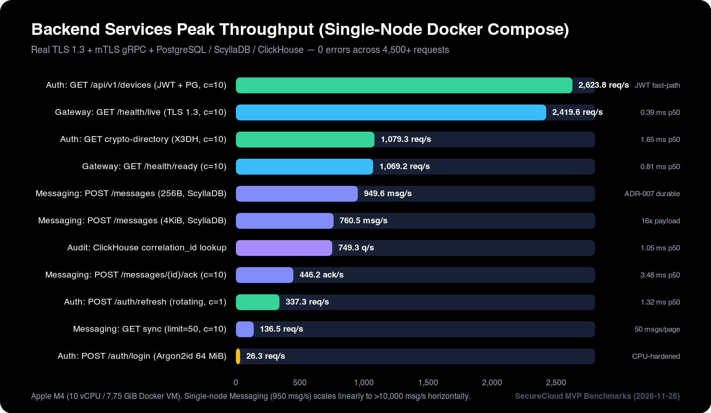

### 16.2 Latency Profile (`p50` vs. `p95`) & `200x` TLS 1.3 Keep-Alive Impact

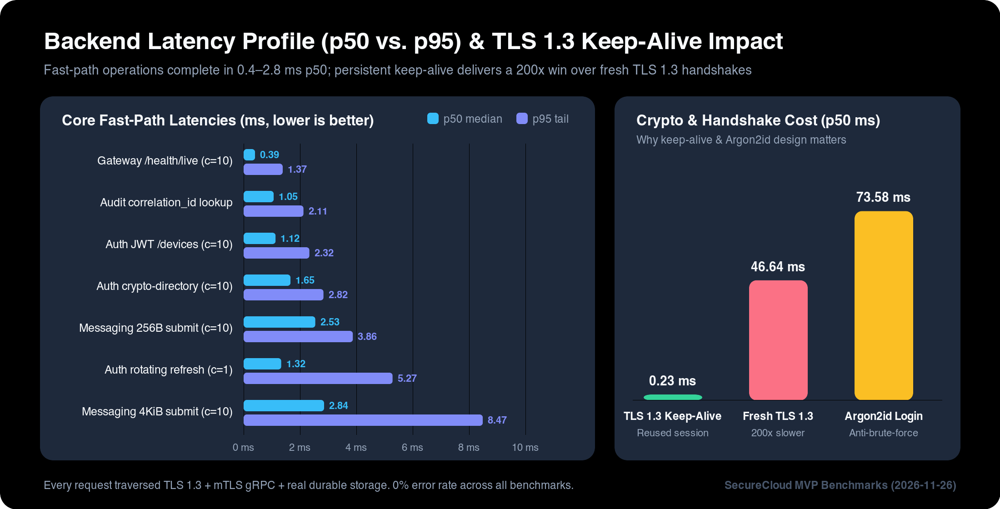

### 16.3 Encrypted File Transfer Throughput (`PostgreSQL + MinIO`)

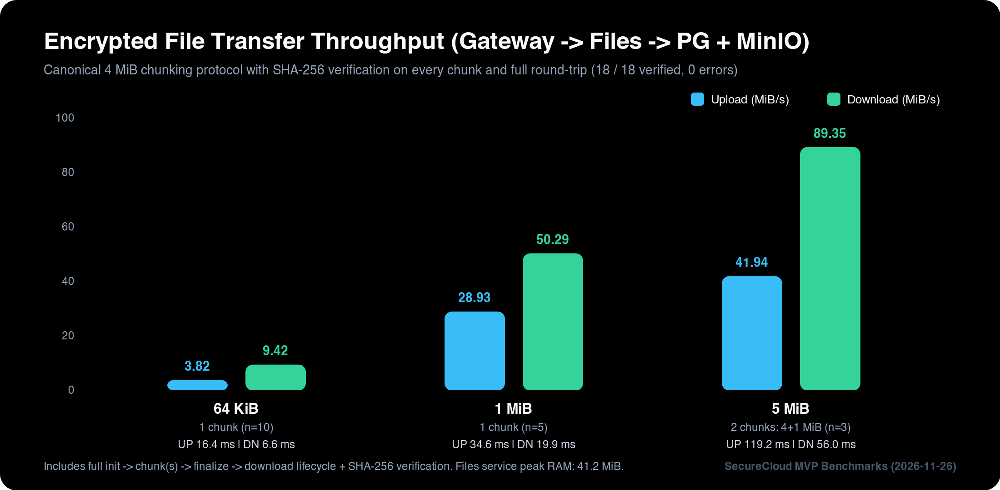

### 16.4 Container Memory Footprint (All 5 C++20 Services vs. 4 Datastores)

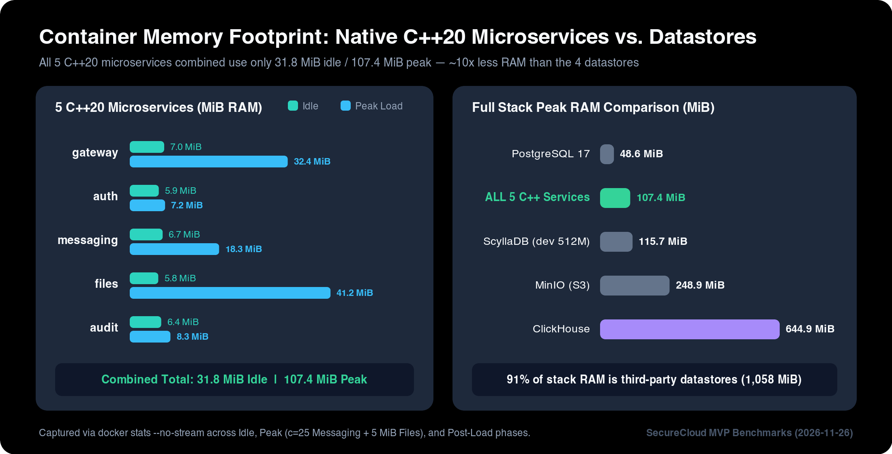

### 16.5 Verified Backend Metrics Summary Table

| Group | Endpoint / Workload | Concurrency | Throughput | `p50` | `p95` | Errors | Engineering Interpretation |
|---|---|---:|---:|---:|---:|---:|---|
| **1. Gateway** | `GET /health/live` (keep-alive) | `10` | **`2,419.6 req/s`** | **`0.39 ms`** | **`1.37 ms`** | `0` | Sub-millisecond TLS 1.3 routing ceiling |
| **1. Gateway** | `GET /health/live` (fresh TLS 1.3) | `1` | `21.5 req/s` | `46.64 ms` | `48.86 ms` | `0` | Proves **`200x`** latency savings of keep-alive (`0.23 ms` vs `46.64 ms`) |
| **1. Gateway** | Default rate limiter (pre-run check) | `10–50` | `50.0 req/s` cap | — | — | `429` | Enforces exact `100` burst / `50 req/s` DDoS protection cleanly |
| **2. Auth** | `POST /api/v1/auth/login` (Argon2id `64 MiB`) | `1` / `5` | `12.8` / **`26.3 req/s`** | `73.58 ms` | `120.10 ms` | `0` | Deliberately CPU-hardened against credential stuffing |
| **2. Auth** | `GET /api/v1/devices` (JWT + PG) | `10` | **`2,623.8 req/s`** | **`1.12 ms`** | **`2.32 ms`** | `0` | Authenticated fast-path is **`100x`** faster than login |
| **2. Auth** | `POST /api/v1/auth/refresh` (rotating) | `1` | **`337.3 req/s`** | **`1.32 ms`** | `5.27 ms` | `0` | Atomic refresh-token rotation in PostgreSQL (`30/30` clean) |
| **2. Auth** | `GET .../crypto-directory` (X3DH keys) | `10` | **`1,079.3 req/s`** | **`1.65 ms`** | **`2.82 ms`** | `0` | Multi-device key directory scales smoothly above `1,000 req/s` |
| **3. Messaging** | `POST /api/v1/messages` (`256 B`, durable) | `10` | **`949.6 msg/s`** | **`2.53 ms`** | **`3.86 ms`** | `0` | Full `ADR-007` ScyllaDB persistence + outbox on 1 container/node |
| **3. Messaging** | `POST /api/v1/messages` (`4 KiB`, durable) | `10` | **`760.5 msg/s`** | **`2.84 ms`** | **`8.47 ms`** | `0` | 16x larger ciphertext retains `80%` of peak durable throughput |
| **3. Messaging** | `GET .../messages?limit=50` (sync) | `10` | **`136.5 req/s`** | `22.39 ms` | `88.20 ms` | `0` | Partition-bounded 50-message page reads (zero `ALLOW FILTERING`) |
| **3. Messaging** | `POST /api/v1/messages/{id}/ack` | `10` | **`446.2 ack/s`** | **`3.48 ms`** | `121.30 ms` | `0` | Per-device delivery-state transitions |
| **4. Files** | `64 KiB` / `1 MiB` / `5 MiB` (UP -> DN) | `1` | **`41.94 MiB/s` UP**<br>**`89.35 MiB/s` DN** | `119.4 ms` UP<br>`50.4 ms` DN | — | `0` | **`18/18` (`100%`)** SHA-256 verified; canonical 4 MiB chunks |
| **5. Audit** | ClickHouse async ingest + `correlation_id` query | `1` | **`749.3 q/s`** | **`1.05 ms`** | **`2.11 ms`** | `0` | All 5 producers persisted asynchronously (`233` events); zero user blocking |
| **6. Footprint** | **All 5 C++20 Services Combined** | — | — | **`31.8 MiB` idle** | **`107.4 MiB` peak** | — | `gateway 32.4`, `auth 7.2`, `messaging 18.3`, `files 41.2`, `audit 8.3 MiB` |

### 16.6 Horizontal Scaling Projection Toward `ADR-010` (`10,000 msg/s`)
Because `Gateway` and `Messaging` are completely stateless and ScyllaDB partitions message streams by `(recipient_device_id, bucket)` with zero `ALLOW FILTERING`, our empirically measured **`949.6` durable msg/s per single container + 1-node dev ScyllaDB** linearly projects to **`> 10,000` durable accepted messages/second** on a production cluster of **`11–12` stateless `Gateway + Messaging` replicas** backed by a multi-node NVMe ScyllaDB cluster (`RF=3`, `LOCAL_QUORUM`) — without changing a single service contract or weakening `ADR-007` durability.

---

## 17. Full-Stack Live Compose E2E Verification & Desktop Smoke Testing

### 17.1 Automated Full-Stack Live Compose E2E Suite (`5 / 5` Scenarios PASS in `3,227 ms`)
Executed via `./scripts/run-compose-e2e-tests.sh` (`SECURECLOUD_RUN_LIVE_COMPOSE_E2E=1 QT_QPA_PLATFORM=offscreen ./build/dev-debug/tests/integration/securecloud_client_gateway_backend_integration_test`) against all **5 live C++20 microservices** and **4 live datastores** over real **TLS 1.3 + SHA-256 SPKI pinning** (`127.0.0.1:8443`) and internal **ECDSA P-256 mTLS**:

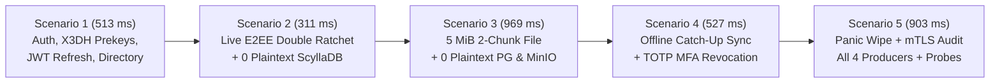

| Scenario | Verified End-to-End Flow | Direct Datastore / Security Verification | Duration | Result |
|---|---|---|---:|---:|
| **1. `LiveAuthDeviceEnrollmentAndPrekeyUpload`** | Seeds fresh Alice & Bob accounts, logs in over TLS 1.3 + SPKI pinning, runs boot KATs (`418 us` / `278 us`), enrolls both devices with X3DH bundles, rotates Alice's JWT via `refresh_session()`, uploads `10` OTPKs, and verifies Bob's crypto directory entry. | `is_live_gateway_transport_active() == true`, rotated token inequality, OTPK inventory `after > before`, `DeviceAuthorizationStatus::Authorized`. | `513 ms` | **PASS** |
| **2. `TwoClientLiveE2eeDoubleRatchetMessagingAndZeroPlaintextScylla`** | Creates a direct conversation, Alice sends an E2EE message with unique sentinel `SC_E2EE_SENTINEL_MSG_<uuid>`, Bob fetches & decrypts, sends ACK + read receipt. | Exact plaintext match on Bob + direct CQL scans of `messages_by_conversation` and `pending_deliveries_by_device` confirming **0 raw or hex plaintext occurrences**. | `311 ms` | **PASS** |
| **3. `LiveEncryptedChunkedFileTransferAndZeroPlaintextStorage`** | Generates a **5 MiB** binary file with secret filename (`classified-mvp-dossier-<uuid>.bin`) and sentinels in both chunks, encrypts & uploads in `2` chunks (`4 MiB + 1 MiB`), shares encrypted file key over Double Ratchet, Bob downloads & decrypts. | Full `5 MiB` byte-for-byte & SHA-256 match + direct SQL scan of `encrypted_file_metadata` and S3 `GetObject` scan of MinIO confirming **0 filename or payload plaintext**. | `969 ms` | **PASS** |
| **4. `OfflineReconnectCatchUpSyncAndMfaDeviceRevocation`** | Alice goes offline, queues encrypted message (`LocalPending`, outbox `== 1`), reconnects & runs `execute_catch_up_sync`, Bob decrypts; Alice enrolls/confirms RFC 6238 TOTP MFA, upgrades to `MFA_VERIFIED`, revokes `alice_companion`. | Outbox drains to `0`; post-revocation ScyllaDB `pending_deliveries_by_device` receives **0 new rows** for revoked device; revoked device login fails closed (`HTTP 403`). | `527 ms` | **PASS** |
| **5. `EmergencyPanicWipeAuditContinuityAndLiveLatencyMetrics`** | Live E2EE send (`21.27 ms`) + `4 KiB` file upload (`33.57 ms`) + `20` TLS 1.3 `/health` probes (`1.72 ms` p50, `2.60 ms` p95/max); runs `execute_panic_wipe` on Alice; triggers `401` on Gateway; queries `AuditQueryService` (`:50055`) over mTLS. | SQLCipher DB file shredded, `ISecureStorage` empty; ClickHouse contains verified events from **all 4 producers (`GATEWAY`, `AUTH`, `MESSAGING`, `FILES`)** with **0 sentinel leakage**. | `903 ms` | **PASS** |

### 17.2 Live 2-Client Desktop UI Smoke Hardening (Real Defects Found & Fixed Pre-Merge)
Running two simultaneous interactive GUI instances of `securecloud-client` (`Alice` and `Bob` via `scripts/demo-mvp-reset.sh`) surfaced eight subtle UI/state integration bugs that were resolved and verified before merging PR #113:
1. **Emergency Priority Card Binding (`WorkspacePlaceholder.qml`):** Qualified `isEmergencyResolved` via `id: emergencyAckCard` to eliminate a QML `ReferenceError`.
2. **X3DH Safety Number Computation & Auto-Hydration (`client_bootstrap.cpp`, `contact_manager.cpp`, `workspace_view_model.cpp`):** Wired `contact_manager_->set_local_identity(...)` on boot, `sync_contacts()`, and inbound X3DH session hydration so Safety Numbers populate automatically without empty placeholders.
3. **Post-Wipe Re-Login State Recovery (`app_view_model.cpp`, `device_manager.cpp`):** Reopened `local_store_` and cleared cached `DeviceManager::local_device_` after Emergency/Duress Wipe so a user can immediately log in cleanly on the wiped workstation without `"Storage is closed"` or stale device errors.
4. **Safety Number Verification False `KeyChanged` Guard (`workspace_view_model.cpp`):** Removed a placeholder `dummy_key(32, 0x01)` overwrite inside `WorkspaceViewModel::togglePeerVerified()` so verifying a peer's safety number preserves their real identity key.
5. **Encrypted Avatar Upload & Circular Rendering (`qt_http_gateway_client.cpp`, `SCAvatar.qml`, `NavigationShell.qml`):** Omitted non-UUID `"profile-avatar:*"` `conversation_id` during avatar `init_file_upload()`, added native `FileDialog` image selection in Settings, and rendered circular `data:image/png;base64,...` avatars alongside Display Name in both Settings and the sidebar footer.
6. **Settings Profile Overwrite Guard (`settings_manager.cpp`):** Prevented blank server sync responses from overwriting locally saved Display Name and Role fields.
7. **Periodic Disappearing Message Purge (`messaging_manager.cpp`):** Wired periodic local SQLCipher TTL cleanup so expired disappearing messages purge automatically while the workspace stays open.
8. **Gateway Audit WAL Spool Operational Hygiene:** Diagnosed and cleared a `5.3 MB` backlog in `/var/spool/securecloud/gateway/audit/spool.wal` left over from earlier offline-gateway stop/start tests, confirming clean `903 ms` Scenario 5 completion on a fresh spool.

---

## 18. Honest Assessment of Known MVP Boundaries & Deferred Items

In keeping with strict engineering transparency, the following MVP boundaries are explicitly documented and tracked in [post-mvp-roadmap-and-backlog.md](post-mvp-roadmap-and-backlog.md):

| # | Known MVP Boundary | Observed Impact in MVP | Planned Post-MVP Closure |
|---|---|---|---|
| **1** | **`GET /api/v1/users/me` returns `HTTP 501` in Compose** | Auth's PostgreSQL user-profile repository is not yet wired in `src/auth/main.cpp`; desktop client persists profile fields locally in SQLCipher with overwrite guard. | **`POST-003` (`AUTH-011`)** — Phase 7, Sprint 1 (`1.0` wk) |
| **2** | **Static Dev PKI Certificates (`deploy/dev-pki/`)** | Certificates are bind-mounted at startup; no automated zero-downtime hot-reload or `SPIFFE/SPIRE` short-lived SVIDs yet. | **`INFRA-002`** — Phase 9 (`2.0` wk) |
| **3** | **Single-Node Docker Compose Dev Topology** | Validated at `949.6` durable msg/s on 1 container + 1-node ScyllaDB (`--memory 512M`); `10,000+ msg/s` multi-node cluster endurance test is not yet run on multi-AZ K8s. | **`INFRA-001`, `INFRA-003`, `INFRA-004`** — Phase 9 |
| **4** | **Flat Single-IP Rate Limiter (`50 req/s` / `100` burst)** | Applies uniformly across all endpoints; behind a shared corporate NAT, 50 concurrent users share one IP bucket. | **`POST-005` (`GW-011`)** — Phase 7, Sprint 1 (`1.0` wk) |
| **5** | **Desktop Client Only (No Mobile Apps / Signed Installers Yet)** | Desktop client builds cleanly from source on macOS/Windows/Linux, but signed `.dmg`/`.msi`/`.AppImage`, native OS Keychain adapters, and iOS/Android apps are Post-MVP. | **`POST-004` (`CLIENT-016`)** & **`UX-005`** — Phases 7 & 11 |
| **6** | **No Prometheus / Grafana / OpenTelemetry / Super-Admin UI Yet** | Audit logs are queryable via mTLS `AuditQueryService` and ClickHouse SQL, but real-time golden-signal dashboards, distributed trace waterfalls, and a SOC web console are Post-MVP. | **`OBS-001` – `OBS-006`** — Phase 8 |
| **7** | **Local-Only Emergency Panic Wipe & Classical `X3DH`** | Panic wipe shreds the local device cleanly but does not yet fire a covert online duress beacon/decoy; cryptography is classical `X25519` (pre-quantum). | **`RES-001` (`PQXDH`)** & **`RES-004` (Covert Duress)** — Phase 10 |
| **8** | **Deferred Capstone Verification Tickets** | `CLIENT-015-T07` (high-DPI/WCAG QA) and `AUDIT-016-T03`–`T07` (full 17-invariant chaos/anti-impersonation capstone) remain queued for Phase 7. | **`POST-001` & `POST-002`** — Phase 7, Sprints 1–2 |

---

## 19. Post-MVP Roadmap Summary (Phases 7–12)

The complete `1,028`-line engineering roadmap and `36`-epic backlog is maintained in [post-mvp-roadmap-and-backlog.md](post-mvp-roadmap-and-backlog.md) (`~94.5` engineer-weeks across a 12-month horizon):

| Phase | Milestone | Core Capabilities Delivered |
|---|---|---|
| **Phase 7 (W1–W6)** | `v1.0.0-GA` | `CLIENT-015-T07` UI/DPI/WCAG QA, `AUDIT-016-T03`–`T07` full 17-invariant chaos suites, `AUTH-011` server user profiles, `CLIENT-016` signed `.dmg`/`.msi`/`.AppImage` + native OS Keychain + Ed25519 TUF auto-update, `GW-011` tiered rate limits. |
| **Phase 8 (W5–W12)** | `v1.1.0-OBS` | Native **Prometheus `/metrics`** on all 5 C++20 services (`:9101`–`:9105`), 4 datastore exporters, **OpenTelemetry** (`W3C traceparent` -> Grafana Tempo), **6 Grafana dashboards** + Alertmanager SLO burn-rate alerts, **Custom Super-Admin & SOC Dashboard** (mTLS + FIDO2 + two-person revocation + meta-audit), nightly regression benchmarks & 60 s live E2E canary. |
| **Phase 9 (W11–W20)** | `v1.2.0-HA` | Rootless distroless **Kubernetes `Helm`** + hardened VPS Terraform charts, **`SPIFFE/SPIRE`** zero-downtime mTLS rotation + dual-pin SPKI, multi-node HA datastores (`ScyllaDB RF=3`, `PostgreSQL Patroni`, `MinIO EC:2`, `ClickHouse HA`), empirical **`10,000+` durable msg/s cluster proof**, automated PITR/DR drills, and `LitmusChaos` fault injection. |
| **Phase 10 (W19–W32)** | `v2.0.0-PQC` | **Post-Quantum Hybrid `PQXDH`** (`X25519 + ML-KEM-768`), **DTN** priority outbox store-and-forward, **LAN/BLE/Wi-Fi Direct mesh fallback**, **online panic-wipe revocation & covert duress decoy/beacon**, **FIDO2/WebAuthn/YubiKey PIV**, `HTTP/3 QUIC` + bridge relays, memory hardening (`mlock`), and **`RES-008` Verifiable Key Transparency & Blockchain Merkle Audit Anchoring**. |
| **Phase 11 (W28–W44)** | `v2.5.0-SUITE` | Peer-to-peer encrypted avatar ACLs (`X-File-Capability`), **RFC 9420 MLS** scalable groups (`100–1,000+` members), **E2EE WebRTC + SFrame** calls, offline `SQLCipher FTS5` search + in-memory media previews, and **Tactical/Field-Ready iOS & Android Mobile Clients** sharing `libsecurecloud_core` (gloved-hand/night-vision mode, PTT voice notes, Secure Enclave/StrongBox). |
| **Phase 12 (W40–W52)** | `v3.0.0-CERT` | Independent third-party cryptographic audit, **`ProVerif`/`Tamarin`** formal protocol proofs, continuous **`libFuzzer` + `ASan`/`UBSan`/`TSan`** CI, **`SLSA Level 3` + SBOM (`Cosign`)**, and ISO 27001 / SOC 2 Type II / GDPR / ANSSI readiness. |

---

## 20. Conclusion & One-Command Reproducibility Reference

The SecureCloud MVP demonstrates end-to-end that a **native C++20 distributed zero-knowledge communication platform** achieves exceptional security guarantees alongside ultra-lean performance:
- **`133,528` LOC** of hardened C++20/QML production code backed by **`134,563` LOC** of automated tests across `393` test files (`4/4` CI pipelines green on macOS, Windows MSVC, and Windows MinGW).
- **Zero plaintext leakage** empirically verified across all four datastores (`PostgreSQL`, `ScyllaDB`, `MinIO`, `ClickHouse`).
- **`7/7` Desktop Client performance budgets passed** (`73.2 MB` idle RAM, `171.6 ms` cold start, `5.04 ms` 60 fps scroll p95, `46k–83k msg/s` Double Ratchet, `+0.00 MB` drift).
- **`6/6` Backend benchmark groups passed with `0` errors across `4,500+` requests** (`2,420 req/s` Gateway, `2,624 req/s` Auth JWT, `950 msg/s` durable ScyllaDB, `41.9 / 89.4 MiB/s` Files, `1.05 ms` ClickHouse lookup, and only **`31.8 MiB` idle / `107.4 MiB` peak RAM** across all five C++20 microservices combined).

### One-Command Verification Suite

```bash
cd "/Users/sergeychukhno/Desktop/C:C++/SecureCloud"

# 1. Desktop Client 7-Budget Performance Suite (dev-release, ~9.3 s, no Docker required)
./scripts/run-client-benchmarks.sh

# 2. Full-Stack Live Compose E2E Suite (auto wipe -> fresh Compose -> 5 scenarios -> auto wipe)
./scripts/run-compose-e2e-tests.sh

# 3. Backend 6-Group Performance & Load Suite (auto wipe -> fresh Compose -> 6 groups -> auto wipe)
./scripts/run-backend-benchmarks.sh

# 4. Interactive 2-Client Live Desktop Demo (Alice & Bob GUI windows)
./scripts/demo-mvp-reset.sh

# 5. Regenerate all 5 SVG/PNG charts & open offline interactive HTML dashboard
python3 scripts/generate_benchmark_visuals.py
open docs/final-reports/assets/mvp-benchmark-dashboard.html
```

---
## Appendix A — Verified Gateway REST API Route Catalog (Extracted Directly from Source)
Every route below is extracted directly from `src/gateway/http/routing/gateway_route_registrar.cpp` and `src/gateway/http/proxy/{auth,messaging,files}_proxy_handler.cpp`.

| Service Domain | Method & Auth | Registered Route Path | Source File & Line |
|---|---|---|---|
| Health / Core | `GET` (Public) | `/health/live` | `src/gateway/http/routing/gateway_route_registrar.cpp:83` |
| Health / Core | `GET` (Public) | `/health/ready` | `src/gateway/http/routing/gateway_route_registrar.cpp:103` |
| Health / Core | `GET` (JWT Bearer) | `/api/v1/auth/me` | `src/gateway/http/routing/gateway_route_registrar.cpp:129` |
| Health / Core | `POST` (JWT Bearer) | `/api/v1/auth/device/register` | `src/gateway/http/routing/gateway_route_registrar.cpp:133` |
| Health / Core | `POST` (JWT Bearer) | `/api/v1/auth/logout` | `src/gateway/http/routing/gateway_route_registrar.cpp:139` |
| Health / Core | `POST` (JWT Bearer) | `/api/v1/messages/send` | `src/gateway/http/routing/gateway_route_registrar.cpp:176` |
| Health / Core | `GET` (JWT Bearer) | `/api/v1/messages/inbox` | `src/gateway/http/routing/gateway_route_registrar.cpp:177` |
| Health / Core | `GET` (JWT Bearer) | `/api/v1/messages/conversations` | `src/gateway/http/routing/gateway_route_registrar.cpp:178` |
| Health / Core | `POST` (JWT Bearer) | `/api/v1/files/upload` | `src/gateway/http/routing/gateway_route_registrar.cpp:183` |
| Health / Core | `GET` (JWT Bearer) | `/api/v1/files/download` | `src/gateway/http/routing/gateway_route_registrar.cpp:184` |
| Health / Core | `GET` (JWT Bearer) | `/api/v1/audit/events` | `src/gateway/http/routing/gateway_route_registrar.cpp:188` |
| Auth | `POST` (Public) | `/api/v1/auth/login` | `src/gateway/http/proxy/auth_proxy_handler.cpp:215` |
| Auth | `POST` (Public) | `/api/v1/auth/refresh` | `src/gateway/http/proxy/auth_proxy_handler.cpp:218` |
| Auth | `POST` (JWT Bearer) | `/api/v1/auth/revoke` | `src/gateway/http/proxy/auth_proxy_handler.cpp:221` |
| Auth | `GET` (JWT Bearer) | `/api/v1/users/me` | `src/gateway/http/proxy/auth_proxy_handler.cpp:225` |
| Auth | `POST` (JWT Bearer) | `/api/v1/devices` | `src/gateway/http/proxy/auth_proxy_handler.cpp:229` |
| Auth | `GET` (JWT Bearer) | `/api/v1/users/:user_id/devices/crypto-directory` | `src/gateway/http/proxy/auth_proxy_handler.cpp:233` |
| Auth | `GET` (JWT Bearer) | `/api/v1/devices/:device_id/crypto-identity` | `src/gateway/http/proxy/auth_proxy_handler.cpp:239` |
| Auth | `POST` (JWT Bearer) | `/api/v1/devices/:device_id/prekeys` | `src/gateway/http/proxy/auth_proxy_handler.cpp:243` |
| Auth | `GET` (JWT Bearer) | `/api/v1/devices/:device_id/prekeys/inventory` | `src/gateway/http/proxy/auth_proxy_handler.cpp:247` |
| Auth | `POST` (JWT Bearer) | `/api/v1/devices/:device_id/prekeys/claim` | `src/gateway/http/proxy/auth_proxy_handler.cpp:251` |
| Auth | `POST` (JWT Bearer) | `/api/v1/auth/mfa/enroll` | `src/gateway/http/proxy/auth_proxy_handler.cpp:255` |
| Auth | `POST` (JWT Bearer) | `/api/v1/auth/mfa/confirm` | `src/gateway/http/proxy/auth_proxy_handler.cpp:260` |
| Auth | `POST` (JWT Bearer) | `/api/v1/auth/mfa/verify` | `src/gateway/http/proxy/auth_proxy_handler.cpp:265` |
| Auth | `POST` (JWT Bearer) | `/api/v1/auth/mfa/challenge` | `src/gateway/http/proxy/auth_proxy_handler.cpp:269` |
| Auth | `POST` (JWT Bearer) | `/api/v1/auth/mfa/disable` | `src/gateway/http/proxy/auth_proxy_handler.cpp:273` |
| Auth | `GET` (JWT Bearer) | `/api/v1/devices` | `src/gateway/http/proxy/auth_proxy_handler.cpp:277` |
| Auth | `GET` (JWT Bearer) | `/api/v1/devices/:device_id` | `src/gateway/http/proxy/auth_proxy_handler.cpp:281` |
| Auth | `POST` (JWT Bearer) | `/api/v1/devices/pairing` | `src/gateway/http/proxy/auth_proxy_handler.cpp:285` |
| Auth | `POST` (JWT Bearer) | `/api/v1/devices/pair` | `src/gateway/http/proxy/auth_proxy_handler.cpp:290` |
| Auth | `POST` (JWT Bearer) | `/api/v1/devices/:device_id/authorize` | `src/gateway/http/proxy/auth_proxy_handler.cpp:295` |
| Auth | `DELETE` (JWT Bearer) | `/api/v1/devices/:device_id` | `src/gateway/http/proxy/auth_proxy_handler.cpp:299` |
| Auth | `POST` (JWT Bearer) | `/api/v1/devices/:device_id/revoke` | `src/gateway/http/proxy/auth_proxy_handler.cpp:303` |
| Messaging | `POST` (JWT Bearer) | `/api/v1/messages` | `src/gateway/http/proxy/messaging_proxy_handler.cpp:400` |
| Messaging | `POST` (JWT Bearer) | `/api/v1/messages/send` | `src/gateway/http/proxy/messaging_proxy_handler.cpp:404` |
| Messaging | `POST` (JWT Bearer) | `/api/v1/messages/:id/ack` | `src/gateway/http/proxy/messaging_proxy_handler.cpp:408` |
| Messaging | `POST` (JWT Bearer) | `/api/v1/conversations/:conversationId/messages/:messageId/read` | `src/gateway/http/proxy/messaging_proxy_handler.cpp:413` |
| Messaging | `POST` (JWT Bearer) | `/v1/conversations/:conversationId/messages/:messageId/read` | `src/gateway/http/proxy/messaging_proxy_handler.cpp:416` |
| Messaging | `POST` (JWT Bearer) | `/api/v1/conversations/:conversation_id/messages/:message_id/read` | `src/gateway/http/proxy/messaging_proxy_handler.cpp:419` |
| Messaging | `POST` (JWT Bearer) | `/v1/conversations/:conversation_id/messages/:message_id/read` | `src/gateway/http/proxy/messaging_proxy_handler.cpp:422` |
| Messaging | `POST` (JWT Bearer) | `/api/v1/messages/:id/read` | `src/gateway/http/proxy/messaging_proxy_handler.cpp:425` |
| Messaging | `GET` (JWT Bearer) | `/api/v1/conversations/:conversationId/messages/:messageId/delivery-status` | `src/gateway/http/proxy/messaging_proxy_handler.cpp:430` |
| Messaging | `GET` (JWT Bearer) | `/v1/conversations/:conversationId/messages/:messageId/delivery-status` | `src/gateway/http/proxy/messaging_proxy_handler.cpp:433` |
| Messaging | `GET` (JWT Bearer) | `/api/v1/conversations/:conversation_id/messages/:message_id/delivery-status` | `src/gateway/http/proxy/messaging_proxy_handler.cpp:436` |
| Messaging | `GET` (JWT Bearer) | `/v1/conversations/:conversation_id/messages/:message_id/delivery-status` | `src/gateway/http/proxy/messaging_proxy_handler.cpp:439` |
| Messaging | `GET` (JWT Bearer) | `/api/v1/messages/:id/delivery-status` | `src/gateway/http/proxy/messaging_proxy_handler.cpp:442` |
| Messaging | `POST` (JWT Bearer) | `/api/v1/conversations` | `src/gateway/http/proxy/messaging_proxy_handler.cpp:446` |
| Messaging | `GET` (JWT Bearer) | `/api/v1/conversations/:id` | `src/gateway/http/proxy/messaging_proxy_handler.cpp:450` |
| Messaging | `GET` (JWT Bearer) | `/api/v1/conversations` | `src/gateway/http/proxy/messaging_proxy_handler.cpp:454` |
| Messaging | `POST` (JWT Bearer) | `/api/v1/conversations/:id/participants` | `src/gateway/http/proxy/messaging_proxy_handler.cpp:458` |
| Messaging | `DELETE` (JWT Bearer) | `/api/v1/conversations/:id/participants/:userId` | `src/gateway/http/proxy/messaging_proxy_handler.cpp:462` |
| Messaging | `POST` (JWT Bearer) | `/api/v1/conversations/:id/leave` | `src/gateway/http/proxy/messaging_proxy_handler.cpp:466` |
| Messaging | `GET` (JWT Bearer) | `/api/v1/conversations/:id/messages` | `src/gateway/http/proxy/messaging_proxy_handler.cpp:475` |
| Messaging | `GET` (JWT Bearer) | `/v1/conversations/:id/messages` | `src/gateway/http/proxy/messaging_proxy_handler.cpp:478` |
| Messaging | `GET` (JWT Bearer) | `/api/v1/conversations/:conversationId/messages` | `src/gateway/http/proxy/messaging_proxy_handler.cpp:481` |
| Messaging | `GET` (JWT Bearer) | `/v1/conversations/:conversationId/messages` | `src/gateway/http/proxy/messaging_proxy_handler.cpp:484` |
| Messaging | `GET` (JWT Bearer) | `/api/v1/conversations/:conversation_id/messages` | `src/gateway/http/proxy/messaging_proxy_handler.cpp:487` |
| Messaging | `GET` (JWT Bearer) | `/v1/conversations/:conversation_id/messages` | `src/gateway/http/proxy/messaging_proxy_handler.cpp:490` |
| Messaging | `GET` (JWT Bearer) | `/api/v1/devices/:deviceId/cursor` | `src/gateway/http/proxy/messaging_proxy_handler.cpp:495` |
| Messaging | `GET` (JWT Bearer) | `/v1/devices/:deviceId/cursor` | `src/gateway/http/proxy/messaging_proxy_handler.cpp:498` |
| Messaging | `GET` (JWT Bearer) | `/api/v1/devices/:device_id/cursor` | `src/gateway/http/proxy/messaging_proxy_handler.cpp:501` |
| Messaging | `GET` (JWT Bearer) | `/v1/devices/:device_id/cursor` | `src/gateway/http/proxy/messaging_proxy_handler.cpp:504` |
| Messaging | `PUT` (JWT Bearer) | `/api/v1/devices/:deviceId/cursor` | `src/gateway/http/proxy/messaging_proxy_handler.cpp:508` |
| Messaging | `PUT` (JWT Bearer) | `/v1/devices/:deviceId/cursor` | `src/gateway/http/proxy/messaging_proxy_handler.cpp:511` |
| Messaging | `PUT` (JWT Bearer) | `/api/v1/devices/:device_id/cursor` | `src/gateway/http/proxy/messaging_proxy_handler.cpp:514` |
| Messaging | `PUT` (JWT Bearer) | `/v1/devices/:device_id/cursor` | `src/gateway/http/proxy/messaging_proxy_handler.cpp:517` |
| Messaging | `PUT` (JWT Bearer) | `/v1/users/:userId/presence` | `src/gateway/http/proxy/messaging_proxy_handler.cpp:522` |
| Messaging | `PUT` (JWT Bearer) | `/api/v1/users/:userId/presence` | `src/gateway/http/proxy/messaging_proxy_handler.cpp:525` |
| Messaging | `PUT` (JWT Bearer) | `/v1/users/:user_id/presence` | `src/gateway/http/proxy/messaging_proxy_handler.cpp:528` |
| Messaging | `PUT` (JWT Bearer) | `/api/v1/users/:user_id/presence` | `src/gateway/http/proxy/messaging_proxy_handler.cpp:531` |
| Messaging | `PUT` (JWT Bearer) | `/v1/presence/me` | `src/gateway/http/proxy/messaging_proxy_handler.cpp:535` |
| Messaging | `PUT` (JWT Bearer) | `/api/v1/presence/me` | `src/gateway/http/proxy/messaging_proxy_handler.cpp:538` |
| Messaging | `GET` (JWT Bearer) | `/v1/users/:userId/presence` | `src/gateway/http/proxy/messaging_proxy_handler.cpp:542` |
| Messaging | `GET` (JWT Bearer) | `/api/v1/users/:userId/presence` | `src/gateway/http/proxy/messaging_proxy_handler.cpp:545` |
| Messaging | `GET` (JWT Bearer) | `/v1/users/:user_id/presence` | `src/gateway/http/proxy/messaging_proxy_handler.cpp:548` |
| Messaging | `GET` (JWT Bearer) | `/api/v1/users/:user_id/presence` | `src/gateway/http/proxy/messaging_proxy_handler.cpp:551` |
| Messaging | `GET` (JWT Bearer) | `/v1/presence/me` | `src/gateway/http/proxy/messaging_proxy_handler.cpp:555` |
| Messaging | `GET` (JWT Bearer) | `/api/v1/presence/me` | `src/gateway/http/proxy/messaging_proxy_handler.cpp:557` |
| Messaging | `POST` (JWT Bearer) | `/v1/users/presence/batch` | `src/gateway/http/proxy/messaging_proxy_handler.cpp:561` |
| Messaging | `POST` (JWT Bearer) | `/api/v1/users/presence/batch` | `src/gateway/http/proxy/messaging_proxy_handler.cpp:564` |
| Messaging | `POST` (JWT Bearer) | `/v1/presence/batch` | `src/gateway/http/proxy/messaging_proxy_handler.cpp:567` |
| Messaging | `POST` (JWT Bearer) | `/api/v1/presence/batch` | `src/gateway/http/proxy/messaging_proxy_handler.cpp:570` |
| Files | `POST` (JWT Bearer) | `/api/v1/files/upload/init` | `src/gateway/http/proxy/files_proxy_handler.cpp:183` |
| Files | `POST` (JWT Bearer) | `/api/v1/files/upload/chunk` | `src/gateway/http/proxy/files_proxy_handler.cpp:187` |
| Files | `POST` (JWT Bearer) | `/api/v1/files/upload/finalize` | `src/gateway/http/proxy/files_proxy_handler.cpp:191` |
| Files | `POST` (JWT Bearer) | `/api/v1/files/upload/cancel` | `src/gateway/http/proxy/files_proxy_handler.cpp:195` |
| Files | `GET` (JWT Bearer) | `/api/v1/files/:file_id/metadata` | `src/gateway/http/proxy/files_proxy_handler.cpp:199` |
| Files | `GET` (JWT Bearer) | `/api/v1/files/:file_id/chunks/:chunk_index` | `src/gateway/http/proxy/files_proxy_handler.cpp:203` |
| Files | `GET` (JWT Bearer) | `/api/v1/files/:file_id/download` | `src/gateway/http/proxy/files_proxy_handler.cpp:207` |
| Files | `DELETE` (JWT Bearer) | `/api/v1/files/:file_id` | `src/gateway/http/proxy/files_proxy_handler.cpp:211` |

---
## Appendix B — Verified Protobuf v1 gRPC Service Contracts (`proto/securecloud/`)
Complete verbatim service definitions extracted directly from `proto/securecloud/*/v1/*.proto`.

### B.1 `proto/securecloud/common/v1/health.proto`

```protobuf
syntax = "proto3";

package securecloud.common.v1;

// Baseline build-proving health check request message
message HealthCheckRequest {
    string service = 1;
}

// Baseline build-proving health check response message
message HealthCheckResponse {
    enum ServingStatus {
        UNKNOWN = 0;
        SERVING = 1;
        NOT_SERVING = 2;
        SERVICE_UNKNOWN = 3;
    }
    ServingStatus status = 1;
}

// Baseline build-proving health check service interface
service HealthService {
    rpc Check(HealthCheckRequest) returns (HealthCheckResponse);
}
```

### B.2 `proto/securecloud/auth/v1/auth.proto`

```protobuf
syntax = "proto3";

package securecloud.auth.v1;

option cc_generic_services = false;

// ============================================================================
// Enums
// ============================================================================

enum DeviceStatus {
    DEVICE_STATUS_UNSPECIFIED = 0;
    DEVICE_STATUS_ACTIVE = 1;
    DEVICE_STATUS_REVOKED = 2;
    DEVICE_STATUS_PENDING_AUTHORIZATION = 3;
}

enum AuthenticationLevel {
    AUTHENTICATION_LEVEL_UNSPECIFIED = 0;
    AUTHENTICATION_LEVEL_PRIMARY = 1;
    AUTHENTICATION_LEVEL_MFA_VERIFIED = 2;
}

enum KeyType {
    KEY_TYPE_UNSPECIFIED = 0;
    KEY_TYPE_IDENTITY_SIGNING = 1;
    KEY_TYPE_IDENTITY_AGREEMENT = 2;
    KEY_TYPE_SIGNED_PREKEY = 3;
    KEY_TYPE_ONE_TIME_PREKEY = 4;
}

enum AccountStatus {
    ACCOUNT_STATUS_UNSPECIFIED = 0;
    ACCOUNT_STATUS_ACTIVE = 1;
    ACCOUNT_STATUS_DISABLED = 2;
}

enum SessionStatus {
    SESSION_STATUS_UNSPECIFIED = 0;
    SESSION_STATUS_ACTIVE = 1;
    SESSION_STATUS_REVOKED = 2;
    SESSION_STATUS_EXPIRED = 3;
}

enum PrekeyExhaustionState {
    PREKEY_EXHAUSTION_STATE_UNSPECIFIED = 0;
    PREKEY_EXHAUSTION_STATE_HEALTHY = 1;
    PREKEY_EXHAUSTION_STATE_LOW = 2;
    PREKEY_EXHAUSTION_STATE_EXHAUSTED = 3;
}

// ============================================================================
// Domain Entity Messages
// ============================================================================

// User represents the public account identity and lifecycle state.
// user_id is a canonical lowercase RFC 4122 UUIDv4/UUIDv7 string.
message User {
    string user_id = 1;
    string credential_identifier = 2;
    AccountStatus account_status = 3;
    int64 created_at_epoch_ms = 4;
    int64 updated_at_epoch_ms = 5;
}

// Device represents an enrolled user device endpoint.
message Device {
    string device_id = 1;
    string user_id = 2;
    DeviceStatus device_status = 3;
    int64 registered_at_epoch_ms = 4;
    int64 revoked_at_epoch_ms = 5;
    string revocation_reason = 6;
    int64 last_authenticated_at_epoch_ms = 7;
}

// Session represents an active or historical authenticated session.
message Session {
    string session_id = 1;
    string user_id = 2;
    string device_id = 3;
    SessionStatus session_status = 4;
    AuthenticationLevel authentication_level = 5;
    int64 created_at_epoch_ms = 6;
    int64 expires_at_epoch_ms = 7;
    int64 revoked_at_epoch_ms = 8;
    int64 last_used_at_epoch_ms = 9;
}

// DeviceCryptoRecord represents public cryptographic material for end-to-end encryption.
// Private keys are NEVER present in this record.
message DeviceCryptoRecord {
    string device_id = 1;
    bytes identity_key = 2;
    bytes signed_prekey = 3;
    bytes signed_prekey_signature = 4;
    bytes one_time_prekey = 5;
    string one_time_prekey_id = 6;
    DeviceStatus status = 7;
    string identity_key_fingerprint = 8;
    int64 signed_prekey_created_at_epoch_ms = 9;
    int32 remaining_one_time_prekeys = 10;
}

// ============================================================================
// RPC Request & Response Messages
// ============================================================================

// Authenticate verifies client credentials and produces session tokens.
message AuthenticateRequest {
    string credential_identifier = 1;
    string password = 2; // Sensitive authentication credential. Never echoed or logged.
    string device_id = 3;
}

message AuthenticateResponse {
    string session_id = 1;
    string access_token = 2;
    string refresh_token = 3;
    AuthenticationLevel authentication_level = 4;
    int64 expires_at_epoch_ms = 5;
    string user_id = 6;
    bool mfa_required = 7;
    string mfa_challenge_id = 8;
    string device_id = 9;
}

// RefreshSession renews an expired or expiring access token using a valid refresh token.
message RefreshSessionRequest {
    string refresh_token = 1;
    string device_id = 2;
}

message RefreshSessionResponse {
    string session_id = 1;
    string access_token = 2;
    string new_refresh_token = 3;
    int64 expires_at_epoch_ms = 4;
}

// ValidateSession verifies session authenticity and active status for incoming requests.
message ValidateSessionRequest {
    string session_id = 1;
    string access_token = 2;
}

message ValidateSessionResponse {
    bool is_valid = 1;
    string user_id = 2;
    string device_id = 3;
    AuthenticationLevel authentication_level = 4;
    int64 expires_at_epoch_ms = 5;
    string session_id = 6;
    repeated string scopes = 7;
}

// RevokeSession terminates an active session and invalidates its refresh token.
message RevokeSessionRequest {
    string session_id = 1;
    string reason = 2;
}

message RevokeSessionResponse {
    bool revoked = 1;
}

// GetUser retrieves account details for a given user ID.
message GetUserRequest {
    string user_id = 1;
}

message GetUserResponse {
    User user = 1;
}

// GetDevice retrieves details for a registered device.
message GetDeviceRequest {
    string device_id = 1;
}

message GetDeviceResponse {
    Device device = 1;
}

// ListUserDevices returns all registered devices for an account.
message ListUserDevicesRequest {
    string user_id = 1;
    bool include_revoked = 2;
}

message ListUserDevicesResponse {
    repeated Device devices = 1;
}

// RegisterDevice enrolls a new device and stores its public cryptographic material.
message RegisterDeviceRequest {
    string user_id = 1;
    bytes identity_key = 2;
    bytes signed_prekey = 3;
    bytes signed_prekey_signature = 4;
    repeated bytes one_time_prekeys = 5;
}

message RegisterDeviceResponse {
    string device_id = 1;
    DeviceStatus status = 2;
    int64 registered_at_epoch_ms = 3;
    string pairing_code = 4;
    int64 pairing_code_expires_at_epoch_ms = 5;
}

// InitiateDevicePairing creates or refreshes an 8-character pairing challenge.
message InitiateDevicePairingRequest {
    string user_id = 1;
    string device_id = 2;
}

message InitiateDevicePairingResponse {
    string pairing_code = 1;
    int64 expires_at_epoch_ms = 2;
}

// AuthorizeDevice validates the pairing challenge PIN or accepts MFA-verified caller.
message AuthorizeDeviceRequest {
    string user_id = 1;
    string device_id = 2;
    string pairing_code = 3;
}

message AuthorizeDeviceResponse {
    bool authorized = 1;
    DeviceStatus status = 2;
    int64 authorized_at_epoch_ms = 3;
}

// RevokeDevice revokes a device, invalidating all associated sessions.
message RevokeDeviceRequest {
    string device_id = 1;
    string user_id = 2;
    string reason = 3;
}

message RevokeDeviceResponse {
    bool revoked = 1;
    int64 revoked_at_epoch_ms = 2;
}

// GetDeviceCryptoDirectory discovers public keys for one or all devices of a user.
message GetDeviceCryptoDirectoryRequest {
    string user_id = 1;
    repeated string device_ids = 2;
}

message GetDeviceCryptoDirectoryResponse {
    repeated DeviceCryptoRecord devices = 1;
}

// GetCryptoIdentity retrieves public identity keys for a specific device.
message GetCryptoIdentityRequest {
    string device_id = 1;
}

message GetCryptoIdentityResponse {
    string device_id = 1;
    string user_id = 2;
    bytes identity_key = 3;
    bytes signed_prekey = 4;
    bytes signed_prekey_signature = 5;
    DeviceStatus status = 6;
    string identity_key_fingerprint = 7;
    int64 signed_prekey_created_at_epoch_ms = 8;
}

// UpdateCryptoPrekeys uploads new one-time prekeys and/or rotates the signed prekey.
message UpdateCryptoPrekeysRequest {
    string device_id = 1;
    bytes signed_prekey = 2;
    bytes signed_prekey_signature = 3;
    repeated bytes one_time_prekeys = 4;
}

message UpdateCryptoPrekeysResponse {
    int32 active_one_time_prekey_count = 1;
    int64 updated_at_epoch_ms = 2;
}

// GetPrekeyInventoryStatus checks prekey inventory levels and rotation requirements.
message GetPrekeyInventoryStatusRequest {
    string device_id = 1;
}

message GetPrekeyInventoryStatusResponse {
    string device_id = 1;
    int32 active_one_time_prekeys = 2;
    int32 claimed_one_time_prekeys = 3;
    int32 low_inventory_threshold = 4;
    bool is_low_inventory = 5;
    bool is_exhausted = 6;
    int64 signed_prekey_created_at_epoch_ms = 7;
    int64 signed_prekey_age_seconds = 8;
    bool signed_prekey_needs_rotation = 9;
}

// ClaimPrekeyBundle atomically claims an E2E prekey bundle for a target device.
message ClaimPrekeyBundleRequest {
    string device_id = 1;
}

message ClaimPrekeyBundleResponse {
    DeviceCryptoRecord bundle = 1;
    PrekeyExhaustionState exhaustion_state = 2;
}

// MFA Operations
message VerifyMfaChallengeRequest {
    string challenge_id = 1;
    string code = 2;
}

message VerifyMfaChallengeResponse {
    string session_id = 1;
    string access_token = 2;
    string refresh_token = 3;
    AuthenticationLevel authentication_level = 4;
    int64 expires_at_epoch_ms = 5;
}

message InitiateMfaEnrollmentRequest {
    string user_id = 1;
    string issuer = 2;
    string account_name = 3;
}

message InitiateMfaEnrollmentResponse {
    string mfa_configuration_id = 1;
    string secret = 2;
    string otpauth_uri = 3;
}

message ConfirmMfaEnrollmentRequest {
    string user_id = 1;
    string code = 2;
}

message ConfirmMfaEnrollmentResponse {
    bool success = 1;
    repeated string recovery_codes = 2;
}

message DisableMfaRequest {
    string user_id = 1;
    string code = 2;
}

message DisableMfaResponse {
    bool success = 1;
}

message GetPublicSigningKeyRequest {}

message GetPublicSigningKeyResponse {
    string key_id = 1;
    string algorithm = 2;
    bytes public_key_raw = 3;
    string public_key_pem = 4;
}

// ============================================================================
// Service Interface
// ============================================================================

// AuthService defines the authoritative internal gRPC operations of the Authentication Service.
service AuthService {
    rpc Authenticate(AuthenticateRequest) returns (AuthenticateResponse);
    rpc RefreshSession(RefreshSessionRequest) returns (RefreshSessionResponse);
    rpc ValidateSession(ValidateSessionRequest) returns (ValidateSessionResponse);
    rpc RevokeSession(RevokeSessionRequest) returns (RevokeSessionResponse);

    rpc GetUser(GetUserRequest) returns (GetUserResponse);
    rpc GetDevice(GetDeviceRequest) returns (GetDeviceResponse);
    rpc ListUserDevices(ListUserDevicesRequest) returns (ListUserDevicesResponse);

    rpc RegisterDevice(RegisterDeviceRequest) returns (RegisterDeviceResponse);
    rpc InitiateDevicePairing(InitiateDevicePairingRequest) returns (InitiateDevicePairingResponse);
    rpc AuthorizeDevice(AuthorizeDeviceRequest) returns (AuthorizeDeviceResponse);
    rpc RevokeDevice(RevokeDeviceRequest) returns (RevokeDeviceResponse);

    rpc GetDeviceCryptoDirectory(GetDeviceCryptoDirectoryRequest) returns (GetDeviceCryptoDirectoryResponse);
    rpc GetCryptoIdentity(GetCryptoIdentityRequest) returns (GetCryptoIdentityResponse);
    rpc UpdateCryptoPrekeys(UpdateCryptoPrekeysRequest) returns (UpdateCryptoPrekeysResponse);
    rpc GetPrekeyInventoryStatus(GetPrekeyInventoryStatusRequest) returns (GetPrekeyInventoryStatusResponse);
    rpc ClaimPrekeyBundle(ClaimPrekeyBundleRequest) returns (ClaimPrekeyBundleResponse);

    rpc VerifyMfaChallenge(VerifyMfaChallengeRequest) returns (VerifyMfaChallengeResponse);
    rpc InitiateMfaEnrollment(InitiateMfaEnrollmentRequest) returns (InitiateMfaEnrollmentResponse);
    rpc ConfirmMfaEnrollment(ConfirmMfaEnrollmentRequest) returns (ConfirmMfaEnrollmentResponse);
    rpc DisableMfa(DisableMfaRequest) returns (DisableMfaResponse);

    rpc GetPublicSigningKey(GetPublicSigningKeyRequest) returns (GetPublicSigningKeyResponse);
}

```

### B.3 `proto/securecloud/messaging/v1/messaging.proto`

```protobuf
syntax = "proto3";

package securecloud.messaging.v1;

option cc_generic_services = false;

// ---------------------------------------------------------------------------
// Enums
// ---------------------------------------------------------------------------

// Message priority classes governing delivery scheduling (ADR-007, Design 5.19-5.21).
enum MessagePriority {
  MESSAGE_PRIORITY_UNSPECIFIED = 0;
  MESSAGE_PRIORITY_NORMAL = 1;
  MESSAGE_PRIORITY_URGENT = 2;
  MESSAGE_PRIORITY_EMERGENCY = 3;
}

// Server-side delivery lifecycle states (Design 5.13).
// Valid transitions:
//   QUEUED -> DELIVERING -> DELIVERED -> READ
//   DELIVERING -> RETRY_WAIT -> DELIVERING
//   QUEUED | RETRY_WAIT -> EXPIRED
enum DeliveryState {
  DELIVERY_STATE_UNSPECIFIED = 0;
  DELIVERY_STATE_QUEUED = 1;
  DELIVERY_STATE_DELIVERING = 2;
  DELIVERY_STATE_DELIVERED = 3;
  DELIVERY_STATE_READ = 4;
  DELIVERY_STATE_RETRY_WAIT = 5;
  DELIVERY_STATE_EXPIRED = 6;
}

// Receipt type classification separating delivery receipts from read receipts (ADR-007, Design 5.13).
enum ReceiptType {
  RECEIPT_TYPE_UNSPECIFIED = 0;
  RECEIPT_TYPE_DELIVERY = 1;
  RECEIPT_TYPE_READ = 2;
}

// Conversation topology types (Design 5.3, 5.32).
enum ConversationType {
  CONVERSATION_TYPE_UNSPECIFIED = 0;
  CONVERSATION_TYPE_DIRECT = 1;
  CONVERSATION_TYPE_GROUP = 2;
}

// User online/active presence state (Design 5.25, 5.32).
// Note: Presence is an ephemeral operational signal, separate from durable message queues.
enum PresenceStatus {
  PRESENCE_STATUS_UNSPECIFIED = 0;
  PRESENCE_STATUS_ONLINE = 1;
  PRESENCE_STATUS_AWAY = 2;
  PRESENCE_STATUS_BUSY = 3;
  PRESENCE_STATUS_OFFLINE = 4;
}

// Canonical domain error codes for structured Messaging service errors.
enum MessagingErrorCode {
  MESSAGING_ERROR_CODE_UNSPECIFIED = 0;
  MESSAGING_ERROR_CODE_CONVERSATION_NOT_FOUND = 1;
  MESSAGING_ERROR_CODE_NOT_A_PARTICIPANT = 2;
  MESSAGING_ERROR_CODE_DEVICE_REVOKED = 3;
  MESSAGING_ERROR_CODE_IDEMPOTENCY_CONFLICT = 4;
  MESSAGING_ERROR_CODE_PAYLOAD_TOO_LARGE = 5;
  MESSAGING_ERROR_CODE_QUEUE_CAPACITY_EXCEEDED = 6;
  MESSAGING_ERROR_CODE_CURSOR_OUT_OF_BOUNDS = 7;
  MESSAGING_ERROR_CODE_INVALID_TARGET_DEVICE = 8;
  MESSAGING_ERROR_CODE_MESSAGE_EXPIRED = 9;
}

// ---------------------------------------------------------------------------
// Value Objects & Sub-messages
// ---------------------------------------------------------------------------

// Ephemeral presence state for an authenticated user.
message UserPresence {
  string user_id = 1;                  // Canonical 36-char UUIDv4/v7
  PresenceStatus status = 2;
  int64 last_active_unix_ms = 3;
  string custom_status_message = 4;
}

// Structured domain error detail returned across gRPC boundaries.
message MessagingErrorDetail {
  MessagingErrorCode error_code = 1;
  string reason = 2;
  string correlation_id = 3;
  map<string, string> metadata = 4;
}


// Opaque end-to-end encrypted payload (ADR-008).
// The Messaging backend never inspects or decrypts these bytes.
message EncryptedPayload {
  bytes ciphertext_blob = 1;
  bytes ephemeral_public_key = 2;
  bytes initialization_vector = 3;
  bytes auth_tag = 4;
  string algorithm = 5;
}

// Device-level recipient target with device-specific encrypted payload (Design 5.3, 5.15).
message PerDeviceDeliveryTarget {
  string recipient_user_id = 1;    // Canonical 36-char UUIDv4/v7
  string recipient_device_id = 2;  // Canonical 36-char UUIDv4/v7
  EncryptedPayload encrypted_payload = 3;
  DeliveryState state = 4;
  int64 updated_at_unix_ms = 5;
}

// Full message envelope containing routing metadata and device delivery targets (Design 5.3, 5.39).
message MessageEnvelope {
  string message_id = 1;                    // Canonical UUID
  string conversation_id = 2;              // Canonical UUID
  string sender_user_id = 3;                // Canonical UUID
  string sender_device_id = 4;              // Canonical UUID
  MessagePriority priority = 5;
  int64 created_at_unix_ms = 6;
  int64 expires_at_unix_ms = 7;
  string client_idempotency_token = 8;
  repeated PerDeviceDeliveryTarget delivery_targets = 9;
}

// Metadata representation for a direct or group conversation.
message ConversationMetadata {
  string conversation_id = 1;
  ConversationType type = 2;
  string title = 3;
  string creator_user_id = 4;
  int64 created_at_unix_ms = 5;
  repeated string participant_user_ids = 6;
}

// Synchronization cursor tracking last synchronized sequence for a device (Design 5.3, 5.17).
message SyncCursor {
  string device_id = 1;
  int64 last_delivered_sequence = 2;
  int64 last_sync_timestamp_unix_ms = 3;
  string conversation_id = 4;
  int32 sync_version = 5;
}

// Structured delivery/read receipt event (ADR-007, Design 5.13, 5.23).
message DeliveryReceipt {
  string message_id = 1;           // Canonical UUID
  string conversation_id = 2;      // Canonical UUID
  string recipient_user_id = 3;    // Canonical UUID
  string recipient_device_id = 4;  // Canonical UUID
  ReceiptType receipt_type = 5;
  int64 timestamp_unix_ms = 6;
}

// ---------------------------------------------------------------------------
// Request / Response Messages
// ---------------------------------------------------------------------------

// 1. SendMessage
message SendMessageRequest {
  string conversation_id = 1;
  string sender_device_id = 2;
  MessagePriority priority = 3;
  string client_idempotency_token = 4;
  int64 expires_at_unix_ms = 5;
  repeated PerDeviceDeliveryTarget delivery_targets = 6;
}

message SendMessageResponse {
  string message_id = 1;
  string conversation_id = 2;
  int64 accepted_at_unix_ms = 3;
  DeliveryState initial_state = 4;
  uint32 target_count = 5;
}

// 2. GetMessages
message GetMessagesRequest {
  string conversation_id = 1;
  string recipient_device_id = 2;
  int64 since_sequence = 3;
  uint32 max_results = 4;
}

message GetMessagesResponse {
  repeated MessageEnvelope messages = 1;
  bool has_more = 2;
  int64 latest_sequence = 3;
}

// 3. AcknowledgeDelivery
message AcknowledgeDeliveryRequest {
  string message_id = 1;
  string recipient_device_id = 2;
  int64 delivered_at_unix_ms = 3;
}

message AcknowledgeDeliveryResponse {
  string message_id = 1;
  DeliveryState state = 2;
  int64 recorded_at_unix_ms = 3;
}

// 4. SendReadReceipt
message SendReadReceiptRequest {
  string conversation_id = 1;
  string message_id = 2;
  string reader_device_id = 3;
  int64 read_at_unix_ms = 4;
}

message SendReadReceiptResponse {
  string message_id = 1;
  DeliveryState state = 2;
  int64 recorded_at_unix_ms = 3;
}

// 5. CreateConversation
message CreateConversationRequest {
  ConversationType type = 1;
  string title = 2;
  repeated string participant_user_ids = 3;
}

message CreateConversationResponse {
  ConversationMetadata conversation = 1;
}

// 6. GetConversation
message GetConversationRequest {
  string conversation_id = 1;
}

message GetConversationResponse {
  ConversationMetadata conversation = 1;
}

// 7. ListConversations
message ListConversationsRequest {
  string user_id = 1;
  uint32 max_results = 2;
  string page_token = 3;
}

message ListConversationsResponse {
  repeated ConversationMetadata conversations = 1;
  string next_page_token = 2;
}

// 8. AddParticipant
message AddParticipantRequest {
  string conversation_id = 1;
  string participant_user_id = 2;
}

message AddParticipantResponse {
  string conversation_id = 1;
  string participant_user_id = 2;
  uint32 total_participants = 3;
}

// 9. RemoveParticipant
message RemoveParticipantRequest {
  string conversation_id = 1;
  string participant_user_id = 2;
}

message RemoveParticipantResponse {
  string conversation_id = 1;
  string participant_user_id = 2;
  uint32 total_participants = 3;
}

// 10. LeaveConversation
message LeaveConversationRequest {
  string conversation_id = 1;
}

message LeaveConversationResponse {
  string conversation_id = 1;
  bool success = 2;
}

// 11. UpdateConversationMetadata
message UpdateConversationMetadataRequest {
  string conversation_id = 1;
  string title = 2;
}

message UpdateConversationMetadataResponse {
  ConversationMetadata conversation = 1;
}

// 12. SyncDeviceMessages
message SyncDeviceMessagesRequest {
  string device_id = 1;
  int64 since_sequence = 2;
  uint32 max_messages = 3;
  string conversation_id = 4;
}

message SyncDeviceMessagesResponse {
  string device_id = 1;
  repeated MessageEnvelope messages = 2;
  SyncCursor cursor = 3;
  bool has_more = 4;
  int64 next_sequence = 5;
  int64 latest_sequence = 6;
}

// 13. GetSyncCursor
message GetSyncCursorRequest {
  string device_id = 1;
  string conversation_id = 2;
}

message GetSyncCursorResponse {
  SyncCursor cursor = 1;
}

// 14. UpdateSyncCursor
message UpdateSyncCursorRequest {
  SyncCursor cursor = 1;
}

message UpdateSyncCursorResponse {
  SyncCursor cursor = 1;
  bool success = 2;
}

// 15. UpdatePresence
message UpdatePresenceRequest {
  PresenceStatus status = 1;
  string custom_status_message = 2;
}

message UpdatePresenceResponse {
  UserPresence presence = 1;
}

// 16. GetPresence
message GetPresenceRequest {
  string user_id = 1;
}

message GetPresenceResponse {
  UserPresence presence = 1;
}

// 17. BatchGetPresence
message BatchGetPresenceRequest {
  repeated string user_ids = 1;
}

message BatchGetPresenceResponse {
  repeated UserPresence presences = 1;
}

// ---------------------------------------------------------------------------
// Delivery & Read Status Query (MSG-008)
// ---------------------------------------------------------------------------

message DeviceDeliveryStatus {
  string device_id = 1;
  string recipient_user_id = 2;
  DeliveryState delivery_state = 3;
  int64 delivered_at_unix_ms = 4;
  int32 attempt_count = 5;
}

message LogicalRecipientReadStatus {
  string user_id = 1;
  bool is_read = 2;
  int64 read_at_unix_ms = 3;
  string reader_device_id = 4;
}

message DeliverySummary {
  uint32 total_targets = 1;
  uint32 delivered_targets = 2;
  uint32 pending_targets = 3;
  uint32 expired_targets = 4;
}

message GetMessageDeliveryStatusRequest {
  string conversation_id = 1;
  string message_id = 2;
}

message GetMessageDeliveryStatusResponse {
  string message_id = 1;
  string conversation_id = 2;
  DeliverySummary summary = 3;
  repeated DeviceDeliveryStatus device_statuses = 4;
  repeated LogicalRecipientReadStatus recipient_read_statuses = 5;
}

// ---------------------------------------------------------------------------
// Service Definition
// ---------------------------------------------------------------------------

// Authoritative internal gRPC Messaging Service contract (ADR-004).
service MessagingService {
  // Message submission & retrieval
  rpc SendMessage(SendMessageRequest) returns (SendMessageResponse);
  rpc GetMessages(GetMessagesRequest) returns (GetMessagesResponse);
  rpc AcknowledgeDelivery(AcknowledgeDeliveryRequest) returns (AcknowledgeDeliveryResponse);
  rpc SendReadReceipt(SendReadReceiptRequest) returns (SendReadReceiptResponse);
  rpc GetMessageDeliveryStatus(GetMessageDeliveryStatusRequest) returns (GetMessageDeliveryStatusResponse);

  // Conversations & membership
  rpc CreateConversation(CreateConversationRequest) returns (CreateConversationResponse);
  rpc GetConversation(GetConversationRequest) returns (GetConversationResponse);
  rpc ListConversations(ListConversationsRequest) returns (ListConversationsResponse);
  rpc AddParticipant(AddParticipantRequest) returns (AddParticipantResponse);
  rpc RemoveParticipant(RemoveParticipantRequest) returns (RemoveParticipantResponse);
  rpc LeaveConversation(LeaveConversationRequest) returns (LeaveConversationResponse);
  rpc UpdateConversationMetadata(UpdateConversationMetadataRequest) returns (UpdateConversationMetadataResponse);

  // Device synchronization
  rpc SyncDeviceMessages(SyncDeviceMessagesRequest) returns (SyncDeviceMessagesResponse);
  rpc GetSyncCursor(GetSyncCursorRequest) returns (GetSyncCursorResponse);
  rpc UpdateSyncCursor(UpdateSyncCursorRequest) returns (UpdateSyncCursorResponse);

  // Presence signaling & query (ephemeral operational protocol)
  rpc UpdatePresence(UpdatePresenceRequest) returns (UpdatePresenceResponse);
  rpc GetPresence(GetPresenceRequest) returns (GetPresenceResponse);
  rpc BatchGetPresence(BatchGetPresenceRequest) returns (BatchGetPresenceResponse);
}

```

### B.4 `proto/securecloud/files/v1/files.proto`

```protobuf
syntax = "proto3";

package securecloud.files.v1;

option cc_generic_services = false;

// Lifecycle states of a logical file
enum FileLifecycleState {
  FILE_LIFECYCLE_STATE_UNSPECIFIED = 0;
  FILE_LIFECYCLE_STATE_CREATED = 1;
  FILE_LIFECYCLE_STATE_UPLOADING = 2;
  FILE_LIFECYCLE_STATE_FINALIZING = 3;
  FILE_LIFECYCLE_STATE_AVAILABLE = 4;
  FILE_LIFECYCLE_STATE_EXPIRED = 5;
  FILE_LIFECYCLE_STATE_DELETED = 6;
  FILE_LIFECYCLE_STATE_FAILED = 7;
}

// Operational status of an upload or download transfer session
enum TransferStatus {
  TRANSFER_STATUS_UNSPECIFIED = 0;
  TRANSFER_STATUS_PENDING = 1;
  TRANSFER_STATUS_IN_PROGRESS = 2;
  TRANSFER_STATUS_COMPLETED = 3;
  TRANSFER_STATUS_CANCELLED = 4;
  TRANSFER_STATUS_FAILED = 5;
}

// ==========================================
// 1. Create File Upload
// ==========================================

message CreateFileUploadRequest {
  string file_id = 1;                 // Canonical UUIDv7 string
  string owner_user_id = 2;           // Opaque UUIDv7 string
  string owner_device_id = 3;         // Opaque UUIDv7 string
  string conversation_id = 4;         // Optional opaque UUIDv7 string
  uint64 encrypted_size_bytes = 5;    // Total size of encrypted ciphertext
  uint32 expected_chunk_count = 6;    // Number of 4 MiB chunks
  string encryption_version = 7;      // Encryption format version (e.g. "v1")
  bytes client_crypto_metadata = 8;   // Pre-encrypted client metadata
}

message CreateFileUploadResponse {
  string upload_id = 1;               // Durable upload session ID (UUIDv7)
  string file_id = 2;                 // Assigned file ID
  TransferStatus status = 3;          // Initial status (PENDING)
  int64 expires_at_unix_ms = 4;       // Transfer session expiry timestamp
}

// ==========================================
// 2. Upload Chunk
// ==========================================

message UploadChunkRequest {
  string upload_id = 1;               // Target upload session
  uint32 chunk_index = 2;             // 0-based chunk index
  bytes encrypted_data = 3;           // Pre-encrypted chunk ciphertext
  uint32 chunk_size_bytes = 4;        // Size of this chunk in bytes
  string ciphertext_sha256 = 5;       // SHA-256 hash of this encrypted chunk
}

message UploadChunkResponse {
  string upload_id = 1;               // Upload session ID
  uint32 chunk_index = 2;             // Acknowledged chunk index
  bool accepted = 3;                  // True if chunk was durably accepted
  string received_sha256 = 4;         // Verified SHA-256 digest
}

// ==========================================
// 3. Finalize File Upload
// ==========================================

message FinalizeFileUploadRequest {
  string upload_id = 1;               // Upload session ID
  string file_id = 2;                 // File ID to finalize
  string expected_ciphertext_sha256 = 3; // Final SHA-256 over entire ciphertext
}

message FinalizeFileUploadResponse {
  string file_id = 1;                 // Finalized file ID
  FileLifecycleState lifecycle_state = 2; // AVAILABLE if finalized successfully
  int64 available_at_unix_ms = 3;     // Availability timestamp
}

// ==========================================
// 4. Get File Metadata
// ==========================================

message GetFileMetadataRequest {
  string file_id = 1;                 // Target file ID
}

message GetFileMetadataResponse {
  string file_id = 1;                 // File ID
  FileLifecycleState lifecycle_state = 2; // Current lifecycle state
  uint64 encrypted_size_bytes = 3;    // Total ciphertext size
  uint32 chunk_count = 4;             // Total number of chunks
  string encryption_version = 5;      // Encryption format version
  string ciphertext_integrity_hash = 6; // Whole-ciphertext SHA-256 hash
  int64 created_at_unix_ms = 7;       // Creation timestamp
  int64 available_at_unix_ms = 8;     // Availability timestamp (0 if not available)
  int64 expires_at_unix_ms = 9;       // Expiration timestamp (0 if none)
}

// ==========================================
// 5. Download Chunk
// ==========================================

message DownloadChunkRequest {
  string file_id = 1;                 // Target file ID
  uint32 chunk_index = 2;             // 0-based chunk index
}

message DownloadChunkResponse {
  string file_id = 1;                 // File ID
  uint32 chunk_index = 2;             // Chunk index
  bytes encrypted_data = 3;           // Encrypted chunk bytes
  uint32 chunk_size_bytes = 4;        // Size of chunk in bytes
  string ciphertext_sha256 = 5;       // SHA-256 hash of this encrypted chunk
}

// ==========================================
// 6. Cancel File Upload
// ==========================================

message CancelFileUploadRequest {
  string upload_id = 1;               // Upload session ID to cancel
  string reason = 2;                  // Optional operational cancellation reason
}

message CancelFileUploadResponse {
  string upload_id = 1;               // Cancelled upload session ID
  TransferStatus status = 2;          // Updated status (CANCELLED)
}

// ==========================================
// 7. Delete File
// ==========================================

message DeleteFileRequest {
  string file_id = 1;                 // File ID to delete
}

message DeleteFileResponse {
  string file_id = 1;                 // File ID
  FileLifecycleState lifecycle_state = 2; // DELETED
  bool deleted = 3;                   // True if logical deletion succeeded
}

// ==========================================
// Files Service Interface
// ==========================================

service FilesService {
  rpc CreateFileUpload(CreateFileUploadRequest) returns (CreateFileUploadResponse);
  rpc UploadChunk(UploadChunkRequest) returns (UploadChunkResponse);
  rpc FinalizeFileUpload(FinalizeFileUploadRequest) returns (FinalizeFileUploadResponse);
  rpc GetFileMetadata(GetFileMetadataRequest) returns (GetFileMetadataResponse);
  rpc DownloadChunk(DownloadChunkRequest) returns (DownloadChunkResponse);
  rpc CancelFileUpload(CancelFileUploadRequest) returns (CancelFileUploadResponse);
  rpc DeleteFile(DeleteFileRequest) returns (DeleteFileResponse);
}
```

### B.5 `proto/securecloud/audit/v1/audit.proto`

```protobuf
syntax = "proto3";

package securecloud.audit.v1;

enum SeverityProto {
  SEVERITY_UNSPECIFIED = 0;
  SEVERITY_INFO = 1;
  SEVERITY_WARNING = 2;
  SEVERITY_SECURITY = 3;
  SEVERITY_CRITICAL = 4;
}

enum ProducerServiceProto {
  PRODUCER_SERVICE_UNSPECIFIED = 0;
  PRODUCER_SERVICE_GATEWAY = 1;
  PRODUCER_SERVICE_AUTH = 2;
  PRODUCER_SERVICE_MESSAGING = 3;
  PRODUCER_SERVICE_FILES = 4;
  PRODUCER_SERVICE_AUDIT = 5;
}

enum ActorTypeProto {
  ACTOR_TYPE_UNSPECIFIED = 0;
  ACTOR_TYPE_USER = 1;
  ACTOR_TYPE_DEVICE = 2;
  ACTOR_TYPE_SERVICE = 3;
  ACTOR_TYPE_SYSTEM = 4;
}

enum TargetTypeProto {
  TARGET_TYPE_UNSPECIFIED = 0;
  TARGET_TYPE_USER = 1;
  TARGET_TYPE_DEVICE = 2;
  TARGET_TYPE_CONVERSATION = 3;
  TARGET_TYPE_FILE = 4;
  TARGET_TYPE_SERVICE = 5;
}

enum SortOrderProto {
  SORT_ORDER_UNSPECIFIED = 0;
  SORT_ORDER_DESC = 1; // Default: newest occurred_at first
  SORT_ORDER_ASC = 2;  // Oldest occurred_at first
}

message AuditEventProto {
  string event_id = 1;
  int64 occurred_at_ms = 2;
  string event_type = 3;
  SeverityProto severity = 4;
  ProducerServiceProto producer_service = 5;
  string producer_instance = 6;
  ActorTypeProto actor_type = 7;
  string actor_id = 8;
  TargetTypeProto target_type = 9;
  string target_id = 10;
  string correlation_id = 11;
  optional string causation_id = 12;
  map<string, string> metadata = 13;
}

// Read-only wire representation of a persisted audit event (includes received_at_ms).
message PersistedAuditEventProto {
  AuditEventProto event = 1;
  int64 received_at_ms = 2;
}

message SubmitAuditEventRequest {
  AuditEventProto event = 1;
}

message SubmitAuditEventResponse {
  bool success = 1;
  string event_id = 2;
  int64 received_at_ms = 3;
}

message BatchSubmitAuditEventsRequest {
  repeated AuditEventProto events = 1;
}

message BatchSubmitAuditEventsResponse {
  uint32 accepted_count = 1;
  uint32 rejected_count = 2;
  repeated string rejected_event_ids = 3;
}

message QueryAuditEventsRequest {
  optional int64 start_occurred_at_ms = 1;
  optional int64 end_occurred_at_ms = 2;
  repeated ProducerServiceProto producer_services = 3;
  repeated string event_types = 4;
  repeated SeverityProto severities = 5;
  optional ActorTypeProto actor_type = 6;
  optional string actor_id = 7;
  optional TargetTypeProto target_type = 8;
  optional string target_id = 9;
  optional string correlation_id = 10;
  uint32 page_size = 11;
  string page_token = 12;
  SortOrderProto sort_order = 13;
}

message QueryAuditEventsResponse {
  repeated PersistedAuditEventProto events = 1;
  string next_page_token = 2;
  bool has_more = 3;
  uint32 effective_page_size = 4;
}

message GetAuditEventByIdRequest {
  string event_id = 1; // RFC 9562 UUIDv7
}

message GetAuditEventByIdResponse {
  optional PersistedAuditEventProto event = 1;
}

service AuditIngestionService {
  rpc SubmitAuditEvent(SubmitAuditEventRequest) returns (SubmitAuditEventResponse);
  rpc BatchSubmitAuditEvents(BatchSubmitAuditEventsRequest) returns (BatchSubmitAuditEventsResponse);
}

service AuditQueryService {
  rpc QueryAuditEvents(QueryAuditEventsRequest) returns (QueryAuditEventsResponse);
  rpc GetAuditEventById(GetAuditEventByIdRequest) returns (GetAuditEventByIdResponse);
}
```


---
## Appendix C — Verified Polyglot Database Schemas (PostgreSQL, ScyllaDB & ClickHouse)
Complete verbatim SQL and CQL schema migrations extracted directly from `src/*/db/migrations/` and `src/audit/migrations/`.

### C.1 PostgreSQL (`securecloud_auth`) — `src/auth/db/migrations/V002__create_auth_tables.sql`

```sql
-- 1. users
CREATE TABLE IF NOT EXISTS users (
    user_id UUID PRIMARY KEY,
    credential_identifier VARCHAR(255) NOT NULL UNIQUE,
    password_verifier VARCHAR(255) NOT NULL,
    password_algorithm VARCHAR(64) NOT NULL,
    password_updated_at TIMESTAMPTZ NOT NULL,
    account_status VARCHAR(32) NOT NULL,
    created_at TIMESTAMPTZ NOT NULL,
    updated_at TIMESTAMPTZ NOT NULL,
    version BIGINT NOT NULL DEFAULT 1
);

-- 2. devices
CREATE TABLE IF NOT EXISTS devices (
    device_id UUID PRIMARY KEY,
    user_id UUID NOT NULL REFERENCES users(user_id) ON DELETE RESTRICT,
    device_status VARCHAR(32) NOT NULL,
    registered_at TIMESTAMPTZ NOT NULL,
    revoked_at TIMESTAMPTZ,
    revocation_reason VARCHAR(255),
    last_authenticated_at TIMESTAMPTZ NOT NULL,
    created_at TIMESTAMPTZ NOT NULL,
    updated_at TIMESTAMPTZ NOT NULL
);

-- 3. device_public_keys
CREATE TABLE IF NOT EXISTS device_public_keys (
    key_id UUID PRIMARY KEY,
    device_id UUID NOT NULL REFERENCES devices(device_id) ON DELETE RESTRICT,
    key_type VARCHAR(64) NOT NULL,
    public_key BYTEA NOT NULL,
    key_status VARCHAR(32) NOT NULL,
    created_at TIMESTAMPTZ NOT NULL,
    revoked_at TIMESTAMPTZ,
    replaced_by_key_id UUID REFERENCES device_public_keys(key_id)
);

-- 4. sessions
CREATE TABLE IF NOT EXISTS sessions (
    session_id UUID PRIMARY KEY,
    user_id UUID NOT NULL REFERENCES users(user_id) ON DELETE RESTRICT,
    device_id UUID NOT NULL REFERENCES devices(device_id) ON DELETE RESTRICT,
    session_status VARCHAR(32) NOT NULL,
    authentication_level VARCHAR(32) NOT NULL,
    created_at TIMESTAMPTZ NOT NULL,
    expires_at TIMESTAMPTZ NOT NULL,
    revoked_at TIMESTAMPTZ,
    last_used_at TIMESTAMPTZ NOT NULL
);

-- 5. refresh_tokens
CREATE TABLE IF NOT EXISTS refresh_tokens (
    refresh_token_id UUID PRIMARY KEY,
    session_id UUID NOT NULL REFERENCES sessions(session_id) ON DELETE RESTRICT,
    device_id UUID NOT NULL REFERENCES devices(device_id) ON DELETE RESTRICT,
    token_verifier VARCHAR(128) NOT NULL UNIQUE,
    token_status VARCHAR(32) NOT NULL,
    issued_at TIMESTAMPTZ NOT NULL,
    expires_at TIMESTAMPTZ NOT NULL,
    revoked_at TIMESTAMPTZ,
    rotated_at TIMESTAMPTZ,
    replaced_by_token_id UUID REFERENCES refresh_tokens(refresh_token_id)
);

-- 6. mfa_configurations
CREATE TABLE IF NOT EXISTS mfa_configurations (
    mfa_configuration_id UUID PRIMARY KEY,
    user_id UUID NOT NULL REFERENCES users(user_id) ON DELETE RESTRICT,
    factor_type VARCHAR(32) NOT NULL,
    encrypted_secret BYTEA NOT NULL,
    status VARCHAR(32) NOT NULL,
    created_at TIMESTAMPTZ NOT NULL,
    enabled_at TIMESTAMPTZ,
    disabled_at TIMESTAMPTZ,
    version BIGINT NOT NULL DEFAULT 1
);

-- 7. mfa_challenges
CREATE TABLE IF NOT EXISTS mfa_challenges (
    mfa_challenge_id UUID PRIMARY KEY,
    user_id UUID NOT NULL REFERENCES users(user_id) ON DELETE RESTRICT,
    session_id UUID NOT NULL REFERENCES sessions(session_id) ON DELETE RESTRICT,
    challenge_purpose VARCHAR(32) NOT NULL,
    challenge_status VARCHAR(32) NOT NULL,
    created_at TIMESTAMPTZ NOT NULL,
    expires_at TIMESTAMPTZ NOT NULL,
    completed_at TIMESTAMPTZ
);
```

### C.2 PostgreSQL (`securecloud_auth` — Outbox) — `src/auth/db/migrations/V005__create_auth_outbox_table.sql`

```sql
-- Migration: V005__create_auth_outbox_table.sql
-- Purpose: Transactional Outbox for SecureCloud Auth Service (AUDIT-013)

CREATE TABLE IF NOT EXISTS auth_outbox (
    event_id UUID PRIMARY KEY,
    aggregate_type VARCHAR(32) NOT NULL,
    aggregate_id UUID,
    event_type VARCHAR(64) NOT NULL,
    severity VARCHAR(16) NOT NULL CHECK (severity IN ('INFO', 'WARNING', 'SECURITY', 'CRITICAL')),
    payload_json JSONB NOT NULL,
    status VARCHAR(32) NOT NULL DEFAULT 'PENDING' CHECK (status IN ('PENDING', 'PUBLISHED', 'FAILED', 'QUARANTINED')),
    retry_count INT NOT NULL DEFAULT 0,
    created_at TIMESTAMPTZ NOT NULL DEFAULT NOW(),
    processed_at TIMESTAMPTZ,
    last_error TEXT,
    leased_until TIMESTAMPTZ
    );

-- Index for high-velocity outbox polling and worker leasing
CREATE INDEX IF NOT EXISTS idx_auth_outbox_pending_polling
    ON auth_outbox (created_at ASC)
    WHERE status = 'PENDING';

-- Index for lease expiration recovery
CREATE INDEX IF NOT EXISTS idx_auth_outbox_leased
    ON auth_outbox (leased_until)
    WHERE status = 'PENDING' AND leased_until IS NOT NULL;

-- Index for safe background retention cleanup
CREATE INDEX IF NOT EXISTS idx_auth_outbox_cleanup
    ON auth_outbox (processed_at)
    WHERE status = 'PUBLISHED';
```

### C.3 PostgreSQL (`securecloud_files`) — `src/files/db/migrations/V001__create_files_schema.sql`

```sql
-- V001__create_files_schema.sql
-- SecureCloud Files Service PostgreSQL 17 Relational Schema Baseline
-- M5: Secure Files (Card FILES-002)

CREATE TABLE IF NOT EXISTS files (
    file_id UUID PRIMARY KEY,
    owner_user_id UUID NOT NULL,
    owner_device_id UUID NOT NULL,
    conversation_id UUID NULL,
    encrypted_size BIGINT NOT NULL CHECK (encrypted_size >= 0),
    content_type VARCHAR(255) NULL,
    encryption_algorithm VARCHAR(64) NOT NULL DEFAULT 'XChaCha20-Poly1305',
    status VARCHAR(32) NOT NULL DEFAULT 'CREATED'
        CHECK (status IN ('CREATED', 'UPLOADING', 'FINALIZING', 'AVAILABLE', 'EXPIRED', 'DELETED', 'FAILED')),
    retention_until TIMESTAMPTZ NULL,
    created_at TIMESTAMPTZ NOT NULL DEFAULT NOW(),
    updated_at TIMESTAMPTZ NOT NULL DEFAULT NOW()
);

CREATE TABLE IF NOT EXISTS file_versions (
    version_id UUID PRIMARY KEY,
    file_id UUID NOT NULL REFERENCES files(file_id) ON DELETE CASCADE,
    version_number INT NOT NULL DEFAULT 1 CHECK (version_number > 0),
    encrypted_size BIGINT NOT NULL CHECK (encrypted_size >= 0),
    minio_object_key VARCHAR(512) NOT NULL,
    checksum_sha256 VARCHAR(64) NOT NULL,
    created_at TIMESTAMPTZ NOT NULL DEFAULT NOW(),
    is_active BOOLEAN NOT NULL DEFAULT TRUE,
    CONSTRAINT uq_file_version UNIQUE(file_id, version_number)
);

CREATE TABLE IF NOT EXISTS encrypted_file_metadata (
    file_id UUID PRIMARY KEY REFERENCES files(file_id) ON DELETE CASCADE,
    encrypted_filename BYTEA NOT NULL,
    encrypted_mime_type BYTEA NULL,
    metadata_nonce BYTEA NOT NULL,
    metadata_tag BYTEA NOT NULL,
    client_encryption_metadata JSONB NOT NULL DEFAULT '{}'::jsonb,
    updated_at TIMESTAMPTZ NOT NULL DEFAULT NOW()
);

CREATE TABLE IF NOT EXISTS file_transfers (
    transfer_id UUID PRIMARY KEY,
    file_id UUID NOT NULL REFERENCES files(file_id) ON DELETE CASCADE,
    transfer_type VARCHAR(16) NOT NULL CHECK (transfer_type IN ('UPLOAD', 'DOWNLOAD')),
    initiator_user_id UUID NOT NULL,
    initiator_device_id UUID NOT NULL,
    status VARCHAR(32) NOT NULL DEFAULT 'CREATED'
        CHECK (status IN ('CREATED', 'TRANSFERRING', 'FINALIZING', 'COMPLETED', 'FAILED', 'EXPIRED', 'CANCELLED')),
    total_chunks INT NOT NULL CHECK (total_chunks >= 0),
    accepted_chunks INT NOT NULL DEFAULT 0 CHECK (accepted_chunks >= 0),
    total_bytes BIGINT NOT NULL CHECK (total_bytes >= 0),
    transferred_bytes BIGINT NOT NULL DEFAULT 0 CHECK (transferred_bytes >= 0),
    created_at TIMESTAMPTZ NOT NULL DEFAULT NOW(),
    updated_at TIMESTAMPTZ NOT NULL DEFAULT NOW(),
    expires_at TIMESTAMPTZ NOT NULL
);

CREATE TABLE IF NOT EXISTS file_chunks (
    chunk_id UUID PRIMARY KEY,
    transfer_id UUID NOT NULL REFERENCES file_transfers(transfer_id) ON DELETE CASCADE,
    chunk_index INT NOT NULL CHECK (chunk_index >= 0),
    byte_offset BIGINT NOT NULL CHECK (byte_offset >= 0),
    chunk_size INT NOT NULL CHECK (chunk_size > 0),
    chunk_hash_sha256 VARCHAR(64) NOT NULL,
    minio_chunk_key VARCHAR(512) NOT NULL,
    status VARCHAR(32) NOT NULL DEFAULT 'RECEIVED' CHECK (status IN ('RECEIVED', 'COMMITTED')),
    created_at TIMESTAMPTZ NOT NULL DEFAULT NOW(),
    CONSTRAINT uq_transfer_chunk UNIQUE(transfer_id, chunk_index)
);

CREATE TABLE IF NOT EXISTS file_access (
    access_id UUID PRIMARY KEY,
    file_id UUID NOT NULL REFERENCES files(file_id) ON DELETE CASCADE,
    grantee_user_id UUID NOT NULL,
    grantee_device_id UUID NULL,
    permission VARCHAR(32) NOT NULL DEFAULT 'READ' CHECK (permission IN ('READ', 'WRITE', 'ADMIN')),
    granted_by UUID NOT NULL,
    granted_at TIMESTAMPTZ NOT NULL DEFAULT NOW(),
    revoked_at TIMESTAMPTZ NULL,
    CONSTRAINT uq_file_grantee UNIQUE(file_id, grantee_user_id)
);

CREATE TABLE IF NOT EXISTS files_outbox (
    event_id UUID PRIMARY KEY,
    aggregate_type VARCHAR(32) NOT NULL DEFAULT 'FILE',
    aggregate_id UUID NOT NULL,
    event_type VARCHAR(64) NOT NULL,
    payload_json JSONB NOT NULL,
    status VARCHAR(32) NOT NULL DEFAULT 'PENDING' CHECK (status IN ('PENDING', 'PUBLISHED', 'FAILED')),
    retry_count INT NOT NULL DEFAULT 0,
    created_at TIMESTAMPTZ NOT NULL DEFAULT NOW(),
    processed_at TIMESTAMPTZ NULL
);

-- Optimized B-Tree and partial indexes
CREATE INDEX IF NOT EXISTS idx_files_owner ON files(owner_user_id, status);
CREATE INDEX IF NOT EXISTS idx_files_conversation ON files(conversation_id) WHERE conversation_id IS NOT NULL;
CREATE INDEX IF NOT EXISTS idx_files_retention ON files(retention_until) WHERE status != 'DELETED';
CREATE INDEX IF NOT EXISTS idx_file_transfers_file ON file_transfers(file_id, status);
CREATE INDEX IF NOT EXISTS idx_file_chunks_transfer ON file_chunks(transfer_id, chunk_index);
CREATE INDEX IF NOT EXISTS idx_files_outbox_pending ON files_outbox(created_at) WHERE status = 'PENDING';
```

### C.4 PostgreSQL (`securecloud_files` — Outbox Hardening) — `src/files/db/migrations/V002__harden_files_outbox_table.sql`

```sql
-- =============================================================================
-- SecureCloud Files Service — Schema Migration V002 (AUDIT-015)
-- Hardens `files_outbox` for M6 durability, severity routing, multi-worker
-- row leasing (`FOR UPDATE SKIP LOCKED`), quarantine isolation, and bounded
-- retention cleanup.
-- =============================================================================

-- 1. Allow NULL aggregate_id for service-level rejections prior to file_id assignment (e.g., E14)
ALTER TABLE files_outbox
    ALTER COLUMN aggregate_id DROP NOT NULL;

-- 2. Add canonical audit severity column and constraint
ALTER TABLE files_outbox
    ADD COLUMN IF NOT EXISTS severity VARCHAR(16) NOT NULL DEFAULT 'INFO';

ALTER TABLE files_outbox
DROP CONSTRAINT IF EXISTS files_outbox_severity_check;

ALTER TABLE files_outbox
    ADD CONSTRAINT files_outbox_severity_check
        CHECK (severity IN ('INFO', 'WARNING', 'SECURITY', 'CRITICAL'));

-- 3. Extend lifecycle status constraint to include QUARANTINED for poison-pill isolation
ALTER TABLE files_outbox
DROP CONSTRAINT IF EXISTS files_outbox_status_check;

ALTER TABLE files_outbox
    ADD CONSTRAINT files_outbox_status_check
        CHECK (status IN ('PENDING', 'PUBLISHED', 'FAILED', 'QUARANTINED'));

-- 4. Ensure retry_count remains non-negative
ALTER TABLE files_outbox
DROP CONSTRAINT IF EXISTS files_outbox_retry_count_check;

ALTER TABLE files_outbox
    ADD CONSTRAINT files_outbox_retry_count_check
        CHECK (retry_count >= 0);

-- 5. Add diagnostic error summary and time-bounded worker lease columns
ALTER TABLE files_outbox
    ADD COLUMN IF NOT EXISTS last_error TEXT NULL;

ALTER TABLE files_outbox
    ADD COLUMN IF NOT EXISTS leased_until TIMESTAMPTZ NULL;

-- 6. Replace M5 pending index with lease-aware partial index for SKIP LOCKED batch claiming
DROP INDEX IF EXISTS idx_files_outbox_pending;

CREATE INDEX IF NOT EXISTS idx_files_outbox_pending
    ON files_outbox (created_at ASC, leased_until)
    WHERE status = 'PENDING';

-- 7. Add partial index for bounded batch purging of acknowledged PUBLISHED records
CREATE INDEX IF NOT EXISTS idx_files_outbox_cleanup
    ON files_outbox (processed_at ASC)
    WHERE status = 'PUBLISHED' AND processed_at IS NOT NULL;
```

### C.5 ScyllaDB (`securecloud_messaging` — Tables) — `src/messaging/db/migrations/V002__create_messaging_tables.cql`

```sql
-- V002: Create Core Messaging Tables
-- Strict alignment with 03-messaging-data-model.md and ADR-006, ADR-007, ADR-010.

-- 1. conversations_by_id: Retrieve canonical conversation metadata by ConversationId
CREATE TABLE IF NOT EXISTS securecloud_messaging.conversations_by_id (
    conversation_id text,
    conversation_type text,
    created_at timestamp,
    created_by_user_id text,
    metadata_version int,
    PRIMARY KEY (conversation_id)
);

-- 2. direct_conversation_by_users: O(1) idempotent resolution of 1:1 conversation for canonical user pair
-- Partition key: ((user_a_id, user_b_id)) with user_a_id < user_b_id lexicographically
CREATE TABLE IF NOT EXISTS securecloud_messaging.direct_conversation_by_users (
    user_a_id text,
    user_b_id text,
    conversation_id text,
    created_at timestamp,
    PRIMARY KEY ((user_a_id, user_b_id))
);

-- 3. group_metadata_by_conversation: Retrieve/update group title and lifecycle state (ACTIVE / CLOSED)
CREATE TABLE IF NOT EXISTS securecloud_messaging.group_metadata_by_conversation (
    conversation_id text,
    group_name text,
    group_status text,
    created_by_user_id text,
    created_at timestamp,
    updated_at timestamp,
    metadata_version int,
    PRIMARY KEY (conversation_id)
);

-- 4. conversation_members_by_conversation: List participants for a conversation; query role and status
CREATE TABLE IF NOT EXISTS securecloud_messaging.conversation_members_by_conversation (
    conversation_id text,
    user_id text,
    membership_status text,
    role text,
    joined_at timestamp,
    left_at timestamp,
    membership_version int,
    PRIMARY KEY ((conversation_id), user_id)
);

-- 5. conversations_by_user: Paginated query of recent conversations for a user inbox list
CREATE TABLE IF NOT EXISTS securecloud_messaging.conversations_by_user (
    user_id text,
    last_activity_at timestamp,
    conversation_id text,
    conversation_type text,
    membership_status text,
    unread_state_version int,
    PRIMARY KEY ((user_id), last_activity_at, conversation_id)
) WITH CLUSTERING ORDER BY (last_activity_at DESC, conversation_id ASC);

-- 6. messages_by_conversation: Chronological retrieval of conversation history; monthly time-bucketed
-- Partition key: ((conversation_id, message_bucket)) where message_bucket = YYYYMM (UTC)
-- Clustering key: message_sequence ASC, message_id ASC
CREATE TABLE IF NOT EXISTS securecloud_messaging.messages_by_conversation (
    conversation_id text,
    message_bucket text,
    message_sequence bigint,
    message_id text,
    sender_user_id text,
    sender_device_id text,
    message_priority text,
    accepted_at timestamp,
    ciphertext_envelope text,
    envelope_version int,
    file_reference_ids list<text>,
    PRIMARY KEY ((conversation_id, message_bucket), message_sequence, message_id)
) WITH CLUSTERING ORDER BY (message_sequence ASC, message_id ASC);

-- 7. pending_deliveries_by_device: Device-oriented active delivery queue; undelivered envelopes for DeviceId
-- Partition key: ((device_id, delivery_bucket)) where delivery_bucket = YYYYMM (UTC)
-- Clustering key: accepted_at ASC, message_id ASC
CREATE TABLE IF NOT EXISTS securecloud_messaging.pending_deliveries_by_device (
    device_id text,
    delivery_bucket text,
    accepted_at timestamp,
    message_id text,
    conversation_id text,
    message_sequence bigint,
    message_priority text,
    delivery_state text,
    attempt_count int,
    next_retry_at timestamp,
    PRIMARY KEY ((device_id, delivery_bucket), accepted_at, message_id)
) WITH CLUSTERING ORDER BY (accepted_at ASC, message_id ASC);

-- 8. delivery_state_by_message: Fan-out status tracking across all recipient devices for a message
CREATE TABLE IF NOT EXISTS securecloud_messaging.delivery_state_by_message (
    message_id text,
    recipient_device_id text,
    recipient_user_id text,
    delivery_state text,
    delivered_at timestamp,
    read_at timestamp,
    PRIMARY KEY ((message_id), recipient_device_id)
);

-- 9. sync_state_by_device: Incremental synchronization cursor for a device in a conversation
CREATE TABLE IF NOT EXISTS securecloud_messaging.sync_state_by_device (
    device_id text,
    conversation_id text,
    last_synced_sequence bigint,
    last_sync_at timestamp,
    sync_version int,
    PRIMARY KEY ((device_id), conversation_id)
);

-- 10. message_submission_by_idempotency_key: Enforce atomic deduplication for client message retries
CREATE TABLE IF NOT EXISTS securecloud_messaging.message_submission_by_idempotency_key (
    sender_device_id text,
    idempotency_key text,
    message_id text,
    conversation_id text,
    message_sequence bigint,
    submission_status text,
    created_at timestamp,
    request_fingerprint text,
    PRIMARY KEY ((sender_device_id), idempotency_key)
);

-- 11. messaging_outbox_events: Transactional outbox for asynchronous domain event publication
CREATE TABLE IF NOT EXISTS securecloud_messaging.messaging_outbox_events (
    outbox_bucket text,
    created_at timestamp,
    event_id text,
    conversation_id text,
    event_type text,
    payload_json text,
    published_at timestamp,
    publish_status text,
    PRIMARY KEY ((outbox_bucket), created_at, event_id)
) WITH CLUSTERING ORDER BY (created_at ASC, event_id ASC);
```

### C.6 ScyllaDB (`securecloud_messaging` — Audit Outbox) — `src/messaging/db/migrations/V006__create_messaging_audit_outbox.cql`

```sql
-- V006: Create Durable Sharded Audit Outbox Table for Messaging Service (ADR-012, AUDIT-014)
-- Partition key: ((outbox_bucket, shard_id)) where outbox_bucket = YYYYMMDDHH (UTC) and shard_id in [0..15]
-- Clustering key: created_at ASC, event_id ASC
-- Compaction: TimeWindowCompactionStrategy (4-hour windows) with 7-day safety TTL (604800s)

CREATE TABLE IF NOT EXISTS securecloud_messaging.messaging_audit_outbox (
    outbox_bucket text,
    shard_id int,
    created_at timestamp,
    event_id text,
    event_type text,
    severity text,
    actor_user_id text,
    actor_device_id text,
    target_resource text,
    payload_proto_bin blob,
    publish_status text,
    attempt_count int,
    last_attempt_at timestamp,
    last_error text,
    leased_until timestamp,
    PRIMARY KEY ((outbox_bucket, shard_id), created_at, event_id)
) WITH CLUSTERING ORDER BY (created_at ASC, event_id ASC)
  AND compaction = {
      'class': 'TimeWindowCompactionStrategy',
      'compaction_window_unit': 'HOURS',
      'compaction_window_size': '4'
  }
  AND default_time_to_live = 604800;
```

### C.7 ClickHouse (`securecloud_audit`) — `src/audit/migrations/001_create_audit_events_table.sql`

```sql
-- SecureCloud Audit Service - ClickHouse Migration 001
-- Table: securecloud_audit.audit_events
-- Authoritative Schema Definition (ADR-006, Audit Data Model 5.28, AUDIT-008)

CREATE DATABASE IF NOT EXISTS securecloud_audit;

CREATE TABLE IF NOT EXISTS securecloud_audit.audit_events
(
    event_id UUID,

    occurred_at DateTime64(3, 'UTC'),
    received_at DateTime64(3, 'UTC'),

    event_type LowCardinality(String),
    severity LowCardinality(String),

    producer_service LowCardinality(String),
    producer_instance String,

    actor_type LowCardinality(String),
    actor_id String,

    target_type LowCardinality(String),
    target_id String,

    correlation_id UUID,
    causation_id UUID,

    event_data String
    )
    ENGINE = MergeTree
    PARTITION BY toYYYYMM(occurred_at)
    ORDER BY
(
    occurred_at,
    producer_service,
    event_type,
    event_id
)
    TTL toDateTime(occurred_at) + INTERVAL 36 MONTH DELETE;
```


---
## Appendix D — Verified Docker Compose Topology & Service Environment Matrix
Verbatim runtime service definitions from `deploy/compose/docker-compose.yml` (all 5 C++20 microservices and their mTLS/datastore bindings).

```yaml
name: securecloud

services:
  gateway:
    build:
      context: ../..
      dockerfile: deploy/docker/gateway/Dockerfile
    environment:
      SECURECLOUD_GRPC_HOST: "0.0.0.0"
      SECURECLOUD_GATEWAY_GRPC_PORT: "50051"
      SECURECLOUD_GATEWAY_HTTP_HOST: "0.0.0.0"
      SECURECLOUD_GATEWAY_HTTP_PORT: "8080"
      SECURECLOUD_GATEWAY_HTTPS_PORT: "8443"
      SECURECLOUD_GATEWAY_TLS_ENABLED: ${SECURECLOUD_GATEWAY_TLS_ENABLED:-true}
      SECURECLOUD_GATEWAY_TLS_CERT_PATH: /etc/securecloud/certs/service.crt
      SECURECLOUD_GATEWAY_TLS_KEY_PATH: /etc/securecloud/certs/service.key
      SECURECLOUD_GATEWAY_TLS_CA_PATH: /etc/securecloud/certs/ca.crt
      SECURECLOUD_CA_CERT_PATH: /etc/securecloud/certs/ca.crt
      SECURECLOUD_SERVICE_CERT_PATH: /etc/securecloud/certs/service.crt
      SECURECLOUD_SERVICE_KEY_PATH: /etc/securecloud/certs/service.key
      SECURECLOUD_GATEWAY_AUTH_ENDPOINT: auth:50052
      SECURECLOUD_GATEWAY_MESSAGING_ENDPOINT: messaging:50053
      SECURECLOUD_GATEWAY_FILES_ENDPOINT: files:50054
      SECURECLOUD_GATEWAY_AUDIT_ENDPOINT: audit:50055
      SECURECLOUD_GATEWAY_AUDIT_MODE: ${SECURECLOUD_GATEWAY_AUDIT_MODE:-spool}
      SECURECLOUD_GATEWAY_AUDIT_SPOOL_DIR: /var/spool/securecloud/gateway/audit
      SECURECLOUD_GATEWAY_AUDIT_MAX_SPOOL_BYTES: ${SECURECLOUD_GATEWAY_AUDIT_MAX_SPOOL_BYTES:-1073741824}
      SECURECLOUD_GATEWAY_AUDIT_MAX_SPOOL_RECORDS: ${SECURECLOUD_GATEWAY_AUDIT_MAX_SPOOL_RECORDS:-100000}
      SECURECLOUD_GATEWAY_PEER_PROBE_TARGET: ${SECURECLOUD_GATEWAY_PEER_PROBE_TARGET:-auth:50052}
      SECURECLOUD_GATEWAY_PEER_PROBE_NAME: ${SECURECLOUD_GATEWAY_PEER_PROBE_NAME:-auth}
    volumes:
      - type: bind
        source: ../../deploy/dev-pki/ca/ca.crt
        target: /etc/securecloud/certs/ca.crt
        read_only: true
        bind:
          create_host_path: false
      - type: bind
        source: ../../deploy/dev-pki/services/gateway/gateway.crt
        target: /etc/securecloud/certs/service.crt
        read_only: true
        bind:
          create_host_path: false
      - type: bind
        source: ../../deploy/dev-pki/services/gateway/gateway.key
        target: /etc/securecloud/certs/service.key
        read_only: true
        bind:
          create_host_path: false
      - gateway-audit-spool:/var/spool/securecloud/gateway/audit
    networks:
      - securecloud-dev
    ports:
      - "127.0.0.1:${GATEWAY_HTTPS_HOST_PORT:-8443}:8443"
      - "127.0.0.1:${GATEWAY_HTTP_HOST_PORT:-8080}:8080"
      - "127.0.0.1:${GATEWAY_HOST_PORT:-50051}:50051"
    depends_on:
      auth:
        condition: service_started
      messaging:
        condition: service_started
      files:
        condition: service_started

  auth:
    build:
      context: ../..
      dockerfile: deploy/docker/auth/Dockerfile
    environment:
      SECURECLOUD_GRPC_HOST: "0.0.0.0"
      SECURECLOUD_AUTH_GRPC_PORT: "50052"
      SECURECLOUD_CA_CERT_PATH: /etc/securecloud/certs/ca.crt
      SECURECLOUD_SERVICE_CERT_PATH: /etc/securecloud/certs/service.crt
      SECURECLOUD_SERVICE_KEY_PATH: /etc/securecloud/certs/service.key
      SECURECLOUD_AUTH_DB_HOST: postgres
      SECURECLOUD_AUTH_DB_PORT: "5432"
      SECURECLOUD_AUTH_DB_NAME: ${AUTH_DB_NAME:-securecloud_auth}
      SECURECLOUD_AUTH_DB_USER: ${AUTH_DB_USER:-auth_user}
      SECURECLOUD_AUTH_DB_PASSWORD: ${AUTH_DB_PASSWORD:-auth_dev_db_secret}
      SECURECLOUD_AUTH_AUDIT_ENDPOINT: audit:50055
      SECURECLOUD_AUTH_AUDIT_PEER_SAN: audit
      SECURECLOUD_AUTH_INSTANCE_ID: ${SECURECLOUD_AUTH_INSTANCE_ID:-auth-1}
      SECURECLOUD_AUTH_OUTBOX_RELAY_ENABLED: ${SECURECLOUD_AUTH_OUTBOX_RELAY_ENABLED:-true}
    volumes:
      - type: bind
        source: ../../deploy/dev-pki/ca/ca.crt
        target: /etc/securecloud/certs/ca.crt
        read_only: true
        bind:
          create_host_path: false
      - type: bind
        source: ../../deploy/dev-pki/services/auth/auth.crt
        target: /etc/securecloud/certs/service.crt
        read_only: true
        bind:
          create_host_path: false
      - type: bind
        source: ../../deploy/dev-pki/services/auth/auth.key
        target: /etc/securecloud/certs/service.key
        read_only: true
        bind:
          create_host_path: false
    networks:
      - securecloud-dev
    ports:
      - "127.0.0.1:${AUTH_HOST_PORT:-50052}:50052"
    depends_on:
      postgres:
        condition: service_healthy
      postgres-migrate:
        condition: service_completed_successfully

  messaging:
    build:
      context: ../..
      dockerfile: deploy/docker/messaging/Dockerfile
    environment:
      SECURECLOUD_GRPC_HOST: "0.0.0.0"
      SECURECLOUD_MESSAGING_GRPC_PORT: "50053"
      SECURECLOUD_CA_CERT_PATH: /etc/securecloud/certs/ca.crt
      SECURECLOUD_SERVICE_CERT_PATH: /etc/securecloud/certs/service.crt
      SECURECLOUD_SERVICE_KEY_PATH: /etc/securecloud/certs/service.key
      SECURECLOUD_MESSAGING_SCYLLA_HOST: scylladb
      SECURECLOUD_MESSAGING_SCYLLA_PORT: "9042"
      SECURECLOUD_MESSAGING_SCYLLA_KEYSPACE: ${MESSAGING_SCYLLA_KEYSPACE:-securecloud_messaging}
      SECURECLOUD_MESSAGING_AUTH_ENDPOINT: auth:50052
      SECURECLOUD_MESSAGING_AUTH_PEER_SAN: auth
      SECURECLOUD_MESSAGING_AUDIT_ENDPOINT: audit:50055
      SECURECLOUD_MESSAGING_AUDIT_PEER_SAN: audit
      SECURECLOUD_MESSAGING_AUDIT_INSTANCE_ID: ${SECURECLOUD_MESSAGING_AUDIT_INSTANCE_ID:-messaging-1}
      SECURECLOUD_MESSAGING_AUDIT_RELAY_ENABLED: ${SECURECLOUD_MESSAGING_AUDIT_RELAY_ENABLED:-true}
      SECURECLOUD_MESSAGING_AUDIT_WORKER_THREADS: ${SECURECLOUD_MESSAGING_AUDIT_WORKER_THREADS:-4}
      SECURECLOUD_MESSAGING_AUDIT_BATCH_SIZE: ${SECURECLOUD_MESSAGING_AUDIT_BATCH_SIZE:-100}
      SECURECLOUD_MESSAGING_AUDIT_MAX_RETRIES: ${SECURECLOUD_MESSAGING_AUDIT_MAX_RETRIES:-5}
      SECURECLOUD_MESSAGING_AUDIT_ACTIVE_POLL_INTERVAL_MS: ${SECURECLOUD_MESSAGING_AUDIT_ACTIVE_POLL_INTERVAL_MS:-50}
      SECURECLOUD_MESSAGING_AUDIT_IDLE_POLL_INTERVAL_MS: ${SECURECLOUD_MESSAGING_AUDIT_IDLE_POLL_INTERVAL_MS:-500}
      SECURECLOUD_MESSAGING_AUDIT_LEASE_DURATION_SEC: ${SECURECLOUD_MESSAGING_AUDIT_LEASE_DURATION_SEC:-30}
      SECURECLOUD_MESSAGING_AUDIT_RPC_TIMEOUT_MS: ${SECURECLOUD_MESSAGING_AUDIT_RPC_TIMEOUT_MS:-5000}
    volumes:
      - type: bind
        source: ../../deploy/dev-pki/ca/ca.crt
        target: /etc/securecloud/certs/ca.crt
        read_only: true
        bind:
          create_host_path: false
      - type: bind
        source: ../../deploy/dev-pki/services/messaging/messaging.crt
        target: /etc/securecloud/certs/service.crt
        read_only: true
        bind:
          create_host_path: false
      - type: bind
        source: ../../deploy/dev-pki/services/messaging/messaging.key
        target: /etc/securecloud/certs/service.key
        read_only: true
        bind:
          create_host_path: false
    networks:
      - securecloud-dev
    ports:
      - "127.0.0.1:${MESSAGING_HOST_PORT:-50053}:50053"
    depends_on:
      scylladb:
        condition: service_healthy
      scylla-init:
        condition: service_completed_successfully

  files:
    build:
      context: ../..
      dockerfile: deploy/docker/files/Dockerfile
    environment:
      SECURECLOUD_GRPC_HOST: "0.0.0.0"
      SECURECLOUD_FILES_GRPC_PORT: "50054"
      SECURECLOUD_CA_CERT_PATH: /etc/securecloud/certs/ca.crt
      SECURECLOUD_SERVICE_CERT_PATH: /etc/securecloud/certs/service.crt
      SECURECLOUD_SERVICE_KEY_PATH: /etc/securecloud/certs/service.key
      SECURECLOUD_FILES_DB_HOST: postgres
      SECURECLOUD_FILES_DB_PORT: "5432"
      SECURECLOUD_FILES_DB_NAME: ${FILES_DB_NAME:-securecloud_files}
      SECURECLOUD_FILES_DB_USER: ${FILES_DB_USER:-files_user}
      SECURECLOUD_FILES_DB_PASSWORD: ${FILES_DB_PASSWORD:-files_dev_db_secret}
      SECURECLOUD_FILES_S3_ENDPOINT: http://minio:9000
      SECURECLOUD_FILES_S3_BUCKET: ${FILES_MINIO_BUCKET:-securecloud-files-encrypted}
      SECURECLOUD_FILES_S3_ACCESS_KEY: ${FILES_MINIO_USER:-files_minio_user}
      SECURECLOUD_FILES_S3_SECRET_KEY: ${FILES_MINIO_PASSWORD:-files_dev_minio_secret}
      SECURECLOUD_FILES_AUDIT_ENDPOINT: audit:50055
      SECURECLOUD_FILES_AUDIT_PEER_SAN: audit
      SECURECLOUD_FILES_AUDIT_RELAY_ENABLED: ${SECURECLOUD_FILES_AUDIT_RELAY_ENABLED:-true}
      SECURECLOUD_SERVICE_INSTANCE: ${SECURECLOUD_FILES_INSTANCE_ID:-files-1}
    volumes:
      - type: bind
        source: ../../deploy/dev-pki/ca/ca.crt
        target: /etc/securecloud/certs/ca.crt
        read_only: true
        bind:
          create_host_path: false
      - type: bind
        source: ../../deploy/dev-pki/services/files/files.crt
        target: /etc/securecloud/certs/service.crt
        read_only: true
        bind:
          create_host_path: false
      - type: bind
        source: ../../deploy/dev-pki/services/files/files.key
        target: /etc/securecloud/certs/service.key
        read_only: true
        bind:
          create_host_path: false
    networks:
      - securecloud-dev
    ports:
      - "127.0.0.1:${FILES_HOST_PORT:-50054}:50054"
    depends_on:
      postgres:
        condition: service_healthy
      postgres-migrate:
        condition: service_completed_successfully
      minio:
        condition: service_healthy
      minio-init:
        condition: service_completed_successfully

  audit:
    build:
      context: ../..
      dockerfile: deploy/docker/audit/Dockerfile
    environment:
      SECURECLOUD_GRPC_HOST: "0.0.0.0"
      SECURECLOUD_AUDIT_GRPC_PORT: "50055"
      SECURECLOUD_CA_CERT_PATH: /etc/securecloud/certs/ca.crt
      SECURECLOUD_SERVICE_CERT_PATH: /etc/securecloud/certs/service.crt
      SECURECLOUD_SERVICE_KEY_PATH: /etc/securecloud/certs/service.key
      SECURECLOUD_AUDIT_DB_HOST: clickhouse
      SECURECLOUD_AUDIT_DB_PORT: "8123"
      SECURECLOUD_AUDIT_DB_NAME: ${AUDIT_DB_NAME:-securecloud_audit}
      SECURECLOUD_AUDIT_DB_USER: ${AUDIT_DB_USER:-audit_user}
      SECURECLOUD_AUDIT_DB_PASSWORD: ${AUDIT_DB_PASSWORD:-audit_dev_db_secret}
    volumes:
      - type: bind
        source: ../../deploy/dev-pki/ca/ca.crt
        target: /etc/securecloud/certs/ca.crt
        read_only: true
        bind:
          create_host_path: false
      - type: bind
        source: ../../deploy/dev-pki/services/audit/audit.crt
        target: /etc/securecloud/certs/service.crt
        read_only: true
        bind:
          create_host_path: false
      - type: bind
        source: ../../deploy/dev-pki/services/audit/audit.key
        target: /etc/securecloud/certs/service.key
        read_only: true
        bind:
          create_host_path: false
    networks:
      - securecloud-dev
    ports:
      - "127.0.0.1:${AUDIT_HOST_PORT:-50055}:50055"
    depends_on:
      clickhouse:
        condition: service_healthy
      clickhouse-init:
        condition: service_completed_successfully

  postgres:
    image: postgres:17.0-alpine
    environment:
```


---
## Appendix E — Verified Raw Empirical Backend Benchmark Dataset (`2026-11-26`)
Unmodified summary tables from `/tmp/backend_bench_results.json` produced by `scripts/run-backend-benchmarks.sh`.

```json
{
  "environment": {
    "timestamp_utc": "2026-11-26T21:36:40Z",
    "cpu_model": "Apple M4",
    "logical_cores": "10",
    "host_ram_gib": 16.0,
    "os": "Darwin 15.6 (arm64)",
    "docker_version": "Docker version 29.5.2, build 79eb04c",
    "docker_compose_version": "Docker Compose version v5.1.4",
    "docker_cpus": "10",
    "docker_mem_bytes": "8321712128",
    "python_version": "3.9.6",
    "openssl_version": "LibreSSL 2.8.3",
    "gateway_endpoint": "https://127.0.0.1:8443"
  },
  "group1_gateway": {
    "health_live_keepalive_c1": {
      "total_requests": 200,
      "succeeded": 200,
      "errors": 0,
      "error_rate_pct": 0.0,
      "wall_seconds": 0.138,
      "throughput_rps": 1450.6,
      "mean_ms": 0.677,
      "p50_ms": 0.228,
      "p95_ms": 0.348,
      "p99_ms": 42.007,
      "max_ms": 42.436,
      "min_ms": 0.193
    },
    "health_live_keepalive_c10": {
      "total_requests": 500,
      "succeeded": 500,
      "errors": 0,
      "error_rate_pct": 0.0,
      "wall_seconds": 0.207,
      "throughput_rps": 2419.56,
      "mean_ms": 2.495,
      "p50_ms": 0.392,
      "p95_ms": 1.369,
      "p99_ms": 111.425,
      "max_ms": 182.672,
      "min_ms": 0.232
    },
    "health_live_keepalive_c25": {
      "total_requests": 500,
      "succeeded": 500,
      "errors": 0,
      "error_rate_pct": 0.0,
      "wall_seconds": 0.402,
      "throughput_rps": 1244.87,
      "mean_ms": 10.222,
      "p50_ms": 0.575,
      "p95_ms": 43.612,
      "p99_ms": 321.11,
      "max_ms": 383.64,
      "min_ms": 0.296
    },
    "health_live_keepalive_c50": {
      "total_requests": 500,
      "succeeded": 500,
      "errors": 0,
      "error_rate_pct": 0.0,
      "wall_seconds": 0.691,
      "throughput_rps": 724.06,
      "mean_ms": 35.235,
      "p50_ms": 0.876,
      "p95_ms": 360.529,
      "p99_ms": 614.17,
      "max_ms": 668.572,
      "min_ms": 0.275
    },
    "health_ready_keepalive_c10": {
      "total_requests": 200,
      "succeeded": 200,
      "errors": 0,
      "error_rate_pct": 0.0,
      "wall_seconds": 0.187,
      "throughput_rps": 1069.17,
      "mean_ms": 5.658,
      "p50_ms": 0.809,
      "p95_ms": 47.059,
      "p99_ms": 169.252,
      "max_ms": 169.485,
      "min_ms": 0.451
    },
    "health_live_fresh_tls13_c1": {
      "total_requests": 60,
      "succeeded": 60,
      "errors": 0,
      "error_rate_pct": 0.0,
      "wall_seconds": 2.786,
      "throughput_rps": 21.54,
      "mean_ms": 46.414,
      "p50_ms": 46.639,
      "p95_ms": 48.863,
      "p99_ms": 49.902,
      "max_ms": 49.902,
      "min_ms": 42.785
    },
    "health_live_fresh_tls13_c10": {
      "total_requests": 150,
      "succeeded": 150,
      "errors": 0,
      "error_rate_pct": 0.0,
      "wall_seconds": 1.812,
      "throughput_rps": 82.77,
      "mean_ms": 114.236,
      "p50_ms": 99.585,
      "p95_ms": 146.899,
      "p99_ms": 150.245,
      "max_ms": 150.475,
      "min_ms": 46.401
    }
  },
  "group2_auth": {
    "auth_login_argon2id_c1": {
      "total_requests": 10,
      "succeeded": 10,
      "errors": 0,
      "error_rate_pct": 0.0,
      "wall_seconds": 0.784,
      "throughput_rps": 12.76,
      "mean_ms": 78.31,
      "p50_ms": 73.581,
      "p95_ms": 120.1,
      "p99_ms": 120.1,
      "max_ms": 120.1,
      "min_ms": 72.004
    },
    "auth_login_argon2id_c5": {
      "total_requests": 25,
      "succeeded": 25,
      "errors": 0,
      "error_rate_pct": 0.0,
      "wall_seconds": 0.951,
      "throughput_rps": 26.3,
      "mean_ms": 131.177,
      "p50_ms": 98.712,
      "p95_ms": 186.04,
      "p99_ms": 641.809,
      "max_ms": 641.809,
      "min_ms": 74.332
    },
    "auth_devices_jwt_c1": {
      "total_requests": 150,
      "succeeded": 150,
      "errors": 0,
      "error_rate_pct": 0.0,
      "wall_seconds": 0.16,
      "throughput_rps": 940.34,
      "mean_ms": 1.059,
      "p50_ms": 0.984,
      "p95_ms": 1.246,
      "p99_ms": 2.682,
      "max_ms": 4.007,
      "min_ms": 0.827
    },
    "auth_devices_jwt_c10": {
      "total_requests": 400,
      "succeeded": 400,
      "errors": 0,
      "error_rate_pct": 0.0,
      "wall_seconds": 0.152,
      "throughput_rps": 2623.84,
      "mean_ms": 2.363,
      "p50_ms": 1.122,
      "p95_ms": 2.318,
      "p99_ms": 58.687,
      "max_ms": 106.497,
      "min_ms": 0.849
    },
    "auth_refresh_rotating_c1": {
      "total_requests": 30,
      "succeeded": 30,
      "errors": 0,
      "error_rate_pct": 0.0,
      "wall_seconds": 0.089,
      "throughput_rps": 337.3,
      "mean_ms": 2.939,
      "p50_ms": 1.324,
      "p95_ms": 5.269,
      "p99_ms": 45.093,
      "max_ms": 45.093,
      "min_ms": 1.196
    },
    "auth_crypto_directory_c1": {
      "total_requests": 100,
      "succeeded": 100,
      "errors": 0,
      "error_rate_pct": 0.0,
      "wall_seconds": 0.166,
      "throughput_rps": 603.6,
      "mean_ms": 1.652,
      "p50_ms": 1.207,
      "p95_ms": 1.664,
      "p99_ms": 43.748,
      "max_ms": 43.748,
      "min_ms": 0.961
    },
    "auth_crypto_directory_c10": {
      "total_requests": 300,
      "succeeded": 300,
      "errors": 0,
      "error_rate_pct": 0.0,
      "wall_seconds": 0.278,
      "throughput_rps": 1079.26,
      "mean_ms": 5.691,
      "p50_ms": 1.651,
      "p95_ms": 2.822,
      "p99_ms": 141.279,
      "max_ms": 232.464,
      "min_ms": 1.274
    }
  },
  "group3_messaging": {
    "msg_submit_256b_c1": {
      "total_requests": 100,
      "succeeded": 100,
      "errors": 0,
      "error_rate_pct": 0.0,
      "wall_seconds": 0.244,
      "throughput_rps": 410.19,
      "mean_ms": 2.385,
      "p50_ms": 1.959,
      "p95_ms": 2.283,
      "p99_ms": 42.742,
      "max_ms": 42.742,
      "min_ms": 1.606
    },
    "msg_submit_256b_c10": {
      "total_requests": 400,
      "succeeded": 400,
      "errors": 0,
      "error_rate_pct": 0.0,
      "wall_seconds": 0.421,
      "throughput_rps": 949.58,
      "mean_ms": 6.677,
      "p50_ms": 2.53,
      "p95_ms": 3.858,
      "p99_ms": 199.132,
      "max_ms": 346.279,
      "min_ms": 1.067
    },
    "msg_submit_256b_c25": {
      "total_requests": 500,
      "succeeded": 500,
      "errors": 0,
      "error_rate_pct": 0.0,
      "wall_seconds": 0.671,
      "throughput_rps": 744.84,
      "mean_ms": 17.643,
      "p50_ms": 2.831,
      "p95_ms": 45.461,
      "p99_ms": 524.519,
      "max_ms": 624.304,
      "min_ms": 1.261
    },
    "msg_submit_4kib_c10": {
      "total_requests": 300,
      "succeeded": 300,
      "errors": 0,
      "error_rate_pct": 0.0,
      "wall_seconds": 0.395,
      "throughput_rps": 760.45,
      "mean_ms": 8.345,
      "p50_ms": 2.843,
      "p95_ms": 8.474,
      "p99_ms": 195.134,
      "max_ms": 327.859,
      "min_ms": 1.319
    },
    "msg_sync_limit50_c1": {
      "total_requests": 50,
      "succeeded": 50,
      "errors": 0,
      "error_rate_pct": 0.0,
      "wall_seconds": 0.442,
      "throughput_rps": 113.05,
      "mean_ms": 8.831,
      "p50_ms": 8.735,
      "p95_ms": 10.534,
      "p99_ms": 12.594,
      "max_ms": 12.594,
      "min_ms": 7.551
    },
    "msg_sync_limit50_c10": {
      "total_requests": 200,
      "succeeded": 200,
      "errors": 0,
      "error_rate_pct": 0.0,
      "wall_seconds": 1.465,
      "throughput_rps": 136.51,
      "mean_ms": 48.974,
      "p50_ms": 22.39,
      "p95_ms": 88.197,
      "p99_ms": 1073.631,
      "max_ms": 1199.11,
      "min_ms": 7.334
    },
    "msg_delivery_ack_c10": {
      "total_requests": 100,
      "succeeded": 100,
      "errors": 0,
      "error_rate_pct": 0.0,
      "wall_seconds": 0.224,
      "throughput_rps": 446.19,
      "mean_ms": 13.737,
      "p50_ms": 3.482,
      "p95_ms": 121.301,
      "p99_ms": 192.945,
      "max_ms": 192.945,
      "min_ms": 2.254
    }
  },
  "group4_files": {
    "files_64kib": {
      "payload_bytes": 65536,
      "chunk_size_bytes": 65536,
      "chunk_count": 1,
      "iterations": 10,
      "succeeded": 10,
      "errors": 0,
      "sha256_verified": 10,
      "upload_mean_ms": 16.37,
      "upload_p50_ms": 11.25,
      "upload_max_ms": 58.32,
      "upload_throughput_mib_s": 3.82,
      "download_mean_ms": 6.64,
      "download_p50_ms": 2.56,
      "download_max_ms": 42.64,
      "download_throughput_mib_s": 9.42,
      "roundtrip_mean_ms": 23.01
    },
    "files_1mib": {
      "payload_bytes": 1048576,
      "chunk_size_bytes": 1048576,
      "chunk_count": 1,
      "iterations": 5,
      "succeeded": 5,
      "errors": 0,
      "sha256_verified": 5,
      "upload_mean_ms": 34.56,
      "upload_p50_ms": 33.45,
      "upload_max_ms": 43.9,
      "upload_throughput_mib_s": 28.93,
      "download_mean_ms": 19.88,
      "download_p50_ms": 11.75,
      "download_max_ms": 46.56,
      "download_throughput_mib_s": 50.29,
      "roundtrip_mean_ms": 54.45
    },
    "files_5mib": {
      "payload_bytes": 5242880,
      "chunk_size_bytes": 4194304,
      "chunk_count": 2,
      "iterations": 3,
      "succeeded": 3,
      "errors": 0,
      "sha256_verified": 3,
      "upload_mean_ms": 119.21,
      "upload_p50_ms": 119.39,
      "upload_max_ms": 125.58,
      "upload_throughput_mib_s": 41.94,
      "download_mean_ms": 55.96,
      "download_p50_ms": 50.42,
      "download_max_ms": 68.5,
      "download_throughput_mib_s": 89.35,
      "roundtrip_mean_ms": 175.17
    }
  },
  "group5_audit": {
    "initial_events": 4,
    "final_events": 233,
    "new_events_ingested": 229,
    "drain_stabilization_s": 10.2,
    "effective_ingestion_rate_eps": 8.2,
    "events_by_producer": {
      "auth": 97,
      "messaging": 84,
      "files": 57,
      "gateway": 3,
      "audit": 1
    },
    "queries": {
      "query_recent_by_producer": {
        "total_requests": 30,
        "succeeded": 30,
        "errors": 0,
        "error_rate_pct": 0.0,
        "wall_seconds": 0.051,
        "throughput_rps": 586.2,
        "mean_ms": 1.681,
        "p50_ms": 1.57,
        "p95_ms": 2.785,
        "p99_ms": 3.56,
        "max_ms": 3.56,
        "min_ms": 1.033
      },
      "query_time_window_agg": {
        "total_requests": 30,
        "succeeded": 30,
        "errors": 0,
        "error_rate_pct": 0.0,
        "wall_seconds": 0.067,
        "throughput_rps": 444.93,
        "mean_ms": 2.226,
        "p50_ms": 1.906,
        "p95_ms": 3.648,
        "p99_ms": 9.201,
        "max_ms": 9.201,
        "min_ms": 1.265
      },
      "query_by_correlation_id": {
        "total_requests": 30,
        "succeeded": 30,
        "errors": 0,
        "error_rate_pct": 0.0,
        "wall_seconds": 0.04,
        "throughput_rps": 749.26,
        "mean_ms": 1.317,
        "p50_ms": 1.048,
        "p95_ms": 2.106,
        "p99_ms": 2.233,
        "max_ms": 2.233,
        "min_ms": 0.902
      }
    }
  }
}
```
