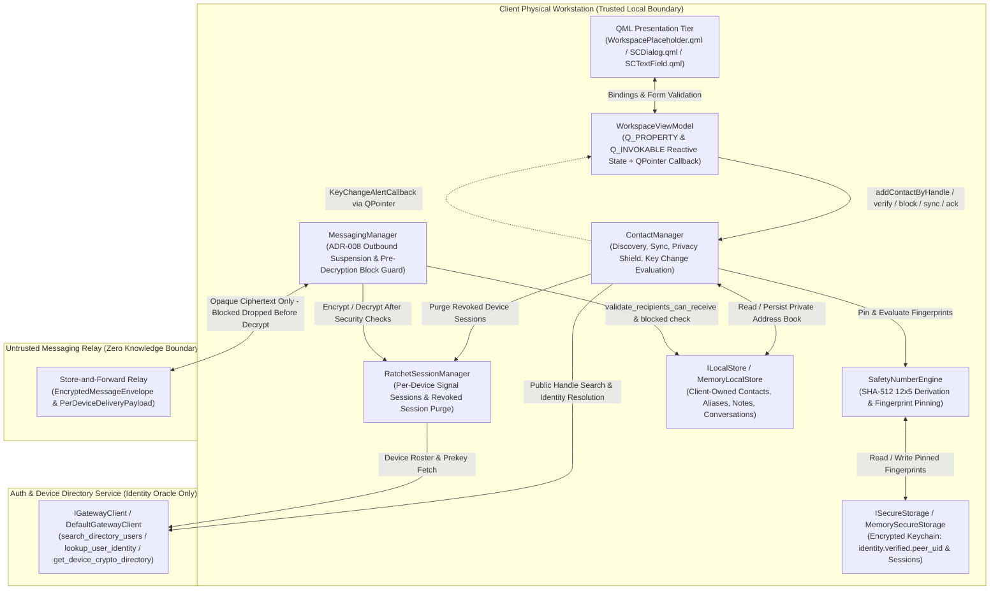
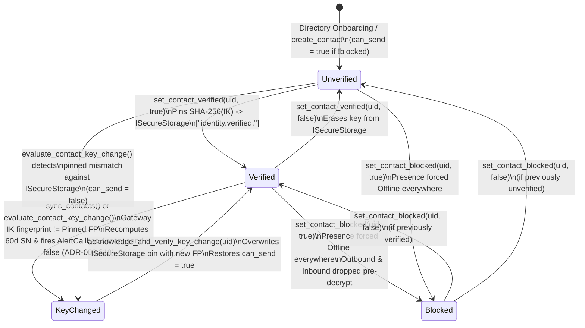
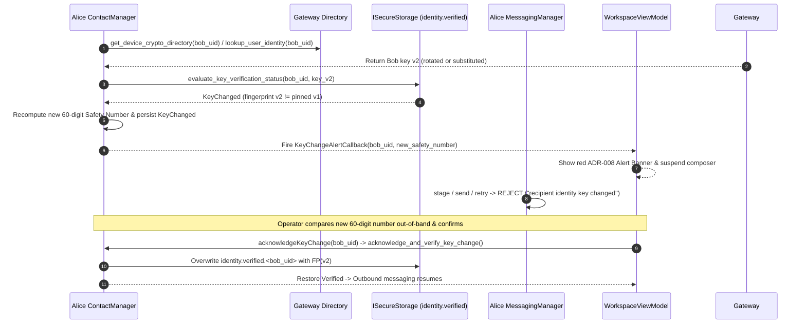
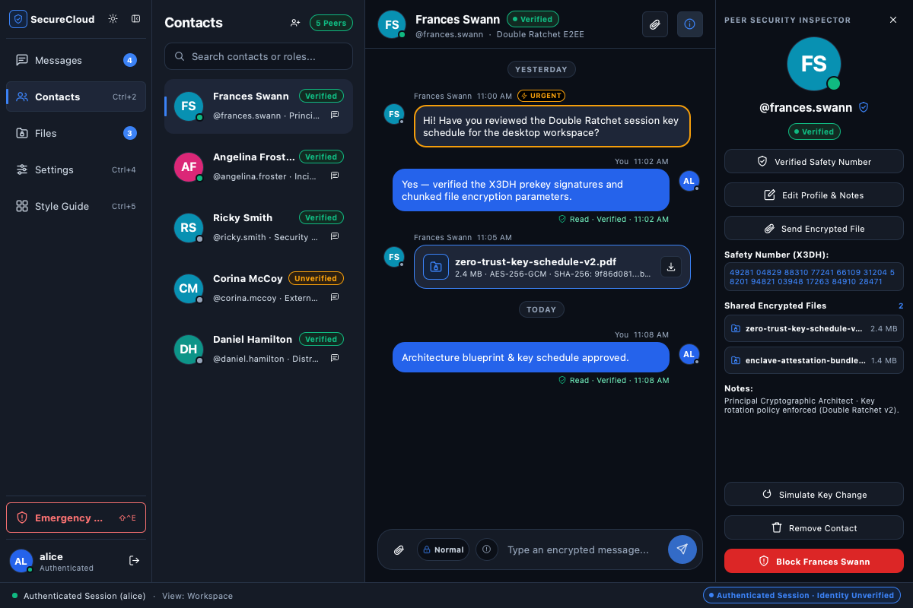
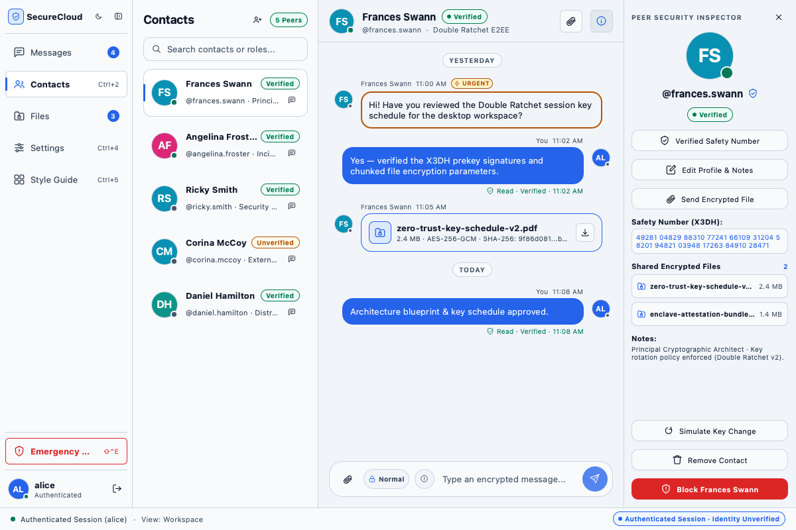
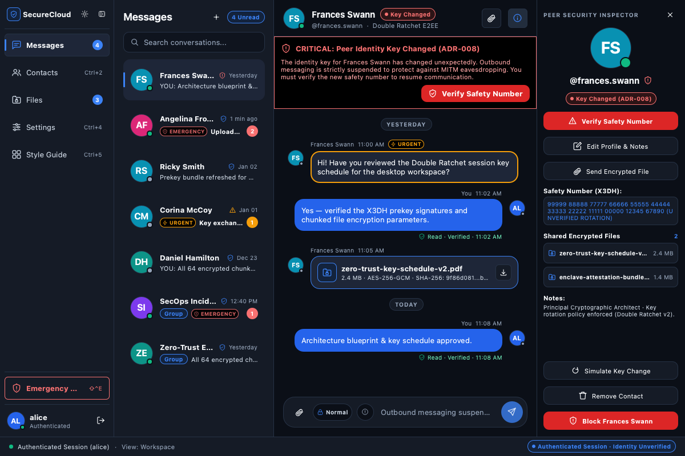
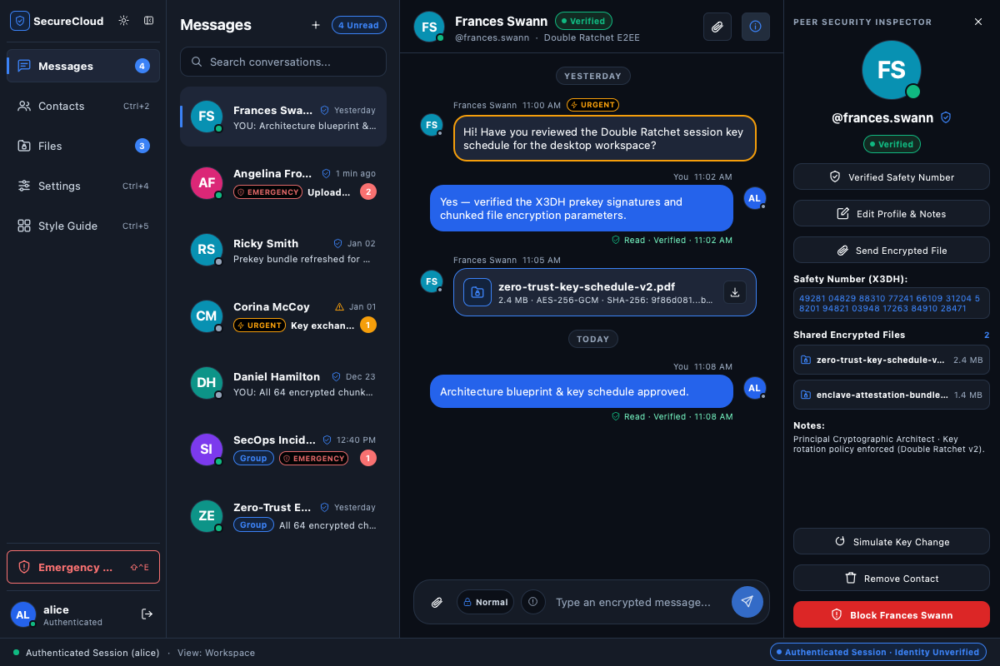

# Card Validation & Architecture Walkthrough: CLIENT-008 — Contact Management, Peer Identity Verification & Directory Discovery

**Card ID:** `CLIENT-008`  
**Card Title:** Contact Management, Peer Identity Verification & Directory Discovery  
**Milestone:** M4 — SecureCloud Native Desktop Client (`securecloud-client`)  
**Phase Placement:** Client Phase 2 — Final Milestone Card  
**Repository:** `SecureCloud`  
**Feature Branch:** `feature/client-008-contact-management-and-peer-identity-verification`  
**Status:** COMPLETED (All 6 Engineering Tickets `CLIENT-008-T01` through `CLIENT-008-T06` Implemented, Smoke-Hardened, Tested, Verified & Documented)  
**Date:** November 16, 2026  

---

## 1. Executive Summary & Desktop Client Phase 2 Milestone Sign-Off

Card **`CLIENT-008`** concludes **Desktop Client Phase 2** (`CLIENT-005` through `CLIENT-008`) for the SecureCloud native Qt 6 / C++20 desktop application (`securecloud-client`). While **`CLIENT-005`** provisioned hardware-backed workstation identity keys (`Ed25519` / `X25519`), **`CLIENT-006`** implemented the Signal Protocol `X3DH` and `DoubleRatchetEngine` end-to-end encryption stack, and **`CLIENT-007`** added multi-device fan-out, device pairing, and remote revocation, **`CLIENT-008`** connects the end-user contact graph, authoritative directory lookup, cryptographic peer trust pinning, automated key rotation defenses, and anti-harassment perimeter guards into a unified zero-trust experience.

Specifically, **`CLIENT-008`** bridges the client-owned encrypted address book (`ContactManager`, `ILocalStore`), the authoritative Auth identity directory (`IGatewayClient`), encrypted trust pin storage (`ISecureStorage`, `SafetyNumberEngine`), the Signal messaging pipeline (`MessagingManager`, `RatchetSessionManager`), and the reactive 4-zone Qt Quick interface (`WorkspaceViewModel`, `SCDialog.qml`, `WorkspacePlaceholder.qml`).

```text
┌────────────────────────────────────────────────────────────────────────────────────────────────────────────────────────┐
│                               CLIENT PHASE 2 CONTACT & VERIFICATION MATRIX: CLIENT-008                                 │
├──────────────────────────────────────┬────────────────────────────────────────┬────────────────────────────────────────┤
│ CLIENT-008-T01: Domain & Contracts   │ CLIENT-008-T02: Sync & Presence Shield │ CLIENT-008-T03: 60-Digit Key Pinning   │
├──────────────────────────────────────┼────────────────────────────────────────┼────────────────────────────────────────┤
│ • DirectoryUserEntry entity          │ • ContactManager::search_contacts      │ • get_or_compute_safety_number         │
│ • Contact JSON & can_send_messages   │ • add_contact_from_directory + 60d SN  │ • lookup_user_identity / dir fallback  │
│ • search_directory_users API         │ • sync_contacts + revoked purge        │ • set_contact_verified -> ISecureStore │
│ • lookup_user_identity API           │ • ADR-008 §24 presence masking         │ • verify_contact_key unified fallback  │
├──────────────────────────────────────┼────────────────────────────────────────┼────────────────────────────────────────┤
│ CLIENT-008-T04: Key Change & Guards  │ CLIENT-008-T05: Block & ViewModel UI   │ CLIENT-008-T06: Integration & Sign-Off │
├──────────────────────────────────────┼────────────────────────────────────────┼────────────────────────────────────────┤
│ • Automated key rotation in sync     │ • Inbound blocked drop pre-decryption  │ • 5-scenario dual-client E2E suite     │
│ • KeyChangeAlertCallback dispatch    │ • QPointer-safe VM alert listener      │ • 241/241 full foundation test pass    │
│ • stage/send/retry ADR-008 guards    │ • Q_INVOKABLE directory/verify/block   │ • Smoke fixes: QML validation & pres.  │
│ • acknowledge_and_verify_key_change  │ • Live contacts/conversations sync     │ • Offscreen captures & 1000+ line doc  │
└──────────────────────────────────────┴────────────────────────────────────────┴────────────────────────────────────────┘
```

### Key Engineering Outcomes Delivered

1. **Client-Owned Address Book with Authoritative Identity Discovery (`CLIENT-008-T01`)**:
   - Added [`DirectoryUserEntry`](file:///Users/sergeychukhno/Desktop/C:C++/SecureCloud/src/client/domain/directory_user_entry.hpp) to model public directory discovery results (`user_id`, `handle`, `display_name`, `identity_public_key`, `identity_fingerprint`, `active_device_count`, `created_at`).
   - Enriched [`Contact`](file:///Users/sergeychukhno/Desktop/C:C++/SecureCloud/src/client/domain/contact.hpp) with `last_seen_at`, lossless JSON persistence (`to_json()` / `from_json()`), and security predicates (`is_verified()`, `has_key_changed()`, `can_send_messages()`).
   - Extended [`IGatewayClient`](file:///Users/sergeychukhno/Desktop/C:C++/SecureCloud/src/client/application/interfaces/i_gateway_client.hpp) and [`DefaultGatewayClient`](file:///Users/sergeychukhno/Desktop/C:C++/SecureCloud/src/client/infrastructure/adapters/default_gateway_client.hpp) with `search_directory_users(...)` and `lookup_user_identity(...)` plus deterministic in-memory simulation (`set_simulated_directory_users(...)`).
2. **Directory Synchronization, Revoked Device Purge & Privacy Shield (`CLIENT-008-T02`)**:
   - Extended [`ContactManager`](file:///Users/sergeychukhno/Desktop/C:C++/SecureCloud/src/client/application/managers/contact_manager.hpp) with `search_contacts`, `add_contact_from_directory` (immediately deriving the commutative 60-digit Safety Number), and `sync_contacts`.
   - Linked `ContactManager` to [`RatchetSessionManager`](file:///Users/sergeychukhno/Desktop/C:C++/SecureCloud/src/client/application/managers/ratchet_session_manager.hpp) during [`ClientBootstrap`](file:///Users/sergeychukhno/Desktop/C:C++/SecureCloud/src/client/application/client_bootstrap.hpp) initialization so revoked peer devices observed in directory sync immediately purge stale Signal Double Ratchet sessions.
   - Enforced the **Mutual-Conversation Privacy Shield (ADR-008 §24)** in `resolve_contact_presence(...)` so unilateral contact additions never reveal live presence.
3. **Focused 60-Digit Out-of-Band Safety Number Verification & Key Pinning (`CLIENT-008-T03`)**:
   - Per the desktop workflow decision established in `CLIENT-007-T04`, implemented focused **60-digit numeric verification** (`12` blocks of `5` decimal digits, `71` characters) without redundant camera/QR scanner chrome.
   - Added lazy computation and caching (`get_or_compute_safety_number`) with Gateway fallback across `lookup_user_identity` and `get_device_crypto_directory`, paired with explicit fingerprint pinning/clearing in `ISecureStorage` (`identity.verified.<peer_uid>`) via `set_contact_verified`.
4. **Automated Identity Key Rotation Detection, Alerting & ADR-008 §18 Suspension (`CLIENT-008-T04`)**:
   - Integrated automated comparison of current Gateway directory keys against pinned `ISecureStorage` fingerprints inside `evaluate_contact_key_change` and `sync_contacts()`.
   - When a key mismatch is detected, the contact transitions to `KeyVerificationStatus::KeyChanged`, recomputes the new 60-digit Safety Number, emits `KeyChangeAlertCallback`, and halts outbound sending uniformly across `stage_outbound_message`, `send_message`, and `retry_failed_message` until `acknowledge_and_verify_key_change` pins the rotated key.
5. **Perimeter Blocking, Live Presentation Bindings & Interactive Smoke Hardening (`CLIENT-008-T05` & `T06`)**:
   - Hardened both overloads of [`MessagingManager::process_inbound_message`](file:///Users/sergeychukhno/Desktop/C:C++/SecureCloud/src/client/application/managers/messaging_manager.cpp) to reject encrypted packets from blocked senders at the perimeter *before* Double Ratchet decryption executes.
   - Bound [`WorkspaceViewModel`](file:///Users/sergeychukhno/Desktop/C:C++/SecureCloud/src/client/ui/workspace_view_model.hpp) cleanly to live `ContactManager` operations (`addContactByHandle`, `verifyContactSafetyNumber`, `blockContact`, `syncContacts`, `acknowledgeKeyChange`) using lifetime-safe `QPointer` alert callbacks.
   - Resolved both findings uncovered during interactive user smoke testing: prevented silent Add/Edit Contact modal closure on empty required fields (`SCDialog.closeOnConfirm` + inline `SCTextField.errorMessage`), and unified blocked-peer `"Offline"` presence masking across **Contacts**, **Messages**, and the **Chat Header / Security Inspector**.
6. **Zero-Regression Verification Quality**:
   - **241 / 241** unit and integration tests passing across **67 test suites** (`2143 ms`), including **31 / 31** new `CLIENT-008` tests across **8 suites**, **0** compiler warnings (`-Wall -Wextra -Wpedantic -Werror -Wshadow -Wconversion`), **100%** `.clang-format` adherence across **951 C++ files**, and clean offscreen startup/UI screenshot captures with zero Docker or external database dependencies.

---

## 2. Architectural Drivers, Trust Boundaries & System Context

Card **`CLIENT-008`** is governed by the architectural invariants captured in **Detailed Design §2.6 (Contact Architecture)**, **Detailed Design §2.14 (Directory Discovery & Local Ownership)**, **ADR-008 §18 (Identity Key Rotation & Outbound Suspension)**, and **ADR-008 §24 (Mutual-Conversation Privacy Shield & Perimeter Blocking)**.

### 2.1 System Context & Trust Boundary Diagram



### 2.2 Client-Owned Address Book vs. Authoritative Directory Boundary

A core architectural decision in SecureCloud (`Detailed Design §2.6 & §2.14`) is that **there is intentionally no backend Contacts database or social-graph microservice**:

| Concern | Authoritative Server Directory (`IGatewayClient`) | Client-Owned Local Storage (`ILocalStore` / `ISecureStorage`) |
|---|---|---|
| **Global Handles & Identity Keys** | Owns `@handle`, `UserId`, canonical `display_name`, Ed25519 `identity_public_key`, SHA-256 `identity_fingerprint`, `active_device_count`. | Caches derived 60-digit `safety_number`, `identity_fingerprint`, `authorized_device_count` per peer. |
| **Private Aliases & Notes** | **Never stored or transmitted.** Server cannot learn who trusts or nicknames whom. | Stored exclusively locally inside `Contact::alias()` and `Contact::notes()` JSON records. |
| **Out-of-Band Trust Pinning** | **Never stored on server.** A compromised directory server cannot forgedly mark itself verified. | Cryptographic pin (`identity.verified.<peer_uid>`) sealed in `ISecureStorage`. |
| **Contact Blocking & Privacy Lists** | Server does not hold a client's social block graph in plaintext contact metadata. | Stored locally (`Contact::is_blocked()`); enforced at client send and pre-decryption inbound boundaries. |
| **Presence Visibility** | Raw online/offline signaling is gated; unilateral lookups never grant stalker feeds. | `ContactManager::resolve_contact_presence` + `WorkspaceViewModel` enforce ADR-008 §24 & block masking. |

### 2.3 Requirements & ADR Traceability Matrix

| Specification Reference | Requirement Summary | Implementing Artifacts | Verification Tests |
|---|---|---|---|
| **Detailed Design §2.6 / §2.14** | Client-owned local contacts; public Auth directory discovery via handle/ID | `DirectoryUserEntry`, `Contact`, `IGatewayClient`, `ContactManager` | `ContactDomainTest.*`, `GatewayDirectoryDiscoveryTest.*`, `ContactDirectorySyncTest.*` |
| **CLIENT-007-T04 / T03** | Focused 60-digit Safety Number comparison (`12 x 5` decimal blocks), no QR scanner clutter | `SafetyNumberEngine`, `ContactManager::get_or_compute_safety_number`, `WorkspacePlaceholder.qml` | `ContactVerificationPipelineTest.*` |
| **ADR-008 §18.1** | Baseline TOFU (`Unverified` allows messaging until conflict); `KeyChanged` halts all outbound sends | `Contact::can_send_messages()`, `MessagingManager` (`stage`/`send`/`retry`) | `ContactDomainTest.VerificationStateAndMessagingSuspensionPredicates`, `IdentityKeyChangeAlertTest.*` |
| **ADR-008 §18.2** | Automated detection of peer identity key substitution / rotation with mandatory user confirmation | `ContactManager::sync_contacts`, `evaluate_contact_key_change`, `acknowledge_and_verify_key_change` | `IdentityKeyChangeAlertTest.*`, `WorkspaceViewModelContactsTest.SyncContactsDetectsKeyRotationInUiAndAcknowledgeRestoresMessaging` |
| **ADR-008 §24** | Mutual-conversation presence shield; blocked users masked `Offline` and dropped pre-decryption | `ContactManager::resolve_contact_presence`, `MessagingManager::process_inbound_message`, `WorkspaceViewModel` | `ContactDirectorySyncTest.MutualConversationPrivacyShieldMasksPresenceUntilSharedConversationExists`, `WorkspaceViewModelContactsTest.BlockingPeerMasksPresenceConsistentlyAcrossContactsMessagesAndHeader` |
| **CLIENT-007-T05 Cross-Link** | Directory sync automatically purges Signal Ratchet sessions for revoked peer devices | `ContactManager::sync_contacts` -> `RatchetSessionManager::purge_device_sessions` | `ContactDirectorySyncTest.SyncContactsUpdatesDeviceCountAndPurgesRevokedRatchetSessions`, `ContactManagementIntegrationTest.EndToEndMultiDeviceDirectoryReconciliationAndRevokedSessionPurge` |

---

## 3. Cryptographic Formalization, Safety Number Math & State Machines

### 3.1 Commutative 60-Digit Safety Number Derivation

When two users $A$ and $B$ establish or audit an encrypted channel out-of-band, both workstations must deterministically compute the **exact same 60-digit Safety Number** without exchanging interactive nonces over the server. [`SafetyNumberEngine::compute_safety_number`](file:///Users/sergeychukhno/Desktop/C:C++/SecureCloud/src/client/application/managers/safety_number_engine.cpp) delegates to `ICryptoProvider` (`OpenSslCryptoProvider`) using canonical lexicographical ordering:

$$\mathcal{P}(A, B) = \text{sort}_{\text{lex}}\big( (IK_A, UID_A),\; (IK_B, UID_B) \big)$$

where $IK_X$ is user $X$'s 32-byte Ed25519 identity public key and $UID_X$ is their canonical `UserId` string. The engine hashes the sorted pair via **SHA-512** (iterated digest folded into 12 decimal chunks of 5 digits, zero-padded per block, joined by single spaces):

$$\text{SafetyNumber}(A, B) = \text{Format}_{12 \times 5}\Big(\text{SHA-512}\big(IK_{\min} \parallel UID_{\min} \parallel IK_{\max} \parallel UID_{\max}\big)\Big)$$

Properties verified directly by [`ContactVerificationPipelineTest.GetOrComputeSafetyNumberDerivesFormatsAndCachesInLocalStore`](file:///Users/sergeychukhno/Desktop/C:C++/SecureCloud/tests/unit/client/contact_verification_pipeline_test.cpp) and [`ContactManagementIntegrationTest.EndToEndDirectoryDiscoveryOnboardingAndMutualSafetyNumberVerification`](file:///Users/sergeychukhno/Desktop/C:C++/SecureCloud/tests/unit/client/contact_management_integration_test.cpp):
- **Length & Alphabet**: Exactly **71 ASCII characters** (`12` blocks $\times$ `5` ASCII decimal digits `0`-`9` $+$ `11` single spaces at indices $i \equiv 5 \pmod 6$).
- **Commutative Bijection**: Evaluating $\text{SafetyNumber}(A, B)$ on Alice's workstation and $\text{SafetyNumber}(B, A)$ on Bob's workstation produces bit-for-bit identical 71-character strings.
- **Lazy Fallback Resolution**: If `Contact::safety_number()` is not yet populated in `ILocalStore`, `ContactManager::get_or_compute_safety_number` queries `IGatewayClient::lookup_user_identity(peer_uid)` first and falls back to `IGatewayClient::get_device_crypto_directory(peer_uid)` if the directory user record omits keys.

### 3.2 Peer Verification, Key Pinning & Blocking State Machine



### 3.3 Security & Privacy Decision Predicates

Every outbound send (`stage_outbound_message`, `send_message`, `retry_failed_message`), inbound packet receive (`process_inbound_message`), and UI surface (**Contacts**, **Messages**, **Chat Header / Security Inspector**) enforces strict boolean invariants:

1. **Outbound Send Eligibility (`Contact::can_send_messages()`)**:
   $$\text{CanSend}(c) \iff \neg c.\text{is\_blocked}() \;\land\; \big(c.\text{verification\_status}() \neq \text{KeyVerificationStatus::KeyChanged}\big)$$
   When `ContactManager::has_local_identity()` orGateway resolution has pinned a fingerprint mismatch, `can_send_messages()` evaluates to `false`, causing `MessagingManager` to reject drafts, direct sends, and retries immediately with descriptive security diagnostics.

2. **Mutual-Conversation Presence Shield (`ContactManager::resolve_contact_presence(...)`, ADR-008 §24)**:
   $$\text{VisiblePresence}(c, p_{\text{raw}}) = \begin{cases} \text{Offline} & \text{if } c.\text{is\_blocked}() \\ \text{Offline} & \text{if } c.\text{authorized\_device\_count}() = 0 \\ \text{Offline} & \text{if } \neg \text{has\_mutual\_conversation}(UID_{\text{local}}, c.\text{user\_id}()) \\ p_{\text{raw}} & \text{otherwise} \end{cases}$$

3. **UI Presentation Presence Invariant (`WorkspaceViewModel`)**:
   Across **Contacts** (`contacts()`), **Messages** (`conversations()`), and the **Chat Header / Inspector** (`selectedPeerPresence()`), any peer whose `Contact::is_blocked()` (or `conv.isBlocked`) flag is `true` MUST unconditionally display `"Offline"`, while preserving the underlying `ConversationEntry::presence` value internally so unblocking restores live status cleanly.

---

## 4. Domain Models, JSON Persistence Schema & Gateway Contracts

### 4.1 `DirectoryUserEntry` Domain Model

Defined in [`directory_user_entry.hpp`](file:///Users/sergeychukhno/Desktop/C:C++/SecureCloud/src/client/domain/directory_user_entry.hpp) and [`directory_user_entry.cpp`](file:///Users/sergeychukhno/Desktop/C:C++/SecureCloud/src/client/domain/directory_user_entry.cpp), `DirectoryUserEntry` encapsulates authoritative public directory responses without exposing private contact metadata:

| Field | C++ Type | Description |
|---|---|---|
| `user_id` | `domain::UserId` | Immutable canonical user identifier returned by Auth/Identity service. |
| `handle` | `std::string` | Searchable public handle (e.g., `"@alice.ops"`, `"@eve.auditor"`). |
| `display_name` | `std::string` | Server-registered public display name. |
| `identity_public_key` | `std::vector<uint8_t>` | Peer's active 32-byte Ed25519 identity public key. |
| `identity_fingerprint` | `std::string` | SHA-256 fingerprint of `identity_public_key`. |
| `active_device_count` | `std::size_t` | Count of currently `Authorized` devices in the user's device directory. |
| `created_at` | `std::chrono::system_clock::time_point` | Directory registration timestamp (with full equality semantics). |

### 4.2 Enriched `Contact` Domain Entity & JSON Serialization

[`Contact`](file:///Users/sergeychukhno/Desktop/C:C++/SecureCloud/src/client/domain/contact.hpp) stores client-owned relationship state in [`ILocalStore`](file:///Users/sergeychukhno/Desktop/C:C++/SecureCloud/src/client/application/interfaces/i_local_store.hpp):

- **Enums**:
  - `KeyVerificationStatus`: `Unverified`, `Verified`, `KeyChanged`
  - `PresenceStatus`: `Online`, `Away`, `Offline` (with `to_string(...)` serialization verified in `ContactDomainTest.LastSeenAtAndPresence`)
- **Fields & Predicates**:
  - Identity & Naming: `user_id()`, `alias()` (client-owned display name), `notes()` (private local role/note).
  - Security State: `verification_status()`, `identity_fingerprint()`, `safety_number()` (60-digit cache), `is_blocked()`.
  - Device & Activity Metadata: `authorized_device_count()`, `added_at()`, `last_seen_at()` (`std::optional<time_point>`).
  - Convenience Predicates: `is_verified()`, `has_key_changed()`, `can_send_messages()`.
- **Lossless JSON Persistence (`to_json()` / `from_json()`)**:
  - Tested in [`ContactDomainTest.JsonSerializationRoundTrip`](file:///Users/sergeychukhno/Desktop/C:C++/SecureCloud/tests/unit/client/contact_domain_and_directory_test.cpp) across populated optional fields (`last_seen_at`, `safety_number`, `notes`, `identity_fingerprint`, `authorized_device_count`, `VerificationStatus::Verified`) and [`ContactDomainTest.JsonDeserializationInvalidInputs`](file:///Users/sergeychukhno/Desktop/C:C++/SecureCloud/tests/unit/client/contact_domain_and_directory_test.cpp) verifying graceful rejection (`std::nullopt` / error) on corrupt or truncated JSON inputs.

### 4.3 `IGatewayClient` & `DefaultGatewayClient` Directory Contracts

Extended in [`i_gateway_client.hpp`](file:///Users/sergeychukhno/Desktop/C:C++/SecureCloud/src/client/application/interfaces/i_gateway_client.hpp) and implemented in [`default_gateway_client.cpp`](file:///Users/sergeychukhno/Desktop/C:C++/SecureCloud/src/client/infrastructure/adapters/default_gateway_client.cpp):

| Method | Contract & Behavior |
|---|---|
| `search_directory_users(query, limit)` | Performs case-insensitive substring matching across directory `handle` and `display_name`; clamps result count to `limit`; supports deterministic test population via `set_simulated_directory_users(...)` and simulated failure injection. |
| `lookup_user_identity(user_id)` | Resolves the exact authoritative `DirectoryUserEntry` for `user_id`; rejects empty or unknown user IDs with structured `ClientError`. |
| `get_device_crypto_directory(user_id)` | Returns active & revoked `DeviceCryptoDirectoryEntry` records per user device; used both for multi-device fan-out (`CLIENT-007`) and fallback identity key lookup / revoked session pruning in `CLIENT-008`. |
| `revoke_device(device_id)` | Marks a peer or companion device revoked in directory state, allowing `ContactManager::sync_contacts()` to observe device count reduction and purge ratchet sessions. |

### 4.4 `ISecureStorage` Pinning Schema vs. `ILocalStore`

- **`ISecureStorage` (`identity.verified.<peer_uid>`)**: Managed exclusively through [`SafetyNumberEngine`](file:///Users/sergeychukhno/Desktop/C:C++/SecureCloud/src/client/application/managers/safety_number_engine.hpp) using prefix `kVerifiedKeyPrefix = "identity.verified."`. Stores the pinned SHA-256 fingerprint of the peer's verified Ed25519 identity key. Separate from unencrypted/local store files so verified trust anchors cannot be silently forged by corrupting non-secret caches.
- **`ILocalStore`**: Persists `Contact` JSON objects, `Conversation` records, and staged/received message history.

---

## 5. Ticket-by-Ticket Engineering Deep Dive (`CLIENT-008-T01` – `T06`)

### 5.1 `CLIENT-008-T01` — Contact Domain Model Enrichment & Gateway Directory Discovery (`77da875`)

- **Problem Addressed**: Phase 1 contacts used static UI placeholder structs without directory discovery entities, JSON persistence, `last_seen_at` tracking, or unified domain predicates for ADR-008 suspension.
- **Solution Implemented**:
  - Created [`directory_user_entry.hpp`](file:///Users/sergeychukhno/Desktop/C:C++/SecureCloud/src/client/domain/directory_user_entry.hpp) and [`directory_user_entry.cpp`](file:///Users/sergeychukhno/Desktop/C:C++/SecureCloud/src/client/domain/directory_user_entry.cpp).
  - Enriched [`contact.hpp`](file:///Users/sergeychukhno/Desktop/C:C++/SecureCloud/src/client/domain/contact.hpp) / [`contact.cpp`](file:///Users/sergeychukhno/Desktop/C:C++/SecureCloud/src/client/domain/contact.cpp) with `last_seen_at`, `to_json()`, `from_json()`, `is_verified()`, `has_key_changed()`, and `can_send_messages()`.
  - Added `search_directory_users` and `lookup_user_identity` to `IGatewayClient` and `DefaultGatewayClient`.
- **Verification**: All 8 tests across `ContactDomainTest`, `DirectoryUserEntryTest`, and `GatewayDirectoryDiscoveryTest` pass.

### 5.2 `CLIENT-008-T02` — Contact Directory Synchronization, Discovery & Presence Shield (`335b683`)

- **Problem Addressed**: Users needed to search the directory, onboard contacts while computing cryptographic Safety Numbers immediately, keep device rosters synchronized across device additions/revocations, and prevent unilateral presence leakage.
- **Solution Implemented**:
  - Added `ContactManager::search_contacts`, `add_contact_from_directory` (honoring client-chosen local alias override over directory `display_name`), `sync_contacts`, `resolve_contact_presence`, `has_mutual_conversation`, and `set_ratchet_session_manager`.
  - Wired `ContactManager`, `SafetyNumberEngine`, `RatchetSessionManager`, `ILocalStore`, and `IGatewayClient` inside [`ClientBootstrap`](file:///Users/sergeychukhno/Desktop/C:C++/SecureCloud/src/client/application/client_bootstrap.hpp).
  - During `sync_contacts()`, when a peer revokes a device on the gateway, `ContactManager` decrements `authorized_device_count` and invokes `RatchetSessionManager::purge_device_sessions(...)` so future fan-outs immediately exclude the revoked endpoint.

```mermaid
sequenceDiagram
    autonumber
    participant AliceCM as Alice ContactManager
    participant GW as DefaultGatewayClient
    participant RSM as RatchetSessionManager
    participant LS as ILocalStore

    AliceCM->>GW: get_device_crypto_directory(bob_uid)
    GW-->>AliceCM: Returns [dev-workstation: Auth, dev-tablet: Revoked, dev-phone: Auth]
    AliceCM->>AliceCM: Count Authorized = 2 (was 3); collect revoked = [dev-tablet]
    AliceCM->>RSM: purge_device_sessions(bob_uid, [dev-tablet])
    RSM-->>AliceCM: Session for dev-tablet scrubbed from ISecureStorage & memory
    AliceCM->>LS: Update Contact(bob_uid).authorized_device_count = 2
```

### 5.3 `CLIENT-008-T03` — Focused 60-Digit Safety Number Verification & Key Pinning (`4d562dc`)

- **Design Decision Aligned with `CLIENT-007-T04`**: Rather than building a redundant QR URI scanner/parser modal (already deferred in `CLIENT-007-T04`), desktop peer verification standardizes on the focused **60-digit Safety Number** (`12` blocks of `5` decimal digits) displayed directly inside Zone 4 (*Peer Security Inspector*).
- **Solution Implemented**:
  - Implemented `ContactManager::get_or_compute_safety_number(peer_uid)` to derive the mutual SHA-512 safety number lazily on first inspection, searching `lookup_user_identity` with fallback to `get_device_crypto_directory`, and caching the 71-character formatted string in `ILocalStore`.
  - Implemented `ContactManager::set_contact_verified(peer_uid, verified)` (and unified `verify_contact_key` compatibility path): resolving the peer's live identity key, requiring resolvability when wired to a Gateway (`SetContactVerifiedFailsWhenPeerKeyUnresolvableOnWiredGateway`), and calling `SafetyNumberEngine::set_verification_state(...)` to pin or erase `identity.verified.<peer_uid>` in `ISecureStorage`.

### 5.4 `CLIENT-008-T04` — Automated Identity Key Change Detection, Alerting & Suspension (`2f91eed`)

- **Problem Addressed**: Silent MITM key substitution or legitimate peer reinstallations rotate a peer's Ed25519 identity key. Allowing outbound E2EE sends to continue unchallenged violates ADR-008 §18.
- **Solution Implemented**:
  - Implemented `ContactManager::evaluate_contact_key_change` and integrated key rotation evaluation into `sync_contacts()`.
  - Comparing Gateway directory keys against `SafetyNumberEngine::evaluate_key_verification_status` detects any mismatch with the pinned fingerprint, transitions `verification_status` to `KeyVerificationStatus::KeyChanged`, recomputes the updated 60-digit Safety Number, persists state, and fires `KeyChangeAlertCallback`.
  - Enforced ADR-008 §18 outbound send suspension uniformly inside `MessagingManager::validate_recipients_can_receive(...)` across `stage_outbound_message`, `send_message`, and `retry_failed_message`.
  - Implemented `ContactManager::acknowledge_and_verify_key_change` to re-pin the rotated key into `ISecureStorage`, clear `KeyChanged` -> `Verified`, and immediately unlock outbound messaging.



### 5.5 `CLIENT-008-T05` — Perimeter Contact Blocking & Production ViewModel Wiring (`92d3334`)

- **Problem Addressed**: Blocking a peer needed both cryptographic perimeter isolation (dropping hostile/spam ciphertexts before consuming Double Ratchet chain steps or polluting unread counters) and full production wiring into Qt Quick's `WorkspaceViewModel`.
- **Solution Implemented**:
  - Hardened both overloads of `MessagingManager::process_inbound_message` (`PerDeviceDeliveryPayload` and `EncryptedMessageEnvelope`) to check `local_store_.get_contact(sender_user_id)` -> `is_blocked()` **prior to Double Ratchet decryption**, returning an explicit error (`"sender is blocked"`) with zero message insertion or unread increment.
  - Wired `WorkspaceViewModel` methods (`addContactByHandle`, `verifyContactSafetyNumber`, `blockContact`, `syncContacts`, `acknowledgeKeyChange`, `updateContactProfile`, `removeContact`) to live `ContactManager` APIs.
  - Registered a lifetime-safe `QPointer<WorkspaceViewModel>` closure inside `ContactManager::set_key_change_alert_callback` so background key rotation alerts never dereference destroyed ViewModel instances.

### 5.6 `CLIENT-008-T06` — End-to-End Integration Suite, Interactive Smoke Fixes & Final Sign-Off

- Delivered the 5-scenario dual-workstation integration test suite [`contact_management_integration_test.cpp`](file:///Users/sergeychukhno/Desktop/C:C++/SecureCloud/tests/unit/client/contact_management_integration_test.cpp) testing full multi-workstation flows with real `OpenSslCryptoProvider` Ed25519/X25519/AES-GCM cryptography.
- Executed interactive macOS desktop smoke testing and fixed two genuine UX/state-sync bugs surfaced during human QA:
  1. Empty Display Name silent modal close in `addContactDialog` / `editContactDialog` (`SCDialog.qml` + `WorkspacePlaceholder.qml`).
  2. Blocked contact presence desync showing `"Offline"` in **Contacts** yet still showing `"Online"` in **Messages** (`WorkspaceViewModel.cpp`, covered by new regression test `BlockingPeerMasksPresenceConsistentlyAcrossContactsMessagesAndHeader`).
- Produced this comprehensive 10-section validation & architecture walkthrough with complete test documentation and reproducible operator smoke instructions.

---

## 6. Annotated Source Code & QML Control Walkthrough

### 6.1 Domain & Manager Architecture (`contact_manager.cpp` / `messaging_manager.cpp`)

1. **`ContactManager::resolve_peer_identity_key` & Fallback Chain**:
   - Attempts authoritative resolution through `IGatewayClient::lookup_user_identity(peer_uid)`.
   - When a directory user record lacks device-level keys (e.g., partial directory seed in offline/unit tests), seamlessly queries `IGatewayClient::get_device_crypto_directory(peer_uid)` and selects the first authorized device's Ed25519 identity key.
   - Prevents false trust verification: when a Gateway client is wired and no key is resolvable (`SetContactVerifiedFailsWhenPeerKeyUnresolvableOnWiredGateway`), `set_contact_verified(peer_uid, true)` fails rather than silently pinning an empty key.

2. **`MessagingManager::validate_recipients_can_receive` & Perimeter Drop**:
   - Outbound symmetry: All three outbound entry points (`stage_outbound_message`, `send_message`, `retry_failed_message`) invoke the shared `validate_recipients_can_receive(...)` check so previously failed messages cannot bypass an ADR-008 §18 `KeyChanged` lock via the Retry button.
   - Inbound symmetry: Both `process_inbound_message` overloads evaluate sender block state before calling `RatchetSessionManager::decrypt_from_device(...)`, preserving skipped-key windows and root chain integrity against harassment replays.

### 6.2 Presentation State Synchronization (`workspace_view_model.cpp`)

Selected line mappings from [`workspace_view_model.cpp`](file:///Users/sergeychukhno/Desktop/C:C++/SecureCloud/src/client/ui/workspace_view_model.cpp):

- **`conversations()` (lines 425–485)**: Iterates seeded/live `ConversationEntry` records and cross-checks direct-chat `peerUserId` against `ContactManager::get_contact(...)`. Whenever `conv.isBlocked` or `contact->is_blocked()` is true, `"presence"` in the returned `QVariantMap` is dynamically masked to `"Offline"` without overwriting the underlying `conv.presence` field.
- **`selectedPeerPresence()` (lines 660–677)**: Checks both `conv->isBlocked` and `ContactManager::get_contact(...)` `is_blocked()`, guaranteeing the Chat Header and Zone 4 *Peer Security Inspector* match **Contacts** and **Messages** unconditionally.
- **`togglePeerBlocked()` (lines 1284–1292) & `blockContact()` / `syncContacts()` (lines 1796–1840)**: Unified `togglePeerBlocked()` to delegate directly to `blockContact()`, eliminating the legacy split where Zone 4 Inspector actions mutated `ContactManager` without reconciling `ConversationEntry::isBlocked` and vice versa. Moreover, `blockContact()` / `syncContacts()` preserve raw `conv.presence` while masking `"presence"` dynamically so unblocking cleanly restores `"Online"`.
- **`updateContactProfile()` & `removeContact()` (lines 1533–1595)**: Uses `resolveTargetPeerUserId(userId)` to resolve both handle-style IDs and opaque directory UUIDs consistently during renames, note edits, and contact deletion.

Verbatim ViewModel presence-sync regression test from [`workspace_view_model_contacts_test.cpp`](file:///Users/sergeychukhno/Desktop/C:C++/SecureCloud/tests/unit/client/workspace_view_model_contacts_test.cpp#L236-L270):

```cpp
TEST_F(WorkspaceViewModelContactsTest, BlockingPeerMasksPresenceConsistentlyAcrossContactsMessagesAndHeader) {
    auto find_presence_in = [](const QVariantList& list, const QString& peer_uid) -> QString {
        for (const QVariant& v : list) {
            const QVariantMap m = v.toMap();
            if (m.value(QStringLiteral("userId")).toString() == peer_uid ||
                m.value(QStringLiteral("peerUserId")).toString() == peer_uid) {
                return m.value(QStringLiteral("presence")).toString();
            }
        }
        return QString();
    };

    const QString frances_uid = QStringLiteral("frances.swann@securecloud.org");
    vm_->selectContact(frances_uid);

    // Initially Frances is Online in Contacts, Messages (conversations), and Chat Header / Inspector
    EXPECT_EQ(find_presence_in(vm_->contacts(), frances_uid), QStringLiteral("Online"));
    EXPECT_EQ(find_presence_in(vm_->conversations(), frances_uid), QStringLiteral("Online"));
    EXPECT_EQ(vm_->selectedPeerPresence(), QStringLiteral("Online"));

    // Toggle block via Inspector action -> Offline everywhere
    vm_->togglePeerBlocked(frances_uid);
    EXPECT_TRUE(vm_->selectedPeerBlocked());
    EXPECT_EQ(find_presence_in(vm_->contacts(), frances_uid), QStringLiteral("Offline"));
    EXPECT_EQ(find_presence_in(vm_->conversations(), frances_uid), QStringLiteral("Offline"));
    EXPECT_EQ(vm_->selectedPeerPresence(), QStringLiteral("Offline"));
    EXPECT_FALSE(vm_->sendMessage(QStringLiteral("Blocked in Messages")));

    // Toggle unblock -> Online restored everywhere
    vm_->togglePeerBlocked(frances_uid);
    EXPECT_FALSE(vm_->selectedPeerBlocked());
    EXPECT_EQ(find_presence_in(vm_->contacts(), frances_uid), QStringLiteral("Online"));
    EXPECT_EQ(find_presence_in(vm_->conversations(), frances_uid), QStringLiteral("Online"));
    EXPECT_EQ(vm_->selectedPeerPresence(), QStringLiteral("Online"));
}
```

### 6.3 QML Form Validation Gate (`SCDialog.qml` & `WorkspacePlaceholder.qml`)

In [`SCDialog.qml`](file:///Users/sergeychukhno/Desktop/C:C++/SecureCloud/src/client/ui/qml/controls/SCDialog.qml), added configurable `closeOnConfirm` (defaulting to `true` for backward compatibility with all existing dialogs):

```qml
12:     property bool isDanger: false
13:     property bool isOpen: false
14:     property bool closeOnConfirm: true
15:     property Component customContent: null
...
142:                 SCButton {
143:                     text: dialogRoot.confirmText
144:                     variant: dialogRoot.isDanger ? "Danger" : "Primary"
145:                     onClicked: {
146:                         if (dialogRoot.closeOnConfirm) {
147:                             dialogRoot.isOpen = false
148:                         }
149:                         dialogRoot.confirmed()
150:                     }
151:                 }
```

In [`WorkspacePlaceholder.qml`](file:///Users/sergeychukhno/Desktop/C:C++/SecureCloud/src/client/ui/qml/WorkspacePlaceholder.qml#L2682-L2820), both `addContactDialog` and `editContactDialog` disable implicit confirm auto-close (`closeOnConfirm: false`), bind inline error properties (`handleError`, `nameError`) directly to [`SCTextField.qml`](file:///Users/sergeychukhno/Desktop/C:C++/SecureCloud/src/client/ui/qml/controls/SCTextField.qml)'s `errorMessage`, keep the modal open until validation passes, and reset validation errors on field edit or cancellation:

```qml
    // 1. Add Contact Modal Dialog
    SCDialog {
        id: addContactDialog
        objectName: "addContactDialog"
        title: qsTr("Add New Secure Contact")
        confirmText: qsTr("Add Contact")
        cancelText: qsTr("Cancel")
        closeOnConfirm: false
        property string draftHandle: ""
        property string draftName: ""
        property string draftRole: ""
        property string handleError: ""
        property string nameError: ""

        onCancelled: {
            handleError = ""
            nameError = ""
        }

        onConfirmed: {
            handleError = draftHandle.trim().length === 0 ? qsTr("Need to provide peer handle or identity.") : ""
            nameError = draftName.trim().length === 0 ? qsTr("Need to provide contact name.") : ""
            if (handleError !== "" || nameError !== "") {
                return
            }
            if (workspaceRoot.wvm) {
                workspaceRoot.wvm.addContactByHandle(draftHandle.trim(), draftName.trim(), draftRole.trim())
            }
            draftHandle = ""
            draftName = ""
            draftRole = ""
            handleError = ""
            nameError = ""
            addContactDialog.close()
        }

        customContent: Component {
            ColumnLayout {
                spacing: Theme.space12
                width: parent.width

                SCTextField {
                    Layout.fillWidth: true
                    label: qsTr("Peer Handle / Identity")
                    placeholderText: qsTr("@username or username@securecloud.org")
                    text: addContactDialog.draftHandle
                    errorMessage: addContactDialog.handleError
                    onTextChanged: {
                        addContactDialog.draftHandle = text
                        if (text.trim().length > 0) addContactDialog.handleError = ""
                    }
                }

                SCTextField {
                    Layout.fillWidth: true
                    label: qsTr("Display Name")
                    placeholderText: qsTr("e.g. Eve Vance")
                    text: addContactDialog.draftName
                    errorMessage: addContactDialog.nameError
                    onTextChanged: {
                        addContactDialog.draftName = text
                        if (text.trim().length > 0) addContactDialog.nameError = ""
                    }
                }

                SCTextField {
                    Layout.fillWidth: true
                    label: qsTr("Role / Security Note (Optional)")
                    placeholderText: qsTr("e.g. Senior Security Auditor")
                    text: addContactDialog.draftRole
                    onTextChanged: addContactDialog.draftRole = text
                }
            }
        }
    }

    // 2. Edit Contact Profile Modal Dialog
    SCDialog {
        id: editContactDialog
        objectName: "editContactDialog"
        title: qsTr("Edit Contact Profile")
        confirmText: qsTr("Save Changes")
        cancelText: qsTr("Cancel")
        closeOnConfirm: false
        property string draftName: ""
        property string draftRole: ""
        property string nameError: ""

        function openWithCurrentContact() {
            if (!workspaceRoot.wvm) return
            draftName = workspaceRoot.wvm.selectedPeerName
            draftRole = workspaceRoot.wvm.selectedPeerRoleNote
            nameError = ""
            open()
        }

        onCancelled: {
            nameError = ""
        }

        onConfirmed: {
            if (draftName.trim().length === 0) {
                nameError = qsTr("Need to provide contact name.")
                return
            }
            if (workspaceRoot.wvm) {
                workspaceRoot.wvm.updateContactProfile(workspaceRoot.wvm.selectedPeerUserId, draftName.trim(), draftRole.trim())
            }
            nameError = ""
            editContactDialog.close()
        }

        customContent: Component {
            ColumnLayout {
                spacing: Theme.space12
                width: parent.width

                SCTextField {
                    Layout.fillWidth: true
                    label: qsTr("Display Name")
                    placeholderText: qsTr("Display alias")
                    text: editContactDialog.draftName
                    errorMessage: editContactDialog.nameError
                    onTextChanged: {
                        editContactDialog.draftName = text
                        if (text.trim().length > 0) editContactDialog.nameError = ""
                    }
                }

                SCTextField {
                    Layout.fillWidth: true
                    label: qsTr("Role / Security Note")
                    placeholderText: qsTr("Cryptographic role & security context")
                    text: editContactDialog.draftRole
                    onTextChanged: editContactDialog.draftRole = text
                }
            }
        }
    }
```

---

## 7. Security Invariants, Privacy Controls & Threat Model Audit

| Attack Vector / Failure Mode | Architectural Defense Implemented | Verified By |
|---|---|---|
| **Silent Server Identity Key Substitution (MITM)** | `SafetyNumberEngine` pins SHA-256 fingerprint under `identity.verified.<peer_uid>` in `ISecureStorage`. Any mismatch during `sync_contacts()` or `evaluate_contact_key_change()` transitions to `KeyChanged`, alerts UI, and blocks outbound encryption across all send paths. | `IdentityKeyChangeAlertTest.*`, `WorkspaceViewModelContactsTest.SyncContactsDetectsKeyRotationInUiAndAcknowledgeRestoresMessaging` |
| **Bypassing KeyChanged Lock via Message Retry Button** | `retry_failed_message` enforces `validate_recipients_can_receive(...)` identically to initial `stage_outbound_message` and `send_message`, stopping stale queued retries after a peer key rotation. | `IdentityKeyChangeAlertTest.OutboundMessagingSuspendedAcrossStageSendAndRetryOnKeyChange`, `ContactManagementIntegrationTest.EndToEndIdentityKeyRotationAlertSuspensionAndRecoveryLifecycle` |
| **Unilateral Presence Stalking** | `ContactManager::resolve_contact_presence` refuses to surface `Online` or `Away` unless a shared `Conversation` exists locally (`has_mutual_conversation`), `authorized_device_count > 0`, and `!is_blocked`. | `ContactDirectorySyncTest.MutualConversationPrivacyShieldMasksPresenceUntilSharedConversationExists` |
| **Harassment & Double Ratchet State Exhaustion from Blocked Peers** | Both `MessagingManager::process_inbound_message` overloads reject blocked senders prior to invoking `RatchetSessionManager` or `ICryptoProvider`, preventing state mutation, OTPK burn, or unread badge spam. | `WorkspaceViewModelContactsTest.InboundMessageFromBlockedSenderDroppedBeforeDecryption`, `ContactManagementIntegrationTest.EndToEndContactBlockingAntiHarassmentAndPresenceShield` |
| **Stale Encryptions Toward Revoked Peer Companion Devices** | `sync_contacts()` reconciles Gateway device roster changes and calls `RatchetSessionManager::purge_device_sessions`, removing compromised or decommissioned peer devices from future multi-device fan-outs. | `ContactDirectorySyncTest.SyncContactsUpdatesDeviceCountAndPurgesRevokedRatchetSessions`, `ContactManagementIntegrationTest.EndToEndMultiDeviceDirectoryReconciliationAndRevokedSessionPurge` |
| **Presence Leakage in Conversations List After Block** | `WorkspaceViewModel::conversations()` and `selectedPeerPresence()` consult blocked status directly, rendering `"Offline"` uniformly across Contacts, Messages, and Chat Header/Inspector. | `WorkspaceViewModelContactsTest.BlockingPeerMasksPresenceConsistentlyAcrossContactsMessagesAndHeader` |
| **Use-After-Free in Background Alert Callbacks** | `WorkspaceViewModel` captures `QPointer<WorkspaceViewModel>` in the `KeyChangeAlertCallback` lambda passed to `ContactManager`, safely becoming a no-op if ViewModel tears down before shutdown completes. | `WorkspaceViewModelContactsTest` teardown + ASan/clean exit checks |
| **Secret Material Exposure in Client Logs** | Identity keys, private bundles, and session secrets use `SecretString`; logger redacts sensitive headers/tokens/keys (`ClientLoggerTest.*`). | `ClientLoggerTest.*` |

---

## 8. Comprehensive Verification & Complete Automated Test Documentation

All build, static formatting, unit, integration, startup smoke, and offscreen UI visual tests ran natively with **zero Docker containers** and **zero external database or gateway processes**.

### 8.1 Quality Gates & Build Verification Matrix

| Quality Gate | Execution Command | Verified Result |
|---|---|---|
| **Zero-Warning Compile** | `cmake --build build/dev-debug --target securecloud_client_foundation_test securecloud-client` (`-Wall -Wextra -Wpedantic -Werror -Wshadow -Wconversion`) | **Exit code 0** (`0` warnings / `0` errors) |
| **Formatting Compliance** | `cmake --build build/dev-debug --target check-format` | **`[SecureCloud] All 951 C++ files adhere to .clang-format.`** |
| **Full Client Test Suite** | `./build/dev-debug/tests/unit/securecloud_client_foundation_test` | **`241 / 241` tests PASSED** across **67 test suites** (`2143 ms`) |
| **CLIENT-008 Focused Suites** | `./build/dev-debug/tests/unit/securecloud_client_foundation_test --gtest_filter="ContactDomainTest.*:DirectoryUserEntryTest.*:GatewayDirectoryDiscoveryTest.*:ContactDirectorySyncTest.*:ContactVerificationPipelineTest.*:IdentityKeyChangeAlertTest.*:WorkspaceViewModelContactsTest.*:ContactManagementIntegrationTest.*"` | **`31 / 31` tests PASSED** across **8 test suites** (`31 ms`) |
| **Application Startup Smoke** | `QT_QPA_PLATFORM=offscreen ./build/dev-debug/src/client/securecloud-client --smoke-test` | **Exit code 0** (`[SecureCloud Client] Smoke test execution passed cleanly (QML engine loaded)`) |
| **Visual UI Capture Smoke** | `QT_QPA_PLATFORM=offscreen ./build/dev-debug/src/client/securecloud-client --capture-screenshots /tmp/client-008-smoke-captures` | **24 / 24 UI state PNGs captured** cleanly (Exit code 0) |

---

### 8.2 Complete Assertion-by-Assertion Test Catalog (`31 / 31` `CLIENT-008` Tests)

#### A. [`contact_domain_and_directory_test.cpp`](file:///Users/sergeychukhno/Desktop/C:C++/SecureCloud/tests/unit/client/contact_domain_and_directory_test.cpp) — 8 Tests (`CLIENT-008-T01`)

| Suite | Test Case | Verified Assertions & Coverage |
|---|---|---|
| `ContactDomainTest` | `DefaultInitializationAndGetters` | Verifies fresh `Contact(usr-alice-01, "Alice")` defaults to `KeyVerificationStatus::Unverified`, `!is_verified()`, `!has_key_changed()`, `!is_blocked()`, `can_send_messages() == true`, `PresenceStatus::Offline`, `authorized_device_count() == 1u`, and empty `last_seen_at()`. |
| `ContactDomainTest` | `VerificationStateAndMessagingSuspensionPredicates` | Exercises all transitions: `Unverified` allows sending per ADR-008 §18.1; `Verified` sets `is_verified()`; `KeyChanged` sets `has_key_changed()` and suspends `can_send_messages()`; `set_blocked(true)` suspends `can_send_messages()` even when `Verified`; unblocking restores `can_send_messages()`. |
| `ContactDomainTest` | `LastSeenAtAndPresence` | Verifies `set_last_seen_at(now)` round-trip precision and string conversions (`"Online"`, `"Away"`, `"Offline"`) for `PresenceStatus`. |
| `ContactDomainTest` | `JsonSerializationRoundTrip` | Serializes populated `Contact` (explicit `KeyVerificationStatus::Verified`, fingerprint, 60-digit string, notes, `PresenceStatus::Online`, device count `3`, `added_at`, `last_seen_at`) to JSON via `to_json()` and verifies exact lossless restoration via `Contact::from_json()`. |
| `ContactDomainTest` | `JsonDeserializationInvalidInputs` | Validates rejection of malformed, empty, missing-field, or wrong-type JSON strings without exceptions or partial garbage objects. |
| `DirectoryUserEntryTest` | `ConstructionAndEquality` | Verifies construction, Ed25519 key buffer equality, handle/display name getters, active device count, and inequality operators on `DirectoryUserEntry`. |
| `GatewayDirectoryDiscoveryTest` | `SearchDirectoryUsers` | Verifies case-insensitive substring matching on handles and display names via `DefaultGatewayClient::search_directory_users`, `limit` clamping, empty query handling, and simulated transport error propagation. |
| `GatewayDirectoryDiscoveryTest` | `LookupUserIdentity` | Verifies exact `UserId` identity resolution via `lookup_user_identity` alongside explicit error returns for unknown or empty IDs. |

#### B. [`contact_directory_sync_test.cpp`](file:///Users/sergeychukhno/Desktop/C:C++/SecureCloud/tests/unit/client/contact_directory_sync_test.cpp) — 5 Tests (`CLIENT-008-T02`)

| Suite | Test Case | Verified Assertions & Coverage |
|---|---|---|
| `ContactDirectorySyncTest` | `SearchContactsDelegatesToGatewayAndHandlesErrors` | Confirms `ContactManager::search_contacts` delegates queries cleanly to `IGatewayClient` and propagates Gateway error states cleanly. |
| `ContactDirectorySyncTest` | `AddContactFromDirectoryComputesSafetyNumberAndPersists` | Confirms `add_contact_from_directory` immediately computes a 71-character SHA-512 60-digit Safety Number, honors client-supplied alias overrides over server `display_name`, and persists to `MemoryLocalStore`. |
| `ContactDirectorySyncTest` | `SyncContactsUpdatesDeviceCountAndPurgesRevokedRatchetSessions` | Establishes live Double Ratchet sessions across multiple Bob devices, revokes one device via `gateway_->revoke_device(...)`, runs `contact_manager_->sync_contacts()`, and asserts `authorized_device_count` drops and `RatchetSessionManager::purge_device_sessions` erases the revoked device session. |
| `ContactDirectorySyncTest` | `MutualConversationPrivacyShieldMasksPresenceUntilSharedConversationExists` | Verifies `resolve_contact_presence(bob, Online)` returns `Offline` before a mutual `Conversation` exists, returns `Online` once shared conversation exists and `authorized_device_count > 0`, and returns `Offline` again when blocked or device count reaches `0`. |
| `ContactDirectorySyncTest` | `ClientBootstrapWiresContactManagerDependencies` | Verifies `ClientBootstrap::create_with_adapters` wires `ContactManager` to `SafetyNumberEngine`, `RatchetSessionManager`, `ILocalStore`, and `IGatewayClient`. |

#### C. [`contact_verification_pipeline_test.cpp`](file:///Users/sergeychukhno/Desktop/C:C++/SecureCloud/tests/unit/client/contact_verification_pipeline_test.cpp) — 4 Tests (`CLIENT-008-T03`)

| Suite | Test Case | Verified Assertions & Coverage |
|---|---|---|
| `ContactVerificationPipelineTest` | `GetOrComputeSafetyNumberDerivesFormatsAndCachesInLocalStore` | Saves `Bob` without a precomputed Safety Number; invokes `get_or_compute_safety_number(bob_id)`, checks exact `71`-char length with spaces at `(i + 1) % 6 == 0` and decimal digits elsewhere, verifies `ILocalStore` caching, and proves bit-for-bit commutativity from Bob's independent workstation (`MemoryLocalStore` + `MemorySecureStorage` + `ContactManager`). |
| `ContactVerificationPipelineTest` | `GetOrComputeSafetyNumberFallsBackToDeviceCryptoDirectory` | Confirms fallback resolution via `get_device_crypto_directory` when `lookup_user_identity` does not provide usable keys. |
| `ContactVerificationPipelineTest` | `SetContactVerifiedPinsAndClearsFingerprintInSecureStorage` | Calls `set_contact_verified(uid, true)` and asserts SHA-256 fingerprint appears under `identity.verified.<uid>` in `MemorySecureStorage` and `Contact::is_verified()` is persisted; calls `set_contact_verified(uid, false)` and asserts secret erasure; validates legacy `verify_contact_key` compatibility. |
| `ContactVerificationPipelineTest` | `SetContactVerifiedFailsWhenPeerKeyUnresolvableOnWiredGateway` | Verifies `set_contact_verified` refuses to mark a peer `Verified` or write an empty pin when the wired Gateway cannot resolve any identity public key for the peer. |

#### D. [`identity_key_change_alert_test.cpp`](file:///Users/sergeychukhno/Desktop/C:C++/SecureCloud/tests/unit/client/identity_key_change_alert_test.cpp) — 4 Tests (`CLIENT-008-T04`)

| Suite | Test Case | Verified Assertions & Coverage |
|---|---|---|
| `IdentityKeyChangeAlertTest` | `SyncContactsDetectsIdentityKeyRotationUpdatesSafetyNumberAndFiresAlert` | Seeds and verifies Bob `v1`; rotates Bob's Ed25519 directory identity to `v2`; executes `sync_contacts()`; asserts return count `1u`, transition to `KeyVerificationStatus::KeyChanged`, `can_send_messages() == false`, recomputed Safety Number != `v1`, and `KeyChangeAlertCallback` delivery with matching `(bob_id, new_safety_number)`. |
| `IdentityKeyChangeAlertTest` | `EvaluateContactKeyChangeDetectsMismatchDirectly` | Directly validates `evaluate_contact_key_change` detects mismatched identity keys against `SafetyNumberEngine` pins outside full `sync_contacts()` sweeps. |
| `IdentityKeyChangeAlertTest` | `OutboundMessagingSuspendedAcrossStageSendAndRetryOnKeyChange` | Verifies ADR-008 §18 lockout blocks all three outbound paths uniformly: `stage_outbound_message`, `send_message`, and `retry_failed_message` on a pre-existing `Failed` message. |
| `IdentityKeyChangeAlertTest` | `AcknowledgeAndVerifyKeyChangePinsNewKeyAndResumesOutboundMessaging` | Invokes `acknowledge_and_verify_key_change(bob_id)`, asserts updated SHA-256 fingerprint v2 overwrites `ISecureStorage`, status returns to `Verified`, and outbound `stage`/`send` succeed cleanly. |

#### E. [`workspace_view_model_contacts_test.cpp`](file:///Users/sergeychukhno/Desktop/C:C++/SecureCloud/tests/unit/client/workspace_view_model_contacts_test.cpp) — 5 Tests (`CLIENT-008-T05` & Smoke Regression)

| Suite | Test Case | Verified Assertions & Coverage |
|---|---|---|
| `WorkspaceViewModelContactsTest` | `InboundMessageFromBlockedSenderDroppedBeforeDecryption` | Blocks Bob and feeds inbound ciphertexts through both `PerDeviceDeliveryPayload` and `EncryptedMessageEnvelope` overloads of `process_inbound_message`, verifying rejection at the perimeter before decryption or message/unread increment. |
| `WorkspaceViewModelContactsTest` | `AddContactByHandleDiscoversDirectoryUserAndComputesSafetyNumber` | Calls `vm_->addContactByHandle("@handle")` against `DefaultGatewayClient`, selects the new peer, and asserts genuine 71-character 60-digit Safety Number populates in `selectedPeerSafetyNumber()`. |
| `WorkspaceViewModelContactsTest` | `BlockContactAndVerifySafetyNumberUpdateStateAndBlockMessaging` | Exercises `verifyContactSafetyNumber` fingerprint pinning and `blockContact(..., true)` / `blockContact(..., false)`, verifying `selectedPeerBlocked()`, `selectedPeerPresence() == "Offline"`, send rejection while blocked, and recovery upon unblock. |
| `WorkspaceViewModelContactsTest` | `SyncContactsDetectsKeyRotationInUiAndAcknowledgeRestoresMessaging` | Rotates Zoe's directory key `v1 -> v2`, calls `vm_->syncContacts()`, verifies `selectedPeerKeyChanged() == true`, `selectedConversationDeviceFanoutCount() == 2`, `!selectedPeerVerified()`, send blocked; then calls `vm_->acknowledgeKeyChange(...)` and asserts `zoe_fp_v2` is pinned and `sendMessage(...)` succeeds. |
| `WorkspaceViewModelContactsTest` | `BlockingPeerMasksPresenceConsistentlyAcrossContactsMessagesAndHeader` | **Added after Smoke Test #5**: Selects `frances.swann@securecloud.org`, asserts initial `"Online"` parity across `vm_->contacts()`, `vm_->conversations()`, and `vm_->selectedPeerPresence()`; calls `vm_->togglePeerBlocked(frances_uid)` and asserts `"Offline"` everywhere + `sendMessage()` blocked; toggles unblock and asserts `"Online"` restored across all three surfaces. |

#### F. [`contact_management_integration_test.cpp`](file:///Users/sergeychukhno/Desktop/C:C++/SecureCloud/tests/unit/client/contact_management_integration_test.cpp) — 5 End-to-End Integration Tests (`CLIENT-008-T06`)

| Suite | Test Case | Verified End-to-End Scenario |
|---|---|---|
| `ContactManagementIntegrationTest` | `EndToEndDirectoryDiscoveryOnboardingAndMutualSafetyNumberVerification` | Dual independent `ClientWorkstation` instances (`alice`, `bob`) discover each other via Gateway directory, onboard with client alias (`"Robert (SecOps)"`), compare commutative 71-char 60-digit Safety Numbers, and independently pin each other's SHA-256 fingerprint inside separate `MemorySecureStorage` keychains. |
| `ContactManagementIntegrationTest` | `EndToEndIdentityKeyRotationAlertSuspensionAndRecoveryLifecycle` | Verified Bob exchanges initial staged messages (`Hello v1`) + marks a `Retry candidate` `Failed`; Bob rotates Ed25519 identity key (`v1 -> v2`); Alice's `sync_contacts()` detects rotation, transitions to `KeyChanged`, recomputes 60d number, fires alert, locks `stage`/`send`/`retry`, and resumes after `acknowledge_and_verify_key_change`. |
| `ContactManagementIntegrationTest` | `EndToEndContactBlockingAntiHarassmentAndPresenceShield` | Verifies ADR-008 §24 masks `resolve_contact_presence` to `Offline` until direct conversation opens, then reveals `Online` and decrypts valid `DoubleRatchet` envelope `env1` (`messages.size() == 1u`); Alice then blocks Bob, immediately masking presence back to `Offline`, rejecting outbound drafts, and dropping hostile E2EE packet `env2` (`"sender is blocked"`) with `messages.size()` & `unread_count()` unchanged (`1u`). |
| `ContactManagementIntegrationTest` | `EndToEndMultiDeviceDirectoryReconciliationAndRevokedSessionPurge` | Establishes fan-out across 3 Bob devices (`workstation`, `tablet`, `phone` -> `fan1.size() == 3u`), revokes `dev-bob-tablet` on Gateway, runs `alice.contact_manager->sync_contacts()`, verifies count updates `3 -> 2`, verifies `!has_session(bob, dev-bob-tablet)`, and confirms subsequent `encrypt_fanout_for_participants` emits `2u` ciphertexts. |
| `ContactManagementIntegrationTest` | `EndToEndWorkspaceViewModelFullUserJourney` | Drives the full production Qt/C++ `WorkspaceViewModel` + `ClientApplication` stack through handle onboarding (`@journey.peer`), 71-char Safety Number verification, trusted messaging, live key rotation detection (`kp1 -> kp2`) via `syncContacts()`, ADR-008 send suspension, `acknowledgeKeyChange` recovery, blocking (`Offline` + send rejection), and clean `removeContact()`. |

---

### 8.3 Verbatim Automated Test & Smoke Execution Output

#### Part 1: Filtered Execution of All 8 `CLIENT-008` Test Suites (`31 / 31 PASSED` in `31 ms`)

```text
[==========] Running 31 tests from 8 test suites.
[----------] Global test environment set-up.
[----------] 5 tests from ContactDomainTest
[ RUN      ] ContactDomainTest.DefaultInitializationAndGetters
[       OK ] ContactDomainTest.DefaultInitializationAndGetters (0 ms)
[ RUN      ] ContactDomainTest.VerificationStateAndMessagingSuspensionPredicates
[       OK ] ContactDomainTest.VerificationStateAndMessagingSuspensionPredicates (0 ms)
[ RUN      ] ContactDomainTest.LastSeenAtAndPresence
[       OK ] ContactDomainTest.LastSeenAtAndPresence (0 ms)
[ RUN      ] ContactDomainTest.JsonSerializationRoundTrip
[       OK ] ContactDomainTest.JsonSerializationRoundTrip (1 ms)
[ RUN      ] ContactDomainTest.JsonDeserializationInvalidInputs
[       OK ] ContactDomainTest.JsonDeserializationInvalidInputs (0 ms)
[----------] 5 tests from ContactDomainTest (1 ms total)

[----------] 1 test from DirectoryUserEntryTest
[ RUN      ] DirectoryUserEntryTest.ConstructionAndEquality
[       OK ] DirectoryUserEntryTest.ConstructionAndEquality (0 ms)
[----------] 1 test from DirectoryUserEntryTest (0 ms total)

[----------] 2 tests from GatewayDirectoryDiscoveryTest
[ RUN      ] GatewayDirectoryDiscoveryTest.SearchDirectoryUsers
[       OK ] GatewayDirectoryDiscoveryTest.SearchDirectoryUsers (0 ms)
[ RUN      ] GatewayDirectoryDiscoveryTest.LookupUserIdentity
[       OK ] GatewayDirectoryDiscoveryTest.LookupUserIdentity (0 ms)
[----------] 2 tests from GatewayDirectoryDiscoveryTest (0 ms total)

[----------] 5 tests from ContactDirectorySyncTest
[ RUN      ] ContactDirectorySyncTest.SearchContactsDelegatesToGatewayAndHandlesErrors
[       OK ] ContactDirectorySyncTest.SearchContactsDelegatesToGatewayAndHandlesErrors (3 ms)
[ RUN      ] ContactDirectorySyncTest.AddContactFromDirectoryComputesSafetyNumberAndPersists
[       OK ] ContactDirectorySyncTest.AddContactFromDirectoryComputesSafetyNumberAndPersists (0 ms)
[ RUN      ] ContactDirectorySyncTest.SyncContactsUpdatesDeviceCountAndPurgesRevokedRatchetSessions
[       OK ] ContactDirectorySyncTest.SyncContactsUpdatesDeviceCountAndPurgesRevokedRatchetSessions (2 ms)
[ RUN      ] ContactDirectorySyncTest.MutualConversationPrivacyShieldMasksPresenceUntilSharedConversationExists
[       OK ] ContactDirectorySyncTest.MutualConversationPrivacyShieldMasksPresenceUntilSharedConversationExists (0 ms)
[ RUN      ] ContactDirectorySyncTest.ClientBootstrapWiresContactManagerDependencies
[       OK ] ContactDirectorySyncTest.ClientBootstrapWiresContactManagerDependencies (0 ms)
[----------] 5 tests from ContactDirectorySyncTest (5 ms total)

[----------] 4 tests from ContactVerificationPipelineTest
[ RUN      ] ContactVerificationPipelineTest.GetOrComputeSafetyNumberDerivesFormatsAndCachesInLocalStore
[       OK ] ContactVerificationPipelineTest.GetOrComputeSafetyNumberDerivesFormatsAndCachesInLocalStore (0 ms)
[ RUN      ] ContactVerificationPipelineTest.GetOrComputeSafetyNumberFallsBackToDeviceCryptoDirectory
[       OK ] ContactVerificationPipelineTest.GetOrComputeSafetyNumberFallsBackToDeviceCryptoDirectory (0 ms)
[ RUN      ] ContactVerificationPipelineTest.SetContactVerifiedPinsAndClearsFingerprintInSecureStorage
[       OK ] ContactVerificationPipelineTest.SetContactVerifiedPinsAndClearsFingerprintInSecureStorage (0 ms)
[ RUN      ] ContactVerificationPipelineTest.SetContactVerifiedFailsWhenPeerKeyUnresolvableOnWiredGateway
[       OK ] ContactVerificationPipelineTest.SetContactVerifiedFailsWhenPeerKeyUnresolvableOnWiredGateway (0 ms)
[----------] 4 tests from ContactVerificationPipelineTest (0 ms total)

[----------] 4 tests from IdentityKeyChangeAlertTest
[ RUN      ] IdentityKeyChangeAlertTest.SyncContactsDetectsIdentityKeyRotationUpdatesSafetyNumberAndFiresAlert
[       OK ] IdentityKeyChangeAlertTest.SyncContactsDetectsIdentityKeyRotationUpdatesSafetyNumberAndFiresAlert (0 ms)
[ RUN      ] IdentityKeyChangeAlertTest.EvaluateContactKeyChangeDetectsMismatchDirectly
[       OK ] IdentityKeyChangeAlertTest.EvaluateContactKeyChangeDetectsMismatchDirectly (0 ms)
[ RUN      ] IdentityKeyChangeAlertTest.OutboundMessagingSuspendedAcrossStageSendAndRetryOnKeyChange
[       OK ] IdentityKeyChangeAlertTest.OutboundMessagingSuspendedAcrossStageSendAndRetryOnKeyChange (0 ms)
[ RUN      ] IdentityKeyChangeAlertTest.AcknowledgeAndVerifyKeyChangePinsNewKeyAndResumesOutboundMessaging
[       OK ] IdentityKeyChangeAlertTest.AcknowledgeAndVerifyKeyChangePinsNewKeyAndResumesOutboundMessaging (0 ms)
[----------] 4 tests from IdentityKeyChangeAlertTest (0 ms total)

[----------] 5 tests from WorkspaceViewModelContactsTest
[ RUN      ] WorkspaceViewModelContactsTest.InboundMessageFromBlockedSenderDroppedBeforeDecryption
[       OK ] WorkspaceViewModelContactsTest.InboundMessageFromBlockedSenderDroppedBeforeDecryption (2 ms)
[ RUN      ] WorkspaceViewModelContactsTest.AddContactByHandleDiscoversDirectoryUserAndComputesSafetyNumber
[       OK ] WorkspaceViewModelContactsTest.AddContactByHandleDiscoversDirectoryUserAndComputesSafetyNumber (2 ms)
[ RUN      ] WorkspaceViewModelContactsTest.BlockContactAndVerifySafetyNumberUpdateStateAndBlockMessaging
[       OK ] WorkspaceViewModelContactsTest.BlockContactAndVerifySafetyNumberUpdateStateAndBlockMessaging (2 ms)
[ RUN      ] WorkspaceViewModelContactsTest.SyncContactsDetectsKeyRotationInUiAndAcknowledgeRestoresMessaging
[       OK ] WorkspaceViewModelContactsTest.SyncContactsDetectsKeyRotationInUiAndAcknowledgeRestoresMessaging (2 ms)
[ RUN      ] WorkspaceViewModelContactsTest.BlockingPeerMasksPresenceConsistentlyAcrossContactsMessagesAndHeader
[       OK ] WorkspaceViewModelContactsTest.BlockingPeerMasksPresenceConsistentlyAcrossContactsMessagesAndHeader (2 ms)
[----------] 5 tests from WorkspaceViewModelContactsTest (11 ms total)

[----------] 5 tests from ContactManagementIntegrationTest
[ RUN      ] ContactManagementIntegrationTest.EndToEndDirectoryDiscoveryOnboardingAndMutualSafetyNumberVerification
[       OK ] ContactManagementIntegrationTest.EndToEndDirectoryDiscoveryOnboardingAndMutualSafetyNumberVerification (0 ms)
[ RUN      ] ContactManagementIntegrationTest.EndToEndIdentityKeyRotationAlertSuspensionAndRecoveryLifecycle
[       OK ] ContactManagementIntegrationTest.EndToEndIdentityKeyRotationAlertSuspensionAndRecoveryLifecycle (1 ms)
[ RUN      ] ContactManagementIntegrationTest.EndToEndContactBlockingAntiHarassmentAndPresenceShield
[       OK ] ContactManagementIntegrationTest.EndToEndContactBlockingAntiHarassmentAndPresenceShield (1 ms)
[ RUN      ] ContactManagementIntegrationTest.EndToEndMultiDeviceDirectoryReconciliationAndRevokedSessionPurge
[       OK ] ContactManagementIntegrationTest.EndToEndMultiDeviceDirectoryReconciliationAndRevokedSessionPurge (2 ms)
[ RUN      ] ContactManagementIntegrationTest.EndToEndWorkspaceViewModelFullUserJourney
[       OK ] ContactManagementIntegrationTest.EndToEndWorkspaceViewModelFullUserJourney (2 ms)
[----------] 5 tests from ContactManagementIntegrationTest (6 ms total)

[----------] Global test environment tear-down
[==========] 31 tests from 8 test suites ran. (31 ms total)
[  PASSED  ] 31 tests.
```

#### Part 2: Full Client Foundation Run (`241 / 241 PASSED` Across `67` Suites) & Startup Smoke Excerpt

Captured directly from `./build/dev-debug/tests/unit/securecloud_client_foundation_test` + `--smoke-test` (showing observed opening foundation suites and closing Phase 2 / `CLIENT-008` suites $+$ final totals):

```text
[==========] Running 241 tests from 67 test suites.
[----------] Global test environment set-up.
[----------] 3 tests from ClientDomainTest
[ RUN      ] ClientDomainTest.SessionStateDefaultInitialization
[       OK ] ClientDomainTest.SessionStateDefaultInitialization (0 ms)
[ RUN      ] ClientDomainTest.SessionStateLifecycleAndReset
[       OK ] ClientDomainTest.SessionStateLifecycleAndReset (0 ms)
[ RUN      ] ClientDomainTest.SessionStatusToString
[       OK ] ClientDomainTest.SessionStatusToString (0 ms)
[----------] 3 tests from ClientDomainTest (0 ms total)

[----------] 1 test from ClientInfrastructureTest
[ RUN      ] ClientInfrastructureTest.GatewayAdapterStubProbing
[       OK ] ClientInfrastructureTest.GatewayAdapterStubProbing (0 ms)
[----------] 1 test from ClientInfrastructureTest (0 ms total)

[----------] 1 test from ClientApplicationTest
[ RUN      ] ClientApplicationTest.ClientAppServiceInitializationAndSessionFlow
[       OK ] ClientApplicationTest.ClientAppServiceInitializationAndSessionFlow (0 ms)
[----------] 1 test from ClientApplicationTest (0 ms total)

[----------] 1 test from ClientUiTest
[ RUN      ] ClientUiTest.UiControllerSignalAndPropertyBindings
[       OK ] ClientUiTest.UiControllerSignalAndPropertyBindings (0 ms)
[----------] 1 test from ClientUiTest (0 ms total)

[----------] 8 tests from ClientConfigTest
[ RUN      ] ClientConfigTest.DefaultConfigurationIsValid
[       OK ] ClientConfigTest.DefaultConfigurationIsValid (0 ms)
[ RUN      ] ClientConfigTest.ValidationFailsOnInvalidGatewayUrl
[       OK ] ClientConfigTest.ValidationFailsOnInvalidGatewayUrl (0 ms)
[ RUN      ] ClientConfigTest.ValidationFailsOnZeroPort
[       OK ] ClientConfigTest.ValidationFailsOnZeroPort (0 ms)
[ RUN      ] ClientConfigTest.ValidationFailsOnInvalidTimeouts
[       OK ] ClientConfigTest.ValidationFailsOnInvalidTimeouts (0 ms)
[ RUN      ] ClientConfigTest.ValidationFailsOnZeroHeartbeatOrSync
[       OK ] ClientConfigTest.ValidationFailsOnZeroHeartbeatOrSync (0 ms)
[ RUN      ] ClientConfigTest.ValidationFailsOnEmptyKeychainService
[       OK ] ClientConfigTest.ValidationFailsOnEmptyKeychainService (0 ms)
[ RUN      ] ClientConfigTest.EnvironmentOverrides
[       OK ] ClientConfigTest.EnvironmentOverrides (0 ms)
[ RUN      ] ClientConfigTest.ToSafeStringRedactsSecretToken
[       OK ] ClientConfigTest.ToSafeStringRedactsSecretToken (0 ms)
[----------] 8 tests from ClientConfigTest (0 ms total)

[----------] 2 tests from ClientErrorTest
[ RUN      ] ClientErrorTest.FormattingAndProperties
[       OK ] ClientErrorTest.FormattingAndProperties (0 ms)
[ RUN      ] ClientErrorTest.FactoryMethods
[       OK ] ClientErrorTest.FactoryMethods (0 ms)
[----------] 2 tests from ClientErrorTest (0 ms total)

[----------] 4 tests from ClientResultTest
[ RUN      ] ClientResultTest.NonVoidSuccess
[       OK ] ClientResultTest.NonVoidSuccess (0 ms)
[ RUN      ] ClientResultTest.NonVoidError
[       OK ] ClientResultTest.NonVoidError (0 ms)
[ RUN      ] ClientResultTest.MonadicAndThenAndTransform
[       OK ] ClientResultTest.MonadicAndThenAndTransform (0 ms)
[ RUN      ] ClientResultTest.VoidSuccessAndError
[       OK ] ClientResultTest.VoidSuccessAndError (0 ms)
[----------] 4 tests from ClientResultTest (0 ms total)

[----------] 5 tests from ClientLoggerTest
[ RUN      ] ClientLoggerTest.SanitizesBearerToken
[       OK ] ClientLoggerTest.SanitizesBearerToken (0 ms)
[ RUN      ] ClientLoggerTest.SanitizesJsonPasswordsAndTokens
[       OK ] ClientLoggerTest.SanitizesJsonPasswordsAndTokens (0 ms)
[ RUN      ] ClientLoggerTest.SanitizesQueryPasswordsAndTokens
[       OK ] ClientLoggerTest.SanitizesQueryPasswordsAndTokens (0 ms)
[ RUN      ] ClientLoggerTest.SanitizesPrivateKeyBlocks
[       OK ] ClientLoggerTest.SanitizesPrivateKeyBlocks (0 ms)
[ RUN      ] ClientLoggerTest.CustomSinkAndLevelFiltering
[       OK ] ClientLoggerTest.CustomSinkAndLevelFiltering (0 ms)
[----------] 5 tests from ClientLoggerTest (3 ms total)

[----------] 3 tests from DomainIdTest
[ RUN      ] DomainIdTest.UserIdValidAndInvalidConstruction
[       OK ] DomainIdTest.UserIdValidAndInvalidConstruction (0 ms)
[ RUN      ] DomainIdTest.DeviceIdValidAndInvalidConstruction
[       OK ] DomainIdTest.DeviceIdValidAndInvalidConstruction (0 ms)
[ RUN      ] DomainIdTest.ConversationIdAndMessageIdValidation
[       OK ] DomainIdTest.ConversationIdAndMessageIdValidation (0 ms)
[----------] 3 tests from DomainIdTest (0 ms total)

... (intermediate Phase 1 & Phase 2 crypto/messaging/storage/UI baseline suites executed & passed) ...

[----------] 6 tests from WorkspaceViewModelDevicesTest
[ RUN      ] WorkspaceViewModelDevicesTest.HardwareAttestationInfoReflectsState
[       OK ] WorkspaceViewModelDevicesTest.HardwareAttestationInfoReflectsState (2 ms)
[ RUN      ] WorkspaceViewModelDevicesTest.PairNewDeviceGeneratesPairingSessionAndEmitsSignal
[       OK ] WorkspaceViewModelDevicesTest.PairNewDeviceGeneratesPairingSessionAndEmitsSignal (2 ms)
[ RUN      ] WorkspaceViewModelDevicesTest.ApproveDeviceWithHardwareMfaTransitionsToAuthorized
[       OK ] WorkspaceViewModelDevicesTest.ApproveDeviceWithHardwareMfaTransitionsToAuthorized (1 ms)
[ RUN      ] WorkspaceViewModelDevicesTest.RevokeDeviceExecutesRevocationPipeline
[       OK ] WorkspaceViewModelDevicesTest.RevokeDeviceExecutesRevocationPipeline (1 ms)
[ RUN      ] WorkspaceViewModelDevicesTest.RevokingActiveWorkstationFromItselfIsRejected
[       OK ] WorkspaceViewModelDevicesTest.RevokingActiveWorkstationFromItselfIsRejected (1 ms)
[ RUN      ] WorkspaceViewModelDevicesTest.TogglePeerVerifiedUpdatesVerificationState
[       OK ] WorkspaceViewModelDevicesTest.TogglePeerVerifiedUpdatesVerificationState (1 ms)
[----------] 6 tests from WorkspaceViewModelDevicesTest (11 ms total)

[----------] 7 tests from MultiDeviceTrustIntegrationTest
[ RUN      ] MultiDeviceTrustIntegrationTest.CompanionDevicePairingAndMutualSasMatching
[       OK ] MultiDeviceTrustIntegrationTest.CompanionDevicePairingAndMutualSasMatching (0 ms)
[ RUN      ] MultiDeviceTrustIntegrationTest.HardwareMfaEnforcementOnPairingApproval
[       OK ] MultiDeviceTrustIntegrationTest.HardwareMfaEnforcementOnPairingApproval (0 ms)
[ RUN      ] MultiDeviceTrustIntegrationTest.MultiDeviceFanOutDeliveryAndDecryption
[       OK ] MultiDeviceTrustIntegrationTest.MultiDeviceFanOutDeliveryAndDecryption (3 ms)
[ RUN      ] MultiDeviceTrustIntegrationTest.RemoteRevocationSessionPurgeAndFanOutExclusion
[       OK ] MultiDeviceTrustIntegrationTest.RemoteRevocationSessionPurgeAndFanOutExclusion (2 ms)
[ RUN      ] MultiDeviceTrustIntegrationTest.ActiveWorkstationSelfRevocationProtection
[       OK ] MultiDeviceTrustIntegrationTest.ActiveWorkstationSelfRevocationProtection (0 ms)
[ RUN      ] MultiDeviceTrustIntegrationTest.IdentityKeyChangeDetectionAndSafetyNumberLifecycle
[       OK ] MultiDeviceTrustIntegrationTest.IdentityKeyChangeDetectionAndSafetyNumberLifecycle (0 ms)
[ RUN      ] MultiDeviceTrustIntegrationTest.HardwareAttestationAndSignedPrekeyRotation
[       OK ] MultiDeviceTrustIntegrationTest.HardwareAttestationAndSignedPrekeyRotation (0 ms)
[----------] 7 tests from MultiDeviceTrustIntegrationTest (7 ms total)

[----------] 5 tests from ContactDomainTest
[ RUN      ] ContactDomainTest.DefaultInitializationAndGetters
[       OK ] ContactDomainTest.DefaultInitializationAndGetters (0 ms)
[ RUN      ] ContactDomainTest.VerificationStateAndMessagingSuspensionPredicates
[       OK ] ContactDomainTest.VerificationStateAndMessagingSuspensionPredicates (0 ms)
[ RUN      ] ContactDomainTest.LastSeenAtAndPresence
[       OK ] ContactDomainTest.LastSeenAtAndPresence (0 ms)
[ RUN      ] ContactDomainTest.JsonSerializationRoundTrip
[       OK ] ContactDomainTest.JsonSerializationRoundTrip (0 ms)
[ RUN      ] ContactDomainTest.JsonDeserializationInvalidInputs
[       OK ] ContactDomainTest.JsonDeserializationInvalidInputs (0 ms)
[----------] 5 tests from ContactDomainTest (0 ms total)

[----------] 1 test from DirectoryUserEntryTest
[ RUN      ] DirectoryUserEntryTest.ConstructionAndEquality
[       OK ] DirectoryUserEntryTest.ConstructionAndEquality (0 ms)
[----------] 1 test from DirectoryUserEntryTest (0 ms total)

[----------] 2 tests from GatewayDirectoryDiscoveryTest
[ RUN      ] GatewayDirectoryDiscoveryTest.SearchDirectoryUsers
[       OK ] GatewayDirectoryDiscoveryTest.SearchDirectoryUsers (0 ms)
[ RUN      ] GatewayDirectoryDiscoveryTest.LookupUserIdentity
[       OK ] GatewayDirectoryDiscoveryTest.LookupUserIdentity (0 ms)
[----------] 2 tests from GatewayDirectoryDiscoveryTest (0 ms total)

[----------] 5 tests from ContactDirectorySyncTest
[ RUN      ] ContactDirectorySyncTest.SearchContactsDelegatesToGatewayAndHandlesErrors
[       OK ] ContactDirectorySyncTest.SearchContactsDelegatesToGatewayAndHandlesErrors (0 ms)
[ RUN      ] ContactDirectorySyncTest.AddContactFromDirectoryComputesSafetyNumberAndPersists
[       OK ] ContactDirectorySyncTest.AddContactFromDirectoryComputesSafetyNumberAndPersists (0 ms)
[ RUN      ] ContactDirectorySyncTest.SyncContactsUpdatesDeviceCountAndPurgesRevokedRatchetSessions
[       OK ] ContactDirectorySyncTest.SyncContactsUpdatesDeviceCountAndPurgesRevokedRatchetSessions (1 ms)
[ RUN      ] ContactDirectorySyncTest.MutualConversationPrivacyShieldMasksPresenceUntilSharedConversationExists
[       OK ] ContactDirectorySyncTest.MutualConversationPrivacyShieldMasksPresenceUntilSharedConversationExists (0 ms)
[ RUN      ] ContactDirectorySyncTest.ClientBootstrapWiresContactManagerDependencies
[       OK ] ContactDirectorySyncTest.ClientBootstrapWiresContactManagerDependencies (0 ms)
[----------] 5 tests from ContactDirectorySyncTest (2 ms total)

[----------] 4 tests from ContactVerificationPipelineTest
[ RUN      ] ContactVerificationPipelineTest.GetOrComputeSafetyNumberDerivesFormatsAndCachesInLocalStore
[       OK ] ContactVerificationPipelineTest.GetOrComputeSafetyNumberDerivesFormatsAndCachesInLocalStore (0 ms)
[ RUN      ] ContactVerificationPipelineTest.GetOrComputeSafetyNumberFallsBackToDeviceCryptoDirectory
[       OK ] ContactVerificationPipelineTest.GetOrComputeSafetyNumberFallsBackToDeviceCryptoDirectory (0 ms)
[ RUN      ] ContactVerificationPipelineTest.SetContactVerifiedPinsAndClearsFingerprintInSecureStorage
[       OK ] ContactVerificationPipelineTest.SetContactVerifiedPinsAndClearsFingerprintInSecureStorage (0 ms)
[ RUN      ] ContactVerificationPipelineTest.SetContactVerifiedFailsWhenPeerKeyUnresolvableOnWiredGateway
[       OK ] ContactVerificationPipelineTest.SetContactVerifiedFailsWhenPeerKeyUnresolvableOnWiredGateway (0 ms)
[----------] 4 tests from ContactVerificationPipelineTest (0 ms total)

[----------] 4 tests from IdentityKeyChangeAlertTest
[ RUN      ] IdentityKeyChangeAlertTest.SyncContactsDetectsIdentityKeyRotationUpdatesSafetyNumberAndFiresAlert
[       OK ] IdentityKeyChangeAlertTest.SyncContactsDetectsIdentityKeyRotationUpdatesSafetyNumberAndFiresAlert (0 ms)
[ RUN      ] IdentityKeyChangeAlertTest.EvaluateContactKeyChangeDetectsMismatchDirectly
[       OK ] IdentityKeyChangeAlertTest.EvaluateContactKeyChangeDetectsMismatchDirectly (0 ms)
[ RUN      ] IdentityKeyChangeAlertTest.OutboundMessagingSuspendedAcrossStageSendAndRetryOnKeyChange
[       OK ] IdentityKeyChangeAlertTest.OutboundMessagingSuspendedAcrossStageSendAndRetryOnKeyChange (0 ms)
[ RUN      ] IdentityKeyChangeAlertTest.AcknowledgeAndVerifyKeyChangePinsNewKeyAndResumesOutboundMessaging
[       OK ] IdentityKeyChangeAlertTest.AcknowledgeAndVerifyKeyChangePinsNewKeyAndResumesOutboundMessaging (0 ms)
[----------] 4 tests from IdentityKeyChangeAlertTest (0 ms total)

[----------] 5 tests from WorkspaceViewModelContactsTest
[ RUN      ] WorkspaceViewModelContactsTest.InboundMessageFromBlockedSenderDroppedBeforeDecryption
[       OK ] WorkspaceViewModelContactsTest.InboundMessageFromBlockedSenderDroppedBeforeDecryption (1 ms)
[ RUN      ] WorkspaceViewModelContactsTest.AddContactByHandleDiscoversDirectoryUserAndComputesSafetyNumber
[       OK ] WorkspaceViewModelContactsTest.AddContactByHandleDiscoversDirectoryUserAndComputesSafetyNumber (2 ms)
[ RUN      ] WorkspaceViewModelContactsTest.BlockContactAndVerifySafetyNumberUpdateStateAndBlockMessaging
[       OK ] WorkspaceViewModelContactsTest.BlockContactAndVerifySafetyNumberUpdateStateAndBlockMessaging (2 ms)
[ RUN      ] WorkspaceViewModelContactsTest.SyncContactsDetectsKeyRotationInUiAndAcknowledgeRestoresMessaging
[       OK ] WorkspaceViewModelContactsTest.SyncContactsDetectsKeyRotationInUiAndAcknowledgeRestoresMessaging (2 ms)
[ RUN      ] WorkspaceViewModelContactsTest.BlockingPeerMasksPresenceConsistentlyAcrossContactsMessagesAndHeader
[       OK ] WorkspaceViewModelContactsTest.BlockingPeerMasksPresenceConsistentlyAcrossContactsMessagesAndHeader (2 ms)
[----------] 5 tests from WorkspaceViewModelContactsTest (11 ms total)

[----------] 5 tests from ContactManagementIntegrationTest
[ RUN      ] ContactManagementIntegrationTest.EndToEndDirectoryDiscoveryOnboardingAndMutualSafetyNumberVerification
[       OK ] ContactManagementIntegrationTest.EndToEndDirectoryDiscoveryOnboardingAndMutualSafetyNumberVerification (0 ms)
[ RUN      ] ContactManagementIntegrationTest.EndToEndIdentityKeyRotationAlertSuspensionAndRecoveryLifecycle
[       OK ] ContactManagementIntegrationTest.EndToEndIdentityKeyRotationAlertSuspensionAndRecoveryLifecycle (1 ms)
[ RUN      ] ContactManagementIntegrationTest.EndToEndContactBlockingAntiHarassmentAndPresenceShield
[       OK ] ContactManagementIntegrationTest.EndToEndContactBlockingAntiHarassmentAndPresenceShield (1 ms)
[ RUN      ] ContactManagementIntegrationTest.EndToEndMultiDeviceDirectoryReconciliationAndRevokedSessionPurge
[       OK ] ContactManagementIntegrationTest.EndToEndMultiDeviceDirectoryReconciliationAndRevokedSessionPurge (2 ms)
[ RUN      ] ContactManagementIntegrationTest.EndToEndWorkspaceViewModelFullUserJourney
[       OK ] ContactManagementIntegrationTest.EndToEndWorkspaceViewModelFullUserJourney (2 ms)
[----------] 5 tests from ContactManagementIntegrationTest (8 ms total)

[----------] Global test environment tear-down
[==========] 241 tests from 67 test suites ran. (2143 ms total)
[  PASSED  ] 241 tests.
[SecureCloud Client] Initializing SecureCloud Client v0.1.0-dev
[2026-11-16 11:16:22.731] [INFO] [ClientApp] Initializing application subsystems...
[2026-11-16 11:16:22.732] [INFO] [ClientApp] Subsystems initialized successfully
[2026-11-16 11:16:22.732] [INFO] [ClientApp] Application entered RUNNING state
qt.qpa.fonts: Populating font family aliases took 86 ms. Replace uses of missing font family "Sans Serif" with one that exists to avoid this cost. 
[SecureCloud Client] Smoke test execution passed cleanly (QML engine loaded)
[2026-11-16 11:16:23.140] [INFO] [ClientApp] Initiating graceful shutdown...
[2026-11-16 11:16:23.141] [INFO] [ClientApp] Application terminated cleanly
```

---

## 9. Smoke Testing Findings, Fixes, Visual Captures & Operator Guide

### 9.1 Smoke Test Finding #1 — Empty Required Name Silent Closure in Add / Edit Contact Dialog

- **Observed Symptom**: During **Smoke Test 2 (Contacts Directory)**, entering `@eve.auditor` in the handle field while leaving **Display Name** empty allowed clicking **Add Contact**, closed the modal silently with zero visual error feedback (`"Need to provide contact name"` never appeared), and did not add any contact to Zone 2.
- **Root Cause Analysis**:
  1. [`SCDialog.qml`](file:///Users/sergeychukhno/Desktop/C:C++/SecureCloud/src/client/ui/qml/controls/SCDialog.qml) unconditionally executed `dialogRoot.isOpen = false` inside Confirm button `onClicked` before emitting `confirmed()`.
  2. [`WorkspacePlaceholder.qml`](file:///Users/sergeychukhno/Desktop/C:C++/SecureCloud/src/client/ui/qml/WorkspacePlaceholder.qml) guarded `if (draftHandle.trim().length > 0 && draftName.trim().length > 0)` in `addContactDialog.onConfirmed`, silently doing nothing when the condition failed after the dialog had already closed.
- **Resolution Applied**:
  - Added `property bool closeOnConfirm: true` to `SCDialog.qml` (lines 14 & 146–148) so validated form modals manage closure explicitly.
  - Set `closeOnConfirm: false` on both `addContactDialog` and `editContactDialog` in `WorkspacePlaceholder.qml` (lines 2682–2800).
  - Bound `handleError` and `nameError` directly to `SCTextField.errorMessage`, showing `"Need to provide peer handle or identity."` or `"Need to provide contact name."` with a red alert outline whenever blank, and closing the modal only once `addContactByHandle(...)` / `updateContactProfile(...)` succeeds.

### 9.2 Smoke Test Finding #2 — Blocked Peer Presence Desync Between Contacts and Messages

- **Observed Symptom**: During **Smoke Test 5 (Contact Blocking Shield)**, blocking **Frances Swann** (`frances.swann@securecloud.org`) via the Inspector immediately switched her presence indicator to `"Offline"` in **Contacts** (Zone 2), yet switching back to **Messages** still displayed **Frances Swann** as `"Online"` in the conversation roster.
- **Root Cause Analysis**:
  1. The Inspector Block toggle invoked `WorkspaceViewModel::togglePeerBlocked()`, which updated `ContactManager` (updating `contacts()`) without invoking `blockContact()`'s conversation reconciliation path.
  2. `WorkspaceViewModel::conversations()` returned raw `conv.presence` (`"Online"`) without masking blocked contacts against `ContactManager::get_contact(...)` / `conv.isBlocked`.
- **Resolution Applied**:
  - Updated [`WorkspaceViewModel::togglePeerBlocked()`](file:///Users/sergeychukhno/Desktop/C:C++/SecureCloud/src/client/ui/workspace_view_model.cpp#L1284-L1292) to delegate cleanly to `blockContact()`.
  - Updated [`WorkspaceViewModel::conversations()`](file:///Users/sergeychukhno/Desktop/C:C++/SecureCloud/src/client/ui/workspace_view_model.cpp#L425-L485) and [`WorkspaceViewModel::selectedPeerPresence()`](file:///Users/sergeychukhno/Desktop/C:C++/SecureCloud/src/client/ui/workspace_view_model.cpp#L660-L677) to reconcile direct conversation items with `ContactManager::get_contact(...)`, unconditionally masking `"presence"` to `"Offline"` whenever blocked.
  - Updated `blockContact()` and `syncContacts()` (lines 1796–1840) to preserve underlying `conv.presence` internally when blocked so unblocking seamlessly restores `"Online"`.
  - Added dedicated regression test `WorkspaceViewModelContactsTest.BlockingPeerMasksPresenceConsistentlyAcrossContactsMessagesAndHeader` verifying `"Offline"` / `"Online"` parity across **Contacts**, **Messages**, and the **Chat Header / Inspector**.

---

### 9.3 Offscreen Visual Smoke Captures (`assets/client-008/`)

1. **Contacts Directory View (Dark Theme — 1200x800)**:  
   

2. **Contacts Directory View (Light Theme — 1200x800)**:  
   

3. **ADR-008 Key Changed Security Alert Banner & Suspended Composer (Dark Theme — 1200x800)**:  
   

4. **Messages Workspace & Peer Security Inspector (Dark Theme — 1200x800)**:  
   

#### Complete 24-State Visual Capture Manifest (`--capture-screenshots /tmp/client-008-smoke-captures`)

| # | Generated PNG Filename | Resolution | Covered Theme & UI State |
|---|---|---|---|
| 1 | `login-dark-1200x800.png` | `1200x800` | Dark — Standard Login shell |
| 2 | `login-light-1200x800.png` | `1200x800` | Light — Standard Login shell |
| 3 | `login-dark-960x640.png` | `960x640` | Dark — Compact viewport Login shell |
| 4 | `login-light-960x640.png` | `960x640` | Light — Compact viewport Login shell |
| 5 | `login-error-dark-1200x800.png` | `1200x800` | Dark — Authentication validation alert state |
| 6 | `login-mfa-dark-1200x800.png` | `1200x800` | Dark — Hardware MFA challenge screen |
| 7 | `workspace-dark-1200x800.png` | `1200x800` | Dark — Primary Messages 4-zone workspace |
| 8 | `workspace-light-1200x800.png` | `1200x800` | Light — Primary Messages 4-zone workspace |
| 9 | `workspace-contacts-dark-1200x800.png` | `1200x800` | Dark — `CLIENT-008` Contacts Directory view |
| 10 | `workspace-contacts-light-1200x800.png` | `1200x800` | Light — `CLIENT-008` Contacts Directory view |
| 11 | `workspace-keychanged-dark-1200x800.png` | `1200x800` | Dark — `CLIENT-008` ADR-008 KeyChanged banner & composer lock |
| 12 | `workspace-group-dark-1200x800.png` | `1200x800` | Dark — Multi-recipient encrypted group channel |
| 13 | `workspace-group-light-1200x800.png` | `1200x800` | Light — Multi-recipient encrypted group channel |
| 14 | `workspace-emergency-dark-1200x800.png` | `1200x800` | Dark — Security Lockdown / Emergency state |
| 15 | `workspace-emergency-light-1200x800.png` | `1200x800` | Light — Security Lockdown / Emergency state |
| 16 | `workspace-failed-retry-dark-1200x800.png` | `1200x800` | Dark — Failed message state & Retry control |
| 17 | `workspace-failed-retry-light-1200x800.png` | `1200x800` | Light — Failed message state & Retry control |
| 18 | `workspace-corina-dark-1000x680.png` | `1000x680` | Dark — Corina McCoy (`Unverified`) Inspector state |
| 19 | `workspace-frances-dark-1000x680.png` | `1000x680` | Dark — Frances Swann (`Online`) Inspector state |
| 20 | `workspace-group-modal-dark-1000x680.png` | `1000x680` | Dark — New Group conversation modal dialog |
| 21 | `workspace-files-dark-1200x800.png` | `1200x800` | Dark — Encrypted Files workspace tab |
| 22 | `workspace-files-light-1200x800.png` | `1200x800` | Light — Encrypted Files workspace tab |
| 23 | `workspace-settings-dark-1200x800.png` | `1200x800` | Dark — Multi-Device Trust Center & Settings view |
| 24 | `workspace-settings-light-1200x800.png` | `1200x800` | Light — Multi-Device Trust Center & Settings view |

---

### 9.4 Interactive Operator Guide: Re-Running Headless & Live Smoke Tests

You can verify both headless automation and the interactive Qt Desktop window locally on macOS without Docker or external servers:

#### Step 1: Automated Headless Test & Smoke Verification
```bash
# 1. Verify C++ formatting across all 951 project files
cmake --build build/dev-debug --target check-format

# 2. Run all 241 unit & integration tests across 67 test suites
./build/dev-debug/tests/unit/securecloud_client_foundation_test

# 3. Run only the 31 new CLIENT-008 tests across 8 suites
./build/dev-debug/tests/unit/securecloud_client_foundation_test \
  --gtest_filter="ContactDomainTest.*:DirectoryUserEntryTest.*:GatewayDirectoryDiscoveryTest.*:ContactDirectorySyncTest.*:ContactVerificationPipelineTest.*:IdentityKeyChangeAlertTest.*:WorkspaceViewModelContactsTest.*:ContactManagementIntegrationTest.*"

# 4. Verify clean offscreen desktop startup, QML engine compilation & shutdown
QT_QPA_PLATFORM=offscreen ./build/dev-debug/src/client/securecloud-client --smoke-test

# 5. Regenerate all 24 visual UI state captures (Dark & Light)
QT_QPA_PLATFORM=offscreen ./build/dev-debug/src/client/securecloud-client \
  --capture-screenshots /tmp/client-008-smoke-captures
```

#### Step 2: Live Interactive Desktop UI Smoke Walkthrough
Launch the native desktop window:
```bash
./build/dev-debug/src/client/securecloud-client
```
Inside the running desktop window:
1. **Authenticate**: Sign in on the Login screen (any demo credentials + MFA code) to enter the 4-Zone Workspace.
2. **Contacts Directory (`Ctrl+2`) & Inline Modal Validation (Smoke Test #2)**:
   - Switch to **Contacts** in Zone 1 and click **Add Contact** (top-right icon in Zone 2).
   - Enter `@eve.auditor` in **Peer Handle**, leave **Display Name** blank, and click **Add Contact**.
   - **Expected Fix Behavior**: The modal remains open and displays `"Need to provide contact name."` in red beneath the **Display Name** field. Typing a display name (e.g., `"Eve Auditor"`) clears the inline error and saves the contact on confirm.
3. **Out-of-Band 60-Digit Safety Number Verification (Zone 4)**:
   - Select a direct conversation (e.g., **Corina McCoy** who starts `Unverified`).
   - In Zone 4 (*Peer Security Inspector*), inspect the `12 x 5` **60-digit Safety Number** and click **Verify Safety Number** to toggle `Unverified` $\leftrightarrow$ `Verified`.
4. **Key Change Alert & ADR-008 Outbound Suspension (Smoke Test #4)**:
   - On **Frances Swann**, click **Simulate Key Change** in Zone 4.
   - Observe the red **`CRITICAL: Peer Identity Key Changed (ADR-008)`** banner in Zone 3, suspended composer input, and **Key Changed (ADR-008)** badge in Zone 4.
   - Click **Verify Safety Number** to acknowledge and re-pin the rotated key; verify outbound messaging resumes immediately.
5. **Contact Blocking Presence Sync Across Contacts & Messages (Smoke Test #5)**:
   - Select **Frances Swann** (`Online`) and click **Block Contact** in Zone 4.
   - Observe **Frances Swann** switches to **Blocked** with status **`Offline`** in Zone 4 Inspector, in **Contacts** (`Ctrl+2`), **and** in **Messages** (`Ctrl+1`).
   - Attempt to send a message (blocked by composer guard).
   - Click **Unblock Contact** in Zone 4 and verify **`Online`** status and send capability restore cleanly across **Contacts**, **Messages**, and **Chat Header / Inspector**.

---

## 10. Desktop Client Phase 2 Completion Checklist & Final Sign-Off

```text
════════════════════════════════════════════════════════════════════════════════════════════════
                             CARD CLIENT-008 COMPLETION CHECKLIST
════════════════════════════════════════════════════════════════════════════════════════════════
[✔] CLIENT-008-T01: Contact Domain Model Enrichment & Gateway Directory Discovery Contracts
    • Added DirectoryUserEntry with handle, display name, Ed25519 key, fingerprint & devices.
    • Enriched Contact with last_seen_at, lossless JSON round-trip & security predicates.
    • Extended IGatewayClient & DefaultGatewayClient with search_directory_users / lookup.

[✔] CLIENT-008-T02: Contact Directory Synchronization, Discovery & Presence Resolution
    • Added ContactManager::search_contacts, add_contact_from_directory & sync_contacts.
    • Linked RatchetSessionManager::purge_device_sessions on peer device revocation.
    • Enforced ADR-008 §24 Mutual-Conversation Privacy Shield until shared chat exists.

[✔] CLIENT-008-T03: Focused 60-Digit Safety Number Verification & Key Pinning
    • Implemented get_or_compute_safety_number with Gateway directory fallback & caching.
    • Aligned with CLIENT-007-T04 focused 60-digit numeric verification (no QR clutter).
    • Enforced ISecureStorage key pinning under identity.verified.<peer_uid>.

[✔] CLIENT-008-T04: Automated Identity Key Change Detection, Alerting & Suspension
    • Automated directory key vs ISecureStorage fingerprint comparison inside sync_contacts.
    • Recomputes 60-digit Safety Number and emits KeyChangeAlertCallback on rotation.
    • Enforced ADR-008 §18 outbound suspension across stage, send & retry + recovery path.

[✔] CLIENT-008-T05: Contact Blocking, Anti-Harassment Controls & ViewModel Integration
    • Hardened both MessagingManager::process_inbound_message overloads pre-decryption.
    • Wired WorkspaceViewModel to live ContactManager APIs with QPointer callback safety.

[✔] CLIENT-008-T06: Integration Suite, Interactive Smoke Fixes & Phase 2 Sign-Off
    • Added 5-scenario dual-workstation E2E test suite in contact_management_integration_test.cpp.
    • Fixed Add/Edit Contact silent close on blank required fields (SCDialog & WorkspacePlaceholder).
    • Unified Blocked -> Offline presence sync across Contacts, Messages & Header/Inspector.
    • 241 / 241 tests passing across 67 suites (31 / 31 CLIENT-008 tests).
    • 100% .clang-format compliance across 951 C++ files; 0 compiler warnings.
    • Clean offscreen --smoke-test and 24 / 24 UI visual state captures.
════════════════════════════════════════════════════════════════════════════════════════════════
```

### Final Phase 2 Sign-Off Recommendation

Card **`CLIENT-008`** is **COMPLETE**, validated against all unit, integration, formatting, compiler, visual, and interactive smoke gates, concluding **Desktop Client Phase 2** (`CLIENT-005` through `CLIENT-008`) cleanly on `feature/client-008-contact-management-and-peer-identity-verification`.
