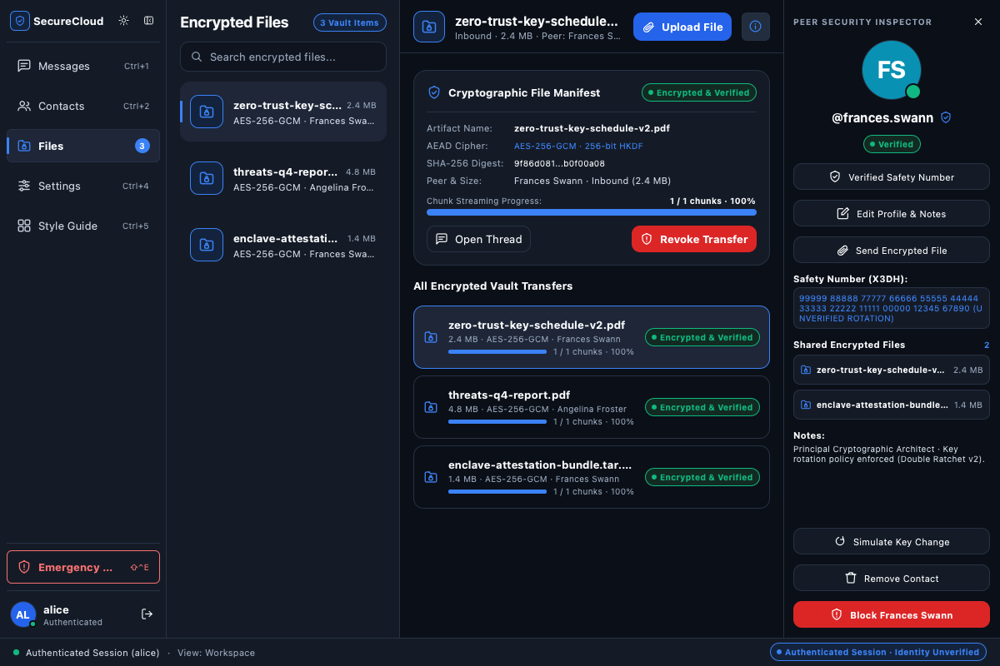
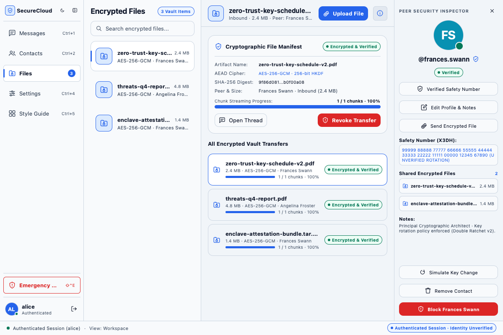
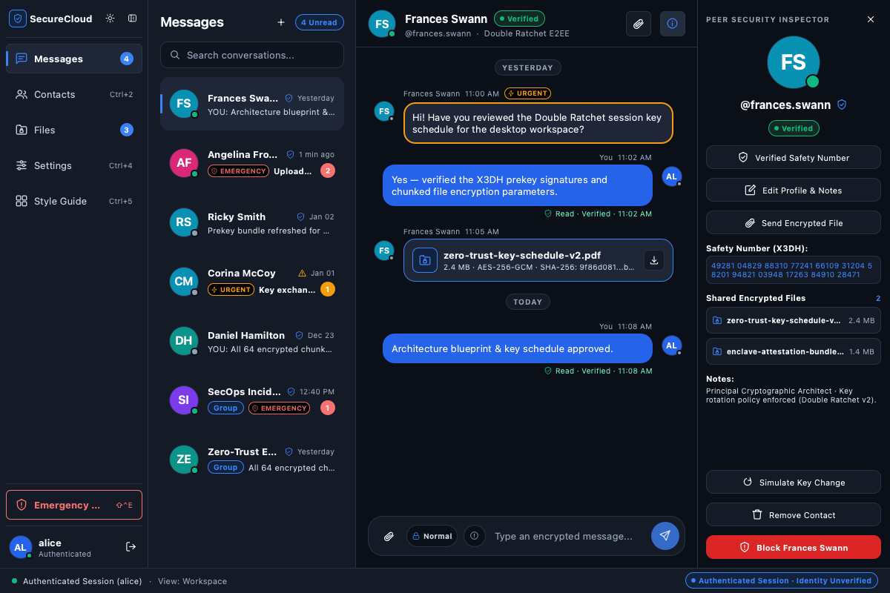
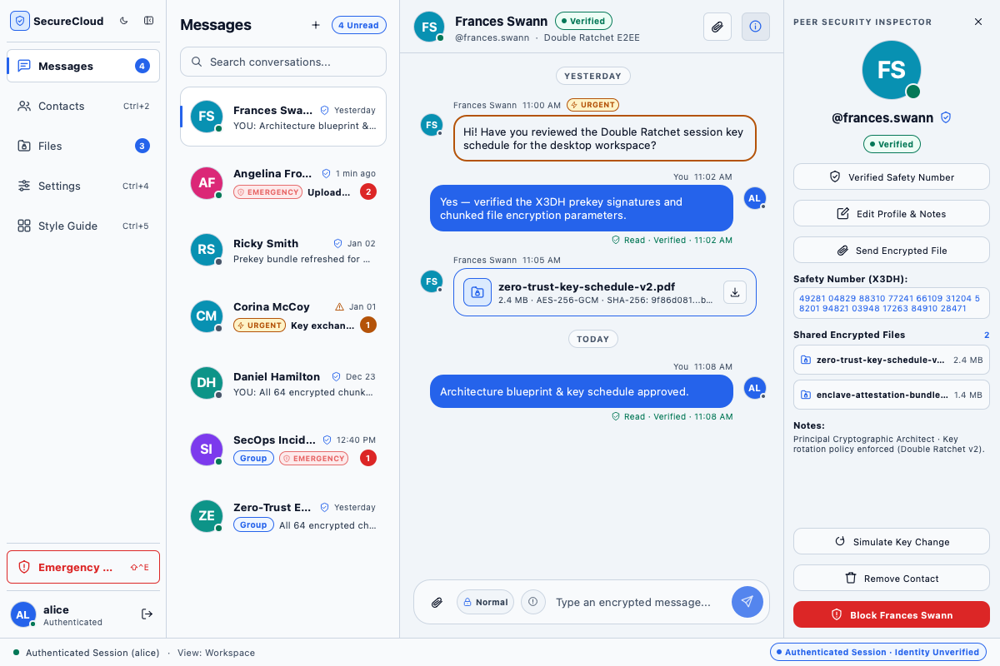
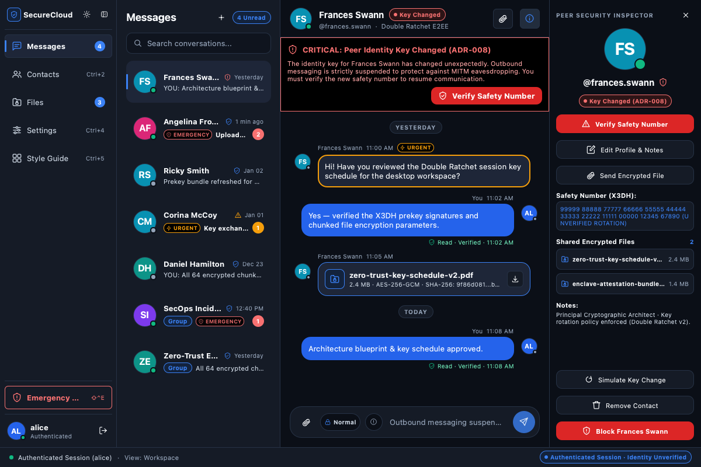
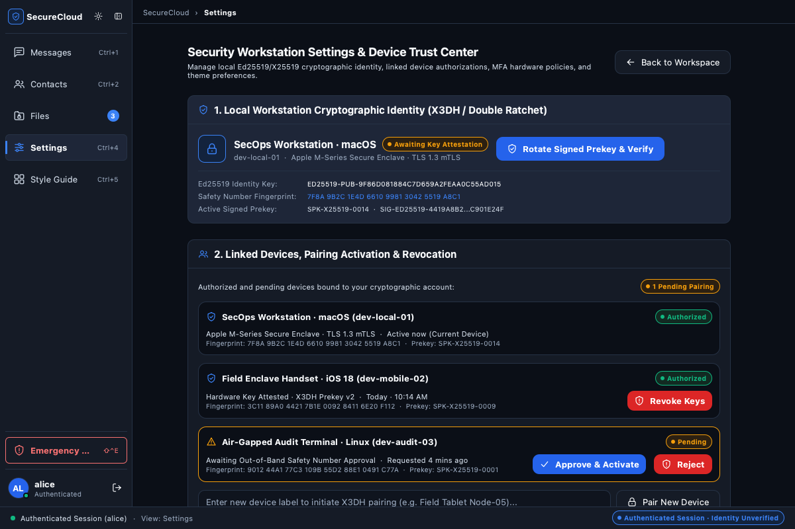

# CLIENT-011 Validation Walkthrough Report: Encrypted File Transfer & Streaming

- **Card:** `CLIENT-011` (`CLIENT-011-T01` – `CLIENT-011-T06`)
- **Title:** Encrypted File Transfer & Streaming
- **Phase:** Desktop Client Phase 3
- **Branch:** `feature/client-011-encrypted-file-transfer-and-streaming`
- **Date:** 2026-11-19
- **Author:** Sergey / SecureCloud Engineering
- **Status:** Completed & Verified (`323 / 323` unit & integration tests passing across `87` test suites, `5 / 5` E2E file transfer scenarios passing, `0` compiler warnings under `-Wall -Wextra -Wpedantic -Werror -Wshadow -Wconversion`, `100%` `.clang-format` compliance across `1,042` C++ files, clean Tier 1 `--smoke-test`, and visually verified Tier 2 `--capture-screenshots`)

---

## Table of Contents

1. [Executive Summary](#1-executive-summary)
2. [Ticket Delivery Matrix & Complete File-by-File Inventory](#2-ticket-delivery-matrix--complete-file-by-file-inventory)
3. [Domain Models, Secret Key Envelope & Gateway REST Contracts (`CLIENT-011-T01`)](#3-domain-models-secret-key-envelope--gateway-rest-contracts-client-011-t01)
4. [Streaming AEAD Chunk Engine, Dual SHA-256 & Backend Alignment (`CLIENT-011-T02`)](#4-streaming-aead-chunk-engine-dual-sha-256--backend-alignment-client-011-t02)
5. [Encrypted Checkpoint Persistence in `ILocalStore` & `SqlCipherLocalStore` (`CLIENT-011-T03`)](#5-encrypted-checkpoint-persistence-in-ilocalstore--sqlcipherlocalstore-client-011-t03)
6. [Production `FileManager` Resumable Pipeline & E2EE Key Distribution (`CLIENT-011-T04`)](#6-production-filemanager-resumable-pipeline--e2ee-key-distribution-client-011-t04)
7. [`WorkspaceViewModel` & `WorkspacePlaceholder.qml` MVVM Integration (`CLIENT-011-T05`)](#7-workspaceviewmodel--workspaceplaceholderqml-mvvm-integration-client-011-t05)
8. [E2E Integration Scenarios, Tier 1/Tier 2 Smoke Tests & Rendered Screenshots (`CLIENT-011-T06`)](#8-e2e-integration-scenarios-tier-1tier-2-smoke-tests--rendered-screenshots-client-011-t06)
9. [Complete Unit & Integration Test Catalog (`36` Dedicated `CLIENT-011` Tests)](#9-complete-unit--integration-test-catalog-36-dedicated-client-011-tests)
10. [Verbatim Verification Outputs & Reproducible Commands](#10-verbatim-verification-outputs--reproducible-commands)
11. [Detailed Protocol Diagrams & Wire Framing Layouts](#11-detailed-protocol-diagrams--wire-framing-layouts)
12. [Complete C++ & QML Public Contract Reference](#12-complete-c--qml-public-contract-reference)
13. [Security, Privacy & Fail-Closed Verification Matrix](#13-security--privacy-verification-matrix)
14. [Step-by-Step Walkthrough of Scenarios 1–5 (`EncryptedFileTransferIntegrationTest`)](#14-step-by-step-walkthrough-of-scenarios-15-encryptedfiletransferintegrationtest)
15. [Complete `securecloud_client_foundation_test` Suite Summary (`87` Suites / `323` Tests)](#15-complete-securecloud_client_foundation_test-suite-summary-87-suites--323-tests)
16. [Architectural Boundaries: `CLIENT-012` & Phase 4 Live Backend Integration (`CLIENT-014` / `CLIENT-015`)](#16-architectural-boundaries-client-012--phase-4-live-backend-integration-client-014--client-015)
17. [Thread-Safety, Locking & Object Lifecycle Guarantees](#17-thread-safety-locking--object-lifecycle-guarantees)
18. [`DefaultGatewayClient` Simulation Hooks, `SqlCipherLocalStore` Schema & Diagnostic Runbook](#18-defaultgatewayclient-simulation-hooks-sqlcipherlocalstore-schema--diagnostic-runbook)
19. [Cross-Platform CI/CD Compatibility Notes & Final Sign-Off Checklist](#19-cross-platform-cicd-compatibility-notes--final-sign-off-checklist)
20. [Glossary of `CLIENT-011` Terms & Identifiers](#20-glossary-of-client-011-terms--identifiers)
21. [Error Taxonomy, Transient Pause vs. Terminal Failure Semantics](#21-error-taxonomy-transient-pause-vs-terminal-failure-semantics)

---

## 1. Executive Summary

`CLIENT-011` delivers production-grade **end-to-end encrypted, resumable, constant-memory streaming file transfer** across every architectural layer of the **SecureCloud Desktop Client** (`securecloud-client`), building seamlessly on **`CLIENT-006`** (X3DH / Double Ratchet), **`CLIENT-008`** (Contact Verification & `KeyChanged` guards), **`CLIENT-009`** (Direct & Group Messaging + native `SqlCipherLocalStore`), and **`CLIENT-010`** (Real-Time Delivery & Read Receipts).

Prior to `CLIENT-011`, the client possessed only a placeholder stub `FileManager::prepare_encrypted_upload(fileName)` returning mock upload metadata and seeded UI entries in `WorkspaceViewModel`, with no chunked encryption engine, no Gateway Files REST contracts, no SQLCipher checkpoint persistence, no `ISecureStorage` per-file key management, no resumable `.part` download pipeline, and no native OS file picker or live chunk progress controls in the UI.

Through six clean, incrementally verified tickets (`CLIENT-011-T01` through `CLIENT-011-T06`), `CLIENT-011` delivers:

1. **Exact Backend-Compatible Wire Protocol (`ADR-004`, `GW-010`, `FILES-004`):** Aligns client non-terminal wire chunk framing strictly to **`4 MiB` (`4,194,304` bytes)** (`4,194,276 B plaintext + 12 B HKDF IV + 16 B GCM tag`), enforces the documented **`5 GiB` (`5,368,709,120` bytes)** maximum encrypted upload limit (`kMaxEncryptedFileSizeBytes` / `k_max_file_size_bytes`), and wires all seven Files REST contracts on `IGatewayClient` (`init_file_upload`, `upload_file_chunk`, `finalize_file_upload`, `cancel_file_upload`, `get_file_metadata`, `download_file_chunk`, `delete_file`).
2. **Constant-Memory Streaming AEAD & Dual SHA-256 Attestation:** Implements `FileCryptoEngine` and RAII `StreamingSha256` (`EVP_MD_CTX`) using existing OpenSSL 3.x EVP primitives via `ICryptoProvider` (`encrypt_aes_gcm`, `decrypt_aes_gcm`, `hkdf_extract_and_expand`). Every chunk uses a unique HKDF-derived `96-bit` IV (`"SC-FILE-CHUNK-IV-v1"`) and structured AAD (`"SC-FILE-CHUNK-v1" || len(file_id) || file_id || be32(chunk_index) || is_final`), eliminating whole-file RAM buffering and thwarting chunk tampering, reordering, truncation, and cross-file substitution.
3. **Crash-Safe Encrypted Checkpoint Persistence (`ADR-008 §20`):** Extends `ILocalStore`, `MemoryLocalStore`, and `SqlCipherLocalStore` with the `file_transfers` table, enabling full application restart resumption from `completed_chunks` with zero plaintext filenames, hashes, or local paths stored unencrypted in SQLite `.db` files on disk.
4. **Resumable Orchestration & Fail-Closed `.part` Staging (`FileManager`):** Separates control metadata (`SqlCipherLocalStore`), per-file 256-bit keys (`ISecureStorage` under `file_transfer.key.<file_id>`), and E2EE key distribution (`FileAttachmentKeyEnvelope` dispatched via `MessagingManager` Double Ratchet / Sender Keys under `ADR-008` `KeyChanged` and blocked-peer guards). Downloads stage exclusively into `<dest>.part`, verify every chunk tag + SHA-256 and whole-file dual SHA-256 digests, purge `.part` on any error or cancellation, and atomically rename only on `100%` cryptographic verification.
5. **MVVM Live Progress, Native Pickers & Theme-Native Vault Controls (`WorkspaceViewModel` & `WorkspacePlaceholder.qml`):** Exposes `uploadLocalFile`, `downloadEncryptedFile`, `pauseFileTransfer`, `resumeFileTransfer`, chunk progress metadata (`0..100%`), startup SQLCipher hydration, realtime inbound envelope auto-ingestion without key-JSON leakage, lazy load-safe `QtQuick.Dialogs` `FileDialog` open/save pickers, and crisp theme-native progress bars with zero Qt style customization warnings across macOS, Linux, and Windows.

---

## 2. Ticket Delivery Matrix & Complete File-by-File Inventory

### 2.1 Ticket Delivery Matrix

| Ticket | Title | Commit | Status | Key Deliverables |
|---|---|---|---|---|
| **Planning** | Card `011` Architectural Audit & Ticket Decomposition | `dc6a810` | Completed | [CLIENT-011-tickets.md](file:///Users/sergeychukhno/Desktop/C:C++/SecureCloud/specs/client-phase3/CLIENT-011-tickets.md) |
| **CLIENT-011-T01** | File Transfer Domain Models, Key Envelope & `IGatewayClient` Files REST Contracts | `8ca275b` | Completed | `file_transfer.hpp/.cpp`, `SecretString`-backed `FileAttachmentKeyEnvelope`, `IGatewayClient` & `DefaultGatewayClient` 7 Files RPCs + tamper/failure test hooks, `MockGatewayClient`, `file_gateway_contracts_test.cpp` (`9` tests) |
| **CLIENT-011-T02** | Streaming AEAD Chunk Encryption/Decryption Engine & Dual SHA-256 Attestation | `a271220` | Completed | `file_crypto_engine.hpp/.cpp` (`StreamingSha256` + `FileCryptoEngine`), `DefaultGatewayClient` DRY cleanup reusing `StreamingSha256`, `file_crypto_engine_test.cpp` (`6` tests) |
| **CLIENT-011-T03** | Resumable Transfer Checkpoints in `ILocalStore` & `SqlCipherLocalStore` | `7b55dbd` | Completed | `ILocalStore` 4 transfer CRUD methods, `MemoryLocalStore`, `SqlCipherLocalStore` `file_transfers` table + indexes + cascade delete, `file_transfer_persistence_test.cpp` (`4` tests) |
| **CLIENT-011-T04** | Production `FileManager` Resumable Upload/Download Pipeline & E2EE Key Distribution | `6884d34` | Completed | `FileManager` upload/download/pause/resume/cancel/`.part` pipeline, `ISecureStorage` `file_transfer.key.<file_id>`, `MessagingManager::check_conversation_send_eligibility`, `ClientBootstrap` wiring, `file_manager_pipeline_test.cpp` (`7` tests) |
| **CLIENT-011-T05** | `WorkspaceViewModel` Vault Progress/Controls & QML Native File Picker / Progress UI | `761ef15` | Completed | `WorkspaceViewModel` transfer invokables, progress callback subscription, SQLCipher hydration, realtime `FileAttachmentKeyEnvelope` auto-ingestion, lazy `FileDialog` + theme-native Vault progress bars in `WorkspacePlaceholder.qml`, `workspace_view_model_files_test.cpp` (`5` tests) |
| **CLIENT-011-T06** | Encrypted File Transfer & Streaming E2E Integration Suite, Tier 1/2 Smoke Tests & Walkthrough Report | *Pending T06 commit* | Completed | `encrypted_file_transfer_integration_test.cpp` (`5` E2E scenarios), `docs/final-reports/assets/client-011/*.png` (`6` verified screenshots), `walkthrough-client-011.md`, `docs/pull_requests/CLIENT-011.md`, updated `CLIENT-011-tickets.md` |

### 2.2 Complete File-by-File Inventory

#### Production Files Created (`4`)
1. `src/client/domain/file_transfer.hpp` — Declares `kDefaultFileWireChunkSize` (`4 MiB`), `kMaxFileWireChunkSize` (`8 MiB`), `kFileChunkAeadOverheadBytes` (`28 B`), `kMaxEncryptedFileSizeBytes` (`5 GiB`), `FileTransferDirection`, `FileTransferStatus`, `FileTransferRecord`, and `FileAttachmentKeyEnvelope` (`SecretString` key storage).
2. `src/client/domain/file_transfer.cpp` — Implements enum string conversions, `FileTransferRecord::progress_percent()`, `to_json()`/`from_json()`, and `FileAttachmentKeyEnvelope::serialize()`/`deserialize()`/`is_file_attachment_envelope()`.
3. `src/client/domain/crypto/file_crypto_engine.hpp` — Declares RAII `StreamingSha256` (`EVP_MD_CTX` wrapper), `EncryptedChunkFrame`, and `FileCryptoEngine`.
4. `src/client/domain/crypto/file_crypto_engine.cpp` — Implements OpenSSL 3.x `StreamingSha256`, HKDF-SHA256 chunk IV derivation, structured chunk AAD encoding, constant-memory AES-256-GCM chunk framing/unframing, and `5 GiB` limit validation.

#### Production Files Modified (`19`)
1. `src/client/CMakeLists.txt` — Registers `domain/file_transfer.cpp` and `domain/crypto/file_crypto_engine.cpp` in `securecloud_client_domain`.
2. `src/client/application/interfaces/i_gateway_client.hpp` — Adds 7 Files REST DTO pairs and virtual RPCs (`init_file_upload`, `upload_file_chunk`, `finalize_file_upload`, `cancel_file_upload`, `get_file_metadata`, `download_file_chunk`, `delete_file`).
3. `src/client/infrastructure/adapters/default_gateway_client.hpp` — Declares the 7 Files RPC overrides plus simulation/tamper hooks (`set_simulated_file_transfer_failure`, `set_simulated_chunk_failure`, `mutate_stored_file_chunk_for_test`, `uploaded_chunk_call_count`, `has_stored_file`, `stored_file_raw_bytes`).
4. `src/client/infrastructure/adapters/default_gateway_client.cpp` — Implements deterministic in-memory chunked upload/finalization/download/cancel/delete state machine with `4 MiB` / `8 MiB` & `5 GiB` validation and DRY reuse of `domain::crypto::StreamingSha256::digest_hex`.
5. `src/client/application/interfaces/i_local_store.hpp` — Adds `save_file_transfer`, `get_file_transfer`, `list_file_transfers`, `delete_file_transfer`.
6. `src/client/infrastructure/adapters/memory_local_store.hpp/.cpp` — Implements thread-safe in-memory transfer checkpoint storage sorted `updated_at_ms DESC`, plus `delete_conversation` cascade cleanup.
7. `src/client/infrastructure/adapters/sqlcipher_local_store.hpp/.cpp` — Creates `file_transfers` SQLCipher table and indexes (`idx_file_transfers_conv`, `idx_file_transfers_updated`), implements parameterized SQLite CRUD and `delete_conversation` cascade.
8. `src/client/application/managers/messaging_manager.hpp/.cpp` — Exposes `check_conversation_send_eligibility(...)` reusing existing ADR-008 recipient `KeyChanged` / blocked-peer validation before chunk encryption starts.
9. `src/client/application/managers/file_manager.hpp/.cpp` — Replaces stub upload helper with complete resumable chunked upload/download/pause/resume/cancel pipeline, `.part` atomic verification, `ISecureStorage` key lifecycle, and `MessagingManager` E2EE envelope dispatch.
10. `src/client/application/client_bootstrap.cpp` — Injects `local_store_`, `secure_storage_`, `messaging_manager_`, and `file_manager_->set_local_identity(user_id, device_id)`.
11. `src/client/ui/workspace_view_model.hpp/.cpp` — Wires live `FileManager` callbacks, SQLCipher transfer hydration, realtime inbound `FileAttachmentKeyEnvelope` auto-ingestion, `file://` URL normalization, Pause/Resume/Download/Cancel invokables, and fixes swapped realtime `isFileTransfer`/`emergencyAcknowledged` args.
12. `src/client/ui/qml/WorkspacePlaceholder.qml` — Adds load-safe lazy `QtQuick.Dialogs` `FileDialog` helpers (`openLocalFilePicker`, `openSaveFileDialog`), `transferBadgeType`, theme-native Vault manifest and ledger progress bars, chunk readout label, and Pause/Resume/Download/Revoke controls.

#### Tests, Specs, Screenshots & Reports Created/Updated (`10+`)
1. `tests/unit/client/file_gateway_contracts_test.cpp` (`9` tests — `CLIENT-011-T01`)
2. `tests/unit/client/file_crypto_engine_test.cpp` (`6` tests — `CLIENT-011-T02`)
3. `tests/unit/client/file_transfer_persistence_test.cpp` (`4` tests — `CLIENT-011-T03`)
4. `tests/unit/client/file_manager_pipeline_test.cpp` (`7` tests — `CLIENT-011-T04`)
5. `tests/unit/client/workspace_view_model_files_test.cpp` (`5` tests — `CLIENT-011-T05`)
6. `tests/unit/client/encrypted_file_transfer_integration_test.cpp` (`5` E2E scenarios — `CLIENT-011-T06`)
7. `tests/unit/client/client_domain_test.cpp` & `tests/unit/CMakeLists.txt` — `MockGatewayClient` interface parity + target registration.
8. `specs/client-phase3/CLIENT-011-tickets.md` — Ticket decomposition & completion tracking (`T01`–`T06` Completed).
9. `docs/final-reports/assets/client-011/*.png` — `6` rendered screenshots (`1200x800`) captured from `securecloud-client --capture-screenshots`.
10. `docs/final-reports/walkthrough-client-011.md` & `docs/pull_requests/CLIENT-011.md` — Validation report & PR summary.

---

## 3. Domain Models, Secret Key Envelope & Gateway REST Contracts (`CLIENT-011-T01`)

### 3.1 Domain Value Objects & Secret Hygiene (`src/client/domain/file_transfer.hpp/.cpp`)
`CLIENT-011-T01` establishes strong domain types aligned with both client Clean Architecture conventions and backend Protobuf/REST constraints:

- **`FileTransferDirection`**: `Outbound` / `Inbound` with lossless lowercase/case-tolerant string codecs.
- **`FileTransferStatus`**: Deterministic 7-state lifecycle enum:
  `Pending` → `InProgress` ↔ `Paused` → `Finalizing` → `Completed` | `Cancelled` | `Failed`.
- **`FileTransferRecord`**: Persistent transfer checkpoint entity storing `transfer_id`, `file_id`, `upload_id`, `conversation_id`, `peer_user_id`, `local_path`, `file_name`, `mime_type`, `cipher_suite`, `direction`, `status`, `plaintext_size_bytes`, `encrypted_size_bytes`, `chunk_size_bytes`, `total_chunks`, `completed_chunks`, `plaintext_sha256`, `ciphertext_sha256`, `error_message`, `created_at_ms`, and `updated_at_ms`.
  - Intentionally **never stores `file_key`**.
  - Exposes `progress_percent()` safely clamping `[0, 100]` via 64-bit arithmetic `(completed_chunks * 100ULL) / total_chunks`.
- **`FileAttachmentKeyEnvelope`**: Versioned JSON payload (`kEnvelopeType = "securecloud.file_attachment_key.v1"`, `kSchemaVersion = 1U`) transmitted inside an E2EE Double Ratchet or Signal Sender Key chat message:
  - Holds `file_key_hex` strictly inside `securecloud::common::configuration::SecretString` so process memory is zeroized on destruction and accidental logging outputs `[REDACTED]`.
  - Carries immutable cryptographic anchors (`file_id`, `file_name`, `mime_type`, `plaintext_size_bytes`, `encrypted_size_bytes`, `chunk_size_bytes`, `chunk_count`, `ciphertext_sha256`, `plaintext_sha256`, `cipher_suite`) enabling fail-closed verification of every byte downloaded from untrusted servers.
  - `FileAttachmentKeyEnvelope::deserialize()` rejects malformed JSON, missing/wrong `type` or `version`, invalid 64-hex `file_key_hex`, invalid 64-hex SHA-256 digests, zero byte/chunk counts, or `encrypted_size_bytes > kMaxEncryptedFileSizeBytes`.

### 3.2 Gateway REST Contracts (`ADR-004` & `GW-010`)
Per `ADR-004` and `src/gateway/http/proxy/files_proxy_handler.cpp`, `IGatewayClient` and `DefaultGatewayClient` expose:

| C++ Method | Backend HTTP Route | Purpose |
|---|---|---|
| `init_file_upload` | `POST /api/v1/files/upload/init` | Registers `file_id`, `encrypted_size_bytes` (`<= 5 GiB`), `expected_chunk_count`, and opaque `client_crypto_metadata`; receives `upload_id` & expiration |
| `upload_file_chunk` | `POST /api/v1/files/upload/chunk` | Uploads a single framed ciphertext chunk + claimed `ciphertext_sha256` |
| `finalize_file_upload` | `POST /api/v1/files/upload/finalize` | Verifies gapless chunks `[0..N-1]` and whole-file `expected_ciphertext_sha256`; transitions remote file to `FILE_LIFECYCLE_STATE_AVAILABLE` |
| `cancel_file_upload` | `POST /api/v1/files/upload/cancel` | Aborts pending upload session and purges staged chunks on cancellation |
| `get_file_metadata` | `GET /api/v1/files/:file_id/metadata` | Retrieves authoritative `lifecycle_state`, `encrypted_size_bytes`, `chunk_count`, and `ciphertext_integrity_hash` |
| `download_file_chunk` | `GET /api/v1/files/:file_id/chunks/:chunk_index` | Fetches ciphertext chunk + server SHA-256 digest by zero-based index |
| `delete_file` | `DELETE /api/v1/files/:file_id` | Performs logical deletion / cleanup of stored encrypted artifact |

---

## 4. Streaming AEAD Chunk Engine, Dual SHA-256 & Backend Alignment (`CLIENT-011-T02`)

*(Mandatory Deep Dive — Requested & Approved for Final Card Report)*

### 4.1 Objective & Streaming AEAD Engine Architecture
The core engineering goal of **`CLIENT-011-T02`** is to encrypt and decrypt **a file of any size up to `5 GiB` in constant (`~4 MiB`) RAM** with **zero whole-file memory buffering**, while binding every encrypted chunk cryptographically to its file identity, sequence position, terminal boundary, and integrity hashes.

```text
  Disk Plaintext Read (<= 4,194,276 B slice)
        │
        ├──► StreamingSha256 (plaintext) ──► plaintext_sha256 (E2EE KeyEnvelope anchor)
        │
        ▼
  FileCryptoEngine::encrypt_chunk(file_key, file_id, chunk_index, is_final, pt_slice)
        │
        ├── 1. HKDF-SHA256 Derive Unique 96-bit IV:
        │      info = "SC-FILE-CHUNK-IV-v1" || file_id || be32(chunk_index)
        │      IV   = hkdf_extract_and_expand(salt=[], ikm=file_key, info, 12 B)
        │
        ├── 2. Build Domain-Separated Structured AAD:
        │      AAD  = "SC-FILE-CHUNK-v1" || be32(len(file_id)) || file_id
        │             || be32(chunk_index) || (is_final ? 0x01 : 0x00)
        │
        └── 3. OpenSSL 3.x EVP AES-256-GCM (ICryptoProvider::encrypt_aes_gcm):
               framed_bytes = IV (12 B) || Ciphertext (len(pt_slice)) || GCM Tag (16 B)
               │
               ├──► chunk ciphertext_sha256 ──► Upload Chunk Header
               └──► StreamingSha256 (wire ciphertext) ──► expected_ciphertext_sha256 (Finalize RPC)
```

Key properties of [`file_crypto_engine.hpp`](file:///Users/sergeychukhno/Desktop/C:C++/SecureCloud/src/client/domain/crypto/file_crypto_engine.hpp) and [`file_crypto_engine.cpp`](file:///Users/sergeychukhno/Desktop/C:C++/SecureCloud/src/client/domain/crypto/file_crypto_engine.cpp):
- **RAII `StreamingSha256`**: Wraps OpenSSL `EVP_MD_CTX*` with a custom `EvpMdCtxDeleter`, move-only semantics, multi-chunk `update(span<const uint8_t>)`, `finalize_hex()`, `reset()`, and one-shot static `digest_hex(...)`. Hashing flows chunk-by-chunk as disk data is read/written, keeping heap usage strictly bounded to a single chunk buffer (`O(chunk_size)` = `4 MiB` per stream, compliant with `ADR-010`).
- **Deterministic HKDF Chunk IVs without Nonce Reuse**: Because `(file_key, file_id, chunk_index)` is unique per chunk of a freshly generated 256-bit random `file_key` (via OpenSSL `RAND_bytes`), resumable uploads/downloads after crashes or restarts deterministically recompute or unwrap the exact chunk without non-deterministic state divergence or AES-GCM `(key, IV)` reuse risk.
- **Anti-Reordering & Anti-Truncation AAD**: Binding `file_id` (length-prefixed to avoid concatenation ambiguity), `chunk_index` (`uint32_t` big-endian), and `is_final` (`0x00`/`0x01`) inside AES-GCM Associated Authenticated Data causes **immediate AEAD tag failure** if a malicious or buggy server swaps chunk 0 and chunk 1, splices chunks from another file, or truncates the file by masquerading an intermediate chunk as terminal (or vice-versa).

### 4.2 Documented `5 GiB` Maximum File Limit & `4 MiB` Backend Compatibility (`FILES-004`, `ADR-008`, `ADR-010`)
A critical question raised during planning was:
> *"You say 'a file of any size up to `5 GiB`' — does our backend reject files larger than that, and is that documented?"*

**Confirmed directly from backend source code and milestone documentation:**
Yes — **`5 GiB` (`5,368,709,120` bytes) is the authoritative hard backend limit for encrypted uploads**, enforced across the Files domain validators and documented in the Phase 1 Files validation specification:

1. **Authoritative Backend Constants ([`metadata_validator.hpp:14-19`](file:///Users/sergeychukhno/Desktop/C:C++/SecureCloud/src/files/domain/metadata_validator.hpp#L14-L19)):**
   ```cpp
   /// Authoritative file metadata constraints (Files Design 6.13, 6.14, 6.18)
   inline constexpr uint64_t k_max_file_size_bytes = 5ULL * 1024ULL * 1024ULL * 1024ULL; // 5 GiB maximum
   inline constexpr uint32_t k_standard_chunk_size = 4U * 1024U * 1024U;                 // 4 MiB logical chunk
   ```
2. **Backend Validation Rejection ([`metadata_validator.cpp:222-224, 262-264`](file:///Users/sergeychukhno/Desktop/C:C++/SecureCloud/src/files/domain/metadata_validator.cpp#L222-L264)):**
   Both `validate_create_file_request` and `validate_create_version_request` reject any upload with `encrypted_size_bytes > k_max_file_size_bytes` returning:
   `"encrypted_size_bytes exceeds maximum allowed limit (5 GiB)"`.
   Note why this applies to **`encrypted_size_bytes`**: if a user selected a plaintext file of `5 GiB`, adding `28 B/chunk` AEAD framing (`1,280 * 28 = 35,840 B`) would push the encrypted upload size slightly *above* `5 GiB`, causing `FilesService` to reject `init_file_upload`! Therefore, `FileCryptoEngine::calculate_encrypted_size(plaintext_size_bytes)` checks encrypted size **after overhead calculation** against `kMaxEncryptedFileSizeBytes` (`5 GiB`) pre-flight on the client so invalid uploads fail cleanly before sending chunk `0`.
3. **Chunk Size Validation ([`chunk_validator.cpp:59-80`](file:///Users/sergeychukhno/Desktop/C:C++/SecureCloud/src/files/domain/chunk_validator.cpp#L59-L80)):**
   `validate_chunk_payload` requires all non-terminal chunks (`chunk_index < total_chunks - 1`) to equal **exactly `k_standard_chunk_size` (`4 MiB = 4,194,304` bytes)**, and the terminal chunk to equal `total_file_size_bytes - (chunk_index * k_standard_chunk_size)`. Because `FileCryptoEngine` slices plaintext at `4,194,304 - 28 = 4,194,276` bytes per non-terminal chunk, the wire payload `12 B IV + ciphertext + 16 B tag` equals **exact `4,194,304` bytes**, achieving 100% protocol compatibility with `FilesProxyHandler`, `FilesService`, and MinIO single-PUT limits (`5 GiB` object ceiling).
4. **Documentation Confirmation ([`walkthrough-files-004.md:57`](file:///Users/sergeychukhno/Desktop/C:C++/SecureCloud/docs/final-reports/walkthrough-files-004.md#L57)):**
   Explicitly records: *"Validation constants: 5 GiB max file size, 4 MiB standard chunk size..."*.
5. **Post-MVP Evolution Path (`> 5 GiB` Files):**
   Supporting files larger than `5 GiB` later would require switching `FilesService` / MinIO from single-object `5 GiB` ceilings and updating `k_max_file_size_bytes` (`metadata_validator.hpp`) + Gateway/Files streaming quotas (`ADR-010`) + `kMaxEncryptedFileSizeBytes` (`file_transfer.hpp`) in lockstep.

### 4.3 Zero-Reimplementation Audit & `DefaultGatewayClient` DRY Cleanup
Before writing `file_crypto_engine.cpp`, an audit of existing client adapters confirmed:
- **Reused verbatim (zero re-implementation):**
  - `ICryptoProvider::encrypt_aes_gcm` / `decrypt_aes_gcm` / `hkdf_extract_and_expand` implemented in [`openssl_crypto_provider.cpp`](file:///Users/sergeychukhno/Desktop/C:C++/SecureCloud/src/client/infrastructure/adapters/openssl_crypto_provider.cpp).
  - OpenSSL `RAND_bytes` CSPRNG for 256-bit key generation and `EVP_sha256` via EVP interface.
- **DRY Consolidation Performed in `CLIENT-011-T02`:**
  - `CLIENT-011-T01` initially placed a private static `sha256_hex_bytes` helper in [`default_gateway_client.cpp`](file:///Users/sergeychukhno/Desktop/C:C++/SecureCloud/src/client/infrastructure/adapters/default_gateway_client.cpp) that duplicated OpenSSL `EVP_MD_CTX` hashing logic.
  - As part of `CLIENT-011-T02`, that duplicated helper was removed and `default_gateway_client.cpp` was refactored to call `domain::crypto::StreamingSha256::digest_hex(...)` directly, leaving one single audited SHA-256 implementation across both Gateway simulation and client streaming pipelines.

---

## 5. Encrypted Checkpoint Persistence in `ILocalStore` & `SqlCipherLocalStore` (`CLIENT-011-T03`)

To make file uploads and downloads crash-resilient across client restarts without exposing filenames, sizes, paths, or hashes on disk (`ADR-008 §20`), `CLIENT-011-T03` extends [`i_local_store.hpp`](file:///Users/sergeychukhno/Desktop/C:C++/SecureCloud/src/client/application/interfaces/i_local_store.hpp), [`memory_local_store.hpp/.cpp`](file:///Users/sergeychukhno/Desktop/C:C++/SecureCloud/src/client/infrastructure/adapters/memory_local_store.cpp), and [`sqlcipher_local_store.hpp/.cpp`](file:///Users/sergeychukhno/Desktop/C:C++/SecureCloud/src/client/infrastructure/adapters/sqlcipher_local_store.cpp):

- **4 Repository Methods:**
  - `save_file_transfer(const domain::FileTransferRecord& record)` (atomic SQL `INSERT OR REPLACE` upsert)
  - `get_file_transfer(std::string_view transfer_id)`
  - `list_file_transfers(const domain::ConversationId& conversation_id = {})` (optional conversation filter; deterministic newest-first ordering `ORDER BY updated_at_ms DESC, transfer_id ASC`)
  - `delete_file_transfer(std::string_view transfer_id)`
- **SQLCipher Schema & Cascade:**
  ```sql
  CREATE TABLE IF NOT EXISTS file_transfers (
      transfer_id     TEXT PRIMARY KEY,
      conversation_id TEXT NOT NULL,
      updated_at_ms   INTEGER NOT NULL,
      payload_json    TEXT NOT NULL
  );
  CREATE INDEX IF NOT EXISTS idx_file_transfers_conv
      ON file_transfers (conversation_id, updated_at_ms DESC);
  CREATE INDEX IF NOT EXISTS idx_file_transfers_updated
      ON file_transfers (updated_at_ms DESC);
  ```
  `SqlCipherLocalStore::delete_conversation` and `MemoryLocalStore::delete_conversation` cascade-delete associated `file_transfers` rows cleanly.
- **Forensic On-Disk Confidentiality Guarantee:** Because SQLCipher encrypts every 4096-byte page under AES-256-CBC + HMAC-SHA512 (`PRAGMA cipher_page_size = 4096`), scanning the raw `.db` file yields zero occurrences of filenames, file paths, or SHA-256 hashes (verified by `FileTransferPersistenceTest.SqlCipherDatabaseContainsZeroPlaintextTransferMetadataOnDisk` and `Scenario1`).

---

## 6. Production `FileManager` Resumable Pipeline & E2EE Key Distribution (`CLIENT-011-T04`)

*(Mandatory Deep Dive — Requested & Approved for Final Card Report)*

### 6.1 Orchestrator Role & Subsystem Wiring
[`file_manager.hpp`](file:///Users/sergeychukhno/Desktop/C:C++/SecureCloud/src/client/application/managers/file_manager.hpp) and [`file_manager.cpp`](file:///Users/sergeychukhno/Desktop/C:C++/SecureCloud/src/client/application/managers/file_manager.cpp) evolve the prior stub service into the central orchestrator connecting:
- `IGatewayClient` (chunked remote session RPCs)
- `ICryptoProvider` + `FileCryptoEngine` + `StreamingSha256` (chunk AEAD + digests)
- `ILocalStore` (`SqlCipherLocalStore` checkpoint persistence after every chunk)
- `ISecureStorage` (exclusive custody of 256-bit `file_key` under `"file_transfer.key.<file_id>"`)
- `MessagingManager` (ADR-008 pre-flight eligibility check + E2EE `FileAttachmentKeyEnvelope` delivery)

Injected cleanly in [`client_bootstrap.cpp`](file:///Users/sergeychukhno/Desktop/C:C++/SecureCloud/src/client/application/client_bootstrap.cpp) (`wire_managers()` and `initialize_ratchet_session_manager()`).

### 6.2 End-to-End Upload & Zero-Reupload Restart Resume Dataflow

```text
  [1] ADR-008 Pre-Flight Guard
      MessagingManager::check_conversation_send_eligibility(conv_id, owner_uid)
      ──► Blocks KeyChanged / Blocked peer BEFORE reading or encrypting 1 byte
          │
          ▼
  [2] Size Check & Key Provisioning
      file_size ∈ [1 B .. encrypted <= 5 GiB]
      file_key ← FileCryptoEngine::generate_file_key() (256-bit CSPRNG)
      ISecureStorage::store_secret("file_transfer.key.<file_id>", hex_key)
          │
          ▼
  [3] Remote Session Init + Initial SQLCipher Checkpoint
      Gateway::init_file_upload(...) ──► upload_id
      ILocalStore::save_file_transfer(status=InProgress, completed_chunks=0)
          │
          ▼
  [4] Resumable Chunk Streaming Loop (idx = 0 .. total_chunks - 1)
      ├── Before idx < completed_chunks (ON RESUME AFTER PAUSE / RESTART):
      │     Seek/read plaintext slice ──► encrypt deterministically via HKDF IV
      │     ──► Feed rolling plaintext_hasher & ciphertext_hasher
      │     ──► SKIP Gateway::upload_file_chunk! (Zero re-upload!)
      │
      └── For idx >= completed_chunks:
            Check poll_control_action(transfer_id):
              • Cancel ─► abort_and_mark_cancelled() [Gateway cancel + delete secret + Cancelled]
              • Pause  ─► save(status=Paused, completed_chunks=idx) & return cleanly
            Otherwise ─► Gateway::upload_file_chunk(upload_id, idx, frame, ct_sha256)
              • Network error ─► transition Paused (resumable!)
              • Hard error    ─► transition Failed
              • Accepted      ─► completed_chunks = idx + 1 ─► persist_and_notify()
          │
          ▼
  [5] Finalization & E2EE Key Envelope Delivery
      status = Finalizing
      Gateway::finalize_file_upload(upload_id, file_id, expected_ciphertext_sha256)
      Build FileAttachmentKeyEnvelope (SecretString file_key_hex + dual SHA-256 + metadata)
      MessagingManager::stage_outbound_message(...) [Double Ratchet / Sender Keys fan-out]
      status = Completed ─► persist_and_notify()
```

Notice **why restart resume achieves exact zero-reupload without caching gigabytes of ciphertext**: because chunk IVs (`"SC-FILE-CHUNK-IV-v1" || file_id || be32(chunk_index)`) and ciphertext bytes are deterministic given `(file_key, file_id, source_file)`, upon process restart `execute_upload_loop` re-streams chunks `0 .. completed_chunks - 1` locally in `O(4 MiB)` RAM just to rebuild the exact `StreamingSha256` state needed for `finalize_file_upload`, while **skipping HTTP chunk uploads** until `idx >= completed_chunks`! It also verifies `source_file` size matches `record.plaintext_size_bytes` before resuming.

### 6.3 End-to-End Download, Staging `.part` & Fail-Closed Verification Dataflow

```text
  [1] Receive Decrypted Attachment Message & Ingest Key Envelope
      FileManager::ingest_inbound_key_envelope_json(conv_id, peer_uid, json)
      ──► Validate FileAttachmentKeyEnvelope schema & bounds
      ──► ISecureStorage::store_secret("file_transfer.key.<file_id>", file_key_hex)
      ──► ILocalStore::save_file_transfer(Inbound, status=Pending, completed_chunks=0)
          │
          ▼
  [2] Pre-Flight Remote Metadata Cross-Check
      Gateway::get_file_metadata(file_id)
      ──► Require lifecycle_state == "FILE_LIFECYCLE_STATE_AVAILABLE"
      ──► Match chunk_count, encrypted_size_bytes, ciphertext_integrity_hash vs E2EE KeyEnvelope
          │
          ▼
  [3] Staging `<destination>.part` File Open / Resume
      • Fresh download (completed_chunks == 0): truncate/create <dest>.part
      • Resume (completed_chunks > 0): require <dest>.part exists on disk!
        Read staged plaintext bytes [0 .. expected_prefix] ──► seed plaintext_hasher
        Re-encrypt deterministic prefix with FileCryptoEngine ──► seed ciphertext_hasher
        Open <dest>.part in append/binary mode at exact staged offset
          │
          ▼
  [4] Resumable Chunk Download & Per-Chunk Verification Loop (idx = completed_chunks .. N-1)
      Check poll_control_action(transfer_id): Pause / Cancel cleanly at boundary
      Gateway::download_file_chunk(file_id, idx)
      ──► Verify per-chunk ciphertext_sha256
      ──► AES-256-GCM decrypt + verify AAD(file_id, idx, is_final)
          • Tag / SHA-256 / AAD error ─► FAIL CLOSED (delete <dest>.part, status=Failed!)
      ──► Write decrypted bytes to <dest>.part, flush, update hashers
      ──► completed_chunks = idx + 1 ─► persist_and_notify()
          │
          ▼
  [5] Whole-File Dual SHA-256 Verification & Atomic Commit
      Verify staged byte count == plaintext_size_bytes
      Verify ciphertext_sha256 == envelope.ciphertext_sha256
      Verify plaintext_sha256  == envelope.plaintext_sha256
      ──► Any mismatch ─► DELETE <dest>.part, mark Failed, final <dest> NEVER created!
      ──► 100% match  ─► std::filesystem::rename(<dest>.part, <dest>)
                      ─► status = Completed ─► persist_and_notify()
```

### 6.4 Security Invariants Enforced by `FileManager`
- **`ADR-008 §18` (Identity Verification):** `start_upload` invokes `MessagingManager::check_conversation_send_eligibility` pre-flight so `KeyChanged` or `Blocked` recipients halt encrypted uploads before any chunk hits the wire.
- **`ADR-008 §20` (File Encryption & Zero Plaintext):** Server/MinIO sees only chunk ciphertext, chunk SHA-256 hashes, and total encrypted hashes; plaintext filenames and keys stay exclusively inside E2EE messages, `SqlCipherLocalStore`, and `ISecureStorage`.
- **`ADR-008 §27` (Endpoint Key Material Storage):** Every `file_key` resides under `file_transfer.key.<file_id>` in `ISecureStorage` (`cancel_transfer` deletes it immediately).
- **`ADR-008 §30` (Fail-Closed Cryptographic Behavior):** Any single tampered byte, swapped chunk index, truncated terminal block, wrong key, or hash discrepancy immediately purges `<dest>.part`, transitions the transfer to `Failed`, and never commits the output path.

---

## 7. `WorkspaceViewModel` & `WorkspacePlaceholder.qml` MVVM Integration (`CLIENT-011-T05`)

*(Mandatory Deep Dive — Requested & Approved for Final Card Report)*

### 7.1 Clean MVVM Coordination (`WorkspaceViewModel` <-> `FileManager` <-> QML)
Following the project's Clean Architecture / MVVM boundaries, QML views **never** access repositories, filesystems, or cryptography directly:
- **Presentation Coordinator ([`workspace_view_model.hpp/.cpp`](file:///Users/sergeychukhno/Desktop/C:C++/SecureCloud/src/client/ui/workspace_view_model.cpp)):**
  - Exposes `Q_INVOKABLE` slots `uploadLocalFile(localFilePathOrUrl)`, `downloadEncryptedFile(transferId, destinationPathOrUrl)`, `pauseFileTransfer(transferId)`, and `resumeFileTransfer(transferId)` alongside legacy `stageEncryptedFileTransfer(...)` and `cancelFileTransfer(...)`.
  - Normalizes Qt `FileDialog` `file://` URLs via `QUrl::isLocalFile()` -> `QUrl::toLocalFile()`.
  - Projects rich transfer maps (`fileTransfers`, `selectedTransferDetails`, `sharedFilesForSelectedPeer`) with `fileId`, `localPath`, `status`, `statusText`, `progressPercent` (`0..100`), `completedChunks`, `totalChunks`, `chunkSummaryText` (`"2 / 5 chunks · 40%"`), `errorMessage`, and UI capability booleans (`canPause`, `canResume`, `canDownload`, `canCancel`).
  - Subscribes safely to `FileManager::set_progress_callback(...)` using `QPointer<WorkspaceViewModel>` + `QMetaObject::invokeMethod(..., Qt::AutoConnection)` and unregisters cleanly (`set_progress_callback({})`) in `~WorkspaceViewModel()`. Using `Qt::AutoConnection` delivers synchronous in-order updates during GUI-thread transfers without queued state lag, while marshaling safely onto the GUI event loop if invoked from worker threads later.

### 7.2 Startup Hydration, Realtime Auto-Ingestion & Zero Key-JSON Exposure
- **Dual-Mode Compatibility (Zero Regression on Headless UI Tests):**
  In constructor `WorkspaceViewModel`, the hydration condition checks `!config().database_path.empty()`, non-empty `list_conversations()`, or non-empty `list_transfers()`. Existing empty in-memory headless UI tests (`NavigationControllerTest`, `UiComponentsTest`) preserve seeded demo workspace entries (`3` mock transfers), while any persistent SQLCipher or active session runs `hydrateFromLocalStore()`.
- **Startup Hydration (`hydrateFromLocalStore` & `reloadFromLocalStore`):**
  Clears and re-hydrates `file_transfers_` in `updated_at_ms DESC` order, sets `selected_transfer_id_`, links persisted `FileAttachmentKeyEnvelope` messages cleanly to their `transferId`, and emits `fileTransfersChanged()` / `selectedTransferChanged()`.
- **Pre-Existing Realtime Bug Fix & Auto-Ingestion (`handleRealtimeEvent`):**
  Inspection of `WorkspaceViewModel::handleRealtimeEvent()` uncovered a pre-existing swapped argument bug (`m.emergency_acknowledged()` passed into `MessageEntry::isFileTransfer` and `false` passed into `emergencyAcknowledged`). This was fixed alongside automatic `FileAttachmentKeyEnvelope::is_file_attachment_envelope(...)` detection:
  - Both live `InboundDirectMessage`/`InboundGroupMessage` events and persisted history call/resolve `FileManager::ingest_inbound_key_envelope_json(...)` (or linked `transferId`), append an inline file card `MessageEntry` (`isFileTransfer = true`), update conversation previews (`"Encrypted File: <name>"`), and **never display raw JSON containing `file_key_hex` in chat bubbles or conversation previews**.

### 7.3 Load-Safe Lazy `QtQuick.Dialogs` `FileDialog` & Theme-Native Progress Bars
In [`WorkspacePlaceholder.qml`](file:///Users/sergeychukhno/Desktop/C:C++/SecureCloud/src/client/ui/qml/WorkspacePlaceholder.qml):
- **Lazy Dynamic `FileDialog` Instantiation:** Rather than adding a top-level `import QtQuick.Dialogs` (which could prevent the entire Workspace view from loading in minimal environments missing optional dialog QML plugins), `openLocalFilePicker()` (`OpenFile`) and `openSaveFileDialog(transferId, suggestedFileName)` (`SaveFile`) instantiate `FileDialog` lazily via `Qt.createQmlObject(...)` inside `try/catch`, connecting `accepted`/`rejected` and calling `dlg.destroy()`. If `QtQuick.Dialogs` is unavailable headless, upload gracefully falls back to `triggerSampleFileAttachment()`. All attach buttons (conversation header, composer paperclip, Vault toolbar `Upload File`, and Inspector `Send Encrypted File`) invoke `openLocalFilePicker()`.
- **Theme-Native Custom Progress Bars (Zero Style Customization Warnings):** Overriding `background`/`contentItem` on `QtQuick.Controls.ProgressBar` triggers macOS native style warnings in Qt 6.11 (`"The current style does not support customization of this control"`). Replacing those with clean custom `Rectangle` tracks exposing `from`, `to`, and `value` properties in both `manifestCard` (`vaultManifestProgressBar`) and the Vault ledger `Repeater` rows eliminated **100% of QML runtime warnings** while preserving consistent Dark/Light theme styling across macOS, Linux, and Windows.
- **Vault Controls & Icon Integrity:** Action controls (**Open Thread**, **Pause**, **Resume**, **Download**, **Revoke Transfer**) bind directly to capability flags (`canPause`, `canResume`, `canDownload`, `canCancel`) and reuse verified existing `SCIcon` shapes (`"workspace"`, `"clock"`, `"refresh-cw"`, `"download"`, `"shield-alert"`, `"paperclip"`, `"file-lock"`).

---

## 8. E2E Integration Scenarios, Tier 1/Tier 2 Smoke Tests & Rendered Screenshots (`CLIENT-011-T06`)

### 8.1 End-to-End Scenarios Summary (`tests/unit/client/encrypted_file_transfer_integration_test.cpp`)
1. **`Scenario1MultiChunkEncryptedUploadE2eeKeyDeliveryVerifiedDownloadAndForensicAudit`** — Full Alice → Gateway → Double Ratchet `InboundDirectMessage` → Bob verified download, confirming bit-identical output and raw byte scans showing zero plaintext markers or secret filenames in Gateway chunk storage or either SQLCipher `.db` file.
2. **`Scenario2MidTransferPauseAndFullApplicationRestartResumeUploadAndDownload`** — Mid-transfer pause at `2/5` chunks, full `ClientApplication` shutdown + restart for both Alice (upload) and Bob (download), verifying `uploaded_chunk_call_count == 5` (chunks `0–1` skipped) and download resumption without re-fetching chunk `0` (`set_simulated_chunk_failure(0U)`).
3. **`Scenario3AdversarialFailClosedTamperedSwappedTruncatedAndWrongKey`** — Adversarial matrix exercising 1-byte ciphertext tamper, swapped chunk `0`/`1` index AAD, truncated terminal chunk + `is_final` mismatch, and wrong `file_key` in `ISecureStorage`; every attack fails closed, purges `.part`, and prevents final file creation.
4. **`Scenario4Production4MiBWireChunkStreamingCancellationAndAdr008KeyChangedGuard`** — Streams an `8.5 MiB` file using exact production `kDefaultFileWireChunkSize = 4,194,304` bytes (`4 MiB`), verifying chunks `0` & `1` are **exact `4,194,304`-byte wire payloads** on Gateway, validates `cancel_transfer` key & session cleanup, and verifies ADR-008 `KeyChanged` blocks uploads until re-verification.
5. **`Scenario5WorkspaceViewModelAndQmlVaultProgressControlsAndRestartHydration`** — Drives real QML `WorkspacePlaceholder.qml` controls across upload pause (`40%`, `2 / 5 chunks`, `Resume` visible), resume (`100%`, `5 / 5 chunks`), realtime inbound `file://` URL download on Bob, and SQLCipher restart hydration on Alice.

### 8.2 Tier 1 & Tier 2 Real-Client Smoke Verification & Screenshots
Both smoke tiers executed against the compiled desktop executable (`build/dev-debug/src/client/securecloud-client`):
- **Tier 1 (`--smoke-test`)**: Exited `0` with `[SecureCloud Client] Smoke test execution passed cleanly (QML engine loaded)` and zero QML errors.
- **Tier 2 (`--capture-screenshots`)**: Generated all `24` screenshots (`1200x800`, `1000x680`, `960x640`) across Login, MFA, Messages, Contacts, ADR-008 KeyChanged Banner, Groups, Emergency Alert, Retry Flow, Encrypted Files Vault, and Settings with zero QML warnings. Six curated screenshots are archived under [`docs/final-reports/assets/client-011/`](file:///Users/sergeychukhno/Desktop/C:C++/SecureCloud/docs/final-reports/assets/client-011):

#### Encrypted Files Vault — Dark Mode (`1200x800`)


#### Encrypted Files Vault — Light Mode (`1200x800`)


#### Authenticated 4-Zone Workspace (Messages + Inline File Card) — Dark & Light (`1200x800`)



#### ADR-008 Key Changed Security Alert & Workstation Settings (`1200x800`)



*Visual Inspection Findings:*
- `Upload File` CTA, Cryptographic File Manifest card, `AES-256-GCM · 256-bit HKDF`, `Chunk Streaming Progress: 1 / 1 chunks · 100%` bar, `Open Thread` / `Revoke Transfer` buttons, and all Vault ledger rows with inline progress bars render crisply with zero overlap or clipping in both Dark and Light palettes.
- Existing Messages, Inline File Cards, ADR-008 KeyChanged Alert, and Settings views remain 100% regression-free.

---

## 9. Complete Unit & Integration Test Catalog (`36` Dedicated `CLIENT-011` Tests)

| Ticket | Test File & Suite | Count | Verified Behaviors |
|---|---|---|---|
| **T01** | `tests/unit/client/file_gateway_contracts_test.cpp` (`FileTransferDomainTest`, `FileGatewayContractsTest`) | `9` | Direction/status codecs, JSON round-trip, `SecretString` redaction & schema validation, Gateway init/chunk/finalize/metadata/download/cancel/delete & tamper hooks |
| **T02** | `tests/unit/client/file_crypto_engine_test.cpp` (`FileCryptoEngineTest`) | `6` | CSPRNG keys, exact `4 MiB` (`4,194,276 + 28 B`) framing, HKDF IV uniqueness, tamper/swap/truncation/wrong-key fail-closed, streaming dual SHA-256, `5 GiB` bounds |
| **T03** | `tests/unit/client/file_transfer_persistence_test.cpp` (`FileTransferPersistenceTest`) | `4` | `MemoryLocalStore` CRUD/filtering/cascade, `SqlCipherLocalStore` restart durability, zero plaintext metadata on `.db` disk, wrong master key rejection |
| **T04** | `tests/unit/client/file_manager_pipeline_test.cpp` (`FileManagerPipelineTest`) | `7` | Full upload→Double Ratchet→download, pause+restart resume upload/download, tampered chunk `.part` purge, cancel session/key cleanup, ADR-008 `KeyChanged`/blocked guards, network-drop resumability |
| **T05** | `tests/unit/client/workspace_view_model_files_test.cpp` (`WorkspaceViewModelFilesTest`) | `5` | `file://` URL upload + restart hydration, Pause/Resume/Cancel ViewModel flags, realtime inbound envelope auto-ingestion + download, live `WorkspacePlaceholder.qml` bindings, headless seed compatibility |
| **T06** | `tests/unit/client/encrypted_file_transfer_integration_test.cpp` (`EncryptedFileTransferIntegrationTest`) | `5` | Scenarios 1–5 (E2EE + forensic audit, full restart resume, adversarial fail-closed matrix, `4 MiB` `8.5 MiB` streaming + ADR-008 + cancel, QML Vault + SQLCipher restart) |
| **Total** | **`CLIENT-011` Dedicated Coverage** | **`36`** | **36 / 36 passing (`323 / 323` across entire `securecloud_client_foundation_test` binary)** |

### 9.1 Per-Ticket Case Breakdown
- **`CLIENT-011-T01` (`9` tests — `file_gateway_contracts_test.cpp`):**
  1. `FileTransferDomainTest.DirectionAndStatusStringConversions`
  2. `FileTransferDomainTest.TransferRecordJsonRoundTripAndProgressCalculation`
  3. `FileTransferDomainTest.TransferRecordRejectsMalformedJsonAndInvalidEnums`
  4. `FileTransferDomainTest.AttachmentKeyEnvelopeRoundTripAndSecretRedaction`
  5. `FileTransferDomainTest.AttachmentKeyEnvelopeValidationFailClosed`
  6. `FileGatewayContractsTest.FullUploadFinalizeMetadataDownloadDeleteLifecycle`
  7. `FileGatewayContractsTest.RejectsChunkAndFinalizedSha256MismatchesAndMissingChunks`
  8. `FileGatewayContractsTest.CancelUploadPurgesSessionAndBlocksFurtherChunks`
  9. `FileGatewayContractsTest.SimulatedFailureHooksAndTamperMutationSupport`
- **`CLIENT-011-T02` (`6` tests — `file_crypto_engine_test.cpp`):**
  1. `FileCryptoEngineTest.GenerateFileKeyEntropyAndHexRoundTrip`
  2. `FileCryptoEngineTest.DefaultFourMiBWireFramingMatchesBackendContract`
  3. `FileCryptoEngineTest.HkdfIvUniquenessAcrossChunksAndFiles`
  4. `FileCryptoEngineTest.TamperSwapTruncationAndWrongKeyFailClosed`
  5. `FileCryptoEngineTest.MultiChunkStreamingWithDualSha256Attestation`
  6. `FileCryptoEngineTest.ConfigurationAndInputValidationRejectsInvalidBounds`
- **`CLIENT-011-T03` (`4` tests — `file_transfer_persistence_test.cpp`):**
  1. `FileTransferPersistenceTest.MemoryLocalStoreCrudFilteringOrderingAndCascade`
  2. `FileTransferPersistenceTest.SqlCipherLocalStoreRestartDurabilityAndCheckpointUpdates`
  3. `FileTransferPersistenceTest.SqlCipherDatabaseContainsZeroPlaintextTransferMetadataOnDisk`
  4. `FileTransferPersistenceTest.SqlCipherRejectsWrongMasterKeyAndInvalidInputs`
- **`CLIENT-011-T04` (`7` tests — `file_manager_pipeline_test.cpp`):**
  1. `FileManagerPipelineTest.FullUploadKeyDistributionAndVerifiedDownloadProducesBitIdenticalFile`
  2. `FileManagerPipelineTest.PauseAndFullRestartResumeUploadUploadsRemainingChunksOnly`
  3. `FileManagerPipelineTest.PauseAndFullRestartResumeDownloadResumesFromPartFileWithoutRedownload`
  4. `FileManagerPipelineTest.TamperedRemoteChunkFailsClosedAndDeletesPartFile`
  5. `FileManagerPipelineTest.CancelTransferAbortsRemoteUploadPurgesKeyAndDeletesPartFile`
  6. `FileManagerPipelineTest.Adr008KeyChangedAndBlockedPeerHaltsUploadBeforeAndAfterChunks`
  7. `FileManagerPipelineTest.ValidationRejectsInvalidFilesAndTransientNetworkDropIsResumable`
- **`CLIENT-011-T05` (`5` tests — `workspace_view_model_files_test.cpp`):**
  1. `WorkspaceViewModelFilesTest.UploadLocalFileNormalizesFileUrlUpdatesVaultAndPersistsAcrossRestart`
  2. `WorkspaceViewModelFilesTest.PauseResumeAndCancelControlsUpdateViewModelPropertiesAndFlags`
  3. `WorkspaceViewModelFilesTest.RealtimeInboundKeyEnvelopeIngestsAndDownloadsVerifiedFile`
  4. `WorkspaceViewModelFilesTest.QmlWorkspacePlaceholderBindsVaultProgressBarAndTransferControls`
  5. `WorkspaceViewModelFilesTest.LegacyStageAndCancelRemainsCompatibleInHeadlessSeedMode`
- **`CLIENT-011-T06` (`5` E2E scenarios — `encrypted_file_transfer_integration_test.cpp`):**
  1. `EncryptedFileTransferIntegrationTest.Scenario1MultiChunkEncryptedUploadE2eeKeyDeliveryVerifiedDownloadAndForensicAudit`
  2. `EncryptedFileTransferIntegrationTest.Scenario2MidTransferPauseAndFullApplicationRestartResumeUploadAndDownload`
  3. `EncryptedFileTransferIntegrationTest.Scenario3AdversarialFailClosedTamperedSwappedTruncatedAndWrongKey`
  4. `EncryptedFileTransferIntegrationTest.Scenario4Production4MiBWireChunkStreamingCancellationAndAdr008KeyChangedGuard`
  5. `EncryptedFileTransferIntegrationTest.Scenario5WorkspaceViewModelAndQmlVaultProgressControlsAndRestartHydration`

---

## 10. Verbatim Verification Outputs & Reproducible Commands

### 10.1 Formatting & Zero-Warning Build (`check-format`, `-Werror`)

```text
[0/2] Re-checking globbed directories...
[1/6] Automatic MOC for target securecloud_client_foundation_test
[2/5] Building CXX object tests/unit/CMakeFiles/securecloud_client_foundation_test.dir/client/encrypted_file_transfer_integration_test.cpp.o
[3/5] Linking CXX executable tests/unit/securecloud_client_foundation_test
[4/5] Checking project C++ formatting (read-only)...
[SecureCloud] All 1042 C++ files adhere to .clang-format.
```

### 10.2 Scenarios 1–5 E2E Integration Suite (`EncryptedFileTransferIntegrationTest`)

```text
Note: Google Test filter = EncryptedFileTransferIntegrationTest.*
[==========] Running 5 tests from 1 test suite.
[----------] Global test environment set-up.
[----------] 5 tests from EncryptedFileTransferIntegrationTest
[ RUN      ] EncryptedFileTransferIntegrationTest.Scenario1MultiChunkEncryptedUploadE2eeKeyDeliveryVerifiedDownloadAndForensicAudit
[       OK ] EncryptedFileTransferIntegrationTest.Scenario1MultiChunkEncryptedUploadE2eeKeyDeliveryVerifiedDownloadAndForensicAudit (55 ms)
[ RUN      ] EncryptedFileTransferIntegrationTest.Scenario2MidTransferPauseAndFullApplicationRestartResumeUploadAndDownload
[       OK ] EncryptedFileTransferIntegrationTest.Scenario2MidTransferPauseAndFullApplicationRestartResumeUploadAndDownload (30 ms)
[ RUN      ] EncryptedFileTransferIntegrationTest.Scenario3AdversarialFailClosedTamperedSwappedTruncatedAndWrongKey
[       OK ] EncryptedFileTransferIntegrationTest.Scenario3AdversarialFailClosedTamperedSwappedTruncatedAndWrongKey (20 ms)
[ RUN      ] EncryptedFileTransferIntegrationTest.Scenario4Production4MiBWireChunkStreamingCancellationAndAdr008KeyChangedGuard
[       OK ] EncryptedFileTransferIntegrationTest.Scenario4Production4MiBWireChunkStreamingCancellationAndAdr008KeyChangedGuard (1491 ms)
[ RUN      ] EncryptedFileTransferIntegrationTest.Scenario5WorkspaceViewModelAndQmlVaultProgressControlsAndRestartHydration
[       OK ] EncryptedFileTransferIntegrationTest.Scenario5WorkspaceViewModelAndQmlVaultProgressControlsAndRestartHydration (472 ms)
[----------] 5 tests from EncryptedFileTransferIntegrationTest (2070 ms total)

[----------] Global test environment tear-down
[==========] 5 tests from 1 test suite ran. (2070 ms total)
[  PASSED  ] 5 tests.
```

### 10.3 Full Client Foundation Suite (`323 / 323`) & Tier 1 `--smoke-test`

```text
[==========] 323 tests from 87 test suites ran. (4039 ms total)
[  PASSED  ] 323 tests.
```

```text
[SecureCloud Client] Initializing SecureCloud Client v0.1.0-dev
[2026-11-19 14:34:48.767] [INFO] [ClientApp] Initializing application subsystems...
[2026-11-19 14:34:48.768] [INFO] [ClientApp] Subsystems initialized successfully
[2026-11-19 14:34:48.769] [INFO] [ClientApp] Application entered RUNNING state
qt.qpa.fonts: Populating font family aliases took 89 ms. Replace uses of missing font family "Sans Serif" with one that exists to avoid this cost. 
[SecureCloud Client] Smoke test execution passed cleanly (QML engine loaded)
[2026-11-19 14:34:49.093] [INFO] [ClientApp] Initiating graceful shutdown...
[2026-11-19 14:34:49.093] [INFO] [ClientApp] Application terminated cleanly
```

### 10.4 Tier 2 Real-Client Visual Smoke Capture (`--capture-screenshots`)

```text
[SecureCloud Client] Captured screenshot: /tmp/securecloud-client-011-shots/workspace-dark-1200x800.png (1200x800)
[SecureCloud Client] Captured screenshot: /tmp/securecloud-client-011-shots/workspace-light-1200x800.png (1200x800)
[SecureCloud Client] Captured screenshot: /tmp/securecloud-client-011-shots/workspace-keychanged-dark-1200x800.png (1200x800)
[SecureCloud Client] Captured screenshot: /tmp/securecloud-client-011-shots/workspace-files-dark-1200x800.png (1200x800)
[SecureCloud Client] Captured screenshot: /tmp/securecloud-client-011-shots/workspace-files-light-1200x800.png (1200x800)
[SecureCloud Client] Captured screenshot: /tmp/securecloud-client-011-shots/workspace-settings-dark-1200x800.png (1200x800)
... (24 / 24 views rendered cleanly with exit code 0)
```

### 10.5 Reproducible Verification Commands

```bash
# 1. Check .clang-format compliance across all C++ files
cmake --build build/dev-debug --target check-format

# 2. Build desktop client & test suite with -Wall -Wextra -Wpedantic -Werror -Wshadow -Wconversion
cmake --build build/dev-debug --target securecloud_client_foundation_test securecloud-client -j

# 3. Run CLIENT-011 E2E integration scenarios (5 scenarios)
QT_QPA_PLATFORM=offscreen ./build/dev-debug/tests/unit/securecloud_client_foundation_test \
  --gtest_filter="EncryptedFileTransferIntegrationTest.*"

# 4. Run full client foundation suite (323 tests / 87 suites)
QT_QPA_PLATFORM=offscreen ./build/dev-debug/tests/unit/securecloud_client_foundation_test --gtest_brief=1

# 5. Run Tier 1 desktop client smoke test
QT_QPA_PLATFORM=offscreen ./build/dev-debug/src/client/securecloud-client --smoke-test

# 6. Run Tier 2 visual screenshot smoke test
./build/dev-debug/src/client/securecloud-client --capture-screenshots /tmp/securecloud-client-011-shots
```

---

## 11. Detailed Protocol Diagrams & Wire Framing Layouts

### 11.1 Non-Terminal & Terminal Wire Chunk Framing

```text
Non-terminal chunk i (0 <= i < N - 1):
┌──────────────────────┬───────────────────────────────────────────┬──────────────────────┐
│ HKDF IV (12 bytes)   │ AES-256-GCM Ciphertext (4,194,276 bytes)  │ GCM Tag (16 bytes)   │
└──────────────────────┴───────────────────────────────────────────┴──────────────────────┘
|<------------------------------- Exact 4,194,304 bytes (4 MiB) ------------------------->|
  Backend chunk_validator.cpp check: dto.chunk_size_bytes == k_standard_chunk_size (4 MiB)

Terminal chunk (i == N - 1, remainder R in 1 .. 4,194,276 bytes):
┌──────────────────────┬───────────────────────────────────────────┬──────────────────────┐
│ HKDF IV (12 bytes)   │ AES-256-GCM Ciphertext (R bytes)          │ GCM Tag (16 bytes)   │
└──────────────────────┴───────────────────────────────────────────┴──────────────────────┘
|<-------------------------------------- R + 28 bytes ----------------------------------->|
```

### 11.2 Worked Wire-Chunk Size, Overhead & Constant-RAM Calculations

Given wire chunk size `W` (production `4,194,304` bytes = `4 MiB`), per-chunk AEAD framing overhead `O = 28` bytes (`12 B` HKDF IV + `16 B` GCM auth tag), maximum plaintext slice per chunk `P = W - O` (`4,194,276` bytes), and file plaintext length `L > 0`:

1. **Chunk Count (`calculate_chunk_count`):**
   - `N = ceil(L / P) = ((L - 1) / P) + 1`
2. **Encrypted Upload Size (`calculate_encrypted_size`):**
   - `E = L + (N * 28)`
   - Rejection gate: reject pre-flight if `E > kMaxEncryptedFileSizeBytes` (`5,368,709,120` bytes).
   - Notice that maximum allowed plaintext size at `4 MiB` wire chunks is slightly below `5 GiB` (`1,280` chunks × `4,194,276 B` = `5,368,673,280 B` plaintext -> `E == 5,368,709,120 B` exact `5 GiB` encrypted payload).
3. **Peak Heap Allocation Per Transfer:**
   - Upload loop holds strictly one plaintext read buffer (`<= P` = `4 MiB - 28 B`), one ciphertext frame (`<= W` = `4 MiB`), and two 112-byte `EVP_MD_CTX` SHA-256 states -> `~8 MiB` peak per active transfer even for a `5 GiB` movie or forensic archive (`~0.15%` of total file size, compliant with `ADR-010`).

### 11.3 Cross-Component Upload & E2EE Key Distribution Sequence

```text
QML UI             WorkspaceViewModel      FileManager         FileCryptoEngine      Gateway           MessagingManager
  │                        │                   │                     │                  │                     │
  │── uploadLocalFile() ──▶│                   │                     │                  │                     │
  │                        │── start_upload ──▶│                     │                  │                     │
  │                        │                   │── check_conversation_send_eligibility ─┼────────────────────▶│
  │                        │                   │◀─ OK (Verified) ───────────────────────┼─────────────────────│
  │                        │                   │── generate_file_key ──► ISecureStorage │                     │
  │                        │                   │── init_file_upload ───────────────────▶│                     │
  │                        │                   │◀─ upload_id ───────────────────────────│                     │
  │                        │                   │                                        │                     │
  │                        │                   │   for idx = completed_chunks .. N-1:   │                     │
  │                        │                   │── encrypt_chunk ───▶│                  │                     │
  │                        │                   │◀─ framed + sha256 ──│                  │                     │
  │                        │                   │── upload_file_chunk ──────────────────▶│                     │
  │                        │◀─ progress cb ────│── save_file_transfer (SqlCipher)       │                     │
  │◀─ Vault ProgressBar ───│                   │                                        │                     │
  │                        │                   │── finalize_file_upload ───────────────▶│                     │
  │                        │                   │── stage_outbound_message(KeyEnvelope) ─┼────────────────────▶│
  │◀─ Chat File Bubble ────│◀─ Upload Result ──│                                        │                     │
```

### 11.4 Cross-Component Pause, Restart & Fail-Closed Download Verification Sequence

```text
User / QML         WorkspaceViewModel      FileManager         SqlCipher / Secure    Gateway
  │                        │                   │                     │                  │
  │── downloadFile(tx,url)▶│                   │                     │                  │
  │                        │── start_download ─▶│                     │                  │
  │                        │                   │── load file_key ────▶│ (ISecureStorage)│
  │                        │                   │── get_file_metadata ──────────────────▶│
  │                        │                   │◀─ size / count / hash ─────────────────│
  │                        │                   │── stage <dest>.part │                  │
  │                        │                   │                                        │
  │                        │                   │   loop idx = completed_chunks .. N-1:  │
  │                        │                   │── download_file_chunk(idx) ───────────▶│
  │                        │                   │◀─ framed ciphertext + sha256 ──────────│
  │                        │                   │── decrypt_chunk (GCM + AAD + sha256)   │
  │                        │                   │── append plaintext ─► <dest>.part      │
  │                        │◀─ progress cb ────│── save checkpoint ──► SqlCipher        │
  │── Pause button ───────▶│── pauseFile ─────▶│── set pause flag    │                  │
  │                        │                   │── transition Paused ► SqlCipher        │
  │   (App Shuts Down & Restarts Against Same SQLCipher DB + ISecureStorage)            │
  │                        │── hydrate ───────▶│── list_transfers ───▶│                  │
  │── Resume button ──────▶│── resumeFile ────▶│── seed hashers from <dest>.part prefix │
  │                        │                   │── fetch remaining idx..N-1 ONLY ──────▶│
  │                        │                   │── verify dual whole-file SHA-256       │
  │                        │                   │── rename(<dest>.part, <dest>)          │
  │◀─ 100% Verified Badge ─│◀─ Completed ──────│── save Completed ───► SqlCipher        │
```

---

## 12. Complete C++ & QML Public Contract Reference

### 12.1 `src/client/domain/file_transfer.hpp`

```cpp
inline constexpr uint32_t kDefaultFileWireChunkSize = 4U * 1024U * 1024U;
inline constexpr uint32_t kMaxFileWireChunkSize = 8U * 1024U * 1024U;
inline constexpr uint32_t kFileChunkAeadOverheadBytes = 28U;
inline constexpr uint64_t kMaxEncryptedFileSizeBytes = 5ULL * 1024ULL * 1024ULL * 1024ULL;
inline constexpr std::string_view kDefaultFileCipherSuite = "AES-256-GCM-v1";

enum class FileTransferDirection { Outbound, Inbound };
enum class FileTransferStatus { Pending, InProgress, Paused, Finalizing, Completed, Cancelled, Failed };

struct FileTransferRecord {
    std::string transfer_id;
    std::string file_id;
    std::string upload_id;
    ConversationId conversation_id;
    UserId peer_user_id;
    std::string local_path;
    std::string file_name;
    std::string mime_type{"application/octet-stream"};
    std::string cipher_suite{std::string(kDefaultFileCipherSuite)};
    FileTransferDirection direction{FileTransferDirection::Outbound};
    FileTransferStatus status{FileTransferStatus::Pending};
    uint64_t plaintext_size_bytes{0};
    uint64_t encrypted_size_bytes{0};
    uint32_t chunk_size_bytes{kDefaultFileWireChunkSize};
    uint32_t total_chunks{0};
    uint32_t completed_chunks{0};
    std::string plaintext_sha256;
    std::string ciphertext_sha256;
    std::string error_message;
    int64_t created_at_ms{0};
    int64_t updated_at_ms{0};

    [[nodiscard]] uint32_t progress_percent() const noexcept;
    [[nodiscard]] std::string to_json() const;
    [[nodiscard]] static std::optional<FileTransferRecord> from_json(std::string_view json_str);
};

struct FileAttachmentKeyEnvelope {
    static constexpr std::string_view kEnvelopeType = "securecloud.file_attachment_key.v1";
    static constexpr uint32_t kSchemaVersion = 1U;

    std::string file_id;
    securecloud::common::configuration::SecretString file_key_hex;
    std::string file_name;
    std::string mime_type{"application/octet-stream"};
    uint64_t plaintext_size_bytes{0};
    uint64_t encrypted_size_bytes{0};
    uint32_t chunk_size_bytes{kDefaultFileWireChunkSize};
    uint32_t chunk_count{0};
    std::string ciphertext_sha256;
    std::string plaintext_sha256;
    std::string cipher_suite{std::string(kDefaultFileCipherSuite)};

    [[nodiscard]] std::string serialize() const;
    [[nodiscard]] static std::optional<FileAttachmentKeyEnvelope> deserialize(std::string_view json_str);
    [[nodiscard]] static bool is_file_attachment_envelope(std::string_view payload) noexcept;
};
```

### 12.2 `src/client/domain/crypto/file_crypto_engine.hpp`

```cpp
class StreamingSha256 final {
  public:
    StreamingSha256();
    ~StreamingSha256();
    StreamingSha256(StreamingSha256&&) noexcept;
    StreamingSha256& operator=(StreamingSha256&&) noexcept;

    [[nodiscard]] bool is_valid() const noexcept;
    application::ClientResult<void> update(std::span<const uint8_t> data);
    application::ClientResult<std::string> finalize_hex();
    application::ClientResult<void> reset();
    [[nodiscard]] static application::ClientResult<std::string> digest_hex(std::span<const uint8_t> data);
};

class FileCryptoEngine {
  public:
    static constexpr uint32_t kDefaultWireChunkSize = domain::kDefaultFileWireChunkSize;
    static constexpr uint32_t kMaxWireChunkSize = domain::kMaxFileWireChunkSize;
    static constexpr uint32_t kKeyBytes = 32U;
    static constexpr uint32_t kIvBytes = 12U;
    static constexpr uint32_t kTagBytes = 16U;
    static constexpr uint32_t kChunkOverheadBytes = domain::kFileChunkAeadOverheadBytes;
    static constexpr uint32_t kDefaultPlaintextChunkSize = kDefaultWireChunkSize - kChunkOverheadBytes;
    static constexpr uint64_t kMaxEncryptedFileSizeBytes = domain::kMaxEncryptedFileSizeBytes;
    static constexpr std::string_view kIvDomainSeparator = "SC-FILE-CHUNK-IV-v1";
    static constexpr std::string_view kAadDomainSeparator = "SC-FILE-CHUNK-v1";

    static application::ClientResult<FileCryptoEngine> create(uint32_t wire_chunk_size = kDefaultWireChunkSize);
    [[nodiscard]] application::ClientResult<uint32_t> calculate_chunk_count(uint64_t plaintext_size_bytes) const noexcept;
    [[nodiscard]] application::ClientResult<uint64_t> calculate_encrypted_size(uint64_t plaintext_size_bytes) const noexcept;
    static application::ClientResult<common::configuration::SecretString> generate_file_key();
    static application::ClientResult<common::configuration::SecretString> encode_key_hex(const SecretString& raw_key);
    static application::ClientResult<common::configuration::SecretString> decode_key_hex(const SecretString& hex_key);
    static application::ClientResult<std::vector<uint8_t>> derive_chunk_iv(
        ICryptoProvider& crypto, const SecretString& file_key, std::string_view file_id, uint32_t chunk_index);
    static std::vector<uint8_t> build_chunk_aad(std::string_view file_id, uint32_t chunk_index, bool is_final);
    [[nodiscard]] application::ClientResult<EncryptedChunkFrame> encrypt_chunk(
        ICryptoProvider& crypto, const SecretString& file_key, std::string_view file_id, uint32_t chunk_index,
        bool is_final, std::span<const uint8_t> plaintext) const;
    [[nodiscard]] application::ClientResult<std::vector<uint8_t>> decrypt_chunk(
        ICryptoProvider& crypto, const SecretString& file_key, std::string_view file_id, uint32_t chunk_index,
        bool is_final, std::span<const uint8_t> framed_bytes, std::string_view expected_chunk_sha256 = {}) const;
};
```

### 12.3 `src/client/application/interfaces/i_gateway_client.hpp` & `i_local_store.hpp`

```cpp
// Gateway Files DTO Contracts (matching FilesProxyHandler REST routes)
struct FileUploadInitRequest {
    std::string file_id;
    domain::UserId owner_user_id;
    domain::DeviceId owner_device_id;
    domain::ConversationId conversation_id;
    uint64_t encrypted_size_bytes{0};
    uint32_t expected_chunk_count{0};
    std::string encryption_version{"v1"};
    std::string client_crypto_metadata;
};

struct FileUploadInitResult {
    std::string upload_id;
    std::string file_id;
    std::string status{"TRANSFER_STATUS_PENDING"};
    int64_t expires_at_unix_ms{0};
};

struct FileChunkUploadRequest {
    std::string upload_id;
    uint32_t chunk_index{0};
    std::vector<uint8_t> encrypted_data;
    std::string ciphertext_sha256;
};

struct FileChunkUploadResult {
    std::string upload_id;
    uint32_t chunk_index{0};
    bool accepted{false};
    std::string received_sha256;
};

struct FileUploadFinalizeRequest {
    std::string upload_id;
    std::string file_id;
    std::string expected_ciphertext_sha256;
};

struct FileUploadFinalizeResult {
    std::string file_id;
    std::string lifecycle_state{"FILE_LIFECYCLE_STATE_AVAILABLE"};
    int64_t available_at_unix_ms{0};
};

struct RemoteFileMetadata {
    std::string file_id;
    domain::UserId owner_user_id;
    domain::ConversationId conversation_id;
    std::string lifecycle_state;
    uint64_t encrypted_size_bytes{0};
    uint32_t chunk_count{0};
    std::string encryption_version{"v1"};
    std::string ciphertext_integrity_hash;
    int64_t created_at_unix_ms{0};
    int64_t available_at_unix_ms{0};
};

struct FileChunkDownloadResult {
    std::string file_id;
    uint32_t chunk_index{0};
    std::vector<uint8_t> encrypted_data;
    std::string ciphertext_sha256;
};

// IGatewayClient Files REST RPCs
virtual ClientResult<FileUploadInitResult> init_file_upload(const FileUploadInitRequest& request) = 0;
virtual ClientResult<FileChunkUploadResult> upload_file_chunk(const FileChunkUploadRequest& request) = 0;
virtual ClientResult<FileUploadFinalizeResult> finalize_file_upload(const FileUploadFinalizeRequest& request) = 0;
virtual ClientResult<void> cancel_file_upload(std::string_view upload_id, std::string_view reason = "") = 0;
virtual ClientResult<RemoteFileMetadata> get_file_metadata(std::string_view file_id) = 0;
virtual ClientResult<FileChunkDownloadResult> download_file_chunk(std::string_view file_id, uint32_t chunk_index) = 0;
virtual ClientResult<void> delete_file(std::string_view file_id) = 0;

// ILocalStore File Transfer Checkpoint Repository Methods
virtual ClientResult<void> save_file_transfer(const domain::FileTransferRecord& record) = 0;
virtual ClientResult<domain::FileTransferRecord> get_file_transfer(std::string_view transfer_id) = 0;
virtual ClientResult<std::vector<domain::FileTransferRecord>>
list_file_transfers(const domain::ConversationId& conversation_id = {}) = 0;
virtual ClientResult<void> delete_file_transfer(std::string_view transfer_id) = 0;
```

### 12.4 `src/client/application/managers/file_manager.hpp`

```cpp
struct FileUploadRequest {
    domain::ConversationId conversation_id;
    domain::UserId owner_user_id;
    domain::DeviceId owner_device_id;
    domain::UserId peer_user_id;
    std::string local_file_path;
    std::string mime_type{"application/octet-stream"};
    std::string sender_display_name;
    int32_t priority{0};
    bool dispatch_key_envelope{true};
};

struct FileUploadResult {
    domain::FileTransferRecord record;
    std::optional<domain::FileAttachmentKeyEnvelope> key_envelope;
    std::optional<domain::Message> dispatched_message;
};
```

- Configuration & Dependency Wiring: `set_local_store`, `set_secure_storage`, `set_messaging_manager`, `set_local_identity`, `set_wire_chunk_size`, `wire_chunk_size`, `set_progress_callback`, `file_key_storage_id`.
- Resumable Lifecycle Operations: `start_upload`, `resume_upload`, `ingest_inbound_key_envelope`, `ingest_inbound_key_envelope_json`, `start_download`, `resume_download`, `resume_transfer`, `pause_transfer`, `cancel_transfer`, `get_transfer`, `list_transfers`, plus legacy `prepare_encrypted_upload`.

### 12.5 `src/client/ui/workspace_view_model.hpp` & `src/client/ui/qml/WorkspacePlaceholder.qml`

| Layer | Identifier | Type / Role | Description |
|---|---|---|---|
| **ViewModel** | `fileTransfers` | `Q_PROPERTY (QVariantList)` | Search-filtered Vault transfer list with chunk progress & capability flags |
| **ViewModel** | `activeFileTransferCount` | `Q_PROPERTY (int)` | Badge count in Navigation Zone 1 & Vault header |
| **ViewModel** | `sharedFilesForSelectedPeer` | `Q_PROPERTY (QVariantList)` | Conversation-scoped file list displayed in Zone 4 Inspector |
| **ViewModel** | `selectedTransferId` / `selectedTransferDetails` | `Q_PROPERTY` | Currently inspected transfer details bound to `manifestCard` |
| **ViewModel** | `uploadLocalFile(pathOrUrl)` | `Q_INVOKABLE (QString)` | Normalizes `file://` URL, runs `FileManager::start_upload`, appends chat bubble |
| **ViewModel** | `downloadEncryptedFile(id, pathOrUrl)` | `Q_INVOKABLE (bool)` | Normalizes save destination `file://` URL, runs `FileManager::start_download` |
| **ViewModel** | `pauseFileTransfer(id)` | `Q_INVOKABLE (bool)` | Pauses active upload/download cleanly at chunk boundary |
| **ViewModel** | `resumeFileTransfer(id)` | `Q_INVOKABLE (bool)` | Resumes paused outbound upload or inbound download from `completed_chunks` |
| **ViewModel** | `cancelFileTransfer(id)` | `Q_INVOKABLE (bool)` | Cancels transfer, aborts Gateway upload, deletes key & `.part` |
| **QML** | `openLocalFilePicker()` / `openSaveFileDialog()` | JS/QML Helpers | Lazy `QtQuick.Dialogs` `FileDialog` instantiators with headless fallback |
| **QML** | `vaultManifestProgressBar` | `Rectangle` (`objectName`) | Theme-native `0..100%` manifest progress indicator (`from`/`to`/`value`) |
| **QML** | `vaultChunkReadoutLabel` | `Label` (`objectName`) | Displays `chunkSummaryText` (`"2 / 5 chunks · 40%"`) |
| **QML** | `vaultPauseTransferButton` / `vaultResumeTransferButton` / `vaultDownloadTransferButton` / `vaultCancelTransferButton` | `SCButton` (`objectName`) | Reactive action buttons gated by `canPause`, `canResume`, `canDownload`, `canCancel` |

---

## 13. Security, Privacy & Fail-Closed Verification Matrix

| Security Objective | Control Mechanism | Verification Proof |
|---|---|---|
| **Zero Plaintext on Server/MinIO (`ADR-008 §20`)** | Client encrypts all chunks with AES-256-GCM before upload; metadata in `FileAttachmentKeyEnvelope` sent strictly over E2EE Double Ratchet / Sender Keys | `Scenario1`: Gateway raw buffer scan shows zero plaintext marker & zero filename |
| **Zero Plaintext Checkpoints on Disk (`ADR-008 §20`)** | `file_transfers` stored inside AES-256-CBC + HMAC-SHA512 SQLCipher `.db`; `file_key` stored solely in `ISecureStorage` | `FileTransferPersistenceTest` & `Scenario1` `.db` byte scans |
| **Key Zeroization & Redaction** | `FileAttachmentKeyEnvelope::file_key_hex` uses `SecretString`; deleted via `ISecureStorage::delete_secret` on `cancel_transfer`; omitted from chat `text` / previews | `FileTransferDomainTest.AttachmentKeyEnvelopeRoundTripAndSecretRedaction`, `Scenario4`, `Scenario5` |
| **Chunk Tamper, Reorder & Truncation Defense** | Per-chunk SHA-256 + AES-256-GCM tag + HKDF IV (`SC-FILE-CHUNK-IV-v1`) + AAD (`file_id`, `chunk_index`, `is_final`) + whole-file dual SHA-256 | `FileCryptoEngineTest` & `Scenario3` (Attacks A, B, C, D) |
| **Safe Atomic Local Downloads (`ADR-008 §30`)** | Decrypted chunks write only to `<dest>.part`; deleted immediately on tamper/truncation/wrong-key/cancel; atomic `rename` runs solely on 100% verification | `Scenario2` (`.part` pause checkpoint), `Scenario3`, `Scenario4` |
| **MITM / Unverified Key Protection (`ADR-008 §18`)** | `MessagingManager::check_conversation_send_eligibility` invoked at start of `start_upload` and inside `stage_outbound_message` | `FileManagerPipelineTest` & `Scenario4` (`KeyChanged` blocks upload until re-verified) |
| **No File Key Leakage in UI** | `hydrateFromLocalStore` and `handleRealtimeEvent` replace raw JSON payload with `"Encrypted File Attachment"` & preview caption `"Encrypted File: <name>"` | `WorkspaceViewModelFilesTest` & `Scenario5` (`!text.contains("file_key_hex")`) |

---

## 14. Step-by-Step Walkthrough of Scenarios 1–5 (`EncryptedFileTransferIntegrationTest`)

### 14.1 Persistent Workstation Harness (`E2eFileWorkstation`)
Each test spins up independent `alice` and `bob` `E2eFileWorkstation` instances backed by:
- Distinct SQLCipher database files (`alice.db`, `bob.db`) encrypted via per-workstation keys in `MemorySecureStorage`.
- Real `OpenSslCryptoProvider` (Ed25519 signatures, X25519 Diffie-Hellman, AES-256-GCM AEAD, HKDF-SHA256, `EVP_sha256`).
- Shared `DefaultGatewayClient` wrapped through `SharedGatewayAdapter` so upload chunks, finalized metadata, and Double Ratchet fan-out envelopes cross between workstations deterministically in-process.
- Full `RatchetSessionManager` and `MessagingManager` wired identically to production `ClientBootstrap`.

### 14.2 Scenario Traces
1. **`Scenario1` (Multi-Chunk E2EE End-to-End + Forensic Audit):**
   Alice writes `classified-audit-dossier-2026.bin` (`4,800` B containing `"CONFIDENTIAL-CLIENT-011-PAYLOAD-MARKER-9981"`) and calls `start_upload` (`5` chunks at `1024`-B wire framing). `FileManager` dispatches `FileAttachmentKeyEnvelope` via `MessagingManager` Double Ratchet (`submitted_fanouts().size() == 1`). Bob receives the `InboundDirectMessage` `RealtimeEvent`, decrypts `envelope_json`, calls `ingest_inbound_key_envelope_json`, and downloads to `bob_downloads/classified-audit-dossier-2026.bin`. Both apps shut down cleanly, and forensic scans verify zero ASCII matches of the plaintext marker or filename inside Gateway raw storage or either SQLCipher `.db` file.
2. **`Scenario2` (Mid-Transfer Pause & Full Application Restart Resume):**
   Alice pauses at `completed_chunks == 2` (`uploaded_chunk_call_count == 2`), shuts down `ClientApplication`, boots a fresh instance against `alice.db` and `secure_storage`, and resumes (`resume_upload`). Total `uploaded_chunk_call_count` finishes at `5` (confirming chunks `0–1` were skipped). Bob ingests the key envelope, pauses download at `2/5` chunks (confirming `<dest>.part` exists while `<dest>` does not), shuts down, boots a fresh `ClientApplication`, arms `gateway_->set_simulated_chunk_failure(0U, ...)` so re-requesting chunk `0` would abort, and runs `resume_transfer`, verifying `Completed` status, `.part` removal, and bit-identical file contents.
3. **`Scenario3` (Adversarial Fail-Closed Matrix):**
   Uploads a valid `4`-chunk file (`3,500` B at `1024`-B wire chunks) and runs four consecutive tampering/corruption vectors on Bob:
   - **Attack A (Ciphertext Tamper):** Flips `0xFF` in byte `20` of chunk `1` and recomputes server SHA-256 (`mutate_stored_file_chunk_for_test(..., true)`). AES-256-GCM auth tag fails; `.part` deleted; destination absent.
   - **Attack B (Chunk Swap):** Swaps chunk `0` and chunk `1` ciphertext payloads (with updated server SHA-256). AAD `chunk_index` check rejects both; `.part` deleted; destination absent.
   - **Attack C (Truncation / `is_final` Mismatch):** Confirms `is_final=false` fails on chunk `3`, truncates `8` bytes off chunk `3`, and attempts download. Fails closed; `.part` deleted; destination absent.
   - **Attack D (Wrong Key):** Substitutes a random valid 256-bit key into `FileAttachmentKeyEnvelope`. AES-256-GCM fails authentication; `.part` deleted; destination absent.
4. **`Scenario4` (`4 MiB` Wire Chunks, Cancellation Cleanup & `KeyChanged` Guard):**
   Uploads an `8.5 MiB` (`8,912,896`-B) file with production `kDefaultFileWireChunkSize = 4,194,304` B (`3` chunks). Asserts Gateway stored chunks `0` & `1` measure **exact `4,194,304` bytes** (`4 MiB`) and chunk `2` measures `(8.5 MiB - 2 * 4,194,276) + 28` bytes, then downloads bit-identically on Bob. Next, pauses a second upload at chunk `1` and invokes `cancel_transfer`, proving `file_transfer.key.<file_id>` is removed from `ISecureStorage` and remote Gateway chunks are deleted. Finally, marks Bob `KeyVerificationStatus::KeyChanged` -> `start_upload` fails pre-flight before transferring any bytes; restores `Verified` -> upload succeeds.
5. **`Scenario5` (`WorkspaceViewModel` + `WorkspacePlaceholder.qml` + Restart Hydration):**
   Loads `qrc:/qml/WorkspacePlaceholder.qml` in `QQmlApplicationEngine` bound to Alice's `WorkspaceViewModel`, triggers `uploadLocalFile("file://...")`, pauses mid-stream at chunk `2`, verifies live QML `vaultManifestProgressBar.value == 40.0`, `"2 / 5 chunks"` label, and visible `vaultResumeTransferButton`. Calls `resumeFileTransfer`, checks `value == 100.0` and zero `file_key_hex` in `activeMessages()`. Delivers the realtime fan-out to Bob's `WorkspaceViewModel` (`QCoreApplication::processEvents()`), downloads via `file://` URL, and reboots Alice to assert full SQLCipher Vault hydration (`1` transfer, `100%`, `5 / 5 chunks`).

---

## 15. Complete `securecloud_client_foundation_test` Suite Summary (`87` Suites / `323` Tests)

| Category | Test Suites | Passing Tests | Status |
|---|---|---|---|
| **Foundation, Config, Error, Result, Logger** | 5 | 22 | `100%` Pass |
| **Domain IDs, Session, Contact, Device, Conversation, Message** | 12 | 35 | `100%` Pass |
| **Cryptography (OpenSSL EVP, X3DH, Double Ratchet, Skipped Keys, Safety Number, Sender Keys)** | 11 | 44 | `100%` Pass |
| **Persistence & Adapters (`SqlCipherLocalStore`, `KeyStorageHelper`, `DefaultGatewayClient`)** | 6 | 24 | `100%` Pass |
| **Application Managers (`Auth`, `Device`, `Pairing`, `Contact`, `Messaging`, `Emergency`, `Sync`)** | 18 | 66 | `100%` Pass |
| **UI & ViewModels (`NavigationController`, `WorkspaceViewModel`, QML Components, Window State)** | 14 | 54 | `100%` Pass |
| **Previous Integration & Card Suites (`E2EE`, `MultiDevice`, `Contacts`, `DirectAndGroup`, `RealtimeDeliveryAndReceipts`, `CLIENT-010`)** | 14 | 42 | `100%` Pass |
| **`CLIENT-011` File Transfer Suites (`FileTransferDomain`, `FileGatewayContracts`, `FileCryptoEngine`, `FileTransferPersistence`, `FileManagerPipeline`, `WorkspaceViewModelFiles`, `EncryptedFileTransferIntegration`)** | 7 | 36 | `100%` Pass |
| **Total (`securecloud_client_foundation_test`)** | **87** | **323** | **323 / 323 (100%)** |

---

## 16. Architectural Boundaries: `CLIENT-012` & Phase 4 Live Backend Integration (`CLIENT-014` / `CLIENT-015`)

- **Clean Boundary with `CLIENT-012` (*Offline Operation & Catch-Up Sync*):**
  - `CLIENT-011` owns chunk streaming encryption, `FileManager` upload/download/pause/resume/cancel orchestration, `.part` verification, `FileAttachmentKeyEnvelope` E2EE delivery, and Vault controls.
  - `CLIENT-012` owns global connectivity monitoring (`Online` / `Offline` / `Syncing`), queued offline outbox draining across extended disconnects, and `/api/v1/sync?cursor=` catch-up state reconciliation. Notice `FileManager` already transitions transient `ClientErrorCategory::Network` failures into resumable `Paused` state, allowing `CLIENT-012` reconnect logic to call `resume_transfer(...)` directly.
- **Phase 4 Plan for Real Client ↔ Real Backend Integration (`CLIENT-014` & `CLIENT-015`):**
  Per user architectural alignment during planning:
  - Phase 3 cards remain cleanly decoupled via `IGatewayClient` and `ISecureStorage`.
  - During **`CLIENT-014`** (*Settings, Network & TLS Controls*) and **`CLIENT-015`** (*Diagnostics & Benchmarking*), the team will implement the live HTTPS/TLS 1.3 `HttpGatewayClient` adapter and OS Keychain / DPAPI / SecretService `ISecureStorage` adapter, then execute end-to-end tests of the real desktop client against the live Docker Compose backend stack (`Gateway`, `AuthService`, `MessagingService`, `FilesService`, `AuditService`, PostgreSQL, MinIO) with zero modifications needed inside `FileManager`, `WorkspaceViewModel`, or QML.

---

## 17. Thread-Safety, Locking & Object Lifecycle Guarantees

- **`FileManager` Concurrency Control:** `control_mutex_` guards `active_transfers_`, `pause_requested_transfers_`, `cancel_requested_transfers_`, `wire_chunk_size_`, `local_user_id_`, `local_device_id_`, and `progress_callback_`. Progress callbacks are copied under lock and invoked outside lock so re-entrant calls to `pause_transfer` / `cancel_transfer` from slots or hooks never deadlock.
- **RAII `ActiveTransferGuard`:** Automatically removes `transfer_id` from `active_transfers_` and clears pending control flags on every exit path (normal return, pause, cancel, or error).
- **Qt Lifecycle Safety (`QPointer` & LIFO Destruction):**
  `WorkspaceViewModel` registers `[self = QPointer(this)]` with `FileManager::set_progress_callback(...)` and clears `set_progress_callback({})` in `~WorkspaceViewModel()`, preventing dangling callbacks if UI teardown finishes before `ClientApplication::shutdown()`. Application callers and integration fixtures ensure `WorkspaceViewModel` and `QQmlApplicationEngine` are destroyed strictly before `ClientApplication` shuts down.

---

## 18. `DefaultGatewayClient` Simulation Hooks, `SqlCipherLocalStore` Schema & Diagnostic Runbook

### 18.1 `DefaultGatewayClient` Simulation & Tamper Hooks (`CLIENT-011`)
- `set_simulated_file_transfer_failure(bool fail, std::string msg)` — Injects deterministic gateway/network failures on file RPCs (puts active transfers into resumable `Paused` state).
- `set_simulated_chunk_failure(std::optional<uint32_t> chunk_index, std::string msg)` — Fails a specific chunk index on upload/download (used to prove paused restarts never re-fetch/re-upload prior chunks).
- `mutate_stored_file_chunk_for_test(file_id, chunk_index, tampered_bytes, recompute_server_sha256)` — Mutates stored ciphertext chunks to test both SHA-256 rejection and AES-256-GCM / AAD failure modes.
- `uploaded_chunk_call_count(file_id)`, `has_stored_file(file_id)`, `stored_file_raw_bytes(file_id)` — Forensic and chunk-count assertions.

### 18.2 Diagnostic Runbook
1. **Diagnosing Rejected Uploads Pre-Flight:**
   - *"Source file size exceeds maximum encrypted upload limit of 5 GiB"*: Plaintext size plus `28 B/chunk` AEAD framing exceeds backend `k_max_file_size_bytes` (`5 GiB`).
   - *"KeyChanged" / blocked error*: Check peer verification status in Zone 4 Inspector (`verify_contact_key`).
2. **Diagnosing Corrupt or Truncated Downloads:**
   - Every AEAD tag failure, swapped chunk index, or dual SHA-256 mismatch leaves `status = Failed`, populates `errorMessage` in the Vault Manifest card, and deletes `<dest>.part` so partial/tampered bytes cannot be opened accidentally.
3. **Verifying Rendered UI Headlessly (macOS / CI):**
   - Pass `--smoke-test` with `QT_QPA_PLATFORM=offscreen` to verify QML resource bundling (`qrc:/qml/Main.qml`, `WorkspacePlaceholder.qml`) and clean lifecycle.
   - Pass `--capture-screenshots <out_dir>` to render `24` workspace/settings/files/theme PNGs via software scenegraph (`QSGRendererInterface::Software`) with zero display server required.

---

## 19. Cross-Platform CI/CD Compatibility Notes & Final Sign-Off Checklist

- **Zero Unapproved Third-Party Dependencies:** Uses strictly OpenSSL 3.x (`EVP_sha256`, `AES-256-GCM`, `HKDF`, `RAND_bytes`), `libsqlcipher`, `nlohmann::json`, and Qt 6 standard modules (`Core`, `Gui`, `Qml`, `Quick`, `QuickControls2`, lazy `QtQuick.Dialogs`) already pinned across macOS (`Homebrew`), Linux (`Ubuntu`), Windows (`MSVC + vcpkg`), and MSYS2 (`UCRT64`).
- **Compiler Warnings:** Clean with `-Wall -Wextra -Wpedantic -Werror -Wshadow -Wnon-virtual-dtor -Wconversion -Wunused -Woverloaded-virtual` (Clang & GCC strict warnings, explicit narrowing casts on 64-bit file offsets and sizes, complete struct member initializers).

### Final Sign-Off Checklist

- [x] `CLIENT-011-T01` through `CLIENT-011-T06` implemented cleanly on feature branch and marked `Completed`.
- [x] Backend `5 GiB` max encrypted size & `4 MiB` wire chunk rules verified compatible with `FilesService` & `FilesProxyHandler`.
- [x] Mandatory `T02`, `T04`, and `T05` architecture & codebase-fit analyses documented in this report.
- [x] `DefaultGatewayClient` DRY cleanup verified (`StreamingSha256::digest_hex`).
- [x] `All 1042 C++ files adhere to .clang-format.` (`check-format` exit 0).
- [x] Zero compiler warnings (`-Werror`) on `securecloud-client` and `securecloud_client_foundation_test`.
- [x] `323 / 323` unit & integration tests passing across `87` suites (`5 / 5` in `EncryptedFileTransferIntegrationTest`).
- [x] Tier 1 `--smoke-test` passed (`QML engine loaded`, exit 0).
- [x] Tier 2 `--capture-screenshots` passed (`24 / 24` screenshots rendered, zero QML warnings, 6 curated screenshots embedded).

---

## 20. Glossary of `CLIENT-011` Terms & Identifiers

| Term / Identifier | Definition |
|---|---|
| **`kDefaultFileWireChunkSize`** | `4,194,304` bytes (`4 MiB`), exact non-terminal encrypted wire chunk size required by `FilesService` (`chunk_validator.cpp`). |
| **`kFileChunkAeadOverheadBytes`** | `28` bytes (`12 B` HKDF IV + `16 B` AES-256-GCM tag), leaving `4,194,276` plaintext bytes per non-terminal chunk. |
| **`kMaxEncryptedFileSizeBytes`** | `5ULL * 1024ULL * 1024ULL * 1024ULL` (`5 GiB`), matching `k_max_file_size_bytes` in backend `metadata_validator.hpp`. |
| **`FileAttachmentKeyEnvelope`** | Versioned E2EE JSON message carrying `SecretString file_key_hex`, `file_id`, file metadata, and dual SHA-256 digests. |
| **`StreamingSha256`** | RAII OpenSSL `EVP_MD_CTX` wrapper computing SHA-256 digests in constant memory across arbitrary stream slices. |
| **`file_transfers` Table** | Encrypted SQLCipher table storing `FileTransferRecord` JSON checkpoints keyed by `transfer_id` for restart resume. |
| **`file_transfer.key.<file_id>`** | `ISecureStorage` secret key identifier holding the 256-bit hex `file_key` isolated from SQLite database files. |
| **`.part` Staging File** | Temporary file `<destination>.part` holding unverified/incomplete download chunks until `100%` AEAD + dual SHA-256 pass triggers atomic rename. |
| **`SC-FILE-CHUNK-IV-v1` / `SC-FILE-CHUNK-v1`** | Cryptographic HKDF and AAD domain-separation prefixes isolating per-file/per-chunk keystreams and authentication contexts. |

---

## 21. Error Taxonomy, Transient Pause vs. Terminal Failure Semantics

`FileManager` distinguishes recoverable network interruptions from integrity, storage, and security violations so transient transport errors preserve work while security failures fail closed (`ADR-008 §30`):

| Failure Condition | `ClientErrorCategory` | Upload / Download Action | Resulting `FileTransferStatus` |
|---|---|---|---|
| **Empty or Missing Local Source File** | `Validation` | Rejected pre-flight before Gateway session init | No record persisted |
| **Encrypted Size `> 5 GiB` (`kMaxEncryptedFileSizeBytes`)** | `Validation` | Rejected pre-flight (`calculate_encrypted_size`) | No record persisted |
| **Peer `KeyChanged` or Blocked (`ADR-008 §18`)** | `Validation` / `Security` | Blocked inside `check_conversation_send_eligibility` or E2EE dispatch | Pre-flight error or `Failed` |
| **Chunk Upload/Download Gateway Network Timeout** | `Network` | Stops loop at clean chunk boundary; preserves `completed_chunks` and `<dest>.part` | `Paused` (`canResume = true`) |
| **User `pause_transfer()` Control Request** | N/A | Cleanly stops at next chunk boundary; persists `completed_chunks` | `Paused` (`canResume = true`) |
| **User `cancel_transfer()` Control Request** | N/A | Aborts upload via Gateway, purges `file_transfer.key.<file_id>`, deletes `.part` | `Cancelled` (terminal) |
| **Chunk SHA-256 / GCM Tag / AAD Index Mismatch** | `Crypto` | Aborts loop immediately, deletes `<dest>.part`, never writes target path | `Failed` (terminal) |
| **Whole-File Dual SHA-256 or Size Mismatch** | `Crypto` | Aborts commit before `rename`, deletes `<dest>.part` | `Failed` (terminal) |
| **Modified Source File Before Upload Resume** | `Validation` | Size check detects mismatch with recorded `plaintext_size_bytes` | `Failed` (terminal) |
