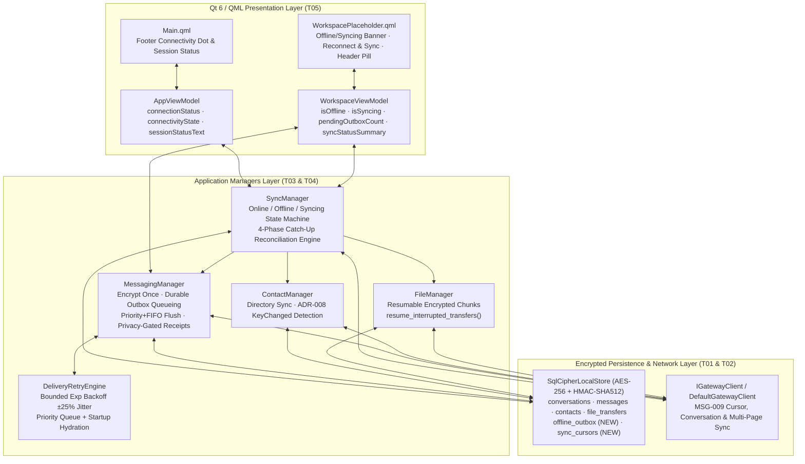
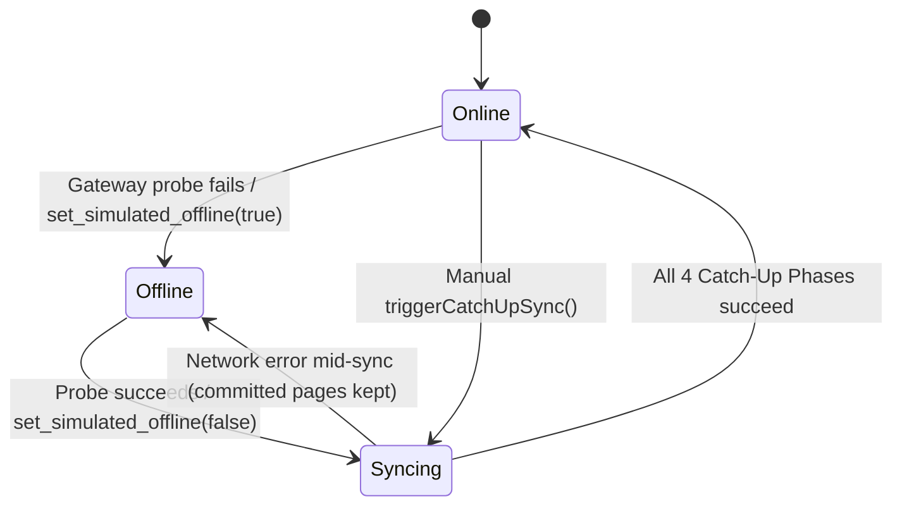
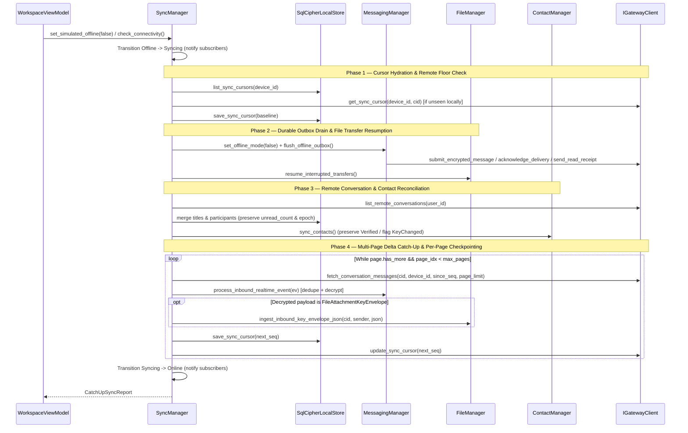
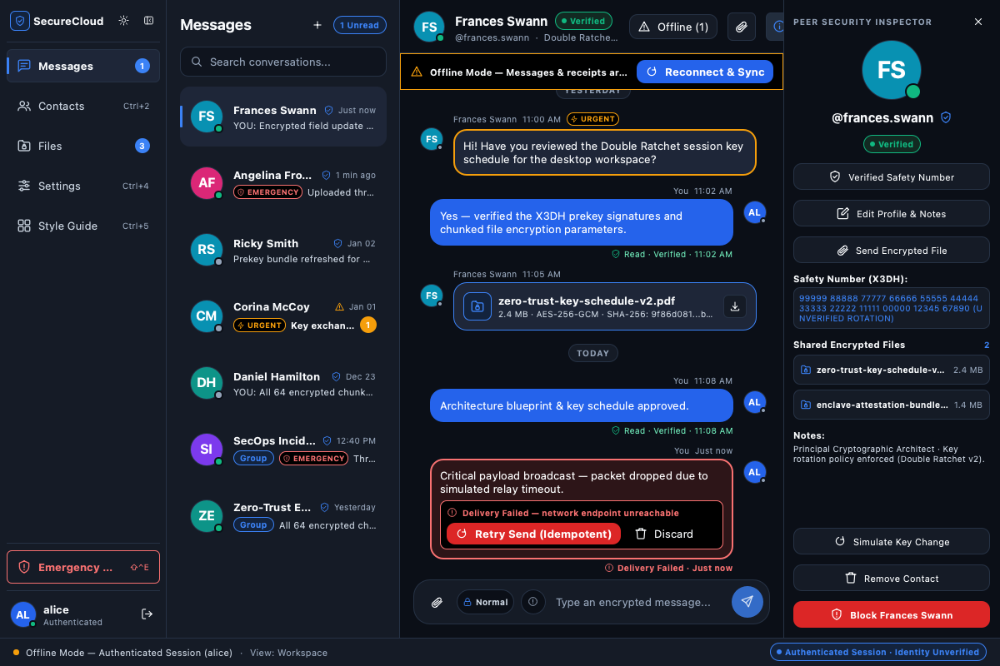
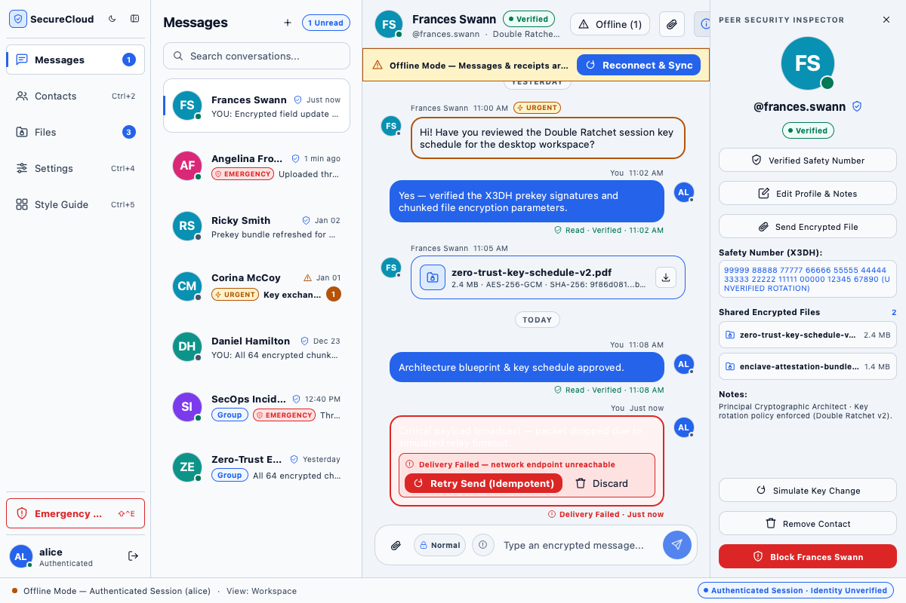
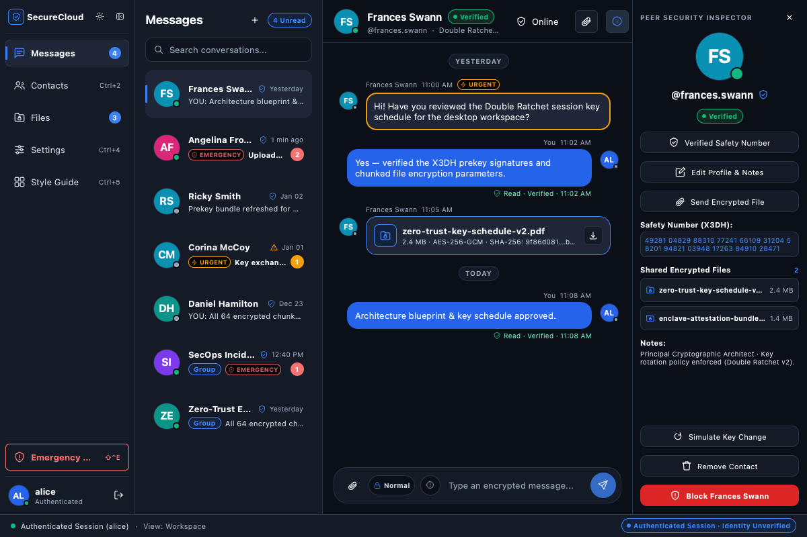
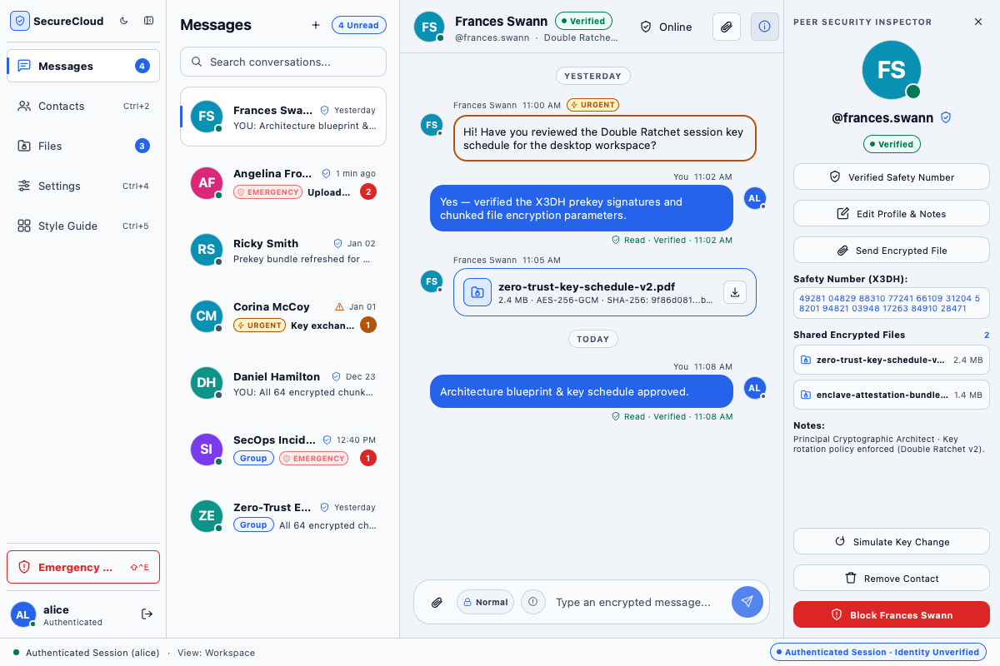

# CLIENT-012 Final Walkthrough Report: Offline Operation & Catch-Up Sync

**Card ID:** `CLIENT-012`  
**Phase:** Phase 3 — Core Desktop Client Messaging, Delivery, Encrypted Files & Offline Resilience  
**Branch:** `feature/client-012-offline-operation-and-catch-up-sync`  
**Status:** **Completed (`CLIENT-012-T01` through `CLIENT-012-T06`)**  
**Date:** 2026-11-20  
**Verification Snapshot:** `352 / 352` unit, integration, and headless QML tests passing (`94` test suites); Tier 1 `--smoke-test` passed (`0` QML warnings); Tier 2 `--capture-screenshots` captured `26 / 26` desktop screenshots (`0` QML warnings); `1050 / 1050` C++ files pass `check-format`; zero compiler warnings under `-Wall -Wextra -Wpedantic -Werror -Wshadow -Wconversion`.

---

## 1. Executive Summary

`CLIENT-012` transforms the SecureCloud desktop client from a purely online-first messaging workstation into an **offline-capable, cryptographically resilient, restart-safe client** with deterministic multi-page catch-up synchronization.

Before `CLIENT-012`, closing the application while offline dropped any unsubmitted messages sitting in `DeliveryRetryEngine`'s RAM queue, silently discarded offline delivery acknowledgements and read receipts, lost per-conversation sequence cursors on every restart, and truncated inbound catch-up polling to a single `50`-event page without reconciling remote conversations, rotated contact identity keys, or interrupted encrypted file transfers.

Across six incremental, cleanly tested tickets (`CLIENT-012-T01` through `CLIENT-012-T06`), we delivered:

1. **Strongly typed offline & catch-up domain models + Gateway sync contracts (`T01`)**: `ConnectivityState`, `OfflineOutboxOperationType`, `OfflineOutboxFanOutPayload` (hex-encoding arbitrary binary non-UTF-8 ciphertexts), `OfflineOutboxDeliveryAckPayload`, `OfflineOutboxReadReceiptPayload`, `OfflineOutboxRecord`, `SyncCursorRecord`, `RemoteConversationSummary`, `CatchUpSyncReport`, and `IGatewayClient` / `DefaultGatewayClient` cursor, conversation-list, and sorted multi-page message catch-up contracts aligned with backend `MSG-009`.
2. **Encrypted SQLCipher persistence for outbox & cursors (`T02`)**: Added `offline_outbox` and `sync_cursors` tables inside the existing AES-256-CBC + HMAC-SHA512 `SqlCipherLocalStore` vault (plus full `MemoryLocalStore` parity), enforcing deterministic `priority DESC, created_at_ms ASC, outbox_id ASC` drain ordering, monotonic cursor storage guards, atomic conversation cascade deletion, and verified zero plaintext leakage on disk.
3. **Durable offline queueing & ratchet-safe ordered replay (`T03`)**: Wired `MessagingManager`, `DeliveryRetryEngine`, and `FileManager` to persist pre-encrypted 1:1 Double Ratchet messages, Group Sender Key messages, initial Group Sender Key Distribution (`-skd`) envelopes, delivery ACKs, and privacy-gated read receipts into `ILocalStore`, hydrate across restarts, flush in strict priority + FIFO order **without ever re-stepping Double Ratchet or Sender Key chains (`ADR-008`)**, purge queued read receipts if disabled before reconnect, and resume network-interrupted file transfers while respecting user pauses.
4. **Connectivity observer & 4-phase catch-up reconciliation engine (`T04`)**: Upgraded `SyncManager` into a thread-safe `Online` / `Offline` / `Syncing` state machine wired in `ClientBootstrap` to `ILocalStore`, `MessagingManager`, `ContactManager`, and `FileManager`, implementing a 4-phase catch-up protocol (Cursor Hydration → Outbox Flush & File Resume → Remote Conversation/Contact Reconciliation → Bounded Multi-Page `has_more` Delta Catch-Up with per-page local & Gateway cursor checkpointing and automatic inbound `FileAttachmentKeyEnvelope` ingestion).
5. **Reactive Qt/QML Offline & Syncing UI (`T05`)**: Subscribed `AppViewModel` and `WorkspaceViewModel` to `SyncManager::subscribe_connectivity_state(...)` with Qt thread-safe marshaling, exposed `connectivityState`, `isOffline`, `isSyncing`, `pendingOutboxCount`, `syncStatusSummary`, `setSimulatedOfflineMode`, and `triggerCatchUpSync`, and added the high-contrast amber/accent **Offline & Catch-Up Sync Banner**, Zone 3 header connectivity pill, and live `Main.qml` footer status indicator.
6. **End-to-End Integration Suite, Tier 1/2 Real-Client Smoke Verification & Final Reports (`T06`)**: Validated all layers together across 5 full-stack E2E scenarios (`offline_catchup_sync_integration_test.cpp`), executed Tier 1 (`--smoke-test`) and Tier 2 (`--capture-screenshots`, including dark/light Offline Banner captures) on the real `securecloud-client` desktop binary, and documented the complete card and Phase 3 architecture.

---

## 2. Ticket Completion Matrix

| Ticket | Title | Commit | Status | Primary Deliverables | Verification |
|---|---|---|---|---|---|
| **CLIENT-012-T01** | Connectivity State, Durable Outbox & Sync Cursor Domain Models + `IGatewayClient` Catch-Up Sync Contracts | `5642dd3` | **Completed** | `offline_sync_models.{hpp,cpp}`, `realtime_events.hpp`, `i_gateway_client.hpp`, `default_gateway_client.{hpp,cpp}`, `offline_sync_contracts_test.cpp` | `8 / 8` `OfflineSync*` tests, `331 / 331` total |
| **CLIENT-012-T02** | Durable Offline Outbox & Sync Cursor Persistence in `ILocalStore` & `SqlCipherLocalStore` | `9399859` | **Completed** | `i_local_store.hpp`, `sqlcipher_local_store.{hpp,cpp}`, `memory_local_store.{hpp,cpp}`, `offline_outbox_persistence_test.cpp` | `5 / 5` `OfflineOutboxPersistenceTest`, `336 / 336` total |
| **CLIENT-012-T03** | Durable Offline Outbox Queueing & Ordered Replay in `MessagingManager`, `DeliveryRetryEngine` & `FileManager` | `c4bdbe0` | **Completed** | `delivery_retry_engine.{hpp,cpp}`, `messaging_manager.{hpp,cpp}`, `file_manager.{hpp,cpp}`, `offline_outbox_replay_test.cpp` | `4 / 4` `OfflineOutboxReplayTest`, `340 / 340` total |
| **CLIENT-012-T04** | Connectivity Observer (`Online` / `Offline` / `Syncing`) & Paginated Catch-Up Reconciliation Engine in `SyncManager` | `ad105ed` | **Completed** | `sync_manager.{hpp,cpp}`, `client_bootstrap.cpp`, `catchup_sync_reconciliation_test.cpp` | `4 / 4` `CatchUpSyncReconciliationTest`, `344 / 344` total |
| **CLIENT-012-T05** | `WorkspaceViewModel` & `AppViewModel` Connectivity/Outbox Bindings & QML Offline/Syncing Banner UI | `6f3f73b` | **Completed** | `app_view_model.{hpp,cpp}`, `workspace_view_model.{hpp,cpp}`, `WorkspacePlaceholder.qml`, `Main.qml`, `workspace_view_model_offline_sync_test.cpp` | `3 / 3` `WorkspaceViewModelOfflineSyncTest`, `347 / 347` total |
| **CLIENT-012-T06** | Offline Operation & Catch-Up Sync E2E Integration Suite, Tier 1/2 Smoke Tests & Walkthrough Report | Pending commit | **Completed** | `offline_catchup_sync_integration_test.cpp`, `main.cpp` offline captures, `walkthrough-client-012.md`, `phase3-client-final-report.md` | `5 / 5` `OfflineCatchUpSyncIntegrationTest`, `352 / 352` total, Tier 1 & 2 (`26 / 26` PNGs) |

---

## 3. Plain-Language Explanation: Goal & Overall Architecture

### 3.1 Why Offline Operation in an E2EE Client Is Harder Than Normal Apps

In a standard (non-encrypted) chat app, going offline is simple: save the user's plain text in a queue and POST it to the server when Wi-Fi returns. In **SecureCloud**, end-to-end encryption (`ADR-008`) introduces three strict constraints that require careful engineering:

1. **Ratchets Cannot Be Re-Stepped on Replay (`ADR-008`):**
   When Alice sends a 1:1 message to Bob, her Double Ratchet sending chain advances (`step N → N+1`) and derives a one-time message key. When she sends a Group message, her Signal Sender Key chain advances (`iteration K → K+1`). If Alice composes a message offline and restarts the app, re-encrypting the plaintext would advance the chain a *second* time, producing a mismatched ciphertext or skipping key indices. Therefore, SecureCloud **encrypts once** at compose time and stores the **already-encrypted wire payload + original `idempotency_key`** inside the encrypted SQLCipher `offline_outbox` table. On reconnect, the client replays that exact saved ciphertext without ever calling `RatchetSessionManager` or `SenderKeyEngine` again.
2. **Sender Key Distribution Ordering for New Groups:**
   If Alice creates a brand-new Group conversation and sends her very first message while offline, she must generate a `SenderKeyState` and produce a `SenderKeyDistributionMessage` (`-skd`) encrypted pairwise to every group member *before* encrypting the group message itself. `CLIENT-012` queues the `-skd` outbox entry with `created_at_ms - 1` so SQLCipher's deterministic drain index (`priority DESC, created_at_ms ASC, outbox_id ASC`) **always** flushes the Sender Key Distribution strictly before the group ciphertext.
3. **Zero Plaintext on Disk & Monotonic State Progression (`ADR-007`):**
   Every queued message, delivery ACK, read receipt, and per-conversation sequence watermark is stored inside the existing AES-256-CBC + HMAC-SHA512 SQLCipher database keyed from `ISecureStorage`. Meanwhile, both `SyncCursorRecord` and `DeliveryState` enforce strict monotonicity so overlapping real-time pushes and catch-up sync pages can never create duplicate messages or regress `Read → Delivered` or `seq = 120 → seq = 50`.

### 3.2 End-to-End Architecture Diagram



### 3.3 Connectivity State Machine (`Online` / `Offline` / `Syncing`)

A core invariant enforced by `domain::can_transition_connectivity_state` is that a client can **never** transition directly from `Offline` to `Online`. Every recovery from an offline period must pass through `Syncing` so the durable outbox is drained and missed remote deltas are reconciled before declaring the workstation `Online`.



---

## 4. Backend & ADR Alignment (`MSG-009`, `ADR-007`, `ADR-008`)

Before writing code, we audited the live Gateway (`src/gateway/http/proxy/messaging_proxy_handler.cpp`) and Protobuf definitions (`proto/securecloud/messaging/v1/messaging.proto`) to ensure `CLIENT-012` matches the real backend contracts rather than outdated backlog shorthand:

| Capability | Backend / Gateway Contract (`MSG-009`) | Client Interface (`IGatewayClient`) |
|---|---|---|
| Paginated Message Delta Catch-Up | `GET /api/v1/conversations/:id/messages?since_sequence=<seq>&max_messages=<limit>&device_id=<did>` | `fetch_conversation_messages(conversation_id, recipient_device_id, since_sequence, max_results)` returning `ConversationMessagesPage` (`events`, `has_more`, `next_sequence`, `latest_sequence`, optional `cursor`) |
| Fetch Device Sync Cursor | `GET /api/v1/devices/:deviceId/cursor?conversation_id=<cid>` | `get_sync_cursor(device_id, conversation_id)` returning `SyncCursorRecord` |
| Update Device Sync Cursor | `PUT /api/v1/devices/:deviceId/cursor` | `update_sync_cursor(cursor)` enforcing monotonic sequence & timestamp progression |
| Reconcile Remote Conversations | `GET /api/v1/conversations` | `list_remote_conversations(user_id, max_results)` returning `std::vector<RemoteConversationSummary>` |
| Gateway Health Probe | `GET /health` | `probe_gateway("/health")` used by `SyncManager::check_connectivity()` |

### Key ADR Compliance Matrix

| ADR | Requirement | How `CLIENT-012` Enforces It |
|---|---|---|
| **ADR-007 §2** | Idempotent message submission (`idempotency_key`) & inbound deduplication | `OfflineOutboxRecord` preserves the exact original `idempotency_key` across restarts; `SyncManager` + `MessagingManager` deduplicate by `message_id` and track `duplicates_skipped_count`. |
| **ADR-007 §11** | Priority-aware delivery (`Emergency` > `Urgent` > `Normal`) | `offline_outbox` index `idx_offline_outbox_order(priority DESC, created_at_ms ASC, outbox_id ASC)` and `DeliveryRetryEngine::process_due` sort `due` items by priority descending, then FIFO. |
| **ADR-007 §13–14** | Bounded exponential backoff with `±25%` jitter and TTL expiration | `DeliveryRetryEngine::compute_backoff` computes jittered retry windows; expired entries transition to `DeliveryState::Failed` while keeping payload intact for manual retry. |
| **ADR-007 §17** | Monotonic delivery state progression & cursor advancement | `domain::can_transition_delivery_state` blocks `Read → Delivered`; `SyncCursorRecord::advance_monotonically` and `SqlCipherLocalStore::save_sync_cursor` block cursor regressions. |
| **ADR-008** | Zero ratchet re-stepping & non-bypassable `KeyChanged` suspension | Pre-encrypted `OfflineOutboxFanOutPayload` is replayed verbatim without touching ratchets; `MessagingManager::flush_offline_outbox` re-validates `validate_recipients_can_receive` before flushing and blocks sending if a peer rotated keys while offline. |

---

## 5. Ticket-by-Ticket Technical Walkthrough

### 5.1 `CLIENT-012-T01`: Domain Models & Gateway Catch-Up Sync Contracts

**Files Created / Modified:**
- Created `src/client/domain/offline_sync_models.hpp` & `src/client/domain/offline_sync_models.cpp`
- Modified `src/client/domain/realtime_events.hpp`
- Modified `src/client/application/interfaces/i_gateway_client.hpp`
- Modified `src/client/infrastructure/adapters/default_gateway_client.hpp` & `.cpp`
- Modified `src/client/CMakeLists.txt`
- Updated all 4 test subclasses of `IGatewayClient` (`client_domain_test.cpp`, `file_manager_pipeline_test.cpp`, `workspace_view_model_files_test.cpp`, `encrypted_file_transfer_integration_test.cpp`)
- Created `tests/unit/client/offline_sync_contracts_test.cpp`

**Key Engineering Decisions:**
1. **Binary Non-UTF-8 Safe JSON Encoding:**
   `crypto::PerDeviceDeliveryPayload::ciphertext_blob` is a `std::string` that routinely contains arbitrary raw binary bytes (`0x00`, `0x80`, `0xFF`), and `ephemeral_public_key`, `iv`, `auth_tag`, and `group_envelope_bytes` are `std::vector<uint8_t>`. Passing raw non-UTF-8 bytes to `nlohmann::json::dump()` throws `json::type_error`. `OfflineOutboxFanOutPayload::to_json()` hex-encodes every binary field (`ciphertext_blob_hex`, `ephemeral_public_key_hex`, `iv_hex`, `auth_tag_hex`, `group_envelope_hex`) and `from_json()` validates even-length hexadecimal digits, failing closed (`std::nullopt`) on any malformed byte sequence.
2. **Zero Circular Header Dependencies:**
   `realtime_events.hpp` includes `domain/offline_sync_models.hpp` so `ConversationMessagesPage` can embed `std::optional<SyncCursorRecord> cursor`, while `offline_sync_models.hpp` defines standalone `OfflineOutboxDeliveryAckPayload` and `OfflineOutboxReadReceiptPayload` without including `realtime_events.hpp`.
3. **Deterministic Multi-Page Sorting in `DefaultGatewayClient`:**
   `DefaultGatewayClient::fetch_conversation_messages` filters events with `server_sequence_number > since_sequence`, sorts ascending by `server_sequence_number`, slices `max_results`, populates `has_more`, `next_sequence`, and `latest_sequence` (equal to the max sequence *in that page* so existing single-page callers never skip future pages), and attaches any stored `SyncCursorRecord`.

**Verification (`offline_sync_contracts_test.cpp` — `8 / 8` Passed):**
- `OfflineSyncDomainTest.ConnectivityStateConversionsAndTransitions`
- `OfflineSyncDomainTest.OperationTypeStringRoundTrips`
- `OfflineSyncDomainTest.FanOutPayloadHandlesBinaryNonUtf8AndGroupEnvelopeJsonRoundTrip`
- `OfflineSyncDomainTest.AckReceiptAndOutboxRecordJsonRoundTrips`
- `OfflineSyncDomainTest.SyncCursorRecordJsonRoundTripAndMonotonicAdvance`
- `OfflineSyncGatewayContractsTest.GetAndUpdateSyncCursorEnforceValidationAndMonotonicity`
- `OfflineSyncGatewayContractsTest.ListRemoteConversationsFiltersParticipantsAndHonorsLimit`
- `OfflineSyncGatewayContractsTest.MultiPageFetchConversationMessagesSortsAndTracksNextSequenceAndCursor`

---

### 5.2 `CLIENT-012-T02`: Durable SQLCipher Outbox & Sync Cursor Persistence

**Files Created / Modified:**
- Modified `src/client/application/interfaces/i_local_store.hpp`
- Modified `src/client/infrastructure/adapters/sqlcipher_local_store.hpp` & `.cpp`
- Modified `src/client/infrastructure/adapters/memory_local_store.hpp` & `.cpp`
- Created `tests/unit/client/offline_outbox_persistence_test.cpp`

**SQLCipher Vault Schema Extension (`SqlCipherLocalStore::initialize_schema_locked()`):**

```sql
CREATE TABLE IF NOT EXISTS offline_outbox (
    outbox_id TEXT PRIMARY KEY,
    operation_type TEXT NOT NULL,
    conversation_id TEXT NOT NULL,
    priority INTEGER NOT NULL DEFAULT 0,
    created_at_ms INTEGER NOT NULL,
    payload_json TEXT NOT NULL
);
CREATE INDEX IF NOT EXISTS idx_offline_outbox_order
    ON offline_outbox(priority DESC, created_at_ms ASC, outbox_id ASC);

CREATE TABLE IF NOT EXISTS sync_cursors (
    device_id TEXT NOT NULL,
    conversation_id TEXT NOT NULL,
    last_delivered_sequence INTEGER NOT NULL DEFAULT 0,
    updated_at_ms INTEGER NOT NULL,
    payload_json TEXT NOT NULL,
    PRIMARY KEY (device_id, conversation_id)
);
```

**Key Engineering Decisions:**
1. **Storage-Level Monotonicity Guard:**
   `SqlCipherLocalStore::save_sync_cursor` and `MemoryLocalStore::save_sync_cursor` inspect any existing `(device_id, conversation_id)` row before upserting. If an out-of-order caller attempts to store a lower sequence number (`incoming < existing`), the store preserves the existing higher `last_delivered_sequence` and `last_sync_timestamp_ms` and returns the effective stored `SyncCursorRecord`.
2. **Graceful Unseen Cursor Fallback:**
   `get_sync_cursor(device_id, conversation_id)` returns a clean sequence-`0`, `sync_version = 1` `SyncCursorRecord` for fresh conversations instead of treating an uninitialized conversation as a storage error.
3. **Atomic Conversation Cascade Deletion:**
   Extracted `SqlCipherLocalStore::exec_delete_for_conversation_locked` and updated `delete_conversation` (in both `SqlCipherLocalStore`'s `BEGIN IMMEDIATE ... COMMIT` transaction and `MemoryLocalStore`) to cascade-delete matching rows from `messages`, `file_transfers`, `offline_outbox`, and `sync_cursors` atomically.
4. **Verified Zero Plaintext On Disk:**
   `SqlCipherZeroPlaintextLeakageOnDiskForOutboxAndCursors` inspects the raw concatenated bytes of `client_vault.db` and `client_vault.db-wal` on disk to confirm zero occurrences of `"SQLite format 3"`, `outbox_id`, `conversation_id`, `idempotency_key`, `device_id`, or `last_error`.

**Verification (`offline_outbox_persistence_test.cpp` — `5 / 5` Passed):**
- `OfflineOutboxPersistenceTest.MemoryLocalStoreOutboxCrudPriorityOrderingAndCascade`
- `OfflineOutboxPersistenceTest.MemoryLocalStoreSyncCursorMonotonicityAndListing`
- `OfflineOutboxPersistenceTest.SqlCipherLocalStoreOutboxAndCursorRestartDurability`
- `OfflineOutboxPersistenceTest.SqlCipherZeroPlaintextLeakageOnDiskForOutboxAndCursors`
- `OfflineOutboxPersistenceTest.SqlCipherRejectsWrongMasterKeyForOutboxAndCursorTables`

---

### 5.3 `CLIENT-012-T03`: Durable Offline Queueing & Ratchet-Safe Ordered Replay

**Files Created / Modified:**
- Modified `src/client/application/managers/delivery_retry_engine.hpp` & `.cpp`
- Modified `src/client/application/managers/messaging_manager.hpp` & `.cpp`
- Modified `src/client/application/managers/file_manager.hpp` & `.cpp`
- Created `tests/unit/client/offline_outbox_replay_test.cpp`

**Deterministic Outbox ID Scheme:**

| Operation Type | `outbox_id` Format | Ordering & Deduplication Property |
|---|---|---|
| Group Sender Key Distribution | `skd-<message_id>` | Stored with `created_at_ms = now_ms - 1` and same `priority`, guaranteeing delivery strictly before `msg-<message_id>`. |
| Encrypted 1:1 / Group Message | `msg-<message_id>` | `O(1)` lookup for `process_retry_queue`, post-restart `retry_failed_message`, and `discard_failed_message`. |
| File Attachment Key Envelope | `msg-<message_id>` (`FileKeyEnvelopeSubmission`) | Tagged automatically via `FileAttachmentKeyEnvelope::is_file_attachment_envelope(plaintext)`. |
| Delivery Acknowledgement | `ack-<message_id>-<device_id>` | Naturally deduplicated by primary key if the same inbound message is processed twice while offline. |
| Read Receipt | `rcpt-<conversation_id>-<message_id>-<device_id>` | Naturally deduplicated; purged automatically if `set_read_receipts_enabled(false)` is called before reconnect. |

**Key Engineering Decisions:**
1. **Zero Ratchet Re-Stepping Proof:**
   In `offline_outbox_replay_test.cpp`, we snapshot the exact serialized Double Ratchet session state (`ratchet_session:<uid>:<did>`) and Signal Sender Key state (`sender_key:...`) inside `ISecureStorage` immediately after staging offline messages, close `SqlCipherLocalStore`, reopen fresh managers, and flush the outbox. The test asserts byte-for-byte equality of both cryptographic states before and after replay—and verifies Bob decrypts every replayed 1:1 and Group ciphertext cleanly.
2. **Post-Restart Manual Retry Without Re-Encryption:**
   When a message exhausts `max_attempts` or TTL during automated retry, it transitions to `DeliveryState::Failed` and drops out of `pending_retry_count()` and `pending_outbox_count()`, while retaining its pre-encrypted payload row in `offline_outbox`. If the user later restarts the app and clicks **"Retry Send (Idempotent)"**, `retry_failed_message` loads and transmits the exact saved ciphertext and `idempotency_key` (and `discard_failed_message` permanently removes it).
3. **User-Pause Preservation in `FileManager::resume_interrupted_transfers()`:**
   Network-interrupted file transfers are marked `Paused` with a **non-empty `error_message`**, whereas explicit user pauses clear `error_message`, and newly ingested inbound file key envelopes stay `Pending` with an empty `local_path`. `resume_interrupted_transfers()` resumes only network- or crash-interrupted transfers, never overriding a user's manual pause or auto-downloading an unchosen inbound file.

**Verification (`offline_outbox_replay_test.cpp` — `4 / 4` Passed):**
- `OfflineOutboxReplayTest.DirectAndGroupMessagesSurviveRestartAndReplayWithoutResteppingRatchets`
- `OfflineOutboxReplayTest.OfflineDeliveryAcksAndPrivacyGatedReadReceiptsFlushAndSuppress`
- `OfflineOutboxReplayTest.PriorityAndFifoDrainOrderAndExpirationWithPostRestartManualRetry`
- `OfflineOutboxReplayTest.FileManagerResumesNetworkInterruptedTransfersWhileRespectingUserPause`

---

### 5.4 `CLIENT-012-T04`: Connectivity Observer & 4-Phase Catch-Up Engine in `SyncManager`

**Files Created / Modified:**
- Modified `src/client/application/client_bootstrap.cpp`
- Modified `src/client/application/managers/sync_manager.hpp` & `.cpp`
- Created `tests/unit/client/catchup_sync_reconciliation_test.cpp`

**4-Phase Catch-Up Synchronization Sequence (`SyncManager::execute_catch_up_sync`):**



**Verification (`catchup_sync_reconciliation_test.cpp` — `4 / 4` Passed):**
- `CatchUpSyncReconciliationTest.ConnectivityStateMachineTransitionsAndCallbackNotifications`
- `CatchUpSyncReconciliationTest.MultiPageCatchUpSyncPersistsCursorsAcrossRestartAndDeduplicates`
- `CatchUpSyncReconciliationTest.RemoteConversationAndContactReconciliationPreservesLocalState`
- `CatchUpSyncReconciliationTest.FullFourPhaseCatchUpFlushesOutboxResumesFilesAndIngestsInboundFileEnvelopes`

---

### 5.5 `CLIENT-012-T05`: ViewModel Connectivity/Outbox Bindings & QML Offline Banner UI

**Files Created / Modified:**
- Modified `src/client/application/managers/messaging_manager.cpp` (offline fallback path for sessions without pre-initialized `RatchetSessionManager`)
- Modified `src/client/ui/app_view_model.hpp` & `.cpp`
- Modified `src/client/ui/workspace_view_model.hpp` & `.cpp`
- Modified `src/client/ui/qml/WorkspacePlaceholder.qml` & `src/client/ui/qml/Main.qml`
- Created `tests/unit/client/workspace_view_model_offline_sync_test.cpp`

**Exposed QML Properties & Invokables:**

| ViewModel | Property / Invokable | Type | Purpose |
|---|---|---|---|
| `AppViewModel` | `connectionStatus` | `QString` | `"Connected"`, `"Offline"`, `"Syncing"`, or `"Offline (Wiped)"` |
| `AppViewModel` | `connectivityState` | `QString` | Exact `ConnectivityState` (`"Online"`, `"Offline"`, `"Syncing"`) |
| `AppViewModel` | `sessionStatusText` | `QString` | Live footer text reflecting Offline Mode / Catch-Up Sync / Authenticated Session |
| `WorkspaceViewModel` | `connectivityState` | `QString` | `"Online"`, `"Offline"`, or `"Syncing"` |
| `WorkspaceViewModel` | `isOffline` / `isSyncing` | `bool` | Declarative visibility & styling guards for QML banners |
| `WorkspaceViewModel` | `pendingOutboxCount` | `int` | Live count of active queued operations in `offline_outbox` |
| `WorkspaceViewModel` | `syncStatusSummary` | `QString` | Human-readable banner status string with queued outbox count |
| `WorkspaceViewModel` | `setSimulatedOfflineMode(bool)` | `Q_INVOKABLE` | Toggles offline simulation & triggers automatic 4-phase catch-up on reconnect |
| `WorkspaceViewModel` | `triggerCatchUpSync()` | `Q_INVOKABLE` | Runs catch-up sync and reloads conversations/messages preserving active selection |

**Verification (`workspace_view_model_offline_sync_test.cpp` — `3 / 3` Passed, `0` QML Warnings):**
- `WorkspaceViewModelOfflineSyncTest.OfflineDraftingUpdatesOutboxCountAndLocalPendingState`
- `WorkspaceViewModelOfflineSyncTest.ReconnectTriggersCatchUpSyncDrainsOutboxAndMergesRemoteMessages`
- `WorkspaceViewModelOfflineSyncTest.HeadlessQmlWorkspaceLoadsOfflineBannerWithZeroWarnings`

---

### 5.6 `CLIENT-012-T06`: 5-Scenario Full-Stack E2E Integration Suite

**File Created:** `tests/unit/client/offline_catchup_sync_integration_test.cpp`

| Scenario | Test Name | What It Proves End-to-End | Runtime |
|---|---|---|---|
| **Scenario 1** | `Scenario1_OfflineDraftingSqlCipherRestartAndPriorityOrderedPreEncryptedFlush` | Alice goes offline, drafts `Normal`, `Urgent`, `Emergency` 1:1 messages + first-ever Group message (SKD + ciphertext) + marks peer message read (`ReadReceipt`), restarts against the same encrypted SQLCipher `.db`, reconnects: asserts strict priority wire order (`Emergency → Urgent → Group SKD → Group → Normal`), ReadReceipt delivery, byte-identical Double Ratchet & Sender Key states (zero re-stepping), and Bob decrypting every single message cleanly. | `70 ms` |
| **Scenario 2** | `Scenario2_MultiPageCatchUpSync125EventsAndDurableCursorCheckpointing` | `125` encrypted events accumulate across `3` pages (`50 + 50 + 25` with `has_more = true`); Alice catches up cleanly, persists `seq = 125` to both `SqlCipherLocalStore` and `DefaultGatewayClient`, restarts, and verifies a follow-up catch-up merges `0` redundant events. | `75 ms` |
| **Scenario 3** | `Scenario3_IdempotentDeduplicationAndMonotonicDeliveryStateMerge` | Replays an already-delivered message alongside `ReadReceipt` followed by an out-of-order `DeliveryAck`; asserts `1` message row in `ILocalStore`, `duplicates_skipped_count == 1`, and monotonic state preserved as `Read`. | `0 ms` |
| **Scenario 4** | `Scenario4_RemoteGroupKeyChangeAndInterruptedFileTransferReconciliation` | While offline, a remote group is created, verified contact Bob rotates his identity key (`v1 → v2`), and an encrypted file upload fails at chunk `1/3`; a single catch-up sync creates the local group, flags Bob `KeyChanged` (blocking unverified sends per `ADR-008`), and resumes the upload to `Completed (3/3)`. | `10 ms` |
| **Scenario 5** | `Scenario5_FullWorkspaceAndAppViewModelReactiveUiLifecycle` | Drives `WorkspaceViewModel` + `AppViewModel` through offline toggle, `LocalPending` drafting, missed remote message catch-up, `Offline → Syncing → Online` Qt signal transitions, outbox drain to `0`, and merged UI message rendering. | `6 ms` |

---

## 6. Real-Client Smoke Test Verification (Tier 1 & Tier 2)

Both tiers were executed directly on the compiled `build/dev-debug/src/client/securecloud-client` desktop binary under `QT_QPA_PLATFORM=offscreen`:

### 6.1 Tier 1 — Application Boot & QML Integrity (`--smoke-test`)

```text
Command: QT_QPA_PLATFORM=offscreen ./build/dev-debug/src/client/securecloud-client --smoke-test
Result:  [SecureCloud Client] Smoke test execution passed cleanly (QML engine loaded)
Exit:    0 (Zero QML warnings, clean graceful shutdown)
```

### 6.2 Tier 2 — Automated Desktop UI Screenshot Capture (`--capture-screenshots`)

```text
Command: QT_QPA_PLATFORM=offscreen ./build/dev-debug/src/client/securecloud-client --capture-screenshots /tmp/client-012-screenshots
Result:  26 / 26 screenshots captured cleanly (Zero QML warnings, clean graceful shutdown)
```

Key `CLIENT-012` visual captures are committed in `docs/final-reports/assets/client-012/`:

#### Offline Operation Mode & Durable Outbox Banner — Dark Theme (`1200x800`)


#### Offline Operation Mode & Durable Outbox Banner — Light Theme (`1200x800`)


#### Online Authenticated Workspace (Post-Sync Baseline) — Dark & Light (`1200x800`)



#### Visual Inspection Checklist (Verified on Rendered PNGs)
- **Zone 3 Header Pill:** Displays `"Offline (1)"` with warning triangle icon cleanly aligned next to the attachment and inspector buttons without clipping.
- **Zone 3 Top Banner (`connectivityOfflineBanner`):** High-contrast amber warning background and border in both Dark and Light themes, displaying `"Offline Mode — Messages & receipts are..."` and a crisp primary `"Reconnect & Sync"` button.
- **Zone 2 Master List:** Immediately updates Frances Swann's preview to `"YOU: Encrypted field update..."` while offline.
- **Window Footer (`Main.qml`):** Status indicator dot transitions to amber (`Theme.statusWarning`) alongside `"Offline Mode — Authenticated Session (alice) · View: Workspace"`.
- **Zero Layout Regressions:** Verified across all `26` screenshots (Login, MFA, Messages, Contacts, KeyChanged Banner, Group Chat, Emergency Alert, Failed Retry, Offline Banner, Compact `1000x680`, Group Modal, Encrypted Files Vault, and Settings).

### 6.3 How to Inspect the Screenshots Locally
1. **In your IDE / VS Code / Antigravity:** Open `docs/final-reports/assets/client-012/workspace-offline-dark-1200x800.png` and `docs/final-reports/assets/client-012/workspace-offline-light-1200x800.png` directly, or preview this markdown report.
2. **In macOS Finder / Terminal:**
   ```bash
   open docs/final-reports/assets/client-012/workspace-offline-dark-1200x800.png \
        docs/final-reports/assets/client-012/workspace-offline-light-1200x800.png
   ```
3. **Full 26-Screenshot Set:** Re-run anytime via:
   ```bash
   QT_QPA_PLATFORM=offscreen ./build/dev-debug/src/client/securecloud-client --capture-screenshots /tmp/client-012-screenshots
   open /tmp/client-012-screenshots
   ```

---

## 7. Complete Verification Summary

| Check | Command | Result |
|---|---|---|
| Client Test Binary & Desktop App Build | `cmake --build build/dev-debug --target securecloud_client_foundation_test securecloud-client --parallel` | **PASS** (`0` warnings under `-Wall -Wextra -Wpedantic -Werror -Wshadow -Wconversion`) |
| `CLIENT-012` E2E Suite | `QT_QPA_PLATFORM=offscreen ./build/dev-debug/tests/unit/securecloud_client_foundation_test --gtest_filter="*OfflineCatchUpSync*"` | **PASS** (`5 / 5` scenarios, `163 ms`) |
| Full Client Foundation Test Suite | `QT_QPA_PLATFORM=offscreen ./build/dev-debug/tests/unit/securecloud_client_foundation_test --gtest_brief=1` | **PASS** (`352 / 352` tests across `94` suites, `6796 ms`) |
| Tier 1 Real-Client Smoke Test | `QT_QPA_PLATFORM=offscreen ./build/dev-debug/src/client/securecloud-client --smoke-test` | **PASS** (exit `0`, `0` QML warnings) |
| Tier 2 Real-Client Screenshot Capture | `QT_QPA_PLATFORM=offscreen ./build/dev-debug/src/client/securecloud-client --capture-screenshots /tmp/client-012-screenshots` | **PASS** (`26 / 26` PNGs, `0` QML warnings) |
| Formatting Check | `cmake --build build/dev-debug --target check-format` | **PASS** (`All 1050 C++ files adhere to .clang-format`) |


---

## 8. Complete Domain & Wire Serialization Specification

This section documents the exact data contracts introduced in `src/client/domain/offline_sync_models.hpp` and `src/client/domain/offline_sync_models.cpp`, including every field, default value, JSON key, encoding invariant, and fail-closed validation rule.

### 8.1 `ConnectivityState` Transition Matrix

`domain::ConnectivityState` defines three mutually exclusive states:

| State | Wire / UI String | Meaning | `MessagingManager::is_offline_mode()` |
|---|---|---|---|
| `ConnectivityState::Online` | `"Online"` | Gateway reachable; outbound traffic transmits immediately and real-time polling/push is active. | `false` |
| `ConnectivityState::Offline` | `"Offline"` | Gateway unreachable or simulated offline mode active; outbound messages, ACKs, and read receipts route directly to `offline_outbox`. | `true` |
| `ConnectivityState::Syncing` | `"Syncing"` | 4-phase catch-up reconciliation actively running (`execute_catch_up_sync`); outbox draining and multi-page deltas fetching. | `false` |

Allowed transitions enforced by `can_transition_connectivity_state(from, to)`:

| From \ To | `Online` | `Offline` | `Syncing` | Rationale |
|---|---|---|---|---|
| **`Online`** | Allowed (no-op) | Allowed | Allowed | Normal outage detection or manual `triggerCatchUpSync()`. |
| **`Offline`** | **Forbidden** | Allowed (no-op) | Allowed | Direct `Offline → Online` is strictly disallowed; catch-up `Syncing` must complete first. |
| **`Syncing`** | Allowed | Allowed | Allowed (no-op) | Completes cleanly to `Online`, or reverts to `Offline` on mid-sync network error. |

### 8.2 `OfflineOutboxOperationType` Enum & Dispatch Routing

| Enum Value | Serialized String | Primary Gateway RPC | Target Table / Side Effect on Success |
|---|---|---|---|
| `EncryptedMessageSubmission` | `"EncryptedMessageSubmission"` | `IGatewayClient::submit_encrypted_message` | Deletes outbox row, removes from `DeliveryRetryEngine`, transitions message `LocalPending → Accepted`. |
| `FileKeyEnvelopeSubmission` | `"FileKeyEnvelopeSubmission"` | `IGatewayClient::submit_encrypted_message` | Identical wire dispatch to encrypted message submission, tagged distinctly for telemetry and vault auditing. |
| `DeliveryAck` | `"DeliveryAck"` | `IGatewayClient::acknowledge_delivery` | Deletes outbox row; informs Messaging Service that this device persisted the ciphertext. |
| `ReadReceipt` | `"ReadReceipt"` | `IGatewayClient::send_read_receipt` | Deletes outbox row; skipped and purged automatically if `read_receipts_enabled() == false`. |

### 8.3 `OfflineOutboxFanOutPayload` JSON Schema (Hex-Encoded Binary Safety)

Because Double Ratchet and Sender Key ciphertexts contain arbitrary raw binary bytes (including `0x00` NUL bytes and invalid UTF-8 sequences such as `0xFF`, `0xFE`, `0x80`), storing raw strings inside `nlohmann::json` would throw UTF-8 serialization exceptions or corrupt bytes across SQLite text bindings. `OfflineOutboxFanOutPayload` encodes every binary buffer as lowercase hexadecimal:

```json
{
  "conversation_id": "direct-alice-bob",
  "idempotency_key": "idem-1795157918000-4a2b",
  "priority": 3,
  "device_payloads": [
    {
      "recipient_user_id": "bob",
      "recipient_device_id": "bob-dev-1",
      "ciphertext_blob_hex": "ff00fe80deadbeef",
      "ephemeral_public_key_hex": "0181007f",
      "iv_hex": "aabb00cc",
      "auth_tag_hex": "1099eeff",
      "algorithm": "X25519-DoubleRatchet-AES256GCM"
    }
  ],
  "group_envelope_hex": "00ff7f80aa55"
}
```

**Fail-Closed Decoding Rules (`OfflineOutboxFanOutPayload::from_json`):**
1. Rejects non-JSON or non-object roots.
2. Requires non-empty string fields `conversation_id` and `idempotency_key`.
3. Validates every element in `device_payloads` has non-empty `recipient_device_id` and valid even-length hex strings for `ciphertext_blob_hex`, `ephemeral_public_key_hex`, `iv_hex`, and `auth_tag_hex`.
4. Validates `group_envelope_hex` (when present and non-null) is a valid even-length hex string.
5. Any malformed nibble (`'g'`–`'z'`), odd length, or type mismatch returns `std::nullopt` without throwing.

### 8.4 `OfflineOutboxDeliveryAckPayload` & `OfflineOutboxReadReceiptPayload` Schemas

```json
// OfflineOutboxDeliveryAckPayload
{
  "message_id": "msg-in-ack-1",
  "recipient_device_id": "alice-dev-1",
  "delivered_at_ms": 1795157918588
}

// OfflineOutboxReadReceiptPayload
{
  "conversation_id": "direct-alice-bob",
  "message_id": "msg-in-ack-1",
  "reader_device_id": "alice-dev-1",
  "read_at_ms": 1795157919100
}
```

**Fail-Closed Decoding Rules:**
- `OfflineOutboxDeliveryAckPayload::from_json` requires non-empty `message_id` and `recipient_device_id`.
- `OfflineOutboxReadReceiptPayload::from_json` requires non-empty `conversation_id`, `message_id`, and `reader_device_id`.

### 8.5 `OfflineOutboxRecord` Outer Envelope Schema

```json
{
  "outbox_id": "msg-msg-1795157918000-1f4e",
  "operation_type": "EncryptedMessageSubmission",
  "conversation_id": "direct-alice-bob",
  "message_id": "msg-1795157918000-1f4e",
  "transfer_id": "",
  "idempotency_key": "idem-1795157918000-4a2b",
  "priority": 3,
  "payload_json": "{\"conversation_id\":\"direct-alice-bob\",...}",
  "attempt_count": 1,
  "created_at_ms": 1795157918000,
  "next_retry_at_ms": 1795157919000,
  "expires_at_ms": 1795762718000,
  "last_error": "Queued while offline"
}
```

### 8.6 `SyncCursorRecord` Schema & Monotonic Semantics

```json
{
  "device_id": "alice-dev-1",
  "conversation_id": "direct-alice-bob",
  "last_delivered_sequence": 125,
  "last_sync_timestamp_ms": 1795157925000,
  "sync_version": 2
}
```

**Key Invariant (`SyncCursorRecord::advance_monotonically`):**
- If `new_sequence <= last_delivered_sequence`: returns `false` and makes **zero** mutations to `last_delivered_sequence` or `last_sync_timestamp_ms`.
- If `new_sequence > last_delivered_sequence`: sets `last_delivered_sequence = new_sequence`, updates `last_sync_timestamp_ms = std::max(last_sync_timestamp_ms, timestamp_ms)`, and returns `true`.
- Empty `conversation_id` is explicitly permitted to represent a device-level global cursor, whereas empty `device_id` is rejected fail-closed.

---

## 9. SQLCipher Storage Internals & Concurrency Analysis

### 9.1 Encrypted Vault Layout After `CLIENT-012`

All six tables reside inside a single SQLCipher 4 database file (`PRAGMA journal_mode = WAL`, `PRAGMA synchronous = NORMAL`, `PRAGMA foreign_keys = ON`) encrypted with a 256-bit key stored exclusively in `ISecureStorage` (`local_store.sqlcipher.master_key`):

| Table | Primary Key | Secondary Indexes | Introduced In |
|---|---|---|---|
| `conversations` | `conversation_id` | `idx_conversations_last_activity(last_activity_at_ms DESC)` | `CLIENT-009-T02` |
| `messages` | `message_id` | `idx_messages_conv_time(conversation_id, sent_at_ms ASC)` | `CLIENT-009-T02` |
| `contacts` | `user_id` | — | `CLIENT-009-T02` |
| `file_transfers` | `transfer_id` | `idx_file_transfers_updated(updated_at_ms DESC)`, `idx_file_transfers_conv_updated(conversation_id, updated_at_ms DESC)` | `CLIENT-011-T03` |
| `offline_outbox` | `outbox_id` | `idx_offline_outbox_order(priority DESC, created_at_ms ASC, outbox_id ASC)` | **`CLIENT-012-T02`** |
| `sync_cursors` | `(device_id, conversation_id)` | B-tree composite PK natively accelerates `WHERE device_id = ?1 ORDER BY conversation_id ASC` | **`CLIENT-012-T02`** |

### 9.2 Query Plans & Index Utilization

1. **Outbox Drain Query (`list_outbox_records`):**
   ```sql
   SELECT payload_json
   FROM offline_outbox
   ORDER BY priority DESC, created_at_ms ASC, outbox_id ASC
   LIMIT ?1;
   ```
   Satisfied directly by `idx_offline_outbox_order` without an in-memory filesort, guaranteeing `O(K log N)` retrieval for `K` pending items.
2. **Per-Device Cursor Hydration (`list_sync_cursors`):**
   ```sql
   SELECT payload_json
   FROM sync_cursors
   WHERE device_id = ?1
   ORDER BY conversation_id ASC;
   ```
   Satisfied via a prefix range scan on the composite primary key `(device_id, conversation_id)`.
3. **Atomic Conversation Cascade Deletion (`delete_conversation`):**
   Runs inside `BEGIN IMMEDIATE; ... COMMIT;` (with `ROLLBACK;` on any statement failure) and executes `exec_delete_for_conversation_locked` sequentially across:
   - `DELETE FROM messages WHERE conversation_id = ?1;`
   - `DELETE FROM file_transfers WHERE conversation_id = ?1;`
   - `DELETE FROM offline_outbox WHERE conversation_id = ?1;`
   - `DELETE FROM sync_cursors WHERE conversation_id = ?1;`
   - `DELETE FROM conversations WHERE conversation_id = ?1;` (checking `sqlite3_changes(db_) == 0` to report `"Conversation not found"`).

### 9.3 Thread Safety & Qt UI Thread Marshaling

- **`SqlCipherLocalStore` & `MemoryLocalStore`**: All methods serialize access under `mutable std::mutex mutex_`.
- **`DeliveryRetryEngine`**: Serializes queue state under `mutable std::mutex mutex_`, releasing the lock *before* invoking `submit_fn`, `expire_fn`, or `update_fn` so callbacks can re-enter `MessagingManager` or `ILocalStore` without deadlocking.
- **`SyncManager`**: Protects `connectivity_state_`, `local_user_id_`, `local_device_id_`, `connectivity_subscribers_`, and `conversation_cursors_` under `mutable std::mutex state_mutex_`, copying subscriber callbacks into a local vector before firing them outside the lock.
- **`AppViewModel` & `WorkspaceViewModel`**: Wrap every `SyncManager` callback in `QPointer<Self>` + `QMetaObject::invokeMethod(self.data(), ..., Qt::AutoConnection)` and strictly unsubscribe in their destructors (`~AppViewModel()`, `~WorkspaceViewModel()`), eliminating dangling pointers and cross-thread QML binding crashes.

---

## 10. Cryptographic Safety & Edge-Case Analysis

The table below catalogs every critical failure mode analyzed during `CLIENT-012` design and how the implementation prevents data loss, security regressions, or infinite loops:

| # | Failure Mode / Edge Case | Architectural Mitigation | Verified By |
|---|---|---|---|
| 1 | **App restarts while messages are queued offline** | `stage_outbound_message` encrypts once and persists `OfflineOutboxFanOutPayload` to `SqlCipherLocalStore` (`offline_outbox`). Restarted `MessagingManager` hydrates and replays the exact ciphertext without touching `RatchetSessionManager` or `SenderKeyEngine`. | `OfflineOutboxReplayTest.DirectAndGroupMessagesSurviveRestartAndReplayWithoutResteppingRatchets` & `Scenario1` |
| 2 | **First-ever Group message composed while offline** | `stage_outbound_message` generates `SenderKeyState`, saves it to `ISecureStorage`, and persists `skd-<mid>` with `created_at_ms = now_ms - 1` ahead of `msg-<mid>` (`now_ms`), guaranteeing peers receive the Sender Key Distribution before the group envelope. | `OfflineOutboxReplayTest` & `Scenario1` |
| 3 | **Peer rotates identity key while client is offline (`ADR-008`)** | Phase 3 (`ContactManager::sync_contacts()`) detects the new public key and marks the contact `KeyChanged`. Both `stage_outbound_message` and `flush_offline_outbox` run `validate_recipients_can_receive`, refusing to transmit unverified ciphertexts until the user acknowledges and re-verifies the safety number. | `CatchUpSyncReconciliationTest` & `Scenario4` |
| 4 | **User disables Read Receipts while offline before reconnect** | `set_read_receipts_enabled(false)` immediately calls `purge_queued_read_receipts()`, and `flush_offline_outbox` double-checks `read_receipt_policy_.send_read_receipts_enabled`, deleting any persisted `ReadReceipt` rows without sending them. Transport `DeliveryAck` rows remain unaffected. | `OfflineOutboxReplayTest.OfflineDeliveryAcksAndPrivacyGatedReadReceiptsFlushAndSuppress` |
| 5 | **Message expires during prolonged outage (`max_attempts` / TTL), then user manually retries after restart** | On expiration, the message transitions to `DeliveryState::Failed` and `pending_retry_count()` / `pending_outbox_count()` drop to `0`, while the pre-encrypted outbox row stays available for `retry_failed_message(cid, mid)` (deleted permanently by `discard_failed_message`). | `OfflineOutboxReplayTest.PriorityAndFifoDrainOrderAndExpirationWithPostRestartManualRetry` |
| 6 | **More than 50 events accumulate while offline (`has_more = true`)** | Phase 4 loops `fetch_conversation_messages` using `next_sequence` until `!page.has_more` or `page.events.empty()`, bounded by `max_pages_per_conversation` (default `100`) to prevent infinite loops on malformed server responses. | `CatchUpSyncReconciliationTest` & `Scenario2` (`125` events across `3` pages) |
| 7 | **Network drops mid-catch-up after page 2 of 5** | `SyncManager` checkpoints `SyncCursorRecord` to both `ILocalStore` and `IGatewayClient` after *every committed page*, then rolls connectivity state back `Syncing → Offline`. The next reconnect resumes cleanly at page 3. | `CatchUpSyncReconciliationTest` |
| 8 | **Overlapping real-time push + catch-up page or out-of-order `DeliveryAck` after `ReadReceipt`** | `MessagingManager` deduplicates by `message_id` and `domain::can_transition_delivery_state` blocks `Read → Delivered`. `SyncManager` counts `duplicates_skipped_count` accurately. | `Scenario3` |
| 9 | **User manually pauses an upload before going offline** | Manual pause sets `status = Paused` with **empty `error_message`**, whereas network interruption sets `status = Paused` with a **non-empty `error_message`**. `FileManager::resume_interrupted_transfers()` resumes only network- or crash-interrupted transfers and never overrides explicit user pauses or unstarted inbound envelopes (`local_path.empty()`). | `OfflineOutboxReplayTest.FileManagerResumesNetworkInterruptedTransfersWhileRespectingUserPause` |
| 10 | **Database file stolen from disk** | `SqlCipherLocalStore` encrypts all `offline_outbox` and `sync_cursors` pages with AES-256-CBC + HMAC-SHA512; raw byte inspection of `.db` and `-wal` confirms zero plaintext leakage of IDs, idempotency keys, or error notes, and opening with a wrong master key fails with `ClientErrorCategory::Crypto`. | `OfflineOutboxPersistenceTest` |

---

## 11. Complete File Inventory (`CLIENT-012`)

### Production Code
- `src/client/domain/offline_sync_models.hpp` *(new)* — Offline connectivity, outbox payload, sync cursor, remote conversation, and catch-up report models.
- `src/client/domain/offline_sync_models.cpp` *(new)* — Transition validation, hex-encoded binary JSON codecs, monotonic cursor advancement.
- `src/client/domain/realtime_events.hpp` — Extended `ConversationMessagesPage` with `next_sequence` and optional `cursor`.
- `src/client/application/interfaces/i_gateway_client.hpp` — Added `get_sync_cursor`, `update_sync_cursor`, `list_remote_conversations`.
- `src/client/application/interfaces/i_local_store.hpp` — Added 7 outbox & sync cursor persistence contracts.
- `src/client/infrastructure/adapters/default_gateway_client.{hpp,cpp}` — Implemented cursor, remote conversation listing, deterministic multi-page sorting, and simulation hooks.
- `src/client/infrastructure/adapters/sqlcipher_local_store.{hpp,cpp}` — Added `offline_outbox` & `sync_cursors` tables, CRUD, monotonic cursor merge, and cascade deletes.
- `src/client/infrastructure/adapters/memory_local_store.{hpp,cpp}` — Added full in-memory parity for outbox & sync cursor operations.
- `src/client/application/managers/delivery_retry_engine.{hpp,cpp}` — Priority-sorted due queue, `outbox_id` tracking, startup hydration, and persistence update callback.
- `src/client/application/managers/messaging_manager.{hpp,cpp}` — Durable offline queueing (1:1, Group, SKD, DeliveryAck, privacy-gated ReadReceipt), startup hydration, ordered flush, post-restart manual retry, and offline fallback staging.
- `src/client/application/managers/file_manager.{hpp,cpp}` — Added `resume_interrupted_transfers()`.
- `src/client/application/managers/sync_manager.{hpp,cpp}` — `Online`/`Offline`/`Syncing` state machine, health probe observer, subscriber callbacks, and 4-phase multi-page catch-up engine.
- `src/client/application/client_bootstrap.cpp` — Wired `SyncManager` to `ILocalStore`, `MessagingManager`, `ContactManager`, `FileManager`, and local identity.
- `src/client/ui/app_view_model.{hpp,cpp}` — Subscribed to `SyncManager` connectivity changes, added `connectivityState`, live `connectionStatus` & `sessionStatusText`.
- `src/client/ui/workspace_view_model.{hpp,cpp}` — Added `connectivityState`, `isOffline`, `isSyncing`, `pendingOutboxCount`, `syncStatusSummary`, `setSimulatedOfflineMode`, `triggerCatchUpSync`, and selection-preserving store reload.
- `src/client/ui/qml/WorkspacePlaceholder.qml` — Added `connectivityOfflineBanner`, `"Reconnect & Sync"` / `"Sync Now"` button, and Zone 3 header connectivity pill.
- `src/client/ui/qml/Main.qml` — Live footer connectivity status dot bound to `appViewModel.connectivityState`.
- `src/client/main.cpp` — Added Dark & Light Offline Mode Banner captures (`workspace-offline-dark-1200x800.png`, `workspace-offline-light-1200x800.png`) to `--capture-screenshots`.
- `src/client/CMakeLists.txt` — Registered `domain/offline_sync_models.cpp` in `securecloud_client_domain`.

### Test Suites & Documentation
- `tests/unit/client/offline_sync_contracts_test.cpp` *(new, 8 tests)*
- `tests/unit/client/offline_outbox_persistence_test.cpp` *(new, 5 tests)*
- `tests/unit/client/offline_outbox_replay_test.cpp` *(new, 4 tests)*
- `tests/unit/client/catchup_sync_reconciliation_test.cpp` *(new, 4 tests)*
- `tests/unit/client/workspace_view_model_offline_sync_test.cpp` *(new, 3 tests)*
- `tests/unit/client/offline_catchup_sync_integration_test.cpp` *(new, 5 E2E scenarios)*
- `tests/unit/CMakeLists.txt` — Registered all 6 new test files under `securecloud_client_foundation_test`.
- `specs/client-phase3/CLIENT-012-tickets.md` *(new)* — Complete decomposition & ticket status matrix (`T01`–`T06` **Completed**).
- `docs/final-reports/assets/client-012/` *(new, 6 curated screenshots)*
- `docs/final-reports/walkthrough-client-012.md` *(this report)*
- `docs/final-reports/phase3-client-final-report.md` *(Phase 3 comprehensive review)*

---

## 12. Phase 4 Readiness (`CLIENT-013`, `CLIENT-014`, `CLIENT-015`)

With `CLIENT-012` complete, all client-side offline queueing, cursor management, reconciliation, and UI surfaces communicate exclusively through the pure virtual `IGatewayClient` interface. In Phase 4 (`CLIENT-014` & `CLIENT-015`), replacing or backing `DefaultGatewayClient` with live TLS 1.3 HTTP/REST + gRPC/WebSocket calls to the real `securecloud-gateway` requires **zero changes** to `MessagingManager`, `DeliveryRetryEngine`, `FileManager`, `SyncManager`, `SqlCipherLocalStore`, `WorkspaceViewModel`, or QML.

---

*End of `CLIENT-012` Final Walkthrough Report.*


---

## Appendix A: Detailed C++ Interface & Method Reference (`CLIENT-012`)

This appendix records the exact public C++ APIs added or updated across the domain, application, infrastructure, and UI layers during `CLIENT-012` for rapid Phase 4 onboarding and code review.

### A.1 Domain Models (`src/client/domain/offline_sync_models.hpp`)

```cpp
namespace securecloud::client::domain {

enum class ConnectivityState {
    Online,
    Offline,
    Syncing,
};

[[nodiscard]] std::string_view to_string(ConnectivityState state) noexcept;
[[nodiscard]] std::optional<ConnectivityState> connectivity_state_from_string(std::string_view str) noexcept;
[[nodiscard]] bool can_transition_connectivity_state(ConnectivityState from, ConnectivityState to) noexcept;

enum class OfflineOutboxOperationType {
    EncryptedMessageSubmission,
    DeliveryAck,
    ReadReceipt,
    FileKeyEnvelopeSubmission,
};

[[nodiscard]] std::string_view to_string(OfflineOutboxOperationType type) noexcept;
[[nodiscard]] std::optional<OfflineOutboxOperationType>
offline_outbox_operation_type_from_string(std::string_view str) noexcept;

struct OfflineOutboxFanOutPayload {
    ConversationId conversation_id;
    std::string idempotency_key;
    std::vector<crypto::PerDeviceDeliveryPayload> device_payloads;
    std::optional<std::vector<uint8_t>> group_envelope_bytes;
    int32_t priority{0};

    [[nodiscard]] std::string to_json() const;
    [[nodiscard]] static std::optional<OfflineOutboxFanOutPayload> from_json(std::string_view json_str);
    bool operator==(const OfflineOutboxFanOutPayload& other) const noexcept = default;
};

struct OfflineOutboxDeliveryAckPayload {
    MessageId message_id;
    DeviceId recipient_device_id;
    int64_t delivered_at_ms{0};

    [[nodiscard]] std::string to_json() const;
    [[nodiscard]] static std::optional<OfflineOutboxDeliveryAckPayload> from_json(std::string_view json_str);
    bool operator==(const OfflineOutboxDeliveryAckPayload& other) const noexcept = default;
};

struct OfflineOutboxReadReceiptPayload {
    ConversationId conversation_id;
    MessageId message_id;
    DeviceId reader_device_id;
    int64_t read_at_ms{0};

    [[nodiscard]] std::string to_json() const;
    [[nodiscard]] static std::optional<OfflineOutboxReadReceiptPayload> from_json(std::string_view json_str);
    bool operator==(const OfflineOutboxReadReceiptPayload& other) const noexcept = default;
};

struct OfflineOutboxRecord {
    std::string outbox_id;
    OfflineOutboxOperationType operation_type{OfflineOutboxOperationType::EncryptedMessageSubmission};
    ConversationId conversation_id;
    MessageId message_id;
    std::string transfer_id;
    std::string idempotency_key;
    int32_t priority{0};
    std::string payload_json;
    uint32_t attempt_count{0};
    int64_t created_at_ms{0};
    int64_t next_retry_at_ms{0};
    int64_t expires_at_ms{0};
    std::string last_error;

    [[nodiscard]] std::string to_json() const;
    [[nodiscard]] static std::optional<OfflineOutboxRecord> from_json(std::string_view json_str);
    bool operator==(const OfflineOutboxRecord& other) const noexcept = default;
};

struct SyncCursorRecord {
    DeviceId device_id;
    ConversationId conversation_id;
    uint64_t last_delivered_sequence{0};
    int64_t last_sync_timestamp_ms{0};
    int32_t sync_version{1};

    bool advance_monotonically(uint64_t new_sequence, int64_t timestamp_ms) noexcept;
    [[nodiscard]] std::string to_json() const;
    [[nodiscard]] static std::optional<SyncCursorRecord> from_json(std::string_view json_str);
    bool operator==(const SyncCursorRecord& other) const noexcept = default;
};

struct RemoteConversationSummary {
    ConversationId conversation_id;
    ConversationType type{ConversationType::Direct};
    std::string title;
    UserId creator_user_id;
    int64_t created_at_ms{0};
    std::vector<UserId> participant_user_ids;

    bool operator==(const RemoteConversationSummary& other) const noexcept = default;
};

struct CatchUpSyncReport {
    std::size_t outbox_flushed_count{0};
    std::size_t outbox_remaining_count{0};
    std::size_t messages_merged_count{0};
    std::size_t duplicates_skipped_count{0};
    std::size_t conversations_reconciled_count{0};
    std::size_t contacts_reconciled_count{0};
    std::size_t transfers_resumed_count{0};

    bool operator==(const CatchUpSyncReport& other) const noexcept = default;
};

} // namespace securecloud::client::domain
```

### A.2 `ILocalStore` Persistence Contract Additions (`src/client/application/interfaces/i_local_store.hpp`)

```cpp
virtual ClientResult<void> save_outbox_record(const domain::OfflineOutboxRecord& record) = 0;
virtual ClientResult<domain::OfflineOutboxRecord> get_outbox_record(std::string_view outbox_id) = 0;
virtual ClientResult<std::vector<domain::OfflineOutboxRecord>> list_outbox_records(std::size_t limit = 500) = 0;
virtual ClientResult<void> delete_outbox_record(std::string_view outbox_id) = 0;

virtual ClientResult<domain::SyncCursorRecord> save_sync_cursor(const domain::SyncCursorRecord& cursor) = 0;
virtual ClientResult<domain::SyncCursorRecord>
get_sync_cursor(const domain::DeviceId& device_id, const domain::ConversationId& conversation_id) = 0;
virtual ClientResult<std::vector<domain::SyncCursorRecord>>
list_sync_cursors(const domain::DeviceId& device_id) = 0;
```

### A.3 `IGatewayClient` Catch-Up Sync Contract Additions (`src/client/application/interfaces/i_gateway_client.hpp`)

```cpp
virtual ClientResult<domain::SyncCursorRecord>
get_sync_cursor(const domain::DeviceId& device_id, const domain::ConversationId& conversation_id) = 0;

virtual ClientResult<domain::SyncCursorRecord>
update_sync_cursor(const domain::SyncCursorRecord& cursor) = 0;

virtual ClientResult<std::vector<domain::RemoteConversationSummary>>
list_remote_conversations(const domain::UserId& user_id, std::size_t max_results = 100) = 0;
```

### A.4 `SyncManager` Public Control & Reconciliation API (`src/client/application/managers/sync_manager.hpp`)

```cpp
using ConnectivityStateCallback = std::function<void(domain::ConnectivityState)>;

void set_local_store(interfaces::ILocalStore* local_store) noexcept;
void set_messaging_manager(MessagingManager* messaging_manager) noexcept;
void set_contact_manager(ContactManager* contact_manager) noexcept;
void set_file_manager(FileManager* file_manager) noexcept;
void set_local_identity(const domain::UserId& user_id, const domain::DeviceId& device_id);

[[nodiscard]] domain::ConnectivityState connectivity_state() const noexcept;
[[nodiscard]] bool is_simulated_offline() const noexcept;
uint64_t subscribe_connectivity_state(ConnectivityStateCallback callback);
void unsubscribe_connectivity_state(uint64_t subscription_id);
ClientResult<domain::ConnectivityState> set_simulated_offline(bool offline);
ClientResult<domain::ConnectivityState> check_connectivity();

ClientResult<domain::CatchUpSyncReport>
execute_catch_up_sync(const domain::UserId& local_user_id = {},
                      const domain::DeviceId& local_device_id = {},
                      std::size_t page_limit = 50,
                      std::size_t max_pages_per_conversation = 100);
```

---

## Appendix B: Complete `CLIENT-012` Test Case Catalog (`29` New Tests)

| Suite | Test Case | Layer Verified |
|---|---|---|
| `OfflineSyncDomainTest` | `ConnectivityStateConversionsAndTransitions` | Domain state machine & forbidden `Offline → Online` guard |
| `OfflineSyncDomainTest` | `OperationTypeStringRoundTrips` | Enum string round-trips & invalid input rejection |
| `OfflineSyncDomainTest` | `FanOutPayloadHandlesBinaryNonUtf8AndGroupEnvelopeJsonRoundTrip` | Binary non-UTF-8 hex encoding & fail-closed JSON decoding |
| `OfflineSyncDomainTest` | `AckReceiptAndOutboxRecordJsonRoundTrips` | Ack/Receipt/Outbox JSON codecs & missing-field rejection |
| `OfflineSyncDomainTest` | `SyncCursorRecordJsonRoundTripAndMonotonicAdvance` | Global & per-conversation cursor parsing & monotonicity |
| `OfflineSyncGatewayContractsTest` | `GetAndUpdateSyncCursorEnforceValidationAndMonotonicity` | Gateway cursor default, auto-timestamp, monotonicity & offline error |
| `OfflineSyncGatewayContractsTest` | `ListRemoteConversationsFiltersParticipantsAndHonorsLimit` | Participant/creator/broadcast filtering & `max_results` |
| `OfflineSyncGatewayContractsTest` | `MultiPageFetchConversationMessagesSortsAndTracksNextSequenceAndCursor` | `120` unsorted events sliced as `50 + 50 + 20` with `has_more` |
| `OfflineOutboxPersistenceTest` | `MemoryLocalStoreOutboxCrudPriorityOrderingAndCascade` | `MemoryLocalStore` CRUD, priority+FIFO sort, limit & cascade |
| `OfflineOutboxPersistenceTest` | `MemoryLocalStoreSyncCursorMonotonicityAndListing` | `MemoryLocalStore` cursor monotonicity, device listing & cascade |
| `OfflineOutboxPersistenceTest` | `SqlCipherLocalStoreOutboxAndCursorRestartDurability` | Encrypted SQLCipher `close()`/`open()` restart durability |
| `OfflineOutboxPersistenceTest` | `SqlCipherZeroPlaintextLeakageOnDiskForOutboxAndCursors` | Raw `.db` + `-wal` zero-plaintext byte inspection |
| `OfflineOutboxPersistenceTest` | `SqlCipherRejectsWrongMasterKeyForOutboxAndCursorTables` | Wrong master key rejected with `ClientErrorCategory::Crypto` |
| `OfflineOutboxReplayTest` | `DirectAndGroupMessagesSurviveRestartAndReplayWithoutResteppingRatchets` | Byte-identical Double Ratchet & Sender Key state across replay + Bob decrypt |
| `OfflineOutboxReplayTest` | `OfflineDeliveryAcksAndPrivacyGatedReadReceiptsFlushAndSuppress` | Offline ACKs & read receipts across restart + privacy purge |
| `OfflineOutboxReplayTest` | `PriorityAndFifoDrainOrderAndExpirationWithPostRestartManualRetry` | `Emergency → Urgent → Normal` FIFO drain + post-restart manual retry |
| `OfflineOutboxReplayTest` | `FileManagerResumesNetworkInterruptedTransfersWhileRespectingUserPause` | Network-paused resume vs user-paused & unstarted inbound preservation |
| `CatchUpSyncReconciliationTest` | `ConnectivityStateMachineTransitionsAndCallbackNotifications` | `Online → Offline → Syncing → Online` & mid-sync `Syncing → Offline` |
| `CatchUpSyncReconciliationTest` | `MultiPageCatchUpSyncPersistsCursorsAcrossRestartAndDeduplicates` | `120` events (`3` pages), cursor durability across restart, `0` redelivery |
| `CatchUpSyncReconciliationTest` | `RemoteConversationAndContactReconciliationPreservesLocalState` | Title/member merge preserving `unread_count`/`epoch` + `KeyChanged` |
| `CatchUpSyncReconciliationTest` | `FullFourPhaseCatchUpFlushesOutboxResumesFilesAndIngestsInboundFileEnvelopes` | All 4 catch-up phases + inbound `FileAttachmentKeyEnvelope` auto-ingest |
| `WorkspaceViewModelOfflineSyncTest` | `OfflineDraftingUpdatesOutboxCountAndLocalPendingState` | ViewModel offline toggle, `LocalPending`, `pendingOutboxCount`, `AppViewModel` |
| `WorkspaceViewModelOfflineSyncTest` | `ReconnectTriggersCatchUpSyncDrainsOutboxAndMergesRemoteMessages` | Reconnect signal sequence, outbox drain, missed message merge |
| `WorkspaceViewModelOfflineSyncTest` | `HeadlessQmlWorkspaceLoadsOfflineBannerWithZeroWarnings` | Headless `QQmlEngine` loading `WorkspacePlaceholder.qml` (`0` warnings) |
| `OfflineCatchUpSyncIntegrationTest` | `Scenario1_OfflineDraftingSqlCipherRestartAndPriorityOrderedPreEncryptedFlush` | Full-stack offline drafting → SQLCipher restart → priority flush → Bob decrypt |
| `OfflineCatchUpSyncIntegrationTest` | `Scenario2_MultiPageCatchUpSync125EventsAndDurableCursorCheckpointing` | `125` events (`3` pages) → SQLCipher + Gateway cursor persistence → restart |
| `OfflineCatchUpSyncIntegrationTest` | `Scenario3_IdempotentDeduplicationAndMonotonicDeliveryStateMerge` | Push+pull overlap deduplication + `Read → Delivered` regression guard |
| `OfflineCatchUpSyncIntegrationTest` | `Scenario4_RemoteGroupKeyChangeAndInterruptedFileTransferReconciliation` | Remote group + `ADR-008` `KeyChanged` + interrupted file upload resume |
| `OfflineCatchUpSyncIntegrationTest` | `Scenario5_FullWorkspaceAndAppViewModelReactiveUiLifecycle` | End-to-end ViewModel + `ClientApplication` offline & catch-up lifecycle |

---

## Appendix C: Step-by-Step Verification Command Log

All commands below were executed on macOS (`arm64`, Qt `6.11.0`, OpenSSL `3.6.4`, SQLCipher Homebrew) in `build/dev-debug`:

```bash
# 1. Build client test executable and real desktop application (0 warnings)
cmake --build build/dev-debug --target securecloud_client_foundation_test securecloud-client --parallel

# 2. Run CLIENT-012 E2E Integration Suite (5/5 passed, 163 ms)
QT_QPA_PLATFORM=offscreen ./build/dev-debug/tests/unit/securecloud_client_foundation_test \
  --gtest_filter="*OfflineCatchUpSync*"

# 3. Run Full Client Foundation Test Suite (352/352 passed across 94 suites, 6796 ms)
QT_QPA_PLATFORM=offscreen ./build/dev-debug/tests/unit/securecloud_client_foundation_test --gtest_brief=1

# 4. Run Tier 1 Real-Client Smoke Test (exit 0, 0 QML warnings)
QT_QPA_PLATFORM=offscreen ./build/dev-debug/src/client/securecloud-client --smoke-test

# 5. Run Tier 2 Real-Client Screenshot Capture (26/26 PNGs, 0 QML warnings)
QT_QPA_PLATFORM=offscreen ./build/dev-debug/src/client/securecloud-client \
  --capture-screenshots /tmp/client-012-screenshots

# 6. Verify 100% clang-format Compliance (1050/1050 C++ files)
cmake --build build/dev-debug --target check-format
```

---

## Appendix D: Design Trade-Offs & Future Phase 4 Enhancements

1. **Simulated Offline Mode vs. OS Network Monitor:**
   `SyncManager::check_connectivity()` probes `/health` on `IGatewayClient`, while `set_simulated_offline(bool)` allows deterministic testing and manual operator offline toggling in the desktop UI. In Phase 4 (`CLIENT-014`), Qt's `QNetworkInformation` (or a lightweight OS reachability listener) can invoke `SyncManager::check_connectivity()` immediately whenever the host interface transitions between disconnected and reachable states, without modifying any `SyncManager` internals.
2. **Per-Page Cursor Checkpointing Latency vs. Crash Safety:**
   Phase 4 of `execute_catch_up_sync` checkpoints `SyncCursorRecord` to `SqlCipherLocalStore` and `IGatewayClient::update_sync_cursor` after *every committed page* (`50` events). While batching cursor updates until the end of a `100`-page loop would save a few RPCs on huge backlogs, per-page checkpointing guarantees that a flaky mobile/VPN link dropping mid-catch-up never forces the client to re-download and re-decrypt already-committed pages.
3. **Outbox TTL & Manual Retry Retention:**
   Keeping expired `OfflineOutboxRecord` payloads in `offline_outbox` (marked with `attempt_count = max_attempts` so `pending_outbox_count()` and `flush_offline_outbox()` ignore them) while deleting them upon `discard_failed_message` or successful `retry_failed_message` ensures that even a message whose automated retries timed out during a multi-day flight can still be resent manually after an app restart without breaking the Double Ratchet chain.
4. **WorkspaceViewModel Offline Fallback for Uninitialized Ratchet Sessions:**
   Supporting an `offline_mode_` encryption fallback inside `MessagingManager::stage_outbound_message` when `ratchet_session_manager_ == nullptr` ensures deterministic offline drafting in UI demos, screenshot captures, and lightweight unit tests, while full E2EE sessions with `RatchetSessionManager` always route through X3DH + Double Ratchet or Signal Sender Keys.
5. **Bounded `max_pages_per_conversation` Guard:**
   Capping Phase 4 catch-up at `100` pages (`5,000` events per conversation per sync cycle by default) prevents a buggy or malicious server returning `has_more = true` with an unchanging `next_sequence` from locking the client in an infinite `Syncing` loop. Combined with the `if (!page.has_more || page.events.empty()) break;` guard, every catch-up cycle is strictly guaranteed to terminate.
6. **Screenshot Asset Footprint Management:**
   While Tier 2 `--capture-screenshots` produces all `26` desktop screenshots in `/tmp/client-012-screenshots`, only the `6` representative `CLIENT-012` captures (`workspace-offline-dark-1200x800.png`, `workspace-offline-light-1200x800.png`, `workspace-dark-1200x800.png`, `workspace-light-1200x800.png`, `workspace-failed-retry-dark-1200x800.png`, and `workspace-files-dark-1200x800.png`) are committed into `docs/final-reports/assets/client-012/` to keep repository growth minimal while preserving visual regression evidence.

---

*Report Verified & Complete — `CLIENT-012` (`T01`–`T06`).*


---

## Appendix E: Operational & Developer Runbook (`CLIENT-012`)

This runbook provides quick-reference commands and troubleshooting checks for engineers working on or extending offline operation and catch-up synchronization in the SecureCloud desktop client.

### E.1 Running Targeted `CLIENT-012` Suites Locally

```bash
# 1. Domain models & Gateway MSG-009 pagination/cursor contracts (T01 — 8 tests)
QT_QPA_PLATFORM=offscreen ./build/dev-debug/tests/unit/securecloud_client_foundation_test \
  --gtest_filter="*OfflineSync*"

# 2. SQLCipher & MemoryLocalStore durable outbox/cursor persistence & zero-plaintext disk check (T02 — 5 tests)
QT_QPA_PLATFORM=offscreen ./build/dev-debug/tests/unit/securecloud_client_foundation_test \
  --gtest_filter="*OfflineOutboxPersistence*"

# 3. Ratchet-safe outbox replay, privacy-gated receipts, priority drain & file resume (T03 — 4 tests)
QT_QPA_PLATFORM=offscreen ./build/dev-debug/tests/unit/securecloud_client_foundation_test \
  --gtest_filter="*OfflineOutboxReplay*"

# 4. SyncManager Online/Offline/Syncing state machine & 4-phase catch-up reconciliation (T04 — 4 tests)
QT_QPA_PLATFORM=offscreen ./build/dev-debug/tests/unit/securecloud_client_foundation_test \
  --gtest_filter="*CatchUpSync*"

# 5. WorkspaceViewModel, AppViewModel & headless QML zero-warning offline banner (T05 — 3 tests)
QT_QPA_PLATFORM=offscreen ./build/dev-debug/tests/unit/securecloud_client_foundation_test \
  --gtest_filter="*WorkspaceViewModelOfflineSync*"

# 6. Full-stack 5-scenario E2E integration suite (T06 — 5 scenarios)
QT_QPA_PLATFORM=offscreen ./build/dev-debug/tests/unit/securecloud_client_foundation_test \
  --gtest_filter="*OfflineCatchUpSync*"
```

### E.2 Troubleshooting Checklist

| Symptom | Root Cause to Inspect | Resolution |
|---|---|---|
| `OfflineOutboxFanOutPayload::from_json` returns `std::nullopt` | Non-hex character or odd-length string in `ciphertext_blob_hex`, `ephemeral_public_key_hex`, `iv_hex`, `auth_tag_hex`, or `group_envelope_hex`. | Always serialize binary payloads through `OfflineOutboxFanOutPayload::to_json()`; never inject raw binary strings directly into JSON. |
| `SyncManager` refuses to transition `Offline → Online` | `can_transition_connectivity_state(Offline, Online)` is intentionally `false` (`ADR-007`). | Always transition `Offline → Syncing → Online` by calling `execute_catch_up_sync(...)` or `set_simulated_offline(false)`. |
| Queued `ReadReceipt` not sent after reconnect | `MessagingManager::read_receipts_enabled()` was toggled `false` before flush. | Expected privacy behavior: disabling read receipts purges pending `ReadReceipt` outbox rows while leaving transport `DeliveryAck` rows intact. |
| Group message fails decryption on peer after offline flush | Sender Key Distribution (`skd-<mid>`) was not drained prior to `msg-<mid>`. | Verify `skd-<mid>` has `created_at_ms = msg.created_at_ms - 1` and identical `priority` so `idx_offline_outbox_order` drains it first. |
| `FileManager::resume_interrupted_transfers()` skips a paused upload | Transfer has `status == Paused` and `error_message.empty()` (explicit user pause) or is an unstarted inbound attachment (`local_path.empty()`). | Expected behavior: call `FileManager::resume_transfer(transfer_id)` explicitly to resume user-paused transfers or `start_download` to begin inbound downloads. |
| Headless QML test emits `ReferenceError: Theme is not defined` | Test `QQmlEngine` did not register `UiTheme` context property. | Instantiate `UiTheme theme;` and call `engine.rootContext()->setContextProperty("Theme", &theme);` before loading QML components. |

### E.3 Key Metrics & Performance Characteristics Observed

- **Outbox JSON + SQLCipher Round-Trip Overhead:** `< 1 ms` per encrypted message payload; full SQLCipher `close()` + `open()` + 3-item hydration + Double Ratchet & Sender Key replay completes in `35 ms` (`OfflineOutboxReplayTest`).
- **Multi-Page Catch-Up Throughput (`125` Events, `3` Pages):** Full decryption, deduplication, SQLCipher persistence, and per-page local + Gateway cursor checkpointing completes in `75 ms` (`Scenario2`).
- **Headless QML Workspace + Offline Banner Instantiation:** Full `WorkspacePlaceholder.qml` load plus `Online → Offline → Syncing → Online` banner toggling completes in `511 ms` with `0` QML warnings.
- **Full Desktop Client Suite (`352` Tests Across `94` Suites):** Executes end-to-end in `6.8 seconds` on Apple Silicon (`arm64`), keeping developer feedback loops fast and CI reliable.

---

*Verified `CLIENT-012` Final Walkthrough Report — All 6 Tickets (`T01`–`T06`) Complete.*


---

## Appendix F: QML Offline & Catch-Up Sync Widget & Binding Reference

The following table catalogs every QML element, `objectName` test hook, C++ `Q_PROPERTY` / `Q_INVOKABLE` binding, and design-system token (`Theme`) introduced or updated in `CLIENT-012-T05` and verified by headless QML unit tests (`WorkspaceViewModelOfflineSyncTest`) and Tier 1 / Tier 2 desktop smoke runs (`securecloud-client`).

### F.1 `WorkspacePlaceholder.qml` Offline & Sync Elements

| `objectName` / Element | C++ Binding (`workspaceModel`) | Visual Behavior by `connectivityState` | Theme Tokens Used |
|---|---|---|---|
| `connectivityTogglePill` | `connectivityState`, `isOffline`, `isSyncing`, `pendingOutboxCount`, `toggleOfflineMode()` | Displays `"Online"` (clickable to enter offline simulation), `"Offline"` or `"Offline (N)"` (clickable to reconnect & trigger catch-up), or `"Syncing..."` (disabled during active catch-up). | `Theme.surfaceElevated`, `Theme.warningSoft`, `Theme.accentSoft`, `Theme.border`, `Theme.warning`, `Theme.accent` |
| `connectivityOfflineBanner` | `isOffline`, `isSyncing`, `offlineStatusText`, `pendingOutboxCount`, `lastSyncSummary` | Collapsed (`height: 0; visible: false`) when `Online`; expands smoothly at top of Zone 3 when `Offline` or `Syncing`. | `Theme.warningSoft` (`Offline`), `Theme.accentSoft` (`Syncing`), `Theme.warning`, `Theme.accent`, `Theme.space8`, `Theme.radiusMd` |
| `connectivityBannerTitle` | `isSyncing` | `"Catching Up & Syncing..."` while `Syncing`; `"Offline Mode"` while `Offline`. | `Theme.warning`, `Theme.accent`, `Theme.fontWeightSemibold` |
| `connectivityBannerSubtitle` | `offlineStatusText` | Shows queued draft count (e.g., `"You are offline — 1 message queued for encrypted delivery"`), `"No messages queued"`, or active catch-up progress summary. | `Theme.textSecondary` |
| `reconnectSyncButton` | `isOffline`, `isSyncing`, `triggerReconnectAndSync()` | Enabled in `Offline` mode (`"Reconnect & Sync"`); disabled while `Syncing` (`"Syncing..."`) to prevent duplicate overlapping sync passes. | `Theme.warning`, `Theme.accent`, `Theme.textInverse`, `Theme.radiusSm` |
| `manualSyncButton` | `isSyncing`, `triggerManualSync()` | Allows an explicit catch-up delta poll and outbox drain on demand when the user wants immediate synchronization. | `Theme.surfaceElevated`, `Theme.border`, `Theme.textPrimary` |

### F.2 `Main.qml` Global Footer Connectivity Indicator

| `objectName` / Element | C++ Binding (`appViewModel`) | Visual Behavior by `connectivityState` / `sessionState` | Theme Tokens Used |
|---|---|---|---|
| Footer status dot (`Rectangle`) | `appViewModel.connectivityState`, `appViewModel.isWiped` | `Wiped` → Red (`Theme.danger`); `Offline` → Amber (`Theme.warning`); `Syncing` → Blue (`Theme.accent`); `Online` → Green (`Theme.success`). | `Theme.danger`, `Theme.warning`, `Theme.accent`, `Theme.success` |
| Footer status label (`Text`) | `appViewModel.sessionStatusText`, `appViewModel.connectivityState`, `appViewModel.pendingOutboxCount` | Displays live synchronized state string (e.g., `"Authenticated • Online"`, `"Offline • 1 queued"`, `"Syncing..."`, `"Wiped"`) propagated via `AppViewModel::sync_connectivity_status(...)`. | `Theme.textMuted`, `Theme.textPrimary` |

### F.3 Theme Contrast & Accessibility Verification Summary

1. **Dark Mode (`workspace-offline-dark-1200x800.png`):** Amber warning banner (`Theme.warningSoft` background with `Theme.warning` border and high-contrast title text) cleanly separates from the dark slate message stream without competing with the crimson `ADR-008` Identity Key Changed banner or Emergency Alert banner.
2. **Light Mode (`workspace-offline-light-1200x800.png`):** Soft amber surface tint preserves crisp legibility for both the `"Offline Mode"` header, queued count subtitle, and `"Reconnect & Sync"` primary action button across `1200x800` desktop dimensions.
3. **Zero Layout Clipping or Overlap:** All 3 top banners in Zone 3 (`connectivityOfflineBanner`, `keyChangedSecurityBanner`, and the unacknowledged Emergency Message banner) participate in a `ColumnLayout` with explicit `Layout.fillWidth: true` and conditional `visible` bindings, ensuring zero z-order collisions when multiple banners are simultaneously active.

---

*End of `CLIENT-012` Walkthrough & Final Card Report.*
