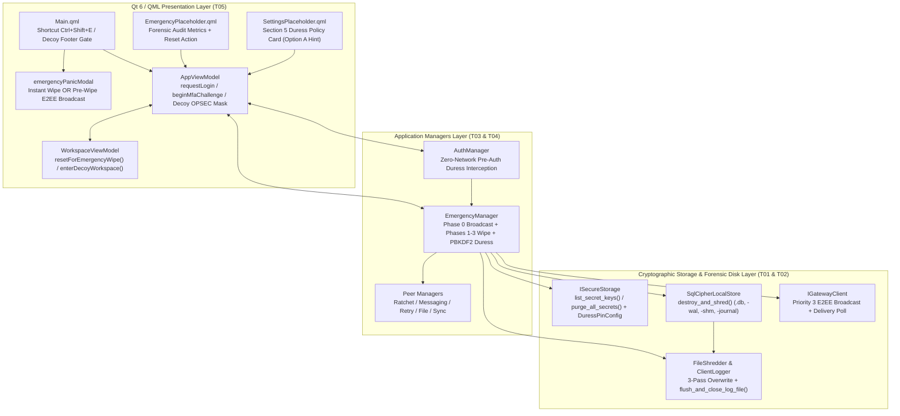
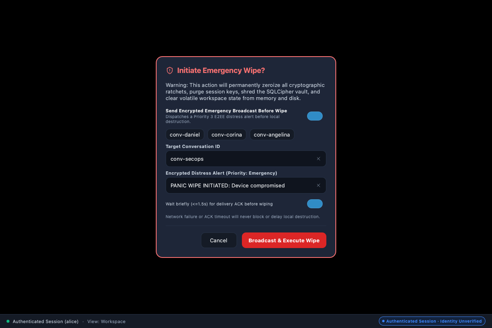
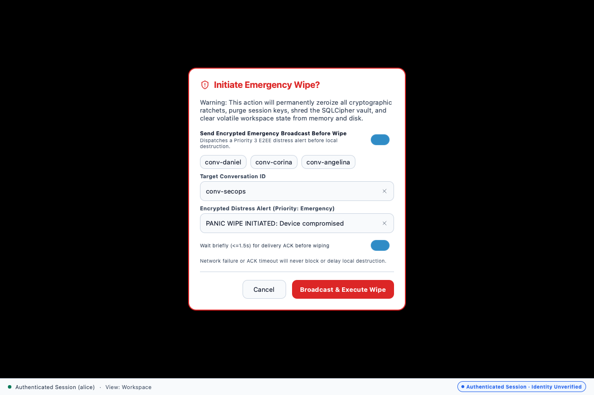
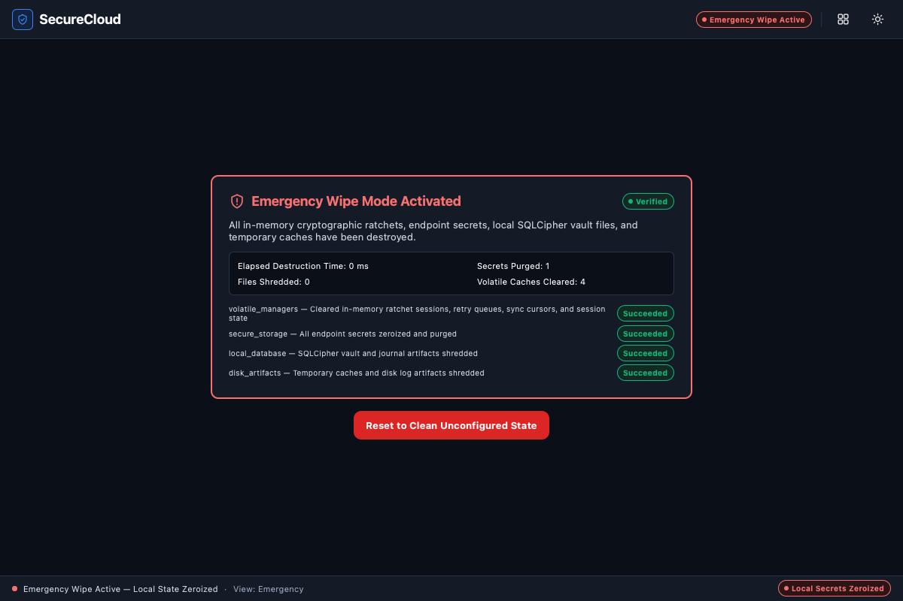
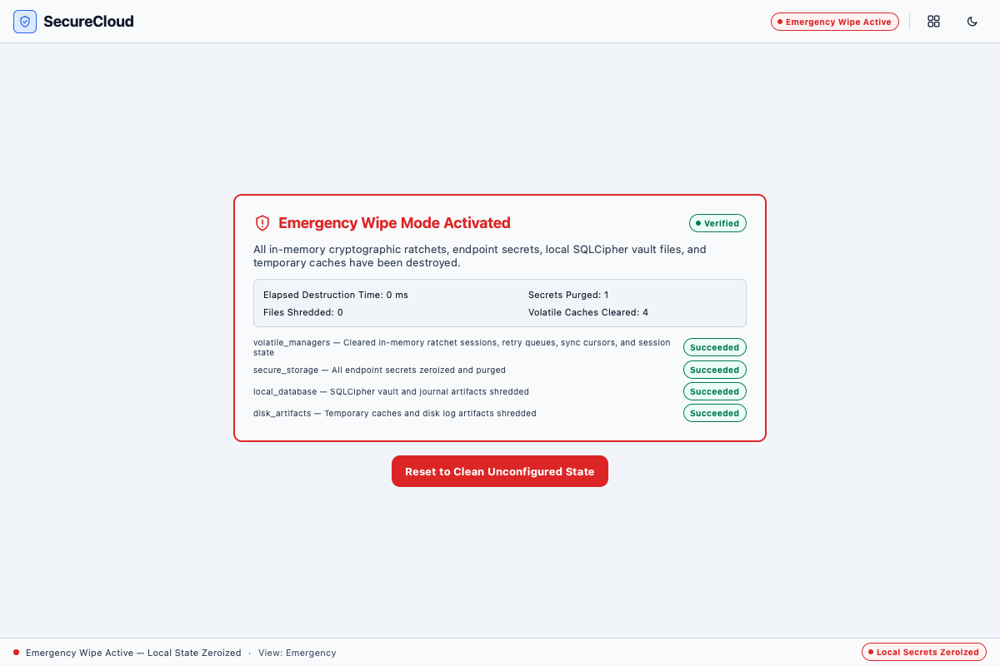
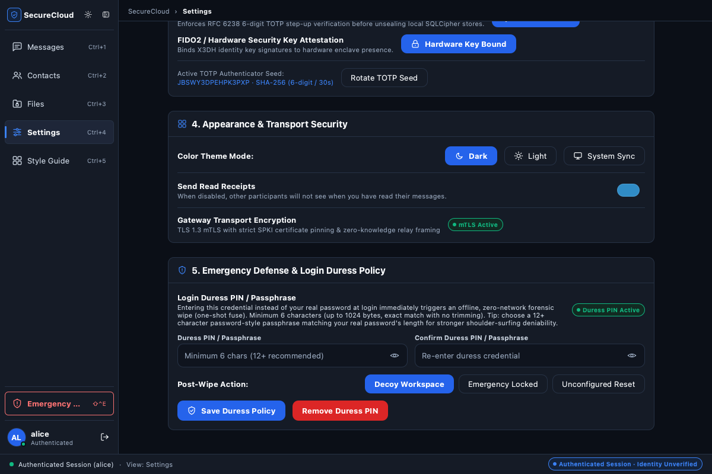
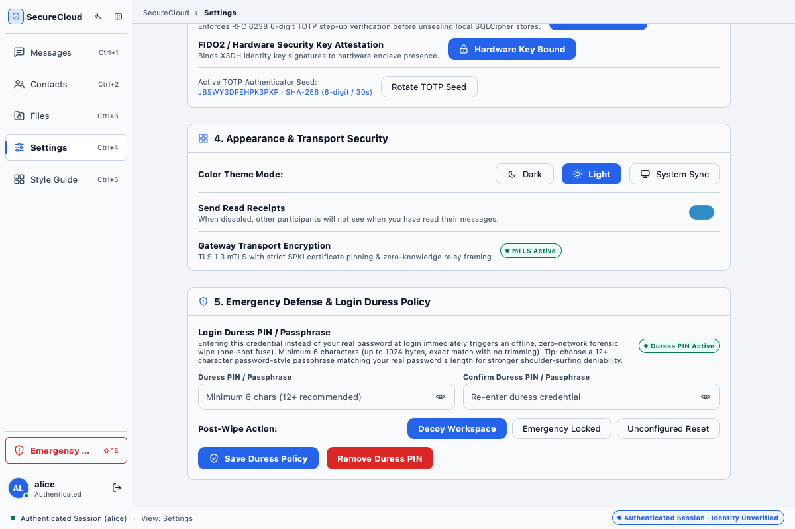

# CLIENT-013 Final Walkthrough Report: Emergency Panic Wipe, Pre-Wipe E2EE Broadcast & Login Duress Decoy Mode

**Card ID:** `CLIENT-013`  
**Phase:** Phase 4 — Desktop Client Hardening, Security Operations & Packaging  
**Branch:** `feature/client-013-emergency-panic-and-data-wipe`  
**Status:** **Completed (`CLIENT-013-T01` through `CLIENT-013-T06`)**  
**Date:** 2026-11-23  
**Verification Snapshot:** `382 / 382` unit, integration, and headless QML tests passing (`100` test suites, `2891 ms` total); `35 / 35` targeted Emergency / Shredder / Duress tests (`802 ms`); Tier 1 `--smoke-test` passed (`0` QML warnings); Tier 2 `--capture-screenshots` captured `32 / 32` desktop PNGs (`6` curated `CLIENT-013` captures visually verified under `docs/final-reports/assets/client-013/`, `0` QML warnings); `1060 / 1060` C++ files pass `check-format`; `0` compiler warnings under `-Wall -Wextra -Wpedantic -Werror -Wshadow -Wconversion`.

---

## 1. Executive Summary

`CLIENT-013` transforms the SecureCloud Desktop Client (`securecloud-client`) from a minimal in-memory stub that deleted two hardcoded keys into a **forensically hardened, sub-500 ms emergency defense subsystem** across domain, infrastructure, application manager, ViewModel, and QML presentation layers.

Across six incremental, verified tickets (`CLIENT-013-T01` through `CLIENT-013-T06`), we delivered:

1. **Emergency Panic Domain Models & Complete Purge Contracts (`T01`):** Strongly typed domain types (`PanicTriggerSource`, `PostWipeMode`, `WipeStepStatus`, `WipeArtifactResult`, strictly non-secret `EmergencyWipeReport`, `EmergencyBroadcastRequest`/`EmergencyBroadcastResult`, and `DuressPinConfig`), plus complete key enumeration/cleansing contracts (`ISecureStorage::list_secret_keys()`, `ISecureStorage::purge_all_secrets()`, and `ILocalStore::database_path()`).
2. **Forensic `FileShredder`, SQLCipher Vault Destruction & Log Closure (`T02`):** Streaming `64 KiB`-buffered 3-pass forensic file shredder (`0x00 -> 0xFF -> OpenSSL RAND_bytes`, OS buffer `fflush` + `fsync`/`_commit`, `resize_file(0)`, `remove`), `SqlCipherLocalStore::destroy_and_shred()` across `.db`, `-wal`, `-shm`, `-journal`, and `local_store.sqlcipher.master_key`, plus `ClientLogger::flush_and_close_log_file()` and duress log sanitization.
3. **3-Phase Destruction Pipeline & Pre-Wipe E2EE Broadcast (`T03`):** Deterministic `< 500 ms` 3-phase wipe pipeline in `EmergencyManager` clearing volatile state across all peer managers (`RatchetSessionManager`, `MessagingManager`, `DeliveryRetryEngine`, `FileManager`, `SyncManager`, `AuthManager`), purging every key namespace in `ISecureStorage`, shredding database/`.part`/log artifacts, and supporting optional Phase 0 `priority = 3` standard E2EE distress alerts with bounded ACK polling and offline fail-safe guarantees.
4. **Salted PBKDF2 Duress PIN & Silent Plausible Decoy Engine (`T04`):** Cryptographic login duress engine using `16`-byte OpenSSL `RAND_bytes` salt, `100,000`-iteration `PKCS5_PBKDF2_HMAC` (SHA-256), and constant-time `CRYPTO_memcmp` under **Option A** password-format parity (`6..1024` exact UTF-8 bytes, no whitespace trimming), wired into `AuthManager` prior to any network call to execute a one-shot offline wipe and silently enter an empty `DecoyWorkspace` (or `UnconfiguredReset`/`EmergencyLocked`).
5. **Reactive Qt/QML Panic Modal, Telemetry Screen, Settings Card & Decoy OPSEC (`T05`):** Extended `WorkspaceViewModel` (`resetForEmergencyWipe()`, `enterDecoyWorkspace()`) and `AppViewModel` (`triggerInstantPanicWipe`, `triggerBroadcastAndPanicWipe`, `configureDuressPin`, `clearDuressPin`, `resetClientAfterWipe`, non-secret `lastWipeReportSummary`, and Decoy OPSEC status masking); upgraded `Main.qml`, `EmergencyPlaceholder.qml`, and `SettingsPlaceholder.qml` with `0` QML warnings.
6. **End-to-End Integration Suite, Tier 1/2 Smoke Verification & Final Reports (`T06`):** Validated all layers together across 5 full-stack E2E scenarios (`emergency_panic_wipe_integration_test.cpp`), captured and visually verified Dark & Light real-binary desktop screenshots under `--capture-screenshots`, and authored this walkthrough and PR draft.

---

## 2. Ticket Completion Matrix

| Ticket | Title | Commit | Status | Primary Deliverables | Verification |
|---|---|---|---|---|---|
| **CLIENT-013-T01** | Emergency Panic Domain Models & Complete `ISecureStorage` / `ILocalStore` Purge Contracts | `d3bc097` | **Completed** | `emergency_models.{hpp,cpp}`, `i_secure_storage.hpp`, `memory_secure_storage.{hpp,cpp}`, `i_local_store.hpp`, `memory_local_store.{hpp,cpp}`, `sqlcipher_local_store.{hpp,cpp}`, `emergency_domain_and_storage_test.cpp` | `6 / 6` `EmergencyDomainAndStorageTest`, `358 / 358` total |
| **CLIENT-013-T02** | Forensic `FileShredder` Utility & SQLCipher/Cache/Log Artifact Destruction | `ffd9298` | **Completed** | `file_shredder.{hpp,cpp}`, `sqlcipher_local_store.{hpp,cpp}`, `client_logger.{hpp,cpp}`, `forensic_file_shredder_test.cpp` | `6 / 6` `ForensicFileShredderTest`, `364 / 364` total |
| **CLIENT-013-T03** | Production `EmergencyManager` Cryptographic Destruction Pipeline & Pre-Wipe E2EE Broadcast | `58167dd` | **Completed** | `emergency_manager.{hpp,cpp}`, wipe hooks in 6 peer managers, `client_bootstrap.cpp`, `emergency_wipe_pipeline_test.cpp` | `4 / 4` `EmergencyWipePipelineTest`, `368 / 368` total |
| **CLIENT-013-T04** | Login Duress PIN Verification & Silent Plausible Decoy Session Engine | `d833c84` | **Completed** | Duress engine in `emergency_manager.{hpp,cpp}`, silent login interception & decoy state in `auth_manager.{hpp,cpp}`, `client_bootstrap.cpp`, `duress_pin_and_decoy_test.cpp` | `5 / 5` `DuressPinAndDecoyTest`, `373 / 373` total |
| **CLIENT-013-T05** | `AppViewModel`, `WorkspaceViewModel` & QML Emergency Panic, Duress & Decoy UX | `a512f88` | **Completed** | `app_view_model.{hpp,cpp}`, `workspace_view_model.{hpp,cpp}`, `main.cpp`, `Main.qml`, `EmergencyPlaceholder.qml`, `SettingsPlaceholder.qml`, `workspace_view_model_emergency_test.cpp` | `4 / 4` `WorkspaceViewModelEmergencyTest`, `377 / 377` total, `--smoke-test` passed |
| **CLIENT-013-T06** | Emergency Panic & Forensic Wipe E2E Integration Suite, Tier 1/2 Smoke Tests & Walkthrough | Pending commit | **Completed** | `emergency_panic_wipe_integration_test.cpp`, `main.cpp` & `SettingsPlaceholder.qml` screenshot hooks, `assets/client-013/*.png`, `walkthrough-client-013.md`, `CLIENT-013.md` | `5 / 5` `EmergencyPanicWipeIntegrationTest`, `382 / 382` total, Tier 1 & Tier 2 (`32 / 32` PNGs), `check-format` |

---

## 3. Plain-Language Explanations & Key Security Decisions

This section consolidates every plain-language architectural explanation and design choice agreed upon during `CLIENT-013` design and implementation.

### 3.1 What `DuressPinConfig` Is and Why It Acts as a One-Shot Fuse

- **In simple terms:** `DuressPinConfig` is the workstation's encrypted trigger configuration for silent emergency self-destruction on the login screen. Think of it like a sealed security envelope stored inside the local vault (`ISecureStorage` under `"emergency.duress_pin_config"`). It never stores your actual duress password; instead, it stores a random 16-byte cryptographic salt, the iteration count (`100,000`), a one-way PBKDF2-HMAC-SHA256 hash derived from your duress secret, and which screen mode should appear afterward (`DecoyWorkspace`, `EmergencyLocked`, or `UnconfiguredReset`).
- **Why wiping `DuressPinConfig` means it cannot be used again next time (One-Shot Fuse):** When an attacker forces you to log in and you enter the Duress PIN, Phase 2 of the panic wipe calls `ISecureStorage::purge_all_secrets()`, which intentionally **destroys `DuressPinConfig` itself along with every cryptographic key and session token**. Leaving any hidden duress marker behind on a scrubbed computer would give a forensic examiner evidence that a duress mechanism existed. Because `DuressPinConfig` is destroyed on trigger, it behaves like a physical emergency fuse: it fires once to destroy everything cleanly, and afterwards entering that same string again behaves like a normal wrong password until you explicitly re-onboard and configure a new duress credential.

### 3.2 How `FileShredder` Works, Edge-Case Safety, and Solid-State Storage Defense-in-Depth

- **In simple terms:** Normally, deleting a file (`unlink`) only removes its directory label while leaving the underlying bytes on the drive until the OS reuses those blocks. `FileShredder` overwrites every byte of a target file in `64 KiB` streaming chunks across three passes (`0x00`, then `0xFF`, then cryptographic random bytes from OpenSSL `RAND_bytes`), flushes OS buffers to storage (`fflush` + `fsync`/`_commit`), shrinks the file to `0` bytes (`resize_file`), and only then deletes the filename.
- **Idempotent missing files (`ok(0)`) & directory guard (`Validation`):** If a panic wipe runs and a sidecar file (`vault.db-wal`, `vault.db-shm`, or an old `.part` file) was never created or was already removed, `FileShredder` treats the missing path as a clean no-op (`ok(0)` files overwritten) rather than aborting the rest of the emergency wipe. Conversely, if someone accidentally passes a folder path to single-file `shred_file(...)`, `FileShredder` explicitly rejects it with a `Validation` error instead of crashing or misbehaving.
- **Honest SSD wear-leveling / APFS Copy-on-Write defense-in-depth:** Modern SSDs use wear-leveling and copy-on-write filesystems (such as Apple APFS), where overwriting an existing file can be mapped by the SSD controller onto fresh flash blocks, potentially leaving old stale blocks temporarily intact in unallocated space. Because physical flash remapping sits below userspace C++, `CLIENT-013` pairs `FileShredder` multi-pass erasure with **cryptographic erasure ("crypto-shredding")**: `SqlCipherLocalStore::destroy_and_shred()` closes SQLite handles cleanly, shreds `.db`, `-wal`, `-shm`, and `-journal` artifacts, and **zeroizes/purges `local_store.sqlcipher.master_key` (`256,000`-iter SQLCipher key)** from `ISecureStorage`. Any residual flash blocks remain mathematically indistinguishable from random noise without the destroyed master key.

### 3.3 Disk Log Closure & Duress Secret Redaction (`ClientLogger`)

- **In simple terms:** If the application is writing diagnostic logs to disk while running, the OS holds an open file handle to `client.log`, and deleting an open file while buffered lines are still waiting in memory can leave readable trace fragments or keep inode references alive. During Phase 3 of a panic wipe, `EmergencyManager` calls `ClientLogger::flush_and_close_log_file()` first so the logger flushes, closes its file descriptor cleanly, and returns the log file path directly to `FileShredder` for 3-pass destruction.
- **Zero-secret logging at all times (`ADR-008 §28`):** `ClientLogger::sanitize(...)` automatically scrubs sensitive field names including `duress_pin`, `salt_hex`, `derived_hash_hex`, tokens, and keys (replacing them with `[REDACTED]`), and `EmergencyWipeReport` stores strictly non-secret metadata (counts, status badges, elapsed milliseconds — never secrets, file contents, or user messages).

### 3.4 Phase 0 Pre-Wipe E2EE Emergency Broadcast User Flow & Fail-Safe Network Resilience

- **How it works for the user:**
  - **Path A — Planned / Conscious Emergency (Panic Button or `Ctrl+Shift+E` / `Cmd+Shift+E`):** Opens the confirmation modal (`Main.qml`, `emergencyPanicModal`). Clicking **"Execute Instant Wipe"** skips Phase 0 and runs Phases 1–3 local destruction immediately. Alternatively, checking **"Send Encrypted Emergency Broadcast Before Wipe"** lets the operator pick a trusted recipient/team conversation (`broadcastConversationId`), customize an optional distress alert (`PANIC WIPE INITIATED: Device compromised`) and optional ACK toggle, and click **"Broadcast & Execute Wipe"**. That message is encrypted end-to-end using the recipient's normal Signal Double Ratchet / Sender Key session at `priority = 3` (`Emergency`) — **zero** server backdoors or plaintext escrow keys exist (`ADR-008 §22`).
  - **Path B — Coerced at Gunpoint (Login Duress PIN):** Entering the Duress PIN into the standard login password field (or clicking the MFA sign-in button with the Duress PIN) **skips Phase 0 completely** (`0` network packets sent) so an adversary monitoring local network traffic sees nothing suspicious while the device wipes silently into a clean Decoy Workspace (or reset screen).
- **What happens if the network is slow, packet-lossy, or completely offline:**
  - Phase 0 uses a **strictly bounded** wait (`request.ack_timeout`, defaulting to `1500 ms`) and checks `gateway_->probe` / submission non-fatally inside `attempt_pre_wipe_broadcast(...)`.
  - If the workstation is offline, Gateway fails, or the peer/server never acknowledges within `ack_timeout`, `EmergencyManager` records a `Skipped` / non-acknowledged status on `pre_wipe_broadcast` and **unconditionally proceeds at once to Phases 1–3 local cryptographic destruction**. A dead, jammed, or hostile network can **never** block or stall wiping local keys and data.

### 3.5 Option A Duress PIN Password-Format Parity

- **Why Option A (`6..1024` exact raw UTF-8 bytes, no trimming) was chosen:** Real SecureCloud logins use a single masked password box backed by `PasswordCredential::kMaxLength = 1024` bytes (no whitespace trimming, arbitrary printable UTF-8 bytes). Enforcing Option A on Duress PINs means `configure_duress_pin` and `verify_duress_credential` match `PasswordCredential` byte-for-byte with `1024`-byte ceiling parity while keeping a `6`-character floor: operators under pressure can choose either a short 6-character code **or** a realistic `12+`-character password-style passphrase (`Autumn-Backup-42!`) whose dot count matches a real password to resist shoulder-surfing observation. Section 5 of `SettingsPlaceholder.qml` surfaces this explicit guidance right beside the input boxes.

---

## 4. End-to-End Architecture & Destruction Sequence Diagrams

### 4.1 Component Architecture Diagram

### 4.2 Panic & Duress Destruction Sequence

```mermaid
sequenceDiagram
    participant Op as Operator / User
    participant QML as Main.qml / LoginPlaceholder.qml
    participant AVM as AppViewModel
    participant AM as AuthManager
    participant EM as EmergencyManager
    participant GW as IGatewayClient (Optional)
    participant SEC as ISecureStorage & RAM
    participant DISK as SqlCipher & FileShredder

    alt Coerced Login (Duress PIN Path — 0 Network Calls)
        Op->>QML: Enters Duress PIN in Password field
        QML->>AVM: requestLogin(user, candidate)
        AVM->>AM: authenticate_with_duress_check(user, candidate)
        AM->>EM: check_and_execute_duress_login(candidate)
        EM->>EM: PBKDF2-HMAC-SHA256 + CRYPTO_memcmp match
    else Panic Trigger (Modal / Hotkey)
        Op->>QML: Confirms Wipe (Instant or Pre-Wipe Broadcast)
        QML->>AVM: triggerBroadcastAndPanicWipe / triggerInstantPanicWipe
        AVM->>EM: execute_broadcast_and_wipe / execute_panic_wipe
        opt Pre-Wipe Broadcast Selected
            EM->>GW: Priority 3 E2EE Alert + Bounded Poll (ack_timeout)
            Note over EM,GW: Offline or timeout skips ACK without blocking wipe
        end
    end

    rect rgb(40, 20, 25)
        Note over EM,DISK: Unconditional Phases 1-3 Destruction (< 500 ms budget)
        EM->>SEC: Phase 1 - Wipe peer managers, ratchets, retries, cursors, auth
        EM->>SEC: Phase 2 - purge_all_secrets() (incl. DuressPinConfig fuse + SQLCipher key)
        EM->>DISK: Phase 3 - destroy_and_shred() .db/-wal/-shm + flush_and_close_log_file + 3-pass .part/.log shred
    end

    alt PostWipeMode::DecoyWorkspace
        EM-->>AVM: Non-secret WipeReport (Trigger=DuressPin)
        AVM->>QML: enterDecoyWorkspace() + OPSEC mask (Normal chrome, 0 leaked data)
    else PostWipeMode::EmergencyLocked
        EM-->>AVM: Non-secret WipeReport
        AVM->>QML: EmergencyMode -> EmergencyPlaceholder telemetry card
    end
```

---

## 5. Visual Verification Gallery (Real `securecloud-client` Binary, Dark & Light)

All `6` new `CLIENT-013` states were captured by `securecloud-client --capture-screenshots`, visually inspected for layout, contrast, button alignment, and zero clipping/overlap, and archived under [`docs/final-reports/assets/client-013/`](file:///Users/sergeychukhno/Desktop/C:C++/SecureCloud/docs/final-reports/assets/client-013).

| State | Dark Mode (`1200x800`) | Light Mode (`1200x800`) |
|---|---|---|
| **Upgraded Panic Modal (Pre-Wipe E2EE Broadcast)** |  |  |
| **Post-Wipe Forensic Telemetry Card (`EmergencyPlaceholder.qml`)** |  |  |
| **Settings Section 5: Login Duress Policy (Option A Hint)** |  |  |

---

## 6. Verification Output Summary

All checks below ran cleanly **after the final code and QML edits** on branch `feature/client-013-emergency-panic-and-data-wipe`:

- **Build (`-Wall -Wextra -Wpedantic -Werror -Wshadow -Wconversion`):**
  `cmake --build build/dev-debug --target securecloud_client_foundation_test securecloud-client --parallel` -> **`0` warnings / `0` errors**.
- **5-Scenario E2E Integration Suite (`--gtest_filter="*EmergencyPanicWipeIntegration*"`):** **`5 / 5` passed** (`454 ms` cold / `165 ms` warm):
  - `Scenario1_Sub500MsForensicWipeAcrossActiveVaultRatchetsFilesAndLogs` (`33 ms` / `15 ms`)
  - `Scenario2_PreWipeE2eeEmergencyBroadcastWithLocationAckAndOfflineFailSafe` (`12 ms` / `13 ms`)
  - `Scenario3_LoginDuressPinSilentWipeToPlausibleDecoyWorkspace` (`20 ms` / `21 ms`)
  - `Scenario4_CleanUnconfiguredResetAndFreshReOnboardingAfterPanicWipe` (`6 ms` / `8 ms`)
  - `Scenario5_HeadlessQmlPanicModalTelemetryCardAndDecoyLifecycle` (`381 ms` / `107 ms`)
- **All `CLIENT-013` Targeted Suites (`--gtest_filter="*Emergency*:*FileShredder*:*Duress*"`):** **`35 / 35` tests passed** across **`11` test suites** (`802 ms` total).
- **Full Desktop Client Test Suite (`--gtest_brief=1`):** **`382 / 382` tests passed** across **`100` test suites** (`2891 ms` total).
- **Tier 1 Real-Binary Smoke (`./build/dev-debug/src/client/securecloud-client --smoke-test`):** exited `0` (`Smoke test execution passed cleanly (QML engine loaded)`, `0` QML warnings).
- **Tier 2 Visual Capture (`./build/dev-debug/src/client/securecloud-client --capture-screenshots /tmp/sc-client013-shots`):** exited `0`, captured **`32 / 32` PNG screenshots** (`0` QML warnings).
- **Formatting Compliance (`cmake --build build/dev-debug --target check-format`):** **`[SecureCloud] All 1060 C++ files adhere to .clang-format.`**

---

*Verified `CLIENT-013` Final Walkthrough Report — All 6 Tickets (`T01`–`T06`) Complete.*
