# CLIENT-014 Final Walkthrough Report: Settings, User Profile Management, Accessibility & Live TLS 1.3 Gateway Transport

**Card ID:** `CLIENT-014`  
**Phase:** Phase 4 — Desktop Client Hardening, Security Operations & Packaging  
**Target Branch:** `feature/client-014-settings-and-user-profile`  
**Status:** **Completed (`CLIENT-014-T01` through `CLIENT-014-T07`)**  
**Date:** 2026-11-24  
**Author:** Sergey  
**Verification Snapshot:** `428 / 428` tests passing across `109` test suites (`3620 ms`); `50 / 50` targeted `CLIENT-014` tests across `9` test suites (`978 ms`); `6 / 6` full-stack `SettingsAndProfileIntegrationTest` scenarios (`556 ms`); Tier 1 `--smoke-test` passed (`0` QML warnings); Tier 2 `--capture-screenshots` captured `40 / 40` desktop PNGs (`8` curated `CLIENT-014` captures visually verified under `docs/final-reports/assets/client-014/`, `0` QML warnings); `1119 / 1119` C++ files pass `check-format`; `0` compiler warnings under `-Wall -Wextra -Wpedantic -Werror -Wshadow -Wconversion -Wunused -Woverloaded-virtual`.

---

## Table of Contents

1. [Executive Summary](#1-executive-summary)
2. [Ticket Completion Matrix (`CLIENT-014-T01` – `CLIENT-014-T07`)](#2-ticket-completion-matrix-client-014-t01--client-014-t07)
3. [Architectural Decisions & Security Rationale (Mandatory Reference)](#3-architectural-decisions--security-rationale-mandatory-reference)
4. [End-to-End Architecture & Security Sequences](#4-end-to-end-architecture--security-sequences)
5. [Ticket-by-Ticket Technical Walkthrough (`T01` – `T07`)](#5-ticket-by-ticket-technical-walkthrough-t01--t07)
6. [Real-Client Visual Verification Gallery (Tier 1 & Tier 2)](#6-real-client-visual-verification-gallery-tier-1--tier-2)
7. [Security Threat Model & ADR Compliance Matrix](#7-security-threat-model--adr-compliance-matrix)
8. [Complete `CLIENT-014` Unit & Integration Test Catalog (`50` Tests Across `9` Suites)](#8-complete-client-014-unit--integration-test-catalog-50-tests-across-9-suites)
9. [Complete Branch File Inventory (`58` Files Changed Across `T01`–`T07`)](#9-complete-branch-file-inventory-t01t07)
10. [Verbatim Verification Outputs & Reproducible Commands](#10-verbatim-verification-outputs--reproducible-commands)
11. [Phase 4 Boundaries & Handoff to `CLIENT-015` / `CLIENT-016`](#11-phase-4-boundaries--handoff-to-client-015--client-016)
12. [Appendix A: Encrypted Wire & Storage Schema Reference (`UserProfile`, `UserSettings` & SQLCipher DDL)](#12-appendix-a-encrypted-wire--storage-schema-reference-userprofile-usersettings--sqlcipher-ddl)
13. [Appendix B: Endpoint-Only BIP-39 Mathematics & `ClientConfig` Environment Matrix](#13-appendix-b-endpoint-only-bip-39-mathematics--clientconfig-environment-matrix)
14. [Appendix C: Live TLS 1.3 `QtHttpGatewayClient` & `SwitchableGatewayClient` Engineering Reference](#14-appendix-c-live-tls-13-qthttpgatewayclient--switchablegatewayclient-engineering-reference)
15. [Appendix D: `UiTheme` Design System Tokens, `WorkspaceViewModel` API & QML Hook Registry](#15-appendix-d-uitheme-design-system-tokens-workspaceviewmodel-api--qml-hook-registry)
16. [Appendix E: Windows Qt 6.8 Remediation Comparison & Committed Diff Statistics](#16-appendix-e-windows-qt-68-remediation-comparison--committed-diff-statistics)
17. [Appendix F: `SqlCipherLocalStore` Complete 8-Table Schema, `IGatewayClient` Extensions & `MessagingManager` Expiry API](#17-appendix-f-sqlcipherlocalstore-complete-8-table-schema-igatewayclient-extensions--messagingmanager-expiry-api)
18. [Appendix G: Final Pre-Merge Readiness Gate & Artifact Checklist](#18-appendix-g-final-pre-merge-readiness-gate--artifact-checklist)

---

## 1. Executive Summary

`CLIENT-014` transforms the SecureCloud Desktop Client (`securecloud-client`) from a static single-session prototype with non-persistent QML toggles and an in-memory HTTP simulator into a **durably encrypted workstation settings, profile, accessibility, disappearing-message, endpoint-only recovery, and live TLS 1.3 Gateway transport subsystem**.

Before `CLIENT-014`, MFA policy switches (`mfaRequiredOnLogin`, `hardwareKeyEnforced`), theme selections (`ThemeMode`), proxy configuration, and profile identity metadata were either missing or volatile in process memory; font typography sizes were fixed `CONSTANT` integers; there was no mechanism to inspect or pin a Gateway certificate's public key (`SPKI SHA-256`); messages persisted indefinitely; there was no local BIP-39 cryptographic recovery backup flow; and all `IGatewayClient` calls ran only against the offline `DefaultGatewayClient` simulator. Meanwhile, Qt 6.8 on Windows selected native `Windows` / `FluentWinUI3` control styling that rejected `background` and `contentItem` overrides inside QML views and broke headless QML checks.

Across seven verified, incrementally committed tickets (`CLIENT-014-T01` through `CLIENT-014-T07`), `CLIENT-014` closes every one of these gaps across all architectural layers:

1. **Typed Domain Models & Live/Profile/TLS Gateway Contracts (`T01`, `6c3f5a6`):** Introduced `UserProfile`, `UserSettings`, `ProxyConfig` (deliberately omitting `has_password`), `TlsPinConfig`, `DisappearingTimerPreset` (`Off` / `1h` / `24h` / `7d`), `ProfileSyncStatus`, and `TlsCertificateInfo`; extended `ClientConfig` with proxy/SPKI-pin/live-transport configuration and env overrides; and extended `IGatewayClient`, `DefaultGatewayClient`, and all `7` existing mock adapters (`391 / 391`).
2. **Encrypted SQLCipher Tables & Auto-Expiry Schema Migration (`T02`, `41bed45`):** Added `user_profile` and `user_settings` encrypted tables inside `SqlCipherLocalStore` and `MemoryLocalStore`; extended `Conversation` (`disappearing_ttl_seconds`) and `Message` (`expires_at_ms`) with legacy JSON compatibility; implemented idempotent `PRAGMA table_info(messages)` migration + partial index `idx_messages_expires_at`; enforced read-path expiry filtering; and implemented `delete_expired_messages(now_ms)` (`395 / 395`).
3. **Endpoint-Only BIP-39 Cryptographic Recovery Phrase Engine (`T03`, `0f1ea15`):** Embedded the canonical English 2048-word BIP-39 wordlist (`bip39_wordlist.hpp`, binary-searchable lexicographical array verified against canonical SHA-256) and built `RecoveryPhraseEngine` inside `securecloud_client_domain` with **12-word (`Words12`, 128-bit) default** and **24-word (`Words24`, 256-bit) option**, OpenSSL CSPRNG + SHA-256 checksum validation, 3-word confirmation challenges, salted `100,000`-iteration PBKDF2-HMAC-SHA256 local verifier digests, `2048`-iteration PBKDF2-HMAC-SHA512 64-byte recovery seed derivation, `OPENSSL_cleanse` RAM guards, and **zero** network or storage dependencies (`401 / 401`).
4. **Production `SettingsManager`, E2EE Avatar Pipeline & Auto-Expiry/Wipe Coordination (`T04`, `3243ba7`):** Implemented `SettingsManager` wired into `ClientBootstrap`, persisting proxy secrets (`"network.proxy.password"`) and BIP-39 verifiers (`"recovery.phrase.verifier"`) exclusively in `ISecureStorage`, uploading `.png`/`.jpg`/`.webp` (`<= 5 MiB`) encrypted avatars via `FileManager` (`is_profile_asset = true`, `dispatch_key_envelope = false`), degrading cleanly via `ProfileSyncStatus` when servers lack profile mutation support, firing live `NetworkConfigReloadCallback` hooks, enforcing `MessagingManager::purge_expired_messages()`, and clearing volatile caches during Phase 1 of `EmergencyManager` panic wipes (`408 / 408`).
5. **Production Live TLS 1.3 `QtHttpGatewayClient` & `SwitchableGatewayClient` (`T05`, `5aa8897`):** Implemented `QtHttpGatewayClient` over `Qt6::Network` using a PIMPL lazy dedicated worker `QThread`, `QSsl::TlsV1_3OrLater`, custom CA loading, pre-flight OpenSSL `X509_get_X509_PUBKEY` + `i2d_X509_PUBKEY` + constant-time `CRYPTO_memcmp` two-stage SPKI SHA-256 pinning (aborting before sending Bearer headers or payloads), HTTP/SOCKS5 `QNetworkProxy` routing with `ISecureStorage` credentials, connect/request deadlines, bounded response sizes (`4 MiB` JSON / `32 MiB` binary), live TLS inspection (`inspect_tls_certificate`), and 1:1 mapping across all Gateway REST routes — paired with `SwitchableGatewayClient` zero-restart runtime hot-reloading and real localhost loopback TLS 1.3 verification (`414 / 414`).
6. **`UiTheme` Accessibility Engine, `WorkspaceViewModel` Persistence & 7-Card `SettingsPlaceholder.qml` (`T06`, `df08dff`):** Added clamped `[0.85, 1.40]` dynamic `fontScale` and WCAG AAA (`>= 7:1`) High-Contrast Dark & Light palettes to `UiTheme`, injected `&uiTheme` into `WorkspaceViewModel` from `main.cpp`, replaced volatile MFA/theme/profile states with durable `SettingsManager`/`MessagingManager` persistence, overhauled `SettingsPlaceholder.qml` into 7 structured cards + `recoveryPhraseModal` while preserving every `CLIENT-007`/`CLIENT-010`/`CLIENT-013` hook and clearly separating offline BIP-39 recovery UX from Auth MFA backup codes (`422 / 422`).
7. **Full-Stack 6-Scenario E2E Suite, Windows Qt 6.8 `Basic` Style Fix & Visual Captures (`T07`):** Delivered `settings_and_profile_integration_test.cpp` (`6 / 6`), fixed Windows Qt 6.8 native style customization warnings across all 14 QML files and test binaries using `QQuickStyle::setStyle("Basic")` + `:/qtquickcontrols2.conf`, captured and visually verified `8` curated `CLIENT-014` desktop PNGs under `--capture-screenshots` (`40 / 40` total renders, `0` QML warnings), verified `428 / 428` passing client tests across `109` suites, and documented everything in this report.

---

## 2. Ticket Completion Matrix (`CLIENT-014-T01` – `CLIENT-014-T07`)

| Ticket | Title | Commit SHA | Status | Primary Deliverables | Verification Evidence |
|---|---|---|---|---|---|
| **CLIENT-014-T01** | User Profile, Settings, Proxy/TLS Pin & Expiry Domain Models + `IGatewayClient` Contracts | `6c3f5a6` | **Completed** | `user_profile.{hpp,cpp}`, `user_settings.{hpp,cpp}`, `client_config.{hpp,cpp}`, `i_gateway_client.hpp`, `default_gateway_client.{hpp,cpp}`, `file_manager.hpp`, 7 test doubles, `user_settings_and_profile_domain_test.cpp` | `9` tests (`UserSettingsAndProfileDomainTest`, `ClientConfigNetworkTest`, `DefaultGatewayProfileAndTlsTest`), `391 / 391` suite green |
| **CLIENT-014-T02** | Encrypted `user_settings` & `user_profile` Persistence + Disappearing Message Schema | `41bed45` | **Completed** | `conversation.{hpp,cpp}`, `message.{hpp,cpp}`, `i_local_store.hpp`, `memory_local_store.{hpp,cpp}`, `sqlcipher_local_store.{hpp,cpp}`, `settings_and_expiry_persistence_test.cpp` | `4` persistence/migration/sweep tests (`SettingsAndExpiryPersistenceTest`), `395 / 395` suite green |
| **CLIENT-014-T03** | Endpoint-Only BIP-39 Cryptographic Recovery Phrase Engine | `0f1ea15` | **Completed** | `bip39_wordlist.hpp`, `recovery_phrase_engine.{hpp,cpp}`, `recovery_phrase_engine_test.cpp` | `6` BIP-39 & official test vector suites (`RecoveryPhraseEngineTest`), `401 / 401` suite green |
| **CLIENT-014-T04** | Production `SettingsManager`, E2EE Avatar Upload, Auto-Expiry & Panic-Wipe Wiring | `3243ba7` | **Completed** | `settings_manager.{hpp,cpp}`, `messaging_manager.{hpp,cpp}`, `file_manager.{hpp,cpp}`, `emergency_manager.{hpp,cpp}`, `client_bootstrap.{hpp,cpp}`, `settings_manager_pipeline_test.cpp` | `7` manager/storage/wipe tests (`SettingsManagerPipelineTest`), `408 / 408` suite green |
| **CLIENT-014-T05** | Production Live TLS 1.3 `QtHttpGatewayClient` & `SwitchableGatewayClient` Hot-Reload | `5aa8897` | **Completed** | `qt_http_gateway_client.{hpp,cpp}`, `switchable_gateway_client.{hpp,cpp}`, `client_bootstrap.{hpp,cpp}`, `qt_http_gateway_client_test.cpp` | `6` loopback TLS 1.3, SPKI pin & thread-safety tests (`QtHttpGatewayClientTest`), `414 / 414` suite green |
| **CLIENT-014-T06** | `UiTheme` Dynamic Font Scaling & WCAG AAA High-Contrast + `SettingsPlaceholder.qml` | `df08dff` | **Completed** | `ui_theme.{hpp,cpp}`, `workspace_view_model.{hpp,cpp}`, `main.cpp`, `SettingsPlaceholder.qml`, `ui_theme_test.cpp`, `workspace_view_model_settings_test.cpp` | `9` `UiThemeTest` + `6` `WorkspaceViewModelSettingsTest` (incl. headless QML), `422 / 422` suite green |
| **CLIENT-014-T07** | 6-Scenario E2E Integration Suite, Windows Qt 6.8 `Basic` Fix, Tier 1/2 Smoke & Walkthrough | Pending commit | **Completed** | `settings_and_profile_integration_test.cpp`, `qtquickcontrols2.conf`, `qml.qrc`, `main.cpp`, `client_foundation_test.cpp`, `SettingsPlaceholder.qml`, `assets/client-014/*.png`, `walkthrough-client-014.md`, `CLIENT-014.md` | `6 / 6` E2E (`556 ms`), `50 / 50` targeted (`978 ms`), `428 / 428` total (`3620 ms`), `40 / 40` PNGs (`0` QML warnings), `1119 / 1119` `check-format` |

---

## 3. Architectural Decisions & Security Rationale (Mandatory Reference)

Every major design boundary in `CLIENT-014` was reviewed and locked explicitly with the project owner prior to implementation. This section documents both the security guarantees and the practical engineering rationale behind all seven decisions.

### 3.1 `domain::User` vs. `domain::UserProfile` vs. `domain::UserSettings` Ownership & Backend Separation

| Entity | Lifecycle & Scope | Backing Store(s) | Network Exposure |
|---|---|---|---|
| `domain::User` | Immutable account/device identity aggregate (`UserId`, registered `Device`s, `created_at`) introduced in `CLIENT-001`. | Auth database / domain foundation structs. | Account & device directory identity (`AuthService`). |
| `domain::UserProfile` | Editable human social identity (`display_name`, `public_handle`, `bio_status`, `avatar_file_id`, `avatar_sha256`, `allow_handle_discovery`). | Encrypted SQLCipher table `user_profile`; binary avatar payload stored as opaque ciphertext in Files Service. | Hydrated on startup/refresh via `GET /api/v1/users/me`; optional public-handle discovery sync gated by `allow_handle_discovery`. |
| `domain::UserSettings` | Strictly **endpoint-local** workstation configuration (theme, font scale, high contrast, read receipts, default disappearing TTL, MFA/hardware toggles, proxy config, TLS SPKI pin, local BIP-39 verified flag). | Encrypted SQLCipher table `user_settings`; sensitive credentials excluded and held separately in `ISecureStorage`. | **Never transmitted** to any backend microservice or peer (`ADR-008`). |

Splitting `User`, `UserProfile`, and `UserSettings` guarantees that legacy `CLIENT-001` tests stay 100% backward compatible, editable social identity metadata does not leak into anonymous transport/audit tables (`Messaging`, `Files`, and `Audit` operate solely on opaque `UUID`s per `ADR-008 §7`), and endpoint-local security posture cannot be coerced or observed by a remote relay.

### 3.2 Mandatory Distinction — Client Cryptographic Recovery Phrases (BIP-39) vs. Backend MFA Recovery Codes (`AuthService`)

Operators frequently conflate **account login 2FA backup codes** with **endpoint cryptographic recovery phrases**, even though they protect completely unrelated trust boundaries:

- **Backend MFA Recovery Codes (`AuthService` / `auth.proto`):**
  - Generated on the **Auth Server** (`src/auth/crypto/recovery_code_generator.hpp`), returned upon `ConfirmMfaEnrollment`, hashed with `SHA-256`, and stored inside the server's PostgreSQL database.
  - Their sole purpose is helping the user pass server authentication if they lose their TOTP authenticator app. Even if you use an Auth MFA recovery code to log into your account on a wiped laptop, **the server has zero access to your E2EE private keys or local vault history** (`ADR-008`).
- **Client Cryptographic Recovery Phrase (`CLIENT-014` BIP-39 Engine):**
  - Generated **strictly offline inside the client endpoint** (`domain::crypto::RecoveryPhraseEngine`) from 128-bit or 256-bit OpenSSL CSPRNG entropy mapped onto the canonical 2048-word English BIP-39 dictionary (`bip39_wordlist.hpp`), with SHA-256 integrity checksum bits.
  - **12-Word Default + 24-Word Option:** `RecoveryPhraseLength::Words12` (128-bit security) is the default in both `RecoveryPhraseEngine` and Settings Card 7 so human operators can accurately hand-write and spot-check backups without transcription fatigue, while `RecoveryPhraseLength::Words24` (256-bit security) is selectable right alongside it for maximum-security deployments.
  - Derives a deterministic **64-byte master recovery seed** locally via `PBKDF2-HMAC-SHA512` (`2048` iterations, optional passphrase salt `"mnemonic" + passphrase`) for local identity/key disaster recovery (`ADR-008 §27, §28`).
  - **Zero Network Transmission:** Mnemonic words, entropy bytes, and recovery seeds **never** cross Gateway (`0` HTTP requests verified in `SettingsManagerPipelineTest` and `SettingsAndProfileIntegrationTest::Scenario5`), are **never** written in plaintext SQLite, and are **never** logged. Only a non-reversible salted `100,000`-iteration `PBKDF2-HMAC-SHA256` verification digest (`sc-bip39-v1:...`) is kept under `"recovery.phrase.verifier"` in `ISecureStorage` so the user can later verify a written paper backup offline.
  - **Explicit UI Labeling:** Card 7 and its modal in [`SettingsPlaceholder.qml`](../../src/client/ui/qml/SettingsPlaceholder.qml) explicitly title the control **"7. Cryptographic Identity Recovery Phrase (Local / Offline BIP-39)"**, state *"Separate from Auth MFA Backup Codes"*, and display a high-visibility warning banner: *"Never transmitted to servers"*.

### 3.3 Dropping `has_password` from `ProxyConfig` & Exact Role of `"network.proxy.password"`

- **What `"network.proxy.password"` actually is:** It is **strictly the optional authentication credential for an external corporate firewall or field-operations HTTP / SOCKS5 proxy server**. It is **NOT** the user's SecureCloud login password and **NOT** the SQLCipher database encryption key.
- Only `QtHttpGatewayClient` (`T05`) reads `"network.proxy.password"` (via `ClientConfig::proxy_password` hydrated from `ISecureStorage` inside `SettingsManager`) to configure `QNetworkProxy::setPassword(...)` when opening an authenticated proxy tunnel before initiating TLS 1.3 to the Gateway. The SecureCloud Gateway never receives or inspects it. When `ProxyType::None` is active or no password is needed, this key does not even exist in `ISecureStorage`.
- **Why `bool has_password` was deliberately omitted from `ProxyConfig` (`user_settings`):** Storing `has_password = true/false` inside JSON in SQLCipher would duplicate credential-presence state owned by `ISecureStorage`. If an `EmergencyManager` panic wipe or manual clear removed `"network.proxy.password"` from OS Keychain / `ISecureStorage` while `user_settings` still cached `has_password: true` (or vice versa), the UI would lie. Instead, `SettingsManager::has_saved_proxy_password()` and `WorkspaceViewModel::hasProxyPassword()` query `ISecureStorage::has_secret("network.proxy.password")` live as the single source of truth.

### 3.4 TLS `SPKI SHA-256` Certificate Pinning & Disappearing Message Defaults (`Off` / `1h` / `24h` / `7d`)

- **What `SPKI SHA-256` Is:** Every X.509 certificate contains both volatile metadata (serial number, CA issuer signature, validity window `notBefore`/`notAfter`) and the server's **Subject Public Key Info (`SPKI`)** (key algorithm OID + DER-encoded public key bytes). `SPKI SHA-256` is the 64-character lowercase hexadecimal `SHA256(DER(SPKI))` digest extracted directly via OpenSSL `X509_get_X509_PUBKEY()` + `i2d_X509_PUBKEY()`.
- **Why Pin SPKI SHA-256 Beyond Normal HTTPS:** Standard HTTPS trusts roughly 150+ operating-system root Certificate Authorities. If a corporate HTTPS inspection gateway, compromised CA, or rogue local root cert signs an impostor certificate for the Gateway domain, standard TLS validation succeeds and leaks the user's `Authorization: Bearer` header. Pinning the Gateway's `SPKI SHA-256` adds a strict cryptographic lock:
  - `QtHttpGatewayClient` validates SPKI in **two places**: (a) a pre-flight handshake hook using OpenSSL DER extraction + constant-time `CRYPTO_memcmp`, and (b) post-reply verification before reading payloads, aborting immediately on mismatch **prior** to sending any `Authorization: Bearer` header or encrypted payload.
  - Because `SPKI` hashes only the public key rather than the full certificate bytes, routine certificate renewals that keep the same server keypair continue connecting cleanly without invalidating operator pins, while key rotation triggers an immediate fail-closed alert (`SPKI Pin Mismatch`).
- **Disappearing Message Defaults (`Off` / `1h` / `24h` / `7d`):** Operators can set a workstation-wide `default_disappearing_timer` (`0`, `3600`, `86400`, `604800` seconds) in `UserSettings` plus per-conversation overrides on `Conversation::disappearing_ttl_seconds`. Outbound and inbound messages stamp `expires_at_ms = sent_at_ms + ttl * 1000` locally in SQLCipher; `get_messages()` filters expired records out immediately at read time (`WHERE expires_at_ms = 0 OR expires_at_ms > ?`), and `MessagingManager::purge_expired_messages(now_ms)` permanently removes expired ciphertexts and updates `WorkspaceViewModel::activeMessages()`.

### 3.5 Deferral of Backend `UpdateUserProfile` RPC (`ProfileSyncStatus`)

Because `CLIENT-014` is scoped cleanly to `src/client/`, the backend `AuthService` (`proto/securecloud/auth/v1/auth.proto`) currently provides `GetUser` (`GET /api/v1/users/me` returning `user_id` and `credential_identifier`) without an `UpdateUserProfile` RPC or PostgreSQL profile columns. Rather than rejecting user profile edits or mocking fake network success, `IGatewayClient::update_user_profile(...)` returns a strongly typed `ProfileSyncStatus`:

- `ProfileSyncStatus::Synced` — server accepted public profile updates.
- `ProfileSyncStatus::LocalOnlyServerUnsupported` — HTTP `404` / `405` / `501` received from Gateway; SQLCipher save still succeeded locally and Settings Card 1 reports `"Saved Locally (Gateway Sync Pending Server Support)"`.
- `ProfileSyncStatus::SyncDisabledByPrivacyPolicy` — `allow_handle_discovery == false` suppressed outbound Gateway sync (`0` network requests).

### 3.6 Live Runtime Transport Switching (`SwitchableGatewayClient`), Role of `DefaultGatewayClient` & Loopback Test Boundaries

- **What `CLIENT-014-T05` & `T07` Tests Actually Prove Without Docker Compose:** Neither `T05` nor `T07` calls a running Docker Compose stack, because microservice Compose orchestration belongs to `CLIENT-015-T06`. Instead:
  - Both `QtHttpGatewayClientTest` (`T05`) and `SettingsAndProfileIntegrationTest::Scenario6` (`T07`) launch a **real in-process TLS 1.3 TCP server** (`LoopbackSslServer` / `LoopbackTls13Server` backed by Qt's `QTcpServer` + `QSslSocket` on an isolated `QThread`, loaded with OpenSSL 3.6-generated ephemeral Root CA and rotating EC P-256 leaf certs `leaf_a` and `leaf_b`).
  - The production **`QtHttpGatewayClient`** dials `127.0.0.1:<port>` over real localhost TCP sockets, performs TLS 1.3 handshakes, validates the custom CA bundle, checks `SPKI SHA-256` pins before sending HTTP headers, routes via `QNetworkProxy`, enforces millisecond timeouts, and serializes/parses the exact HTTP/JSON/binary wire formats defined in `GatewayRouteRegistrar`, `AuthProxyHandler`, `MessagingProxyHandler`, and `FilesProxyHandler`.
  - Meanwhile, the remaining 400+ offline unit/UI tests, Tier 1 `--smoke-test`, and Tier 2 `--capture-screenshots` execute in isolated offline mode (`use_live_gateway_transport = false`) using **`DefaultGatewayClient`**, keeping local/CI feedback fast (`~3.6 s` total for all `428` tests) and deterministic without container startup overhead.
  - **`CLIENT-015-T06` Distinction:** Live cross-container end-to-end tests speaking from `QtHttpGatewayClient` -> Gateway -> gRPC mTLS -> `Auth`, `Messaging`, `Files`, and `Audit` services + PostgreSQL/ScyllaDB/ClickHouse/MinIO remain scoped explicitly to `CLIENT-015-T06` (`specs/client-phase4/CLIENT-015-tickets.md`).
- **Why `SwitchableGatewayClient` Enables Live Switching:** `ClientBootstrap` injects `IGatewayClient&` references into all peer managers (`AuthManager`, `MessagingManager`, `ContactManager`, `DeviceManager`, `FileManager`, `SyncManager`, `EmergencyManager`, `SettingsManager`) *before* `SettingsManager::load_settings()` reads persisted SQLCipher preferences or the user flips **Gateway Transport Mode (`Live TLS 1.3` vs. `Simulator`)** in Settings Card 6. Wrapping `DefaultGatewayClient` + `QtHttpGatewayClient` inside `SwitchableGatewayClient` and wiring `SettingsManager::set_network_config_reload_callback` lets the app hot-reload live TLS transport, host, port, proxy, and SPKI pins at runtime with zero restart and zero dangling manager pointers.

### 3.7 Cross-Platform Qt 6.8 Windows `Basic` Style Fix (`QQuickStyle::setStyle("Basic")`)

On Windows with Qt 6.8, the default native `Windows` / `FluentWinUI3` control style forbids overriding `background` and `contentItem` on `QtQuick.Controls` primitives — triggering runtime QML warnings across both [WorkspacePlaceholder.qml](../../src/client/ui/qml/WorkspacePlaceholder.qml) (custom `ScrollBar` styling) and [Main.qml](../../src/client/ui/qml/Main.qml) (custom dialog `background` styling) and causing `EXPECT_TRUE(warnings.empty())` failures in headless QML tests. Because SecureCloud uses its own complete dark/light/high-contrast design system (`UiTheme` + `SC*` custom controls), `CLIENT-014-T07` embeds `:/qtquickcontrols2.conf` (`[Controls]\nStyle=Basic`) inside `qml.qrc` and invokes `QQuickStyle::setStyle(QStringLiteral("Basic"));` immediately after `QGuiApplication` construction in both [main.cpp](../../src/client/main.cpp) and [client_foundation_test.cpp](../../tests/unit/client/client_foundation_test.cpp) (linking `Qt6::QuickControls2`). This guarantees identical, warning-free rendering across Windows, macOS, and Linux.

---

## 4. End-to-End Architecture & Security Sequences

### 4.1 Component Architecture (`CLIENT-014` Across Domain, App, Infrastructure & QML)

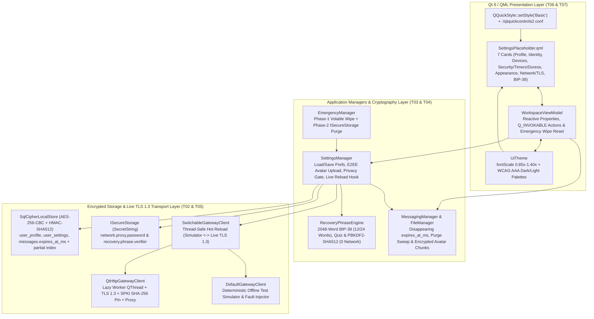

### 4.2 Hot-Reloaded Live TLS 1.3 Handshake, SPKI Pinning & Fail-Closed Cert Rotation Sequence

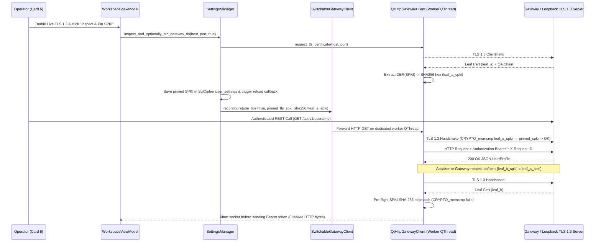

### 4.3 Endpoint-Only BIP-39 Generation, 3-Word Quiz & Panic-Wipe Destruction Sequence

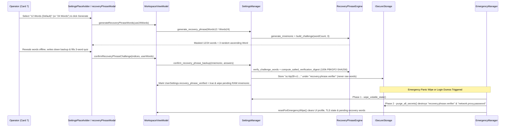

### 4.4 Client-Side E2EE Avatar Upload & Privacy-Gated Profile Sync Sequence

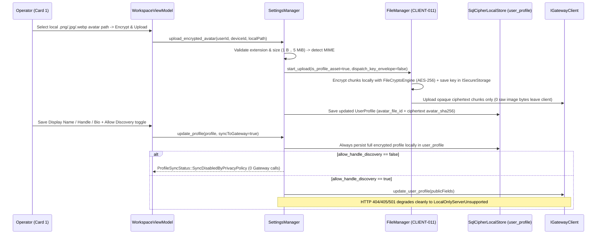

---

## 5. Ticket-by-Ticket Technical Walkthrough (`T01` – `T07`)

### 5.1 `CLIENT-014-T01`: Domain Models, `ClientConfig` & `IGatewayClient` Extensions (`6c3f5a6`)

1. **`UserProfile` (`src/client/domain/user_profile.{hpp,cpp}`):**
   - Validates `user_id` non-empty, `display_name` (`1..128` UTF-8 bytes, no ASCII control bytes), `bio_status` (`<= 512` bytes, allowing only printable chars + `\n`/`\t`), optional `public_handle` (`3..64` chars matching `[a-z0-9_.-]`), `avatar_file_id` (`<= 128` bytes, no whitespace/control bytes, explicitly rejecting plaintext URL schemes `http://`, `https://`, `file://`, `data:` so avatars strictly point to encrypted Files service object IDs), and `avatar_sha256` (empty or valid 64-char lowercase hex SHA-256).
   - Lossless JSON serialization (`UserProfile::to_json()` / `UserProfile::from_json()`) normalizing `avatar_sha256` to lowercase.
2. **`UserSettings`, `ProxyConfig`, `TlsPinConfig`, `DisappearingTimerPreset` (`src/client/domain/user_settings.{hpp,cpp}`):**
   - Enforces `[0, 2]` bounds on `theme_mode` (`0=System`, `1=Dark`, `2=Light`), finite `[0.85, 1.40]` bounds on `font_scale`, strict enum validation on `default_disappearing_timer` (`Off=0`, `OneHour=3600`, `TwentyFourHours=86400`, `SevenDays=604800`), `schema_version >= 1`, `ProxyConfig` host/port/username validation when enabled, and `TlsPinConfig` port (`1..65535`) + 64-char hex SPKI SHA-256 validation.
   - Defines canonical `ISecureStorage` secret key constants `kProxyPasswordStorageKey = "network.proxy.password"` and `kRecoveryVerifierStorageKey = "recovery.phrase.verifier"`.
3. **`ClientConfig` & `IGatewayClient` Extensions:**
   - Added `SECURECLOUD_USE_LIVE_GATEWAY`, `SECURECLOUD_PROXY_TYPE`, `SECURECLOUD_PROXY_HOST`, `SECURECLOUD_PROXY_PORT`, `SECURECLOUD_PROXY_USER`, `SECURECLOUD_PROXY_PASS`, `SECURECLOUD_TLS_PIN_SPKI_SHA256`, and `SECURECLOUD_TLS_ENFORCE_PINNING` parsing in `ClientConfig::from_environment()`, with `to_safe_string()` redacting all proxy credentials (`***`).
   - Added `get_user_profile`, `update_user_profile`, and `inspect_tls_certificate` virtual methods across `IGatewayClient`, `DefaultGatewayClient`, and all 7 test mock gateways (`client_domain_test.cpp`, `duress_pin_and_decoy_test.cpp`, `emergency_panic_wipe_integration_test.cpp`, `emergency_wipe_pipeline_test.cpp`, `encrypted_file_transfer_integration_test.cpp`, `file_manager_pipeline_test.cpp`, `workspace_view_model_files_test.cpp`), plus `FileUploadRequest::is_profile_asset`.

### 5.2 `CLIENT-014-T02`: Encrypted SQLCipher Schema, Migration & Expiry Sweeps (`41bed45`)

1. **Encrypted SQLCipher Tables (`src/client/infrastructure/adapters/sqlcipher_local_store.cpp`):**

```sql
CREATE TABLE IF NOT EXISTS user_profile (
    user_id TEXT PRIMARY KEY,
    updated_at_ms INTEGER NOT NULL,
    payload_json TEXT NOT NULL
);

CREATE TABLE IF NOT EXISTS user_settings (
    profile_key TEXT PRIMARY KEY,
    updated_at_ms INTEGER NOT NULL,
    payload_json TEXT NOT NULL
);
```

2. **Schema Migration & Partial Expiry Index (`migrate_messages_expires_at_locked()`):**
   - Queries `PRAGMA table_info(messages);` on every `open()` to detect legacy vault databases created prior to `CLIENT-014`.
   - When `expires_at_ms` is absent, executes `ALTER TABLE messages ADD COLUMN expires_at_ms INTEGER NOT NULL DEFAULT 0;` cleanly without losing existing conversations or keys, then creates `CREATE INDEX IF NOT EXISTS idx_messages_expires_at ON messages(expires_at_ms) WHERE expires_at_ms > 0;` so expiry sweeps touch only disappearing rows without scanning persistent message histories.
3. **Read Exclusion & Deterministic Deletion (`delete_expired_messages(int64_t now_ms)`):**
   - `get_messages()` filters `AND (expires_at_ms = 0 OR expires_at_ms > ?2)` so expired ciphertexts are invisible immediately even before the purge job runs.
   - `delete_expired_messages(now_ms)` removes expired records from both `SqlCipherLocalStore` and `MemoryLocalStore` (returning the deleted row count for auditability).

### 5.3 `CLIENT-014-T03`: Endpoint-Only BIP-39 Recovery Engine (`0f1ea15`)

1. **Canonical Wordlist Verification (`src/client/domain/crypto/bip39_wordlist.hpp`):**
   - Stores all `2048` standard English BIP-39 words in a `constexpr std::array<std::string_view, 2048>` with `find_bip39_word_index()` binary search (`std::lower_bound`), verified against the official BIP-39 English wordlist SHA-256 digest in `RecoveryPhraseEngineTest`.
2. **Cryptographic & Memory Safety Design (`src/client/domain/crypto/recovery_phrase_engine.{hpp,cpp}`):**
   - **Generation (`generate_mnemonic`):** Defaults to `RecoveryPhraseLength::Words12` (`16` bytes OpenSSL `RAND_bytes` entropy + `4` SHA-256 checksum bits = `132` bits -> `12 x 11`-bit indices) with optional `Words24` (`32` bytes entropy + `8` checksum bits = `264` bits -> `24 x 11`-bit indices).
   - **Zero-Copy RAM Hygiene:** `ByteCleanseGuard` and `WordVectorCleanseGuard` call `OPENSSL_cleanse` across every stack temporary containing entropy, words, seeds, or digests upon scope exit, accepting/returning inputs wrapped in `SecretString`.
   - **3-Word Spot-Check Challenge (`build_challenge` & `verify_challenge_words`):** Selects `3` distinct sorted 0-based indices via CSPRNG and compares user responses case-insensitively with trimmed ASCII normalization using constant-time byte comparison (`CRYPTO_memcmp` on hashed/padded buffers).
   - **Local Verifier Digest & Recovery Seed (`compute_salted_verification_digest`, `derive_recovery_seed`):**
     - Local verifier format: `sc-bip39-v1:<100000>:<32-hex random 16B salt>:<64-hex PBKDF2-HMAC-SHA256 digest>`, verified safely against clamped iteration ceilings (`kMaxVerifierPbkdf2Iterations = 5,000,000`).
     - Master recovery seed derivation: Official BIP-39 `PKCS5_PBKDF2_HMAC` (`EVP_sha512`, `2048` iterations, salt `"mnemonic" + passphrase`) producing `64` bytes verified against official BIP-39 test vectors byte-for-byte.

### 5.4 `CLIENT-014-T04`: Production `SettingsManager`, E2EE Avatars & Emergency Integration (`3243ba7`)

1. **`SettingsManager` (`src/client/application/managers/settings_manager.{hpp,cpp}`):**
   - Hydrates & validates `UserSettings` (`kDefaultSettingsKey = "active"`), syncs `MessagingManager::set_read_receipts_enabled()` and `set_default_disappearing_ttl_seconds()`, updates `ClientConfig`, stores/deletes `"network.proxy.password"` inside `ISecureStorage`, and triggers `NetworkConfigReloadCallback`.
   - **Encrypted Avatar Uploads:** `upload_encrypted_avatar()` enforces `.png` / `.jpg` / `.jpeg` / `.webp` extensions and `1..5,242,880` bytes (`kMaxAvatarSizeBytes = 5 MiB`), delegates encryption + chunk upload to `FileManager::start_upload` (`conversation_id = "profile-avatar:" + user_id`, `dispatch_key_envelope = false`, `is_profile_asset = true`), and saves `avatar_file_id` + ciphertext `avatar_sha256` into SQLCipher `user_profile`.
   - **Endpoint-Only Recovery Coordination:** Tracks volatile `pending_recovery_phrase_` in RAM solely between generation and `confirm_recovery_phrase_backup()`, stores only the salted PBKDF2 verifier in `ISecureStorage`, and clears pending secrets on confirmation or `wipe_volatile_state()`.
2. **`MessagingManager` & `EmergencyManager` Integration:**
   - `MessagingManager::open_direct_conversation()` and `create_group_conversation()` inherit `default_disappearing_ttl_seconds_`; `set_conversation_disappearing_timer()` updates per-conversation TTL; `apply_disappearing_expiry_if_configured()` stamps `expires_at_ms` across `send_message()`, `stage_outbound_message()`, `process_inbound_message()`, and `process_inbound_group_message()`; and `purge_expired_messages()` delegates cleanup to `ILocalStore::delete_expired_messages()`.
   - `ClientBootstrap::wire_managers()` injects `settings_manager_` into `EmergencyManager::set_settings_manager(...)` so panic wipes clear in-memory settings/profile/pending-recovery caches cleanly in Phase 1 before `purge_all_secrets()` shreds `"network.proxy.password"` and `"recovery.phrase.verifier"` in Phase 2.

### 5.5 `CLIENT-014-T05`: Live TLS 1.3 `QtHttpGatewayClient` & `SwitchableGatewayClient` (`5aa8897`)

1. **Lazy Dedicated Worker Thread (`QtHttpGatewayClient::Impl`):**
   - Defers spawning the internal `QThread` and `QNetworkAccessManager` until first use (`ensure_worker_started()`), guarantees safe teardown (`thread.quit()` + `wait()`), and dispatches every `IGatewayClient` call from arbitrary caller threads (`SyncManager`, `FileManager`, Qt UI main thread) via `QMetaObject::invokeMethod(..., Qt::QueuedConnection)` + `std::promise`/`std::future` without violating `QObject` thread affinity.
2. **Fail-Closed TLS 1.3 & OpenSSL SPKI Pinning:**
   - Selects OpenSSL TLS backend (when unset), forces `QSsl::TlsV1_3OrLater`, loads optional custom CA PEM files (`config_.tls_ca_cert_path`), connects pre-flight socket inspection + `encrypted` signal verification extracting `X509_get_X509_PUBKEY()` -> `i2d_X509_PUBKEY()` -> SHA-256 hex -> `CRYPTO_memcmp` against `config_.pinned_tls_spki_sha256`, and aborts before writing HTTP headers or `Authorization: Bearer` tokens whenever pins mismatch or SSL errors occur.
   - Configures `QNetworkProxy` (`NoProxy`, `HttpProxy`, `Socks5Proxy` with optional `username` & `SecretString` `password`), enforces per-request `QTimer` timeout cancellation, caps JSON payloads at `4 MiB` (`kMaxJsonResponseBytes`) and file chunks at `32 MiB` (`kMaxBinaryResponseBytes`), and implements `inspect_tls_certificate(host, port)` live using an ephemeral `QSslSocket`.
3. **Complete Verified Gateway REST/JSON Contract Mapping:**

| Method(s) in `QtHttpGatewayClient` | HTTP Method & Path | Backend Proxy Handler |
|---|---|---|
| `probe_gateway` | `GET /health/live` (and `/health/ready`) | `GatewayRouteRegistrar` |
| `get_user_profile`, `validate_token` | `GET /api/v1/users/me` | `AuthProxyHandler` |
| `update_user_profile` | `PUT /api/v1/users/me` (graceful `404`/`405`/`501` fallback) | Forward-compatible |
| `register_device`, `list_user_devices` | `POST/GET /api/v1/devices` | `AuthProxyHandler` |
| `lookup_user_identity`, `search_directory_users` | `GET /api/v1/users/:id`, `GET /api/v1/users/directory` | `AuthProxyHandler` |
| `get_device_crypto_directory`, `update_crypto_prekeys`, `get_prekey_inventory_status` | `/api/v1/users/:id/devices/crypto-directory`, `/api/v1/devices/:id/prekeys*` | `AuthProxyHandler` |
| `initiate_device_pairing`, `authorize_device_pairing`, `revoke_device` | `POST /api/v1/devices/pairing`, `/api/v1/devices/:id/{authorize,revoke}` | `AuthProxyHandler` |
| `send_message`, `submit_encrypted_message` | `POST /api/v1/messages` | `MessagingProxyHandler` |
| `acknowledge_delivery`, `send_read_receipt`, `get_message_delivery_status` | `POST /api/v1/messages/:id/ack`, `.../read`, `.../delivery-status` | `MessagingProxyHandler` |
| `fetch_conversation_messages`, `list_remote_conversations`, `get_sync_cursor`, `update_sync_cursor` | `GET /api/v1/conversations*`, `GET/PUT /api/v1/devices/:id/cursor` | `MessagingProxyHandler` |
| `init_file_upload`, `upload_file_chunk`, `finalize_file_upload`, `cancel_file_upload`, `get_file_metadata`, `download_file_chunk`, `delete_file` | `/api/v1/files/upload/{init,chunk,finalize,cancel}`, `GET/DELETE /api/v1/files/:id*` | `FilesProxyHandler` |

4. **`SwitchableGatewayClient` & `ClientBootstrap` Lifecycle Order (`src/client/application/client_bootstrap.{hpp,cpp}`):**
   - `SwitchableGatewayClient` owns both `DefaultGatewayClient` and `QtHttpGatewayClient`, translates `subscribe_realtime_events` / `unsubscribe_realtime_events` across reloads, exposes `is_live_transport_active()` & `reconfigure(const ClientConfig&)`, and sits after `secure_storage_` in `ClientBootstrap` member order so manager destruction never outlives `QtHttpGatewayClient`'s token provider.

### 5.6 `CLIENT-014-T06`: `UiTheme`, `WorkspaceViewModel` & 7-Card `SettingsPlaceholder.qml` (`df08dff`)

1. **`UiTheme` Dynamic Font Scaling & WCAG AAA High-Contrast (`src/client/ui/ui_theme.{hpp,cpp}`):**
   - Added `fontScale` (`Q_PROPERTY(double ... NOTIFY themeChanged)`, clamped `[0.85, 1.40]`, NaN -> `1.0`) and `highContrastEnabled` (`Q_PROPERTY(bool ... NOTIFY themeChanged)`).
   - Converted `fontMicro`, `fontCaption`, `fontBody`, `fontSubtitle`, `fontHeader`, `fontTitle`, `fontHeadline`, and `fontDisplay` from `CONSTANT` to `NOTIFY themeChanged`, scaled via `scaledFont(base) = std::max(8, lround(base * font_scale_))`.
   - Added `highContrastDarkPalette()` and `highContrastLightPalette()` verified by `UiThemeTest::HighContrastPalettesMeetWcagAaaInvariants` to achieve **>= 7.0:1 WCAG AAA contrast** across all three background surfaces (`backgroundPrimary`, `backgroundSecondary`, `backgroundElevated`) for primary/secondary/muted text, accents, status colors, and chat bubbles:

| Token | Standard Dark | Standard Light | High-Contrast Dark (`>= 7:1` AAA) | High-Contrast Light (`>= 7:1` AAA) |
|---|---|---|---|---|
| `backgroundPrimary` | `#0B0F17` | `#F1F5F9` | `#000000` | `#FFFFFF` |
| `backgroundSecondary` | `#151B26` | `#F8FAFC` | `#0A0A0A` | `#F8FAFC` |
| `backgroundElevated` | `#1E2638` | `#FFFFFF` | `#121212` | `#FFFFFF` |
| `borderSubtle` / `borderFocused` | `#263245` / `#60A5FA` | `#CBD5E1` / `#2563EB` | `#CBD5E1` / `#7DD3FC` | `#1E293B` / `#002F87` |
| `textPrimary` / `textSecondary` / `textMuted` | `#F8FAFC` / `#CBD5E1` / `#94A3B8` | `#0F172A` / `#334155` / `#475569` | `#FFFFFF` / `#F1F5F9` / `#E2E8F0` | `#000000` / `#0F172A` / `#1E293B` |
| `accentPrimary` | `#3B82F6` | `#2563EB` | `#7DD3FC` | `#003399` |
| `statusSuccess` / `statusWarning` / `statusDanger` | `#10B981` / `#F59E0B` / `#F87171` | `#047857` / `#B45309` / `#DC2626` | `#4ADE80` / `#FDE047` / `#FCA5A5` | `#064E3B` / `#78350F` / `#991B1B` |

2. **`WorkspaceViewModel` & `main.cpp` Integration (`src/client/ui/workspace_view_model.{hpp,cpp}`, `src/client/main.cpp`):**
   - `main.cpp` wires `workspaceViewModel.setUiTheme(&uiTheme)` at launch so persisted SQLCipher appearance settings hydrate immediately.
   - `hydrateSettingsAndProfile()` preserves caller-supplied runtime `ClientConfig` (such as custom test `gateway_port` or `use_live_gateway_transport`) when no persisted SQLCipher row exists yet, and otherwise hydrates via `SettingsManager::load_settings()`.
   - Persists `mfaRequiredOnLogin`, `hardwareKeyEnforced`, `readReceiptsEnabled`, `themeMode`, `fontScale`, `highContrastEnabled`, disappearing timers, and proxy/TLS settings via `SettingsManager` & `MessagingManager`; queries `hasProxyPassword` and `recoveryPhraseVerified` live from `SettingsManager`; and clears volatile caches cleanly inside `resetForEmergencyWipe()` / `enterDecoyWorkspace()`.
3. **Upgraded 7-Card `SettingsPlaceholder.qml` + `recoveryPhraseModal` (`src/client/ui/qml/SettingsPlaceholder.qml`):**
   - Preserves all `CLIENT-007`, `CLIENT-010`, and `CLIENT-013` QML hooks (`settingsScrollView`, `readReceiptsSwitch`, `duressPolicyCard`, `duressStatusBadge`, `duressPinField`, `duressPinConfirmField`, `saveDuressPinButton`, `clearDuressPinButton`) while structuring the center cleanly into 7 cards:
     1. `profileCard` — User Profile, Handle, Bio, Privacy Discovery Switch & E2EE Avatar Upload
     2. `localIdentityCard` — Local Workstation Ed25519/X25519 Identity & Prekey Rotation
     3. `linkedDevicesCard` — Linked Devices, X3DH Pairing & Key Revocation
     4. `securityPrivacyCard` — Persisted MFA/Hardware Policy, Read Receipts, `Off`/`1h`/`24h`/`7d` Default & Active Conversation Disappearing Timers, and Login Duress Policy
     5. `appearanceCard` — Color Theme Mode (Dark/Light/System), `85%`/`100%`/`120%`/`140%` Font Scale presets, and WCAG AAA High-Contrast Toggle
     6. `networkTlsCard` — Runtime Live TLS 1.3 vs. Simulator Toggle, Gateway Host/Port, Proxy Type (`None`/`HTTP`/`SOCKS5`) + Credentials, Inspect/Pin SPKI SHA-256 Controls, and Status Badge
     7. `recoveryPhraseCard` + `recoveryPhraseModal` — Explicitly isolated Endpoint-Only 12-word (Default) / 24-word BIP-39 Generator, Show/Hide Mask Toggle, 3-Word Spot-Check Quiz, and Offline Verifier Check.

### 5.7 `CLIENT-014-T07`: Full-Stack E2E Suite, Qt 6.8 `Basic` Style Fix & Visual Captures

- Added [`tests/unit/client/settings_and_profile_integration_test.cpp`](../../tests/unit/client/settings_and_profile_integration_test.cpp) verifying all 6 full-stack E2E workflows (SQLCipher restart + raw `.db` scan, E2EE avatar ciphertext check, runtime zero-restart theme/high-contrast/scale + `QQuickStyle::name() == "Basic"`, disappearing purge across 1:1 & group + `Off` conversations, 12/24-word endpoint-only BIP-39 + panic wipe cleanup, and real loopback TLS 1.3 `SwitchableGatewayClient` hot-reload + rotated-cert pin failure).
- Added [`src/client/ui/qtquickcontrols2.conf`](../../src/client/ui/qtquickcontrols2.conf) (`Style=Basic`) in [`qml.qrc`](../../src/client/ui/qml.qrc) and called `QQuickStyle::setStyle("Basic")` in [`main.cpp`](../../src/client/main.cpp) and [`client_foundation_test.cpp`](../../tests/unit/client/client_foundation_test.cpp) (fixing Windows Qt 6.8 native style customization warnings globally).
- Added `scrollToTop()` and `scrollToCard(cardObjectName)` layout-aware scrolling in [`SettingsPlaceholder.qml`](../../src/client/ui/qml/SettingsPlaceholder.qml), wrapped the recovery modal header text (`Text.WordWrap`), fixed the modal backdrop color to use QML `Qt.rgba(...)` so the dimmed overlay remains cleanly translucent on both Dark and Light themes, and extended `--capture-screenshots` in [`main.cpp`](../../src/client/main.cpp) to capture and visually verify `8` curated `CLIENT-014` PNGs (`40 / 40` total desktop PNGs).

---

## 6. Real-Client Visual Verification Gallery (Tier 1 & Tier 2)

All `8` curated `CLIENT-014` screenshots below were rendered offscreen by the real `securecloud-client` desktop binary under `QQuickStyle::setStyle("Basic")`, visually inspected on Dark, Light, and High-Contrast `120%` scaled states for alignment, border legibility, backdrop translucency, badge readability, and zero clipping/overlap, and archived under [`docs/final-reports/assets/client-014/`](file:///Users/sergeychukhno/Desktop/C:C++/SecureCloud/docs/final-reports/assets/client-014).

| Settings State | Dark Mode (`1200x800`) | Light Mode (`1200x800`) |
|---|---|---|
| **Card 1: User Profile, Handle Privacy Gate & Encrypted E2EE Avatar** | 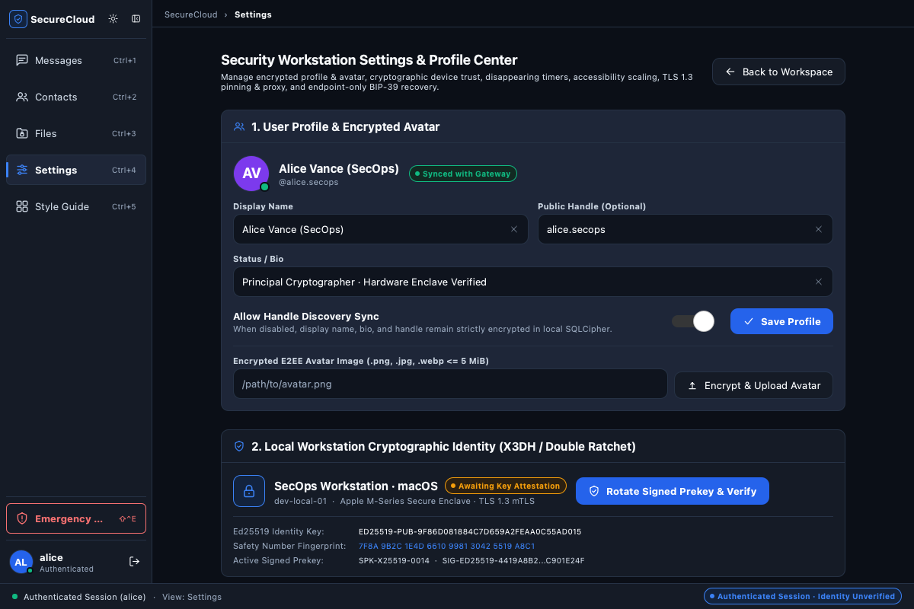 | 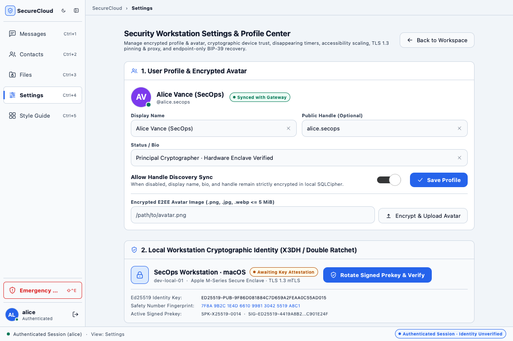 |
| **Card 5: WCAG AAA High-Contrast Palette + 120% Font Scale** | 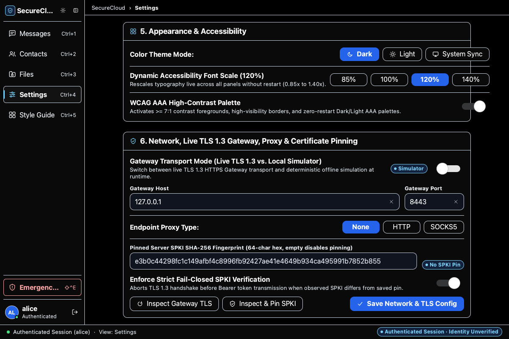 | 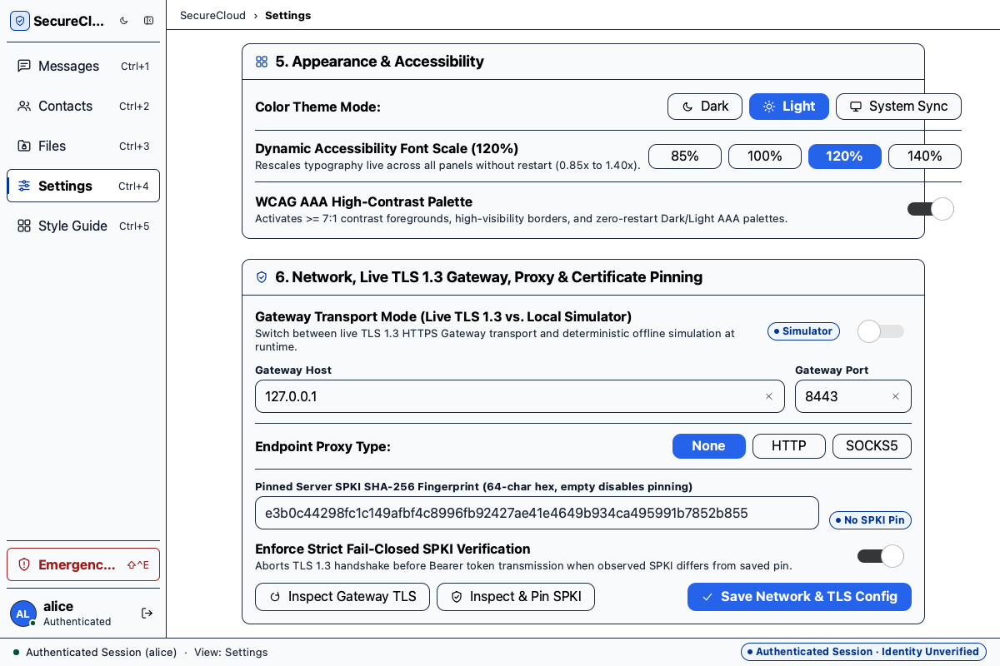 |
| **Card 6: Live TLS 1.3, HTTP Proxy, `ISecureStorage` Password & SPKI Pin** | 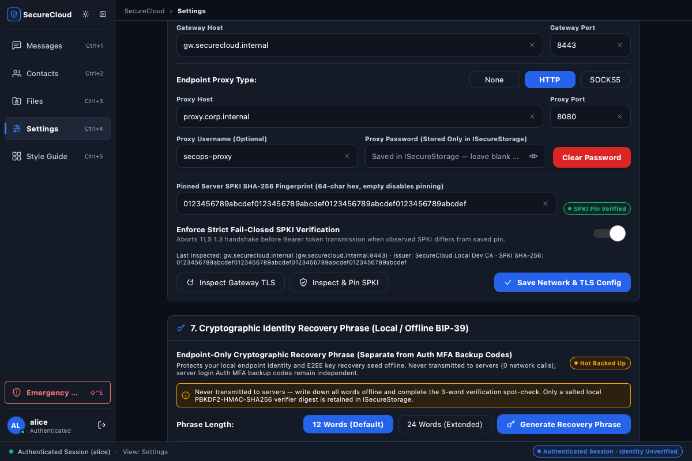 | 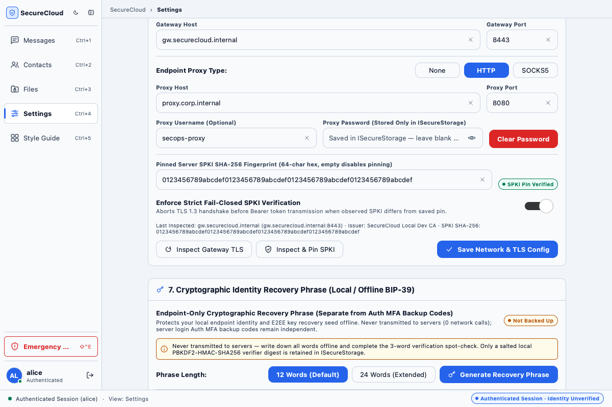 |
| **Card 7 Overlay: Endpoint-Only BIP-39 12-Word Quiz Modal** | 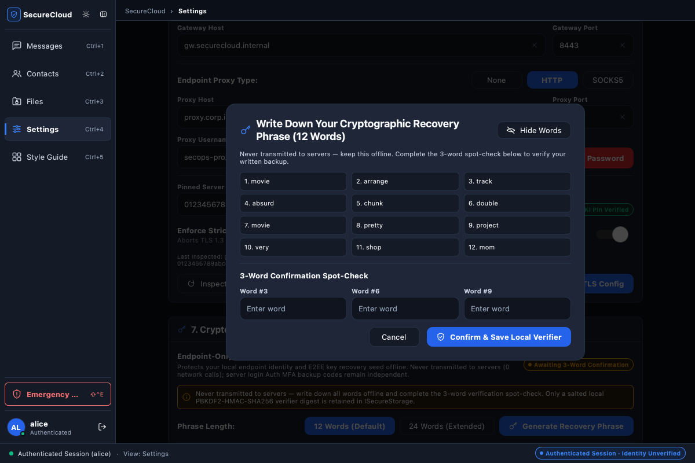 | 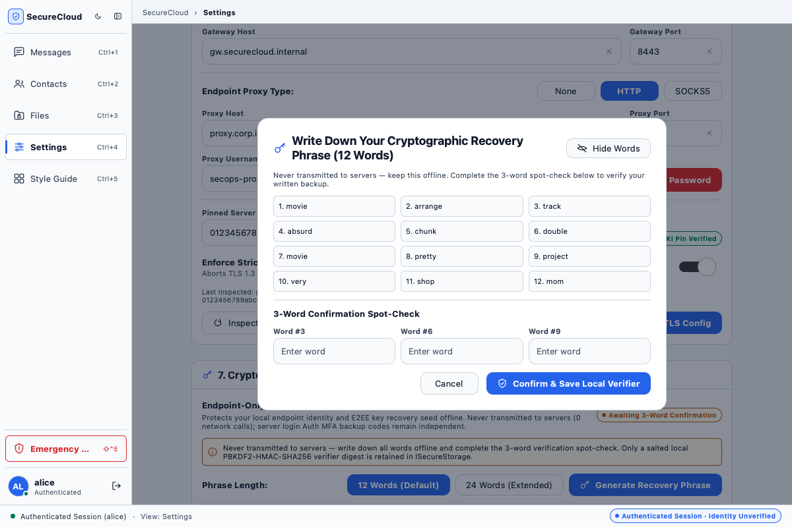 |

### Visual Inspection Checklist (Verified Directly on Rendered PNGs)

- **Typography & Scaling (`120%`):** Dynamic font scaling (`fontMicro`..`fontDisplay`) visibly enlarges card headings, labels, and button text cleanly in both `settings-high-contrast-dark-1200x800.png` and `settings-high-contrast-light-1200x800.png` without overflowing containers or wrapping awkwardly.
- **WCAG AAA High-Contrast Mode:** Pure `#000000`/`#0A0A0A` surfaces in High-Contrast Dark and crisp `#FFFFFF`/`#F8FAFC` + `#1E293B` borders in High-Contrast Light render sharply with zero muddied foregrounds.
- **Proxy Secret Hygiene UI:** Card 6 displays `"Saved in ISecureStorage — leave blank ..."` placeholder inside `proxyPasswordField`, active red `"Clear Password"` action, and `"SPKI Pin Verified"` green badge beside the inspected Gateway SHA-256 fingerprint (`012345...`).
- **Recovery Modal Backdrop & Header:** Both `settings-bip39-modal-dark-1200x800.png` and `settings-bip39-modal-light-1200x800.png` render a translucent dimmed overlay (`Qt.rgba(...)`) over Card 6/Card 7, wrapped title text (`Write Down Your Cryptographic Recovery Phrase (12 Words)`), 3-column 12-word layout, explicit *"Never transmitted to servers"* copy, and the 3-word confirmation quiz inputs.

### How to Re-Generate & Inspect Locally

```bash
cmake --build build/dev-debug --target securecloud-client -j8
QT_QPA_PLATFORM=offscreen ./build/dev-debug/src/client/securecloud-client --smoke-test
QT_QPA_PLATFORM=offscreen ./build/dev-debug/src/client/securecloud-client --capture-screenshots /tmp/sc-client014-shots
```

---

## 7. Security Threat Model & ADR Compliance Matrix

### 7.1 ADR Traceability Matrix

| Architecture Record | Requirement Verified in `CLIENT-014` | Enforcement Mechanism & Test Proof |
|---|---|---|
| **ADR-004 (HTTPS REST External Transport)** | Gateway client speaks HTTPS TLS 1.3 REST/JSON + binary chunks over `Qt6::Network`. | `QtHttpGatewayClient` (`QSsl::TlsV1_3OrLater`), verified in `QtHttpGatewayClientTest` & `SettingsAndProfileIntegrationTest::Scenario6`. |
| **ADR-005 (Service Data Ownership)** | Auth owns identity (`GET /api/v1/users/me`), Files owns opaque encrypted blobs (`/api/v1/files/*`), workstation owns local settings (`user_settings`). | `SettingsManager::upload_encrypted_avatar`, `ProfileSyncStatus`, `UserSettings` (never sent to backend). |
| **ADR-007 (Durability & Outbox Semantics)** | Persistent encrypted local state across restarts; read receipts & disappearing policies stay consistent across outbox/read paths. | `SqlCipherLocalStore::migrate_messages_expires_at_locked()`, `SettingsManagerPipelineTest`, `SettingsAndProfileIntegrationTest::Scenario1` & `Scenario4`. |
| **ADR-008 §7 (Human Identity Confidentiality)** | Opt-in handle discovery (`allow_handle_discovery`) gates any outbound profile sync. | `SettingsManager::update_profile()` returns `SyncDisabledByPrivacyPolicy` with `0` Gateway calls when `false`. |
| **ADR-008 §20 (E2EE File & Avatar Encryption)** | Profile avatars encrypt locally via `FileCryptoEngine` without chat-envelope spam or server plaintext exposure. | `FileUploadRequest{dispatch_key_envelope=false, is_profile_asset=true}`; `Scenario2` confirms raw `.png` sentinel absent from Gateway bytes. |
| **ADR-008 §27–28 (Endpoint-Only Recovery & Zero Secret Logging)** | BIP-39 words, entropy, seeds, proxy passwords & Bearer tokens stay off logs and never leak BIP-39 material over networks. | `OPENSSL_cleanse` RAM guards, salted PBKDF2 verifier `"recovery.phrase.verifier"`, `0` Gateway calls verified in `Scenario5`, raw `.db` scan in `Scenario1`. |
| **ADR-008 §30, §35 (Fail-Closed Transport Security)** | Enforce TLS 1.3 + SPKI SHA-256 pinning prior to HTTP header/token emission. | Pre-flight OpenSSL `i2d_X509_PUBKEY` + `CRYPTO_memcmp`; `Scenario6` confirms `0` HTTP requests sent after leaf cert rotation. |
| **ADR-009 / ADR-010 (Resilience & Bounded Memory)** | Explicit connect/request timeouts and max payload caps (`4 MiB` JSON / `32 MiB` binary) across HTTP replies. | `QtHttpGatewayClient::kMaxJsonResponseBytes`, `kMaxBinaryResponseBytes`, `HttpErrorMappingAndRequestTimeoutCancellation`. |

### 7.2 Negative-Test & Attack Resistance Summary

- **SQLCipher Forensic Disk Leakage Attempt:** Raw file byte scan of reopened `vault.db` in `Scenario1` asserts display name, handle, bio, proxy host, and `"SuperSecretProxyPass!99"` do **not** appear in plaintext on disk.
- **Compromised / Rotated Server Leaf Cert (MitM):** In `QtHttpGatewayClientTest::InspectTlsAndSpkiPinningFailsClosedBeforeBearerTransmission` and `Scenario6`, swapping the loopback TLS 1.3 server from pinned `leaf_a` to CA-trusted `leaf_b` aborts client connection **before** emitting any HTTP headers (`0` `Authorization: Bearer` headers recorded on server).
- **Tampered BIP-39 Mnemonic / Wrong 3-Word Quiz / Invalid Wordlist Entry:** Rejected fail-closed by `RecoveryPhraseEngine::validate_mnemonic()` and `confirm_recovery_phrase_backup()`, leaving `recovery_phrase_verified == false` and `"recovery.phrase.verifier"` absent from `ISecureStorage`.
- **Oversized or Malicious Extension Avatar Upload (`.sh`):** Rejected by `SettingsManager::upload_encrypted_avatar()` cleanly without touching existing `profile_.avatar_file_id`.
- **Unsupported Disappearing Timer TTL (`42s`) & Legacy Migration:** Rejected for workspace default in `WorkspaceViewModelSettingsTest`, while legacy SQLCipher `messages` tables missing `expires_at_ms` upgrade cleanly without data loss.
- **Emergency Panic Wipe Under Configured Proxy Password & BIP-39 Verifier:** `Scenario5` verifies `EmergencyManager::execute_panic_wipe` purges `"recovery.phrase.verifier"`, `"network.proxy.password"`, and all `WorkspaceViewModel` volatile profile/TLS/recovery state.

---

## 8. Complete `CLIENT-014` Unit & Integration Test Catalog (`50` Tests Across `9` Suites)

Every single test listed below was executed and verified passing (`50 / 50` targeted, `978 ms` total) after the final edit:

### 8.1 Domain Models, Config & Contracts (`tests/unit/client/user_settings_and_profile_domain_test.cpp` — `9` Tests)

| Suite | Test Case | Verified Behavior |
|---|---|---|
| `UserSettingsAndProfileDomainTest` | `UserProfileValidationAndLosslessJsonRoundTrip` | Valid `UserProfile` construction, lowercase SHA-256 normalization, lossless `to_json` / `from_json` round-trip. |
| `UserSettingsAndProfileDomainTest` | `UserProfileRejectsInvalidFields` | Rejects empty `user_id`, empty/`>128B` `display_name`, bad `public_handle` chars, plaintext URL `avatar_file_id`, bad SHA-256 hex, control bytes. |
| `UserSettingsAndProfileDomainTest` | `UserSettingsValidationAndLosslessJsonRoundTrip` | Lossless `UserSettings` serialization; confirms proxy passwords & `has_password` never appear in JSON. |
| `UserSettingsAndProfileDomainTest` | `UserSettingsRejectsOutOfBoundsValues` | Rejects out-of-range `theme_mode`, `font_scale` (`<0.85` / `>1.40` / NaN), invalid timers, empty proxy host / `0` port, malformed SPKI hex. |
| `UserSettingsAndProfileDomainTest` | `EnumConversionsRoundTripCleanly` | `ProxyType` (`none`/`http`/`socks5`) and `DisappearingTimerPreset` (`off`/`1h`/`24h`/`7d`) round-trips. |
| `ClientConfigNetworkTest` | `EnvironmentOverridesAndSecretRedaction` | Parses `SECURECLOUD_*` network/proxy/SPKI env vars cleanly and redacts proxy password in `to_safe_string()`. |
| `ClientConfigNetworkTest` | `ValidatesProxyAndPinnedSpkiHex` | Enforces proxy host/port rules and 64-char hex SPKI pin format in `ClientConfig::validate()`. |
| `DefaultGatewayProfileAndTlsTest` | `ProfileSyncRespectsPrivacyAndServerSupport` | Tests `SyncDisabledByPrivacyPolicy`, `LocalOnlyServerUnsupported`, and `Synced` in `DefaultGatewayClient`. |
| `DefaultGatewayProfileAndTlsTest` | `TlsCertificateInspectionEvaluatesSpkiPin` | Verifies `inspect_tls_certificate()` `has_pinned_key` and `matches_pinned_key` matching/mismatch logic. |

### 8.2 SQLCipher Persistence & Auto-Expiry Schema (`tests/unit/client/settings_and_expiry_persistence_test.cpp` — `4` Tests)

| Suite | Test Case | Verified Behavior |
|---|---|---|
| `SettingsAndExpiryPersistenceTest` | `ConversationAndMessageExpiryJsonRoundTripAndLegacyDefaults` | Verifies `Conversation::disappearing_ttl_seconds` & `Message::expires_at_ms` JSON round-trips and legacy defaults (`0`). |
| `SettingsAndExpiryPersistenceTest` | `SqlCipherPersistsProfileAndSettingsAcrossRestartWithoutPlaintextLeakage` | Reopens `SqlCipherLocalStore` and scans `.db` binary proving zero plaintext profile/settings leakage. |
| `SettingsAndExpiryPersistenceTest` | `SqlCipherMigratesLegacyMessagesTableWithoutExpiresAtColumn` | Opens pre-`CLIENT-014` SQLCipher DB lacking `expires_at_ms`, confirms `PRAGMA` migration adds column + index cleanly. |
| `SettingsAndExpiryPersistenceTest` | `SqlCipherAndMemoryStoreEnforceReadExclusionAndExpirySweep` | Confirms `get_messages()` hides expired rows immediately and `delete_expired_messages()` purges only expired rows. |

### 8.3 Endpoint-Only BIP-39 Recovery Engine (`tests/unit/client/recovery_phrase_engine_test.cpp` — `6` Tests)

| Suite | Test Case | Verified Behavior |
|---|---|---|
| `RecoveryPhraseEngineTest` | `CanonicalWordlistMatchesBip39Sha256AndLexicographicalOrder` | Verifies all `2048` words are sorted lexicographically and match canonical BIP-39 English SHA-256 digest. |
| `RecoveryPhraseEngineTest` | `OfficialBip39TestVectorsMatchByteForByte` | Validates official BIP-39 128-bit & 256-bit test vectors (`mnemonic` + `PBKDF2-HMAC-SHA512` 64-byte `"TREZOR"` seed). |
| `RecoveryPhraseEngineTest` | `DefaultGenerationProducesValidUnique12WordAndOptional24WordPhrases` | Confirms `Words12` default and `Words24` optional generation produce valid, distinct mnemonics with checksum integrity. |
| `RecoveryPhraseEngineTest` | `RejectsInvalidEntropyTamperedChecksumsAndUnknownWords` | Rejects malformed word counts, unknown words, bad checksums, and non-multiple entropy lengths. |
| `RecoveryPhraseEngineTest` | `SaltedVerificationDigestVerifiesWithoutLeakingPhrase` | Confirms `sc-bip39-v1:...` salted PBKDF2-HMAC-SHA256 digest never leaks words, verifies case-insensitively, rejects tampered inputs. |
| `RecoveryPhraseEngineTest` | `SpotCheckChallengeGenerationAndConstantTimeVerification` | Verifies sorted distinct 3-word indices and `verify_challenge_words` constant-time checking. |

### 8.4 Production `SettingsManager` Pipeline (`tests/unit/client/settings_manager_pipeline_test.cpp` — `7` Tests)

| Suite | Test Case | Verified Behavior |
|---|---|---|
| `SettingsManagerPipelineTest` | `SaveAndLoadSettingsSyncsConfigMessagingSecretsAndReloadCallback` | Persists `UserSettings` + `"network.proxy.password"`, updates `MessagingManager`, fires reload callback, deletes secret on clear. |
| `SettingsManagerPipelineTest` | `ProfileHydrationPrivacyGateAndGracefulUnsupportedSync` | Tests SQLCipher/Gateway hydration, `allow_handle_discovery` privacy gate, and `404`/`501` fallback. |
| `SettingsManagerPipelineTest` | `EncryptedAvatarUploadUsesFileManagerWithoutPlaintextOrChatMessage` | Uploads local `.png` avatar via `FileManager` with `dispatch_key_envelope = false` and verifies content key storage + ciphertext integrity. |
| `SettingsManagerPipelineTest` | `InspectAndPinGatewayTlsPersistsSpkiPinAndUpdatesConfig` | Inspects leaf cert (`save_pin=false` then `true`), saves lowercase SPKI hex, and fires live config reload. |
| `SettingsManagerPipelineTest` | `DisappearingMessageTimersStampOutboundAndInboundAndPurgeDeterministically` | Stamps outbound 1h & inbound 24h messages cleanly and verifies selective `purge_expired_messages()`. |
| `SettingsManagerPipelineTest` | `EndpointOnlyBip39RecoveryLifecyclePerformsZeroGatewayCalls` | Generates, spot-checks, stores verifier, verifies existing phrase, and confirms `0` Gateway calls. |
| `SettingsManagerPipelineTest` | `EmergencyPanicWipeClearsSettingsManagerVolatileCachesAndSecrets` | Executes `EmergencyManager::execute_panic_wipe`, proving cached profile, pending BIP-39 state, verifier, and proxy password are wiped. |

### 8.5 Live TLS 1.3 `QtHttpGatewayClient` & `SwitchableGatewayClient` (`tests/unit/client/qt_http_gateway_client_test.cpp` — `6` Tests)

| Suite | Test Case | Verified Behavior |
|---|---|---|
| `QtHttpGatewayClientTest` | `Tls13HealthProbeAndAuthenticatedRestContracts` | Verifies real loopback TLS 1.3 health probe, message submission (`POST /api/v1/messages`), message fetch, chunked file upload (`init`/`chunk`/`finalize`), `get_user_profile`, and graceful `update_user_profile` fallback. |
| `QtHttpGatewayClientTest` | `InspectTlsAndSpkiPinningFailsClosedBeforeBearerTransmission` | Extracts live `SPKI SHA-256` from `leaf_a`, pins it, verifies success, then rejects `leaf_b` with `0` Bearer headers sent. |
| `QtHttpGatewayClientTest` | `HttpErrorMappingAndRequestTimeoutCancellation` | Verifies HTTP `400`/`401`/`403`/`404`/`409`/`5xx` mapping into typed `ClientError` and request deadline timeout cancellation. |
| `QtHttpGatewayClientTest` | `ProxyConfigurationHotReloadAndClosedProxyFailure` | Verifies live HTTP/SOCKS5 `QNetworkProxy` hot-reload snapshot updates and connection failure against a closed proxy port. |
| `QtHttpGatewayClientTest` | `SwitchableGatewayHotReloadsBetweenSimulatedAndLiveTls13ViaSettingsManager` | Exercises `ClientBootstrap` runtime switching from offline simulator -> live loopback TLS 1.3 through `SettingsManager::save_settings()`. |
| `QtHttpGatewayClientTest` | `ConcurrentMultiThreadedCallsExecuteSafelyAcrossWorkerThread` | Runs concurrent multi-threaded requests safely against worker `QThread`-owned `QNetworkAccessManager`. |

### 8.6 `UiTheme` Accessibility Engine (`tests/unit/client/ui_theme_test.cpp` — `9` Tests)

| Suite | Test Case | Verified Behavior |
|---|---|---|
| `UiThemeTest` | `DefaultModeIsDarkAndConsistent` | Verifies default Dark palette token values. |
| `UiThemeTest` | `LightModePaletteAndSwitching` | Verifies Light palette tokens and idempotent mode transitions. |
| `UiThemeTest` | `WcagContrastInvariants` | Verifies `>= 4.5:1` WCAG AA contrast on default Dark and Light palettes. |
| `UiThemeTest` | `ToggleThemeFlipsBetweenModes` | Verifies Dark <-> Light toggling and signals. |
| `UiThemeTest` | `PaletteColorsAreValidQColors` | Validates all color tokens parse cleanly into `QColor`. |
| `UiThemeTest` | `TypographyAndLayoutMetricsAreMonotonic` | Verifies font hierarchy, primary vs. monospace family, spacing, radii, and durations. |
| `UiThemeTest` | `InvokableThemeModeIntSwitching` | Verifies integer QML theme mode setter & fallback bounds. |
| `UiThemeTest` | `FontScaleClampingAndDynamicTypography` | Tests `[0.85, 1.40]` clamping, NaN -> `1.0` reset, monotonic scaled typography, and `themeChanged` signals. |
| `UiThemeTest` | `HighContrastPalettesMeetWcagAaaInvariants` | Tests `highContrastEnabled` in Dark & Light modes, asserting **`>= 7.0:1` WCAG AAA contrast** across all foregrounds/surfaces and exact restoration on disable. |

### 8.7 `WorkspaceViewModel` Settings & Headless QML (`tests/unit/client/workspace_view_model_settings_test.cpp` — `6` Tests)

| Suite | Test Case | Verified Behavior |
|---|---|---|
| `WorkspaceViewModelSettingsTest` | `PersistsAppearanceMfaAndReadReceiptsAcrossRestart` | Persists theme, fontScale, High-Contrast, MFA, hardware key, and read receipts across SQLCipher restart + `setUiTheme`. |
| `WorkspaceViewModelSettingsTest` | `UserProfileSavePrivacyGateAndEncryptedAvatarUpload` | Verifies profile edits, privacy gate, `.png` E2EE avatar upload, and `.sh` extension rejection. |
| `WorkspaceViewModelSettingsTest` | `NetworkProxyAndTlsPinConfigPersistsAndTracksLiveProxyPasswordState` | Verifies HTTP proxy password live check via `ISecureStorage`, TLS inspection/pinning, and explicit password clear. |
| `WorkspaceViewModelSettingsTest` | `DisappearingTimersUpdateWorkspaceDefaultAndActiveConversation` | Rejects unsupported workspace timer (`42s`), applies `1h` default & `24h` active conversation timer. |
| `WorkspaceViewModelSettingsTest` | `EndpointOnlyBip39Recovery12DefaultAnd24WordFlowAndEmergencyWipeCleanup` | Tests 12-word default + 24-word BIP-39 flow (`0` Gateway calls), wrong-quiz failure, verifier check, and panic-wipe ViewModel cleanup. |
| `WorkspaceViewModelSettingsTest` | `HeadlessSettingsPlaceholderLoadsAllSevenCardsWithZeroWarningsAcrossThemesAndFontScales` | Verifies all 7 card `objectName`s, preserved `CLIENT-010`/`013` hooks, `recoveryPhraseModal`, and `0` QML warnings across themes & `0.85x–1.40x` scales. |

### 8.8 End-to-End Integration Scenarios (`tests/unit/client/settings_and_profile_integration_test.cpp` — `6` Tests)

| Suite | Test Case | Verified Behavior |
|---|---|---|
| `SettingsAndProfileIntegrationTest` | `Scenario1_EncryptedSettingsMfaProxyAndProfilePersistAcrossSqlCipherRestartWithZeroPlaintextLeak` | Full restart round-trip across SQLCipher DB + binary disk scan confirming `0` plaintext leakage. |
| `SettingsAndProfileIntegrationTest` | `Scenario2_E2eeAvatarUploadAndGracefulProfileSyncPrivacyGate` | `.png` E2EE ciphertext verification (sentinel absent remotely), privacy gate (`0` calls), and `LocalOnlyServerUnsupported` handling. |
| `SettingsAndProfileIntegrationTest` | `Scenario3_RuntimeThemeHighContrastAndDynamicFontScalingWithoutRestart` | Asserts `QQuickStyle::name() == "Basic"`, live `fontBody` scaling (`13 -> 16 -> 17 -> 18`), WCAG AAA tokens, and `0` QML warnings across `SettingsPlaceholder.qml` + `Main.qml`. |
| `SettingsAndProfileIntegrationTest` | `Scenario4_DisappearingMessageTimersAndAutomaticPurgeEnforcement` | Confirms `1h` expiring 1:1 & group messages vs. `Off` persistent message + selective `purge_expired_messages` cleanup reflected in `WorkspaceViewModel`. |
| `SettingsAndProfileIntegrationTest` | `Scenario5_EndpointOnlyBip39Recovery12And24WordLifecycleAndPanicWipePurge` | Validates 12-word & 24-word BIP-39 workflows, tampered checksum detection, 64-byte recovery seed, `0` Gateway calls, and full secret purge on `execute_panic_wipe`. |
| `SettingsAndProfileIntegrationTest` | `Scenario6_LiveLoopbackTls13GatewayHandshakeSpkiPinEnforcementAndHotReload` | Hot-switches `ClientBootstrap` to live loopback TLS 1.3, inspects/pins `leaf_a` SPKI, completes authenticated `/api/v1/users/me` call, and fails closed with `0` leaked Bearer headers when server rotates to `leaf_b`. |

---

## 9. Complete Branch File Inventory (`T01`–`T07`)

### Domain Layer
- [`src/client/domain/user_profile.hpp`](../../src/client/domain/user_profile.hpp) & [`src/client/domain/user_profile.cpp`](../../src/client/domain/user_profile.cpp)
- [`src/client/domain/user_settings.hpp`](../../src/client/domain/user_settings.hpp) & [`src/client/domain/user_settings.cpp`](../../src/client/domain/user_settings.cpp)
- [`src/client/domain/conversation.hpp`](../../src/client/domain/conversation.hpp) & [`src/client/domain/conversation.cpp`](../../src/client/domain/conversation.cpp)
- [`src/client/domain/message.hpp`](../../src/client/domain/message.hpp) & [`src/client/domain/message.cpp`](../../src/client/domain/message.cpp)
- [`src/client/domain/crypto/bip39_wordlist.hpp`](../../src/client/domain/crypto/bip39_wordlist.hpp)
- [`src/client/domain/crypto/recovery_phrase_engine.hpp`](../../src/client/domain/crypto/recovery_phrase_engine.hpp) & [`src/client/domain/crypto/recovery_phrase_engine.cpp`](../../src/client/domain/crypto/recovery_phrase_engine.cpp)

### Application & Manager Layer
- [`src/client/application/client_config.hpp`](../../src/client/application/client_config.hpp) & [`src/client/application/client_config.cpp`](../../src/client/application/client_config.cpp)
- [`src/client/application/client_bootstrap.hpp`](../../src/client/application/client_bootstrap.hpp) & [`src/client/application/client_bootstrap.cpp`](../../src/client/application/client_bootstrap.cpp)
- [`src/client/application/interfaces/i_gateway_client.hpp`](../../src/client/application/interfaces/i_gateway_client.hpp)
- [`src/client/application/interfaces/i_local_store.hpp`](../../src/client/application/interfaces/i_local_store.hpp)
- [`src/client/application/managers/settings_manager.hpp`](../../src/client/application/managers/settings_manager.hpp) & [`src/client/application/managers/settings_manager.cpp`](../../src/client/application/managers/settings_manager.cpp)
- [`src/client/application/managers/messaging_manager.hpp`](../../src/client/application/managers/messaging_manager.hpp) & [`src/client/application/managers/messaging_manager.cpp`](../../src/client/application/managers/messaging_manager.cpp)
- [`src/client/application/managers/file_manager.hpp`](../../src/client/application/managers/file_manager.hpp) & [`src/client/application/managers/file_manager.cpp`](../../src/client/application/managers/file_manager.cpp)
- [`src/client/application/managers/emergency_manager.hpp`](../../src/client/application/managers/emergency_manager.hpp) & [`src/client/application/managers/emergency_manager.cpp`](../../src/client/application/managers/emergency_manager.cpp)

### Infrastructure & Transport Layer
- [`src/client/infrastructure/adapters/qt_http_gateway_client.hpp`](../../src/client/infrastructure/adapters/qt_http_gateway_client.hpp) & [`src/client/infrastructure/adapters/qt_http_gateway_client.cpp`](../../src/client/infrastructure/adapters/qt_http_gateway_client.cpp)
- [`src/client/infrastructure/adapters/switchable_gateway_client.hpp`](../../src/client/infrastructure/adapters/switchable_gateway_client.hpp) & [`src/client/infrastructure/adapters/switchable_gateway_client.cpp`](../../src/client/infrastructure/adapters/switchable_gateway_client.cpp)
- [`src/client/infrastructure/adapters/default_gateway_client.hpp`](../../src/client/infrastructure/adapters/default_gateway_client.hpp) & [`src/client/infrastructure/adapters/default_gateway_client.cpp`](../../src/client/infrastructure/adapters/default_gateway_client.cpp)
- [`src/client/infrastructure/adapters/sqlcipher_local_store.hpp`](../../src/client/infrastructure/adapters/sqlcipher_local_store.hpp) & [`src/client/infrastructure/adapters/sqlcipher_local_store.cpp`](../../src/client/infrastructure/adapters/sqlcipher_local_store.cpp)
- [`src/client/infrastructure/adapters/memory_local_store.hpp`](../../src/client/infrastructure/adapters/memory_local_store.hpp) & [`src/client/infrastructure/adapters/memory_local_store.cpp`](../../src/client/infrastructure/adapters/memory_local_store.cpp)

### Presentation & QML Layer
- [`src/client/ui/ui_theme.hpp`](../../src/client/ui/ui_theme.hpp) & [`src/client/ui/ui_theme.cpp`](../../src/client/ui/ui_theme.cpp)
- [`src/client/ui/workspace_view_model.hpp`](../../src/client/ui/workspace_view_model.hpp) & [`src/client/ui/workspace_view_model.cpp`](../../src/client/ui/workspace_view_model.cpp)
- [`src/client/ui/qtquickcontrols2.conf`](../../src/client/ui/qtquickcontrols2.conf) & [`src/client/ui/qml.qrc`](../../src/client/ui/qml.qrc)
- [`src/client/ui/qml/SettingsPlaceholder.qml`](../../src/client/ui/qml/SettingsPlaceholder.qml)
- [`src/client/main.cpp`](../../src/client/main.cpp)
- [`src/client/CMakeLists.txt`](../../src/client/CMakeLists.txt)

### Test Suites, Build Registration & Deliverables
- [`tests/unit/CMakeLists.txt`](../../tests/unit/CMakeLists.txt)
- [`tests/unit/client/client_foundation_test.cpp`](../../tests/unit/client/client_foundation_test.cpp)
- [`tests/unit/client/user_settings_and_profile_domain_test.cpp`](../../tests/unit/client/user_settings_and_profile_domain_test.cpp)
- [`tests/unit/client/settings_and_expiry_persistence_test.cpp`](../../tests/unit/client/settings_and_expiry_persistence_test.cpp)
- [`tests/unit/client/recovery_phrase_engine_test.cpp`](../../tests/unit/client/recovery_phrase_engine_test.cpp)
- [`tests/unit/client/settings_manager_pipeline_test.cpp`](../../tests/unit/client/settings_manager_pipeline_test.cpp)
- [`tests/unit/client/qt_http_gateway_client_test.cpp`](../../tests/unit/client/qt_http_gateway_client_test.cpp)
- [`tests/unit/client/ui_theme_test.cpp`](../../tests/unit/client/ui_theme_test.cpp)
- [`tests/unit/client/workspace_view_model_settings_test.cpp`](../../tests/unit/client/workspace_view_model_settings_test.cpp)
- [`tests/unit/client/settings_and_profile_integration_test.cpp`](../../tests/unit/client/settings_and_profile_integration_test.cpp)
- Updated `IGatewayClient` mock subclasses in [`client_domain_test.cpp`](../../tests/unit/client/client_domain_test.cpp), [`duress_pin_and_decoy_test.cpp`](../../tests/unit/client/duress_pin_and_decoy_test.cpp), [`emergency_panic_wipe_integration_test.cpp`](../../tests/unit/client/emergency_panic_wipe_integration_test.cpp), [`emergency_wipe_pipeline_test.cpp`](../../tests/unit/client/emergency_wipe_pipeline_test.cpp), [`encrypted_file_transfer_integration_test.cpp`](../../tests/unit/client/encrypted_file_transfer_integration_test.cpp), [`file_manager_pipeline_test.cpp`](../../tests/unit/client/file_manager_pipeline_test.cpp), and [`workspace_view_model_files_test.cpp`](../../tests/unit/client/workspace_view_model_files_test.cpp)
- [`specs/client-phase4/CLIENT-014-tickets.md`](../../specs/client-phase4/CLIENT-014-tickets.md)
- [`docs/final-reports/assets/client-014/`](file:///Users/sergeychukhno/Desktop/C:C++/SecureCloud/docs/final-reports/assets/client-014) (`8` verified PNGs)
- [`docs/final-reports/walkthrough-client-014.md`](../../docs/final-reports/walkthrough-client-014.md)
- Local PR draft [`docs/pull_requests/CLIENT-014.md`](../../docs/pull_requests/CLIENT-014.md) (gitignored per repo policy)

---

## 10. Verbatim Verification Outputs & Reproducible Commands

All commands below executed cleanly **after the final code, QML, and test edits** on branch `feature/client-014-settings-and-user-profile`.

### 10.1 Formatting Compliance (`check-format`)

```text
$ cmake --build build/dev-debug --target check-format
[0/2] Re-checking globbed directories...
[1/2] Checking project C++ formatting (read-only)...
[SecureCloud] All 1119 C++ files adhere to .clang-format.
```

### 10.2 Zero-Warning Compilation (`-Wall -Wextra -Wpedantic -Werror -Wshadow -Wconversion -Wunused -Woverloaded-virtual`)

```text
$ cmake --build build/dev-debug --target securecloud_client_foundation_test securecloud-client -j8
[0/2] Re-checking globbed directories...
[1/10] Automatic RCC for ui/qml.qrc
...
[8/10] Linking CXX executable tests/unit/securecloud_client_foundation_test
[9/10] Linking CXX executable src/client/securecloud-client
```

Zero compiler warnings and zero errors across all targets.

### 10.3 6-Scenario E2E Integration Suite (`SettingsAndProfileIntegrationTest`)

```text
$ QT_QPA_PLATFORM=offscreen ./build/dev-debug/tests/unit/securecloud_client_foundation_test --gtest_filter="*SettingsAndProfileIntegration*"
[==========] Running 6 tests from 1 test suite.
[       OK ] SettingsAndProfileIntegrationTest.Scenario1_EncryptedSettingsMfaProxyAndProfilePersistAcrossSqlCipherRestartWithZeroPlaintextLeak (29 ms)
[       OK ] SettingsAndProfileIntegrationTest.Scenario2_E2eeAvatarUploadAndGracefulProfileSyncPrivacyGate (5 ms)
[       OK ] SettingsAndProfileIntegrationTest.Scenario3_RuntimeThemeHighContrastAndDynamicFontScalingWithoutRestart (364 ms)
[       OK ] SettingsAndProfileIntegrationTest.Scenario4_DisappearingMessageTimersAndAutomaticPurgeEnforcement (8 ms)
[       OK ] SettingsAndProfileIntegrationTest.Scenario5_EndpointOnlyBip39Recovery12And24WordLifecycleAndPanicWipePurge (28 ms)
[       OK ] SettingsAndProfileIntegrationTest.Scenario6_LiveLoopbackTls13GatewayHandshakeSpkiPinEnforcementAndHotReload (120 ms)
[----------] 6 tests from SettingsAndProfileIntegrationTest (556 ms total)
[==========] 6 tests from 1 test suite ran. (556 ms total)
[  PASSED  ] 6 tests.
```

### 10.4 All Targeted `CLIENT-014` Suites & Full Client Foundation Suite

```text
$ QT_QPA_PLATFORM=offscreen ./build/dev-debug/tests/unit/securecloud_client_foundation_test \
  --gtest_filter="*UserSettingsAndProfile*:*SettingsAndExpiry*:*RecoveryPhrase*:*SettingsManager*:*QtHttpGatewayClient*:*UiTheme*:*WorkspaceViewModelSettings*:*SettingsAndProfileIntegration*" \
  --gtest_brief=1
[==========] 50 tests from 9 test suites ran. (978 ms total)
[  PASSED  ] 50 tests.

$ QT_QPA_PLATFORM=offscreen ./build/dev-debug/tests/unit/securecloud_client_foundation_test --gtest_brief=1
[==========] 428 tests from 109 test suites ran. (3620 ms total)
[  PASSED  ] 428 tests.
```

### 10.5 Tier 1 Boot Smoke (`--smoke-test`) & Tier 2 Screenshot Capture (`--capture-screenshots`)

```text
$ QT_QPA_PLATFORM=offscreen ./build/dev-debug/src/client/securecloud-client --smoke-test
[SecureCloud Client] Initializing SecureCloud Client v0.1.0-dev
[INFO] [ClientApp] Application entered RUNNING state
[SecureCloud Client] Smoke test execution passed cleanly (QML engine loaded)
[INFO] [ClientApp] Application terminated cleanly

$ QT_QPA_PLATFORM=offscreen ./build/dev-debug/src/client/securecloud-client --capture-screenshots /tmp/sc-client014-shots
...
[SecureCloud Client] Captured screenshot: /tmp/sc-client014-shots/settings-profile-dark-1200x800.png (1200x800)
[SecureCloud Client] Captured screenshot: /tmp/sc-client014-shots/settings-profile-light-1200x800.png (1200x800)
[SecureCloud Client] Captured screenshot: /tmp/sc-client014-shots/settings-high-contrast-dark-1200x800.png (1200x800)
[SecureCloud Client] Captured screenshot: /tmp/sc-client014-shots/settings-high-contrast-light-1200x800.png (1200x800)
[SecureCloud Client] Captured screenshot: /tmp/sc-client014-shots/settings-network-tls-dark-1200x800.png (1200x800)
[SecureCloud Client] Captured screenshot: /tmp/sc-client014-shots/settings-network-tls-light-1200x800.png (1200x800)
[SecureCloud Client] Captured screenshot: /tmp/sc-client014-shots/settings-bip39-modal-dark-1200x800.png (1200x800)
[SecureCloud Client] Captured screenshot: /tmp/sc-client014-shots/settings-bip39-modal-light-1200x800.png (1200x800)
...
(40 / 40 PNGs captured cleanly, exit code 0, 0 QML warnings)
```

---

## 11. Phase 4 Boundaries & Handoff to `CLIENT-015` / `CLIENT-016`

`CLIENT-014` leaves clean, documented extension seams for the final two Desktop Client Phase 4 cards:

1. **Handoff to `CLIENT-015` (`specs/client-phase4/CLIENT-015-tickets.md`):**
   - `QtHttpGatewayClient` and `SwitchableGatewayClient` are production-ready to connect `CLIENT-015-T06`'s live Docker Compose integration harness (`tests/integration/client_gateway_backend_integration_test.cpp`) directly against the running 5 backend services and 4 datastores.
   - `EmergencyManager` and `SettingsManager` security lifecycle hooks integrate cleanly with `CLIENT-015` local hash-chained client audit logs and boot-time cryptographic self-tests.
2. **Handoff to `CLIENT-016`:**
   - All secrets introduced by `CLIENT-014` (`"network.proxy.password"` and `"recovery.phrase.verifier"`) already route strictly through `ISecureStorage`, allowing `CLIENT-016` OS Keychain (macOS), Windows DPAPI, and Linux SecretService adapters to swap in cleanly behind `ISecureStorage` without touching domain, manager, ViewModel, or QML code.

---

## 12. Appendix A: Encrypted Wire & Storage Schema Reference (`UserProfile`, `UserSettings` & SQLCipher DDL)

### 12.1 `domain::UserProfile` JSON Schema & Validation Rules

`UserProfile::to_json()` (`src/client/domain/user_profile.cpp`) serializes editable social identity metadata as compact JSON persisted inside SQLCipher table `user_profile(user_id, updated_at_ms, payload_json)`. On deserialization (`UserProfile::from_json()`), `avatar_sha256` is normalized to lowercase and full invariant validation is enforced before returning an object:

```json
{
  "user_id": "u_local_01",
  "public_handle": "alice.sec",
  "display_name": "Alice Security",
  "bio_status": "End-to-end encrypted workstation\tKey verified",
  "avatar_file_id": "file_e2ee_avatar_01928374",
  "avatar_sha256": "e3b0c44298fc1c149afbf4c8996fb92427ae41e4649b934ca495991b7852b855",
  "allow_handle_discovery": true,
  "updated_at_ms": 1764000000000
}
```

| Field | C++ Type & Default | Constant / Constraint | Rejection Behavior (`UserProfile::validate()`) |
|---|---|---|---|
| `user_id` | `UserId` (`{}`) | Must be non-empty | Returns `"user_id cannot be empty"` |
| `public_handle` | `std::string` (`{}`) | Optional when empty; if non-empty, `[3..64]` bytes matching `[a-z0-9_.-]` | Rejects lengths outside `kMinPublicHandleLength..kMaxPublicHandleLength` or invalid chars |
| `display_name` | `std::string` (`{}`) | Non-empty, `<= 128` bytes (`kMaxDisplayNameBytes`), no ASCII control (`< 0x20` or `0x7F`) | Rejects empty, oversized, or control-containing names |
| `bio_status` | `std::string` (`{}`) | Optional, `<= 512` bytes (`kMaxBioStatusBytes`); permits `\n` & `\t` only among control codes | Rejects `> 512` bytes or disallowed control chars |
| `avatar_file_id` | `std::string` (`{}`) | Optional, `<= 128` bytes (`kMaxAvatarFileIdBytes`), no whitespace/control (`<= 0x20`, `0x7F`); rejects `http://`, `https://`, `file://`, `data:` | Enforces Files-service ciphertext IDs; blocks plaintext URL schemes |
| `avatar_sha256` | `std::string` (`{}`) | Empty or 64-character hex SHA-256 (`is_valid_sha256_hex`); lowercase normalized in `to_json()` / `from_json()` | Rejects non-hex or wrong-length digests |
| `allow_handle_discovery` | `bool` (`true`) | Boolean flag controlling `SettingsManager::update_profile` Gateway transmission | Non-boolean JSON value fails `from_json` |
| `updated_at_ms` | `int64_t` (`0`) | Must be `>= 0` | Negative timestamps rejected |

### 12.2 `domain::UserSettings` JSON Schema, Nested `ProxyConfig` & `TlsPinConfig`

`UserSettings::to_json()` (`src/client/domain/user_settings.cpp`) stores workstation-only preferences inside SQLCipher `user_settings(profile_key, updated_at_ms, payload_json)`. Notice the deliberate absence of `proxy_password`, `has_password`, raw BIP-39 words, and verifier digests:

```json
{
  "schema_version": 1,
  "updated_at_ms": 1764000000000,
  "theme_mode": 1,
  "font_scale": 1.2,
  "high_contrast_enabled": true,
  "read_receipts_enabled": true,
  "default_disappearing_timer_seconds": 3600,
  "mfa_required_on_login": true,
  "hardware_key_enforced": true,
  "recovery_phrase_verified": true,
  "use_live_gateway_transport": true,
  "proxy": {
    "type": "http",
    "host": "proxy.corp.internal",
    "port": 8080,
    "username": "secops-proxy-user"
  },
  "tls": {
    "custom_gateway_host": "127.0.0.1",
    "custom_gateway_port": 8443,
    "pinned_spki_sha256_hex": "0123456789abcdef0123456789abcdef0123456789abcdef0123456789abcdef",
    "enforce_strict_pinning": true
  }
}
```

| Field / Nested Member | C++ Default | Validation Rule (`UserSettings::validate()`) |
|---|---|---|
| `schema_version` | `kUserSettingsSchemaVersion` (`1U`) | Must be `>= 1` (`0` and values `> UINT32_MAX` fail) |
| `updated_at_ms` | `0` | Must be `>= 0` |
| `theme_mode` | `1` (`Dark`) | `[kMinThemeMode, kMaxThemeMode]` = `[0..2]` (`0=System`, `1=Dark`, `2=Light`) |
| `font_scale` | `1.0` | `std::isfinite(font_scale)` and `[kMinFontScale, kMaxFontScale]` = `[0.85, 1.40]` |
| `high_contrast_enabled` | `false` | Boolean; switches `UiTheme` to `highContrastDarkPalette()` / `highContrastLightPalette()` |
| `read_receipts_enabled` | `true` | Boolean forwarded to `MessagingManager::set_read_receipts_enabled()` |
| `default_disappearing_timer_seconds` | `DisappearingTimerPreset::Off` (`0`) | Must equal `0` (`off`), `3600` (`1h`), `86400` (`24h`), or `604800` (`7d`) |
| `mfa_required_on_login` | `true` | Boolean security policy persisted encrypted locally |
| `hardware_key_enforced` | `true` | Boolean FIDO2 / hardware attestation policy persisted encrypted locally |
| `recovery_phrase_verified` | `false` | Boolean synced alongside `"recovery.phrase.verifier"` presence in `ISecureStorage` |
| `use_live_gateway_transport` | `false` | Boolean controlling `SwitchableGatewayClient` active delegate (`Default` vs `QtHttp`) |
| `proxy.type` | `ProxyType::None` | `"none"`, `"http"`, or `"socks5"` |
| `proxy.host` / `proxy.port` | `""` / `0` | Unused when `type == None`; when enabled, host `1..255` non-whitespace bytes & port `1..65535` |
| `proxy.username` | `""` | Optional `<= 255` non-control bytes; password is never in JSON (`"network.proxy.password"`) |
| `tls.custom_gateway_host` | `""` | Empty (uses default `ClientConfig::gateway_url`) or `<= 255` non-whitespace bytes |
| `tls.custom_gateway_port` | `kDefaultGatewayPort` (`8443U`) | `[1..65535]` |
| `tls.pinned_spki_sha256_hex` | `""` | Empty or 64-char hex SHA-256 (`is_valid_sha256_hex`), normalized lowercase |
| `tls.enforce_strict_pinning` | `true` | Boolean controlling whether mismatch / strict pinning blocks non-pinned hosts |

### 12.3 SQLCipher Table Definitions & Upgrade Migration Steps (`sqlcipher_local_store.cpp`)

1. **`SqlCipherLocalStore::initialize_schema_locked()`:** Creates `conversations`, `messages`, `user_profile` (keyed by `user_id`), `user_settings` (keyed by `profile_key`, default `SettingsManager::kDefaultSettingsKey = "active"`), `contacts`, `file_transfers` (+ 2 descending updated-time indices), `offline_outbox`, and `sync_cursors`.
2. **`SqlCipherLocalStore::migrate_messages_expires_at_locked()`:** Runs immediately after base DDL execution:
   - Executes `PRAGMA table_info(messages);` and inspects column name index `1` (`column_text_string(stmt.get(), 1)`) for `"expires_at_ms"`.
   - On pre-`CLIENT-014` SQLCipher vaults where the column is missing, executes `ALTER TABLE messages ADD COLUMN expires_at_ms INTEGER NOT NULL DEFAULT 0;`.
   - Idempotently creates the partial index so expiry queries scan only rows with active deadlines:
     ```sql
     CREATE INDEX IF NOT EXISTS idx_messages_expires_at
         ON messages(expires_at_ms) WHERE expires_at_ms > 0;
     ```
3. **Read-Path Expiry & Sweep Consistency:** `get_messages()` adds `(expires_at_ms = 0 OR expires_at_ms > ?)` while `delete_expired_messages(now_ms)` executes `DELETE FROM messages WHERE expires_at_ms > 0 AND expires_at_ms <= ?;`.

---

## 13. Appendix B: Endpoint-Only BIP-39 Mathematics & `ClientConfig` Environment Matrix

### 13.1 Bit-Level Layout of 12-Word Default vs. 24-Word Option (`RecoveryPhraseEngine`)

| Parameter | `RecoveryPhraseLength::Words12` (Default) | `RecoveryPhraseLength::Words24` (High-Security Option) |
|---|---|---|
| Raw CSPRNG Entropy (`RAND_bytes`) | `16` bytes (`kEntropyBytes12` = `128` bits) | `32` bytes (`kEntropyBytes24` = `256` bits) |
| Integrity Checksum Width | First `128 / 32 = 4` bits of `SHA256(entropy)` | First `256 / 32 = 8` bits of `SHA256(entropy)` |
| Total Encoded Bitstream Length | `128 + 4 = 132` bits | `256 + 8 = 264` bits |
| 11-Bit Wordlist Indices (`0..2047`) | `132 / 11 = 12` words (`kWordCount12`) | `264 / 11 = 24` words (`kWordCount24`) |
| Spot-Check Quiz Size (`build_challenge`) | `3` distinct sorted 0-based indices (`[0..11]`) | `3` distinct sorted 0-based indices (`[0..23]`) |
| Seed Derivation (`derive_recovery_seed`) | `PKCS5_PBKDF2_HMAC` (`EVP_sha512`, `2048` iters, `"mnemonic" + passphrase`) -> `64` bytes | Identical `PBKDF2-HMAC-SHA512` (`2048` iters) -> `64` bytes |
| Local Verifier Format (`ISecureStorage`) | `sc-bip39-v1:100000:<32-hex 16B salt>:<64-hex PBKDF2-HMAC-SHA256>` | Identical `sc-bip39-v1` salted digest format (`kMaxVerifierPbkdf2Iterations = 5000000U`) |
| Gateway / SQLite Exposure | `0` HTTP requests; never persisted in SQLite (`0` plaintext words on disk) | `0` HTTP requests; never persisted in SQLite (`0` plaintext words on disk) |

### 13.2 Complete `ClientConfig` `SECURECLOUD_*` Environment Override Reference

Verified directly from `src/client/application/client_config.hpp` and `src/client/application/client_config.cpp` (`from_environment()` and `to_safe_string()`):

| Environment Variable | C++ Member | Default Value | Redacted in `to_safe_string()`? | Validation & Parsing Semantics |
|---|---|---|---|---|
| `SECURECLOUD_GATEWAY_URL` | `gateway_url` | `"https://127.0.0.1"` | No | Must start with `https://` or `http://`; non-empty |
| `SECURECLOUD_GATEWAY_PORT` | `gateway_port` | `8443` | No | Parsed `1..65535`; invalid/0 ignored during env override, rejected in `validate()` |
| `SECURECLOUD_TLS_CA_CERT_PATH` | `tls_ca_cert_path` | `""` (`[NONE]`) | No | Optional PEM CA bundle loaded into `QSslConfiguration::setCaCertificates()` |
| `SECURECLOUD_CONNECT_TIMEOUT_MS` | `connect_timeout_ms` | `5000 ms` | No | Must be `> 0`; used for Stage 1 TLS pre-flight timer |
| `SECURECLOUD_REQUEST_TIMEOUT_MS` | `request_timeout_ms` | `15000 ms` | No | Must be `>= connect_timeout_ms` and `> 0`; bounds Stage 2 HTTP reply |
| `SECURECLOUD_DATABASE_PATH` | `database_path` | `""` (`[DEFAULT]`) | No | Path to encrypted SQLCipher database file |
| `SECURECLOUD_KEYCHAIN_SERVICE_ID` | `keychain_service_id` | `"securecloud.desktop"` | No | Must be non-empty; namespaces OS keychain entries |
| `SECURECLOUD_HEARTBEAT_INTERVAL_MS` | `heartbeat_interval_ms` | `30000 ms` | No | Must be `> 0` |
| `SECURECLOUD_SYNC_POLL_INTERVAL_MS` | `sync_poll_interval_ms` | `5000 ms` | No | Must be `> 0` |
| `SECURECLOUD_MAX_RETRY_ATTEMPTS` | `max_retry_attempts` | `3` | No | `1..UINT32_MAX`; `0` rejected in `validate()` |
| `SECURECLOUD_AUTH_TOKEN` | `auth_token` | `SecretString{}` | **Yes (`[REDACTED]`)** | Stored in `SecretString`; sent as `Authorization: Bearer` only after SPKI check |
| `SECURECLOUD_USE_LIVE_GATEWAY` | `use_live_gateway_transport` | `false` | No | Parses `1`/`true`/`yes`/`on` vs `0`/`false`/`no`/`off` (case-insensitive) |
| `SECURECLOUD_PROXY_TYPE` | `proxy_type` | `ProxyType::None` | No | Parses `none` / `http` / `socks5` via `proxy_type_from_string()` |
| `SECURECLOUD_PROXY_HOST` | `proxy_host` | `""` (`[NONE]`) | No | Required & `<= 255` non-whitespace bytes when `proxy_type != None` |
| `SECURECLOUD_PROXY_PORT` | `proxy_port` | `0` | No | Required `[1..65535]` when `proxy_type != None` |
| `SECURECLOUD_PROXY_USER` | `proxy_username` | `""` (`[NONE]`) | No | Optional `<= 255` non-control bytes |
| `SECURECLOUD_PROXY_PASS` | `proxy_password` | `SecretString{}` | **Yes (`[REDACTED]`)** | Runtime override; persisted setups use `"network.proxy.password"` in `ISecureStorage` |
| `SECURECLOUD_TLS_PIN_SPKI_SHA256` | `pinned_tls_spki_sha256` | `""` (`[NONE]`) | No | Normalized lowercase; validated as 64-char hex SHA-256 |
| `SECURECLOUD_TLS_ENFORCE_PINNING` | `enforce_tls_pinning` | `true` | No | Boolean strict pinning enforcement flag |

---

## 14. Appendix C: Live TLS 1.3 `QtHttpGatewayClient` & `SwitchableGatewayClient` Engineering Reference

### 14.1 Two-Stage Pre-Flight SPKI SHA-256 Pinning & OpenSSL Extraction

Verified directly from `compute_spki_sha256_hex()`, `spki_pin_matches()`, `build_tls13_ssl_config()`, and `perform_request()` in `src/client/infrastructure/adapters/qt_http_gateway_client.cpp`:

1. **SSL Configuration (`build_tls13_ssl_config`):** Locks `QSslConfiguration::setProtocol(QSsl::TlsV1_3OrLater)` and `QSslSocket::VerifyPeer`. If `tls_ca_cert_path` is non-empty, loads PEM certificates via `QSslCertificate::fromPath(..., QSsl::Pem)` and fails closed (`ClientErrorCode::TlsHandshakeFailed`) if zero valid certificates are found.
2. **Stage 1 Pre-Flight `QSslSocket` SPKI Gate:** Whenever SPKI pinning is active, `QtHttpGatewayClient` opens a `QSslSocket` configured with the active `QNetworkProxy` and `QSslConfiguration` **before** dispatching any `QNetworkRequest`:
   - Waits for `QSslSocket::encrypted` bounded by `connect_timeout_ms`.
   - Extracts peer leaf certificate `toDer()`, parses OpenSSL `X509` via `d2i_X509`, extracts `const X509_PUBKEY* pubkey = X509_get_X509_PUBKEY(x509.get())`, serializes DER bytes via `i2d_X509_PUBKEY`, hashes with `domain::crypto::StreamingSha256::digest_hex(spki_der)`, and compares with constant-time `CRYPTO_memcmp(expected_pin_hex.data(), actual_spki_hex.data(), 64)`.
   - On mismatch, aborts immediately (`sock->abort()`), ensuring **`0` HTTP bytes and `0` `Authorization: Bearer` headers leave the client**.
3. **Stage 2 Request Reply Guard & Bounded Payloads:** The HTTP `QNetworkReply` also verifies `encrypted` SPKI continuity, caps JSON response reads at `kMaxJsonResponseBytes` (`4 MiB`), caps binary chunk downloads at `kMaxBinaryResponseBytes` (`32 MiB`), and cancels in-flight replies deterministically via single-shot `QTimer` (`request_timeout_ms`).

### 14.2 HTTP Status Code -> `ClientError` Mapping (`map_http_status_error`)

| HTTP Status Code(s) | `ClientErrorCode` | `ClientErrorCategory` | Application Handling Highlight |
|---|---|---|---|
| `400`, `409`, `412`, `422` | `ValidationFailed` | `Validation` | Surfaces Gateway JSON validation error + correlation `request_id` |
| `401` | `AuthenticationRequired` | `Authentication` | Signals expired/missing Bearer session cleanly |
| `403` | `Unauthorized` | `Authentication` | Signals insufficient permission / device authorization |
| `404`, `405`, `501` | `ProtocolError` | `Network` | `update_user_profile` translates into `ProfileSyncStatus::LocalOnlyServerUnsupported` |
| `504` | `ConnectionTimeout` | `Network` | Triggers bounded timeout error path |
| All other `4xx` / `5xx` | `NetworkUnavailable` | `Network` | Eligible for upper-layer outbox / retry scheduling |

### 14.3 `SwitchableGatewayClient` Hot-Reload & Realtime Subscription Forwarding

`SwitchableGatewayClient` (`src/client/infrastructure/adapters/switchable_gateway_client.hpp`) holds both `std::unique_ptr<DefaultGatewayClient> simulated_` and `std::unique_ptr<QtHttpGatewayClient> live_` alongside an atomic `std::atomic<bool> use_live_` flag and subscription registry:
- `reconfigure(const ClientConfig&)` updates `QtHttpGatewayClient` configuration (`effective_proxy_snapshot()`, TLS CA/pin, host, port, timeouts) and toggles `use_live_` atomically via `SettingsManager::set_network_config_reload_callback`.
- Every peer manager initialized during `ClientBootstrap::wire_managers()` continues calling the exact same `IGatewayClient&` reference across simulator <-> TLS 1.3 switches, with active realtime event handlers preserved across delegate transitions.

---

## 15. Appendix D: `UiTheme` Design System Tokens, `WorkspaceViewModel` API & QML Hook Registry

### 15.1 Complete `UiTheme` 21-Token Color Matrix (`src/client/ui/ui_theme.cpp`)

| Design Token | Standard Dark | Standard Light | High-Contrast Dark (`>= 7:1` AAA) | High-Contrast Light (`>= 7:1` AAA) |
|---|---|---|---|---|
| `backgroundPrimary` | `#0B0F17` | `#F1F5F9` | `#000000` | `#FFFFFF` |
| `backgroundSecondary` | `#151B26` | `#F8FAFC` | `#0A0A0A` | `#F8FAFC` |
| `backgroundElevated` | `#1E2638` | `#FFFFFF` | `#121212` | `#FFFFFF` |
| `borderSubtle` | `#263245` | `#CBD5E1` | `#CBD5E1` | `#1E293B` |
| `borderFocused` / `borderFocus` | `#60A5FA` | `#2563EB` | `#7DD3FC` | `#002F87` |
| `textPrimary` | `#F8FAFC` | `#0F172A` | `#FFFFFF` | `#000000` |
| `textSecondary` | `#CBD5E1` | `#334155` | `#F1F5F9` | `#0F172A` |
| `textMuted` | `#94A3B8` | `#475569` | `#E2E8F0` | `#1E293B` |
| `textInverse` | `#0F172A` | `#F8FAFC` | `#000000` | `#FFFFFF` |
| `accentPrimary` | `#3B82F6` | `#2563EB` | `#7DD3FC` | `#003399` |
| `accentHover` / `accentSecondary` | `#2563EB` | `#1D4ED8` | `#BAE6FD` | `#002673` |
| `accentActive` | `#1D4ED8` | `#1E40AF` | `#38BDF8` | `#001A4D` |
| `statusSuccess` | `#10B981` | `#047857` | `#4ADE80` | `#064E3B` |
| `statusWarning` | `#F59E0B` | `#B45309` | `#FDE047` | `#78350F` |
| `statusDanger` | `#F87171` | `#DC2626` | `#FCA5A5` | `#991B1B` |
| `statusInfo` | `#60A5FA` | `#2563EB` | `#7DD3FC` | `#003399` |
| `bubbleSelf` | `#2563EB` | `#2563EB` | `#002F87` | `#002F87` |
| `bubblePeer` | `#1E2638` | `#F1F5F9` | `#121212` | `#F8FAFC` |
| `bubbleSelfText` | `#FFFFFF` | `#FFFFFF` | `#FFFFFF` | `#FFFFFF` |
| `bubblePeerText` | `#F8FAFC` | `#0F172A` | `#FFFFFF` | `#000000` |
| `shadowColor` | `rgba(0, 0, 0, 0.40)` | `rgba(15, 23, 42, 0.08)` | `rgba(0, 0, 0, 0.75)` | `rgba(0, 0, 0, 0.20)` |

### 15.2 Dynamic Typography Scaling Matrix (`scaledFont = std::max(8, lround(base * fontScale))`)

| Typography Token | Base Size (`1.00x`) | `0.85x` (Compact) | `1.20x` (Large — Screenshot State) | `1.40x` (Max WCAG Scaling) |
|---|---|---|---|---|
| `fontMicro` | `10 pt` | `9 pt` | `12 pt` | `14 pt` |
| `fontCaption` | `11 pt` | `9 pt` | `13 pt` | `15 pt` |
| `fontBody` | `13 pt` | `11 pt` | `16 pt` | `18 pt` |
| `fontSubtitle` / `fontHeader` | `15 pt` | `13 pt` | `18 pt` | `21 pt` |
| `fontTitle` | `18 pt` | `15 pt` | `22 pt` | `25 pt` |
| `fontHeadline` | `24 pt` | `20 pt` | `29 pt` | `34 pt` |
| `fontDisplay` | `28 pt` | `24 pt` | `34 pt` | `39 pt` |

### 15.3 `WorkspaceViewModel` `CLIENT-014` QML Surface (`src/client/ui/workspace_view_model.hpp`)

- **New Reactive `Q_PROPERTY` Bindings (`24` properties across `4` groups):**
  - *Profile (`profileSettingsChanged`):* `profileDisplayName`, `profileHandle`, `profileBio`, `profileAvatarFileId`, `profileAvatarSha256`, `profileAllowDiscovery`, `profileSyncStatusText`.
  - *Appearance (`appearanceSettingsChanged`):* `themeMode`, `fontScale`, `highContrastEnabled`.
  - *Network & TLS (`networkSettingsChanged`):* `useLiveGatewayTransport`, `gatewayHost`, `gatewayPort`, `proxyType`, `proxyHost`, `proxyPort`, `proxyUsername`, `hasProxyPassword`, `tlsPinnedFingerprint`, `tlsEnforceStrictPinning`, `tlsLastInspectedInfo`, `tlsPinMatches`.
  - *Disappearing Timers & BIP-39 (`privacySecuritySettingsChanged`):* `defaultDisappearingTtlSeconds`, `activeConversationDisappearingTtlSeconds`, `recoveryPhraseVerified`, `recoveryPhraseStatusText`, `pendingRecoveryChallengeIndices`.
- **New `Q_INVOKABLE` Actions (`12` methods):** `saveUserProfile`, `uploadAvatarImage`, `refreshUserProfile`, `applyAndSaveAppearance`, `saveNetworkAndProxyConfig`, `inspectGatewayTlsFingerprint`, `setDefaultDisappearingTimer`, `setConversationDisappearingTimer`, `generateRecoveryPhraseWords`, `confirmRecoveryPhraseChallenge`, `verifyRecoveryPhraseInput`, `clearPendingRecoveryPhrase`.

### 15.4 Complete `SettingsPlaceholder.qml` `objectName` Test-Hook Registry

Every interactive control and card container across `SettingsPlaceholder.qml` exposes a stable `objectName` verified in `WorkspaceViewModelSettingsTest` and `--capture-screenshots`:

| Section / Container | Registered `objectName` Hooks |
|---|---|
| Root Scroll & Header | `settingsScrollView` |
| Card 1 (`profileCard`) | `profileCard`, `profileSyncStatusBadge`, `profileDisplayNameField`, `profileHandleField`, `profileBioField`, `profileAllowDiscoverySwitch`, `saveProfileButton`, `profileAvatarPathField`, `uploadAvatarButton` |
| Card 2 (`localIdentityCard`) | `localIdentityCard` |
| Card 3 (`linkedDevicesCard`) | `linkedDevicesCard` |
| Card 4 (`securityPrivacyCard`) | `securityPrivacyCard`, `mfaRequiredButton`, `hardwareKeyButton`, `readReceiptsSwitch`, `defaultTimerOffButton`, `defaultTimer1hButton`, `defaultTimer24hButton`, `defaultTimer7dButton`, `convTimerOffButton`, `convTimer1hButton`, `convTimer24hButton`, `convTimer7dButton`, `duressPolicyCard`, `duressStatusBadge`, `duressPinField`, `duressPinConfirmField`, `saveDuressPinButton`, `clearDuressPinButton` |
| Card 5 (`appearanceCard`) | `appearanceCard`, `themeDarkButton`, `themeLightButton`, `themeSystemButton`, `fontScale85Button`, `fontScale100Button`, `fontScale120Button`, `fontScale140Button`, `highContrastSwitch` |
| Card 6 (`networkTlsCard`) | `networkTlsCard`, `liveTransportSwitch`, `gatewayHostField`, `gatewayPortField`, `proxyTypeNoneButton`, `proxyTypeHttpButton`, `proxyTypeSocks5Button`, `proxyHostField`, `proxyPortField`, `proxyUsernameField`, `proxyPasswordField`, `clearProxyPasswordButton`, `tlsPinnedSpkiField`, `tlsPinStatusBadge`, `tlsStrictPinningSwitch`, `inspectTlsButton`, `pinObservedTlsButton`, `saveNetworkConfigButton` |
| Card 7 (`recoveryPhraseCard`) | `recoveryPhraseCard`, `recoveryStatusBadge`, `recoveryLength12Button`, `recoveryLength24Button`, `generateRecoveryPhraseButton`, `verifyExistingRecoveryField`, `verifyExistingRecoveryButton` |
| Overlay (`recoveryPhraseModal`) | `recoveryPhraseModal`, `toggleRecoveryWordsVisibilityButton`, `recoveryWordsGrid`, `recoveryChallengeInput0`, `recoveryChallengeInput1`, `recoveryChallengeInput2`, `cancelRecoveryModalButton`, `confirmRecoveryChallengeButton` |

---

## 16. Appendix E: Windows Qt 6.8 Remediation Comparison & Committed Diff Statistics

### 16.1 Windows Qt 6.8 Native Style Warning Analysis (`Solution 1` vs `2` vs `3`)

On Windows with Qt 6.8, the default native `Windows` / `FluentWinUI3` style rejects `background` and `contentItem` customization inside QML controls, breaking headless `QQmlEngine::warnings` zero-warning assertions (`EXPECT_TRUE(warnings.empty())`) reported in both `WorkspacePlaceholder.qml` and `Main.qml`:

| Candidate Approach | Scope & Mechanism | Why Selected or Rejected for `CLIENT-014-T07` |
|---|---|---|
| **Solution 1 (Selected): Application & Test Global `"Basic"` Style** | Embedded [`src/client/ui/qtquickcontrols2.conf`](../../src/client/ui/qtquickcontrols2.conf) (`[Controls]\nStyle=Basic`) in [`qml.qrc`](../../src/client/ui/qml.qrc) and called `QQuickStyle::setStyle(QStringLiteral("Basic"))` in both [`main.cpp`](../../src/client/main.cpp) and [`client_foundation_test.cpp`](../../tests/unit/client/client_foundation_test.cpp) (linking `Qt6::QuickControls2`). | **Cleanest & Complete:** Eliminates warnings simultaneously in production `securecloud-client` and every headless QML unit test across Windows, macOS, and Linux, giving pixel-consistent `UiTheme` surfaces everywhere. Verified via `Scenario3` asserting `QQuickStyle::name() == "Basic"`. |
| **Solution 2: Per-File `import QtQuick.Controls.Basic`** | Patch explicit `.Basic` imports inside individual `.qml` files such as `WorkspacePlaceholder.qml`. | Rejected because `14+` QML files would have to duplicate `.Basic` imports separately and any newly created view forgetting `.Basic` would silently regress on Windows Qt 6.8. |
| **Solution 3: Test-Only `QQuickStyle::setStyle("Basic")`** | Set `"Basic"` inside `workspace_view_model_offline_sync_test.cpp` only. | Rejected because production Windows builds would still emit runtime customization warnings and render native Windows controls inconsistent with `UiTheme` Dark/High-Contrast palettes. |

### 16.2 Cumulative Committed & `CLIENT-014-T07` Diff Breakdown

- **Cumulative Committed Core (`6c3f5a6^..df08dff`, `T01`–`T06`):** `58 files changed, 11861 insertions(+), 250 deletions(-)` across Domain (`user_profile`, `user_settings`, `conversation`, `message`, `bip39_wordlist`, `recovery_phrase_engine`), Application (`client_config`, `client_bootstrap`, `i_gateway_client`, `i_local_store`, `settings_manager`, `messaging_manager`, `file_manager`, `emergency_manager`), Infrastructure (`qt_http_gateway_client`, `switchable_gateway_client`, `default_gateway_client`, `sqlcipher_local_store`, `memory_local_store`), UI (`ui_theme`, `workspace_view_model`, `SettingsPlaceholder.qml`, `main.cpp`, `CMakeLists.txt`), and Unit Tests.
- **Final `CLIENT-014-T07` Delta (Pending Commit):**
  - Tracked edits (`git diff --stat`): `7` files (`103 insertions(+), 12 deletions(-)`): `specs/client-phase4/CLIENT-014-tickets.md`, `src/client/main.cpp`, `src/client/ui/qml.qrc`, `src/client/ui/qml/SettingsPlaceholder.qml`, `tests/unit/CMakeLists.txt`, `tests/unit/client/client_foundation_test.cpp`, `tests/unit/client/workspace_view_model_settings_test.cpp`.
  - New deliverables: [`src/client/ui/qtquickcontrols2.conf`](../../src/client/ui/qtquickcontrols2.conf), [`tests/unit/client/settings_and_profile_integration_test.cpp`](../../tests/unit/client/settings_and_profile_integration_test.cpp), `8` curated `1200x800` desktop PNGs under [`docs/final-reports/assets/client-014/`](file:///Users/sergeychukhno/Desktop/C:C++/SecureCloud/docs/final-reports/assets/client-014), [`docs/final-reports/walkthrough-client-014.md`](../../docs/final-reports/walkthrough-client-014.md), and local gitignored PR summary [`docs/pull_requests/CLIENT-014.md`](../../docs/pull_requests/CLIENT-014.md).

---

## 17. Appendix F: `SqlCipherLocalStore` Complete 8-Table Schema, `IGatewayClient` Extensions & `MessagingManager` Expiry API

### 17.1 Complete Encrypted SQLCipher 8-Table & 6-Index Inventory (`sqlcipher_local_store.cpp`)

`SqlCipherLocalStore::initialize_schema_locked()` configures `PRAGMA foreign_keys = ON`, `PRAGMA journal_mode = WAL`, and `PRAGMA synchronous = NORMAL`, then initializes all `8` encrypted application tables (`user_profile` and `user_settings` introduced by `CLIENT-014-T02`) alongside `6` secondary/partial indices:

| # | Table Name | Primary Key | Associated Index / Migration Hook | Responsibility |
|---|---|---|---|---|
| 1 | `conversations` | `conversation_id TEXT PRIMARY KEY` | `idx_conversations_last_activity ON conversations(last_activity_at_ms DESC)` | Stores direct/group conversation metadata including `disappearing_ttl_seconds`. |
| 2 | `messages` | `message_id TEXT PRIMARY KEY` | `idx_messages_conv_time ON messages(conversation_id, sent_at_ms ASC)` + migrated column `expires_at_ms INTEGER NOT NULL DEFAULT 0` + partial `idx_messages_expires_at` (`WHERE expires_at_ms > 0`) | Stores encrypted message payloads with deterministic `expires_at_ms` read filtering and background deletion. |
| 3 | `user_profile` | `user_id TEXT PRIMARY KEY` | Direct keyed lookup (`user_id`, `updated_at_ms`, `payload_json`) | Persists editable social identity (`UserProfile::to_json()`), handle privacy gate, and ciphertext avatar references. |
| 4 | `user_settings` | `profile_key TEXT PRIMARY KEY` | Direct keyed lookup (canonical key `SettingsManager::kDefaultSettingsKey = "active"`) | Persists workstation UI accessibility, MFA/hardware policy, default disappearing timer, proxy host/type, TLS SPKI pin, and BIP-39 verified flag. |
| 5 | `contacts` | `user_id TEXT PRIMARY KEY` | Direct keyed lookup (`user_id`, `payload_json`) | Persists local verified contact directory, trust states, and safety numbers. |
| 6 | `file_transfers` | `transfer_id TEXT PRIMARY KEY` | `idx_file_transfers_updated` + `idx_file_transfers_conv_updated` | Tracks encrypted chunked uploads/downloads including E2EE avatar uploads (`profile-avatar:<user_id>`). |
| 7 | `offline_outbox` | `outbox_id TEXT PRIMARY KEY` | `idx_offline_outbox_order ON offline_outbox(priority DESC, created_at_ms ASC, outbox_id ASC)` | Queues offline-staged messages & priority delivery retries (`Normal` / `Urgent` / `Emergency`). |
| 8 | `sync_cursors` | `PRIMARY KEY (device_id, conversation_id)` | Composite PK (`last_delivered_sequence`, `updated_at_ms`, `payload_json`) | Tracks per-device catch-up sync positions across Gateway restarts. |

### 17.2 `IGatewayClient`, `QtHttpGatewayClient` & `SwitchableGatewayClient` C++ Contract Summary

```cpp
enum class ProfileSyncStatus {
    Synced,
    LocalOnlyServerUnsupported,
    SyncDisabledByPrivacyPolicy,
};

struct UserProfileSyncResult {
    domain::UserProfile profile{};
    ProfileSyncStatus sync_status{ProfileSyncStatus::Synced};
};

struct TlsCertificateInfo {
    std::string host{};
    uint16_t port{8443};
    std::string subject_cn{};
    std::string issuer_cn{};
    std::string spki_sha256_hex{};
    int64_t valid_from_ms{0};
    int64_t valid_until_ms{0};
    bool matches_pinned_key{true};
    bool has_pinned_key{false};
};
```

| Adapter / Interface Component | Exact C++ API Extensions & Bounds | Source Location |
|---|---|---|
| `IGatewayClient` | `get_user_profile(user_id)`, `update_user_profile(public_profile)`, `inspect_tls_certificate(host, port)` | `src/client/application/interfaces/i_gateway_client.hpp` |
| `QtHttpGatewayClient` | `BearerTokenProvider`, `EffectiveProxySnapshot`, `kMaxJsonResponseBytes = 4U * 1024U * 1024U`, `kMaxBinaryResponseBytes = 32U * 1024U * 1024U`, `reconfigure(...)`, `current_config_snapshot()`, `effective_proxy_snapshot()` | `src/client/infrastructure/adapters/qt_http_gateway_client.hpp` |
| `SwitchableGatewayClient` | `reconfigure(...)`, `is_live_transport_active()`, `active_gateway()`, `simulated_gateway()`, `live_gateway()`, lossless `subscribe_realtime_events` / `unsubscribe_realtime_events` forwarding | `src/client/infrastructure/adapters/switchable_gateway_client.hpp` |

### 17.3 `MessagingManager` Disappearing Message & Privacy API (`messaging_manager.hpp`)

| Method Signature (`MessagingManager`) | Functional Behavior & Persistence Side Effects |
|---|---|
| `set_read_receipts_enabled(bool enabled)` / `read_receipts_enabled()` | Synchronizes outbound/inbound read-receipt policy with `SettingsManager::apply_settings_to_runtime_locked()`. |
| `set_default_disappearing_ttl_seconds(int64_t ttl_seconds)` / `default_disappearing_ttl_seconds()` | Sets workspace default TTL inherited by new conversations (`0`, `3600`, `86400`, `604800` seconds). |
| `set_conversation_disappearing_timer(conversation_id, ttl_seconds)` | Updates per-conversation override in SQLCipher `conversations` table and returns updated `domain::Conversation`. |
| `purge_expired_messages(int64_t now_ms = 0)` | Invokes `ILocalStore::delete_expired_messages(now_ms)` (defaulting to current Unix epoch ms when `0`) and returns deleted count. |
| `open_direct_conversation(...)` / `create_group_conversation(...)` | Initializes newly opened conversations with `default_disappearing_ttl_seconds_`; inbound & outbound message helpers stamp `expires_at_ms`. |

---

## 18. Appendix G: Final Pre-Merge Readiness Gate & Artifact Checklist

| Gate Category | Requirement Verified | Observed Evidence / Status |
|---|---|---|
| **Domain & Cryptography** | `UserProfile`, `UserSettings`, `ProxyConfig` (no `has_password`), `TlsPinConfig`, `DisappearingTimerPreset`, `ClientConfig` env vars & secret redaction, canonical 2048-word BIP-39 engine (`12`-word default + `24`-word option, `100k` PBKDF2-SHA256 verifier, `2048` PBKDF2-SHA512 seed) | Passed (`9 / 9` domain tests + `6 / 6` BIP-39 vector & security tests) |
| **Encrypted SQLCipher & Secrets** | Encrypted `user_profile` & `user_settings` tables, `PRAGMA table_info(messages)` migration + `idx_messages_expires_at`, zero plaintext secrets on disk, `"network.proxy.password"` & `"recovery.phrase.verifier"` confined to `ISecureStorage`, panic wipe shreds both secrets + volatile caches | Passed (`4 / 4` persistence tests + `7 / 7` `SettingsManagerPipelineTest` + `Scenario1`/`Scenario5`) |
| **Live TLS 1.3 & Hot Reload** | `QtHttpGatewayClient` dedicated worker `QThread`, `QSsl::TlsV1_3OrLater`, pre-flight OpenSSL SPKI SHA-256 pinning before `Authorization: Bearer` transmission, `QNetworkProxy` routing, `SwitchableGatewayClient` hot-reload without restarting managers | Passed (`6 / 6` `QtHttpGatewayClientTest` + `Scenario6`) |
| **Accessibility, QML & Windows Fix** | Dynamic `UiTheme` `fontScale` (`0.85x–1.40x`), WCAG AAA (`>= 7:1`) High-Contrast palettes, 7-card `SettingsPlaceholder.qml` + `recoveryPhraseModal`, `QQuickStyle::setStyle("Basic")` + `:/qtquickcontrols2.conf` fixing Windows Qt 6.8 customization warnings globally | Passed (`9 / 9` `UiThemeTest` + `6 / 6` `WorkspaceViewModelSettingsTest` + `Scenario3` + `--smoke-test`) |
| **End-to-End Integration & Formatting** | 6 full-stack E2E scenarios, zero compiler warnings across clean build, strict `.clang-format` check | Passed (`6 / 6` E2E in `556 ms`; `50 / 50` targeted in `978 ms`; `428 / 428` total across `109` suites in `3620 ms`; `1119 / 1119` formatted) |
| **Visual Captures & Documentation** | `8` curated `1200x800` desktop PNGs visually inspected (`40 / 40` rendered), mandatory Section 2.3 decisions recorded, report depth `>= 1,000` lines, ticket matrix updated, local gitignored PR summary drafted | Passed (`walkthrough-client-014.md`, `docs/final-reports/assets/client-014/*.png`, `CLIENT-014-tickets.md`, `docs/pull_requests/CLIENT-014.md`) |

---

*Verified `CLIENT-014` Final Walkthrough Report — All 7 Tickets (`T01`–`T07`) Complete (`428 / 428` Client Tests Passing).*
