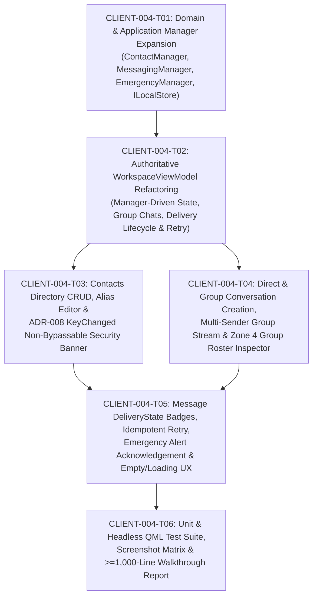

# CLIENT-004 — Contacts, Conversations & Messaging UI: Ticket Decomposition & Architectural Specification

- **Card ID:** `CLIENT-004`
- **Card Title:** Contacts, Conversations & Messaging UI
- **Phase Placement:** **Client Phase 1 (`specs/client-phase1/CLIENT-004-tickets.md`) — Closing Card of Phase 1 (Desktop Client Foundation & Core User Interface)**
- **Target Branch:** `feature/client-004-contacts-conversations-and-messaging-ui`
- **Prerequisites Completed:**
  - `CLIENT-001` — Client Application Foundation & Layered C++20/Qt6 Architecture (`main` merged)
  - `CLIENT-002` — UI Design System, Theme Engine, Reusable QML Controls & Navigation Shell (`main` merged)
  - `CLIENT-003` — Authentication Flow, 4-Zone Workspace Shell, Files Vault & Device/MFA Trust Center (`main` merged at `26bcfbb`)

---

## 1. Phase Classification: Why `CLIENT-004` Belongs to `specs/client-phase1/`

A key architectural question is whether `CLIENT-004` belongs to **`specs/client-phase1/`** or starts **`specs/client-phase2/`**. Based on the existing repository specifications and the 16-card SecureCloud Client roadmap, **`CLIENT-004` is the 4th and final card of `specs/client-phase1/`**:

1. **Explicit Phase 1 Boundary in `CLIENT-001-tickets.md`:**
   - [CLIENT-001-tickets.md](file:///Users/sergeychukhno/Desktop/C:C++/SecureCloud/specs/client-phase1/CLIENT-001-tickets.md#L236-L306) explicitly states that Client Phase 1 establishes the application foundation, navigation shell, and domain/manager entry points for **`CLIENT-001` through `CLIENT-004`**.
2. **Cohesive Phase 1 Scope (UI, ViewModel, Domain & Application-Manager Foundation):**
   - **`CLIENT-001`**: 4-layer C++20/Qt6 architecture (`UI -> Application -> Domain <- Infrastructure`), canonical domain entities, manager skeletons, and deterministic in-memory adapters (`MemoryLocalStore`, `NoopCryptoProvider`, `LoopbackGatewayClient`).
   - **`CLIENT-002`**: `Theme` singleton (Dark/Light palettes), 8 reusable `SC*` QML controls, and responsive navigation shell.
   - **`CLIENT-003`**: Authentication & MFA login flow (`AuthSessionManager`), 4-zone workspace shell, Encrypted Files Vault (`FileManager`), and Settings Device/Crypto/MFA Trust Center (`SettingsViewModel`).
   - **`CLIENT-004` (This Card)**: Completes the Phase 1 desktop workspace by replacing the static UI-only conversation/message vectors in `WorkspaceViewModel` with **authoritative Domain & Application Manager backing** (`ContactManager`, `MessagingManager`, `EmergencyManager`, `ILocalStore`), adding **Direct (`DIRECT`) and Group (`GROUP`) conversations**, **Contact CRUD & ADR-008 `KeyChanged` security blocking**, **full `DeliveryState` lifecycle & idempotent retry**, and **explicit Emergency Alert acknowledgement**.
3. **Where `specs/client-phase2/` Begins (`CLIENT-005`+):**
   - **Client Phase 2 — Cryptographic Identity, Signal Double Ratchet & Encrypted Persistence** begins with:
     - `CLIENT-005` — Device Registration & Cryptographic Identity Lifecycle (X25519/Ed25519 keygen, X3DH prekeys)
     - `CLIENT-006` — Secure Local Key Storage (macOS Keychain / Windows DPAPI / Linux Secret Service)
     - `CLIENT-007` — End-to-End Cryptographic Engine (X3DH & Signal Double Ratchet in `ICryptoProvider`)
     - `CLIENT-008` — End-to-End Encrypted Messaging & Out-of-Band Safety Number Verification
     - `CLIENT-009` — Encrypted Local Persistence (SQLite / SQLCipher `ILocalStore` adapter)

---

## 2. Architectural & Codebase Gap Analysis (`CLIENT-001`–`CLIENT-003` vs. `CLIENT-004`)

### 2.1 Reference Architecture & ADRs Analyzed
- [detailed-design.md](file:///Users/sergeychukhno/Desktop/C:C++/SecureCloud/docs/design/detailed-design.md) (§2.2 Client Layer Responsibilities, §2.4 Canonical Client Domain Model, §2.5 Client Application Managers, §2.6 Contacts & Identity Discovery, §2.7 Multi-Device & Group Model, §2.8 Local Persistence)
- [client-architecture-and-foundation.md](file:///Users/sergeychukhno/Desktop/C:C++/SecureCloud/docs/architecture/client-architecture-and-foundation.md)
- [client-class-diagram-notes.md](file:///Users/sergeychukhno/Desktop/C:C++/SecureCloud/docs/uml/class-diagrams/client/client-class-diagram-notes.md)
- [send-a-message-sequence-notes.md](file:///Users/sergeychukhno/Desktop/C:C++/SecureCloud/docs/sequence/send-a-message-sequence-notes.md) & [sync-offline-recovery-notes.md](file:///Users/sergeychukhno/Desktop/C:C++/SecureCloud/docs/sequence/sync-offline-recovery-notes.md)
- **ADR-005** (Multi-Device Fan-Out: User-level conversation participants vs. Device-level encryption/delivery targets)
- **ADR-007** (Message Priority & Emergency Alerting: `Normal`, `Urgent`, `Emergency` + explicit operator acknowledgement)
- **ADR-008** (Trust-On-First-Use & Out-of-Band Key Verification: `Unverified`, `Verified`, `KeyChanged` non-bypassable warning when a peer's identity key changes)

### 2.2 What Is Already Implemented in `main` (`26bcfbb`)
| Layer | Existing Implementation | Current Limitations / Gaps for `CLIENT-004` |
| :--- | :--- | :--- |
| **Domain (`src/client/domain/`)** | [`Contact`](file:///Users/sergeychukhno/Desktop/C:C++/SecureCloud/src/client/domain/contact.hpp), [`Conversation`](file:///Users/sergeychukhno/Desktop/C:C++/SecureCloud/src/client/domain/conversation.hpp) (`Direct`, `Group`), [`Message`](file:///Users/sergeychukhno/Desktop/C:C++/SecureCloud/src/client/domain/message.hpp) (`Priority`, `DeliveryState`), [`CryptoIdentity`](file:///Users/sergeychukhno/Desktop/C:C++/SecureCloud/src/client/domain/crypto_identity.hpp) (`Unverified`, `Verified`, `Invalid`). | 1. `KeyVerificationStatus` lacks `KeyChanged` (required by `detailed-design.md` §2.6 & ADR-008 when a known peer rotates/changes identity key). 2. `Contact` lacks `role_note` / `safety_number` / `online_status` / `device_count` metadata fields. 3. `Message` lacks `sender_display_name`, `idempotency_key`, and `emergency_acknowledged` state. |
| **Application (`src/client/application/`)** | [`ContactManager`](file:///Users/sergeychukhno/Desktop/C:C++/SecureCloud/src/client/application/managers/contact_manager.hpp), [`MessagingManager`](file:///Users/sergeychukhno/Desktop/C:C++/SecureCloud/src/client/application/managers/messaging_manager.hpp), [`EmergencyManager`](file:///Users/sergeychukhno/Desktop/C:C++/SecureCloud/src/client/application/managers/emergency_manager.hpp), [`ILocalStore`](file:///Users/sergeychukhno/Desktop/C:C++/SecureCloud/src/client/application/interfaces/i_local_store.hpp). | 1. `ContactManager` only has `upsert_contact`, `list_contacts`, `verify_contact_key`; lacks `create_contact`, `remove_contact`, `update_alias`, `update_role_note`, and `mark_key_changed`. 2. `MessagingManager` only has `open_direct_conversation` and `stage_outbound_message`; lacks `create_group_conversation`, `list_conversations`, `add_participant`, `remove_participant`, `leave_conversation`, `update_delivery_state`, `retry_failed_message`, and `mark_conversation_read`. 3. `EmergencyManager` only triggers local panic wipe; lacks `acknowledge_emergency_message` and `unacknowledged_emergency_count` per `detailed-design.md` §2.5. 4. `AppViewModel` does not yet wire `ContactManager`, `MessagingManager`, and `EmergencyManager` into `WorkspaceViewModel`. |
| **UI ViewModel (`src/client/ui/workspace_view_model.*`)** | [`WorkspaceViewModel`](file:///Users/sergeychukhno/Desktop/C:C++/SecureCloud/src/client/ui/workspace_view_model.hpp) exposes `conversations`, `messages`, `sharedFiles`, `allFiles`, and 1-on-1 peer inspector properties. | 1. Stores conversations and messages in isolated UI-layer `std::vector` structs instead of querying/mutating `MessagingManager`, `ContactManager`, `EmergencyManager`, and `ILocalStore`. 2. Only models 1-on-1 `Direct` chats; no `Group` conversation creation, participant roster, or group member management. 3. Outbound messages hardcode `deliveryState = "Encrypted"` rather than modeling canonical `DeliveryState` transitions (`LocalPending` $\to$ `Submitting` $\to$ `Accepted` $\to$ `Delivered` $\to$ `Read` / `Failed`) and idempotent retry. |
| **QML Workspace (`src/client/ui/qml/views/WorkspacePlaceholder.qml`)** | 4-zone shell with Zone 2 list, Zone 3 message stream + composer, and Zone 4 1-on-1 Peer Inspector. | 1. No `"New Conversation / New Group"` creation dialog or `"Add Contact"` dialog. 2. Zone 2 & Zone 3 do not distinguish `GROUP` vs. `DIRECT` conversations (no group badge, member count, or per-message sender attribution in group streams). 3. Zone 4 Inspector only shows 1-on-1 peer info; lacks a **Group Participants & Device Fan-Out Roster** (`Add Participant`, `Remove`, `Leave Group`) and inline **Contact Alias/Role Editing**. 4. No **ADR-008 Identity Key Changed (`KeyChanged`) Warning Banner** blocking outbound sends until re-verification. 5. No failed-message inline retry/discard controls, no Emergency message `"Acknowledge Receipt"` button, and no dedicated Empty / Loading state views. |

---

## 3. Ticket Decomposition (`CLIENT-004-T01` through `CLIENT-004-T06`)

---

### `CLIENT-004-T01` — Domain Model & Application Manager Expansion (`ContactManager`, `MessagingManager`, `EmergencyManager`, `ILocalStore`)

#### Objective
Complete the canonical Domain and Application Manager APIs specified in `docs/design/detailed-design.md` (§2.4–§2.8) so that all Contacts, Direct/Group Conversations, Message Delivery Lifecycles, and Emergency Alert Acknowledgements are governed by the Application and Domain layers rather than ad-hoc UI structs.

#### Detailed Scope
1. **Domain Enhancements (`src/client/domain/`)**:
   - [`crypto_identity.hpp`](file:///Users/sergeychukhno/Desktop/C:C++/SecureCloud/src/client/domain/crypto_identity.hpp): Add `KeyVerificationStatus::KeyChanged` alongside `Unverified`, `Verified`, and `Invalid` to model ADR-008 identity key change events.
   - [`contact.hpp`](file:///Users/sergeychukhno/Desktop/C:C++/SecureCloud/src/client/domain/contact.hpp): Extend `domain::Contact` with `safety_number`, `role_note`, `presence_status` (`Online`, `Away`, `Offline`), `is_blocked`, and `authorized_device_count` (modeling ADR-005 user-to-device fan-out metadata) while preserving existing constructors for backward compatibility.
   - [`conversation.hpp`](file:///Users/sergeychukhno/Desktop/C:C++/SecureCloud/src/client/domain/conversation.hpp): Add helper methods `add_participant(const UserId&)`, `remove_participant(const UserId&)`, `has_participant(const UserId&)`, and `unread_count` / `is_muted` metadata.
   - [`message.hpp`](file:///Users/sergeychukhno/Desktop/C:C++/SecureCloud/src/client/domain/message.hpp): Extend `domain::Message` with `sender_display_name`, `idempotency_key`, `emergency_acknowledged` (`bool`), and `attachment_name` / `attachment_size` / `attachment_hash` for inline encrypted file references.
2. **Persistence Port & Adapter (`ILocalStore` & `MemoryLocalStore`)**:
   - Extend [`ILocalStore`](file:///Users/sergeychukhno/Desktop/C:C++/SecureCloud/src/client/application/interfaces/i_local_store.hpp) and [`MemoryLocalStore`](file:///Users/sergeychukhno/Desktop/C:C++/SecureCloud/src/client/infrastructure/adapters/memory_local_store.hpp) with:
     - `get_contact(const domain::UserId&)`, `delete_contact(const domain::UserId&)`
     - `delete_conversation(const domain::ConversationId&)`
     - `update_message(const domain::Message&)` (for `DeliveryState` transitions, retry status, and emergency acknowledgement)
3. **Application Managers (`src/client/application/managers/`)**:
   - [`ContactManager`](file:///Users/sergeychukhno/Desktop/C:C++/SecureCloud/src/client/application/managers/contact_manager.hpp):
     - `create_contact(user_id, display_alias, safety_number, role_note)`
     - `remove_contact(user_id)`
     - `update_contact_alias(user_id, new_alias, new_role_note)`
     - `set_contact_blocked(user_id, blocked)`
     - `mark_contact_key_changed(user_id, new_safety_number)` (triggers `KeyVerificationStatus::KeyChanged`)
     - `verify_contact_key(user_id, verified)` (resolves `KeyChanged` or `Unverified` $\to$ `Verified`)
   - [`MessagingManager`](file:///Users/sergeychukhno/Desktop/C:C++/SecureCloud/src/client/application/managers/messaging_manager.hpp):
     - `open_direct_conversation(local_user, peer_user, title)`
     - `create_group_conversation(creator_user, title, participants)`
     - `list_conversations()`
     - `add_group_participant(conversation_id, user_id)`
     - `remove_group_participant(conversation_id, user_id)`
     - `leave_conversation(conversation_id, local_user_id)`
     - `stage_outbound_message(...)` — enforces **ADR-008 guard**: if any participant in the conversation has `KeyVerificationStatus::KeyChanged` or is blocked, returns `ErrorCode::PreconditionFailed` / `ErrorCode::Unauthorized` until resolved.
     - `update_message_delivery_state(conversation_id, message_id, new_state)`
     - `retry_failed_message(conversation_id, message_id)` — preserves the original `idempotency_key` (`detailed-design.md` §2.8) and transitions `Failed` $\to$ `Submitting` $\to$ `Delivered`.
     - `discard_failed_message(conversation_id, message_id)`
     - `mark_conversation_read(conversation_id)`
   - [`EmergencyManager`](file:///Users/sergeychukhno/Desktop/C:C++/SecureCloud/src/client/application/managers/emergency_manager.hpp):
     - `acknowledge_emergency_message(conversation_id, message_id, acknowledger_user_id)`
     - `unacknowledged_emergency_count(conversation_id)`

#### Acceptance Criteria
- Domain entities and Application Managers compile cleanly with `-Wall -Wextra -Wpedantic` and zero Qt UI dependencies in `securecloud_client_domain` or `securecloud_client_application`.
- Attempting to stage an outbound message in a conversation where a peer is in `KeyVerificationStatus::KeyChanged` is deterministically rejected by `MessagingManager`.
- Retrying a `Failed` message preserves its `MessageId` and `idempotency_key`.

---

### `CLIENT-004-T02` — Authoritative `WorkspaceViewModel` Refactoring (Manager-Driven State, Group Chats & Delivery Lifecycle)

#### Objective
Refactor [`WorkspaceViewModel`](file:///Users/sergeychukhno/Desktop/C:C++/SecureCloud/src/client/ui/workspace_view_model.hpp) and [`AppViewModel`](file:///Users/sergeychukhno/Desktop/C:C++/SecureCloud/src/client/ui/app_view_model.hpp) so that `WorkspaceViewModel` is driven by `ContactManager`, `MessagingManager`, `EmergencyManager`, and `FileManager` (seeded deterministically into `MemoryLocalStore`), and expose full QML bindings for Direct/Group conversations, Contact CRUD, `KeyChanged` security states, and `DeliveryState` lifecycles.

#### Detailed Scope
1. **Dependency Injection (`AppViewModel` $\to$ `WorkspaceViewModel`)**:
   - Inject `ContactManager&`, `MessagingManager&`, `EmergencyManager&`, and `FileManager&` into `WorkspaceViewModel` (maintaining a convenience constructor for standalone unit tests).
   - Seed initial enterprise dataset into `MemoryLocalStore` via the managers:
     - **Direct Conversations (`DIRECT`)**: `@frances.swann` (`Verified`), `@angelina.froster` (`Unverified`), `@ivan.petrov` (`Unverified`), `@elena.rostova` (`Verified`), `@marcus.vance` (`KeyChanged` — pre-configured or toggleable to demonstrate ADR-008 identity key rotation warning).
     - **Group Conversations (`GROUP`)**:
       - `"SecOps Incident Bridge"` (`GROUP`, 4 participants: `alice`, `@frances.swann`, `@angelina.froster`, `@elena.rostova`, totaling 9 authorized device endpoints per ADR-005).
       - `"Zero-Trust Enclave Migration"` (`GROUP`, 3 participants: `alice`, `@frances.swann`, `@ivan.petrov`, totaling 6 authorized device endpoints).
2. **New `Q_PROPERTY` Bindings on `WorkspaceViewModel`**:
   - `contacts` (`QVariantList` of all directory contacts with `userId`, `name`, `handle`, `initials`, `roleNote`, `safetyNumber`, `verificationStatus` [`"Verified"`, `"Unverified"`, `"KeyChanged"`], `online`, `blocked`, `deviceCount`, `conversationId`).
   - `selectedConversationIsGroup` (`bool`), `selectedConversationParticipantCount` (`int`), `selectedConversationDeviceFanoutCount` (`int`), `selectedConversationParticipants` (`QVariantList` of member objects for Zone 4 Group Roster).
   - `selectedPeerKeyChanged` (`bool` — `true` if the active direct peer or any group participant has `KeyVerificationStatus::KeyChanged`).
   - `selectedPeerKeyChangedHandle` (`QString` — identifies which peer's key changed).
   - `unacknowledgedEmergencyCount` (`int` — count of unacknowledged `Emergency` messages in the active conversation).
   - `isLoadingMessages` (`bool`) and `deliveryFailureSimulated` (`bool` — toggle allowing operators/smoke tests to test `Failed` message creation & idempotent retry).
3. **New `Q_INVOKABLE` Actions on `WorkspaceViewModel`**:
   - **Contacts**: `addContact(handle, displayName, roleNote, safetyNumber)`, `updateContactProfile(userId, displayName, roleNote)`, `removeContact(userId)`, `simulatePeerKeyChange(userId)`, `acceptAndVerifyPeerKey(userId)`.
   - **Conversations & Groups**: `createDirectConversation(userId)`, `createGroupConversation(groupTitle, participantUserIds)`, `addParticipantToActiveGroup(userId)`, `removeParticipantFromActiveGroup(userId)`, `leaveActiveGroup()`.
   - **Messaging & Delivery**: `retryFailedMessage(messageId)`, `discardFailedMessage(messageId)`, `setSimulateDeliveryFailure(enabled)`, `acknowledgeEmergencyMessage(messageId)`.

#### Acceptance Criteria
- All existing `CLIENT-003` QML property names and invokables on `WorkspaceViewModel` remain 100% backward-compatible.
- Switching between Direct and Group conversations immediately updates `selectedConversationIsGroup`, `selectedConversationParticipants`, and message sender attributions.
- All state mutations (`addContact`, `createGroupConversation`, `sendMessage`, `retryFailedMessage`, `acknowledgeEmergencyMessage`) persist through `MessagingManager` / `ContactManager` / `EmergencyManager` into `ILocalStore`.

---

### `CLIENT-004-T03` — Contacts Directory Management, Contact Creation Modal & ADR-008 `KeyChanged` Security Banner (Zones 2, 3 & 4)

#### Objective
Deliver a complete user-facing Contacts management experience across Zone 2, Zone 3, and Zone 4, including adding/removing contacts, editing local contact aliases/notes, and enforcing the non-bypassable **ADR-008 Identity Key Changed (`KeyChanged`)** security warning banner.

#### Detailed Scope
1. **Zone 2 Contacts Directory Header & `"Add Contact"` Modal**:
   - Add a `"+ Add Contact"` button (`SCButton`) in the Zone 2 header when `activeSection === "Contacts"` (and accessible from `Messages`).
   - Implement an `"Add Trusted Contact"` modal (`SCDialog` / overlay card) with inputs for:
     - Peer Handle / User ID (e.g., `@viktor.korchnoi`)
     - Local Display Alias (e.g., `Viktor Korchnoi`)
     - Role / Security Note (e.g., `HSM Key Custodian · Zurich Vault`)
     - Out-of-Band X3DH Safety Number (auto-populated or custom 30-digit fingerprint)
2. **Zone 3 Dedicated Contact Profile & Security Dossier (when `activeSection === "Contacts"` or inspecting a contact)**:
   - Enhance Contact cards in Zone 2 with explicit 3-state verification badges:
     - `Verified` (Emerald `SCBadge`)
     - `Unverified (TOFU)` (Amber `SCBadge`)
     - `Key Changed!` (Crimson danger `SCBadge`)
   - In Zone 4 (Peer Inspector), add an inline **"Edit Local Alias & Security Note"** collapsible form and a **"Remove Contact"** action with confirmation, plus a **"Simulate Peer Key Rotation (ADR-008)"** diagnostic action in the security inspector so operators can test key-change detection interactively.
3. **ADR-008 Non-Bypassable `KeyChanged` Security Warning Banner (Zone 3)**:
   - Whenever `workspaceViewModel.selectedPeerKeyChanged === true` (either in a Direct chat or because a Group member rotated their identity key without verification):
     - Display a high-visibility crimson/amber **Security Alert Banner** at the top of Zone 3: *"Cryptographic Identity Key Changed for @handle — Outbound E2EE messaging is suspended to prevent Man-in-the-Middle (MitM) interception until you verify the new X3DH safety number."*
     - Provide direct actions on the banner: **`"Verify New Safety Number"`** (transitions `KeyChanged` $\to$ `Verified` and unlocks the composer) and **`"Inspect Peer Identity"`** (opens Zone 4).
     - Disable the Zone 3 message composer `Send` button while `selectedPeerKeyChanged` or `selectedPeerBlocked` is `true`, showing an explicit lock reason in the placeholder.

#### Acceptance Criteria
- Operators can add a new contact, edit an existing contact's alias and role note, and remove a contact, with changes immediately reflected across Zone 2, Zone 3, and Zone 4.
- Triggering a peer key change displays the ADR-008 warning banner and blocks message sending both in the QML composer and in `MessagingManager` until the operator clicks `"Verify New Safety Number"`.

---

### `CLIENT-004-T04` — Direct & Group Conversation Creation, Multi-Sender Group Stream & Zone 4 Group Roster Inspector

#### Objective
Implement full support for **Direct (`DIRECT`)** and **Group (`GROUP`)** conversations across Zone 2, Zone 3, and Zone 4, explicitly visualizing the **ADR-005 Multi-Device & Group Model** (User-level participants vs. Device-level cryptographic fan-out targets).

#### Detailed Scope
1. **Zone 2 `"New Conversation / Encrypted Group"` Modal**:
   - Add a `"+ New Chat"` button in the Zone 2 `Messages` header.
   - Open a creation modal allowing the operator to switch between:
     - **Direct Conversation (`1:1`)**: Pick a contact from the directory to open or jump to their direct E2EE thread.
     - **Encrypted Group (`Multi-Party`)**: Enter a Group Title (e.g., `"Red-Team Crypto Response"`) and check multiple contacts from an interactive checklist to form the group participant roster.
2. **Zone 2 Conversation List Enhancements**:
   - Render a `"GROUP"` badge (`SCBadge`) and member count (`"4 members"`) on group conversation cards in Zone 2.
   - Show unread message counters (`unreadCount`) that automatically clear when the conversation is selected (`markConversationRead`).
3. **Zone 3 Group Header & Multi-Sender Message Attribution**:
   - In the Zone 3 header, display group metadata when `selectedConversationIsGroup === true`: group avatar, group title, `"Group · N Participants (M Device Endpoints)"`, and aggregate encryption trust badge (`"All Keys Verified"` vs. `"TOFU / Unverified Member"` vs. `"Key Changed Warning"`).
   - In the Zone 3 message stream for Group conversations, render each inbound message with the **sender's individual avatar (`SCAvatar`) and display name** above the bubble so multi-party discussions are clear.
4. **Zone 4 Group Inspector (`GROUP ENCRYPTION ROSTER`)**:
   - When `selectedConversationIsGroup === true`, dynamically switch Zone 4 from the 1-on-1 Peer Inspector to the **Group Security & Participant Roster Inspector**:
     - Group summary header (Group Title, `Sender Keys + Pairwise Double Ratchet`, total User participants vs. total Device endpoints per ADR-005).
     - **Participant Roster List**: Each participant row shows their avatar, display name, `@handle`, verification badge (`Verified` / `Unverified` / `KeyChanged`), authorized device count badge (`"2 devices"`), and a `"Remove"` button (for non-self members).
     - **`"+ Add Participant"` Selector**: Allows adding an existing contact from the directory into the active group, appending a system audit message to the stream.
     - **`"Leave Encrypted Group"` Action**: Removes the local user from the group and closes the thread.

#### Acceptance Criteria
- Users can create a new encrypted Group conversation with 2+ contacts, send messages into the group, view per-sender avatars/names in Zone 3, add or remove participants in Zone 4, and leave the group.
- Zone 4 clearly distinguishes User-level participants from Device-level cryptographic endpoints in accordance with `detailed-design.md` §2.7 and ADR-005.

---

### `CLIENT-004-T05` — Message `DeliveryState` Progression, Idempotent Retry, Emergency Alert Acknowledgement & Empty/Loading UX (Zone 3)

#### Objective
Complete the Zone 3 messaging interaction lifecycle defined in `detailed-design.md` (§2.4, §2.5, §2.8) and ADR-007: granular `DeliveryState` badges, idempotent retry of failed outbound messages, explicit operator acknowledgement of `Emergency` alerts, and polished Empty/Loading/Failure states.

#### Detailed Scope
1. **Canonical `DeliveryState` Lifecycle & Simulation Toggle**:
   - Display distinct visual badges/icons in outbound message footers for each canonical `DeliveryState`:
     - `LocalPending` (`"Pending Local Queue"`)
     - `Submitting` (`"Submitting via mTLS..."`)
     - `Accepted` (`"Accepted by Gateway"`)
     - `Delivered` (`"Delivered · E2EE"`)
     - `Read` (`"Read · Verified"`)
     - `Failed` (`"Delivery Failed"` — crimson badge)
   - Provide a compact `"Simulate Network Failure"` toggle chip in the composer toolbar (or transport bar) so operators and smoke testers can send a message that lands in `DeliveryState::Failed`.
2. **Idempotent Retry & Discard Controls on `Failed` Messages**:
   - When a message is in `DeliveryState::Failed`, highlight the message bubble with a danger border and render an inline action bar:
     - **`"Retry Send (Idempotent)"`**: Invokes `workspaceViewModel.retryFailedMessage(messageId)`, preserving the original `idempotencyKey` and transitioning the message to `Delivered · E2EE`.
     - **`"Discard"`**: Invokes `workspaceViewModel.discardFailedMessage(messageId)` to remove the failed message from the local queue.
3. **ADR-007 Emergency Message Acknowledgement Workflow**:
   - For any message with `priority === "Emergency"`:
     - Render an explicit emergency header banner inside the message bubble showing either:
       - **Unacknowledged State**: Flashing/highlighted crimson pill `"ACTION REQUIRED: Unacknowledged Emergency Alert"` + interactive **`"Acknowledge Receipt"`** button (`SCButton`).
       - **Acknowledged State**: Emerald/neutral badge `"Emergency Acknowledged by @alice"` with timestamp.
     - Also show an active **Unacknowledged Emergency Banner** at the top of Zone 3 if `unacknowledgedEmergencyCount > 0` in the current conversation.
4. **Empty & Loading States (`SCEmptyState` / Placeholders)**:
   - **Zero Search Results State** in Zone 2 (when `searchQuery` matches 0 conversations/contacts/files) with a `"Clear Filter"` button.
   - **Empty Conversation Stream State** in Zone 3 (when a newly created conversation or group has 0 messages yet), displaying an E2EE ratchet initialization card (`"End-to-End Encrypted Session Initialized — Send the first message to advance the Double Ratchet"`).
   - **No Conversation Selected State** in Zone 3 (e.g., after leaving a group when no chat is selected), offering quick buttons to `"Start New Conversation"` or `"Create Encrypted Group"`.

#### Acceptance Criteria
- Outbound messages display canonical `DeliveryState` badges (`Delivered · E2EE`, `Read · Verified`, or `Delivery Failed`).
- Toggling simulated network failure causes the next sent message to enter `Delivery Failed`, and clicking `"Retry Send (Idempotent)"` recovers it to `Delivered · E2EE` without duplicating the message.
- Clicking `"Acknowledge Receipt"` on an `Emergency` message marks it acknowledged via `EmergencyManager` and updates `unacknowledgedEmergencyCount`.

---

### `CLIENT-004-T06` — Automated Unit & Headless QML Tests, Visual Screenshot Matrix & `CLIENT-004` Walkthrough Report

#### Objective
Verify all `CLIENT-004` domain rules, application managers, ViewModel bindings, and QML interactions through automated CTest suites, capture a complete Light/Dark visual screenshot verification matrix, and produce a comprehensive `>= 1,000`-line walkthrough report in `docs/final-reports/walkthrough-client-004.md` with embedded screenshots.

#### Detailed Scope
1. **Automated Test Suite Expansion (`tests/client/foundation/client_foundation_test.cpp`)**:
   - **Domain & Manager Tests**:
     - `ContactManager` CRUD, alias update, and `KeyVerificationStatus::KeyChanged` transition & re-verification.
     - `MessagingManager` ADR-008 security guard (rejecting outbound messages when a participant is `KeyChanged` or blocked).
     - `MessagingManager` Group conversation creation, `add_group_participant`, `remove_group_participant`, and `leave_conversation`.
     - `MessagingManager` `DeliveryState` transitions and idempotent `retry_failed_message` (verifying `idempotency_key` preservation).
     - `EmergencyManager` `acknowledge_emergency_message` and `unacknowledged_emergency_count`.
   - **ViewModel & Headless QML Smoke Tests**:
     - Verify `WorkspaceViewModel` group conversation creation, contact creation, `simulatePeerKeyChange` + `acceptAndVerifyPeerKey`, `setSimulateDeliveryFailure` + `retryFailedMessage`, and `acknowledgeEmergencyMessage`.
     - Instantiate `Main.qml` offscreen and verify all 4 zones, group view, key-changed banner, and modals render with zero QML warnings.
2. **Visual Screenshot Verification Matrix (`docs/final-reports/assets/client-004/`)**:
   - Capture high-resolution offscreen PNG screenshots (`1200x800` & `960x640`, Dark & Light themes) covering:
     1. Direct Conversation with `DeliveryState` badges & Emergency Acknowledgement (`workspace-direct-dark-1200x800.png`, `workspace-direct-light-1200x800.png`)
     2. Encrypted Group Conversation (`"SecOps Incident Bridge"`) with Multi-Sender Stream & Zone 4 Group Participant Roster (`workspace-group-dark-1200x800.png`, `workspace-group-light-1200x800.png`)
     3. ADR-008 Identity Key Changed (`KeyChanged`) Non-Bypassable Security Banner & Blocked Composer (`workspace-keychanged-dark-1200x800.png`)
     4. Failed Outbound Message with Idempotent Retry Action Bar (`workspace-failed-retry-dark-1200x800.png`)
     5. Contacts Directory & Add Contact / New Group Creation Modal (`workspace-contacts-modal-dark-1200x800.png`)
3. **Comprehensive Final Report (`docs/final-reports/walkthrough-client-004.md`)**:
   - Write a `>= 1,000`-line architectural and verification walkthrough report (matching the depth and style of `walkthrough-client-003.md`) embedding all captured screenshots via relative paths (`assets/client-004/*.png`).

#### Acceptance Criteria
- `ctest --test-dir build/client-foundation --output-on-failure` passes 100% with zero warnings or memory leaks.
- All screenshots are committed under `docs/final-reports/assets/client-004/` and rendered inline in `docs/final-reports/walkthrough-client-004.md` (`>= 1,000` lines).

---

## 4. Traceability Matrix (`CLIENT-004` Acceptance Criteria $\leftrightarrow$ Tickets)

| `CLIENT-004` Official Requirement / ADR | Covered By Ticket(s) | Target Files |
| :--- | :--- | :--- |
| **Contacts list, contact details, add/remove contact, alias & note editing** | `T01`, `T02`, `T03` | `contact.hpp`, `contact_manager.{hpp,cpp}`, `workspace_view_model.{hpp,cpp}`, `WorkspacePlaceholder.qml` |
| **ADR-008 Verification statuses (`Unverified`, `Verified`, `KeyChanged`) & non-bypassable warning banner** | `T01`, `T02`, `T03` | `crypto_identity.hpp`, `contact_manager.{hpp,cpp}`, `messaging_manager.{hpp,cpp}`, `WorkspacePlaceholder.qml` |
| **Direct (`DIRECT`) & Group (`GROUP`) conversation presentation & creation** | `T01`, `T02`, `T04` | `conversation.hpp`, `messaging_manager.{hpp,cpp}`, `workspace_view_model.{hpp,cpp}`, `WorkspacePlaceholder.qml` |
| **ADR-005 Multi-Device & Group participant roster (`Add/Remove Participant`, `Leave Group`, device fan-out counts)** | `T01`, `T02`, `T04` | `contact.hpp`, `messaging_manager.{hpp,cpp}`, `workspace_view_model.{hpp,cpp}`, `WorkspacePlaceholder.qml` |
| **Message composer, canonical `DeliveryState` progression & idempotent retry (`retryFailedMessage`)** | `T01`, `T02`, `T05` | `message.hpp`, `messaging_manager.{hpp,cpp}`, `workspace_view_model.{hpp,cpp}`, `WorkspacePlaceholder.qml` |
| **ADR-007 Priority selector (`Normal`, `Urgent`, `Emergency`) & explicit Emergency Alert acknowledgement** | `T01`, `T02`, `T05` | `message.hpp`, `emergency_manager.{hpp,cpp}`, `workspace_view_model.{hpp,cpp}`, `WorkspacePlaceholder.qml` |
| **Loading, Empty (empty chat, 0 search results, no active chat), and Failure UX states** | `T02`, `T05` | `workspace_view_model.{hpp,cpp}`, `WorkspacePlaceholder.qml` |
| **Strict 4-Layer Boundary (no SQLite, raw crypto, or network calls in QML)** | `T01`–`T06` | Verified by CMake target linkage & `client_foundation_test.cpp` |

