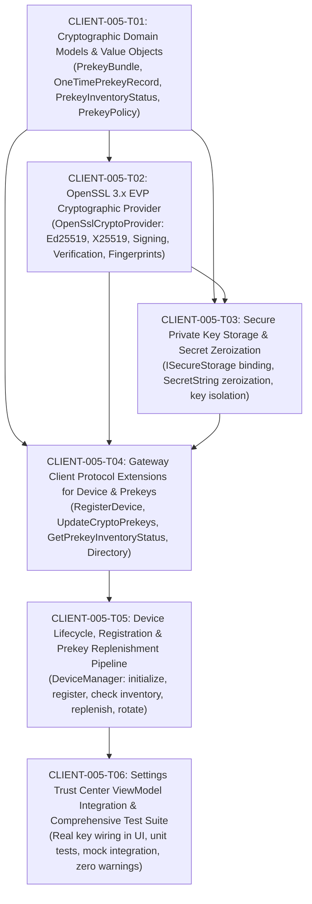

# CLIENT-005 — Device Registration & Cryptographic Identity Lifecycle: Ticket Decomposition & Architectural Specification

- **Card ID:** `CLIENT-005`
- **Card Title:** Device Registration & Cryptographic Identity Lifecycle
- **Phase Placement:** **Client Phase 2 (`specs/client-phase2/CLIENT-005-tickets.md`) — Opening Card of Phase 2 (Cryptographic Identity, Signal Double Ratchet & Encrypted Persistence)**
- **Target Branch:** `feature/client-005-device-registration-and-cryptographic-identity-lifecycle`
- **Prerequisites Completed:**
  - `CLIENT-001` — Client Application Foundation & Layered C++20/Qt6 Architecture (`main` merged)
  - `CLIENT-002` — UI Design System, Theme Engine, Reusable QML Controls & Navigation Shell (`main` merged)
  - `CLIENT-003` — Authentication Flow, 4-Zone Workspace Shell, Files Vault & Device/MFA Trust Center (`main` merged)
  - `CLIENT-004` — Contacts, Conversations & Messaging UI (`main` merged)

---

## 1. Executive Summary & Phase Classification

With the completion of **Client Phase 1 (`CLIENT-001` through `CLIENT-004`)**, the SecureCloud Desktop Client possesses a complete 4-layer UI shell, reactive ViewModels, domain models, navigation controllers, mock adapters, and contacts/messaging presentation.

**Card `CLIENT-005` initiates Client Phase 2**: transitioning the client from mock cryptographic stubs (`StubCryptoProvider`) and placeholder identities to **production cryptographic identity generation, X3DH prekey publication, device registration with the backend Auth service via the Gateway, secure private key handling, and automated prekey replenishment/rotation**.

```text
                               SECURECLOUD CLIENT (Phase 2)
 ┌────────────────────────────────────────────────────────────────────────────────────────┐
 │ Application Layer: DeviceManager / PrekeyLifecycleCoordinator                         │
 │                                                                                        │
 │  1. Generate Ed25519 Identity Keypair + X25519 Signed Prekey + 100 One-Time Prekeys   │
 │  2. Sign Signed Prekey with Ed25519 Identity Private Key                               │
 │  3. Compute Colon-Separated Fingerprint (SHA256:XX:XX:...)                             │
 │  4. Store Private Keys in ISecureStorage (Zeroized via SecretString)                   │
 │  5. Transmit Public PrekeyBundle via Gateway to Auth (RegisterDeviceRequest)           │
 └─────────────────────────────┬──────────────────────────┬───────────────────────────────┘
                               │ Private Material         │ Public Material ONLY
                               ▼                          ▼
               ┌──────────────────────────────┐   ┌──────────────────────────────┐
               │    Local ISecureStorage      │   │     Gateway / Auth API       │
               │  (Identity & Prekey Privates)│   │  (Public Crypto Directory)   │
               └──────────────────────────────┘   └──────────────────────────────┘
```

---

## 2. Architectural Analysis & Invariants

### 2.1 ADR-008 & Detailed Design Alignment

1. **Separation of Authentication and Cryptographic Identity (ADR-008 §5):**
   - Account authentication (JWT / credentials) proves *who* the user is to the backend.
   - Device cryptographic identity (Ed25519 identity key, X25519 prekeys) proves *which endpoint* participates in end-to-end encryption.
   - Compromise of an authentication token must never yield device message-decryption keys, and vice versa.

2. **Endpoint-Only Private Keys (ADR-008 §4, §6):**
   - Every physical installation is an independent cryptographic endpoint (`User -> Device -> CryptoIdentity`).
   - Private keys (Ed25519 identity private key, X25519 signed prekey private key, X25519 one-time prekey private keys) **NEVER** leave the client boundary.
   - The backend public key directory in `auth` stores public keys and signatures only.

3. **No Ad-Hoc Cryptographic Primitives (ADR-008 §3):**
   - All cryptographic operations must use **OpenSSL 3.x EVP** (`EVP_PKEY_ED25519`, `EVP_PKEY_X25519`, `EVP_DigestSign`, `EVP_DigestVerify`, `EVP_DigestInit_ex(EVP_sha256())`).
   - No custom elliptic curve math or hand-rolled signatures.

4. **Wire & Backend Contract Alignment (`proto/securecloud/auth/v1/auth.proto`):**
   - **`RegisterDeviceRequest`**: `user_id` (string UUID), `identity_key` (32 bytes raw Ed25519 public key), `signed_prekey` (32 bytes raw X25519 public key), `signed_prekey_signature` (64 bytes Ed25519 signature), `one_time_prekeys` (repeated 32 bytes raw X25519 public keys, default bundle size 100).
   - **`UpdateCryptoPrekeysRequest`**: `device_id` (string UUID), `signed_prekey` (optional 32 bytes for rotation), `signed_prekey_signature` (optional 64 bytes), `one_time_prekeys` (repeated 32 bytes for replenishment).
   - **`GetPrekeyInventoryStatusRequest/Response`**: `device_id`, `active_one_time_prekeys`, `claimed_one_time_prekeys`, `low_inventory_threshold` (default 20), `is_low_inventory`, `is_exhausted`, `signed_prekey_age_seconds`, `signed_prekey_needs_rotation` (default 7 days).
   - **Key Fingerprint Format**: Uppercase colon-separated hex digest (`"SHA256:XX:XX:..."`) computed over raw Ed25519 identity public key bytes, matching [`KeyFingerprint::compute_sha256`](file:///Users/sergeychukhno/Desktop/C:C++/SecureCloud/src/auth/crypto/key_fingerprint.hpp#L15-L25).

5. **Memory Safety & Secret Zeroization:**
   - Private keys stored in memory must utilize [`SecretString`](file:///Users/sergeychukhno/Desktop/C:C++/SecureCloud/src/common/include/securecloud/configuration/secret_string.hpp#L15-L40) with `OPENSSL_cleanse` wiping on destruction.

---

## 3. Codebase Gap Analysis

| Component | Current State (`CLIENT-004`) | Target State (`CLIENT-005`) |
| :--- | :--- | :--- |
| **Domain** | [`CryptoIdentity`](file:///Users/sergeychukhno/Desktop/C:C++/SecureCloud/src/client/domain/crypto_identity.hpp) has basic fields; lacks prekey bundle and inventory value types. | Add [`PrekeyBundle`](file:///Users/sergeychukhno/Desktop/C:C++/SecureCloud/src/client/domain/prekey_bundle.hpp), [`OneTimePrekeyRecord`](file:///Users/sergeychukhno/Desktop/C:C++/SecureCloud/src/client/domain/one_time_prekey_record.hpp), [`PrekeyInventoryStatus`](file:///Users/sergeychukhno/Desktop/C:C++/SecureCloud/src/client/domain/prekey_inventory_status.hpp), and [`PrekeyPolicy`](file:///Users/sergeychukhno/Desktop/C:C++/SecureCloud/src/client/domain/prekey_policy.hpp). |
| **Crypto Provider** | [`StubCryptoProvider`](file:///Users/sergeychukhno/Desktop/C:C++/SecureCloud/src/client/infrastructure/adapters/stub_crypto_provider.cpp) returns hardcoded strings. | Implement production [`OpenSslCryptoProvider`](file:///Users/sergeychukhno/Desktop/C:C++/SecureCloud/src/client/infrastructure/adapters/openssl_crypto_provider.hpp) using OpenSSL 3.x EVP for Ed25519/X25519 key generation, signing, verification, and SHA-256 fingerprinting. |
| **Secure Storage Adapter** | [`MemorySecureStorage`](file:///Users/sergeychukhno/Desktop/C:C++/SecureCloud/src/client/infrastructure/adapters/memory_secure_storage.hpp) holds raw `SecretString`s. | Provide domain key serialization/deserialization for private identity, signed prekey, and one-time prekeys with zeroized cleanup. |
| **Gateway Client** | [`IGatewayClient`](file:///Users/sergeychukhno/Desktop/C:C++/SecureCloud/src/client/application/interfaces/i_gateway_client.hpp) lacks device registration and prekey endpoints. | Add `register_device()`, `update_crypto_prekeys()`, `get_prekey_inventory_status()`, and `get_device_crypto_directory()` to `IGatewayClient` and `DefaultGatewayClient`. |
| **Device Manager** | [`DeviceManager`](file:///Users/sergeychukhno/Desktop/C:C++/SecureCloud/src/client/application/managers/device_manager.hpp) only has stubs for `list_devices()` and `revoke_device()`. | Implement local identity initialization, device registration flow, automated prekey replenishment, signed prekey rotation, and status tracking. |
| **UI Integration** | [`WorkspaceViewModel`](file:///Users/sergeychukhno/Desktop/C:C++/SecureCloud/src/client/ui/workspace_view_model.cpp) returns simulated fingerprint and dummy device records. | Wire `DeviceManager` into `WorkspaceViewModel` so that the Settings Trust Center displays real cryptographic fingerprints, prekey counts, and device registration states. |

---

## 4. Ticket Decomposition (`CLIENT-005-T01` through `CLIENT-005-T06`)



---

### CLIENT-005-T01: Cryptographic Domain Models & Value Objects
- **Files to Create / Modify:**
  - Create `src/client/domain/prekey_bundle.hpp` / `.cpp`
  - Create `src/client/domain/one_time_prekey_record.hpp` / `.cpp`
  - Create `src/client/domain/prekey_inventory_status.hpp` / `.cpp`
  - Create `src/client/domain/prekey_policy.hpp`
  - Update `src/client/domain/crypto_identity.hpp` / `.cpp`
  - Update `src/client/CMakeLists.txt`
- **Scope & Objectives:**
  - Define `PrekeyBundle`: holds raw 32-byte Ed25519 public identity key, 32-byte X25519 signed prekey, 64-byte Ed25519 signature, timestamp, and collection of 32-byte X25519 one-time prekeys.
  - Define `OneTimePrekeyRecord`: holds prekey ID (UUID / sequential index), raw public key bytes, and consumption/upload status.
  - Define `PrekeyInventoryStatus`: holds active count, low inventory threshold (default 20), signed prekey age, and rotation requirement flag.
  - Define `PrekeyPolicy`: configurable constants (initial bundle size: 100, replenishment threshold: 20, batch upload size: 50, signed prekey rotation interval: 7 days).
  - Add domain invariants: byte length validation, non-empty identifiers, immutability where appropriate.
  - Zero Qt/OS/network dependencies in domain.

---

### CLIENT-005-T02: OpenSSL 3.x EVP Cryptographic Provider
- **Files to Create / Modify:**
  - Update `src/client/application/interfaces/i_crypto_provider.hpp`
  - Create `src/client/infrastructure/adapters/openssl_crypto_provider.hpp` / `.cpp`
  - Update `src/client/infrastructure/adapters/stub_crypto_provider.hpp` / `.cpp` (keep stub updated with new interface signatures)
  - Update `src/client/CMakeLists.txt` (link `OpenSSL::Crypto` to `securecloud_client_infra`)
- **Scope & Objectives:**
  - Expand `ICryptoProvider` interface to declare:
    - `generate_identity_keypair()` -> returns public key + private key `SecretString`
    - `generate_signed_prekey(identity_private_key)` -> returns public key + private key + 64-byte Ed25519 signature
    - `verify_signed_prekey(identity_public_key, signed_prekey_public_key, signature)` -> bool
    - `generate_one_time_prekeys(count)` -> returns vector of public/private pairs
    - `compute_identity_fingerprint(identity_public_key)` -> returns `"SHA256:XX:XX:..."`
  - Implement `OpenSslCryptoProvider`:
    - Use `EVP_PKEY_ED25519` via `EVP_PKEY_Q_keygen` or `EVP_PKEY_CTX_new_id(EVP_PKEY_ED25519)`.
    - Use `EVP_PKEY_X25519` for prekeys.
    - Raw 32-byte extraction using `EVP_PKEY_get_raw_public_key` and `EVP_PKEY_get_raw_private_key`.
    - Ed25519 signing using `EVP_DigestSignInit` / `EVP_DigestSign` with null digest (pure Ed25519 per RFC 8032).
    - Signature verification using `EVP_DigestVerifyInit` / `EVP_DigestVerify`.
    - Compute SHA-256 fingerprint matching [`KeyFingerprint`](file:///Users/sergeychukhno/Desktop/C:C++/SecureCloud/src/auth/crypto/key_fingerprint.hpp).

---

### CLIENT-005-T03: Secure Private Key Storage & Secret Zeroization
- **Files to Create / Modify:**
  - Create `src/client/domain/device_private_bundle.hpp` / `.cpp`
  - Create `src/client/infrastructure/adapters/key_storage_helper.hpp` / `.cpp`
  - Update `src/client/application/interfaces/i_secure_storage.hpp`
  - Update `src/client/infrastructure/adapters/memory_secure_storage.hpp` / `.cpp`
  - Update `src/client/CMakeLists.txt`
- **Scope & Objectives:**
  - Encapsulate private keys in `DevicePrivateBundle` using `SecretString` for every private component:
    - Identity private key (32 bytes raw)
    - Signed prekey private key (32 bytes raw)
    - Map of one-time prekey ID -> private key (32 bytes raw)
  - `KeyStorageHelper`: serialization and deserialization routines to store and load private key bundles securely in `ISecureStorage` under well-known keys (e.g., `device.identity.private.<device_id>`).
  - Zeroization guarantees: ensure memory buffers holding raw private keys are cleansed via `OPENSSL_cleanse` upon destruction or scope exit.
  - Strict boundary defense: private keys are never exposed in public models, logs, or network payloads.

---

### CLIENT-005-T04: Gateway Client Protocol Extensions for Device & Prekeys
- **Files to Create / Modify:**
  - Update `src/client/application/interfaces/i_gateway_client.hpp`
  - Update `src/client/infrastructure/adapters/default_gateway_client.hpp` / `.cpp`
  - Update `src/client/infrastructure/gateway_adapter_stub.hpp` / `.cpp`
  - Update `src/client/CMakeLists.txt`
- **Scope & Objectives:**
  - Add gateway methods:
    - `register_device(user_id, prekey_bundle)` -> `ClientResult<DeviceRegistrationResult>`
    - `update_crypto_prekeys(device_id, prekey_bundle)` -> `ClientResult<PrekeyUpdateResult>`
    - `get_prekey_inventory_status(device_id)` -> `ClientResult<PrekeyInventoryStatus>`
    - `get_device_crypto_directory(user_id)` -> `ClientResult<std::vector<DeviceCryptoRecord>>`
  - Implement request encoding / response decoding in `DefaultGatewayClient` matching `proto/securecloud/auth/v1/auth.proto`.
  - Handle HTTP status codes (200 OK, 400 Bad Request, 401 Unauthorized, 409 Conflict) and map to canonical `ClientError`.
  - Support loopback / mock gateway responses in tests and offline scenarios.

---

### CLIENT-005-T05: Device Lifecycle, Registration & Prekey Replenishment Pipeline
- **Files to Create / Modify:**
  - Update `src/client/application/managers/device_manager.hpp` / `.cpp`
  - Create `src/client/application/managers/prekey_lifecycle_coordinator.hpp` / `.cpp`
  - Update `src/client/CMakeLists.txt`
- **Scope & Objectives:**
  - Implement full device registration workflow in `DeviceManager`:
    - `initialize_local_identity()`: check `ISecureStorage`. If existing keys found, load and validate. If none exist, invoke `ICryptoProvider` to generate fresh identity keypair, signed prekey, and 100 one-time prekeys; store private bundle securely.
    - `register_device(user_id, display_name)`: upload public `PrekeyBundle` to backend via `IGatewayClient::register_device`. Store assigned `DeviceId` and mark device status (`Authorized` or `Pending`).
    - `get_local_device()`: return current device entity with active `CryptoIdentity`.
  - Implement `PrekeyLifecycleCoordinator`:
    - `check_inventory()`: query backend prekey inventory status via `IGatewayClient`.
    - `replenish_if_needed()`: if active prekeys < low-inventory threshold (20), generate fresh batch (e.g. 50 OTPKs), securely persist their private halves, and upload public halves via `update_crypto_prekeys`.
    - `rotate_signed_prekey_if_needed()`: if signed prekey age exceeds 7 days (or backend reports rotation needed), generate fresh X25519 prekey, sign it with identity key, persist private key, and upload new signed prekey.

---

### CLIENT-005-T06: Settings Trust Center ViewModel Integration & Comprehensive Test Suite
- **Files to Create / Modify:**
  - Update `src/client/ui/workspace_view_model.hpp` / `.cpp`
  - Update `src/client/application/client_bootstrap.hpp` / `.cpp`
  - Create `tests/unit/client/client_crypto_identity_test.cpp`
  - Create `tests/unit/client/client_device_registration_test.cpp`
  - Update `tests/unit/CMakeLists.txt`
- **Scope & Objectives:**
  - UI ViewModel Wiring:
    - Wire `WorkspaceViewModel::localDeviceIdentity()` to query real `DeviceManager::get_local_device()`, exposing real identity key, SHA-256 fingerprint, active prekey count, and verification status.
    - Wire `WorkspaceViewModel::rotateSignedPrekey()` to trigger `DeviceManager::rotate_signed_prekey()`.
    - Expose real device inventory health in Settings Trust Center.
  - Comprehensive Unit Test Suite:
    - **Key Generation & Math Tests**: Verify Ed25519 (32 bytes public, 32/64 bytes private) and X25519 (32 bytes public, 32 bytes private).
    - **Signature Verification**: Verify valid Ed25519 signatures over signed prekeys; verify corrupted signatures fail; verify mismatched keys fail.
    - **Fingerprint Test**: Verify SHA-256 fingerprint calculation precisely matches `auth::crypto::KeyFingerprint`.
    - **Private Key Isolation**: Verify public bundles and serialization never contain private key markers or ASN.1 sequences.
    - **Registration Pipeline**: Test initial registration, duplicate registration error handling, and authorization states.
    - **Prekey Replenishment & Rotation**: Test low inventory detection, replenishment batch generation, and signed prekey rotation.
    - **Compiler Standards**: Zero warnings under `-Wall -Wextra -Wpedantic -Werror`.

---

## 5. Verification & Acceptance Criteria

1. **Cryptographic Correctness**:
   - Ed25519 and X25519 keys generated strictly via OpenSSL 3.x EVP.
   - Signed prekey signature verification passes both in client and against backend [`DeviceKeyValidator`](file:///Users/sergeychukhno/Desktop/C:C++/SecureCloud/src/auth/crypto/device_key_validator.hpp).
   - Fingerprint strictly matches uppercase colon-separated format `SHA256:XX:XX:...`.
2. **Security & Memory Safety**:
   - Private keys are stored in `SecretString` and wiped via `OPENSSL_cleanse` on destruction.
   - Zero private key material in network payloads or logs.
3. **Lifecycle Automation**:
   - Device enrollment succeeds through Gateway/Auth contracts.
   - Automated replenishment triggers when OTPK inventory falls below 20.
   - Signed prekey rotation cleanly replaces active signed prekey without breaking identity key.
4. **Code Quality**:
   - 100% clean build with zero compiler warnings across all platforms.
   - All unit tests pass in `securecloud_client_foundation_test`.

