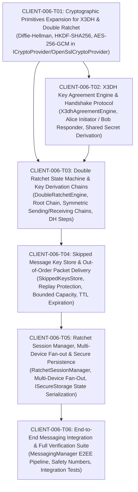

# CLIENT-006 — Signal Double Ratchet Session Management & End-to-End Encryption: Ticket Decomposition & Architectural Specification

- **Card ID:** `CLIENT-006`
- **Card Title:** Signal Double Ratchet Session Management & End-to-End Encryption
- **Phase Placement:** **Client Phase 2 (`specs/client-phase2/CLIENT-006-tickets.md`) — Core End-to-End Cryptography & Session Lifecycle**
- **Target Branch:** `feature/client-006-double-ratchet-session-management-and-e2ee`
- **Prerequisites Completed:**
  - `CLIENT-001` — Client Application Foundation & Layered C++20/Qt6 Architecture (`main` merged)
  - `CLIENT-002` — UI Design System, Theme Engine, Reusable QML Controls & Navigation Shell (`main` merged)
  - `CLIENT-003` — Authentication Flow, 4-Zone Workspace Shell, Files Vault & Device/MFA Trust Center (`main` merged)
  - `CLIENT-004` — Contacts, Conversations & Messaging UI (`main` merged)
  - `CLIENT-005` — Device Registration & Cryptographic Identity Lifecycle (`main` merged)

---

## 1. Executive Summary & Phase Classification

With the completion of **Card `CLIENT-005`**, the client generates valid Ed25519 identity keypairs, X25519 signed prekeys, and sets of one-time prekeys; publishes public prekey bundles to the backend Auth service via the Gateway; and securely persists private keys with `SecretString` zeroization in `ISecureStorage`.

**Card `CLIENT-006` establishes the production End-to-End Encryption (E2EE) messaging engine**. It transforms the client from sending mock ciphertext prefixes (`"encrypted:" + plaintext`) to executing the complete **Signal X3DH (Extended Triple Diffie-Hellman)** key agreement and **Signal Double Ratchet** protocol using **OpenSSL 3.x EVP** primitives (X25519 Diffie-Hellman, HKDF-SHA256, AES-256-GCM AEAD). It guarantees **Forward Secrecy (FS)**, **Post-Compromise Security (PCS)**, out-of-order message decryption with bounded skipped key stores, and multi-device fan-out per recipient device.

### Ticket Status Matrix

| Ticket | Description | Status | Commit / Notes |
|---|---|---|---|
| **CLIENT-006-T01** | Cryptographic Primitives Expansion for X3DH & Double Ratchet | Completed | `1f28223` |
| **CLIENT-006-T02** | X3DH Key Agreement Engine & Handshake Protocol | Completed | `e96f8ec` |
| **CLIENT-006-T03** | Double Ratchet State Machine & Key Derivation Chains | Completed | `90c4c42` |
| **CLIENT-006-T04** | Skipped Message Key Store & Out-of-Order Packet Delivery | Completed | `06133d7` |
| **CLIENT-006-T05** | Ratchet Session Manager, Multi-Device Fan-out & Secure Session Persistence | Completed | `9b5f8f7` |
| **CLIENT-006-T06** | End-to-End Messaging Integration & Full Cryptographic Verification Suite | Completed | Wire `MessagingManager`, wire `WorkspaceViewModel`, end-to-end tests |

```text
                                SECURECLOUD CLIENT (Phase 2 - CLIENT-006)
 ┌────────────────────────────────────────────────────────────────────────────────────────┐
 │ Application Layer: MessagingManager / RatchetSessionManager                            │
 │                                                                                        │
 │  1. Inbound/Outbound Message Interception                                              │
 │  2. Active Session Lookup for Target Device (UserId + DeviceId)                        │
 │  3. If No Session: Fetch Peer PrekeyBundle via Gateway -> Perform X3DH Handshake       │
 │  4. Ratchet Step: Advance Symmetric Chain / DH Ratchet                                 │
 │  5. Encrypt with AES-256-GCM (Message Key, Nonce, Header as AAD)                      │
 │  6. Deliver Per-Device EncryptedPayloads via Gateway SendMessage                       │
 └─────────────────────────────┬──────────────────────────┬───────────────────────────────┘
                               │ Private Material         │ Public Material ONLY
                               ▼                          ▼
                ┌──────────────────────────────┐   ┌──────────────────────────────┐
                │    Local ISecureStorage      │   │    Gateway Messaging API     │
                │ (Ratcheted Session State,    │   │ (Opaque EncryptedPayloads,   │
                │  Skipped Keys, Chain Keys)   │   │  PerDeviceDeliveryTargets)   │
                └──────────────────────────────┘   └──────────────────────────────┘
```

---

## 2. Architectural Analysis & Invariants

### 2.1 ADR-008 & Detailed Design Alignment

1. **Strict Signal Protocol Compatibility (ADR-008 §1, §3):**
   - Initial 1:1 session key agreement uses **X3DH** (Extended Triple Diffie-Hellman) over Curve25519.
   - Ongoing messaging uses the **Signal Double Ratchet**: a continuous combination of Diffie-Hellman ratchets (interleaved with message exchange) and symmetric-key ratchets (KDF chains per DH step).
   - All cryptographic implementations must leverage standard **OpenSSL 3.x EVP** APIs (`EVP_PKEY_derive`, `EVP_KDF_fetch(nullptr, "HKDF", nullptr)`, `EVP_aes_256_gcm`).
   - Zero custom or hand-rolled cryptographic primitives.

2. **Per-Device Pairwise Sessions (ADR-008 §4, Design 5.3):**
   - Sessions exist strictly between physical client devices: `(LocalDeviceId, PeerDeviceId)`.
   - When a user sends a message to another user or group, client application performs **multi-device fan-out**: encrypting a unique `EncryptedPayload` for each authorized active device belonging to the recipient(s) as well as the sender's other registered devices.
   - Backend messaging service acts strictly as an untrusted store-and-forward relay routing opaque payloads.

3. **Forward Secrecy (FS) & Post-Compromise Security (PCS):**
   - **Forward Secrecy**: Once a message key is used to encrypt or decrypt, it is immediately wiped from memory. Past messages cannot be decrypted even if the current root key or chain key is compromised.
   - **Post-Compromise Security**: Every DH ratchet step mixes fresh asymmetric entropy into the root key, healing compromised session keys once the adversary loses passive man-in-the-middle or read capabilities.

4. **Out-of-Order Message Handling & Replay Prevention:**
   - Network reordering or delayed delivery must be handled by advancing the receiver chain and stashing derived message keys in a bounded `SkippedKeysStore`.
   - Maximum skipped key capacity per session: 1,000 keys.
   - Maximum age / time-to-live (TTL) for skipped keys: 14 days.
   - Replay defense: Counter sequences and message identifiers prevent double-decryption or replay injection.

5. **Associated Data (AAD) & Tamper Resistance:**
   - The message header (ratchet public key $DH$, message counter $N$, previous chain length $PN$, and protocol version) along with sender and recipient identities is authenticated as **Additional Authenticated Data (AAD)** in AES-256-GCM.
   - Any tampering with routing headers or ciphertext results in immediate AEAD tag verification failure (`EVP_DecryptFinal_ex` fails).

---

## 3. Codebase Gap Analysis

| Component | Current State (`CLIENT-005`) | Target State (`CLIENT-006`) |
| :--- | :--- | :--- |
| **`ICryptoProvider` / `OpenSslCryptoProvider`** | Has Ed25519/X25519 key generation, signing, verification, SHA-256 fingerprints. `encrypt_message` / `decrypt_message` return dummy `"encrypted:"` prefixes. | Expand with `diffie_hellman()`, `hkdf_extract()`, `hkdf_expand()`, `encrypt_aes_gcm()`, and `decrypt_aes_gcm()`. |
| **`domain::crypto`** | Has `CryptoIdentity`, `PrekeyBundle`, `OneTimePrekeyRecord`, `DevicePrivateBundle`. | Add `X3dhHandshakeMessage`, `RatchetHeader`, `RatchetMessageKey`, `RatchetChainKey`, `RatchetState`, `EncryptedMessageEnvelope`. |
| **Key Agreement Engine** | None. Handshake logic not implemented. | Add `X3dhAgreementEngine`: Initiator (Alice) builds initial handshake and derives $SK$; Responder (Bob) reconstructs $SK$ and consumes one-time prekey. |
| **Double Ratchet State Machine** | None. | Add `DoubleRatchetEngine`: Root KDF chain, Sending KDF chain, Receiving KDF chain, DH ratchet stepping, AEAD encryption/decryption with AAD. |
| **Skipped Keys Store** | None. | Add `SkippedKeysStore`: bounded memory storage, TTL eviction, zeroization of consumed keys, max capacity enforcement. |
| **`RatchetSessionManager`** | None. | Add `RatchetSessionManager`: manages active sessions by `(UserId, DeviceId)`, session establishment via directory lookup, serialization to `ISecureStorage`. |
| **`MessagingManager`** | Has mock message encryption (`crypto_provider_.encrypt_message(...)`). | Integrate `RatchetSessionManager` into `send_message`, outbound message fan-out, inbound sync decryption, and verification. |

---

## 4. Ticket Decomposition (`CLIENT-006-T01` through `CLIENT-006-T06`)



---

### CLIENT-006-T01: Cryptographic Primitives Expansion for X3DH & Double Ratchet

- **Objective:** Extend `ICryptoProvider` and `OpenSslCryptoProvider` with low-level, high-assurance cryptographic primitives required by X3DH and Double Ratchet: Curve25519 Diffie-Hellman key derivation, HKDF-SHA256 extract/expand, and AES-256-GCM AEAD authenticated encryption/decryption.
- **Architectural Scope:**
  - `EVP_PKEY_derive_init` / `EVP_PKEY_derive` using `EVP_PKEY_X25519` for constant-time Diffie-Hellman operations between private and public keys.
  - `EVP_KDF_fetch(nullptr, "HKDF", nullptr)` with `EVP_sha256()` supporting HKDF-Extract and HKDF-Expand with arbitrary application info labels.
  - `EVP_CIPHER_CTX` with `EVP_aes_256_gcm()` for 12-byte IV authenticated encryption with 16-byte authentication tags and arbitrary Additional Authenticated Data (AAD).
  - Explicit secret zeroization of temporary buffers using `OPENSSL_cleanse`.
- **Target Deliverables:**
  - Update [`src/client/application/interfaces/i_crypto_provider.hpp`](file:///Users/sergeychukhno/Desktop/C:C++/SecureCloud/src/client/application/interfaces/i_crypto_provider.hpp).
  - Update [`src/client/infrastructure/adapters/openssl_crypto_provider.hpp`](file:///Users/sergeychukhno/Desktop/C:C++/SecureCloud/src/client/infrastructure/adapters/openssl_crypto_provider.hpp) and [`openssl_crypto_provider.cpp`](file:///Users/sergeychukhno/Desktop/C:C++/SecureCloud/src/client/infrastructure/adapters/openssl_crypto_provider.cpp).
  - Update [`src/client/infrastructure/adapters/stub_crypto_provider.hpp`](file:///Users/sergeychukhno/Desktop/C:C++/SecureCloud/src/client/infrastructure/adapters/stub_crypto_provider.hpp) and implementation.
  - Unit tests in `tests/client/client_crypto_provider_test.cpp` verifying RFC 7748 / RFC 5869 / NIST test vectors.
- **Verification Criteria:**
  - Both parties deriving X25519 shared secret compute identical 32-byte outputs.
  - HKDF generates expected output matching RFC 5869 test vectors.
  - AES-256-GCM round-trips plaintext correctly, and modifying any ciphertext or AAD byte causes decryption failure.

---

### CLIENT-006-T02: X3DH Key Agreement Engine & Handshake Protocol

- **Objective:** Implement the Signal X3DH (Extended Triple Diffie-Hellman) protocol domain engine enabling an initiator (Alice) and responder (Bob) to negotiate a cryptographically mutually authenticated initial shared secret ($SK$).
- **Architectural Scope:**
  - Domain models: `X3dhHeader`, `X3dhInitiatorResult`, `X3dhResponderResult`.
  - Alice (Initiator):
    - Fetches Bob's public prekey bundle ($IK_B, SPK_B, OPK_B$).
    - Verifies Bob's signed prekey signature against $IK_B$.
    - Generates ephemeral keypair $EK_A$.
    - Computes $DH_1 = DH(IK_A, SPK_B)$, $DH_2 = DH(EK_A, IK_B)$, $DH_3 = DH(EK_A, SPK_B)$, and optional $DH_4 = DH(EK_A, OPK_B)$.
    - Derives $SK = \text{HKDF}(\text{salt}=0^{32}, IKM=DH_1 \| DH_2 \| DH_3 [\| DH_4], \text{info}=\text{"SecureCloud-X3DH-v1"})$.
  - Bob (Responder):
    - Reconstructs $DH_1..DH_4$ from Alice's header using his private keys and Alice's public keys.
    - Computes identical $SK$.
    - Identifies which one-time prekey was claimed so it can be discarded.
  - Zeroization of all intermediate DH outputs.
- **Target Deliverables:**
  - `src/client/domain/crypto/x3dh_models.hpp` & `.cpp`.
  - `src/client/domain/crypto/x3dh_engine.hpp` & `.cpp`.
  - Unit tests in `tests/client/x3dh_engine_test.cpp`.
- **Verification Criteria:**
  - Alice and Bob derive identical 32-byte shared secrets with and without one-time prekeys.
  - Tampering with signature or keys aborts handshake with descriptive `ClientError`.

---

### CLIENT-006-T03: Double Ratchet State Machine & Key Derivation Chains

- **Objective:** Implement the core Signal Double Ratchet algorithm, combining symmetric KDF chains and Diffie-Hellman asymmetric ratchets for ongoing 1:1 message exchange.
- **Architectural Scope:**
  - Domain models: `RatchetHeader` (public DH key, message index $N$, previous chain length $PN$), `RatchetState`, `MessageKey`, `ChainKey`.
  - Symmetric Ratchet:
    - KDF chain step: $(CK_{i+1}, MK_i) = \text{HKDF-Expand}(CK_i, \text{"MessageKey"})$.
    - Message encryption / decryption with derived $MK_i$, sequential nonce, and header as AAD.
  - Asymmetric (DH) Ratchet:
    - Upon receiving a new ratchet public key from peer, advance root KDF:
      $(RK_{new}, CK_{recv}) = \text{HKDF}(RK_{old}, \text{DH}(DH_{priv}, DH_{peer}), \text{"RootRatchet"})$.
    - Generate fresh sending ratchet keypair and advance sending chain:
      $(RK_{new2}, CK_{send}) = \text{HKDF}(RK_{new}, \text{DH}(DH_{new\_priv}, DH_{peer}), \text{"RootRatchet"})$.
  - Ephemeral key zeroization and instant deletion of consumed message keys (Forward Secrecy).
- **Target Deliverables:**
  - `src/client/domain/crypto/ratchet_state.hpp` & `.cpp`.
  - `src/client/domain/crypto/double_ratchet_engine.hpp` & `.cpp`.
  - Unit tests in `tests/client/double_ratchet_engine_test.cpp`.
- **Verification Criteria:**
  - Interleaved bidirectional messaging between Alice and Bob correctly advances ratchets.
  - Forward secrecy: compromised past chain state cannot decrypt old messages once message keys are erased.
  - Post-compromise security: state heals after adversary interception once a fresh DH ratchet turn occurs.

---

### CLIENT-006-T04: Skipped Message Key Store & Out-of-Order Packet Delivery

- **Objective:** Implement a secure, bounded storage engine for skipped message keys to support packet reordering, network latency, and delayed delivery without compromising forward secrecy.
- **Architectural Scope:**
  - Store structure: indexed by `(RatchetPublicKey, MessageIndex) -> SecretString (MessageKey)` with insertion timestamp.
  - Fast lookup and deletion upon delayed message arrival.
  - Invariants & Limits:
    - Max capacity limit (default: 1,000 keys per session) — reject messages that exceed the ratchet gap limit.
    - TTL eviction policy (default: 14 days) — expired keys are wiped with `OPENSSL_cleanse`.
  - Replay protection: prevent processing messages with counters already consumed or older than the lower watermark.
- **Target Deliverables:**
  - `src/client/domain/crypto/skipped_keys_store.hpp` & `.cpp`.
  - Integration with `DoubleRatchetEngine`.
  - Unit tests in `tests/client/skipped_keys_store_test.cpp`.
- **Verification Criteria:**
  - Messages arriving out of order (e.g. #3, then #1, then #2) decrypt successfully.
  - Message keys are immediately purged after use.
  - Exceeding max gap threshold fails gracefully with an explicit error.

---

### CLIENT-006-T05: Ratchet Session Manager, Multi-Device Fan-out & Secure Session Persistence

- **Objective:** Create the application-level `RatchetSessionManager` that coordinates active Double Ratchet sessions per `(UserId, DeviceId)` pair, orchestrates multi-device fan-out, and persists session states in `ISecureStorage`.
- **Architectural Scope:**
  - `RatchetSessionManager` lifecycle:
    - `get_or_create_outbound_session(recipient_user_id, recipient_device_id)`: fetches directory prekey bundle from `IGatewayClient` if no active session exists, runs X3DH, and initializes ratchet.
    - `process_inbound_message(sender_user_id, sender_device_id, payload)`: initializes responder ratchet if first message, or feeds into existing session.
  - Multi-Device Fan-out:
    - Query active devices for all participants in a conversation via Gateway.
    - Encrypt separate `PerDeviceDeliveryTarget` payloads with device-specific ratchets.
  - Secure State Persistence:
    - Serialize `RatchetState` (root key, chain keys, current DH pairs, skipped keys) into encrypted blobs stored in `ISecureStorage`.
    - Restore session states on client startup.
- **Target Deliverables:**
  - `src/client/application/managers/ratchet_session_manager.hpp` & `.cpp`.
  - Serialization/deserialization helpers with zeroized memory management.
  - Unit tests in `tests/client/ratchet_session_manager_test.cpp`.
- **Verification Criteria:**
  - Multiple simultaneous sessions across distinct peer devices maintain isolated cryptographic states.
  - Session state persists and resumes cleanly from `ISecureStorage` across simulated application restarts.

---

### CLIENT-006-T06: End-to-End Messaging Integration & Full Cryptographic Verification Suite

- **Objective:** Integrate `RatchetSessionManager` into `MessagingManager` and the presentation layer, implement 60-digit Safety Number verification in the UI, and execute a comprehensive verification test suite.
- **Architectural Scope:**
  - Update `MessagingManager::send_message` and `stage_outbound_message` to encrypt genuine AEAD payloads via `RatchetSessionManager`.
  - Update message receiving and synchronization pipelines to decrypt payloads before storing in `ILocalStore`.
  - Wire Safety Number computation ($IK_A \parallel IK_B$ mutual fingerprint) into `WorkspaceViewModel` for the Trust Center / Peer Verification Drawer.
  - Comprehensive end-to-end integration tests simulating two native client endpoints communicating through mock and Gateway relays.
- **Target Deliverables:**
  - Update `src/client/application/managers/messaging_manager.hpp` & `.cpp`.
  - Update `src/client/ui/workspace_view_model.hpp` & `.cpp` with real Safety Numbers and key verification status.
  - Integration tests in `tests/client/e2ee_messaging_integration_test.cpp`.
  - Ensure 100% build pass under `-Wall -Wextra -Wpedantic -Werror` with zero clang-format violations.
- **Verification Criteria:**
  - Complete end-to-end flow: Alice registers -> Bob registers -> Alice sends E2EE message -> Gateway transports ciphertext -> Bob receives and decrypts plaintext.
  - Intercepted ciphertext is completely opaque and unreadable.
  - Mutated ciphertext fails AEAD authentication tag check.
  - Full test suite passes.

---

## 5. Architectural Invariants Checklist

- [ ] **No Raw Secrets in Plain Strings:** Every private key, root key, chain key, and message key must be held in `SecretString` or `std::vector<uint8_t>` explicitly zeroized via `OPENSSL_cleanse`.
- [ ] **Cryptographic Primitives Standard:** Strictly use OpenSSL 3.x EVP (`EVP_PKEY_derive`, `EVP_KDF_fetch`, `EVP_aes_256_gcm`).
- [ ] **Zero-Knowledge Backend:** Gateway and backend messaging services only ever see ciphertext blobs, public ratchet keys, IVs, and auth tags; never plaintext or key material.
- [ ] **Immediate Key Zeroization:** Message keys are deleted immediately upon decryption; skipped keys expire after TTL.
- [ ] **Code Hygiene & Standards:** 100% clean build under Clang C++20 with `-Wall -Wextra -Wpedantic -Werror`, compliant with `.clang-format`.

