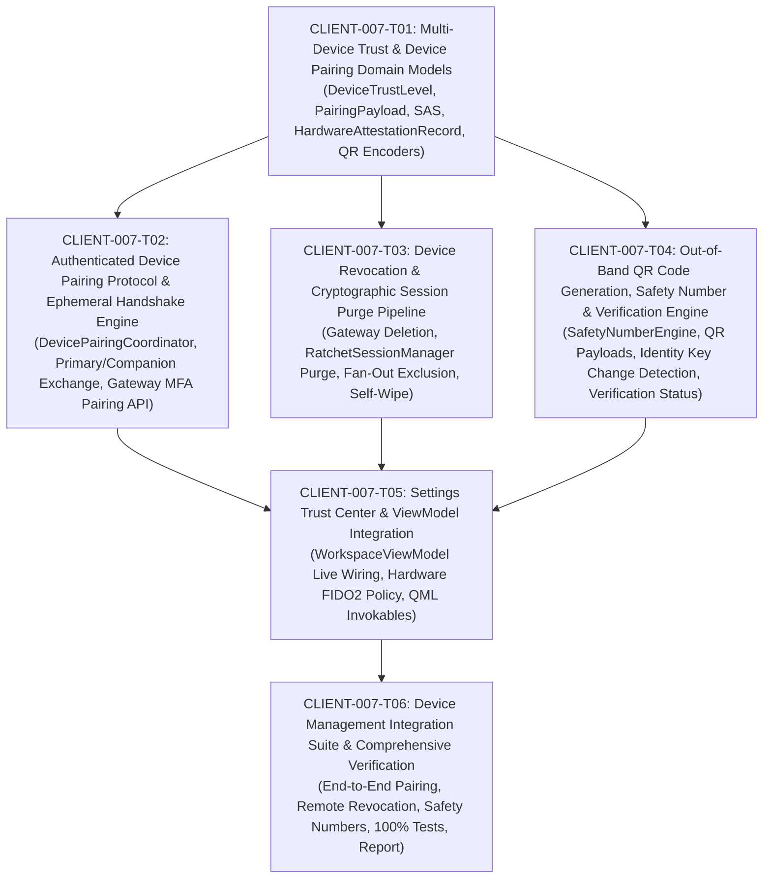

# CLIENT-007 — Device Management, Multi-Device Trust & Hardware Security / Attestation: Ticket Decomposition & Architectural Specification

- **Card ID:** `CLIENT-007`
- **Card Title:** Device Management, Multi-Device Trust & Hardware Security / Attestation
- **Phase Placement:** **Client Phase 2 (`specs/client-phase2/CLIENT-007-tickets.md`) — Multi-Device Trust & Hardware Security**
- **Target Branch:** `feature/client-007-device-management-multi-device-trust-attestation`
- **Prerequisites Completed:**
  - `CLIENT-001` — Client Application Foundation & Layered C++20/Qt6 Architecture (`main` merged)
  - `CLIENT-002` — UI Design System, Theme Engine, Reusable QML Controls & Navigation Shell (`main` merged)
  - `CLIENT-003` — Authentication Flow, 4-Zone Workspace Shell, Files Vault & Device/MFA Trust Center (`main` merged)
  - `CLIENT-004` — Contacts, Conversations & Messaging UI (`main` merged)
  - `CLIENT-005` — Device Registration & Cryptographic Identity Lifecycle (`main` merged)
  - `CLIENT-006` — Signal Double Ratchet Session Management & End-to-End Encryption (`main` merged)

---

## 1. Executive Summary & Phase Classification

With the completion of **Card `CLIENT-006`**, the SecureCloud native client possesses a production-grade cryptographic engine capable of initial X3DH key agreements, Signal Double Ratchet symmetric/asymmetric ratcheting, bounded out-of-order message key recovery, and pairwise session persistence in `ISecureStorage`.

**Card `CLIENT-007` implements the Multi-Device Trust Fabric, Authenticated Companion Device Onboarding, Remote Device Revocation, Out-of-Band Safety Number Verification, and Hardware Security / FIDO2 Attestation**.

In SecureCloud's zero-trust threat model, **each physical device is an independent cryptographic endpoint** with its own identity keypair and prekey bundle (ADR-008 §14). A user's private keys are never transmitted over the network or synchronized through backend servers. When a user adds a secondary device (e.g., laptop or mobile companion), mutual trust is established through **authenticated out-of-band device pairing (QR code and Short Authentication String / SAS)** authorized by the primary device using Multi-Factor Authentication (MFA / WebAuthn FIDO2).

When a device is lost, compromised, or decommissioned, the **Device Revocation Pipeline** guarantees that future messages are strictly excluded from fan-out encryption for that device, pairwise Double Ratchet sessions are purged, and the revoked endpoint's access is permanently quarantined (ADR-008 §16).

### Ticket Status Matrix

| Ticket | Description | Status | Target Scope |
|---|---|---|---|
| **CLIENT-007-T01** | Multi-Device Trust & Device Pairing Domain Models | Completed | Domain models: `DeviceTrustLevel`, `DevicePlatformInfo`, `PairingChallengePayload`, `ShortAuthenticationString`, `HardwareAttestationRecord`, URI/QR serialization |
| **CLIENT-007-T02** | Authenticated Device Pairing Protocol & Ephemeral Handshake Engine | Completed | `DevicePairingCoordinator`: Out-of-band QR/SAS protocol, primary/companion roles, Gateway pairing challenge & MFA authorization |
| **CLIENT-007-T03** | Device Revocation & Cryptographic Session Purge Pipeline | Completed | Remote revocation via Gateway, local self-wipe, `RatchetSessionManager` session termination & fan-out recipient exclusion |
| **CLIENT-007-T04** | Out-of-Band QR Code Generation, Safety Number Scanner & Identity Verification Engine | Completed | `SafetyNumberEngine`: 60-digit SAS derivation, QR code payload generation/parsing, identity key change detection (`KeyChanged` alert) |
| **CLIENT-007-T05** | Settings Trust Center & ViewModel Integration | Completed | Wire `DeviceManager` & `RatchetSessionManager` into `WorkspaceViewModel`: live device list, approve/revoke invokables, hardware FIDO2 policy |
| **CLIENT-007-T06** | Device Management Integration Suite & Comprehensive Verification | Ready for Implementation | Multi-device pairing tests, revocation & fan-out exclusion tests, safety number verification tests, 100% pass, walkthrough report |

```text
                            SECURECLOUD CLIENT (Phase 2 - CLIENT-007)
 ┌────────────────────────────────────────────────────────────────────────────────────────┐
 │ Primary Workstation (Authorized)                      New Companion Device             │
 │                                                                                        │
 │  1. Scans Companion QR / Receives Pairing Challenge                                    │
 │  2. Displays 6-digit SAS / Emoji Comparison       ◄──► Compares SAS Out-of-Band        │
 │  3. Verifies Hardware MFA (FIDO2 / WebAuthn)                                           │
 │  4. Calls Gateway: POST /devices/:id/authorize                                         │
 └─────────────────────────────┬────────────────────────────────────▲─────────────────────┘
                               │ MFA Token + Auth                   │ Issues Token
                               ▼                                    │
                ┌──────────────────────────────┐                    │
                │     Gateway / Auth API       ├────────────────────┘
                │  (Status: Pending -> Auth)   │
                └──────────────┬───────────────┘
                               │
                               ▼ Future Fan-Out (ADR-008 §14)
                ┌──────────────────────────────┐
                │    RatchetSessionManager     │
                │ Encrypts fan-out for each    │
                │ authorized device endpoint.  │
                │ (Excludes revoked devices)   │
                └──────────────────────────────┘
```

---

## 2. Architectural Analysis & Invariants

### 2.1 ADR-008 & Detailed Design Alignment

1. **Independent Cryptographic Endpoints (ADR-008 §14, §15):**
   - Each client device generates and retains its own Ed25519 identity keypair and X25519 prekey bundles.
   - A companion device never inherits, receives, or exports private keys from existing devices.
   - Backend services record only public cryptographic material (`PrekeyBundle`). Endpoint private keys remain endpoint-controlled at all times.

2. **Authenticated Out-of-Band Device Pairing (ADR-008 §15, Detailed Design §2.4):**
   - New devices start in `PendingAuthorization` status.
   - An existing authorized device (primary) authorizes the companion device out-of-band via QR code payload exchange and Short Authentication String (SAS) confirmation.
   - The Gateway requires `mfa_verified` auth-level context (`x-auth-level: mfa_verified`) to authorize a device (`POST /api/v1/devices/:device_id/authorize`), preventing unauthorized pairing even if bearer tokens are stolen.

3. **Device Revocation Semantics (ADR-008 §16, Detailed Design §2.4, §2.8):**
   - **Forward Isolation**: When a device is revoked (`DELETE /api/v1/devices/:device_id`), all future messages must not be encrypted for that device.
   - **Session Purge**: Active Double Ratchet sessions for the revoked device must be purged from `RatchetSessionManager` and `ISecureStorage`.
   - **Participant Fan-Out Exclusion**: `RatchetSessionManager::encrypt_fanout_for_participants` must query the latest active device directory and strictly omit revoked or quarantined endpoints.
   - **Local Decryptability**: Messages already received and decrypted locally on the revoked device remain readable unless an Emergency Wipe (ADR-013) is triggered.

4. **Safety Number Verification & Key Change Detection (ADR-008 §18):**
   - Safety numbers are computed deterministically as 60 decimal digits (12 blocks of 5 digits) from `SHA-512(IK_A || IK_B || User_A || User_B)`.
   - The client must detect any change in a peer device's identity key (`IK`). If a public key changes without explicit re-verification, the device/contact status transitions to `KeyChanged`, displaying an amber/red warning in the UI and requiring explicit user acknowledgement before unblocking.

5. **Hardware Security / FIDO2 Attestation (ADR-008 §18.2):**
   - Sensitive cryptographic operations (device authorization, remote revocation, signed prekey rotation) support hardware-backed authentication (WebAuthn / FIDO2 security keys, Apple Secure Enclave / TPM 2.0).
   - An abstraction layer allows desktop platforms without physical hardware keys to utilize a software-attested security token provider while supporting real FIDO2 / WebAuthn tokens in enterprise environments.

---

## 3. Codebase Gap Analysis

| Component | Current State (`CLIENT-006`) | Target State (`CLIENT-007`) |
| :--- | :--- | :--- |
| **`domain::Device`** | Minimal model with `DeviceId`, `UserId`, `display_name`, `CryptoIdentity`, `status`, `last_seen_at`. | Enrich with `platform_info`, `trust_level`, `hardware_attestation_status`, `is_hardware_backed`, `enrolled_mfa`. |
| **Pairing Domain Models** | None. Placeholder mock IDs used in UI. | Add `PairingChallengePayload`, `ShortAuthenticationString` (SAS), `DeviceTrustLevel`, `HardwareAttestationRecord`, `QrPayloadEncoder`. |
| **Device Pairing Engine** | None. `WorkspaceViewModel::pairNewDevice` creates dummy mock string. | Add `DevicePairingCoordinator`: orchestrates challenge generation, QR payload generation, SAS matching, and Gateway authorization with MFA token. |
| **Device Revocation Pipeline** | `DeviceManager::revoke_device` only wipes local keys if current device matches. | Integrate Gateway `DELETE /api/v1/devices/:device_id`, purge sessions in `RatchetSessionManager`, update local device directory, exclude revoked devices from fan-out encryption. |
| **Safety Number & QR Verification** | `ICryptoProvider::compute_safety_number` exists, but no QR generator/scanner, no change detection engine. | Add `SafetyNumberEngine`: scannable QR payloads, out-of-band verification approval, automated key-change detection (`KeyChanged` state). |
| **Hardware Security / Attestation** | Mock flags in UI. No attestation interface. | Add `IHardwareAuthenticator` & `SoftwareHardwareAuthenticator`: simulated platform authenticator / FIDO2 token provider supporting challenge-response attestation. |
| **`WorkspaceViewModel` Wiring** | Backed by hardcoded in-memory `devices_` mock vector. | Wire `devices()` property to `DeviceManager::list_devices()`, wire `approveDevice`, `revokeDevice`, `pairNewDevice`, and `togglePeerVerified` to real managers. |

---

## 4. Ticket Decomposition (`CLIENT-007-T01` through `CLIENT-007-T06`)



---

## 5. Detailed Ticket Specifications

### CLIENT-007-T01: Multi-Device Trust & Device Pairing Domain Models

- **Ticket ID:** `CLIENT-007-T01`
- **Component:** `src/client/domain/`
- **Objective:** Create domain value objects, enums, and models representing multi-device pairing payloads, Short Authentication Strings (SAS), device trust levels, hardware attestation records, and QR code URI schemes.
- **Architectural Scope:**
  1. **`DeviceTrustLevel` & Status Expansion:**
     - Enums: `DeviceTrustLevel::Untrusted`, `DeviceTrustLevel::VerifiedOutOrBand`, `DeviceTrustLevel::HardwareAttested`, `DeviceTrustLevel::EnterpriseAttested`.
     - Update `domain::Device` with:
       - `platform_info`: OS, hardware architecture, security enclave/TPM flags.
       - `trust_level`: Current trust classification.
       - `is_hardware_backed`: Boolean indicating hardware enclave/token backing.
       - `hardware_attestation`: Optional `HardwareAttestationRecord`.
  2. **`PairingChallengePayload` & QR Code URI:**
     - Structure:
       - `version`: Protocol version (e.g., 1).
       - `user_id`: Target user UUID.
       - `device_id`: Ephemeral or proposed companion device ID.
       - `ephemeral_public_key`: Ephemeral Curve25519 public key (hex or base64).
       - `pairing_code`: 6-digit or UUID pairing secret.
       - `expires_at`: Epoch timestamp.
       - `uri`: `securecloud://pair?v=1&uid=...&did=...&code=...&pk=...&exp=...`.
     - Serializer / Deserializer with strict format and cryptographic checksum validation.
  3. **`ShortAuthenticationString` (SAS):**
     - Structure representing human-verifiable out-of-band confirmation:
       - `numeric_code`: 6-digit zero-padded decimal string (`"492810"`).
       - `visual_emojis`: 4-emoji visual tuple for cross-platform visual confirmation.
       - Method: Derivation from `SHA-256(Primary_Key || Companion_Key || Pairing_Code)`.
  4. **`HardwareAttestationRecord`:**
     - Stores attestation metadata: `aaguid`, `authenticator_type` (`Platform`, `CrossPlatformSecurityKey`), `attestation_statement_hex`, `verified_at`.

- **Deliverables:**
  - `src/client/domain/device_trust_level.hpp`
  - `src/client/domain/device_platform_info.hpp`
  - `src/client/domain/pairing_challenge_payload.hpp` & `.cpp`
  - `src/client/domain/short_authentication_string.hpp` & `.cpp`
  - `src/client/domain/hardware_attestation_record.hpp`
  - Enriched `src/client/domain/device.hpp` & `.cpp`
  - Comprehensive unit tests: `tests/unit/client/device_domain_models_test.cpp`

---

### CLIENT-007-T02: Authenticated Device Pairing Protocol & Ephemeral Handshake Engine

- **Ticket ID:** `CLIENT-007-T02`
- **Component:** `src/client/application/managers/` & `src/client/infrastructure/adapters/`
- **Objective:** Implement the end-to-end device onboarding and pairing protocol between primary and companion devices via the Gateway API with MFA verification.
- **Architectural Scope:**
  1. **Companion Onboarding State Machine (`DevicePairingCoordinator`):**
     - **Role A (Companion Device - Initiator):**
       - Generates independent Ed25519 identity key and X25519 prekey bundle via `ICryptoProvider`.
       - Calls Gateway `POST /api/v1/devices/pairing` to obtain `pairing_code` and expiration.
       - Formats `PairingChallengePayload` and exposes QR URI payload.
       - Computes expected SAS string.
       - Polls / listens for authorization status confirmation.
     - **Role B (Primary Workstation - Authorizer):**
       - Ingests pairing payload (via QR scan or string entry).
       - Derives and displays identical SAS for mutual visual confirmation.
       - Upon user confirmation, verifies local MFA / hardware token.
       - Submits `POST /api/v1/devices/:device_id/authorize` to Gateway with `pairing_code` and `mfa_verified` auth context.
  2. **Gateway Client Expansion:**
     - Update `interfaces::IGatewayClient` and `infrastructure::adapters::DefaultGatewayClient`:
       - `ClientResult<PairingChallengePayload> initiate_device_pairing(const domain::DeviceId& device_id);`
       - `ClientResult<void> authorize_device_pairing(const domain::DeviceId& device_id, std::string_view pairing_code, std::string_view mfa_token);`
       - `ClientResult<std::vector<domain::Device>> list_user_devices(const domain::UserId& user_id);`
  3. **Zero Private Key Transfer Guarantee:**
     - Assert that private keys never cross network boundaries or serialize into pairing payloads.

- **Deliverables:**
  - `src/client/application/managers/device_pairing_coordinator.hpp` & `.cpp`
  - Gateway client updates in `src/client/application/interfaces/i_gateway_client.hpp` and `src/client/infrastructure/adapters/default_gateway_client.hpp` & `.cpp`
  - Unit tests: `tests/unit/client/device_pairing_coordinator_test.cpp`

---

### CLIENT-007-T03: Device Revocation & Cryptographic Session Purge Pipeline

- **Ticket ID:** `CLIENT-007-T03`
- **Component:** `src/client/application/managers/` & `src/client/infrastructure/`
- **Objective:** Implement remote device revocation, local self-wipe, and automatic Double Ratchet session purging to prevent revoked endpoints from participating in future messaging.
- **Architectural Scope:**
  1. **Device Revocation Flow in `DeviceManager`:**
     - `ClientResult<void> revoke_device(const domain::DeviceId& device_id, std::string_view mfa_token = "");`
     - If `device_id == local_device_id`:
       - Perform local self-wipe: zeroize all local private keys (`KeyStorageHelper::wipe_device_keys`), clear session tokens, delete secure storage secrets, and transition local device state to `Revoked`.
     - If `device_id != local_device_id` (Remote companion revocation):
       - Call Gateway `DELETE /api/v1/devices/:device_id` (or `POST /api/v1/devices/:device_id/revoke`) with MFA verification.
       - Mark companion device status as `Revoked` in local cache.
       - Trigger session purge in `RatchetSessionManager`.
  2. **Cryptographic Session Purge in `RatchetSessionManager`:**
     - `ClientResult<void> purge_device_sessions(const domain::DeviceId& device_id);`
     - Deletes active pairwise session for that device from memory and `ISecureStorage`.
     - Zeroizes chain keys, skipped keys, and root keys associated with the revoked device.
  3. **Participant Fan-Out Recipient Exclusion (ADR-008 §16):**
     - Update `RatchetSessionManager::encrypt_fanout_for_participants`:
       - Filter out any devices whose authorization status is `Revoked` or `Quarantined`.
       - Guarantees future messages cannot be decrypted by the revoked device.
       - Existing local decrypted messages remain accessible.

- **Deliverables:**
  - Updated `src/client/application/managers/device_manager.hpp` & `.cpp`
  - Updated `src/client/application/managers/ratchet_session_manager.hpp` & `.cpp`
  - Unit tests: `tests/unit/client/device_revocation_pipeline_test.cpp`

---

### CLIENT-007-T04: Out-of-Band QR Code Generation, Safety Number Scanner & Identity Verification Engine

- **Ticket ID:** `CLIENT-007-T04`
- **Component:** `src/client/application/managers/` & `src/client/infrastructure/`
- **Objective:** Implement the out-of-band contact and device verification engine, QR code payload generation/parsing, 60-digit safety number comparison, and automated identity key change detection.
- **Architectural Scope:**
  1. **`SafetyNumberEngine`:**
     - Wraps `ICryptoProvider::compute_safety_number` to derive formatted 60-digit safety numbers (12 blocks of 5 decimal digits) for any contact or companion device.
     - Generates scannable URI payloads: `securecloud://verify?uid=...&ik=...&sn=...`.
     - Parses incoming QR payload and performs cryptographic validation: matches public key fingerprint against active directory key.
  2. **Identity Key Change Detection (ADR-008 §18):**
     - When syncing contacts or fetching prekey bundles:
       - If a peer's public identity key differs from the stored/verified key:
         - Transition identity status to `KeyVerificationStatus::KeyChanged`.
         - Generate an alert event to notify the user.
         - Suspend trusted message sending until user manually acknowledges and re-verifies the safety number.
  3. **Verification State Toggle:**
     - Explicit verification confirmation: transitions status to `KeyVerificationStatus::Verified`.
     - Persists verification state to local encrypted storage.

- **Deliverables:**
  - `src/client/application/managers/safety_number_engine.hpp` & `.cpp`
  - Unit tests: `tests/unit/client/safety_number_engine_test.cpp`

---

### CLIENT-007-T05: Settings Trust Center & ViewModel Integration

- **Ticket ID:** `CLIENT-007-T05`
- **Component:** `src/client/ui/` & `src/client/application/`
- **Objective:** Connect the Device Trust Center in `SettingsPlaceholder.qml` and `WorkspaceViewModel` to real application managers, replacing mock vectors with live device lists, genuine pairing, revocation, and hardware FIDO2 policy enforcement.
- **Architectural Scope:**
  1. **Hardware Security / FIDO2 Policy Abstraction:**
     - Interface: `interfaces::IHardwareAuthenticator`
       - `ClientResult<std::string> prompt_for_hardware_mfa(std::string_view challenge);`
       - `ClientResult<HardwareAttestationRecord> attest_device_authenticator();`
     - Implement `infrastructure::adapters::SimulatedHardwareAuthenticator` for headless/test environments with configurable touch/PIN simulation.
  2. **`WorkspaceViewModel` Production Wiring:**
     - Bind `devices()` property to `DeviceManager::list_devices()`.
     - Wire `Q_INVOKABLE bool approveDevice(const QString& deviceId)`: invokes `DevicePairingCoordinator::authorize_companion`.
     - Wire `Q_INVOKABLE bool revokeDevice(const QString& deviceId)`: prompts MFA and invokes `DeviceManager::revoke_device()`.
     - Wire `Q_INVOKABLE QString pairNewDevice(const QString& displayName)`: initiates companion pairing and returns genuine QR payload.
     - Wire `Q_INVOKABLE void togglePeerVerified(const QString& peerUserId)`: updates peer verification via `SafetyNumberEngine`.
     - Wire `Q_INVOKABLE void rotateSignedPrekey()`: triggers signed prekey rotation with hardware attestation logging.
  3. **QML Property & Event Synchronicity:**
     - Emit `devicesChanged()`, `activeMessagesChanged()`, and `workspaceError()` correctly on all state transitions.

- **Deliverables:**
  - `src/client/application/interfaces/i_hardware_authenticator.hpp`
  - `src/client/infrastructure/adapters/simulated_hardware_authenticator.hpp` & `.cpp`
  - Updated `src/client/ui/workspace_view_model.hpp` & `.cpp`
  - Unit tests: `tests/unit/client/workspace_view_model_devices_test.cpp`

---

### CLIENT-007-T06: Device Management Integration Suite & Comprehensive Verification

- **Ticket ID:** `CLIENT-007-T06`
- **Component:** `tests/integration/` & `docs/final-reports/`
- **Objective:** Validate end-to-end multi-device pairing, remote device revocation, safety number verification, fan-out exclusion, 100% test pass, zero warnings, `.clang-format` compliance, and compile a comprehensive walkthrough validation report.
- **Architectural Scope:**
  1. **End-to-End Multi-Device Integration Tests:**
     - **Multi-Device Pairing Flow**: Primary workstation pairs with new laptop; SAS matched; Gateway authorizes; companion registers prekeys and receives encrypted messages.
     - **Device Revocation & Fan-Out Exclusion**: Primary workstation revokes compromised laptop; subsequent group/direct message only fan-outs to primary; revoked laptop cannot decrypt; active session wiped.
     - **Identity Key Change & Safety Number Detection**: Peer key change transitions state to `KeyChanged`; safety number re-verification restores `Verified`.
     - **Hardware MFA Enforcement**: Unauthorized pairing without valid MFA fails with `MFA_REQUIRED`.
  2. **Codebase Hygiene & Quality Gates:**
     - 100% passing tests across all test suites.
     - Zero compiler warnings (`-Wall -Wextra -Werror`).
     - Complete `.clang-format` compliance across all modified and newly created files.
  3. **Final Card Walkthrough Report:**
     - Comprehensive Markdown validation report in `docs/final-reports/walkthrough-client-007.md` detailing architectural invariants, test results, code snippets, sequence diagrams, and security proofs.

- **Deliverables:**
  - `tests/integration/multi_device_trust_integration_test.cpp`
  - `docs/final-reports/walkthrough-client-007.md`

---

## 6. Implementation Rules & Non-Functional Requirements

1. **Host Isolation Invariant:**
   - Zero PostgreSQL, Redis, or Gateway processes started on host ports.
   - All tests run in-process using deterministic test doubles (`DefaultGatewayClient`, `MemorySecureStorage`, `SimulatedHardwareAuthenticator`).

2. **Cryptographic Safety Invariant:**
   - Zero custom cryptographic primitives. All symmetric/asymmetric operations must use `ICryptoProvider` / OpenSSL 3.x EVP primitives.
   - All secret keys, pairing codes, and plaintexts must reside in `SecretString` and undergo automatic zeroization.
   - Private keys never leave the endpoint device.

3. **Multi-Device Fan-Out Invariant (ADR-008 §14, §16):**
   - Each active recipient device receives an individually encrypted payload via pairwise Double Ratchet session.
   - Revoked devices are permanently excluded from fan-out delivery.

4. **Codebase Formatting & Cleanliness:**
   - Strict compliance with project `.clang-format` and `.clang-tidy`.

