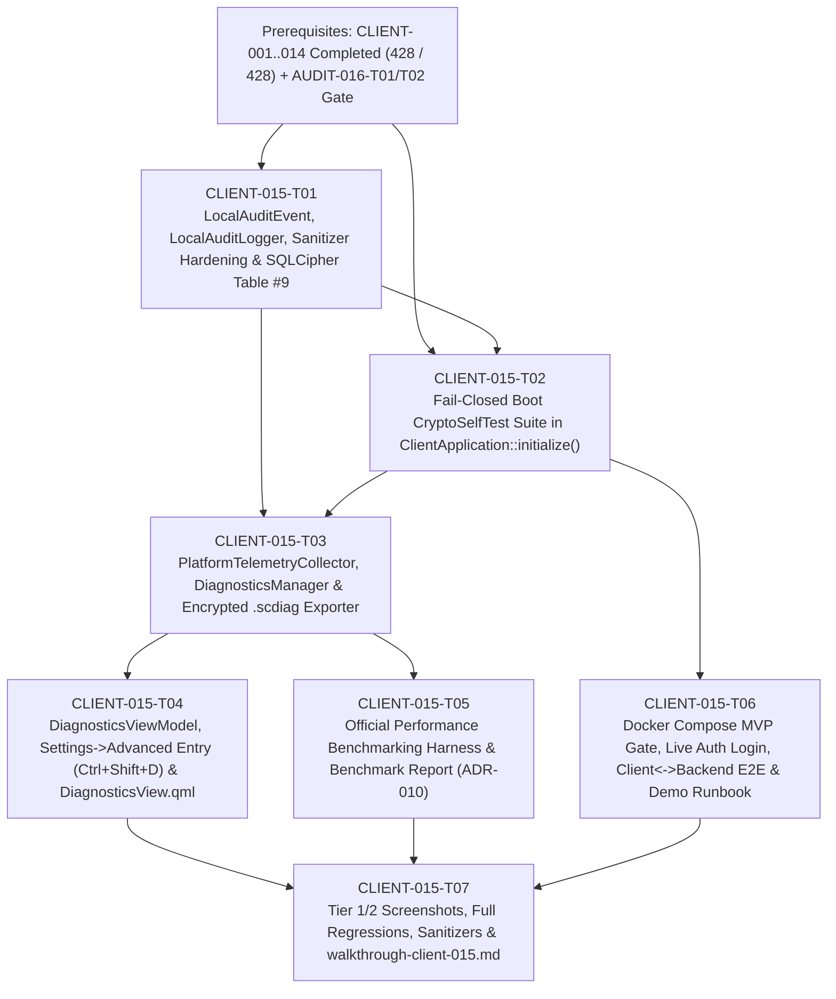

# CLIENT-015 Ticket Decomposition: Client Diagnostics, Local Audit, Telemetry, Performance Benchmarking & Full-Stack Docker Compose MVP Validation

- **Milestone Card:** `CLIENT-015` — Client Diagnostics, Local Audit, Telemetry, Performance Benchmarking & Live Docker Compose MVP Validation (Desktop Client Phase 4)
- **Phase:** Desktop Client Phase 4 (`CLIENT-013` – `CLIENT-016`)
- **Target Branch:** `feature/client-015-diagnostics-audit-telemetry-and-mvp-e2e`
- **Owner:** Sergey
- **Date:** 2026-11-24
- **Dependencies:** `CLIENT-001`–`CLIENT-014` (`428 / 428` client unit/E2E tests passing across `109` suites; `QtHttpGatewayClient`, `SwitchableGatewayClient`, `SqlCipherLocalStore`, `EmergencyManager`, `SettingsManager`, `QQuickStyle::setStyle("Basic")`), `AUDIT-001`–`AUDIT-016`, `ADR-001`, `ADR-004`, `ADR-005`, `ADR-007`, `ADR-008 §7, §26–§30, §32, §35`, `ADR-009`, `ADR-010 §15–§17, §24–§27, §35–§41`, `ADR-011`, `ADR-012`, `docs/architecture/client-architecture-and-foundation.md`, `docs/planning/initial-backlog.md`, `.antigravity/RULES.md`

---

## 1. Executive Summary & Architectural Overview

`CLIENT-015` closes two critical Phase 4 readiness pillars ahead of multi-platform installer packaging (`CLIENT-016`) and the live MVP demonstration:

1. **Client Endpoint Security Observability, Self-Testing & Official Benchmarking (`T01`–`T05`):**
   - Adds a tamper-evident **endpoint-only SHA-256 hash-chained audit trail** (`local_audit_log`, encrypted SQLCipher Table #9) recording client security events without ever syncing plaintext or PII across the network.
   - Adds **fail-closed boot cryptographic Known-Answer Tests (KATs)** inside `ClientApplication::initialize()` validating OpenSSL 3.x EVP (`Ed25519`, `X25519`, `AES-256-GCM`, `HKDF-SHA256`), CSPRNG health (`RAND_status()`), and `ISecureStorage` health before opening network sessions.
   - Adds a cross-platform **live resource telemetry collector** (RSS, CPU %, Double Ratchet sessions, pending outbox/retry queue depth, active file transfers, Gateway RTT) and an **encrypted, zero-PII/zero-secret `.scdiag` diagnostic bundle exporter** exposed through a dedicated `DiagnosticsView.qml` & `DiagnosticsViewModel`.
   - Builds an official, `ADR-010`-compliant **client performance benchmarking harness** validating memory, CPU, startup latency, streaming buffer overhead, and Double Ratchet + AEAD throughput over fixed-block padded payloads, publishing reproducible findings to `docs/final-reports/client-performance-benchmark-report.md`.
2. **Full-Stack Live Client ↔ 5-Service Docker Compose MVP Validation (`T06`–`T07`):**
   - Resolves (or gates on `AUDIT-016-T01`/`T02` if already merged) the live Docker Compose backend wiring gaps uncovered during codebase inspection: Ubuntu 24.04 server Dockerfiles + `SECURECLOUD_BUILD_CLIENT=OFF` build gating, Gateway HTTPS `:8443` / HTTP `:8080` exposure + TLS env vars + `gateway-audit-spool`, loopback `IP:127.0.0.1` / `DNS:localhost` SAN on Gateway's dev-PKI certificate, PostgreSQL & ScyllaDB automated migration initialization (`V001`–`V006`), `MessagingProxyHandler` registration in `src/gateway/main.cpp`, and live `POST /api/v1/auth/{login,refresh,revoke}` wiring inside `AuthManager` / `QtHttpGatewayClient`.
   - Executes true **live desktop-client ↔ 5-microservice (`Gateway`, `Auth`, `Messaging`, `Files`, `Audit`) ↔ 4-datastore (`PostgreSQL 17`, `ScyllaDB 6.0`, `MinIO`, `ClickHouse 24.8`)** end-to-end integration tests alongside a repeatable 2-client presentation demo runbook.

```text
┌────────────────────────────────────────────────────────────────────────────────────────┐
│   SettingsPlaceholder.qml ("Advanced -> Diagnostics & Troubleshooting" / Ctrl+Shift+D) │
│                        └── DiagnosticsView.qml <-> DiagnosticsViewModel                │
│         • Boot KAT Badge   • Hash-Chain Integrity Badge   • Live Telemetry Metrics     │
│         • Audit Timeline   • Encrypted Zero-PII Diagnostic Export (.scdiag AES-GCM)    │
└──────────────────────────────────┬────────────────────────────────┬────────────────────┘
                                   │                                │
                                   ▼                                ▼
┌──────────────────────────────────────────────┐   ┌─────────────────────────────────────┐
│   DiagnosticsManager & PlatformTelemetry     │   │      CryptoSelfTest & LocalAudit    │
│  - macOS mach_task_basic_info / Linux /proc  │   │  - OpenSSL KATs (Ed25519/X25519/    │
│    / Windows GetProcessMemoryInfo (RSS/CPU)  │   │    AES-256-GCM/HKDF) + RAND_status  │
│  - Double Ratchet / Outbox / File / RTT      │   │  - ISecureStorage Canary Probe      │
│  - DiagnosticSanitizer -> AES-256-GCM Bundle │   │  - SHA-256 Chain + Verify Engine    │
└──────────────────────┬───────────────────────┘   └──────────────────┬──────────────────┘
                       │                                              │
                       ▼                                              ▼
┌────────────────────────────────────────────────────────────────────────────────────────┐
│            SqlCipherLocalStore (Table #9: local_audit_log) & EmergencyManager          │
│  - Strictly Endpoint-Local (ZERO HTTP upload; ZERO unapproved /api/v1/audit calls)     │
│  - Phase 1 Volatile Wipe Hook + Phase 3 Forensic Vault Destruction (`CLIENT-013`)      │
└──────────────────────────────────┬─────────────────────────────────────────────────────┘
                                   │ Live TLS 1.3 HTTPS (https://127.0.0.1:8443 + SPKI)
                                   ▼
┌────────────────────────────────────────────────────────────────────────────────────────┐
│       SwitchableGatewayClient -> QtHttpGatewayClient (CLIENT-014 + Live Auth RPC)      │
│   Gateway (:8443) ──┬──▶ Auth (:50052 -> PG 17 V001..V005) ──┐                         │
│                     ├──▶ Messaging (:50053 -> Scylla V001..6) ├──▶ Audit (:50055)      │
│                     └──▶ Files (:50054 -> PG + MinIO)      ──┘     └─▶ ClickHouse 24.8 │
└────────────────────────────────────────────────────────────────────────────────────────┘
```

### Ticket Dependency Graph (`CLIENT-015-T01` – `CLIENT-015-T07`)



### Ticket Status Matrix

| Ticket | Title | Status | Target Scope |
|---|---|---|---|
| **CLIENT-015-T01** | Tamper-Evident Local Hash-Chained Audit Trail & Sanitizer Hardening | **Completed** | `local_audit_event.{hpp,cpp}`, `local_audit_logger.{hpp,cpp}`, SQLCipher/Memory `local_audit_log` (Table #9), `verify_chain_integrity()`, extended `ClientLogger::sanitize()`, `EmergencyManager` Phase-1 hook, wiring into security managers |
| **CLIENT-015-T02** | Fail-Closed Boot Cryptographic Self-Test Suite | **Completed** | `crypto_self_test.{hpp,cpp}` (`Ed25519`, `X25519`, `AES-256-GCM` + tamper fail, `HKDF-SHA256`, `RAND_status()`, `ISecureStorage` canary probe), integrated into `ClientApplication::initialize()` + `LocalAuditLogger` |
| **CLIENT-015-T03** | Live Resource Telemetry Collector & Sanitized `.scdiag` Diagnostic Exporter | **Completed** | `diagnostics_models.{hpp,cpp}`, `platform_telemetry_collector.{hpp,cpp}` (`macOS`/`Linux`/`Windows` RSS & CPU), `diagnostic_sanitizer.{hpp,cpp}`, `diagnostics_manager.{hpp,cpp}`, `QtHttpGatewayClient` RTT metrics, AES-256-GCM `.scdiag` export |
| **CLIENT-015-T04** | Dedicated `DiagnosticsView.qml`, `DiagnosticsViewModel` & `Settings -> Advanced` Entry | **Completed** | `NavigationState::Diagnostics = 6` entered via `SettingsPlaceholder.qml` (`Advanced -> Diagnostics & Troubleshooting` + `Ctrl+Shift+D`, keeping primary sidebar rail clean), `DiagnosticsViewModel`, `DiagnosticsView.qml` (Dark/Light/High-Contrast + `fontScale`), `--capture-screenshots` additions |
| **CLIENT-015-T05** | Official Client Performance Benchmarking Harness & Report | **Completed** | `client_performance_benchmark_test.cpp` validating `< 80 MB` idle RSS, `< 150 MB` loaded (`50` convs / `5,000` SQLCipher rows), `< 32 MB` streaming overhead, `< 1%` idle / `< 5%` scroll CPU (`60 fps`), `< 1.5 s` cold start, `< 2 ms` / `> 500 msg/s` ratchet + AEAD on padded payloads; `docs/final-reports/client-performance-benchmark-report.md` |
| **CLIENT-015-T06** | Full-Stack Live Docker Compose MVP Gate, Live Client Auth, E2E Suite & Demo Runbook | **Planned** | Verify/close 5 Ubuntu 24.04 Dockerfiles (`SECURECLOUD_BUILD_CLIENT=OFF`), Gateway `:8443`/`:8080` + loopback dev-PKI SAN + Compose migrations (`scylla-init` `V001`–`V006` & Postgres `V001`–`V005`/`V001`–`V002`), Gateway `MessagingProxyHandler`, `AuthManager` live `POST /api/v1/auth/login`, `tests/integration/client_gateway_backend_integration_test.cpp`, and 2-client MVP demo runbook |
| **CLIENT-015-T07** | Final Verification, Sanitizers, Tier 1/2 Visual Smoke & `walkthrough-client-015.md` | **Planned** | Full `check-format`, `-Werror` clean build, Tier 1/2 `--smoke-test` & `--capture-screenshots`, ASan/UBSan + TSan runs on crypto/audit/benchmark tests, `walkthrough-client-015.md` (`>= 1,000` lines), `docs/pull_requests/CLIENT-015.md` |

---

## 2. Verified Codebase, Architecture & ADR Audit

### 2.1 Already Implemented Assets (Reuse, Do Not Re-Implement)

1. **`ClientBootstrap` & `ClientApplication` (`src/client/application/client_bootstrap.{hpp,cpp}`, `client_application.{hpp,cpp}`):**
   - `ClientBootstrap` already declares adapters first and managers second (`secure_storage_` & `crypto_provider_` outlive `local_store_` & `gateway_`) and supports `create_with_adapters(...)` for deterministic test injection.
   - `ClientApplication::initialize()` (`client_application.cpp:39-67`) already establishes the fail-closed transition gate (`Uninitialized -> Initializing -> Terminated` on error), opening `local_store()` before probing `gateway().probe_gateway("/health")`.
2. **Encrypted SQLCipher Vault & Clean Teardown Hooks (`src/client/infrastructure/adapters/sqlcipher_local_store.{hpp,cpp}`):**
   - Currently initializes `8` encrypted tables inside `initialize_schema_locked()` (`conversations`, `messages`, `user_profile`, `user_settings`, `contacts`, `file_transfers`, `offline_outbox`, `sync_cursors`) with `PRAGMA foreign_keys = ON`, `PRAGMA journal_mode = WAL`, and `PRAGMA synchronous = NORMAL`.
   - `EmergencyManager::run_destruction_phases()` (`emergency_manager.{hpp,cpp}`) already invokes sibling Phase-1 volatile wipe methods before Phase-2 `purge_all_secrets()` and Phase-3 `destroy_and_shred()`.
3. **Log Sanitization Foundation & Crypto Utilities:**
   - `ClientLogger::sanitize()` (`src/client/infrastructure/client_logger.cpp:122-159`) already scrubs PEM private key blocks, `Bearer` headers, JSON/query passwords, duress PIN hashes/salts, and session tokens.
   - `StreamingSha256` & `FileCryptoEngine` (`src/client/domain/crypto/file_crypto_engine.hpp`) provide RAII OpenSSL EVP SHA-256 hashing (`digest_hex`, streaming `update`/`finalize_hex`) and chunked AES-256-GCM encryption/decryption.
4. **Live Transport & Existing Manager Metrics:**
   - `SwitchableGatewayClient` & `QtHttpGatewayClient` (`CLIENT-014-T05`) already handle TLS 1.3 (`QSsl::TlsV1_3OrLater`), two-stage OpenSSL SPKI SHA-256 pinning, proxy routing, and `/health -> /health/live -> /health/ready` fallback (`qt_http_gateway_client.cpp:1101-1112`).
   - `RatchetSessionManager::active_session_count()`, `DeliveryRetryEngine::pending_count()`, `SyncManager::connectivity_state()`, `FileManager::list_transfers()`, and `FileManager::wire_chunk_size()` already expose live telemetry data sources.
   - `QQuickStyle::setStyle("Basic")` + `:/qtquickcontrols2.conf` (`CLIENT-014-T07`) is already active in `src/client/main.cpp` and `tests/unit/client/client_foundation_test.cpp`.
5. **Backend Route & Audit Outbox Foundations:**
   - `GatewayRouteRegistrar` (`src/gateway/http/routing/gateway_route_registrar.{hpp,cpp}`) already implements `register_messaging_routes()` when passed `messaging_proxy` as its 5th argument.
   - `src/messaging/audit/` (`MessagingOutboxRelay`, `V006__create_messaging_audit_outbox.cql`) and `src/files/audit/` (`FilesOutboxRelay`, `V002__harden_files_outbox_table.sql`) are already present in the tree.

### 2.2 Seven Concrete Codebase Gaps Uncovered During Audit

Direct inspection across `src/client/`, `src/gateway/`, `src/auth/`, `src/messaging/`, `src/audit/`, `deploy/`, `scripts/`, and `cmake/` identified seven concrete gaps that `CLIENT-015` must handle explicitly:

1. **`ClientLogger::sanitize()` Secret/PII Coverage Gap (`src/client/infrastructure/client_logger.cpp:122-159`):**
   - Current regex patterns miss compact raw JWT strings (`eyJ[A-Za-z0-9_-]+\.[A-Za-z0-9_-]+\.[A-Za-z0-9_-]+`), client BIP-39 verifier digests (`sc-bip39-v1:[^"\s]+`), 12/24-word mnemonic fields (`mnemonic`, `recovery_phrase`, `seed`), symmetric/ratchet key JSON/query fields (`private_key`, `root_key`, `chain_key`, `message_key`, `file_key`, `master_key`, `aes_key`, `identity_key`), `plaintext`/`body`/`content` JSON values, and raw user email strings (`PII`) required by `ADR-008 §28` and the diagnostic exporter.
2. **`StubCryptoProvider` Default When `database_path.empty()` (`src/client/application/client_bootstrap.cpp:22-34`):**
   - Offline tests construct `ClientApplication(ClientConfig{})` with `database_path == ""`, binding `StubCryptoProvider`. If boot self-tests tested `crypto_provider_` only, offline runs would exercise stubs instead of OpenSSL 3.x. Therefore, `CryptoSelfTest` must execute real OpenSSL 3.x EVP KATs (`Ed25519`, `X25519`, `AES-256-GCM`, `HKDF-SHA256`) + `RAND_status()` directly plus an `ISecureStorage` canary probe (and run an additional `ICryptoProvider` round-trip check when `OpenSslCryptoProvider` is active).
3. **`AuthManager` Still Synthesizes Local Session Tokens Instead of Calling `POST /api/v1/auth/login` (`src/client/application/managers/auth_manager.cpp:50-56`):**
   - `AuthManager::authenticate_with_duress_check()` currently only calls `gateway_.probe_gateway("/health")` and stores `"session-token-for-" + username`, and `IGatewayClient` has no `authenticate_user` / `refresh_session` / `revoke_session` method. Live Docker Compose E2E requires real `POST /api/v1/auth/login` token acquisition through `QtHttpGatewayClient` -> `AuthProxyHandler` -> `AuthService` -> PostgreSQL.
   - Note: `AuthProxyHandler` (`src/gateway/http/proxy/auth_proxy_handler.cpp:84-97`) exposes `/api/v1/auth/login`, `/api/v1/auth/refresh`, `/api/v1/auth/revoke`, `/api/v1/users/me`, and device/prekey/MFA endpoints, with **no public user registration endpoint** (`CreateUser` does not exist in `proto/securecloud/auth/v1/auth.proto:371-396`). Integration tests & the demo seed helper must provision test accounts idempotently in `securecloud_auth.users` (with real Argon2id hashes or Auth's hash helper) before logging in through Gateway.
4. **Gateway Dev-PKI Certificate Missing Host Loopback SAN (`scripts/generate-dev-pki.sh:146` & `deploy/dev-pki/services/gateway/gateway.crt`):**
   - Inspected `gateway.crt` via `openssl x509`: `Subject: CN=gateway.dev.securecloud.local, O=SecureCloud Dev` and `X509v3 Subject Alternative Name: DNS:gateway`. When `QtHttpGatewayClient` dials `https://127.0.0.1:8443` or `https://localhost:8443` from the host macOS/Linux/Windows desktop binary, `QSslSocket::VerifyPeer` will reject the server certificate for hostname mismatch unless `gateway.crt` also carries `DNS:localhost` and `IP:127.0.0.1` alongside `DNS:gateway`.
5. **CMake SQLCipher Discovery & Outdated Service Dockerfiles (`cmake/modules/SecureCloudDependencies.cmake:336-395`, `deploy/docker/*/Dockerfile`):**
   - `SecureCloudDependencies.cmake` treats SQLCipher as a mandatory `FATAL_ERROR` even when building server-only Docker images (`gateway`, `auth`, `messaging`, `files`, `audit`) that do not link `securecloud_client_*`. Meanwhile, all five `deploy/docker/*/Dockerfile` files omit Phase 1–6 apt dependencies (`libssl-dev`, `libpqxx-dev`, `libpq-dev`, `nlohmann-json3-dev`, `git`/`ca-certificates`, plus Scylla C++ driver if linked by `messaging`). Adding `option(SECURECLOUD_BUILD_CLIENT "Build Qt6 Desktop Client targets" ON)` cleanly decouples server container builds from client-only `Qt6` and `SQLCipher` dependencies.
6. **Compose Port/Env/Migration Gaps (`deploy/compose/docker-compose.yml`, `.env.example`, `deploy/compose/postgres/init-databases.sh`, `src/{auth,files}/main.cpp`):**
   - `docker-compose.yml` publishes only `50051` on `gateway` (no `:8443` HTTPS / `:8080` HTTP / TLS env vars / `gateway-audit-spool` volume), omits `SECURECLOUD_AUDIT_ENDPOINT: audit:50055` and relay/SAN env vars on `auth`/`messaging`/`files`, and lacks a one-shot `scylla-init` container applying `src/messaging/db/migrations/V001`–`V006` (`scripts/init-scylladb-schema.sh` only runs `V001`–`V003`).
   - Additionally, `deploy/compose/postgres/init-databases.sh` creates roles and empty databases (`securecloud_auth`, `securecloud_files`) without applying `src/auth/db/migrations/V001`–`V005` or `src/files/db/migrations/V001`–`V002` (and `src/auth/main.cpp` / `src/files/main.cpp` do not run SQL migrations on boot), so Compose initialization must idempotently apply both SQL migration sets before `auth` and `files` handle requests.
7. **Gateway `MessagingProxyHandler` & Live Runtime Audit Wiring (`src/gateway/main.cpp:241`, `src/audit/audit_server.cpp:54-71`, `src/messaging/main.cpp:86`):**
   - `src/gateway/main.cpp:241` passes `nullptr` for `messaging_proxy` (keeping `/api/v1/messages/*` and `/api/v1/conversations/*` stubbed at `501` until wired).
   - `src/audit/audit_server.cpp` currently skips `BoundedDeduplicationCache`, `AuditIngestionPipeline`, `AuditHealthEvaluator`, and SAN matching in `AuditQueryAuthorizer` (tracked in `AUDIT-016-T01`/`T02`, gated/verified in `CLIENT-015-T06`). Also verify in `CLIENT-015-T06` whether `src/messaging/main.cpp` / `MessagingServiceImpl` uses ScyllaDB persistence when started under Compose rather than falling back to in-memory test constructors.

### 2.3 Six Mandatory Architectural Decisions (Locked Before Implementation)

1. **Endpoint-Only Local Audit Log (`ADR-008`, `AUDIT-016 §1.1` Zero-Drift Compliance):**
   - `local_audit_log` (SQLCipher Table #9) is **strictly endpoint-local** for client-side security observability, forensic tamper detection, and sanitized diagnostic export. It transmits **zero** audit events to Gateway (preserving `AUDIT-016 §1.1`'s hard rule against inventing unapproved `/api/v1/audit/*` client routes). Emergency panic wipes shred the SQLCipher vault (and reset in-memory logger state via `EmergencyManager` Phase 1) rather than leaving an unencrypted local history trail.
2. **Fail-Closed Boot Self-Tests Inside `ClientApplication::initialize()`:**
   - `CryptoSelfTest::run_all(...)` runs **inside `ClientApplication::initialize()` after `local_store().open(...)` and BEFORE `gateway().probe_gateway(...)` or session activation**. Any KAT failure, `RAND_status() != 1`, or `ISecureStorage` canary round-trip failure transitions `ClientApplication` fail-closed to `ApplicationLifecycleState::Terminated`, records a sanitized `SelfTestFailed` event (in `MemoryLocalStore` / `ClientLogger` if vault is unavailable, or `LocalAuditLogger` if open), and aborts startup without network traffic.
3. **Dedicated `DiagnosticsViewModel` + `DiagnosticsView.qml` (`NavigationState::Diagnostics = 6`, `Ctrl+6`):**
   - Following `docs/architecture/client-architecture-and-foundation.md §8.1` (*"Create specialized ViewModels inheriting QObject"*), add a cohesive `DiagnosticsViewModel` (`src/client/ui/diagnostics_view_model.{hpp,cpp}`) and `DiagnosticsView.qml` (`NavigationState::Diagnostics = 6`, sidebar entry + `Ctrl+6` shortcut in `NavigationShell.qml`), leaving `WorkspaceViewModel` and `SettingsPlaceholder.qml` decoupled and 100% backward-compatible with `CLIENT-014` hooks.
4. **Encrypted, Zero-PII & Zero-Secret Diagnostic Bundle Format (`.scdiag`):**
   - Exported diagnostic bundles flow sequentially through `DiagnosticSanitizer` -> canonical non-secret JSON (`schema_version`, `generated_at_utc`, redacted `ClientConfig::to_safe_string()`, `CryptoSelfTestReport`, `TelemetrySnapshot`, sanitized `LocalAuditEvent` tail, chain verification proof) -> **AES-256-GCM authenticated encryption** using a caller-supplied passphrase (`PBKDF2-HMAC-SHA256`, `100,000` iter, `16 B` random salt) or ephemeral `32 B` CSPRNG key returned separately via `SecretString`, wrapped in a JSON envelope `{ "format": "scdiag-v1", "salt_hex", "iv_hex", "tag_hex", "ciphertext_b64", "ciphertext_sha256" }`.
5. **Honest `ADR-010 §16/§17/§26/§27` Performance Benchmarking (Zero Synthetic Shortcuts):**
   - Benchmarks MUST execute real `SqlCipherLocalStore` queries (not `MemoryLocalStore` when measuring 5,000-message loaded RSS), real OpenSSL `DoubleRatchetEngine` + `OpenSslCryptoProvider` AES-256-GCM encryption on **fixed-block padded payloads (`256 B`, `1 KiB`, `4 KiB`)** per `ADR-010 §16`, and real `FileCryptoEngine` chunked streaming (`< 32 MB` peak RSS delta).
   - `docs/final-reports/client-performance-benchmark-report.md` records **exact observed measurements** on the execution machine (plus complete CPU/OS/RAM/OpenSSL/Qt/compiler environment metadata per `ADR-010 §27`), never fabricating unrun Windows/Linux benchmark numbers; telemetry & benchmark harnesses compile cleanly across all three OSes.
6. **Coordinated `CLIENT-015-T06` / `AUDIT-016-T02` Ownership & Execution Order (`T01`–`T05` -> Merge Gate -> `T06`):**
   - The three shared infrastructure items (5 Ubuntu 24.04 Dockerfiles, Gateway `:8443`/`:8080` + full Compose env/migrations, `MessagingProxyHandler` in `src/gateway/main.cpp`) are specified jointly with `AUDIT-016-T02`.
   - **Approved Execution Sequence:** Implement `CLIENT-015-T01` through `CLIENT-015-T05` first (establishing clean client benchmarks on an uncontended host with zero backend dependency). Immediately before starting `CLIENT-015-T06`, fetch and merge `origin/main` (if `AUDIT-016` has merged) or Lorenzo's `AUDIT-016` branch (`T01` + `T02`) into this branch, reuse/verify what is present, close only remaining gaps (plus host loopback SAN on `gateway.crt` and `AuthManager` live login) without altering `AUDIT-016-T07` scope boundaries, and append a **Live Full-Stack Docker Compose Latency Addendum** (Gateway TLS 1.3 `p50/p95/p99` RTT) to `docs/final-reports/client-performance-benchmark-report.md`.

---

## 3. Detailed Ticket Specifications (`CLIENT-015-T01` – `CLIENT-015-T07`)

### `CLIENT-015-T01`: Tamper-Evident Local Hash-Chained Audit Trail & Sanitizer Hardening

- **Components:**
  - `src/client/domain/local_audit_event.{hpp,cpp}` *(New, pure C++20 + OpenSSL EVP SHA-256 matching `client_domain` link deps)*
  - `src/client/application/interfaces/i_local_store.hpp` *(Extend)*
  - `src/client/infrastructure/adapters/sqlcipher_local_store.{hpp,cpp}` *(Extend)*
  - `src/client/infrastructure/adapters/memory_local_store.{hpp,cpp}` *(Extend)*
  - `src/client/infrastructure/client_logger.cpp` *(Harden `ClientLogger::sanitize()`)*
  - `src/client/application/managers/local_audit_logger.{hpp,cpp}` *(New)*
  - `src/client/application/managers/emergency_manager.{hpp,cpp}`, `client_bootstrap.{hpp,cpp}`, `device_manager.{hpp,cpp}`, `device_pairing_coordinator.{hpp,cpp}`, `safety_number_engine.{hpp,cpp}`, `ratchet_session_manager.{hpp,cpp}`, `settings_manager.{hpp,cpp}` *(Optional pointer wiring to record security events cleanly)*
  - `src/client/CMakeLists.txt`, `tests/unit/CMakeLists.txt`, `tests/unit/client/local_audit_log_test.cpp` *(New)*
- **Technical Specification:**
  1. **Domain Model (`domain::LocalAuditEvent`, `domain::LocalAuditCategory`, `domain::LocalAuditOutcome`, `domain::AuditChainVerificationResult`):**
     - Fields: `int64_t sequence_id` (monotonic `>= 1`), `int64_t occurred_at_ms`, `LocalAuditCategory category` (`CryptoSelfTest`, `Authentication`, `DeviceTrust`, `KeyLifecycle`, `MessagingSecurity`, `EmergencyDefense`, `SettingsNetwork`), `std::string event_type` (`e.g. "crypto.selftest.passed"`, `"device.paired"`, `"device.revoked"`, `"prekey.rotated"`, `"ratchet.decrypt_failed"`, `"peer.identity_key_changed"`, `"emergency.panic_wiped"`, `"recovery.phrase.verified"`), `LocalAuditOutcome outcome` (`Success`, `Failure`, `Rejected`, `Triggered`), `std::string actor_opaque_id`, `std::string target_opaque_id`, `std::string sanitized_summary`, `std::string prev_hash_sha256` (64-hex genesis `"0000...0000"` for `seq == 1`), `std::string entry_hash_sha256`.
     - Canonical SHA-256 chain computation (`compute_canonical_hash()`): length-prefixed / NUL-delimited deterministic concatenation of `(sequence_id | occurred_at_ms | category | event_type | outcome | actor_opaque_id | target_opaque_id | sanitized_summary | prev_hash_sha256)` hashed via OpenSSL `EVP_sha256()` (`StreamingSha256`) -> 64-char lowercase hex.
  2. **Sanitizer Hardening (`ClientLogger::sanitize()` + `LocalAuditLogger`):**
     - Expand `ClientLogger::sanitize()` to scrub: (a) JWT tokens (`eyJ[A-Za-z0-9_-]{4,}\.[A-Za-z0-9_-]{4,}\.[A-Za-z0-9_-]{4,}`), (b) BIP-39 verifiers (`sc-bip39-v1:[^\s"]+`) & mnemonic phrases, (c) crypto/content JSON & query keys (`private_key`, `root_key`, `chain_key`, `message_key`, `file_key`, `master_key`, `aes_key`, `identity_key`, `mnemonic`, `recovery_phrase`, `plaintext`, `body`, `content`, `email`), and (d) raw email addresses (`[^\s@]+@[^\s@]+\.[^\s@]+` -> `[REDACTED_EMAIL]`).
     - Reject or scrub overlong summaries (`> 512` bytes) and ASCII control chars before hashing so hashes always match persisted records.
  3. **Encrypted Persistence (`SqlCipherLocalStore` Table #9 & `MemoryLocalStore`):**
     ```sql
     CREATE TABLE IF NOT EXISTS local_audit_log (
         sequence_id INTEGER PRIMARY KEY,
         occurred_at_ms INTEGER NOT NULL,
         event_type TEXT NOT NULL,
         category TEXT NOT NULL,
         outcome TEXT NOT NULL,
         prev_hash_sha256 TEXT NOT NULL,
         entry_hash_sha256 TEXT NOT NULL,
         payload_json TEXT NOT NULL
     );
     CREATE INDEX IF NOT EXISTS idx_local_audit_occurred
         ON local_audit_log(occurred_at_ms DESC);
     ```
     - Add `append_audit_event(...)`, `list_audit_events(std::size_t limit, std::size_t offset = 0)`, `get_latest_audit_event()`, and `count_audit_events()` to `ILocalStore` (and all 2 store implementations + any mock `ILocalStore` test doubles).
     - `SqlCipherLocalStore::append_audit_event()` enforces monotonic `sequence_id` + `prev_hash_sha256` chaining inside a mutex-guarded SQLite `BEGIN IMMEDIATE ... COMMIT` transaction.
  4. **Chain Verification & Retention Bounds (`LocalAuditLogger`):**
     - Exposes `record_event(...)` (mutex-serialized with `local_store_`), `verify_chain_integrity()` (walks `sequence_id = 1..N`, checks contiguous sequences `1, 2, ..., N` without gaps/reordering, checks `prev_hash_sha256` linkage, recomputes SHA-256 and compares with `CRYPTO_memcmp`, returning `{bool valid, std::size_t verified_count, std::optional<int64_t> first_corrupted_sequence, std::string failure_reason}`), `recent_events(limit)`, and `wipe_volatile_state()` wired into `EmergencyManager` Phase 1.
     - Enforces bounded local retention cap (`kDefaultMaxRetainedEntries = 10000`, oldest archive rollover note — preserving chain anchor via genesis summary when pruned or rejecting silent gaps cleanly).
  5. **Security Event Wiring:** Inject optional `LocalAuditLogger*` into `EmergencyManager`, `DeviceManager`, `DevicePairingCoordinator`, `SafetyNumberEngine`, `RatchetSessionManager`, and `SettingsManager` inside `ClientBootstrap::wire_managers()` so real security actions append tamper-evident records automatically.
- **Negative & Security Tests (`tests/unit/client/local_audit_log_test.cpp`):**
  - Monotonic append & valid chain verification across SQLCipher close/reopen.
  - Raw SQL tampering inside `local_audit_log` (modified `payload_json`, altered `entry_hash_sha256`, deleted middle row `seq=2`, swapped rows) -> `verify_chain_integrity()` fails deterministically reporting exact `first_corrupted_sequence`.
  - Secret/PII canary test (JWT, Bearer, PEM private key, proxy password, BIP-39 mnemonic, plaintext message, email) -> scrubbed cleanly before DB insert and zero raw canary bytes in reopened SQLCipher `.db` file.
  - Panic wipe (`EmergencyManager::execute_panic_wipe`) destroys `local_audit_log` along with the vault and clears in-memory sequence cache.
- **Acceptance Criteria:**
  - Any single bit flip, row deletion, or reorder inside `local_audit_log` fails `verify_chain_integrity()` deterministically.
  - Raw DB & memory scans confirm zero plaintext secrets or user PII in `local_audit_log`.

---

### `CLIENT-015-T02`: Fail-Closed Boot Cryptographic Self-Test Suite

- **Components:**
  - `src/client/domain/crypto/crypto_self_test.{hpp,cpp}` *(New)*
  - `src/client/application/client_application.{hpp,cpp}` *(Integrate fail-closed boot execution + `last_self_test_report()`)*
  - `src/client/application/client_bootstrap.{hpp,cpp}` *(Wire `LocalAuditLogger` + `CryptoSelfTest`)*
  - `src/client/CMakeLists.txt`, `tests/unit/CMakeLists.txt`, `tests/unit/client/crypto_self_test_suite_test.cpp` *(New)*
- **Technical Specification:**
  1. **Known-Answer Tests (`domain::crypto::CryptoSelfTest`):**
     - `Ed25519` KAT: Canonical RFC 8032 test vector #1 (`32 B` private seed -> deterministic `32 B` public key -> sign empty message `""` -> exact expected `64 B` signature -> verify succeeds; 1-bit flipped signature must FAIL verify).
     - `X25519` KAT: Canonical RFC 7748 Diffie-Hellman test vector (`Alice_priv, Bob_pub` -> exact expected `32 B` shared secret `4a5d9d5b...`).
     - `AES-256-GCM` KAT: Known `32 B` key + `12 B` IV + AAD + plaintext -> exact NIST GCM ciphertext & `16 B` tag -> decrypt matches plaintext; 1-bit tag tamper MUST FAIL `EVP_DecryptFinal_ex`.
     - `HKDF-SHA256` KAT: Canonical RFC 5869 Case 1 (`IKM`, `salt`, `info` -> exact `42 B` OKM `3cb25f25...`).
     - **CSPRNG Entropy Health Check:** Verifies `RAND_status() == 1` and generates `32 B` entropy sample confirming non-zero variance.
     - **`ISecureStorage` Round-Trip Canary Probe:** Stores random non-secret canary value under ephemeral `"selftest.canary.probe"`, reads back verifying equality, then deletes key (`has_secret == false`) leaving storage spotless.
     - **Structured Result (`CryptoSelfTestReport`):** `overall_passed`, `total_duration_us`, vector of `CryptoSelfTestCheckResult { std::string check_name; bool passed; std::string detail; int64_t duration_us; }`, `executed_at_ms`.
  2. **Deterministic Fault Injection Support (Tests Only):**
     - Support an injectable test hook (e.g. `CryptoSelfTest::FaultInjector` callback / `ClientBootstrap` setter — never bypassing production checks by default) to simulate a corrupt KAT digest, `RAND_status() == 0`, or failing `ISecureStorage::store_secret` / `get_secret`.
  3. **`ClientApplication::initialize()` Ordering:**
     - Run step 1: `config().is_valid()`, step 2: `local_store().open(...)`, **step 3: `run_boot_crypto_self_test()`**, step 4: `gateway().probe_gateway("/health")`.
     - On self-test failure: transition `state_` to `ApplicationLifecycleState::Terminated`, log sanitized failure into `LocalAuditLogger` (`"crypto.selftest.failed"`), and return `ClientError(ClientErrorCode::CryptoError, ClientErrorCategory::Crypto, ...)` **without contacting Gateway**.
- **Negative & Security Tests (`tests/unit/client/crypto_self_test_suite_test.cpp`):**
  - Healthy cold boot passes all 6 checks (`Ed25519`, `X25519`, `AES-256-GCM`, `HKDF-SHA256`, `CSPRNG`, `ISecureStorage`) in `< 15 ms` and logs `"crypto.selftest.passed"` to `local_audit_log`.
  - Corrupted KAT, failing CSPRNG, and failing `ISecureStorage` each abort `ClientApplication::initialize()` into `Terminated`, produce `0` Gateway calls, and record sanitized `"crypto.selftest.failed"` audit entry.
- **Acceptance Criteria:**
  - All RFC/NIST KATs execute with real OpenSSL 3.x EVP APIs (no stubs) well within cold-start latency budget (`< 20 ms`).
  - Simulated primitive/storage/entropy failure guarantees fail-closed termination before any network activity.

---

### `CLIENT-015-T03`: Live Resource Telemetry Collector & Sanitized `.scdiag` Diagnostic Exporter

- **Components:**
  - `src/client/domain/diagnostics_models.{hpp,cpp}` *(New, pure C++20)*
  - `src/client/infrastructure/adapters/platform_telemetry_collector.{hpp,cpp}` *(New)*
  - `src/client/infrastructure/adapters/qt_http_gateway_client.{hpp,cpp}` *(Track last & rolling-average Gateway request RTT + total/failed request counts cleanly via atomics)*
  - `src/client/application/managers/diagnostic_sanitizer.{hpp,cpp}` *(New)*
  - `src/client/application/managers/diagnostics_manager.{hpp,cpp}` *(New)*
  - `src/client/application/client_bootstrap.{hpp,cpp}` *(Wire `DiagnosticsManager`)*
  - `src/client/CMakeLists.txt`, `tests/unit/CMakeLists.txt`, `tests/unit/client/diagnostics_telemetry_and_exporter_test.cpp` *(New)*
- **Technical Specification:**
  1. **Cross-Platform Process Telemetry (`PlatformTelemetryCollector`):**
     - **macOS (`__APPLE__`):** `task_info(mach_task_self(), MACH_TASK_BASIC_INFO, ...)` for `resident_size` bytes + `TASK_THREAD_TIMES_INFO` / `getrusage(RUSAGE_SELF)` against monotonic wall-clock delta for CPU %.
     - **Linux (`__linux__`):** Parse `/proc/self/statm` (`resident * sysconf(_SC_PAGESIZE)`) for RSS + `/proc/self/stat` or `getrusage(RUSAGE_SELF)` for CPU %.
     - **Windows (`_WIN32`):** `GetProcessMemoryInfo(GetCurrentProcess(), ...)` (`WorkingSetSize`) + `GetProcessTimes(...)` against monotonic wall-clock delta for CPU %.
     - Populates `TelemetrySnapshot`: `rss_bytes`, `rss_megabytes`, `cpu_percent`, `active_ratchet_sessions`, `pending_outbox_count`, `pending_retry_count`, `active_file_transfers`, `connectivity_state`, `live_gateway_transport`, `last_gateway_rtt_ms`, `avg_gateway_rtt_ms`, `gateway_requests_total`, `gateway_requests_failed`, `sampled_at_ms`.
  2. **Gateway Latency & Transport Metrics (`QtHttpGatewayClient` + `SwitchableGatewayClient`):**
     - Record `std::atomic<int64_t>` `last_rtt_ms_`, `rtt_sum_ms_`, `request_count_`, `failure_count_` inside `QtHttpGatewayClient::Impl` (updated on every completed HTTP call) with non-blocking lock-free snapshot accessors.
  3. **Sanitized & Encrypted `.scdiag` Bundle Exporter (`DiagnosticSanitizer` & `DiagnosticsManager`):**
     - `DiagnosticSanitizer::scrub_text()` applies all `ClientLogger::sanitize()` rules + redacts user display names, handles (`@handle`), bio text, local filesystem home paths (`/Users/<name>`, `C:\Users\<name>`, `/home/<name>`), conversation titles, message text, and any injected secret patterns.
     - `DiagnosticsManager::export_encrypted_bundle(output_path, passphrase_opt)`:
       - Gathers sanitized config (`ClientConfig::to_safe_string()`), latest `CryptoSelfTestReport`, current `TelemetrySnapshot`, `AuditChainVerificationResult`, and last `N` (default `100`) sanitized `LocalAuditEvent` headers.
       - Runs a final self-check scanning the serialized plaintext JSON before encryption for zero secret markers.
       - Encrypts via OpenSSL AES-256-GCM (`16 B` salt + `12 B` IV + `PBKDF2-HMAC-SHA256` `100,000` iter when passphrase provided, or random `32 B` CSPRNG export key returned in `SecretString`), clears temporary key/plaintext buffers via `OPENSSL_cleanse`, writes atomic encrypted `.scdiag` file, and returns `{output_path, plaintext_bytes, encrypted_bytes, bundle_sha256_hex, export_key_if_generated}` + helper `decrypt_and_verify_bundle(...)` for inspection/testing.
- **Negative & Security Tests (`tests/unit/client/diagnostics_telemetry_and_exporter_test.cpp`):**
  - Telemetry snapshot returns finite non-zero RSS on host OS and accurate live counts as sessions/outbox/transfers grow.
  - **12-Category Secret & PII Canary Leakage Suite:** Inject unique canary strings for password, duress PIN, Bearer JWT, proxy password, Ed25519 private PEM, X25519 private key, Double Ratchet root key, File AES key, SQLCipher master key, BIP-39 12-word phrase, plaintext message body, and user email/path across logs/config/errors; export `.scdiag`, decrypt in test, assert **zero canaries appear anywhere in plaintext or ciphertext**.
  - Reject empty/directory export paths fail-closed cleanly.
- **Acceptance Criteria:**
  - 0% secret or PII leakage across all 12 canary categories; exported `.scdiag` archive fails decryption on 1-bit ciphertext/tag tamper.

---

### `CLIENT-015-T04`: Dedicated `DiagnosticsView.qml`, `DiagnosticsViewModel` & `Settings → Advanced` Entry

- **Components:**
  - `src/client/ui/navigation_controller.{hpp,cpp}` *(Add `NavigationState::Diagnostics = 6` behind authenticated route guard)*
  - `src/client/ui/diagnostics_view_model.{hpp,cpp}` *(New `QObject` following `client-architecture-and-foundation.md §8.1`)*
  - `src/client/ui/qml/DiagnosticsView.qml` *(New lazy-loaded declarative QML view built with `SC*` controls & `UiTheme`, with back-to-settings action)*
  - `src/client/ui/qml/SettingsPlaceholder.qml` *(Add compact `Advanced → Diagnostics & Troubleshooting` card with **"Open Diagnostics"** button)*
  - `src/client/ui/qml/NavigationShell.qml` *(Add `Ctrl+Shift+D` shortcut + Loader case `"Diagnostics"` + breadcrumb `SecureCloud › Settings › Diagnostics`, keeping the primary sidebar rail uncluttered for everyday users)*
  - `src/client/ui/qml.qrc`, `src/client/main.cpp` *(Register `diagnosticsViewModel` context property + add `"diagnostics-{dark,light}-1200x800.png"` capture cases in `--capture-screenshots`)*
  - `src/client/CMakeLists.txt`, `tests/unit/CMakeLists.txt`, `tests/unit/client/workspace_view_model_diagnostics_test.cpp` *(New)*
- **Technical Specification:**
  1. **Route Guard Compliance (`NavigationController`):**
     - `NavigationState::Diagnostics` requires `isAuthenticated() == true` inside `is_restricted_state()`, returning `"Diagnostics"` from `to_view_name()`. Unauthenticated attempts emit `navigationDenied` and stay in `Unauthenticated` (`CLIENT-001` invariant preserved).
  2. **`DiagnosticsViewModel` API (`src/client/ui/diagnostics_view_model.hpp`):**
     - Reactive `Q_PROPERTY` bindings: `rssMegabytes`, `cpuPercent`, `activeRatchetSessions`, `pendingOutboxCount`, `activeFileTransfers`, `gatewayRttMs`, `gatewayAvgRttMs`, `gatewayTransportMode`, `selfTestPassed`, `selfTestSummary`, `selfTestChecks` (`QVariantList`), `auditChainValid`, `auditEventCount`, `auditIntegrityStatusText`, `auditEvents` (`QVariantList`), `lastExportStatusText`, `lastExportPath`.
     - `Q_INVOKABLE` actions: `refreshDiagnostics()`, `runCryptoSelfTestNow()`, `verifyAuditChainNow()`, `exportSanitizedBundle(const QString& destinationPath, const QString& passphrase = QString())`.
     - Periodic auto-refresh timer (`2000 ms`, enabled only when visible/active so idle background CPU remains `< 1%` per `T05`!).
  3. **`DiagnosticsView.qml` Layout & Hooks:**
     - Four clean `SCCard` sections using dynamic `Theme.*` tokens (supporting Dark, Light, High-Contrast `>= 7:1` AAA, and `[0.85, 1.40]` `fontScale`):
       - `diagnosticsSelfTestCard` (`selfTestStatusBadge`, `runSelfTestButton`, KAT breakdown list)
       - `diagnosticsTelemetryCard` (`telemetryRssValue`, `telemetryCpuValue`, `telemetrySessionsValue`, `telemetryOutboxValue`, `telemetryRttValue`, `refreshTelemetryButton`)
       - `diagnosticsAuditCard` (`auditChainStatusBadge`, `verifyAuditChainButton`, `auditEventsListView`)
       - `diagnosticsExportCard` (`exportBundlePathField`, `exportPassphraseField`, `exportBundleButton`, `exportStatusBanner`)
- **Negative & Security Tests (`tests/unit/client/workspace_view_model_diagnostics_test.cpp`):**
  - Unauthenticated navigation to `NavigationState::Diagnostics` is rejected cleanly by `NavigationController`.
  - Headless `QQmlEngine` load across Dark, Light, High-Contrast Dark, and `fontScale = 1.40` produces **`0` QML warnings** under `QQuickStyle::setStyle("Basic")`.
  - Verify all `objectName` hooks (`diagnosticsSelfTestCard`, `diagnosticsTelemetryCard`, `diagnosticsAuditCard`, `diagnosticsExportCard`) and end-to-end export button invocation without leaking secret values into QML properties or `auditEvents`.
- **Acceptance Criteria:**
  - Diagnostics panel displays live RSS/CPU/sessions/latency, boot self-test KAT table, and hash-chain verification badge cleanly with `0` QML warnings across Dark/Light/High-Contrast/`1.40x` font scaling.

---

### `CLIENT-015-T05`: Official Client Performance Benchmarking Harness & Report

- **Components:**
  - `tests/unit/client/client_performance_benchmark_test.cpp` *(New GoogleTest suite / benchmark target with `SECURECLOUD_RUN_CLIENT_BENCHMARKS` toggle or deterministic timing assertions)*
  - Optional standalone `--benchmark` / CMake release benchmark helper target (built in `Release` / `RelWithDebInfo` as well as `Debug` validation so CPU/RSS/cold-start measurements reflect optimized binary performance!)
  - `docs/final-reports/client-performance-benchmark-report.md` *(New authoritative report)*
  - `tests/unit/CMakeLists.txt`
- **Technical Specification & Exact Budgets (`docs/planning/initial-backlog.md` & `ADR-010 §16/§17/§26/§27`):**
  1. **Benchmark Workloads (Using Real Persistence & Real Cryptography — Zero In-Memory Shortcuts):**
     - **Benchmark A — Idle Baseline RSS & CPU:** Measure `securecloud-client` process RSS and CPU % while idle over a 5 s stabilization window -> budget: **Idle RSS `< 80 MB`**, **Idle CPU `< 1%`**.
     - **Benchmark B — Loaded Workspace RSS (`50` Conversations / `5,000` SQLCipher Messages):** Populate a real encrypted SQLCipher vault (`50` conversations × `100` messages = `5,000` encrypted messages), open inside `ClientBootstrap` + `WorkspaceViewModel` + QML UI -> budget: **Loaded RSS `< 150 MB`**.
     - **Benchmark C — Chunked Encrypted Streaming Buffer Overhead:** Stream an `8 MiB`–`16 MiB` test file through `FileCryptoEngine` + `FileManager` chunk loop measuring RSS high-water delta (`peak_rss - pre_rss`) -> budget: **Buffer overhead `< 32 MB`**.
     - **Benchmark D — Active Conversation Scroll & Render Frame Pacing:** Render loaded `WorkspacePlaceholder.qml` message list scrolling smoothly across frames (`QQuickWindow` / `QElapsedTimer` frame intervals + CPU %) -> budget: **Active CPU `< 5%` at `60 fps` frame pacing** with zero UI main-thread Double Ratchet stalls (ratchet decryption dispatched off UI thread).
     - **Benchmark E — Cold Startup Latency:** Time fresh process spawn -> interactive QML root window ready (`--smoke-test` / QML `frameSwapped` measurement across N=5 cold runs, median & p95) -> budget: **Cold start `< 1.5 seconds`**.
     - **Benchmark F — Double Ratchet Step + AES-256-GCM Throughput (`ADR-010 §16/§17`):** Measure pairwise X3DH initialization + Double Ratchet encrypt & decrypt across **`256 B`, `1 KiB`, and `4 KiB` fixed-block padded payloads** using `OpenSslCryptoProvider` + `DoubleRatchetEngine` over 2,000 messages reporting **mean, p50, p95, p99, max latency (`< 2 ms/msg`)** and **sustained throughput (`> 500 msg/s`)**, plus multi-device fan-out (`3` recipient devices).
     - **Benchmark G — Memory Leak Check:** Verify net RSS/heap stability across 1,000 encrypt/decrypt/DB cycles + sanitizer verification (`T07`).
  2. **Official Report (`docs/final-reports/client-performance-benchmark-report.md`):**
     - Records full environment metadata per `ADR-010 §27` (CPU model, core count, RAM, OS/kernel, compiler + flags, Qt 6 / OpenSSL 3.x / SQLCipher versions, build type), exact reproducible commands, measured p50/p95/p99/max tables, padding overhead delta (`256 B` vs `1 KiB` vs `4 KiB`), and clear platform note distinguishing verified host measurements from CI Linux/Windows runner capability.
- **Acceptance Criteria:**
  - All budgets in `docs/planning/initial-backlog.md` and `ADR-010 §17` pass cleanly against real SQLCipher + real OpenSSL 3.x crypto on padded payloads, with reproducible tables committed to `docs/final-reports/client-performance-benchmark-report.md`.

---

### `CLIENT-015-T06`: Full-Stack Live Docker Compose MVP Wiring Gate, Live Client Auth, E2E Suite & Presentation Demo Runbook

- **Components:**
  - `CMakeLists.txt` & `cmake/modules/SecureCloudDependencies.cmake` & `src/CMakeLists.txt` *(Add `SECURECLOUD_BUILD_CLIENT` option so server containers skip `Qt6` and `SQLCipher`)*
  - `deploy/docker/{gateway,auth,messaging,files,audit}/Dockerfile` *(Verify/refresh Ubuntu 24.04 apt build & runtime dependencies)*
  - `deploy/compose/docker-compose.yml` & `.env.example` *(Verify/expose Gateway HTTPS `:8443` + HTTP `:8080`, TLS 1.3 env vars, `gateway-audit-spool`, `scylla-init` `V001`–`V006`, `postgres` migrations `V001`–`V005` / `V001`–`V002`, `auth`/`messaging`/`files` `SECURECLOUD_AUDIT_ENDPOINT: audit:50055`, zero `depends_on: audit` coupling)*
  - `scripts/generate-dev-pki.sh` + `deploy/dev-pki/services/gateway/gateway.crt` *(Add `DNS:localhost` and `IP:127.0.0.1` alongside `DNS:gateway` so host TLS 1.3 `VerifyPeer` passes cleanly against `https://127.0.0.1:8443`)*
  - `src/gateway/main.cpp` *(Verify/wire `MessagingServiceClient` + `MessagingProxyHandler` as 5th argument to `GatewayRouteRegistrar`)*
  - `src/client/application/interfaces/i_gateway_client.hpp`, `src/client/infrastructure/adapters/{qt_http_gateway_client,default_gateway_client,switchable_gateway_client}.{hpp,cpp}`, `src/client/application/managers/auth_manager.{hpp,cpp}` (+ mock doubles) *(Wire real `POST /api/v1/auth/{login,refresh,revoke}` cleanly while preserving pre-network Duress PIN check)*
  - `tests/integration/client_gateway_backend_integration_test.cpp` & `tests/integration/CMakeLists.txt` *(New 5-scenario live Docker Compose E2E test target)*
  - `docs/development/mvp-live-demo-runbook.md` & `scripts/demo-mvp-reset.sh` *(New repeatable 2-client demo setup & database reset helper)*
- **Technical Specification (Two Sequential Gates):**
  1. **Part A — Pre-Flight Coordination Gate (`AUDIT-016-T01`/`T02` Alignment):**
     - Audit `deploy/docker/*/Dockerfile`, `deploy/compose/docker-compose.yml`, `src/gateway/main.cpp`, `src/audit/audit_server.cpp`, and `src/messaging/main.cpp` when starting `T06`. If `AUDIT-016-T01`/`T02` changes are already on `main`, validate them untouched; otherwise apply the minimal clean Compose/Dockerfile/`MessagingProxyHandler`/migration-init updates needed for live execution:
       - Ensure `gateway` publishes `127.0.0.1:${GATEWAY_HTTPS_HOST_PORT:-8443}:8443` and `127.0.0.1:${GATEWAY_HTTP_HOST_PORT:-8080}:8080` with `SECURECLOUD_GATEWAY_TLS_ENABLED=true`, `SECURECLOUD_GATEWAY_HTTP_HOST=0.0.0.0`, `SECURECLOUD_GATEWAY_HTTP_PORT=8080`, `SECURECLOUD_GATEWAY_HTTPS_PORT=8443`, and TLS paths `/etc/securecloud/certs/{service.crt,service.key,ca.crt}`.
       - Ensure PostgreSQL (`auth_db` `V001`–`V005`, `files_db` `V001`–`V002`) and ScyllaDB (`scylla-init` `V001`–`V006` including `messaging_audit_outbox`) apply automatically when bringing up Compose from a clean volume.
       - Regenerate `gateway.crt` via updated `scripts/generate-dev-pki.sh` carrying `SAN=DNS:gateway,DNS:localhost,IP:127.0.0.1` so internal Docker service mTLS (`gateway`) AND external host desktop client TLS 1.3 (`127.0.0.1:8443` / `localhost:8443`) both verify strictly with zero insecure overrides.
  2. **Part B — Live Client Auth Wire Implementation:**
     - Add `authenticate_user(username, password, device_id_opt)`, `refresh_session(refresh_token)`, and `revoke_session(token)` to `IGatewayClient`, implementing real HTTP JSON mapping in `QtHttpGatewayClient` (`POST /api/v1/auth/login`, `/api/v1/auth/refresh`, `/api/v1/auth/revoke` via `AuthProxyHandler`).
     - Update `AuthManager::authenticate_with_duress_check()` so after passing local Duress PIN verification (`0` network bytes on duress match!), when live Gateway auth succeeds it persists real JWT `access_token` (`"session_auth_token"`) and `refresh_token` (`"session_refresh_token"`) inside `ISecureStorage` (with backward-compatible offline simulation in `DefaultGatewayClient`).
  3. **Part C — 5 Live Client ↔ Backend E2E Integration Scenarios (`tests/integration/client_gateway_backend_integration_test.cpp`):**
     - Auto-skip cleanly if `SECURECLOUD_RUN_LIVE_COMPOSE_E2E` is not enabled (matching repo `AUTH`/`FILES`/`AUDIT` integration test conventions) and run deterministically when Compose stack is healthy:
     - **Scenario 1 — Live Authentication, Device Enrollment & Prekey Upload:** Seed Alice & Bob idempotently in `securecloud_auth.users` (Argon2id credential), log in over live TLS 1.3 `QtHttpGatewayClient` (`https://127.0.0.1:8443` with `ca.crt` + pinned SPKI SHA-256), enroll Alice/Bob devices via `/api/v1/devices`, upload real X25519 signed & one-time prekeys.
     - **Scenario 2 — 2-Client Live E2EE Double Ratchet Messaging (`MessagingProxyHandler` -> ScyllaDB):** Alice fetches Bob's prekey directory (`/api/v1/users/:id/devices/crypto-directory`), runs X3DH + `DoubleRatchetEngine`, sends encrypted message (`POST /api/v1/messages`); Bob fetches from `Messaging` (`/api/v1/conversations/:id/messages`), decrypts plaintext identically, and sends delivery/read ACKs. Scan ScyllaDB tables confirming **zero plaintext** stored.
     - **Scenario 3 — Live Encrypted Chunked File Transfer (`FilesProxyHandler` -> PG + MinIO):** Alice encrypts multi-MB file via `FileManager` + `FileCryptoEngine`, uploads chunks via `/api/v1/files/upload/{init,chunk,finalize}`, delivers wrapped file key over encrypted ratchet message, Bob downloads & decrypts verifying exact SHA-256 checksum. Scan PostgreSQL & MinIO objects confirming **zero plaintext**.
     - **Scenario 4 — Offline Reconnect Catch-Up Sync & Device Revocation:** Queue outbound message offline on Alice's client, restore Gateway connectivity, run `SyncManager::execute_catch_up_sync()`, revoke a companion device via `/api/v1/devices/:id/revoke`, and assert subsequent use fails closed (`401`/`403` + zero new encrypted messages for revoked device).
     - **Scenario 5 — Emergency Panic Wipe & Live ClickHouse Audit Continuity:** Execute panic wipe on Alice's client (SQLCipher vault & secrets shredded; `local_audit_log` destroyed locally), query internal `AuditQueryService` (`audit.crt`) confirming correlated end-to-end zero-plaintext records landed across `GATEWAY`, `AUTH`, `MESSAGING`, and `FILES` in ClickHouse `audit_events`.
  4. **Part D — Repeatable 2-Client Live Demo Runbook (`docs/development/mvp-live-demo-runbook.md` & `scripts/demo-mvp-reset.sh`):**
     - Exact commands to start the 5-service Compose stack cleanly, seed `alice` & `bob` demo accounts, print Gateway's current `SPKI SHA-256` fingerprint, and launch two isolated `securecloud-client` desktop windows (`SECURECLOUD_DATABASE_PATH=/tmp/alice.db` and `/tmp/bob.db`) side-by-side in live TLS 1.3 mode for presentation.
     - Capture live end-to-end TLS 1.3 Gateway RTT and submission/download `p50`/`p95`/`p99` metrics via `DiagnosticsManager` and append a **Live Full-Stack Docker Compose Latency Addendum** to `docs/final-reports/client-performance-benchmark-report.md`.
- **Acceptance Criteria:**
  - `docker compose -f deploy/compose/docker-compose.yml build` & `up -d` succeed cleanly across all 5 backend services and 4 datastores.
  - All 5 live Client ↔ Compose E2E scenarios pass cleanly with 0 plaintext strings in PostgreSQL, ScyllaDB, MinIO, or ClickHouse `audit_events`.

---

### `CLIENT-015-T07`: Tier 1/2 Visual Verification, Formatting, Sanitizers & Walkthrough Sign-Off

- **Components:**
  - `docs/final-reports/walkthrough-client-015.md` *(Comprehensive report `>= 1,000` lines matching `CLIENT-014` standard)*
  - `docs/final-reports/assets/client-015/` *(Curated Dark & Light `1200x800` PNGs incl. `diagnostics-dark-1200x800.png` & `diagnostics-light-1200x800.png`)*
  - `docs/final-reports/client-performance-benchmark-report.md`
  - `docs/pull_requests/CLIENT-015.md`
  - `specs/client-phase4/CLIENT-015-tickets.md` *(Ticket status matrix updated with commit SHAs)*
- **Verification Scope:**
  - Zero warnings under `-Wall -Wextra -Wpedantic -Werror -Wshadow -Wconversion -Wunused -Woverloaded-virtual`.
  - 100% `check-format` compliance across all C++ files.
  - Full `securecloud_client_foundation_test` suite passing (0 failed, 0 skipped).
  - Full `client_gateway_backend_integration_test` suite passing against running Docker Compose stack.
  - ASan/UBSan and TSan runs across `local_audit_log`, `crypto_self_test`, `diagnostics_telemetry_and_exporter`, and `client_performance_benchmark`.
  - Tier 1 `--smoke-test` (`0` QML warnings) and Tier 2 `--capture-screenshots` visual inspection on real Dark/Light/High-Contrast PNGs.

---

## 4. ADR Traceability Matrix & Verified Repository Pitfalls

### 4.1 ADR Compliance Mapping

| Architecture Record | `CLIENT-015` Requirement & Enforcement |
|---|---|
| **ADR-001 / ADR-005 (Service Boundaries & Ownership)** | `local_audit_log` stays strictly inside client SQLCipher; `DiagnosticsView` / backend `AuditQueryService` stay completely decoupled (zero public `/api/v1/audit` endpoint drift). |
| **ADR-004 (External HTTPS / Internal gRPC mTLS)** | Live client connects strictly to Gateway HTTPS `:8443` (`QtHttpGatewayClient` TLS 1.3 + SPKI pin); Gateway fans out over mTLS gRPC to Auth/Messaging/Files. |
| **ADR-007 (Durability & Outbox Semantics)** | Catch-up sync & retries verify ScyllaDB/PostgreSQL durability in `T06`; local audit writes commit transactionally in SQLCipher. |
| **ADR-008 §7, §26–§30, §35 (Security & Zero-Secret Logging)** | `ClientLogger::sanitize()` + `DiagnosticSanitizer` scrub keys, tokens, BIP-39 words, PINs, emails, and plaintexts; boot KATs fail closed before network calls; benchmarks include padding (`ADR-008 §26` / `ADR-010 §16`); exported bundles AES-256-GCM encrypted. |
| **ADR-009 (Failure Resilience)** | Business services in Compose have zero `depends_on: audit`; `AuthManager` keeps duress detection offline/pre-network; live E2E tests offline catch-up + revoked device rejection. |
| **ADR-010 §15–§17, §24–§27 (Performance & Benchmarks)** | Bounded local audit & RTT metrics; real SQLCipher (`5,000` msgs) + real OpenSSL Double Ratchet on fixed padded blocks; p50/p95/p99/max + CPU/RSS/OpenSSL/Qt environment specs documented. |
| **ADR-011 / ADR-012 (Audit Producers)** | `T06` verifies Gateway `FileSpoolPendingStore` + Messaging `V006` outbox + Files `V002` outbox + Auth `V005` outbox deliver correlated events into ClickHouse during live desktop interactions. |

### 4.2 Verified Pitfalls to Avoid During `CLIENT-015` Implementation

1. **`AuthProxyHandler` Has No User Registration Endpoint:** Demo/test accounts must be provisioned idempotently directly into `securecloud_auth.users` (with Argon2id password hashes matching Auth's `Argon2idHasher`) by `demo-mvp-reset.sh` / test fixture setup; `QtHttpGatewayClient` logs in via `POST /api/v1/auth/login`.
2. **Gateway `gateway.crt` Loopback SAN Required:** Do not disable TLS hostname checks or `VerifyPeer` in `QtHttpGatewayClient`; update `scripts/generate-dev-pki.sh` (`DNS:gateway,DNS:localhost,IP:127.0.0.1`) so real strict TLS 1.3 verification succeeds on loopback `https://127.0.0.1:8443`.
3. **Database Migrations Must Be Applied Automatically in Compose:** Because `src/auth/main.cpp` and `src/files/main.cpp` do not execute SQL migrations on startup and `scripts/init-scylladb-schema.sh` only ran `V001`–`V003`, Compose setup must apply Auth `V001`–`V005`, Files `V001`–`V002`, and Messaging `V001`–`V006` idempotently.
4. **Do Not Bypass Security/Persistence in `T05` Benchmarks:** Never run `5,000`-message RSS or crypto throughput benchmarks against `MemoryLocalStore` or `StubCryptoProvider`; bind `OpenSslCryptoProvider` + `SqlCipherLocalStore` + padded plaintext blocks per `ADR-010 §26`.
5. **Preserve `CLIENT-007`/`010`/`013`/`014` ViewModel & QML Hooks:** Use `DiagnosticsViewModel` (`T04`) cleanly without renaming or breaking any existing `WorkspaceViewModel` property or `SettingsPlaceholder.qml` / `WorkspacePlaceholder.qml` `objectName`.
6. **Avoid Single-Statement Bare `{ ... }` Blocks (`llvm@18` vs. local `clang-format 23.x`):** CI's `llvm@18` `clang-format` collapses a single-statement bare scope block differently from local `clang-format 23.x`. Close RAII objects explicitly (e.g. `empty_ofs.close();`) instead of relying on a single-statement bare scope.

---

## 5. Verification Commands & Phase 4 Handoff (`CLIENT-016`)

```bash
# 1. Build client, test, and backend Compose stack targets cleanly (-Werror)
cmake --build build/dev-debug --target securecloud_client_foundation_test securecloud-client securecloud-gateway --parallel

# 2. Run CLIENT-015 unit & benchmark suites
QT_QPA_PLATFORM=offscreen ./build/dev-debug/tests/unit/securecloud_client_foundation_test \
  --gtest_filter="*LocalAudit*:*CryptoSelfTest*:*Diagnostics*:*ClientPerformanceBenchmark*"

# 3. Boot full 5-service Docker Compose MVP stack & run live E2E integration suite
docker compose -f deploy/compose/docker-compose.yml config
docker compose -f deploy/compose/docker-compose.yml up -d --build
SECURECLOUD_RUN_LIVE_COMPOSE_E2E=1 ctest --test-dir build/dev-debug -R "client_gateway_backend" --output-on-failure

# 4. Run full client regression suite, Tier 1/2 binary visual smoke tests & clang-format
QT_QPA_PLATFORM=offscreen ./build/dev-debug/tests/unit/securecloud_client_foundation_test --gtest_brief=1
QT_QPA_PLATFORM=offscreen ./build/dev-debug/src/client/securecloud-client --smoke-test
QT_QPA_PLATFORM=offscreen ./build/dev-debug/src/client/securecloud-client --capture-screenshots /tmp/sc-client015-shots
cmake --build build/dev-debug --target check-format
```

**Handoff to `CLIENT-016` (Packaging, OS Keychain/DPAPI/SecretService & Auto-Update):** With `CLIENT-015` complete, `securecloud-client` enters the final card with proven boot crypto KATs, tamper-evident local audit logs, encrypted diagnostic export, verified resource/latency budgets, and full live MVP interoperability across all 5 backend services and 4 datastores.
