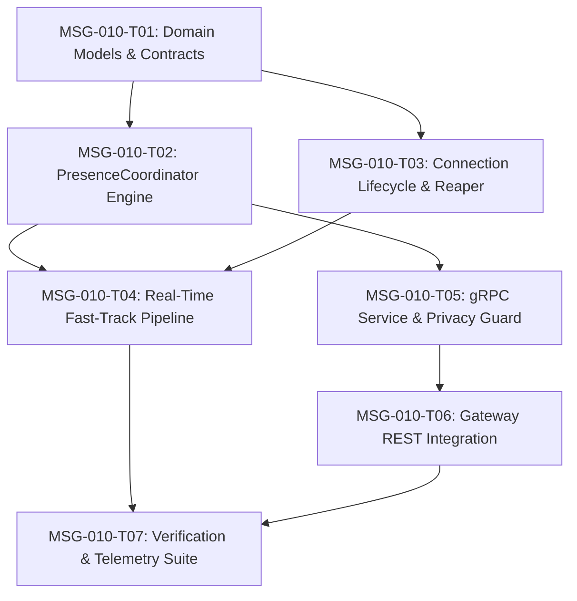

# MSG-010 — Presence & Real-Time Messaging Optimization
## Phase 2 (M3: Secure Messaging Platform) Technical Specification & Implementation Tickets

**Card Identifier**: MSG-010  
**Milestone**: M3 — Secure Messaging Platform  
**Document Status**: Proposal & Implementation Decomposition  
**Role**: Senior Principal Systems Architect, Security Architect & Gatekeeper  
**Author**: Antigravity  
**Date**: October 23, 2026  

---

## 1. Executive Summary & Architectural Scope

Card **MSG-010** establishes the high-performance, real-time connection lifecycle and ephemeral presence subsystem for SecureCloud Messaging (`securecloud-messaging`), adhering strictly to **ADR-001** (Microservices Architecture), **ADR-004** (gRPC Inter-Process Communication), **ADR-007** (Message Reliability & Durability), **ADR-008** (Security & Cryptographic Architecture), **ADR-009** (Distributed Failure & Resilience), and **ADR-010** (Performance, Capacity & Optimization Strategy).

While **MSG-007** established online delivery and worker dispatching, **MSG-008** established multi-device delivery state tracking and read receipts, and **MSG-009** established sequence-based synchronization, **MSG-010 optimizes real-time responsiveness by exploiting active client connections while strictly preserving the decoupling between transient network connections and durable message state.**

### 1.1 The Non-Conflation Axiom
In accordance with ADR-007 and ADR-008, SecureCloud enforces absolute semantic separation between four orthogonal state dimensions:

$$\mathbf{Presence} \neq \mathbf{Delivery\ (Per\text{-}Device)} \neq \mathbf{Read\ (Per\text{-}User)} \neq \mathbf{Synchronization\ (Per\text{-}Device)}$$

```text
┌───────────────────────────────────────────────────────────────────────────────────────────────────┐
│                                   SECURECLOUD STATE DOMAINS                                       │
├──────────────────────────┬──────────────────────────┬───────────────────────┬─────────────────────┤
│ 1. Network Presence      │ 2. Per-Device Delivery   │ 3. Per-User Read      │ 4. Device Sync      │
├──────────────────────────┼──────────────────────────┼───────────────────────┼─────────────────────┤
│ Ephemeral operational    │ Authoritative durable    │ Logical user UI       │ Monotonic sequence  │
│ transport connectivity   │ state machine in ScyllaDB│ presentation receipt  │ watermark in Scylla │
│ (In-memory lease / TTL)  │ (QUEUED -> DELIVERED)    │ (User-level audit)    │ (Pull checkpoint)   │
│                          │                          │                       │                     │
│ Target: Device / User    │ Target: Device ID        │ Target: User ID       │ Target: Device ID   │
│ Persistence: In-Memory   │ Persistence: ScyllaDB    │ Persistence: ScyllaDB │ Persistence: Scylla │
└──────────────────────────┴──────────────────────────┴───────────────────────┴─────────────────────┘
```

#### Core Invariants:
1. **Presence Does Not Imply Delivery**: A device being connected (`ONLINE`) must **never** cause a message to be marked `DELIVERED`. Delivery requires an affirmative, cryptographically verified delivery acknowledgement (`AcknowledgeDelivery`) from the recipient client.
2. **Disconnection Does Not Erase Durable State**: Losing a network connection, dropping a socket, or experiencing lease timeout must **never** regress or erase previously persisted `DELIVERED` or `READ` states.
3. **Absence of Presence Does Not Block Delivery**: If presence information is unavailable, degraded, or reports `OFFLINE`, durable delivery mechanisms (ScyllaDB pending queues and recovery sweeps) continue operating deterministically without data loss.
4. **Presence Does Not Block Synchronization**: Reconnecting clients can pull missed messages via `SyncDeviceMessages` (MSG-009) regardless of reported presence status.
5. **No Global Broker for Presence**: In adherence to ADR-007 and ADR-010, presence is managed via localized in-memory leasing and peer-to-peer operational signaling. No heavy external message brokers (Kafka, RabbitMQ, Redis) are introduced solely for presence.
6. **Zero Plaintext Invariant (ADR-008)**: Presence signaling carries operational availability and custom status strings only. It never accesses or manipulates encryption keys or ciphertext payloads.

---

## 2. Presence & Connection Lifecycle Architecture

### 2.1 Connection Session State Machine

Each connected client device maintains an ephemeral connection session governed by the following state machine:

```text
                     ┌──────────────────┐
                     │   DISCONNECTED   │◄─────────────────────────────┐
                     └─────────┬────────┘                              │
                               │ Transport Handshake                   │
                               │ Authenticated & Bound                 │
                               ▼                                       │
                     ┌──────────────────┐                              │
                     │    CONNECTING    │                              │
                     └─────────┬────────┘                              │
                               │ Channel Registered & Leased           │
                               ▼                                       │
                     ┌──────────────────┐                              │
       ┌────────────►│      ACTIVE      │                              │
       │             └────┬────────┬────┘                              │
       │                  │        │                                   │
       │ Heartbeat / Ping │        │ Lease Idle Window Exceeded        │
       │ Received         │        ▼                                   │
       │             ┌──────────────────┐                              │
       └─────────────┤      STALE       │                              │
                     └─────────┬────────┘                              │
                               │ Eviction Reaper Scan /                │
                               │ Socket RST / Unregister               │
                               ▼                                       │
                     ┌──────────────────┐                              │
                     │    TERMINATED    ├──────────────────────────────┘
                     └──────────────────┘
```

#### Lifecycle Rules:
- **`CONNECTING`**: Mutual TLS / Bearer authentication verified by Gateway. Gateway or client initiates connection channel registration.
- **`ACTIVE`**: Channel is registered in `DeviceConnectionRegistry` with an active lease timer (default $60\,\text{s}$). Real-time delivery worker can push envelopes directly.
- **`STALE`**: If no heartbeat or outbound traffic occurs within $T_{\text{lease}}$ ($60\,\text{s}$), the connection is marked stale. It remains eligible for eviction.
- **`TERMINATED`**: Channel is unregistered either gracefully (client disconnects) or ungracefully (reaper evicts after $T_{\text{evict}}$ or transport error). Any in-flight dispatches safely revert to `QUEUED`.

### 2.2 Presence Status Semantics & Multi-Device Aggregation

The operational presence of a user is represented by the protobuf enum `PresenceStatus`:
```protobuf
enum PresenceStatus {
  PRESENCE_STATUS_UNSPECIFIED = 0; // Unknown or uninitialized
  PRESENCE_STATUS_ONLINE = 1;      // Actively connected and receptive
  PRESENCE_STATUS_AWAY = 2;        // Connected but idle / inactive
  PRESENCE_STATUS_BUSY = 3;        // Do not disturb / in operational session
  PRESENCE_STATUS_OFFLINE = 4;     // No active connections
}
```

#### Multi-Device Aggregation Rules:
1. **Computed Baseline**: A user's natural operational presence is computed across all authorized devices registered to that user:
   $$\text{Status}_{\text{user}} = \begin{cases} \text{ONLINE} & \text{if } \exists d \in \text{Devices}(u) \text{ such that } \text{IsActive}(d) \\ \text{OFFLINE} & \text{if } \forall d \in \text{Devices}(u), \neg \text{IsActive}(d) \text{ and history exists} \\ \text{UNSPECIFIED} & \text{if } \text{Devices}(u) = \emptyset \text{ or no connection observed} \end{cases}$$
2. **Explicit User Preference Override**: If a user explicitly sets their presence to `AWAY` or `BUSY` (with an optional custom status message, max 140 chars) via `UpdatePresence`, that preference overrides the computed `ONLINE` status across all peer queries until reset or until all devices disconnect.
3. **Lease Decay**: If all connected devices of a user go stale or disconnect, the user's presence automatically transitions to `OFFLINE`.

---

## 3. Real-Time Delivery Optimization & Reconnect Fast-Track

### 3.1 Real-Time Delivery Acceleration Protocol

Currently, `OutboxDeliveryConsumer` and `DurableDeliveryRecoveryService` poll ScyllaDB on fixed intervals ($100\,\text{ms}$ and $30\,\text{s}$ respectively). While safe, a reconnecting device might wait up to $30\,\text{s}$ for recovery sweeps to resume delivery of backlogged messages.

Card **MSG-010** introduces the **Reconnect Fast-Track Hook**:

```text
 Client Device                     Gateway Proxy                     Messaging Service              ScyllaDB Cluster
       │                                 │                                   │                              │
       │ 1. Establish Channel / Stream   │                                   │                              │
       ├────────────────────────────────►│ 2. RegisterChannel(device_id)     │                              │
       │                                 ├──────────────────────────────────►│ 3. Register in ConnectionReg │
       │                                 │                                   │    (Lease initialized)       │
       │                                 │                                   │                              │
       │                                 │                                   │ 4. Trigger Fast-Track Hook:  │
       │                                 │                                   │    FastTrackDeliverForDevice │
       │                                 │                                   ├─────────────────────────────►│
       │                                 │                                   │ 5. Read Pending Deliveries   │
       │                                 │                                   │◄─────────────────────────────┤
       │                                 │                                   │                              │
       │                                 │                                   │ 6. Schedule DeliveryTasks    │
       │                                 │                                   │    into BoundedScheduler     │
       │                                 │ 7. Push Ciphertext Envelope       │                              │
       │◄────────────────────────────────┴───────────────────────────────────┤                              │
       │                                                                     │                              │
       │ 8. Client Affirmative ACK (AcknowledgeDelivery)                     │                              │
       ├────────────────────────────────────────────────────────────────────►│ 9. Record DELIVERED in Scylla│
       │                                                                     ├─────────────────────────────►│
```

#### Fast-Track Invariant Protections:
- **No In-Memory Bypass**: The fast-track sweep only reads records already committed to `delivery_state_by_message` / `pending_deliveries_by_device`. No unpersisted messages are dispatched.
- **Fairness & Concurrency Control**: Fast-track tasks are injected into the `BoundedDeliveryScheduler` via priority queues, preserving per-device ring buffers and backpressure limits.
- **Drop-to-Durable Safety**: If the connection drops during transmission, the worker receives `RecipientOffline`, reverts the status in ScyllaDB to `QUEUED`, and exits cleanly without retry penalty.

---

## 4. Resource Limits, Abuse Protection & Security Boundaries

### 4.1 Resource Limits & Capacity Controls

To protect humanitarian messaging servers against file-descriptor exhaustion, memory bloat, and connection-flooding Denial-of-Service (DoS) attacks:

| Dimension | Configurable Limit | Default | Action on Breach |
| :--- | :--- | :--- | :--- |
| **Max Concurrent Devices per User** | `max_devices_per_user_connection` | 10 devices | 11th connection rejected with `RESOURCE_EXHAUSTED` |
| **Max Connections per Single Device** | `max_connections_per_device` | 1 connection | New connection atomically supersedes old channel; old channel evicted gracefully via `DisconnectCallback` |
| **Global Connected Device Capacity** | `max_global_connections` | 100,000 | Reject incoming connection with `UNAVAILABLE` (backpressure) |
| **Presence Update Rate Limit** | `max_presence_updates_per_min` | 12 updates/min | Reject with `RESOURCE_EXHAUSTED` (Rate limit exceeded) |
| **Custom Status String Length** | `max_status_message_length` | 140 bytes | Truncate or reject with `INVALID_ARGUMENT` |
| **Batch Presence Query Limit** | `max_batch_presence_users` | 100 users | Reject with `INVALID_ARGUMENT` if exceeded |

### 4.2 Privacy & Authorization Boundaries

In accordance with ADR-008 and humanitarian data privacy standards:
1. **Self-Presence Modification Only**: A caller can only update their own presence status (`caller_user_id == req.user_id`). Any attempt to modify another user's presence yields `PERMISSION_DENIED`.
2. **Mutual Conversation Privacy Guard**: A user is **not** permitted to query the presence of arbitrary users in the system. A presence query (`GetPresence` or `BatchGetPresence`) is authorized **only if** the caller and the target user share at least one active, non-archived conversation. Unrelated user queries return `PRESENCE_STATUS_OFFLINE` or `NOT_FOUND` to prevent organizational scraping and tracking.
3. **Revoked Device Fail-Closed**: If a client device is marked `REVOKED` in the Auth Service, its active connection channel is immediately terminated and unregistered.

---

## 5. Implementation Tickets Decomposition

### Summary of Tickets

| Ticket ID | Title | Primary Components | Estimated Scope |
| :--- | :--- | :--- | :--- |
| **MSG-010-T01** | Presence & Connection Domain Models, Lifecycle State Machine & Contracts | `domain/presence_types.hpp`, `domain/connection_session.hpp`, `proto/messaging.proto` | Core Domain & Contracts |
| **MSG-010-T02** | Thread-Safe Multi-Device Presence Coordinator & Leased Ephemeral State Engine | `PresenceCoordinator`, `IPresenceCoordinator`, `UserPresenceCache` | Core Engine & Leasing |
| **MSG-010-T03** | Connection Lifecycle Manager, Heartbeat Reaper & Resource Capacity Controller | `ConnectionLifecycleManager`, `DeviceConnectionRegistry` enhancements, Capacity Guards | Concurrency & Limits |
| **MSG-010-T04** | Real-Time Delivery Acceleration & Reconnect Fast-Track Pipeline | `RealtimeDeliveryAccelerator`, `BoundedDeliveryScheduler`, `DurableDeliveryRecoveryService` | Performance Optimization |
| **MSG-010-T05** | MessagingService gRPC Presence RPCs & Mutual-Conversation Privacy Guard | `MessagingServiceImpl`, `ConversationAuthorizationService` | gRPC Service & Security |
| **MSG-010-T06** | Gateway REST Proxy Routing & Presence Endpoints Integration | `MessagingProxyHandler`, Gateway Router, OpenAPI spec update | Gateway API & Mapping |
| **MSG-010-T07** | Comprehensive Verification Suite, Telemetry & Non-Conflation Regression Tests | Unit tests, Integration tests, Prometheus metrics, Chaos disconnect tests | Quality & Verification |

---

### MSG-010-T01 — Presence & Connection Domain Models, Lifecycle State Machine & Contracts

#### 1. Objectives & Scope
Define the formal C++ domain representations for client connection sessions, presence statuses, lease states, and lifecycle transitions. Align domain models with existing protobuf contracts in `proto/securecloud/messaging/v1/messaging.proto`.

#### 2. Detailed Technical Requirements
- Create `src/messaging/domain/presence_types.hpp`:
  - `enum class PresenceStatus : uint8_t { Unspecified = 0, Online = 1, Away = 2, Busy = 3, Offline = 4 };`
  - `struct UserPresence`:
    - `UserId user_id;`
    - `PresenceStatus status;`
    - `std::chrono::system_clock::time_point last_active_at;`
    - `std::string custom_status_message;` (sanitized, UTF-8, max 140 chars)
    - `size_t active_device_count;`
  - `struct UpdatePresenceCommand`:
    - `UserId user_id;`
    - `PresenceStatus status;`
    - `std::string custom_status_message;`
    - `std::chrono::system_clock::time_point updated_at;`
- Create `src/messaging/domain/connection_session.hpp`:
  - `enum class ConnectionState : uint8_t { Connecting = 0, Active = 1, Stale = 2, Terminated = 3 };`
  - `struct ConnectionSession`:
    - `std::string connection_id;` (UUIDv7)
    - `DeviceId device_id;`
    - `UserId user_id;`
    - `std::string client_ip;`
    - `std::string user_agent;`
    - `uint32_t protocol_version;`
    - `ConnectionState state;`
    - `std::chrono::steady_clock::time_point connected_at;`
    - `std::chrono::steady_clock::time_point last_heartbeat_at;`
- Serialization / string conversion helpers for logging and telemetry.

#### 3. Acceptance Criteria
- [ ] Domain models compile cleanly with zero external dependencies beyond `domain/message_types.hpp`.
- [ ] Presence status enum values map 1:1 with `securecloud::messaging::v1::PresenceStatus`.
- [ ] Unit tests verify copy/move semantics and status string serialization.

---

### MSG-010-T02 — Thread-Safe Multi-Device Presence Coordinator & Leased Ephemeral State Engine

#### 1. Objectives & Scope
Implement the core in-memory `PresenceCoordinator` that tracks real-time user availability derived from active device connections, manages explicit status overrides (`AWAY`, `BUSY`), and enforces automatic lease decay without touching persistent storage.

#### 2. Detailed Technical Requirements
- Create `src/messaging/service/presence_coordinator_interface.hpp`:
  - `virtual UserPresence get_user_presence(const UserId& user_id) const = 0;`
  - `virtual std::vector<UserPresence> batch_get_presence(const std::vector<UserId>& user_ids) const = 0;`
  - `virtual void set_user_override(const UserId& user_id, PresenceStatus status, const std::string& custom_message) = 0;`
  - `virtual void clear_user_override(const UserId& user_id) = 0;`
  - `virtual void on_device_connected(const UserId& user_id, const DeviceId& device_id) = 0;`
  - `virtual void on_device_disconnected(const UserId& user_id, const DeviceId& device_id) = 0;`
  - `virtual void on_device_heartbeat(const UserId& user_id, const DeviceId& device_id) = 0;`
- Implement `src/messaging/service/presence_coordinator.hpp` and `.cpp`:
  - Maintains `std::unordered_map<UserId, UserPresenceEntry>` protected by `std::shared_mutex` (allowing highly concurrent read queries).
  - Maintains bi-directional mapping: `UserId -> std::unordered_set<DeviceId>` and `DeviceId -> UserId`.
  - When a device connects (`on_device_connected`), user state automatically evaluates to `Online` (unless explicit `Busy`/`Away` override is active).
  - When the last device of a user disconnects (`on_device_disconnected`), user state transitions to `Offline`.
  - Ephemeral lease evaluation: if `now - last_active > lease_timeout`, presence dynamically evaluates as `Offline`.
  - Zero ScyllaDB reads or writes: state is 100% ephemeral in-memory.

#### 3. Acceptance Criteria
- [ ] Read operations (`get_user_presence`, `batch_get_presence`) acquire shared locks for sub-millisecond retrieval.
- [ ] User with 3 devices remains `Online` when 2 devices disconnect, and transitions to `Offline` when all 3 disconnect.
- [ ] Explicit user status override (`Busy`) persists while devices remain connected and clears on explicit request or total disconnect.
- [ ] Fully verified by comprehensive unit tests.

---

### MSG-010-T03 — Connection Lifecycle Manager, Heartbeat Reaper & Resource Capacity Controller

#### 1. Objectives & Scope
Harden `DeviceConnectionRegistry` and wrap it in a high-level `ConnectionLifecycleManager` that enforces connection limits (per-device, per-user, global), manages heartbeats, and runs a background reaper thread to evict stale connections.

#### 2. Detailed Technical Requirements
- Extend `src/messaging/delivery/device_connection_registry.hpp`:
  - Atomic superseding: if a device re-registers with a new channel, cleanly notify and tear down the prior channel.
  - Track user-level connection counts: reject registration if active devices for a `UserId` exceed `max_devices_per_user` (default 10).
  - Global capacity guard: reject if total connections exceed `max_global_connections` (default 100,000).
- Implement `src/messaging/delivery/connection_lifecycle_manager.hpp` and `.cpp`:
  - Background reaper thread running on configurable interval (e.g., $15\,\text{s}$).
  - Invokes `registry->evict_stale_channels(lease_timeout)` and notifies `PresenceCoordinator::on_device_disconnected`.
  - Provides `record_heartbeat(const DeviceId& device_id)` which invokes `touch_channel()` and updates session timestamps.
  - Safe shutdown: `stop()` joins background threads cleanly.

#### 3. Acceptance Criteria
- [ ] Enforces 1 active connection per `DeviceId` (atomic superseding with old channel cleanup).
- [ ] Rejects 11th device for the same user with `RESOURCE_EXHAUSTED`.
- [ ] Rejects connection when global limit is reached.
- [ ] Stale connections exceeding lease timeout are automatically evicted by reaper thread.
- [ ] Heartbeat refreshes lease and prevents eviction.

---

### MSG-010-T04 — Real-Time Delivery Acceleration & Reconnect Fast-Track Pipeline

#### 1. Objectives & Scope
Integrate connection establishment with online message delivery to eliminate reconnection lag. When an offline device reconnects, immediately trigger a targeted dispatch sweep for that device while strictly preserving the non-conflation invariant.

#### 2. Detailed Technical Requirements
- Implement `src/messaging/delivery/realtime_delivery_accelerator.hpp` and `.cpp`:
  - Subscribes as a listener to `ConnectionLifecycleManager` connection events.
  - On `on_device_connected(DeviceId, UserId)`:
    - Asynchronously queries `IDeliveryStateRepository::fetch_pending_for_device(device_id, current_bucket, max_batch)`.
    - Enqueues retrieved pending messages directly into `BoundedDeliveryScheduler`.
    - Bounded rate: limits fast-track burst to 50 tasks per device to prevent scheduler queue starvation.
- Verify Non-Conflation Guarantees:
  - If client disconnects while fast-track delivery is executing, `DeliveryWorker` receives `RecipientOffline` and reverts state to `QUEUED`.
  - No message transitions to `DELIVERED` without explicit client `AcknowledgeDelivery`.

#### 3. Acceptance Criteria
- [ ] Pending queued messages for an offline device are immediately scheduled within $< 50\,\text{ms}$ of reconnection.
- [ ] Fast-track sweep queries durable persistence (ScyllaDB) and does not rely on transient memory.
- [ ] Abrupt disconnection during fast-track delivery causes zero message loss and preserves `QUEUED` state.

---

### MSG-010-T05 — MessagingService gRPC Presence RPCs & Mutual-Conversation Privacy Guard

#### 1. Objectives & Scope
Implement the 3 currently unimplemented presence RPCs in `MessagingServiceImpl` (`UpdatePresence`, `GetPresence`, `BatchGetPresence`), backed by `PresenceCoordinator` and protected by conversation privacy rules.

#### 2. Detailed Technical Requirements
- Implement in `src/messaging/service/messaging_service_impl.cpp`:
  - `UpdatePresence(ServerContext*, const UpdatePresenceRequest*, UpdatePresenceResponse*)`:
    - Extracts `caller_user_id` from mTLS / gRPC metadata.
    - Validates caller authentication context.
    - Enforces rate limiting (max 12 updates/min).
    - Sanitizes `custom_status_message` (max 140 chars).
    - Calls `PresenceCoordinator::set_user_override` or `clear_user_override`.
    - Returns updated `UserPresence`.
  - `GetPresence(ServerContext*, const GetPresenceRequest*, GetPresenceResponse*)`:
    - Extracts `caller_user_id`.
    - Enforces Mutual Conversation Privacy Guard:
      - If `caller_user_id == req.user_id`: allow immediately.
      - Else, verify via `IConversationRepository` / `IConversationAuthorizationService` that caller and target share at least one mutual active conversation.
      - If no mutual conversation: return `PRESENCE_STATUS_OFFLINE` (privacy shielding).
    - Calls `PresenceCoordinator::get_user_presence(target_user_id)`.
  - `BatchGetPresence(ServerContext*, const BatchGetPresenceRequest*, BatchGetPresenceResponse*)`:
    - Validates `user_ids.size() <= 100`.
    - Filters list to only users sharing a mutual conversation with `caller_user_id`.
    - Calls `PresenceCoordinator::batch_get_presence`.
    - Returns batch results.

#### 3. Acceptance Criteria
- [ ] `UpdatePresence`, `GetPresence`, and `BatchGetPresence` return `grpc::Status::OK` instead of `UNIMPLEMENTED`.
- [ ] Callers cannot update another user's presence (`PERMISSION_DENIED`).
- [ ] Users cannot query presence of non-conversing strangers (privacy shielded to `OFFLINE`).
- [ ] Batch queries exceeding 100 user IDs are rejected with `INVALID_ARGUMENT`.

---

### MSG-010-T06 — Gateway REST Proxy Routing & Presence Endpoints Integration

#### 1. Objectives & Scope
Expose presence capabilities to external clients via the Gateway REST API, mapping HTTP requests to gRPC `MessagingService` calls in `MessagingProxyHandler`.

#### 2. Detailed Technical Requirements
- Update `src/gateway/http/proxy/messaging_proxy_handler.hpp` and `.cpp`:
  - Route: `PUT /v1/users/{user_id}/presence` (or `PUT /v1/presence/me`)
    - Requires authenticated `RequestContext`.
    - Enforces `caller_user_id == route_user_id`.
    - Maps JSON payload `{"status": "online|away|busy|offline", "custom_status_message": "..."}` to `UpdatePresenceRequest`.
    - Calls `MessagingServiceClient::update_presence()`.
    - Returns `200 OK` with JSON `UserPresence`.
  - Route: `GET /v1/users/{user_id}/presence`
    - Requires authenticated `RequestContext`.
    - Calls `MessagingServiceClient::get_presence()`.
    - Returns `200 OK` with JSON `UserPresence`.
  - Route: `POST /v1/users/presence/batch`
    - Requires authenticated `RequestContext`.
    - Payload: `{"user_ids": ["uuid1", "uuid2"]}`.
    - Calls `MessagingServiceClient::batch_get_presence()`.
    - Returns `200 OK` with JSON array.
- Update `openapi/openapi.yaml` with formal REST schemas and security requirements for presence endpoints.

#### 3. Acceptance Criteria
- [ ] Gateway routes match approved REST patterns with strict Bearer token authentication.
- [ ] Unauthorized calls return 401 Unauthorized; mismatched caller IDs return 403 Forbidden.
- [ ] JSON request and response serialization conforms to OpenAPI specification.

---

### MSG-010-T07 — Comprehensive Verification Suite, Telemetry & Non-Conflation Regression Tests

#### 1. Objectives & Scope
Build a comprehensive unit and integration test suite validating presence semantics, connection lifecycle, resource exhaustion, privacy enforcement, real-time reconnect acceleration, and strict non-conflation guarantees. Instrument Prometheus telemetry.

#### 2. Detailed Technical Requirements
- Prometheus Metrics Instrumentation:
  - `messaging_active_connections` (Gauge)
  - `messaging_presence_status{status="online|away|busy|offline"}` (Gauge)
  - `messaging_connection_churn_total{event="connected|disconnected|evicted"}` (Counter)
  - `messaging_fast_track_dispatches_total` (Counter)
  - `messaging_presence_update_latency_seconds` (Histogram)
- Test Suites:
  - `tests/unit/messaging/presence_coordinator_test.cpp`:
    - Multi-device status aggregation.
    - Explicit status overrides and clearing.
    - Idle lease timeout and decay.
  - `tests/unit/messaging/connection_lifecycle_manager_test.cpp`:
    - Device superseding and disconnect callback invocation.
    - Per-user and global connection limit enforcement.
    - Background reaper eviction of stale channels.
    - Heartbeat lease extension.
  - `tests/unit/messaging/presence_privacy_guard_test.cpp`:
    - Mutual conversation validation.
    - Privacy shielding against unauthorized scraping.
  - `tests/integration/messaging/presence_integration_test.cpp`:
    - End-to-end Gateway REST -> gRPC MessagingService presence update and batch query.
    - Non-Conflation Invariant Verification:
      1. Connect Device $D_1$ ($\text{Presence} = \text{Online}$).
      2. Send Message $M_1$.
      3. Assert $M_1$ state is `QUEUED` / `DELIVERING`, **not** `DELIVERED`.
      4. Disconnect Device $D_1$ abruptly.
      5. Assert $M_1$ state remains safely `QUEUED`.
      6. Reconnect Device $D_1$.
      7. Assert fast-track delivery dispatches $M_1$.
      8. Device submits `AcknowledgeDelivery`.
      9. Assert $M_1$ state transitions to `DELIVERED`.
      10. Disconnect $D_1$ again. Assert $M_1$ remains `DELIVERED` (no regression).

#### 3. Acceptance Criteria
- [ ] 100% pass rate across all new unit and integration test suites.
- [ ] All existing test suites (MSG-001 through MSG-009, AUDIT, AUTH, FILES) continue to pass with zero regressions.
- [ ] Zero compiler warnings, 100% `clang-format` compliance, clean ASan/TSan execution.

---

## 6. Implementation Dependency & Execution Sequence



### Execution Strategy:
1. **Foundation (T01)**: Define pure domain types (`UserPresence`, `ConnectionSession`) with zero external coupling.
2. **Core In-Memory Services (T02, T03)**: Build `PresenceCoordinator` and `ConnectionLifecycleManager` with thread-safe data structures, capacity guards, and the background reaper.
3. **Delivery Integration (T04)**: Hook connection establishment to `RealtimeDeliveryAccelerator` to eliminate reconnect delivery latency.
4. **Service Boundary & Gateway (T05, T06)**: Implement gRPC RPCs in `MessagingServiceImpl`, enforce mutual conversation privacy, and expose Gateway REST endpoints.
5. **Validation (T07)**: Execute rigorous unit, integration, and chaos reconnect tests proving zero conflation between presence and delivery.
