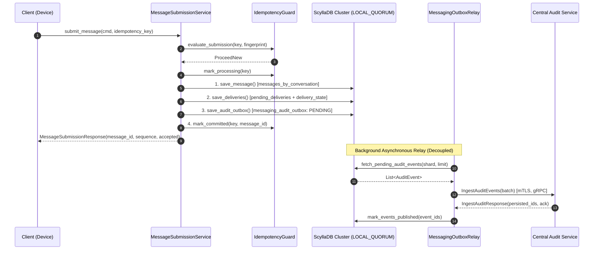
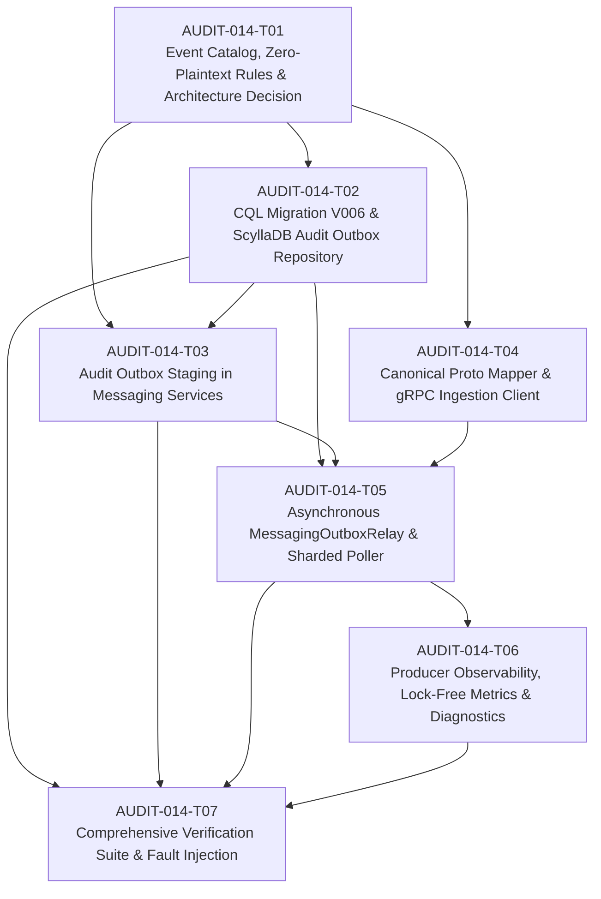

# AUDIT-014 — Messaging Audit Producer and Durable Outbox
## Phase 6 (M6: Centralized Audit & Compliance) Technical Specification & Implementation Tickets

**Card Identifier**: `AUDIT-014`  
**Milestone**: M6 — Centralized Audit & Compliance  
**Document Status**: Implementation-Ready Technical Specification & Ticket Decomposition  
**Assignee / Developer**: Lorenzo  
**Reviewer & Gatekeeper**: Sergey
**Date**: November 5, 2026  
**Dependencies**: `AUDIT-002` (Canonical Event Model & Validator), `AUDIT-004` (Authenticated gRPC Ingestion Contract), `AUDIT-005` (Bounded Asynchronous Ingestion & Batch Persistence), `AUDIT-006` (Event Deduplication & Retry-Safe Acknowledgements), `AUDIT-010` (Readiness, Health Checks & Graceful Shutdown), `AUDIT-011` (Ingestion Metrics & Diagnostics), `MSG-001`–`MSG-008` (Messaging Service, ScyllaDB Persistence Layer & E2E Validation)  
**Related ADRs**: `ADR-004` (Inter-Process Communication Model), `ADR-005` (Database Ownership — §7 Messaging Database), `ADR-006` (Event-Driven Architecture & Message Reliability), `ADR-007` (Message Reliability & Transactional Outbox), `ADR-008` (Security, Service PKI & Zero-Knowledge Transport), `ADR-009` (Distributed Failure Resilience), `ADR-010` (Performance & Bounded Capacity Optimization)

---

## 1. Executive Summary & Architectural Reality

Card **AUDIT-014** specifies and implements the **Durable Audit Outbox** integration for the **SecureCloud Messaging Service** (`securecloud-messaging`), establishing it as an authoritative, reliable, and privacy-preserving audit event producer for the centralized **Audit Service** (`securecloud-audit`).

### 1.1 The Architectural Contrast: ScyllaDB vs. Relational vs. Stateless Outbox

Across the SecureCloud ecosystem, the three audit producers possess fundamentally different persistence topologies:

| Dimension | Gateway (`AUDIT-012`) | Auth Service (`AUDIT-013`) | Messaging Service (`AUDIT-014`) |
| :--- | :--- | :--- | :--- |
| **Primary Persistence** | None (Stateless Reverse Proxy) | PostgreSQL 17 (Relational RDBMS) | ScyllaDB 5.4 / 6.0 (Distributed Wide-Column NoSQL) |
| **Atomicity Boundary** | Process-local disk spool (`ADR-011`) | Single ACID Database Transaction (`pqxx::work`) | Partition-local atomicity only; no multi-table/cross-partition ACID transactions |
| **Outbox Model** | Append-only SQLite WAL Spool on NVMe | Transactional Outbox Table (`auth_audit_outbox`) | Sharded ScyllaDB Outbox Table (`messaging_audit_outbox`) |
| **Dual-Write Mitigation** | Local filesystem write before network | Atomic commit with business state change | Sequential durable write with idempotent forward recovery |
| **Data Protection** | Perimeter metadata only; zero credentials | Zero plaintext secrets (passwords, MFA keys, tokens) | **Strict Zero-Knowledge & Zero-Plaintext** (`ADR-008`): No plaintext, no ciphertext envelopes, no ratchet keys |

### 1.2 The ScyllaDB Distributed Outbox Reality

In a relational database like PostgreSQL (`AUDIT-013`), an operation can commit business rows and an outbox row within a single ACID transaction (`COMMIT`). If the database crashes or rolls back, neither row exists.

In ScyllaDB (`securecloud_messaging`), rows are distributed across a token ring partitioned by partition key hashes:
- `messages_by_conversation` partition key: `((conversation_id, message_bucket))`
- `delivery_state_by_message` partition key: `((message_id))`
- `pending_deliveries_by_device` partition key: `((device_id, delivery_bucket))`
- `message_submission_by_idempotency_key` partition key: `((sender_device_id))`
- `messaging_audit_outbox` partition key: `((outbox_bucket, shard_id))`

**Crucial Distributed Database Fact**:
1. In ScyllaDB / Apache Cassandra, **atomic batches only guarantee atomicity within a single partition**.
2. Spanning multiple tables with different partition keys in a `LOGGED BATCH` **does not** provide relational ACID guarantees: it writes uncoordinated mutation logs to the coordinator's `system.batches`, carries massive coordination overhead, risks distributed timeouts under load, and degrades write throughput (violating the 10,000 msgs/sec design requirement of `ADR-010`).
3. Furthermore, `LOGGED BATCH` does not support isolation or rollback: partial mutations can be read by other queries before completion, and if a coordinator node fails, replicas eventually replay the batch independently.
4. **Separation from Internal Delivery Outbox**: The existing `messaging_outbox_events` table (migration `V002`) is consumed by `OutboxDeliveryConsumer` to trigger immediate real-time socket delivery to online devices. Conflating external compliance audit delivery with real-time push dispatch would introduce lifecycle coupling, backpressure interference, and schema contention.

Therefore, `AUDIT-014` establishes:
1. A dedicated, time-bucketed, sharded table: `securecloud_messaging.messaging_audit_outbox` (migration `V006`).
2. A **Sequential Write with Idempotent Forward Recovery** protocol that provides durable at-least-once audit capture without violating ScyllaDB's architecture or degrading throughput.

---

## 2. Event Inventory, Ownership Boundaries & Zero-Knowledge Invariants

### 2.1 Event Ownership Principles: Messaging vs. Gateway vs. Auth

1. **Messaging owns conversation, message transmission, and delivery lifecycle events**:
   - Verification that a sender is an active member of the conversation.
   - Monotonic sequence allocation and durable acceptance of messages.
   - Fan-out to recipient device delivery queues.
   - Device delivery confirmations and read receipt lifecycle transitions.
   - Group lifecycle operations (creation, member additions, member removals, group closure).
2. **Gateway vs. Messaging duplication rule**:
   - Gateway records perimeter rejection (e.g. rate limit exceeded, invalid TLS, malformed request frame).
   - Once Gateway routes a message submission to Messaging, **Messaging owns the authoritative acceptance or rejection**. Gateway does not record a redundant business event.
3. **Auth vs. Messaging duplication rule**:
   - Auth owns device enrollment and user authentication.
   - Messaging owns device authorization within conversations and recipient device resolution.

### 2.2 Strict Zero-Knowledge & Zero-Plaintext Audit Invariant (`ADR-008`, `RULES.md` §5)

Under `ADR-008`, SecureCloud enforces end-to-end encrypted messaging where servers act as blind relays. The server has **zero access to plaintext message contents or cryptographic keys**.

> [!CAUTION]
> **Zero-Plaintext Compliance Mandatory Rule**:
> 1. Audit events must **NEVER** contain:
>    - Decrypted message contents or plaintext snippets
>    - E2E ciphertext envelopes (`ciphertext_blob`, `ephemeral_public_key`, `iv`, `auth_tag`)
>    - One-time prekeys, signed prekeys, ratchet keys, or shared secrets
>    - Full recipient contact rosters or unhashed private address books
> 2. All audit payloads are strictly limited to **structural metadata**:
>    - Identifiers: `conversation_id`, `message_id`, `sequence`, `sender_user_id`, `sender_device_id`
>    - Operational metrics: `message_priority`, `recipient_device_count`, `protocol_version`, `envelope_byte_size`
>    - Lifecycle timestamps: `accepted_at`, `delivered_at`, `read_at`
> 3. Any payload formatting must pass through `securecloud::messaging::util::ZeroPlaintextGuard` before insertion into the outbox.

### 2.3 Messaging Audit Event Catalog

| Event Type | Severity | Mandatory? | Trigger Condition | Canonical Actor & Target Context | Bounded Metadata Payload |
| :--- | :--- | :--- | :--- | :--- | :--- |
| `message.submitted` | `INFO` | Mandatory | Message accepted, sequenced, and persisted in `messages_by_conversation` | Actor: `sender_user_id`, `sender_device_id`<br>Target: `conversation_id`, `message_id` | `{"sequence": 42, "priority": "NORMAL", "recipient_device_count": 3, "envelope_bytes": 512, "protocol_version": 1}` |
| `message.delivered` | `INFO` | Best-Effort / Batched | Recipient device successfully receives and acknowledges envelope | Actor: `recipient_user_id`, `recipient_device_id`<br>Target: `message_id` | `{"conversation_id": "...", "delivery_latency_ms": 128, "attempt_count": 1}` |
| `message.read` | `INFO` | Best-Effort / Batched | Recipient device acknowledges read receipt | Actor: `recipient_user_id`, `recipient_device_id`<br>Target: `message_id` | `{"conversation_id": "...", "sequence": 42}` |
| `message.delivery.failed` | `WARNING` | Mandatory | Envelope exhausted maximum retries or device permanently removed | Actor: `system` (Messaging Service)<br>Target: `message_id`, `recipient_device_id` | `{"conversation_id": "...", "attempts": 5, "reason": "DEVICE_UNREACHABLE_EXPIRED"}` |
| `conversation.created` | `INFO` | Mandatory | 1:1 or group conversation created | Actor: `created_by_user_id`<br>Target: `conversation_id` | `{"conversation_type": "GROUP", "initial_member_count": 5}` |
| `conversation.membership.changed` | `INFO` | Mandatory | Participant joined, removed, or left conversation | Actor: `actor_user_id`<br>Target: `conversation_id`, `affected_user_id` | `{"action": "MEMBER_ADDED", "role": "MEMBER", "membership_version": 2}` |
| `conversation.closed` | `INFO` | Mandatory | Group conversation permanently closed by admin | Actor: `actor_user_id`<br>Target: `conversation_id` | `{"reason": "ADMIN_ACTION"}` |
| `security.authorization.denied` | `SECURITY` | Mandatory | Non-participant attempts to submit message, read history, or alter members | Actor: `caller_user_id`, `caller_device_id`<br>Target: `conversation_id` | `{"action": "SUBMIT_MESSAGE", "reason": "NOT_AN_ACTIVE_MEMBER"}` |
| `emergency.activated` | `CRITICAL` | Mandatory | Emergency message broadcast triggered | Actor: `caller_user_id`<br>Target: `conversation_id` | `{"priority": "EMERGENCY", "broadcast_scope": "TENANT"}` |
| `messaging.rate_limit.exceeded` | `WARNING` | Best-Effort | Device exceeds message submission rate quota | Actor: `sender_user_id`, `sender_device_id`<br>Target: `conversation_id` | `{"current_rate": 50, "limit": 20, "window_seconds": 1}` |

---

## 3. ScyllaDB Schema Migration `V006__create_messaging_audit_outbox.cql`

To ensure zero interference with the internal device delivery scheduler, we introduce migration `V006` creating `securecloud_messaging.messaging_audit_outbox`.

### 3.1 Partitioning and Sharding Architecture

To support high-throughput message ingestion without write hotspots or coordinator bottlenecking:
1. **Compound Partition Key**: `((outbox_bucket, shard_id))`
   - `outbox_bucket`: Hourly UTC time bucket formatted as `YYYYMMDDHH` (e.g., `2026110517`). Hourly bucketing bounds partition sizes to well under ScyllaDB's recommended 100MB / 100,000-row partition limit.
   - `shard_id`: An integer from `0` to `15` derived from `hash(conversation_id) % 16`. This distributes writes across 16 independent token ranges per hour, eliminating hot replicas.
2. **Clustering Key**: `(created_at ASC, event_id ASC)`
   - Guarantees chronological ordering within each shard, enabling sequential scanning by the outbox relay worker.
3. **Partition Lifecycle**:
   - Old partitions are pruned via ScyllaDB table default TTL (`default_time_to_live = 604800` = 7 days) or scheduled background partition truncation after events are published, preventing infinite tombstone buildup.

```cql
-- V006: Create Dedicated Messaging Audit Outbox Table
-- Strict alignment with AUDIT-014, ADR-005, ADR-007, ADR-010.

CREATE TABLE IF NOT EXISTS securecloud_messaging.messaging_audit_outbox (
    outbox_bucket text,          -- Hourly bucket: YYYYMMDDHH (UTC)
    shard_id int,                -- Shard key: 0..15 based on hash(conversation_id)
    created_at timestamp,        -- Event occurrence time (UTC)
    event_id text,               -- UUIDv7 canonical event identifier
    event_type text,             -- e.g. "message.submitted", "conversation.created"
    severity text,               -- "INFO", "WARNING", "SECURITY", "CRITICAL"
    actor_user_id text,          -- Verified actor identity
    actor_device_id text,        -- Verified device identity
    target_resource text,        -- Primary affected entity (conversation_id or message_id)
    payload_proto_bin blob,      -- Serialized canonical securecloud.audit.v1.AuditEvent proto
    publish_status text,         -- "PENDING", "PUBLISHED", "QUARANTINED"
    attempt_count int,           -- Number of delivery attempts
    last_attempt_at timestamp,   -- Timestamp of most recent dispatch
    last_error text,             -- Sanitized failure reason for diagnostics
    leased_until timestamp,      -- Distributed worker leasing timestamp
    PRIMARY KEY ((outbox_bucket, shard_id), created_at, event_id)
) WITH CLUSTERING ORDER BY (created_at ASC, event_id ASC)
  AND default_time_to_live = 604800  -- 7-day safety TTL
  AND compaction = {
      'class': 'TimeWindowCompactionStrategy',
      'compaction_window_unit': 'HOURS',
      'compaction_window_size': 4
  }
  AND comment = 'AUDIT-014: Durable audit outbox for asynchronous centralized audit ingestion';
```

---

## 4. Mandatory Architecture Decision: ScyllaDB Atomicity, Multi-Partition Limitations & The Sequential Durable Outbox Pattern

### 4.1 Context and Technical Problem

Relational databases provide ACID multi-table transactions. ScyllaDB does not provide multi-partition ACID transactions.
When a message submission arrives, the following mutations must occur:
1. Insert into `messages_by_conversation` (partition: `conversation_id + bucket`)
2. Insert into `pending_deliveries_by_device` (partition: `device_id + bucket`)
3. Insert into `delivery_state_by_message` (partition: `message_id`)
4. Insert into `messaging_audit_outbox` (partition: `outbox_bucket + shard_id`)
5. Update `message_submission_by_idempotency_key` (partition: `sender_device_id`)

Because each table has a different partition key, **they reside on completely different nodes across the cluster**.
If we attempted to wrap all 5 writes in a ScyllaDB `LOGGED BATCH`:
- The coordinator would write distributed log records to `system.batches`, coordinating across multiple token replicas.
- Write latency would increase significantly, and under heavy load (10k msgs/sec), coordinator overload and write timeouts would occur.
- Furthermore, `LOGGED BATCH` provides **neither isolation nor rollbacks**: if one statement encounters a syntax or validation failure, it cannot roll back completed writes.

### 4.2 Approved Architecture Decision: Sequential Durable Write with Idempotent Forward Recovery

To achieve 100% durability, zero data loss, and high throughput without cross-partition anti-patterns, the Messaging Service adopts the **Sequential Durable Write with Idempotent Forward Recovery** protocol:



### 4.3 Failure Windows and Forward Recovery Proof

| Failure Scenario | State at Crash | Client / System Behavior | Recovery Mechanism & Guarantee |
| :--- | :--- | :--- | :--- |
| **Crash during Step 1** (before `save_message`) | Idempotency record is `PROCESSING`; no message or outbox record written | Client receives network timeout / gRPC `UNAVAILABLE` | Client retries with same `idempotency_key`. `IdempotencyGuard` checks `messages_by_conversation`, finds no message, allows fresh submission. Zero phantom audit events. |
| **Crash after Step 2** (`messages` written, but `save_audit_outbox` failed) | Message and delivery rows exist; outbox row missing; idempotency record still `PROCESSING` | Client receives error; retries with same `idempotency_key` | **Idempotent Forward Recovery**: When client retries, `IdempotencyGuard` detects message already exists. It synthesizes the deterministic audit event (`event_id = uuidv7(message_id)`), writes it to `messaging_audit_outbox`, marks idempotency `COMMITTED`, and returns success to client. **Zero message loss, zero audit loss**. |
| **Crash after Step 3** (`audit_outbox` written, before `mark_committed`) | Message, delivery, and audit outbox records exist; idempotency record `PROCESSING` | Client retries with same `idempotency_key` | `IdempotencyGuard` inspects `messages_by_conversation`, finds committed message, updates idempotency key to `COMMITTED`, returns cached response. Outbox relay processes already-written audit record. Idempotent ingestion (`AUDIT-006`) ensures no duplicate ingestion in Audit Service. |
| **Audit Service Down** (Network partition / outage) | All business records and audit outbox record committed in ScyllaDB | Client unaffected; messages delivered in real time | Outbox records remain `PENDING` in `messaging_audit_outbox`. `MessagingOutboxRelay` backs off exponentially. Once Audit recovers, records are dispatched. Zero data loss. |

---

## 5. Detailed Ticket Decomposition

The implementation of `AUDIT-014` is broken down into **7 cohesive, fully testable tickets** assigned to Lorenzo, with clear dependencies and acceptance gates.



---

### Ticket AUDIT-014-T01: Messaging Event Catalog, Zero-Plaintext Boundary & Architecture Decision

- **Ticket ID**: `AUDIT-014-T01`
- **Component**: `securecloud-messaging` (`domain`, `util`, `docs/architecture`)
- **Assignee**: Lorenzo
- **Gatekeeper**: Sergey
- **Estimated Complexity**: Medium (2 days)
- **Objective**: Establish the canonical domain event definitions, formalize the Zero-Plaintext redaction boundary via `ZeroPlaintextGuard`, and document the ScyllaDB outbox architectural decision.

#### Implementation Scope
1. **Domain Types Definition (`src/messaging/domain/audit_event.hpp`)**:
   - Define `MessagingAuditEventType` enum class:
     - `MessageSubmitted`, `MessageDelivered`, `MessageRead`, `MessageDeliveryFailed`
     - `ConversationCreated`, `ConversationMembershipChanged`, `ConversationClosed`
     - `SecurityAuthorizationDenied`, `EmergencyActivated`, `RateLimitExceeded`
   - Define `MessagingAuditSeverity`: `Info`, `Warning`, `Security`, `Critical`.
   - Define `MessagingAuditEvent` struct containing:
     - `event_id` (UUIDv7 string)
     - `event_type` (`MessagingAuditEventType`)
     - `severity` (`MessagingAuditSeverity`)
     - `occurred_at` (`std::chrono::system_clock::time_point`)
     - `actor_user_id` (`domain::UserId`), `actor_device_id` (`domain::DeviceId`)
     - `target_resource` (string: conversation ID or message ID)
     - `payload_json` (bounded metadata JSON string)
     - `correlation_id` (trace identifier string)
2. **Deterministic UUIDv7 Generator (`src/messaging/domain/audit_event_id.hpp`)**:
   - Provide helper `generate_message_audit_event_id(const MessageId& msg_id, MessagingAuditEventType type)` to guarantee deterministic, retry-safe `event_id` generation for idempotent forward recovery.
3. **Zero-Plaintext Invariant Enforcement (`src/messaging/util/zero_plaintext_guard.cpp`)**:
   - Extend `ZeroPlaintextGuard` to validate audit metadata JSON strings:
     - Assert that `payload_json` does NOT contain keys: `ciphertext`, `ciphertext_blob`, `ephemeral_public_key`, `prekey`, `ratchet`, `secret`, `private_key`, `token`.
     - In debug/test builds, throw `std::logic_error` if any forbidden key or raw binary payload is encountered.
4. **Architecture Decision Documentation**:
   - Create `docs/architecture/decisions/ADR-012-messaging-durable-audit-outbox.md` formalizing:
     - Why ScyllaDB multi-partition `LOGGED BATCH` is rejected for cross-table mutations.
     - The Sequential Durable Write with Idempotent Forward Recovery protocol.
     - Partition key design `((outbox_bucket, shard_id), created_at, event_id)` with TTL and TWCS.

#### Acceptance Criteria
- [ ] `MessagingAuditEventType` covers all 10 identified Messaging events with string mappings matching AUDIT-002 conventions.
- [ ] `ZeroPlaintextGuard::validate_audit_payload()` rejects any payload containing cryptographic keys, tokens, or ciphertexts.
- [ ] Unit tests in `tests/messaging/domain/audit_event_test.cpp` verify serialization and deterministic UUIDv7 generation.
- [ ] `ADR-012` is documented and approved by Sergey.

---

### Ticket AUDIT-014-T02: CQL Schema Migration V006 & ScyllaDB Audit Outbox Repository

- **Ticket ID**: `AUDIT-014-T02`
- **Component**: `securecloud-messaging` (`db/migrations`, `repository`)
- **Assignee**: Lorenzo
- **Gatekeeper**: Sergey
- **Estimated Complexity**: High (3 days)
- **Objective**: Author CQL migration `V006`, implement `IMessagingAuditOutboxRepository` and `ScyllaMessagingAuditOutboxRepository` using the native Cassandra C++ driver (`CassSession`).

#### Implementation Scope
1. **Migration File (`src/messaging/db/migrations/V006__create_messaging_audit_outbox.cql`)**:
   - Define `securecloud_messaging.messaging_audit_outbox` with TWCS, 7-day default TTL, compound partition key `((outbox_bucket, shard_id))`, and clustering key `(created_at ASC, event_id ASC)`.
   - Update `V003` schema tracking tests to include `V006`.
2. **Repository Interface (`src/messaging/repository/messaging_audit_outbox_repository_interface.hpp`)**:
   ```cpp
   namespace securecloud::messaging::repository {

   struct AuditOutboxRecord {
       std::string outbox_bucket;
       int32_t shard_id{0};
       std::chrono::system_clock::time_point created_at;
       std::string event_id;
       std::string event_type;
       std::string severity;
       std::string actor_user_id;
       std::string actor_device_id;
       std::string target_resource;
       std::vector<uint8_t> payload_proto_bin;
       std::string publish_status; // "PENDING", "PUBLISHED", "QUARANTINED"
       int32_t attempt_count{0};
       std::chrono::system_clock::time_point last_attempt_at;
       std::string last_error;
       std::chrono::system_clock::time_point leased_until;
   };

   class IMessagingAuditOutboxRepository {
   public:
       virtual ~IMessagingAuditOutboxRepository() = default;
       virtual void enqueue_audit_event(const AuditOutboxRecord& record) = 0;
       virtual std::vector<AuditOutboxRecord> fetch_pending_events(
           const std::string& outbox_bucket, int32_t shard_id, size_t limit,
           std::chrono::seconds lease_duration) = 0;
       virtual void mark_published(const std::string& outbox_bucket, int32_t shard_id,
                                   const std::chrono::system_clock::time_point& created_at,
                                   const std::string& event_id) = 0;
       virtual void record_failure(const std::string& outbox_bucket, int32_t shard_id,
                                   const std::chrono::system_clock::time_point& created_at,
                                   const std::string& event_id,
                                   const std::string& error_message,
                                   bool should_quarantine) = 0;
       virtual size_t count_pending_backlog(const std::string& outbox_bucket, int32_t shard_id) = 0;
   };

   } // namespace securecloud::messaging::repository
   ```
3. **ScyllaDB Implementation (`src/messaging/repository/scylla_messaging_audit_outbox_repository.cpp`)**:
   - Prepared statements for `enqueue_audit_event`, `fetch_pending_events`, `mark_published`, `record_failure`.
   - Tuned write consistency: `CASS_CONSISTENCY_LOCAL_QUORUM` for durability.
   - Worker leasing: `fetch_pending_events` queries `WHERE outbox_bucket = ? AND shard_id = ? AND publish_status = 'PENDING'` and applies a lease timestamp (`leased_until = now + lease_duration`) to prevent concurrent workers from claiming the same batch.
   - In-memory mock repository (`InMemoryMessagingAuditOutboxRepository`) for rapid unit testing.

#### Acceptance Criteria
- [ ] Migration `V006` applies cleanly against ScyllaDB 5.4/6.0 with zero schema warnings.
- [ ] `ScyllaMessagingAuditOutboxRepository` compiles and executes prepared statements using `LOCAL_QUORUM`.
- [ ] Lease updates protect records from duplicate concurrent worker pickup.
- [ ] Repository unit tests cover insertion, fetch, publish ack, failure recording, and quarantine transition.

---

### Ticket AUDIT-014-T03: Audit Outbox Staging Pipeline in Messaging Services

- **Ticket ID**: `AUDIT-014-T03`
- **Component**: `securecloud-messaging` (`service`, `delivery`)
- **Assignee**: Lorenzo
- **Gatekeeper**: Sergey
- **Estimated Complexity**: High (3.5 days)
- **Objective**: Integrate durable audit outbox staging into `MessageSubmissionService`, `ConversationService`, `ReadReceiptService`, and `DeliveryWorker` following the approved Sequential Write and Idempotent Forward Recovery protocol.

#### Implementation Scope
1. **`MessageSubmissionService` Integration (`src/messaging/service/message_submission_service.cpp`)**:
   - Inject `std::shared_ptr<repository::IMessagingAuditOutboxRepository>` into constructor.
   - In `submit_message`:
     - Step 8: Persist `msg_entity` in `messages_by_conversation`.
     - Step 9: Persist `pending_records` and `recipient_states`.
     - Step 10: Persist internal delivery outbox event in `messaging_outbox_events` (for WebSocket push).
     - **Step 10b (New)**: Stage `message.submitted` in `messaging_audit_outbox`:
       - Deterministic `event_id = generate_message_audit_event_id(message_id, MessageSubmitted)`.
       - Shard ID: `std::hash<std::string>{}(cmd.conversation_id.str()) % 16`.
       - Bucket: `MessageBucket::from_time_point(accepted_at).to_hourly_string()`.
       - Metadata sanitized by `ZeroPlaintextGuard`.
     - Step 11: Mark idempotency record `COMMITTED`.
   - Update `IdempotencyGuard::evaluate_submission`:
     - If record is `PROCESSING` or existing message is found during retry, verify audit record presence; if absent, execute forward recovery staging before returning cached response.
   - Stage `security.authorization.denied` when `can_send_message` returns false.
2. **`ConversationService` Integration (`src/messaging/service/conversation_service.cpp`)**:
   - Stage `conversation.created` on 1:1 and group creation.
   - Stage `conversation.membership.changed` on member addition, role change, or departure.
   - Stage `conversation.closed` on group closure.
3. **`ReadReceiptService` Integration (`src/messaging/service/read_receipt_service.cpp`)**:
   - Stage `message.read` when a batch of read receipts is accepted.
4. **`DeliveryWorker` Integration (`src/messaging/delivery/delivery_worker.cpp`)**:
   - Stage `message.delivered` when device acknowledges envelope delivery.
   - Stage `message.delivery.failed` when retry limit (5 attempts) is exhausted.

#### Acceptance Criteria
- [ ] Every valid `submit_message` stages a `message.submitted` record in `messaging_audit_outbox` with status `PENDING`.
- [ ] Rejection of unauthorized users stages a `security.authorization.denied` audit record.
- [ ] Group lifecycle operations stage corresponding conversation audit events.
- [ ] Forward recovery test: If outbox write fails after message persistence, client retry triggers recovery and outbox event is successfully committed without duplicating the message.
- [ ] All staged payloads contain zero plaintext and pass `ZeroPlaintextGuard` validation.

---

### Ticket AUDIT-014-T04: Canonical Proto Mapper & Authenticated gRPC Ingestion Client

- **Ticket ID**: `AUDIT-014-T04`
- **Component**: `securecloud-messaging` (`audit_client`, `proto`)
- **Assignee**: Lorenzo
- **Gatekeeper**: Sergey
- **Estimated Complexity**: Medium (2.5 days)
- **Objective**: Implement the canonical protobuf mapper converting `AuditOutboxRecord` into `securecloud.audit.v1.AuditEvent` and author the authenticated gRPC client connecting over mTLS.

#### Implementation Scope
1. **Canonical Proto Mapping (`src/messaging/audit/canonical_audit_mapper.hpp`, `.cpp`)**:
   - Map `AuditOutboxRecord` to `securecloud::audit::v1::AuditEvent`:
     - `event_id`: UUIDv7 string.
     - `producer_service`: `"messaging"`.
     - `event_type`: Formatted string (`message.submitted`, etc.).
     - `severity`: Proto enum (`SEVERITY_INFO`, `SEVERITY_WARNING`, `SEVERITY_SECURITY`, `SEVERITY_CRITICAL`).
     - `occurred_at`: Google Protobuf `Timestamp`.
     - `actor`: `actor_user_id` and `actor_device_id`.
     - `target_resource`: Populated target ID.
     - `metadata`: JSON payload parsed into Google Protobuf `Struct`.
   - Validate mapped event using `securecloud::audit::domain::validate_canonical_event()` before wire transmission.
2. **Authenticated Ingestion Client (`src/messaging/audit/messaging_audit_client.hpp`, `.cpp`)**:
   - Asynchronous gRPC stub: `securecloud::audit::v1::AuditIngestionService::Stub`.
   - mTLS Configuration:
     - Client certificate & private key from `/etc/securecloud/certs/messaging/client.crt` & `.key`.
     - CA trust bundle verifying `audit.securecloud.internal`.
     - Expected peer SAN: `audit.securecloud.internal`.
   - Support `IngestAuditEvents` batch RPC (up to 100 events per call per `AUDIT-005`).
   - Implement channel health monitoring and reconnect backoff.

#### Acceptance Criteria
- [ ] Mapped protobuf messages validate 100% against `AUDIT-002` schema rules.
- [ ] gRPC client enforces mutual TLS with strict peer certificate SAN validation.
- [ ] Serialization preserves exact UUIDv7 `event_id` and microsecond-precision `occurred_at`.
- [ ] Mock gRPC server test verifies batch request transmission and acknowledgement response handling.

---

### Ticket AUDIT-014-T05: Asynchronous MessagingOutboxRelay Worker, Sharded Poller & Quarantine Engine

- **Ticket ID**: `AUDIT-014-T05`
- **Component**: `securecloud-messaging` (`audit_relay`)
- **Assignee**: Lorenzo
- **Gatekeeper**: Sergey
- **Estimated Complexity**: High (4 days)
- **Objective**: Build the multi-threaded asynchronous relay worker that scans sharded ScyllaDB outbox partitions, dispatches batches to the Audit Service over gRPC, handles exponential backoff, and quarantines poison pills.

#### Implementation Scope
1. **Sharded Poller Architecture (`src/messaging/audit/messaging_outbox_relay.hpp`, `.cpp`)**:
   - Configurable worker pool (e.g., 4 threads servicing 16 shards).
   - Scans active hourly bucket + previous hour bucket (to drain boundary events).
   - Round-robin polling across `shard_id` (0..15) with configurable poll interval (default: 50ms when backlog exists, 500ms when idle).
   - Batch size: 100 events per gRPC request (`AUDIT-005` batch ingestion limit).
2. **Leasing and Dispatch Loop**:
   - Fetch batch using `fetch_pending_events` with lease duration (e.g., 30 seconds).
   - Transmit batch via `MessagingAuditClient::IngestAuditEvents()`.
   - On affirmative acknowledgement:
     - Mark events `PUBLISHED` in ScyllaDB (`mark_published`).
     - Remove published records or leave them for TTL cleanup.
3. **Transient Failure & Exponential Backoff Engine**:
   - If gRPC call fails with `UNAVAILABLE`, `DEADLINE_EXCEEDED`, or `RESOURCE_EXHAUSTED`:
     - Retain status `PENDING`.
     - Apply exponential backoff with full jitter: $t_{backoff} = \min(t_{max}, t_{base} \times 2^{attempt}) \pm jitter$.
     - Increment `attempt_count` and update `last_error`.
4. **Poison-Pill Quarantine Engine**:
   - If gRPC returns `INVALID_ARGUMENT` (malformed payload rejected by Audit Service) or if `attempt_count >= 5`:
     - Transition event to `QUARANTINED` status.
     - Log security alert with sanitized error details.
     - Prevent malformed event from blocking remaining valid events in the shard.
5. **Graceful Shutdown**:
   - Implement `stop()` responding to `SIGTERM`/`SIGINT`.
   - Allow in-flight gRPC batches up to 5 seconds to drain before closing connections.

#### Acceptance Criteria
- [ ] Relay scans all 16 shards without starving any shard.
- [ ] Events successfully acknowledged by Audit Service are marked `PUBLISHED` in ScyllaDB.
- [ ] Transient network drops trigger exponential backoff with jitter without worker crash.
- [ ] Malformed events exceeding 5 retries transition to `QUARANTINED` without blocking healthy events.
- [ ] Graceful shutdown drains in-flight batches cleanly.

---

### Ticket AUDIT-014-T06: Producer Observability, Lock-Free Metrics & Zero-PII Structured Diagnostics

- **Ticket ID**: `AUDIT-014-T06`
- **Component**: `securecloud-messaging` (`metrics`, `diagnostics`)
- **Assignee**: Lorenzo
- **Gatekeeper**: Sergey
- **Estimated Complexity**: Medium (2 days)
- **Objective**: Instrument the Messaging audit producer with lock-free atomic metrics, Prometheus/OpenTelemetry collectors, and zero-PII diagnostic logging.

#### Implementation Scope
1. **Lock-Free Producer Metrics (`src/messaging/audit/messaging_audit_metrics.hpp`, `.cpp`)**:
   - `messaging_audit_events_staged_total{event_type, severity}` (Counter)
   - `messaging_audit_events_published_total{event_type}` (Counter)
   - `messaging_audit_events_retried_total{reason}` (Counter)
   - `messaging_audit_events_quarantined_total{reason}` (Counter)
   - `messaging_audit_outbox_backlog_gauge{shard_id}` (Gauge)
   - `messaging_audit_delivery_latency_seconds` (Histogram: duration from `created_at` to gRPC ACK)
   - `messaging_audit_batch_size` (Histogram: distribution of dispatched batch sizes)
2. **Prometheus Exposition**:
   - Expose metrics on the internal diagnostics listener (`127.0.0.1:9095/metrics` or internal mTLS endpoint).
3. **Structured Diagnostics & Logging (`src/messaging/audit/audit_diagnostics.cpp`)**:
   - Log relay state changes, quarantine events, and connection failures using structured JSON.
   - Enforce zero-PII and zero-plaintext guarantees: sanitize all logs via `ZeroPlaintextGuard`.

#### Acceptance Criteria
- [ ] All defined Prometheus metrics are registered and exposed correctly.
- [ ] Metrics collection uses lock-free atomics with zero lock contention in high-throughput write paths.
- [ ] Backlog gauge accurately reflects pending rows across all shards.
- [ ] Diagnostic logs contain no message ciphertext, encryption keys, or sensitive user tokens.

---

### Ticket AUDIT-014-T07: Comprehensive Verification Suite, Fault Injection & Zero-Plaintext Tests

- **Ticket ID**: `AUDIT-014-T07`
- **Component**: `tests/messaging/audit/`
- **Assignee**: Lorenzo
- **Gatekeeper**: Sergey
- **Estimated Complexity**: High (4 days)
- **Objective**: Implement comprehensive automated unit, integration, and fault injection test suites verifying ScyllaDB outbox persistence, failure windows, restart recovery, and strict zero-plaintext invariants.

#### Implementation Scope
1. **Unit Test Suite (`tests/messaging/audit/messaging_audit_unit_test.cpp`)**:
   - Event creation, field validation, and deterministic UUIDv7 generation.
   - Protocol buffer mapping and serialization correctness.
   - Exponential backoff calculation and jitter bounds.
2. **Zero-Plaintext Security Negative Tests (`tests/messaging/audit/zero_plaintext_security_test.cpp`)**:
   - Attempt to stage events containing mock ciphertext, prekeys, or private keys; verify immediate rejection by `ZeroPlaintextGuard`.
   - Inspect serialized outbox blobs and verify 0% leakage of plaintext or key material.
3. **ScyllaDB Integration & Concurrency Tests (`tests/messaging/audit/scylla_audit_outbox_test.cpp`)**:
   - Multi-threaded producer benchmark: 1,000 messages submitted concurrently across 16 shards; verify zero lost events.
   - Sharded poller test: Verify 4 worker threads claim disjoint records without double-delivery.
4. **Fault Injection & Failure Window Tests (`tests/messaging/audit/audit_fault_injection_test.cpp`)**:
   - **Failure Window 1 (Crash before outbox write)**: Simulate process crash after `save_message`; retry submission; verify Idempotent Forward Recovery stages the missing outbox record.
   - **Failure Window 2 (Audit Service outage)**: Kill mock Audit Service; verify outbox accumulates backlog without dropping messages; restore Audit Service; verify 100% backlog drain.
   - **Failure Window 3 (Poison pill)**: Inject invalid payload into outbox table; verify relay quarantines row after 5 attempts and successfully delivers subsequent healthy events.
   - **Failure Window 4 (Worker restart)**: Terminate Messaging Service while relay has leased records; restart service; verify unacknowledged expired leases are reclaimed and delivered.

#### Acceptance Criteria
- [ ] 100% test pass rate across unit, integration, and fault injection test suites.
- [ ] Zero-plaintext negative tests prove that ciphertexts and keys cannot enter the outbox or audit payloads.
- [ ] Idempotent Forward Recovery recovers from simulated crash windows with zero data loss and zero duplicate messages.
- [ ] Outbox relay drains backlog cleanly following simulated Audit Service downtime.

---

## 6. Acceptance Criteria Traceability Matrix

| Card AUDIT-014 Requirement | Addressed in Tickets | Verification Strategy |
| :--- | :--- | :--- |
| **Identify Messaging audit events** (message lifecycle, authorization, conversation changes, abuse/emergency) | `AUDIT-014-T01`, `AUDIT-014-T03` | `audit_event_test.cpp`, `message_submission_service_test.cpp` |
| **Canonical event production** (AUDIT-002 model, UUIDv7 `event_id`, immutable across retries, distinct `occurred_at`) | `AUDIT-014-T01`, `AUDIT-014-T04` | `canonical_audit_mapper_test.cpp` validating against canonical schema |
| **Metadata minimization & Zero-Knowledge Transport** (No message plaintext, no keys, no raw ciphertext) | `AUDIT-014-T01`, `AUDIT-014-T07` | `zero_plaintext_security_test.cpp` negative tests asserting zero secrets |
| **Durable outbox design based on actual ScyllaDB model** (No assuming relational ACID; reject cross-partition logged batches) | `AUDIT-014-T01` (`ADR-012`), `AUDIT-014-T02` | CQL schema inspection (`V006`), `scylla_audit_outbox_test.cpp` |
| **Durable outbox schema & shard partitioning** (`((outbox_bucket, shard_id))`, TWCS, TTL) | `AUDIT-014-T02` | `V006` migration execution in ScyllaDB test cluster |
| **Sequential Write & Idempotent Forward Recovery** (Recover if business succeeds but outbox fails) | `AUDIT-014-T03`, `AUDIT-014-T07` | Fault injection tests simulating crash between message and outbox write |
| **Outbox delivery & retry** (Authenticated gRPC, mTLS, exponential backoff, jitter, bounded memory) | `AUDIT-014-T04`, `AUDIT-014-T05` | Integration test against mock Audit Service with latency and drop injection |
| **Poison-pill quarantine** (Quarantine malformed events without blocking healthy stream) | `AUDIT-014-T05`, `AUDIT-014-T07` | Fault injection test verifying `QUARANTINED` transition after 5 attempts |
| **Producer observability** (Backlog size, delivery latency, retries, quarantine count, zero-PII logs) | `AUDIT-014-T06` | Prometheus metrics scraping and log inspection in test harness |
| **Comprehensive testing** (Unit, ScyllaDB integration, failure windows, restart recovery) | `AUDIT-014-T07` | Full automated CTest execution in CI pipeline |

---

## 7. Risk Analysis & Mitigation Matrix

| Risk / Failure Mode | Likelihood | Impact | Architectural Mitigation Strategy |
| :--- | :--- | :--- | :--- |
| **R1: ScyllaDB Partition Hotspotting** under heavy message volume | Medium | High | **Hourly + 16 Shards Partitioning**: `((outbox_bucket, shard_id))` distributes writes across 16 token ranges per hour. Shard derived from `hash(conversation_id) % 16`. |
| **R2: Infinite Tombstone Accumulation** in outbox table | High | Medium | **TWCS + 7-Day Default TTL**: `TimeWindowCompactionStrategy` with hourly windows and 7-day TTL ensures expired SSTables are dropped as entire files with zero read-time tombstone scanning. |
| **R3: Plaintext or Crypto Key Leakage into Audit Stream** | Low | Critical | **`ZeroPlaintextGuard` Strict Validation**: Enforce automated key-scanning in `ZeroPlaintextGuard::validate_audit_payload()`. Zero ciphertext blobs in proto struct. |
| **R4: Cross-Partition Multi-Table Write Inconsistency** | Medium | High | **Sequential Write with Idempotent Forward Recovery**: `MessageSubmissionService` executes writes in strict order; `IdempotencyGuard` reconciles and forward-recovers missing outbox events upon client retry. |
| **R5: Audit Service Outage Causing Messaging Disruption** | Medium | Critical | **Complete Decoupling**: Business submission never waits for Audit Service. Relay is entirely asynchronous. Messaging throughput is completely isolated from Audit Service availability. |
| **R6: Worker Double-Dispatch / Lock Contention** | Medium | Low | **Worker Leasing / Shard Partitioning**: Relay workers acquire exclusive time-bounded leases on shard records (`leased_until = now + lease_duration`), ensuring disjoint batches without distributed locking. |
| **R7: Poison Pill Blocking Outbox Shard** | Low | High | **Automatic Quarantine**: Records exceeding 5 attempts or returning `INVALID_ARGUMENT` are marked `QUARANTINED`, emitting a diagnostic alert and unblocking subsequent events. |

---

## 8. Summary & Next Steps

This specification establishes an ironclad, production-ready blueprint for Card **AUDIT-014**:
1. It respects the physical reality and atomicity boundaries of ScyllaDB, explicitly rejecting the anti-pattern of cross-partition logged batches.
2. It introduces a high-throughput, sharded, TTL-managed ScyllaDB schema (`V006`) with zero hotspotting.
3. It enforces SecureCloud's strict **Zero-Knowledge & Zero-Plaintext** cryptographic privacy invariants (`ADR-008`).
4. It delivers a robust, testable 7-ticket roadmap for developer Lorenzo, complete with failure-window proofs and verification suites.

**Recommended Approval Action**:
- Review and approve `specs/phase6/AUDIT-014-tickets.md`.
- Assign `AUDIT-014-T01` through `AUDIT-014-T07` to Lorenzo for Phase 6 implementation.
