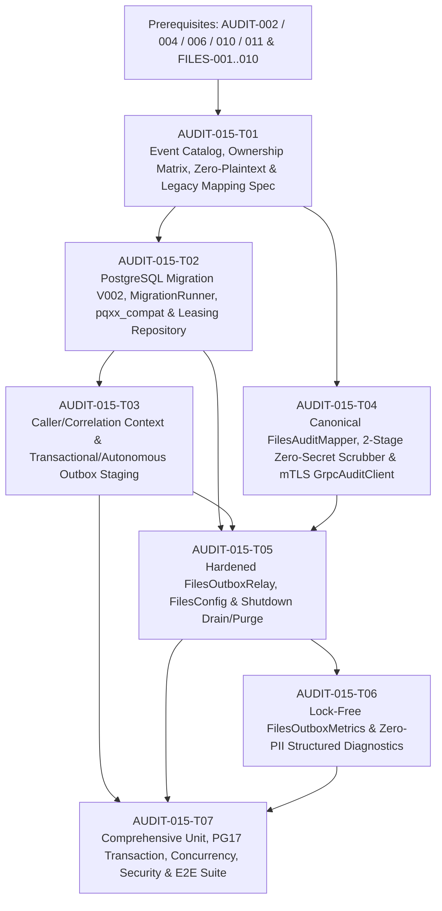

# AUDIT-015 — Files Audit Producer and Production Transactional Outbox
## Phase 6 (M6: Centralized Audit & Compliance) Technical Specification & Implementation Tickets

**Card Identifier**: `AUDIT-015`  
**Milestone**: M6 — Centralized Audit & Compliance  
**Document Status**: Implementation-Ready Technical Specification & Ticket Decomposition  
**Assignee / Developer**: Lorenzo  
**Reviewer & Gatekeeper**: Sergey 
**Date**: 19-11-2026
**Dependencies**: `AUDIT-002` (Canonical Event Model & Validator), `AUDIT-004` (Authenticated gRPC Ingestion Contract), `AUDIT-005` (Bounded Asynchronous Ingestion & Batch Persistence), `AUDIT-006` (Event Deduplication & Retry-Safe Acknowledgements), `AUDIT-010` (Readiness, Health Checks & Graceful Shutdown), `AUDIT-011` (Ingestion Metrics & Diagnostics), `FILES-001`–`FILES-010` (Files Service, PostgreSQL Metadata Layer & MinIO Storage)  
**Related ADRs**: `ADR-004` (Inter-Process Communication Model), `ADR-005` (Database Ownership — §8 Files Database), `ADR-006` (Persistence Technology Selection), `ADR-007` (Message Reliability & Transactional Outbox — §18–§23), `ADR-008` (Security, Service PKI & Zero-Knowledge Encrypted Storage), `ADR-009` (Distributed Failure Resilience), `ADR-010` (Performance & Bounded Capacity Optimization)

---

## 1. Executive Summary & Verified Architectural Delta Analysis

Card **AUDIT-015** upgrades and hardens the **Files Service** (`securecloud-files`) into a production-grade, canonical, fault-tolerant, and zero-plaintext audit event producer for the centralized **Audit Service** (`securecloud-audit`).

Unlike `AUDIT-012` (Gateway greenfield spool) and `AUDIT-013` / `AUDIT-014` (greenfield audit producers for Auth and Messaging), **`securecloud-files` already contains an M5 baseline prototype (`FILES-010`)** spanning `V001__create_files_schema.sql`, `FilesOutboxRepository`, `FilesAuditMapper`, `GrpcAuditClient`, `FilesOutboxRelay`, and initial staging calls inside `FileLifecycleService` and `FileFinalizationService`. However, a full architectural audit against Milestone M6 standards (`AUDIT-002`, `AUDIT-004`, `AUDIT-006`, `AUDIT-011`, and `AUDIT-013`) confirms that the M5 prototype cannot ingest into the production Audit Service or survive transient failures without losing or invalidating events.

### 1.1 The Four-Producer Comparison Matrix

| Dimension | Gateway (`AUDIT-012`) | Auth (`AUDIT-013`) | Messaging (`AUDIT-014`) | Files (`AUDIT-015`) |
| :--- | :--- | :--- | :--- | :--- |
| **Primary Persistence** | None (Stateless Edge Proxy) | PostgreSQL 17 (`securecloud_auth`) | ScyllaDB 6.0 (`securecloud_messaging`) | PostgreSQL 17 (`securecloud_files`) + MinIO S3 (opaque ciphertext) |
| **Atomicity Boundary** | Process-local disk spool (`ADR-011`) | Single ACID DB Transaction (`pqxx::work`) | Partition-local + Forward Recovery (`ADR-012`) | Single ACID DB Transaction (`pqxx::work`) with S3 Staging Prior to Finalization |
| **Outbox Mechanism** | `FileSpoolPendingStore` | `auth_outbox` (`V005`) + `SKIP LOCKED` | `messaging_audit_outbox` (`V006`) 16 shards | `files_outbox` (`V001` -> upgraded via `V002`) + `SKIP LOCKED` Leasing |
| **Current Code State** | Completed (`walkthrough-audit-012.md`) | Completed (`walkthrough-audit-013.md`) | Spec Ready (`AUDIT-014-tickets.md`) | **M5 Baseline (`FILES-010`) Present — 8 Production Gaps Identified** |
| **Confidentiality Boundary** | Perimeter metadata only | Zero passwords, tokens, MFA secrets | Zero plaintext/ciphertext/ratchet keys | Zero plaintext bytes, file keys, encrypted filenames, nonces, or capability tokens |

---

### 1.2 Verified Current State (`FILES-010` M5 Baseline — Do NOT Re-Implement)

Developer Lorenzo must reuse and harden—never duplicate—these existing working components:

| Component | Existing Location | Verified Behavior Already in Repo |
| :--- | :--- | :--- |
| **Schema Baseline** | `src/files/db/migrations/V001__create_files_schema.sql` | Creates `files`, `file_versions`, `encrypted_file_metadata`, `file_transfers`, `file_chunks`, `file_access`, and baseline `files_outbox` table. |
| **Entity & Repository** | `src/files/domain/files_outbox_entity.hpp`, `src/files/repository/files_outbox_repository.{hpp,cpp}` | `FilesOutboxEntity` and `FilesOutboxRepository` with `stage_event`, `fetch_pending_events`, `mark_published`, `mark_failed`, `find_by_id`, and `pqxx_compat.hpp` mock support. |
| **Outbox Audit Module** | `src/files/audit/audit_client_interface.hpp`, `grpc_audit_client.{hpp,cpp}`, `files_audit_mapper.{hpp,cpp}`, `files_outbox_relay.{hpp,cpp}` | `securecloud_files_audit` CMake target, `IFilesAuditClient`, `GrpcAuditClient`, `FilesAuditMapper`, and `FilesOutboxRelay` background thread skeleton wired in `src/files/main.cpp`. |
| **Existing Transactional Hooks** | `src/files/service/file_lifecycle_service.cpp`, `src/files/service/file_finalization_service.cpp` | Atomically calls `outbox_repo_->stage_event(outbox_event, tx)` on `create_file`, `create_file_version`, `transition_lifecycle`, `delete_file`, `evaluate_and_expire_files`, and `finalize_file_upload`. |
| **Health Decoupling (`ADR-009`)** | `src/files/health/files_health_evaluator.cpp` | Evaluates readiness strictly as `compound_ready = db_ok && s3_ok`; Audit unavailability already does **not** mark Files `NOT_SERVING`. |

---

### 1.3 Eight Verified Production Gaps Targeted by `AUDIT-015`

1. **Guaranteed `AUDIT-002` Validation Failure on Every Emitted Event**:
   - `FileLifecycleService::event_type_for_status` (`src/files/service/file_lifecycle_service.cpp:10-28`) and `FileFinalizationService` (`file_finalization_service.cpp:217`) stage legacy uppercase event names (`FILE_CREATED`, `FILE_VERSION_CREATED`, `FILE_AVAILABLE`, `FILE_DELETED`, `FILE_EXPIRED`, `FILE_FAILED`, `FILE_UPLOADING`, `FILE_FINALIZING`).
   - `FilesAuditMapper::to_proto` (`src/files/audit/files_audit_mapper.cpp:13`) copies `entity.event_type` verbatim.
   - `AuditEventValidator::is_valid_event_type_format` (`src/audit/domain/audit_event_validator.cpp:11-34`) strictly enforces dot-separated lowercase alphanumeric segments (`^[a-z0-9_]+(\.[a-z0-9_]+)+$`). Consequently, **100% of Files outbox events are currently rejected with `INVALID_ARGUMENT` by `AuditIngestionService`**.
   - Additionally, `FilesAuditMapper` hardcodes `producer_instance("files-daemon")` and `target_type(TARGET_TYPE_FILE)` and omits `severity` from the outbox entity and database table.

2. **Broken Outbox Leasing & Retry State Machine (Double-Dispatch + Event Stranding)**:
   - `V001` `files_outbox` lacks `severity`, `QUARANTINED` status, `leased_until`, `last_error`, and cleanup/lease partial indexes.
   - In `src/files/repository/files_outbox_repository.cpp:58-61`, `fetch_pending_events(size_t limit)` creates a stack-local `pqxx::work tx`, runs `SELECT ... FOR UPDATE SKIP LOCKED`, and lets `tx` go out of scope on return—**immediately releasing the row lock without updating `leased_until`!** Concurrent `FilesOutboxRelay` workers across horizontal replicas would pick up and double-dispatch the exact same batch.
   - Even worse, on any transient gRPC failure (`UNAVAILABLE`, `DEADLINE_EXCEEDED`), `FilesOutboxRelay::poll_and_dispatch` (`src/files/audit/files_outbox_relay.cpp:79`) calls `mark_failed(ev.event_id)`, which executes `UPDATE files_outbox SET status = 'FAILED', retry_count = retry_count + 1` (`files_outbox_repository.cpp:90`). Because `fetch_pending_events` queries `WHERE status = 'PENDING'`, **a single transient Audit outage permanently strands every in-flight event in `'FAILED'`**! Furthermore, `FilesOutboxRelayConfig::max_retries{5}` is declared in the header (`files_outbox_relay.hpp:21`) but never checked anywhere.

3. **Incomplete Domain Event Coverage & Missing Download Flood Control**:
   - `UploadSessionManager`, `ChunkStorageService`, `DownloadManager`, `FileCapabilityManager`, and `FileAccessRepository` emit **zero** audit events. Critical security events required by `files-design.md` (§6.22) and `AUDIT-002`—including upload initiation/cancellation/expiry, chunk SHA-256 mismatch and hash conflicts, finalization integrity failures, download initiation, ACL grant/revocation/denial, and capability token issuance/rejection—are unrecorded.

4. **Lost Caller Attribution & Missing `correlation_id` Propagation**:
   - In `src/files/service/files_service_impl.cpp`, 6 of 7 RPCs (`CreateFileUpload`, `UploadChunk`, `FinalizeFileUpload`, `GetFileMetadata`, `CancelFileUpload`, `DeleteFile`) ignore `context->client_metadata()` completely. Only `DownloadChunk` (`line 740`) forwards `client_metadata`.
   - `DeleteFile` (`line 1030`) and `DownloadChunk` (`line 832`) pass `peer_identity` (`"gateway"`) as `caller_user_id`, while `FinalizeFileUpload` (`line 571`) passes `caller_user_id = ""`. Meanwhile, `FilesProxyHandler::populate_call_metadata` (`src/gateway/http/proxy/files_proxy_handler.cpp:96-107`) sets `x-user-id`, `x-device-id`, and `x-file-capability`, but never forwards `x-correlation-id` (`extract_request_id(req)`). As a result, distributed trace correlation across Gateway → Files → Audit is broken.

5. **Wrong Default Endpoint, Insecure TLS Default & Coarse `bool` Client Contract**:
   - `src/files/main.cpp:108` defaults `SECURECLOUD_AUDIT_ENDPOINT` to `"localhost:50054"` (Files' own gRPC port!) instead of `"audit:50055"`.
   - `GrpcAuditClientConfig` (`src/files/audit/grpc_audit_client.hpp:14-19`) defaults to `127.0.0.1:50054` with `use_tls{false}` (falling back to `grpc::InsecureChannelCredentials()`), and never verifies the server's mTLS SAN identity (`audit` / `audit.securecloud.internal`) or sets `SslTargetNameOverride`.
   - `IFilesAuditClient::submit_batch` returns plain `bool` (`grpc_audit_client.cpp:56`: `response.rejected_count() == 0`), discarding `grpc::StatusCode` (`UNAVAILABLE`, `DEADLINE_EXCEEDED`, `RESOURCE_EXHAUSTED`, `PERMISSION_DENIED`, `ALREADY_EXISTS`, `INVALID_ARGUMENT`), `accepted_count`, and `rejected_event_ids` needed to satisfy `AUDIT-006` per-event acknowledgement and quarantine rules.
   - `FilesConfig` (`src/files/files_config.hpp`) lacks typed configuration for the Audit endpoint, timeout, expected peer SAN, relay batch/interval/backoff/lease/retention parameters.

6. **Insufficient Zero-Plaintext / Zero-Encrypted-Filename Scrubbing**:
   - `FilesAuditMapper::to_proto` (`files_audit_mapper.cpp:61-63`) checks only 8 top-level keys (`encryption_key`, `key`, `secret`, `token`, `ciphertext`, `data`, `encrypted_data`, `password`). It fails to inspect nested JSON values, fails to scrub PostgreSQL/MinIO secrets (`db_password`, `s3_secret_key`), fails to strip file privacy fields (`encrypted_filename`, `encrypted_mime_type`, `metadata_nonce`, `metadata_tag`, `client_encryption_metadata`, `capability_token`), and lacks regex/structural detection for PEM private key headers, Bearer headers, and 3-segment JWT strings (`eyJ...`).

7. **Missing Lock-Free Observability, Zero-PII Diagnostics, Bounded Shutdown Drain & Retention Purge**:
   - `FilesOutboxRelay` logs raw exceptions to `std::cerr`, exposes zero OpenMetrics counters/gauges, performs no bounded drain during `stop()`, and never purges aged `PUBLISHED` rows from PostgreSQL.

8. **CMake Include-Path Collision Hazard Between `securecloud::auth` and `securecloud::audit_domain`**:
   - `src/files/CMakeLists.txt:56` links `securecloud_files_db` against `securecloud::auth` (for `auth::crypto::ITokenSigner` / `ITokenVerifier` used by `FileCapabilityManager`). Because `securecloud::auth` exports `src/auth/` (which defines `domain/audit_event.hpp`, `domain/enums.hpp`) and `securecloud::audit_domain` exports `src/audit/` (which defines identically named `domain/audit_event.hpp`, `domain/enums.hpp`), directly linking both into the same C++ translation unit would create an include-order ODR/compile hazard (the exact hazard caught in `AUDIT-012` §4.5).
   - **Binding Mitigation**: Keep `securecloud_files_audit` decoupled from `securecloud::auth` include roots or wrap `audit_domain` (`AuditEventValidator`, `SensitiveDataGuard`, `EventId::generate_v7`) behind a narrow pimpl/façade target (`securecloud_files_audit_validator`) that exposes zero `domain/*.hpp` headers, verified by a CTest compile-guard test.

---

## 2. Event Inventory, Ownership Boundaries & Zero-Plaintext Invariants

### 2.1 Cross-Service Ownership Matrix (Zero Duplication Rule)

| Boundary Responsibility | Authoritative Producer | Non-Emitting Service(s) |
| :--- | :--- | :--- |
| Edge rate limit (429), payload size cap (413/431), concurrency cap (503), malformed/expired JWT rejection (401/403) | **Gateway (`AUDIT-012`)** (`gateway.rate_limit.exceeded`, `gateway.request.rejected`, `security.token.rejected`) | Files |
| Streaming chunk SHA-256 mismatch detected at Gateway HTTP ingress proxy | **Gateway (`AUDIT-012`)** (`gateway.file.chunk_integrity_rejected`) | Files (unless request also reaches Files direct/gRPC) |
| Durable file creation, versioning, upload session creation/cancellation/expiry | **Files (`AUDIT-015`)** (`file.created`, `file.version.created`, `file.upload.*`) | Gateway |
| Storage chunk integrity / hash conflict (`ChunkStorageService`) and whole-object assembly / finalization verification (`FileFinalizationService`) | **Files (`AUDIT-015`)** (`file.chunk.integrity_failed`, `file.upload.completed`, `file.finalization.failed`) | Gateway |
| Download initiation (`chunk_index == 0` or resume start), ACL grant/revocation/denial, Ed25519 capability token issuance/rejection, logical deletion & retention expiry | **Files (`AUDIT-015`)** (`file.download.initiated`, `file.access.*`, `file.capability.*`, `file.deleted`, `file.expired`) | Gateway, Auth |
| Device enrollment & primary device revocation | **Auth (`AUDIT-013`)** (`auth.device.enrolled`, `auth.device.revoked`) | Files (Files records `file.capability.rejected` if a revoked device presents a file capability) |

> [!IMPORTANT]
> **Download Audit Flood-Avoidance Rule (`ADR-010`)**:
> A 1 GiB encrypted file download transfers ~256 sequential chunks via `DownloadChunk`. `FilesServiceImpl::DownloadChunk` / `DownloadManager` **MUST ONLY** emit `file.download.initiated` when starting a transfer session (`chunk_index == 0` or `prepare_resume_session`), never once per chunk index `1..N`, ensuring audit volume scales with file transfers (`O(transfers)`) rather than chunk count.

---

### 2.2 Durability Categories (`ADR-007` §18–§23)

1. **Category A — State-Mutating Operations (Transactional Outbox)**:
   - Staged inside the active business `pqxx::work& tx` alongside `files`, `file_versions`, `file_transfers`, or `file_access` mutations.
   - **Guarantee**: If `tx.abort()` or a constraint violation occurs, **zero** phantom audit events commit. If `tx.commit()` succeeds, the outbox record is guaranteed durable before returning to the caller. **Zero** gRPC or S3 network calls occur after outbox commit inside `tx`.
   - Applies to: `E01`–`E06`, `E10`, `E11`, `E15`, `E16`.
2. **Category B — Non-State-Mutating & Rejection Operations (Autonomous Outbox)**:
   - Triggered when validation, ACL checks, capability verification, integrity verification, or read-only download initiation evaluates without mutating core business state (or when business transaction aborted due to security failure).
   - **Guarantee**: Staged via `FilesAuditEventPublisher::publish_autonomous(event)` using a dedicated short-lived `pqxx::work` transaction (`best-effort fail-safe`: DB unavailability during autonomous audit logging is logged via `FilesOutboxDiagnostics` and counted in `FilesOutboxMetrics`, never crashing the worker or masking the primary gRPC error status).
   - Applies to: `E07`, `E08`, `E09`, `E12`, `E13`, `E14`.

---

### 2.3 Strict Zero-Plaintext & Zero-Metadata-Leakage Invariant (`ADR-008`, `RULES.md` §5, `files-design.md` §6.22)

Audit rows in `files_outbox`, serialized `AuditEventProto` batches, and diagnostic logs must **NEVER** contain:
- Plaintext file bytes, encrypted chunk bytes, or base64-encoded file buffers.
- File encryption keys, symmetric CEKs, XChaCha20/AES-GCM keys, or asymmetric private keys (including Ed25519 capability signing keys).
- **Encrypted file metadata secrets**: `encrypted_filename`, `encrypted_mime_type`, `metadata_nonce`, `metadata_tag`, `client_encryption_metadata` (clients encrypt filenames specifically so servers/audit logs never learn filenames or MIME types).
- **Capability or Auth bearer secrets**: Signed Ed25519 capability token strings, `Authorization` headers, JWTs (`eyJ...`), refresh tokens, PEM private keys (`-----BEGIN ... PRIVATE KEY-----`).
- **Infrastructure credentials**: PostgreSQL passwords (`db_password`), MinIO access/secret keys (`s3_secret_key`).

Permitted metadata is strictly bounded to opaque UUIDv7/UUIDv4 identifiers (`file_id`, `upload_id`, `user_id`, `device_id`, `capability_id`, `grantee_user_id`), non-sensitive operational sizes/counts (`encrypted_size_bytes`, `chunk_count`, `chunk_index`, `version_number`, `ttl_seconds`), closed enums (`operation`, `permission`, `reason`), and algorithm names (e.g., `"XChaCha20-Poly1305"`).

---

### 2.4 Comprehensive Canonical Files Audit Event Catalog (`E01`–`E16`)

| # | Canonical `event_type` | Severity | Cat. | Replaces Legacy M5 Name | Triggering Service & Method | Actor / Target | Whitelisted Metadata Keys |
| :-- | :--- | :--- | :--- | :--- | :--- | :--- | :--- |
| **E01** | `file.created` | `INFO` | A | `FILE_CREATED` | `FileLifecycleService::create_file` | `USER=owner_user_id` / `FILE=file_id` | `owner_device_id`, `encrypted_size_bytes`, `chunk_count`, `encryption_algorithm`, `conversation_id` |
| **E02** | `file.version.created` | `INFO` | A | `FILE_VERSION_CREATED` | `FileLifecycleService::create_file_version` | `USER=caller_user_id` / `FILE=file_id` | `version_id`, `version_number`, `encrypted_size_bytes` |
| **E03** | `file.upload.initiated` | `INFO` | A | *(New)* | `UploadSessionManager::create_session` | `USER=owner_user_id` / `FILE=file_id` | `upload_id`, `owner_device_id`, `expected_chunk_count`, `encrypted_size_bytes` |
| **E04** | `file.upload.completed` | `INFO` | A | `FILE_AVAILABLE` | `FileFinalizationService::finalize_file_upload` | `USER=caller_user_id` (or `owner_user_id`) / `FILE=file_id` | `upload_id`, `version_number`, `total_bytes`, `chunk_count`, `checksum_sha256` |
| **E05** | `file.upload.cancelled` | `INFO` | A | `TRANSFER_CANCELLED` | `UploadSessionManager::cancel_session` | `USER=caller_user_id` / `FILE=file_id` | `upload_id`, `reason` |
| **E06** | `file.upload.expired` | `WARNING` | A | *(New)* | `UploadSessionManager::get_transfer_progress` / `ChunkStorageService` lease expiry | `SYSTEM=files` / `FILE=file_id` | `upload_id`, `accepted_chunks`, `total_chunks` |
| **E07** | `file.chunk.integrity_failed` | `SECURITY` | B | *(New)* | `FilesServiceImpl::UploadChunk` / `ChunkStorageService::store_chunk` | `USER=caller_user_id` (or `UNKNOWN`) / `FILE=file_id` | `upload_id`, `chunk_index`, `reason` (`sha256_mismatch` \| `chunk_conflict` \| `size_mismatch`) |
| **E08** | `file.finalization.failed` | `SECURITY` / `WARNING` | B | `FILE_FAILED` | `FileFinalizationService::finalize_file_upload` (`chunk_hash_tamper`=`SECURITY`; `missing_chunks`/`s3_error`=`WARNING`) | `USER=caller_user_id` / `FILE=file_id` | `upload_id`, `reason`, `accepted_chunks`, `expected_chunks` |
| **E09** | `file.download.initiated` | `INFO` | B | *(New)* | `DownloadManager::get_chunk_versioned` (`chunk_index == 0`) / `prepare_resume_session` | `USER=caller_user_id` / `FILE=file_id` | `version_number`, `starting_chunk`, `total_chunks`, `device_id` |
| **E10** | `file.access.granted` | `INFO` | A | *(New)* | `FileAccessService` / `FileAccessRepository::grant_access` | `USER=granted_by` / `FILE=file_id` | `grantee_user_id`, `grantee_device_id`, `permission` |
| **E11** | `file.access.revoked` | `SECURITY` | A | `FILE_ACCESS_REVOKED` | `FileAccessService` / `FileAccessRepository::revoke_access` | `USER=caller_user_id` / `FILE=file_id` | `grantee_user_id`, `reason` |
| **E12** | `file.access.denied` | `SECURITY` | B | *(New)* | `FilesServiceImpl`, `DownloadManager`, `FileLifecycleService`, `ChunkStorageService` | `USER=caller_user_id` (or `UNKNOWN`) / `FILE=file_id` | `operation`, `reason`, `device_id` |
| **E13** | `file.capability.issued` | `INFO` | B | *(New)* | `FileCapabilityManager::issue_capability` | `USER=grantee_user_id` / `FILE=file_id` | `capability_id`, `grantee_device_id`, `operation`, `file_version`, `ttl_seconds` (NO token!) |
| **E14** | `file.capability.rejected` | `SECURITY` | B | `CAPABILITY_REJECTED` | `FileCapabilityManager::authorize_capability` / `issue_capability` | `USER=caller_user_id` (or `UNKNOWN`) / `FILE=target_file_id` | `reason` (`invalid_signature` \| `expired` \| `device_revoked` \| `scope_mismatch` \| `missing`), `requested_operation`, `device_id` |
| **E15** | `file.deleted` | `INFO` | A | `FILE_DELETED` | `FileLifecycleService::delete_file` | `USER=caller_user_id` / `FILE=file_id` | `previous_status`, `reason` |
| **E16** | `file.expired` | `INFO` | A | `FILE_EXPIRED` | `FileLifecycleService::evaluate_and_expire_files` | `SYSTEM=files` / `FILE=file_id` | `retention_until_ms` |

> [!NOTE]
> **Rolling-Upgrade Legacy Mapping**: `FilesAuditMapper::to_proto` must normalize any pre-existing legacy rows stored under `V001` (`FILE_CREATED` → `file.created`, `FILE_AVAILABLE` → `file.upload.completed`, `FILE_DELETED` → `file.deleted`, `FILE_EXPIRED` → `file.expired`, `FILE_FAILED` → `file.finalization.failed`, `FILE_VERSION_CREATED` → `file.version.created`, `TRANSFER_CANCELLED` → `file.upload.cancelled`, `FILE_ACCESS_REVOKED` → `file.access.revoked`, `CAPABILITY_REJECTED` → `file.capability.rejected`) so zero stranded pre-migration rows become poison pills. Note also that `05-audit-data-model.md` §5.8 lists `file.upload.completed` and `file.deleted`, which align directly with `E04` and `E15`.

---

## 3. Database Schema Upgrade (`V002`) & Multi-Worker Leasing Model

### 3.1 Migration `V002__harden_files_outbox_table.sql`

Location: `src/files/db/migrations/V002__harden_files_outbox_table.sql`

```sql
-- V002__harden_files_outbox_table.sql
-- SecureCloud Files Service PostgreSQL 17 Outbox Hardening (AUDIT-015)
-- Upgrades M5 baseline files_outbox (V001) to M6 production leasing, quarantine, and cleanup semantics.

ALTER TABLE files_outbox
    ADD COLUMN IF NOT EXISTS severity VARCHAR(16) NOT NULL DEFAULT 'INFO',
    ADD COLUMN IF NOT EXISTS last_error TEXT NULL,
    ADD COLUMN IF NOT EXISTS leased_until TIMESTAMPTZ NULL;

ALTER TABLE files_outbox
    ALTER COLUMN aggregate_id DROP NOT NULL;

ALTER TABLE files_outbox
    DROP CONSTRAINT IF EXISTS files_outbox_severity_check;

ALTER TABLE files_outbox
    ADD CONSTRAINT files_outbox_severity_check
    CHECK (severity IN ('INFO', 'WARNING', 'SECURITY', 'CRITICAL'));

ALTER TABLE files_outbox
    DROP CONSTRAINT IF EXISTS files_outbox_status_check;

ALTER TABLE files_outbox
    ADD CONSTRAINT files_outbox_status_check
    CHECK (status IN ('PENDING', 'PUBLISHED', 'FAILED', 'QUARANTINED'));

-- Replace baseline index with M6 FIFO polling, lease expiration recovery, and published purge partial indexes
DROP INDEX IF EXISTS idx_files_outbox_pending;

CREATE INDEX IF NOT EXISTS idx_files_outbox_pending_polling
    ON files_outbox (created_at ASC)
    WHERE status = 'PENDING';

CREATE INDEX IF NOT EXISTS idx_files_outbox_leased
    ON files_outbox (leased_until)
    WHERE status = 'PENDING' AND leased_until IS NOT NULL;

CREATE INDEX IF NOT EXISTS idx_files_outbox_cleanup
    ON files_outbox (processed_at)
    WHERE status = 'PUBLISHED';
```

*(Why `aggregate_id DROP NOT NULL`: allows Category B events rejected before a valid `file_id` UUID is established—e.g. malformed capability token or upload size rejection—to reference `TARGET_TYPE_SERVICE` cleanly with `aggregate_id = NULL`, matching `auth_outbox` `V005`.)*

### 3.2 Atomic Lease Acquisition (`FOR UPDATE SKIP LOCKED`) & Recovery

```sql
UPDATE files_outbox
SET leased_until = NOW() + make_interval(secs => $2),
    retry_count  = retry_count + 1
WHERE event_id IN (
    SELECT event_id
    FROM files_outbox
    WHERE status = 'PENDING'
      AND (leased_until IS NULL OR leased_until < NOW())
    ORDER BY created_at ASC
    LIMIT $1
    FOR UPDATE SKIP LOCKED
)
RETURNING event_id, aggregate_type, aggregate_id, event_type, severity,
          payload_json, status, retry_count, created_at, processed_at, last_error, leased_until;
```

- **Zero Contention Across Workers/Replicas**: `FOR UPDATE SKIP LOCKED` skips rows locked by concurrent transactions, while setting `leased_until` inside an atomic `UPDATE ... RETURNING` commits the lease immediately so no long-lived DB transaction stays open across the network gRPC RPC to Audit.
- **Crash Self-Healing**: If a Files pod dies (`SIGKILL` / OOM) mid-RPC, the lease expires automatically after `lease_duration` (default `30s`), allowing any surviving worker to reclaim and redeliver the exact same `event_id` and immutable `payload_json`.
- **Transient Error vs. Permanent Quarantine**:
  - Transient gRPC failures (`UNAVAILABLE`, `DEADLINE_EXCEEDED`, `RESOURCE_EXHAUSTED`, ambiguous socket timeout) keep `status = 'PENDING'`, clear `leased_until = NULL`, record sanitized `last_error`, and apply exponential backoff + jitter.
  - Permanent rejections (`INVALID_ARGUMENT`, `ALREADY_EXISTS`, local validation failure, or presence in `rejected_event_ids`) transition `status = 'QUARANTINED'`, `processed_at = NOW()`, record sanitized `last_error`, and never block subsequent events.

---

## 4. Architecture & Dependency Graph

### 4.1 End-to-End Runtime Architecture

```text
   HTTP Client ──▶ Gateway (FilesProxyHandler)
                        │  Injects: x-user-id, x-device-id,
                        │           x-file-capability, x-correlation-id
                        │  gRPC over mTLS (SAN: DNS:gateway)
                        ▼
   ┌─────────────────────────────── FILES SERVICE (Port 50054) ───────────────────────────────┐
   │                                                                                          │
   │  FilesServiceImpl ──▶ FilesRequestContext (caller_user_id, device_id, correlation_id)    │
   │         │                                                                                │
   │         ├──▶ FileLifecycleService / UploadSessionManager / FileFinalizationService       │
   │         │      / FileAccessRepository      [Category A: stage in business pqxx::work tx] │
   │         │                                                                                │
   │         ├──▶ ChunkStorageService / DownloadManager / FileCapabilityManager               │
   │         │      / Authorization Rejections  [Category B: autonomous tx on rejection/read] │
   │         │                                                                                │
   │         ▼                                                                                │
   │  FilesAuditEventPublisher (Zero-Plaintext / Zero-Filename Guard Stage 1)                 │
   │         │                                                                                │
   │         ▼                                                                                │
   │  =========================================================================               │
   │             PostgreSQL 17: securecloud_files.files_outbox (V002)                         │
   │  =========================================================================               │
   │         ▲                                                                                │
   │         │ fetch_and_lease_pending_batch (UPDATE ... FOR UPDATE SKIP LOCKED)              │
   │         │                                                                                │
   │  FilesOutboxRelay (Exponential Backoff + Jitter, Quarantine, 7d Purge, Drain)            │
   │    ├──▶ FilesAuditMapper (Stage 2 Scrubber + Canonical AUDIT-002 Mapping)                │
   │    ├──▶ FilesOutboxMetrics (Lock-Free Atomic Counters & Gauges)                          │
   │    └──▶ FilesOutboxDiagnostics (Zero-PII Rate-Limited JSON Logs)                         │
   │         │                                                                                │
   │         ▼                                                                                │
   │  GrpcAuditClient (mTLS 1.3 + Peer SAN Check: 'audit' / 'audit.securecloud.internal')     │
   └─────────┼────────────────────────────────────────────────────────────────────────────────┘
             │ BatchSubmitAuditEvents (<= 100 events)
             ▼
   securecloud-audit:50055 (AuditIngestionService -> BoundedDeduplicationCache -> ClickHouse)
```

### 4.2 Ticket Dependency Graph (`AUDIT-015-T01` to `AUDIT-015-T07`)



---

## 5. Detailed Ticket Decomposition (`AUDIT-015-T01` through `AUDIT-015-T07`)

### AUDIT-015-T01 — Files Audit Event Catalog, Ownership Boundaries, Legacy Mapping & Zero-Plaintext Spec

- **Ticket ID**: `AUDIT-015-T01`
- **Component**: Documentation & Domain Contract (`docs/design/`, `docs/data-model/`, `src/files/domain/`)
- **Assignee**: Lorenzo
- **Gatekeeper**: Sergey
- **Objective**: Formalize the complete 16-event canonical Files audit catalog, Gateway-vs-Files deduplication boundaries, rolling-upgrade legacy `FILE_*` normalization map, and strict zero-encrypted-filename / zero-key rules before altering schemas or services.
- **Implementation Scope**:
  1. Create `docs/design/files-audit-producer.md` covering:
     - Full 16-event catalog (`E01`–`E16` in §2.4), severities, Category A/B durability classification, actors/targets, and exact metadata whitelists.
     - Cross-service non-duplication rules (Gateway vs Auth vs Files) and the `file.download.initiated` per-transfer rule.
     - Strict Zero-Plaintext & Zero-Filename prohibitions (`encrypted_filename`, `encrypted_mime_type`, `metadata_nonce`, `metadata_tag`, `client_encryption_metadata`, capability tokens, file/Ed25519/S3/PG keys).
     - Rolling-upgrade normalization mapping for any pre-existing `V001` `FILE_*` rows.
  2. Update existing architecture/data-model docs cleanly (keeping all unrelated sections intact):
     - `docs/design/files-design.md` §6.22 (align event names with canonical `file.*` names alongside legacy notes and quarantine/lease guarantees).
     - `docs/data-model/04-files-data-model.md` (§4.18–§4.19 updating table name `files_outbox`, `V002` columns `severity`, `leased_until`, `last_error`, `'QUARANTINED'`, and `E01`–`E16`).
     - `docs/data-model/05-audit-data-model.md` §5.8 (add the complete canonical `file.*` event set to the internal Audit event taxonomy).
- **Acceptance Criteria**:
  - [ ] All 16 canonical event types (`E01`–`E16`) match `^[a-z0-9_]+(\.[a-z0-9_]+)+$` and `AUDIT-002` constraints.
  - [ ] Explicit legacy `FILE_*` → `file.*` translation table documented.
  - [ ] Signed off by Sergey prior to downstream ticket merges.
- **Dependencies**: `AUDIT-002`, `FILES-010`.

---

### AUDIT-015-T02 — PostgreSQL Migration `V002`, `MigrationRunner` / `pqxx_compat` Alignment & Leasing Repository

- **Ticket ID**: `AUDIT-015-T02`
- **Component**: `securecloud_files_db` (`db/migrations`, `db/`, `domain/`, `repository/`)
- **Assignee**: Lorenzo
- **Gatekeeper**: Sergey
- **Objective**: Upgrade the `files_outbox` schema to M6 durability standards (`severity`, `QUARANTINED`, `leased_until`, `last_error`, partial indexes), align `MigrationRunner` and the `pqxx_compat.hpp` mock engine, and fix the broken `FOR UPDATE SKIP LOCKED` and premature `'FAILED'` state machine bugs in `FilesOutboxRepository`.
- **Implementation Scope**:
  1. **Create SQL Migration** `src/files/db/migrations/V002__harden_files_outbox_table.sql` (exact DDL per §3.1) and update `src/files/db/migration_runner.{hpp,cpp}` (`get_v002_schema_sql()`, idempotent `run_migrations()` executing `V001` then `V002`, and `validate_schema_ddl_syntax`).
  2. **Extend Domain Entity** `src/files/domain/files_outbox_entity.hpp`:
     - Add `Quarantined` to `OutboxStatus`: `enum class OutboxStatus { Pending, Published, Failed, Quarantined };`.
     - Add `enum class OutboxSeverity { Info, Warning, Security, Critical };` with `to_string(...)`.
     - Extend `FilesOutboxEntity` with:
       - `std::optional<std::string> aggregate_id` (nullable `std::nullopt` allowed for service-level rejections).
       - `OutboxSeverity severity{OutboxSeverity::Info}`.
       - `std::optional<std::string> last_error{std::nullopt}`.
       - `std::optional<std::chrono::system_clock::time_point> leased_until{std::nullopt}`.
  3. **Upgrade `pqxx_mappers.{hpp,cpp}` & `pqxx_compat.hpp`**:
     - Support `'QUARANTINED'`, `OutboxSeverity`, nullable `aggregate_id`, `last_error`, and `leased_until` in both `files_outbox_from_row` and in-memory `MockStorage::StoredOutbox` SQL pattern handlers (so existing non-DB unit test builds remain 100% compatible alongside real `libpqxx` builds).
  4. **Upgrade `IFilesOutboxRepository` / `FilesOutboxRepository` (`src/files/repository/files_outbox_repository.{hpp,cpp}`)**:
     - Introduce clean abstract interface `IFilesOutboxRepository` (implemented by `FilesOutboxRepository`) while preserving backward-compatible existing methods where helpful during migration:
       - `stage_event(const FilesOutboxEntity& event, pqxx::work& tx)` (Category A — validates non-empty `event_id`, `event_type`, `payload_json`; preserves nullable `aggregate_id`).
       - `stage_event(const FilesOutboxEntity& event)` (Category B — autonomous committed transaction).
       - `fetch_and_lease_pending_batch(size_t limit, std::chrono::seconds lease_duration)` — executes single atomic `UPDATE files_outbox SET leased_until = ..., retry_count = retry_count + 1 WHERE event_id IN (... FOR UPDATE SKIP LOCKED) RETURNING ...` and commits! Fix old `fetch_pending_events(limit)` or delegate cleanly so no caller acquires uncommitted locks.
       - `mark_published(const std::string& event_id)` — sets `status = 'PUBLISHED', processed_at = NOW(), leased_until = NULL`.
       - `record_transient_failure(const std::string& event_id, std::string_view sanitized_error)` — **keeps `status = 'PENDING'`**, sets `leased_until = NULL`, `last_error = sanitized_error` (fixing the M5 stranding bug!).
       - `mark_quarantined(const std::string& event_id, std::string_view sanitized_reason)` — sets `status = 'QUARANTINED', processed_at = NOW(), leased_until = NULL, last_error = sanitized_reason`.
       - `purge_published_older_than(std::chrono::system_clock::time_point cutoff, size_t batch_size)` — bounded batched `DELETE` using `ctid IN (SELECT ctid FROM files_outbox WHERE status = 'PUBLISHED' AND processed_at < $1 LIMIT $2)` to prevent long table locks.
       - `count_pending()` and `oldest_pending_age_seconds()`.
- **Acceptance Criteria**:
  - [ ] `V002` applies idempotently on fresh DBs and existing `V001` databases against live PostgreSQL 17 (port `5433`).
  - [ ] Transient failure keeps `status = 'PENDING'` with `leased_until = NULL` so events are never stranded.
  - [ ] Two concurrent `fetch_and_lease_pending_batch` calls return strictly disjoint sets of rows; expired leases become reclaimable once `leased_until < NOW()`.
- **Dependencies**: `AUDIT-015-T01`.

---

### AUDIT-015-T03 — Caller/Correlation Context Propagation & Full Transactional/Autonomous Event Staging

- **Ticket ID**: `AUDIT-015-T03`
- **Component**: `src/gateway/http/proxy/` & `src/files/service/` & `src/files/repository/`
- **Assignee**: Lorenzo
- **Gatekeeper**: Sergey
- **Objective**: Close the caller-attribution and distributed tracing gaps between Gateway and Files, migrate all existing `FILE_*` emissions to canonical `E01`–`E16` `file.*` events, and wire atomic Category A / autonomous Category B staging across all Files domain services.
- **Implementation Scope**:
  1. **Gateway Correlation Propagation (`src/gateway/http/proxy/files_proxy_handler.{hpp,cpp}`)**:
     - Update `FilesProxyHandler::populate_call_metadata` (and all 8 RPC call sites) to inject `x-correlation-id` from `extract_request_id(req)` into `grpc::ClientCallContext`.
  2. **Files Metadata Extraction & `FilesCallerContext` (`src/files/service/files_service_impl.cpp`)**:
     - Introduce helper `extract_caller_context(const grpc::ServerContext*, const std::multimap<grpc::string_ref, grpc::string_ref>& client_metadata, const std::string& peer_identity)` parsing:
       - `x-user-id` (falls back to request field `owner_user_id` where applicable, never `"gateway"` when impersonating end-user)
       - `x-device-id`
       - `x-correlation-id` (validated UUIDv4/UUIDv7; generates fresh UUIDv7 if missing/invalid)
       - `x-file-capability` / `x-file-access-capability`
     - Wire `client_metadata` forwarding across **all 7 RPC overloads** (`CreateFileUpload`, `UploadChunk`, `FinalizeFileUpload`, `GetFileMetadata`, `DownloadChunk`, `CancelFileUpload`, `DeleteFile`). Pass verified `user_id` and `correlation_id` down to `FileLifecycleService`, `UploadSessionManager`, `ChunkStorageService`, `FileFinalizationService`, `DownloadManager`, and `FileCapabilityManager` (preserving existing test overload compatibility via optional context parameters or overloaded DTOs).
  3. **`FilesAuditEventPublisher` Helper (`src/files/service/files_audit_event_publisher.{hpp,cpp}`)**:
     - Centralizes Stage-1 sanitization (rejecting/stripping any secret/filename/token fields before PostgreSQL persistence) and canonical JSON payload formatting (`event_id`, `occurred_at_ms`, `event_type`, `severity`, `actor_type`, `actor_id`, `target_type`, `target_id`, `correlation_id`, `metadata`).
     - Exposes `publish_in_tx(const FilesAuditRecord&, pqxx::work& tx)` (Category A) and `publish_autonomous(const FilesAuditRecord&) noexcept` (Category B — catches and counts/logs DB errors without masking business exceptions).
  4. **Wire Canonical Events `E01`–`E16` Across Files Services**:
     - `FileLifecycleService`: Upgrade `FILE_*` → `file.created` (`E01`), `file.version.created` (`E02`), `file.deleted` (`E15`), `file.expired` (`E16`); emit `file.access.denied` (`E12`) on `UnauthorizedFileAccessException` / ownership denial.
     - `UploadSessionManager`: Stage `file.upload.initiated` (`E03`) atomically in `create_session` `tx`; `file.upload.cancelled` (`E05`) atomically in `cancel_session` `tx`; `file.upload.expired` (`E06`) when transitioning expired transfer state.
     - `ChunkStorageService` & `FilesServiceImpl::UploadChunk`: Emit `file.chunk.integrity_failed` (`E07`) on SHA-256 mismatch or `ChunkRecordResult::ConflictHashMismatch`; emit `file.access.denied` (`E12`) on non-initiator transfer attempt; stage `file.upload.expired` (`E06`) in the expiry update `tx`.
     - `FileFinalizationService`: Upgrade `FILE_AVAILABLE` → `file.upload.completed` (`E04`) in `tx`; emit `file.finalization.failed` (`E08`, with `SECURITY` for ciphertext hash mismatch vs `WARNING` for incomplete chunks/S3 error).
     - `DownloadManager` & `FilesServiceImpl::DownloadChunk`: Emit `file.download.initiated` (`E09`) once per download (`chunk_index == 0` in `get_chunk_versioned` or inside `prepare_resume_session`); emit `file.access.denied` (`E12`) when `UnauthorizedFileAccessException` is thrown.
     - `FileCapabilityManager`: Inject optional `FilesAuditEventPublisher`; emit `file.capability.issued` (`E13`, metadata contains `capability_id`, `operation`, `ttl_seconds` only—never the token) and `file.capability.rejected` (`E14`, distinguishing `device_revoked`, `invalid_signature`, `expired`, `scope_mismatch`, `missing`).
     - `FileAccessRepository` / ACL Service: Provide transactional service-level `grant_file_access(..., tx)` (`E10` `file.access.granted`) and `revoke_file_access(..., tx)` (`E11` `file.access.revoked`) staging events atomically with `file_access` mutations.
- **Acceptance Criteria**:
  - [ ] Every state-mutating Files write commits its canonical `file.*` outbox row in the exact same `pqxx::work` transaction; aborted transactions commit 0 rows.
  - [ ] Gateway `x-correlation-id` propagates cleanly through `FilesServiceImpl` into `files_outbox` `payload_json`.
  - [ ] Zero per-chunk `file.download.initiated` amplification when streaming chunk indices `> 0`.
- **Dependencies**: `AUDIT-015-T02`.

---

### AUDIT-015-T04 — Canonical `AUDIT-002` Proto Mapper Hardening, Two-Stage Scrubber & mTLS SAN `GrpcAuditClient`

- **Ticket ID**: `AUDIT-015-T04`
- **Component**: `securecloud_files_audit` (`src/files/audit/`, `src/files/CMakeLists.txt`)
- **Assignee**: Lorenzo
- **Gatekeeper**: Sergey
- **Objective**: Guarantee 100% `AuditEventValidator` wire compliance, close all secret/encrypted-filename leakage gaps, fix the unsafe `bool` return contract and plaintext channel defaults, and enforce CMake include isolation from `securecloud::auth`.
- **Implementation Scope**:
  1. **Upgrade `IFilesAuditClient` Contract (`src/files/audit/audit_client_interface.hpp`)**:
     ```cpp
     struct FilesAuditBatchSubmitResult {
         bool rpc_success{false};
         grpc::Status status;
         uint32_t accepted_count{0};
         uint32_t rejected_count{0};
         std::vector<std::string> rejected_event_ids;
     };

     class IFilesAuditClient {
       public:
         virtual ~IFilesAuditClient() = default;
         [[nodiscard]] virtual FilesAuditBatchSubmitResult submit_batch(
             const std::vector<securecloud::audit::v1::AuditEventProto>& events) = 0;
     };
     ```
     *(Replaces `bool submit_batch(...)`, matching `IAuthAuditClient::submit_batch` in `AUDIT-013`.)*
  2. **Harden `GrpcAuditClient` (`src/files/audit/grpc_audit_client.{hpp,cpp}`)**:
     - Update defaults in `GrpcAuditClientConfig`: `target_endpoint{"audit:50055"}`, `timeout{std::chrono::milliseconds{2000}}`, `expected_peer_san{"audit"}`, `common::security::SecurityCredentialsConfig tls_credentials`, and fail-closed mTLS by default (removing `use_tls{false}` production bypass; optional unit-test stub constructor preserved).
     - Enforce `channel_args.SetSslTargetNameOverride(expected_peer_san)` and post-RPC `context.auth_context()` verification accepting `"audit"` or `"audit.securecloud.internal"` via `common::security::verify_peer_service_identity` (mirroring `src/auth/audit/auth_audit_client.cpp:10-82`).
     - Validate batch size `<= 100` (`AUDIT-005`) and set `context.set_deadline(now + config_.timeout)`.
  3. **Harden `FilesAuditMapper` & Local Validation (`src/files/audit/files_audit_mapper.{hpp,cpp}`)**:
     - Translate `FilesOutboxEntity` to `AuditEventProto` using explicit `producer_instance`, `severity` (`SEVERITY_INFO` / `WARNING` / `SECURITY` / `CRITICAL`), verified `actor_type`/`actor_id`, `target_type` (`TARGET_TYPE_FILE` or `TARGET_TYPE_SERVICE` when `aggregate_id == nullopt`), RFC 9562 UUIDv7 `event_id`, and valid `correlation_id`.
     - Apply the rolling-upgrade legacy `FILE_*` → `file.*` translation map (§2.4 Note).
     - Implement **Stage-2 Zero-Secret & Zero-Filename Sanitization** matching `SensitiveDataGuard`:
       - Strip forbidden keys (case-insensitive substring match): `password`, `passwd`, `secret`, `token`, `credential`, `private_key`, `privkey`, `encryption_key`, `key` (exact or `*_key`), `ciphertext`, `encrypted_data`, `plaintext`, `encrypted_filename`, `encrypted_mime_type`, `metadata_nonce`, `metadata_tag`, `client_encryption_metadata`, `capability_token`, `s3_secret`, `mfa`, `totp`, `seed`, `salt`.
       - Drop/redact nested JSON objects unless flattened safely, enforce metadata bounds (`<= 50` entries, key `<= 64` chars matching `[A-Za-z0-9_.-]`, value `<= 1024` chars), and scrub Bearer tokens, `-----BEGIN .* PRIVATE KEY-----`, Argon2id/bcrypt hashes, and 3-segment JWT (`eyJ...`) values.
     - Pre-flight validate mapped `AuditEventProto` before gRPC dispatch so corrupted rows fail fast into quarantine locally rather than failing an entire Audit batch.
  4. **CMake Include-Path Collision Mitigation (`src/files/CMakeLists.txt`)**:
     - `securecloud_files_audit` must **NEVER** link or inherit `src/auth/` include directories (`securecloud::auth` exports `domain/audit_event.hpp` and `domain/enums.hpp` which collide with `src/audit/domain/`). Keep `FilesAuditMapper` free of `securecloud::auth` headers, and if linking `securecloud::audit_domain` directly for `AuditEventValidator`/`SensitiveDataGuard`, isolate it behind a thin pimpl wrapper target `securecloud_files_audit_validator` whose public header exposes no `domain/*.hpp` includes (verified by a CTest compile-guard target).
- **Acceptance Criteria**:
  - [ ] 100% of mapped `E01`–`E16` (and normalized legacy `FILE_*`) protos pass `securecloud::audit::domain::AuditEventValidator::validate()`.
  - [ ] `GrpcAuditClient` fails closed on missing mTLS credentials or peer SAN mismatch, and returns full `FilesAuditBatchSubmitResult`.
  - [ ] Zero `domain/audit_event.hpp` include collision across Files CMake targets.
- **Dependencies**: `AUDIT-002`, `AUDIT-004`, `AUDIT-015-T01`.

---

### AUDIT-015-T05 — Production `FilesOutboxRelay` Hardening, `FilesConfig` & Graceful Shutdown Drain

- **Ticket ID**: `AUDIT-015-T05`
- **Component**: `securecloud_files_audit`, `securecloud_files_config`, `src/files/main.cpp`
- **Assignee**: Lorenzo
- **Gatekeeper**: Sergey
- **Objective**: Replace the M5 `FilesOutboxRelay` loop with an M6-compliant leased batch dispatcher implementing `AUDIT-006` acknowledgement classification, exponential backoff + jitter, poison-pill quarantine, bounded retention purge, typed configuration, and graceful shutdown drain.
- **Implementation Scope**:
  1. **Extend `FilesConfig` (`src/files/files_config.{hpp,cpp}`)**:
     - Add `FilesAuditOutboxConfig` inside `FilesConfig`:
       - `bool outbox_relay_enabled{true}` (`SECURECLOUD_FILES_AUDIT_RELAY_ENABLED`)
       - `std::string audit_endpoint{"audit:50055"}` (`SECURECLOUD_AUDIT_ENDPOINT` or `SECURECLOUD_FILES_AUDIT_ENDPOINT`)
       - `std::chrono::milliseconds audit_timeout{2000}` (`SECURECLOUD_FILES_AUDIT_TIMEOUT_MS`)
       - `std::string audit_expected_peer_san{"audit"}` (`SECURECLOUD_FILES_AUDIT_PEER_SAN`)
       - `std::string producer_instance{"files-1"}` (`SECURECLOUD_SERVICE_INSTANCE` / `HOSTNAME`)
       - `FilesOutboxRelayConfig relay` (`poll_interval{500ms}`, `batch_size{50}` clamped `<= 100`, `lease_duration{30s}`, `initial_backoff{250ms}`, `max_backoff{30000ms}`, `backoff_multiplier{2.0}`, `jitter_ratio{0.25}`, `max_retries{5}`, `published_retention{24h * 7}`, `purge_interval{1h}`, `purge_batch_size{1000}`, `shutdown_drain_timeout{3000ms}`).
  2. **Harden `FilesOutboxRelay` (`src/files/audit/files_outbox_relay.{hpp,cpp}`)**:
     - Accept `std::shared_ptr<IFilesOutboxRepository>`, `std::shared_ptr<IFilesAuditClient>`, `FilesOutboxRelayConfig`, `std::string producer_instance`, `FilesOutboxMetrics*`, `FilesOutboxDiagnostics*`.
     - Add `notify()` wake trigger (condition variable signal) so Category A/B commits can nudge the relay promptly without tight busy polling.
     - **Leased Polling & Dispatch**: Acquire batch via `fetch_and_lease_pending_batch(clamped_batch, lease_duration)`. Locally validate & map via `FilesAuditMapper`; locally invalid events are quarantined immediately *before* RPC dispatch so valid siblings still proceed.
     - **Full `AUDIT-006` Acknowledgement Matrix**:
       - `rpc_success == true`: events **not** in `rejected_event_ids` → `mark_published`; events **in** `rejected_event_ids` → `mark_quarantined` (permanent rejection; optional single-event diagnostics log).
       - `INVALID_ARGUMENT` / `ALREADY_EXISTS` on RPC: quarantine the failing event(s) (or probe individually once on `INVALID_ARGUMENT`/`ALREADY_EXISTS` when a batch fails, isolating a single bad event without discarding healthy siblings!).
       - `PERMISSION_DENIED` / `UNAUTHENTICATED`: identity/PKI fault — retain all events in `PENDING` (`record_transient_failure`), emit security diagnostic, backoff to `max_backoff`.
       - `UNAVAILABLE` / `DEADLINE_EXCEEDED` / `RESOURCE_EXHAUSTED` / transport error: retain events in `PENDING` (`record_transient_failure`, preserving original `event_id` and JSON payload), increment consecutive failure counter, compute backoff:
         $$\Delta t = \min(t_{\text{max}},\, t_{\text{init}} \cdot m^{k - 1}) \cdot (1 + U(-j, +j))$$
       - Optional retry ceiling check for poison-pill local exceptions (respecting `max_retries` only for repeated local deserialization failures, **never** silently dropping valid events during sustained Audit outage—consistent with `AUDIT-012` D7 & `AUDIT-013`).
     - **Periodic 7-Day Published Retention Purge**: Invoke `purge_old_published_records()` periodically from the worker loop.
     - **Graceful Shutdown Drain**: `stop()` sets stopping flag, runs `drain_on_shutdown()` (bounded by `shutdown_drain_timeout`) to flush immediately available batches before joining `worker_thread_`.
  3. **Wire Production Config in `src/files/main.cpp`**:
     - Remove hardcoded `"localhost:50054"` default and construct `GrpcAuditClient` + `FilesOutboxRelay` strictly from validated `FilesConfig`.
     - Trigger `outbox_relay.stop()` before `db_pool->drain()` and keep `FilesHealthEvaluator` completely independent of Audit reachability (`ADR-009`).
- **Acceptance Criteria**:
  - [ ] `FilesConfig::load` fails closed on invalid Audit/relay bounds and defaults to `audit:50055` with mTLS SAN `"audit"`.
  - [ ] `stop()` executes bounded drain before joining thread and before `db_pool->drain()`.
  - [ ] Audit downtime never flips Files `grpc.health.v1.Health` to `NOT_SERVING`.
- **Dependencies**: `AUDIT-015-T02`, `AUDIT-015-T03`, `AUDIT-015-T04`.

---

### AUDIT-015-T06 — Producer Observability, Lock-Free OpenMetrics & Zero-PII Structured Diagnostics

- **Ticket ID**: `AUDIT-015-T06`
- **Component**: `securecloud_files_audit` (`telemetry` & `diagnostics`)
- **Assignee**: Lorenzo
- **Gatekeeper**: Sergey
- **Objective**: Replace raw `std::cerr` prints in the Files outbox path with lock-free atomic metrics (`AUDIT-011` pattern) and rate-limited, scrubbed structured JSON diagnostics matching `AuthOutboxMetrics` / `AuthOutboxDiagnostics`.
- **Implementation Scope**:
  1. **Lock-Free Metrics (`src/files/audit/files_outbox_metrics.{hpp,cpp}`)**:
     - Track `std::atomic` counters/gauges with closed-set bounded labels (zero dynamic user/file IDs):
       - `files_outbox_pending_events` (Gauge)
       - `files_outbox_events_staged_total{category="transactional|autonomous"}` (Counter)
       - `files_outbox_events_delivered_total` (Counter)
       - `files_outbox_delivery_batches_total{outcome="success|retryable|rejected"}` (Counter)
       - `files_outbox_retries_total` (Counter)
       - `files_outbox_quarantined_total{reason="validation|conflict|mapper|rejected"}` (Counter)
       - `files_outbox_purged_total` (Counter)
       - `files_outbox_oldest_pending_age_seconds` (Gauge)
     - Implement zero-allocation hot-path updates (`memory_order_relaxed`) and standard `to_prometheus_text()` rendering.
  2. **Zero-PII Diagnostics (`src/files/audit/files_outbox_diagnostics.{hpp,cpp}`)**:
     - Structured single-line JSON log emitter for batch outcomes, lease recovery, quarantine triggers, and Audit outage/recovery transitions with `correlation_id`.
     - Token-bucket rate limiting per diagnostic category to prevent log storms during prolonged Audit downtime.
     - Built-in scrubber redacting passwords, bearer tokens, PEM headers, JWTs, S3 secrets, and any filename patterns (`[REDACTED_SENSITIVE_DATA]`).
- **Acceptance Criteria**:
  - [ ] Zero heap allocations on metric increment hot paths.
  - [ ] Prometheus output adheres cleanly to OpenMetrics text exposition format with strictly bounded label cardinality.
  - [ ] Automated test confirms secrets/tokens/filenames passed inside synthetic DB errors are scrubbed from diagnostic logs.
- **Dependencies**: `AUDIT-015-T05`.

---

### AUDIT-015-T07 — Comprehensive Verification Suite (Atomicity, Rollback, `SKIP LOCKED`, Chaos, Security & Real Validator)

- **Ticket ID**: `AUDIT-015-T07`
- **Component**: `tests/unit/files/`, `tests/integration/`
- **Assignee**: Lorenzo
- **Gatekeeper**: Sergey
- **Objective**: Deliver exhaustive automated unit, negative-security, PostgreSQL 17 transactional integration, 4-worker concurrency, fault-injection, and end-to-end Gateway→Files→Audit validation tests closing Milestone M5/M6 verification gaps.
- **Implementation Scope**:
  1. **Unit & Mapper Suite (`tests/unit/files/files_outbox_audit_test.cpp`)**:
     - Canonical proto mapping fidelity for all 16 `file.*` events (`E01`–`E16`) AND legacy `FILE_*` rolling-upgrade normalization, asserting every single produced `AuditEventProto` passes real `securecloud::audit::domain::AuditEventValidator::validate()`.
     - Two-stage Zero-Plaintext / Zero-Filename negative test: inject `encrypted_filename`, `encrypted_mime_type`, `metadata_nonce`, `metadata_tag`, `client_encryption_metadata`, `encryption_key`, `capability_token`, `s3_secret_key`, `db_password`, nested objects, Bearer headers, PEM private keys, and JWTs; assert 100% stripped/redacted.
     - Compile-guard test verifying no `domain/audit_event.hpp` header collision between `securecloud::files_db` (`auth` crypto) and `securecloud::files_audit`.
  2. **Relay & Config Unit Suite (`tests/unit/files/files_outbox_relay_test.cpp`)**:
     - Verify transient failures (`UNAVAILABLE`, `DEADLINE_EXCEEDED`, `RESOURCE_EXHAUSTED`) keep rows `PENDING` (never stranded in `FAILED`) and apply exponential backoff + `±25%` jitter bounds.
     - Verify partial-batch `rejected_event_ids` quarantines only poisoned rows while marking valid siblings `PUBLISHED`.
     - Verify `FilesConfig::load` Audit/outbox env vars, `audit:50055` default, fail-closed mTLS config, and bounded `stop()` drain.
  3. **Metrics & Diagnostics Unit Suite (`tests/unit/files/files_outbox_metrics_test.cpp`)**:
     - Validate OpenMetrics exposition and zero-PII/rate-limited `FilesOutboxDiagnostics`.
  4. **Live PostgreSQL 17 Transactional Integration Suite (`tests/integration/files_outbox_transaction_test.cpp`)**:
     - **Strict Port `5432` Protection**: preflight guard matching `auth_outbox_transaction_test.cpp`.
     - **Atomic Commit & Atomic Rollback (`tx.abort()`)**: Verify file/transfer/access commits create matching `files_outbox` row; aborted transactions leave **zero** phantom outbox rows.
     - **Autonomous Staging**: Rejected chunk SHA-256 mismatch, unauthorized download, and revoked capability commit Category B rows independently.
     - **Download Flood-Avoidance**: Download 10 chunks (`0..9`) of a file and assert exactly **1** `file.download.initiated` event staged.
     - **Crash / Lease Recovery & 4-Worker `SKIP LOCKED` Concurrency**: 4 concurrent relay threads processing 1,000 pending events with zero duplicates; simulate crashed worker holding `leased_until < NOW()` and verify automatic reclamation.
     - **Audit Outage & Backlog Drain + Quarantine + 7-Day Purge**: Simulate gRPC `UNAVAILABLE` → verify 100% backlog stays `PENDING` + Files health stays `SERVING` → restore mock Audit → verify 100% drain to `PUBLISHED` with identical UUIDv7 IDs; inject malformed row → verify `QUARANTINED`; purge rows with `processed_at < NOW() - 8 DAYS`.
  5. **Update E2E Integration Test (`tests/integration/files_e2e_gateway_audit_integration_test.cpp`)**:
     - Remove legacy `FILE_CREATED` expectation, assert canonical `file.created`, `file.upload.initiated`, `file.upload.completed`, `file.download.initiated`, `file.deleted`, end-to-end `correlation_id` propagation from Gateway HTTP `X-Request-ID` header through Files to Audit, and validate every captured `AuditEventProto` using `AuditEventValidator`.
  6. Register new binaries cleanly in `tests/unit/CMakeLists.txt` and `tests/integration/CMakeLists.txt`.
- **Acceptance Criteria**:
  - [ ] 100% CTest pass rate under `-Wall -Wextra -Wpedantic -Werror`.
  - [ ] ASan + UBSan + TSan clean across the 4-worker concurrency and relay shutdown suites.
  - [ ] Zero `clang-format` violations across modified C++ files.
- **Dependencies**: `AUDIT-015-T01` through `AUDIT-015-T06`.

---

## 6. Acceptance Criteria & Definition of Done Traceability Matrix

| Card `AUDIT-015` Requirement | Implementing Ticket(s) | Verification Target |
| :--- | :--- | :--- |
| **Canonical Files event catalog (`E01`–`E16`), non-duplication & legacy upgrade rules documented** | `T01` | `docs/design/files-audit-producer.md` review & sign-off |
| **Zero-Plaintext & Zero-Encrypted-Filename invariant enforced at DB staging, Proto mapping & logs** | `T01`, `T03`, `T04`, `T06`, `T07` | Negative secret/filename injection tests in `files_outbox_audit_test.cpp` & `files_outbox_metrics_test.cpp` |
| **Every event passes real `AUDIT-002` `AuditEventValidator` (`file.*` lowercase, UUIDv7, skew bounds)** | `T01`, `T03`, `T04`, `T07` | Canonical mapper unit tests & updated `files_e2e_gateway_audit_integration_test.cpp` |
| **PostgreSQL `files_outbox` hardened (`V002`: `severity`, `QUARANTINED`, `leased_until`, `last_error`, partial indexes)** | `T02`, `T07` | `V002` execution via `MigrationRunner` against live PG 17 (port `5433`) |
| **Atomic Category A commit & zero-phantom rollback inside business `pqxx::work`** | `T03`, `T07` | `files_outbox_transaction_test.cpp` atomic commit/rollback cases |
| **Autonomous Category B capture for rejections (`chunk.integrity_failed`, `access.denied`, `capability.rejected`) & per-transfer `download.initiated`** | `T03`, `T07` | Security rejection & 10-chunk flood-avoidance tests |
| **End-to-end `x-correlation-id` & verified `x-user-id` propagation across Gateway → Files → Audit** | `T03`, `T07` | `files_e2e_gateway_audit_integration_test.cpp` correlation assertion |
| **Zero double-processing across workers (`UPDATE ... FOR UPDATE SKIP LOCKED` + `leased_until`) & no `FAILED` event stranding** | `T02`, `T05`, `T07` | 4-worker 1,000-event concurrency & outage-recovery tests |
| **Authenticated mTLS (`audit:50055`, SAN verified) & `AUDIT-006` partial-batch / quarantine handling** | `T04`, `T05`, `T07` | `GrpcAuditClient` SAN tests & `files_outbox_relay_test.cpp` |
| **Files availability/readiness completely decoupled from Audit availability (`ADR-009`)** | `T05`, `T07` | Audit outage integration test asserting `FilesHealthEvaluator` stays `SERVING` |
| **Lock-free OpenMetrics, bounded shutdown drain & 7-day published retention purge** | `T05`, `T06`, `T07` | `files_outbox_metrics_test.cpp` & retention purge integration test |

---

## 7. Risk Analysis & Mitigation Matrix

| Risk / Failure Mode | Severity | Potential Impact | Mitigation Strategy |
| :--- | :--- | :--- | :--- |
| **M5 Legacy `FILE_*` Rows During Upgrade** | **High** | Any pre-existing `V001` rows in PostgreSQL fail `AuditEventValidator` cleanly or stall relay | Explicit `legacy_to_canonical_event_type()` mapping inside `FilesAuditMapper::to_proto`, plus local pre-flight quarantine so unknown rows never block valid ones. |
| **Encrypted Filename / Nonce Leakage into Audit** | **Critical** | Compromises zero-knowledge confidentiality invariant (`ADR-008`) | Neither `FileLifecycleService` nor `FilesAuditEventPublisher` ever passes `encrypted_filename`, `metadata_nonce`, `metadata_tag`, or `client_encryption_metadata` to outbox helpers; Stage-1 & Stage-2 scrubbers strip them defensively if ever introduced. |
| **Capability Token String Logged on `file.capability.issued`** | **Critical** | Logged signed capability token would enable replay against Files service | Audit metadata for `E13` explicitly records `capability_id` (UUID) only; Stage-2 scrubber strips any key matching `token` / `capability_token` or 3-segment JWT pattern. |
| **Download Chunks Flooding Outbox & ClickHouse** | **High** | A single 4 GiB download would emit 1,024 redundant audit rows | `file.download.initiated` triggers strictly on `chunk_index == 0` or `prepare_resume_session`, never for sequential chunk indices `> 0`. |
| **Include-Path Collision (`auth/domain/` vs `audit/domain/`)** | **Medium** | Wrong `AuditEvent` header resolved via include order causing ODR UB | Isolate `securecloud::audit_domain` inside a dedicated validator pimpl target (`securecloud_files_audit_validator`) that never shares translation units with `securecloud::auth`. |
| **Transient Audit Outage Stranding Outbox Rows** | **Critical** | M5 `mark_failed` previously flipped `status='FAILED'` permanently | Replace with `record_transient_failure` keeping `status='PENDING'`, `leased_until=NULL`, exponential backoff + jitter, and reserving `QUARANTINED` strictly for permanent schema/conflict rejections. |
