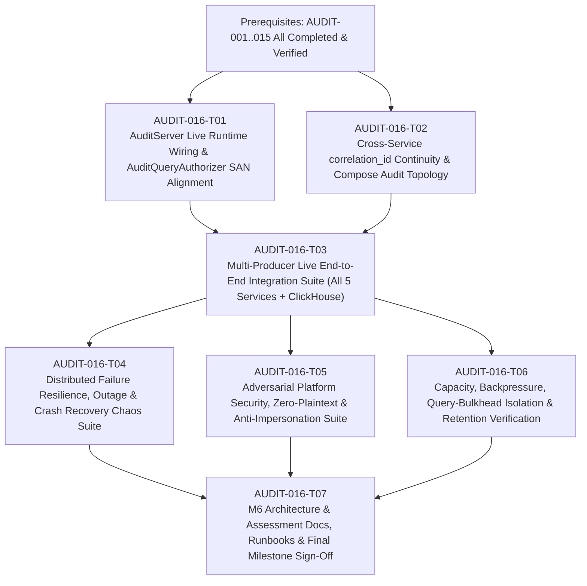

# AUDIT-016 — End-to-End Platform Audit Integration, Cross-Service Resilience, Security Hardening & M6 Sign-Off
## Phase 6 (M6: Centralized Audit & Compliance — Milestone Final Capstone) Technical Specification & Implementation Tickets

**Card Identifier**: `AUDIT-016`  
**Milestone**: M6 — Centralized Audit & Compliance (Milestone Final Card)  
**Document Status**: Implementation-Ready Technical Specification & Ticket Decomposition (Zero-Drift Capstone)  
**Assignee / Developer**: Lorenzo  
**Reviewer & Gatekeeper**: Sergey 
**Date**: 19-11-2026
**Dependencies**: `AUDIT-001`–`AUDIT-011` (Audit Service Core), `AUDIT-012` (Gateway Audit Producer), `AUDIT-013` (Auth Audit Producer), `AUDIT-014` (Messaging Audit Producer), `AUDIT-015` (Files Audit Producer), `GW-001`–`GW-010`, `AUTH-001`–`AUTH-010`, `MSG-001`–`MSG-012`, `FILES-001`–`FILES-010`  
**Related ADRs**: `ADR-001`, `ADR-004`, `ADR-005`, `ADR-006`, `ADR-007`, `ADR-008`, `ADR-009`, `ADR-010`, `ADR-011`, `ADR-012` (from `AUDIT-014`)

---

## 1. Executive Summary, Zero-Drift Mandate & M6 Capstone Scope

Card **AUDIT-016** is the final milestone verification and hardening capstone for **Phase 6 (M6: Centralized Audit & Compliance)**. It closes all remaining cross-service runtime integration defects across the five SecureCloud runtime microservices (`Gateway`, `Auth`, `Messaging`, `Files`, and `Audit`), validates the full multi-producer-to-ClickHouse topology under live mTLS, and delivers empirical proof across resilience chaos tests, adversarial security audits, and realistic capacity benchmarks.

### 1.1 Zero-Drift Capstone Principle (Strict Scope Boundary)

In strict alignment with SecureCloud's architectural governance (`ADR-001`, `ADR-004`, `ADR-005`, `audit-design.md` §7.27, and the precedent established in `MSG-012`):

> **`AUDIT-016` introduces ZERO new microservices, ZERO external message brokers (no Kafka/RabbitMQ/Redis), ZERO new query/streaming infrastructure, and ZERO public REST audit endpoints.**

In particular, `AUDIT-016` explicitly preserves the **Human Operator Query Dependency Gate** established in `AUDIT-007`:
- Human administrator/operator RBAC and stepped-up MFA token claims for cross-service audit browsing at the API Gateway are **not** defined in an approved ADR (`audit_query_authorizer.cpp:42-43` rejects Gateway operator queries with `PERMISSION_DENIED`: `"ForbiddenOperatorContractNotEnabled"`).
- `AUDIT-016` does **not** invent an unapproved public `/api/v1/audit/*` Gateway proxy. Authorized `AuditQueryService` investigations remain internal mTLS RPCs (`audit` global scope; runtime producers self-scoped).

### 1.2 Dual Objective of `AUDIT-016`

1. **Close Four Concrete Cross-Service Runtime Wiring Defects**: Direct codebase auditing of `src/audit/`, `src/gateway/`, `src/auth/`, `deploy/dev-pki/`, and `deploy/compose/` uncovered four live wiring gaps where components built independently in `AUDIT-001`–`AUDIT-015` are not yet connected end-to-end in the production binaries and Compose topology (§2.2).
2. **Prove Full-Platform Compliance Before Milestone Sign-Off**: Validate all **17 Security Invariants** (`docs/design/audit-design.md` §7.24), all **10 Performance & Reliability Principles** (`audit-design.md` §7.25), cross-service `correlation_id` trace reconstruction, distributed outage/crash survival (`ADR-009`), and sustained ingestion/query isolation (`ADR-010`).

---

## 2. Verified Cross-Service Codebase Audit (What Works vs. 4 Live Defects)

### 2.1 Status Inventory Across Preceding Phase 6 Cards (`AUDIT-001`–`AUDIT-015`)

| Card Range | Subsystem / Scope | Verified Codebase State | Key Components |
| :--- | :--- | :--- | :--- |
| `AUDIT-001`–`003` | Audit Config, Canonical Model & ClickHouse Store | **Completed** (`walkthrough-audit-001..003.md`) | `AuditConfig`, `EventId` (UUIDv7), `AuditEventValidator`, `SensitiveDataGuard`, `ProducerIdentityValidator`, `ClickHouseClient`, `001_create_audit_events_table.sql` |
| `AUDIT-004`–`006` | gRPC Ingestion, Bounded Async Pipeline & Two-Phase Dedup | **Completed** (`walkthrough-audit-004..006.md`) | `AuditServiceImpl`, `AuditIngestionService`, `BoundedIngestionQueue`, `BatchAggregator`, `AuditIngestionPipeline`, `BoundedDeduplicationCache`, `AcknowledgementManager` |
| `AUDIT-007`–`008` | Read-Only Query API, Keyset Pagination & 36-Month Retention | **Completed** (`walkthrough-audit-007..008.md`) | `AuditQueryServiceImpl`, `AuditQueryAuthorizer`, `AuditQueryValidator`, `AuditPageCursor`, `QueryBulkheadLimiter`, ClickHouse 36m TTL |
| `AUDIT-009`–`011` | Internal Security Events, Health/Drain & Lock-Free Metrics | **Completed** (`walkthrough-audit-009..011.md`) | `InternalSecurityEventRecorder`, `AntiRecursionGuard`, `AuditHealthEvaluator`, `AuditMetrics` |
| `AUDIT-012` | Gateway Producer & Local Disk Spool (`ADR-011`) | **Completed** (`walkthrough-audit-012.md`) | `GatewayAuditProducer`, `FileSpoolPendingStore`, `BoundedMemoryPendingStore`, `AuditAggregationWindow`, `AuditDeliveryDispatcher`, `AuditProducerMetrics` |
| `AUDIT-013` | Auth Producer & PostgreSQL Transactional Outbox (`V005`) | **Completed** (`walkthrough-audit-013.md`) | `V005__create_auth_outbox_table.sql`, `PostgresAuthOutboxRepository` (`SKIP LOCKED`), `OutboxAuditEventPublisher`, `AuthOutboxRelay`, `AuthAuditClient`, `AuthOutboxMetrics` |
| `AUDIT-014` | Messaging Producer & ScyllaDB Sharded Outbox (`V006`) | **Spec Ready / Target Impl** (`AUDIT-014-tickets.md`) | `V006__create_messaging_audit_outbox.cql`, `ScyllaMessagingAuditOutboxRepository`, `MessagingOutboxRelay`, `ZeroPlaintextGuard`, Forward Recovery |
| `AUDIT-015` | Files Producer & Hardened PostgreSQL Outbox (`V002`) | **Spec Ready / Target Impl** (`AUDIT-015-tickets.md`) | `V002__harden_files_outbox_table.sql`, `FilesOutboxRepository` Leasing, `FilesAuditMapper` (`file.*`), `GrpcAuditClient` (SAN mTLS), `FilesOutboxRelay`, `FilesOutboxMetrics` |

---

### 2.2 Four Verified Live Cross-Service Integration Defects

The following four defects exist in currently committed runtime wiring and **must** be fixed in `AUDIT-016-T01` and `AUDIT-016-T02` before end-to-end platform tests can succeed:

#### Defect 1 — Live `AuditServer` Bypasses Deduplication Cache, Async Bounded Pipeline, `AuditHealthEvaluator` & Live Metrics Wiring
- **Evidence in `src/audit/audit_server.cpp:54-71`**:
  - **Null `dedup_cache`**: Line 68 constructs `std::make_shared<service::AuditIngestionService>(repository_)` using the default `dedup_cache = nullptr` (`audit_ingestion_service.hpp:28`). Inside `AuditIngestionService::ingest_single` (`audit_ingestion_service.cpp:27`), `if (dedup_cache_)` is skipped completely when null—meaning **`AUDIT-006` two-phase deduplication (`BoundedDeduplicationCache`) and SHA-256 `IdempotencyConflict` (`ALREADY_EXISTS`) detection are inactive in the live `securecloud-audit` binary!**
  - **Bypassed `AuditIngestionPipeline`**: Lines 65–66 construct and start `pipeline_ = std::make_shared<ingestion::AuditIngestionPipeline>(config_.ingestion, repository_)`, yet line 71 injects `ingestion_service_` directly into `AuditServiceImpl` without connecting `pipeline_` to ingestion or batch persistence. Live RPC traffic therefore skips `BoundedIngestionQueue` backpressure and `BatchAggregator` batching (500 events / 200ms).
  - **Raw TCP Health Probe Instead of `AuditHealthEvaluator`**: Lines 54–56 wire `health_manager_->set_readiness_evaluator` to raw `probe_tcp_connectivity(host, port)` rather than `AuditHealthEvaluator` (`AUDIT-010`, which checks HTTP `/ping`, failure hysteresis, and ingestion queue high-water mark `90%`).
  - **`AuditMetrics` Runtime Integration Gaps**: Live ClickHouse writes, dedup outcomes, and queue depth gauges must stay synchronized during live `AuditServer` execution.

#### Defect 2 — `AuditQueryAuthorizer` Rejects `deploy/dev-pki` mTLS Short SANs (`DNS:audit`, `DNS:auth`, etc.)
- **Evidence in `deploy/dev-pki/services/audit/audit.crt` & `src/audit/query/audit_query_authorizer.cpp:10-53`**:
  - Actual `deploy/dev-pki` certificates contain `CN=audit.dev.securecloud.local` and `SAN=DNS:audit` (same pattern for `gateway`, `auth`, `messaging`, `files`: `CN=<svc>.dev.securecloud.local, SAN=DNS:<svc>`).
  - While `ProducerIdentityValidator` (`src/audit/domain/producer_identity_validator.cpp:18-71`) matches **both** `short_name` (`"audit"`, `"auth"`, ...) and `fqdn` (`"audit.securecloud.internal"`, ...) across `common_name`, `san_dns_names`, and `san_uri_names`, `AuditQueryAuthorizer::authorize_query` (`src/audit/query/audit_query_authorizer.cpp:10-53`) **only** compares `peer.common_name == "audit.securecloud.internal"` (ignoring `san_dns_names` and short names).
  - **Impact**: Every live mTLS call to `AuditQueryService` using `deploy/dev-pki` certificates fails with `PERMISSION_DENIED` unless a test-only bypass flag is enabled!

#### Defect 3 — `deploy/compose/docker-compose.yml` & `.env.example` Missing Producer Audit Wiring & Gateway Spool Volume
- **Evidence in `deploy/compose/docker-compose.yml`**:
  - Only `gateway` sets `SECURECLOUD_GATEWAY_AUDIT_ENDPOINT: audit:50055` (`line 17`).
  - `auth` (`lines 47-87`), `messaging` (`lines 89-128`), and `files` (`lines 129-178`) have **zero** Audit endpoint, mTLS SAN override, or outbox relay configuration environment variables (meaning `files` currently falls back to `localhost:50054` until `AUDIT-015` + Compose env wiring!).
  - `gateway` lacks a named persistent Docker volume mounted at `/var/spool/securecloud-gateway/audit` as required by `ADR-011` and `GatewayAuditSpoolConfig` (`FileSpoolPendingStore`).
  - **Resilience Constraint (`ADR-009`)**: `gateway`, `auth`, `messaging`, and `files` must **never** add `depends_on: audit` in `docker-compose.yml`; all four must start cleanly and reach `SERVING` readiness even if `audit` or `clickhouse` is down.

#### Defect 4 — Cross-Service `correlation_id` Continuity Broken at Gateway → Auth Proxy & Auth Outbox Mapper
- **Evidence in `src/gateway/http/proxy/auth_proxy_handler.cpp` & `src/auth/service/outbox_event_mapper.cpp:188`**:
  - `MessagingProxyHandler` forwards `x-correlation-id` (`messaging_proxy_handler.cpp:468+`), and `FilesProxyHandler` is updated in `AUDIT-015-T03`.
  - However, `AuthProxyHandler` does not forward `x-correlation-id` to `AuthService`, and `OutboxEventMapper::to_outbox_entity` (`src/auth/service/outbox_event_mapper.cpp:188`) unconditionally overwrites `correlation_id` with `event.session_id` (or `event_id`), discarding the upstream Gateway `X-Request-ID` / `x-correlation-id`.
  - Because ClickHouse `audit_events.correlation_id` is typed `UUID` (`001_create_audit_events_table.sql:19`), propagating the hardened Gateway `request_id` (valid RFC 4122/9562 UUID) across Gateway → Auth / Messaging / Files → Audit is essential so a single `QueryAuditEvents(correlation_id)` reconstructs the full distributed trace!

---

## 3. Full Platform Topology & Ticket Dependency Graph

### 3.1 Five-Service Verified End-to-End Audit Topology

```text
                     External Client (HTTPS TLS 1.3 + X-Request-ID UUID)
                                             │
                                             ▼
    ┌─────────────────────────────────────────────────────────────────────────────────┐
    │ securecloud-gateway (50051)  ──▶ Edge Decisions ──▶ GatewayAuditProducer         │
    │                                                     (FileSpoolPendingStore +     │
    │   Propagates x-user-id, x-device-id,                 BoundedMemory + Aggregation)│
    │              x-correlation-id                                  │                 │
    └───────┬──────────────────────────┬─────────────────────────────┼─────────────────┘
            │                          │                             │
            ▼ mTLS gRPC (50052)        ▼ mTLS gRPC (50053)           ▼ mTLS gRPC (50054)
    ┌──────────────────┐       ┌──────────────────────┐      ┌──────────────────────┐
    │ securecloud-auth │       │ securecloud-messaging│      │  securecloud-files   │
    │  auth_outbox     │       │messaging_audit_outbox│      │    files_outbox      │
    │ (PG 17 V005)     │       │ (ScyllaDB 6.0 V006)  │      │ (PG 17 V002)         │
    │  AuthOutboxRelay │       │ MessagingOutboxRelay │      │   FilesOutboxRelay   │
    └─────────┬────────┘       └──────────┬───────────┘      └──────────┬───────────┘
              │                           │                             │
              └─────────────┬─────────────┼─────────────────────────────┘
                            │             │  BatchSubmitAuditEvents (mTLS 1.3, SAN verified)
                            ▼             ▼
    ┌─────────────────────────────────────────────────────────────────────────────────┐
    │                     securecloud-audit (mTLS Port 50055)                         │
    │                                                                                 │
    │  Ingestion Plane (8 workers, 10k queue):       Query Plane (4 workers, bulkhead):│
    │   • GrpcProducerIdentityValidator (SAN bind)    • AuditQueryAuthorizer (SAN/CN) │
    │   • AuditEventValidator + SensitiveDataGuard    • AuditQueryValidator (bounded) │
    │   • BoundedDeduplicationCache (64 shards)       • AuditPageCursor (keyset+hash) │
    │   • AuditIngestionPipeline (500 / 200ms)        • readonly=1 ClickHouse queries │
    │   • InternalSecurityEventRecorder (+AntiRec)                                    │
    │   • AuditHealthEvaluator + AuditMetrics                                         │
    └─────────────────────────────────────────┬───────────────────────────────────────┘
                                              │ HTTP Parameterized JSON / Native (8123)
                                              ▼
                               ┌─────────────────────────────┐
                               │ ClickHouse 24.8             │
                               │ securecloud_audit.audit_events
                               │ Partition: toYYYYMM         │
                               │ Order: (occurred_at, prod,  │
                               │         event_type, event_id)│
                               │ TTL: 36 MONTHS              │
                               └─────────────────────────────┘
```

### 3.2 Ticket Dependency Graph (`AUDIT-016-T01` to `AUDIT-016-T07`)



---

## 4. Detailed Ticket Decomposition (`AUDIT-016-T01` through `AUDIT-016-T07`)

### AUDIT-016-T01 — Live `AuditServer` Runtime Wiring Hardening & `AuditQueryAuthorizer` SAN Alignment

- **Ticket ID**: `AUDIT-016-T01`
- **Component**: `src/audit/` (`audit_server`, `service/`, `health/`, `query/`)
- **Assignee**: Lorenzo
- **Gatekeeper**: Sergey
- **Objective**: Connect the already-built `BoundedDeduplicationCache`, `AuditIngestionPipeline`, `AuditHealthEvaluator`, and `AuditMetrics` cleanly inside the live `AuditServer` daemon, and align `AuditQueryAuthorizer` peer matching with `ProducerIdentityValidator` so `deploy/dev-pki` certificates work end-to-end without test bypasses.
- **Implementation Scope**:
  1. **Wire Dedup & Async Pipeline in `src/audit/audit_server.{hpp,cpp}`**:
     - Instantiate `BoundedDeduplicationCache` configured from `config_.ingestion` (`dedup_cache_capacity`, `dedup_cache_ttl_ms`, `dedup_cache_shards`) and pass it to `AuditIngestionService`.
     - Connect `AuditServiceImpl` / `AuditIngestionService` to `AuditIngestionPipeline` (`BoundedIngestionQueue` + `BatchAggregator`) so live RPC batches flow through bounded queuing, batch persistence, two-phase `IN_FLIGHT -> COMMITTED` deduplication, and `AcknowledgementManager` rollback on `AmbiguousOutcome` (`audit-design.md` §7.28–§7.31).
     - Ensure `InternalSecurityEventRecorder` continues observing `AntiRecursionGuard` so self-emitted `audit.security.*` events never trigger infinite feedback loops.
  2. **Wire `AuditHealthEvaluator` & `AuditMetrics` in `AuditServer`**:
     - Replace raw `probe_tcp_connectivity` (`audit_server.cpp:54-56`) with `health::AuditHealthEvaluator` bound to `clickhouse_client_` (`HTTP /ping`), live ingestion queue occupancy percentage (`queue_high_water_pct`), and `config_.health`.
     - Update `AuditMetrics::instance()` gauges/counters cleanly from pipeline, dedup cache, ClickHouse repository, query bulkhead, and health state transitions; stop `AuditHealthEvaluator` cleanly in `AuditServer::stop()` Phase 1.
  3. **Align `AuditQueryAuthorizer` Identity Matching (`src/audit/query/audit_query_authorizer.cpp`)**:
     - Reuse the same short-name + FQDN + SAN DNS/URI matching logic used by `ProducerIdentityValidator` (`src/audit/domain/producer_identity_validator.cpp`):
       - `audit` / `audit.securecloud.internal` (in CN or `san_dns_names` / `san_uri_names`) → global investigation scope.
       - `auth` / `auth.securecloud.internal`, `messaging` / `messaging.securecloud.internal`, `files` / `files.securecloud.internal` → strictly self-scoped (`producer_service == caller`).
       - `gateway` / `gateway.securecloud.internal` → self-scoped (`GATEWAY`) permitted; cross-service operator query **remains blocked (`PERMISSION_DENIED`: `"ForbiddenOperatorContractNotEnabled"`)** preserving the `AUDIT-007` blocker gate!
- **Acceptance Criteria**:
  - [ ] Live `AuditServer` test sending duplicate `event_id` with identical payload returns `OK` with **1** row in ClickHouse; duplicate `event_id` with mutated payload returns `ALREADY_EXISTS`.
  - [ ] Live mTLS `AuditQueryService` calls using `deploy/dev-pki/services/audit/audit.crt` (`SAN=DNS:audit`) succeed without `set_bypass_peer_verification_for_testing(true)`, while `files.crt` querying `AUTH` events fails with `PERMISSION_DENIED`.
  - [ ] Existing unit and integration tests under `tests/*/audit/*` remain 100% green.
- **Dependencies**: `AUDIT-001`–`AUDIT-011`.

---

### AUDIT-016-T02 — Cross-Service `correlation_id` Continuity & Docker Compose Audit Topology

- **Ticket ID**: `AUDIT-016-T02`
- **Component**: `src/gateway/http/proxy/`, `src/auth/`, `deploy/compose/`
- **Assignee**: Lorenzo
- **Gatekeeper**: Sergey
- **Objective**: Guarantee unbroken UUID `correlation_id` propagation from external HTTPS requests at Gateway across all four backend producers into ClickHouse, and complete the 5-service Docker Compose audit topology.
- **Implementation Scope**:
  1. **Gateway → Auth `x-correlation-id` Propagation (`src/gateway/http/proxy/auth_proxy_handler.cpp`)**:
     - Forward sanitized `request_id` (valid RFC 4122/9562 UUIDv4/v7 from `RequestContext` / `X-Request-ID`) as `x-correlation-id` gRPC metadata on Auth RPCs alongside `x-user-id` and `x-device-id`.
  2. **Auth Outbox `correlation_id` Preservation (`src/auth/`)**:
     - Add `std::string correlation_id{}` to `auth::domain::AuditEvent` (`src/auth/domain/audit_event.hpp`), populate it in `AuthServiceImpl` from incoming `x-correlation-id` gRPC metadata (falling back to session/event UUID if absent), and update `OutboxEventMapper::to_outbox_entity` (`src/auth/service/outbox_event_mapper.cpp:188`) to prefer `event.correlation_id` when present (preserving backward compatibility when empty).
  3. **Verify Messaging & Files `correlation_id` Alignment**:
     - Confirm `MessagingProxyHandler` + `MessagingServiceImpl` (`x-correlation-id`) and `FilesProxyHandler` + `FilesServiceImpl` (`AUDIT-015-T03`) sanitize non-UUID values cleanly before setting `AuditEventProto::correlation_id` (required by ClickHouse `correlation_id UUID` column).
  4. **Complete `deploy/compose/docker-compose.yml` & `deploy/compose/.env.example`**:
     - Add named volume `gateway-audit-spool:` mounted at `/var/spool/securecloud-gateway/audit` on `gateway` service with spool env config per `ADR-011`.
     - Configure `auth`, `messaging`, and `files` services with `SECURECLOUD_AUDIT_ENDPOINT: audit:50055` (and service-specific instance/relay/SAN env vars matching `AuthConfig`, Messaging config, and `FilesConfig`).
     - Verify **zero** `depends_on: audit` entries are added to `gateway`, `auth`, `messaging`, or `files` (`ADR-009` decoupling invariant).
     - Confirm `docker compose config` validates cleanly and document health/bootstrap verification steps.
- **Acceptance Criteria**:
  - [ ] An HTTP request carrying `X-Request-ID: <uuid>` routed through Gateway → Auth / Messaging / Files produces audit records in all services sharing the exact same `correlation_id` UUID.
  - [ ] `docker compose -f deploy/compose/docker-compose.yml config` validates with zero errors and no `depends_on: audit` coupling on business services.
- **Dependencies**: `AUDIT-012`, `AUDIT-013`, `AUDIT-014`, `AUDIT-015`.

---

### AUDIT-016-T03 — Multi-Producer Live End-to-End Platform Integration Suite (All 5 Services + ClickHouse)

- **Ticket ID**: `AUDIT-016-T03`
- **Component**: `tests/integration/platform_audit_e2e_integration_test.cpp`
- **Assignee**: Lorenzo
- **Gatekeeper**: Sergey
- **Objective**: Prove end-to-end ingestion, storage, cross-service trace correlation, and read-only query retrieval across all five runtime services over real mutual TLS 1.3 and live ClickHouse 24.8.
- **Implementation Scope**:
  1. **Live Multi-Producer Harness (`tests/integration/platform_audit_e2e_integration_test.cpp`)**:
     - Boots live `AuditServer` over real mTLS (`deploy/dev-pki/services/audit/audit.{crt,key}` + `ca.crt`) connected to ClickHouse (`127.0.0.1:8123`, `securecloud_audit`).
     - Drives realistic end-to-end flows sharing a single root `correlation_id` UUID across all 4 producers using each service's real dev-PKI client certificate:
       - **Gateway** (`gateway.crt` + `FileSpoolPendingStore` + `AuditDeliveryDispatcher`): emits perimeter `gateway.security.identity_header_stripped` / `gateway.rate_limit.exceeded` + forwards `x-correlation-id`.
       - **Auth** (`auth.crt` + PostgreSQL `auth_outbox` `V005` + `AuthOutboxRelay`): commits `auth.login.succeeded` + `auth.device.enrolled` sharing the same `correlation_id`.
       - **Messaging** (`messaging.crt` + ScyllaDB `messaging_audit_outbox` `V006` + `MessagingOutboxRelay`): commits `message.submitted` + `conversation.created` sharing the same `correlation_id`.
       - **Files** (`files.crt` + PostgreSQL `files_outbox` `V002` + `FilesOutboxRelay`): commits `file.created` + `file.upload.completed` sharing the same `correlation_id`.
  2. **End-to-End Query & Provenance Verification (`AuditQueryService` with `audit.crt`)**:
     - `QueryAuditEvents(correlation_id)` returns the complete chronological trace spanning `GATEWAY`, `AUTH`, `MESSAGING`, `FILES` under one unified correlation ID.
     - Exercise all query dimensions (`producer_services`, `event_types`, `severities`, `actor_type`/`actor_id`, `target_type`/`target_id`, bounded time range).
     - `GetAuditEventById(event_id)` retrieves specific events via UUIDv7 granule pruning.
     - Keyset pagination (`page_size = 2`) walks across mixed-producer pages in both `SORT_ORDER_DESC` and `SORT_ORDER_ASC` with zero duplicates or skipped events.
     - Assert `occurred_at_ms` (producer event time) <= `received_at_ms` (Audit ingestion time) and timestamps are distinct (`audit-design.md` §7.24 invariant 17).
- **Acceptance Criteria**:
  - [ ] All 4 producer services successfully deliver canonical events over mTLS using real `deploy/dev-pki` certificates into live ClickHouse.
  - [ ] Cross-service `correlation_id` query reconstructs the complete distributed workflow accurately.
  - [ ] Keyset pagination returns exact partition of events with zero duplicates or gaps.
- **Dependencies**: `AUDIT-016-T01`, `AUDIT-016-T02`.

---

### AUDIT-016-T04 — Distributed Failure Resilience, Outage Survival & Chaos Recovery Suite

- **Ticket ID**: `AUDIT-016-T04`
- **Component**: `tests/integration/platform_audit_resilience_test.cpp`
- **Assignee**: Lorenzo
- **Gatekeeper**: Sergey
- **Objective**: Empirically prove `ADR-009` Distributed Failure Resilience and `AUDIT-006`/`AUDIT-010` crash/outage invariants across all 5 services without losing committed business audit records or blocking business operations.
- **Implementation Scope**:
  1. **Scenario 1 — Prolonged Audit Outage Independence (`ADR-009`)**:
     - Stop `AuditServer` while Gateway, Auth, Messaging, and Files continue processing traffic.
     - Assert: (a) 100% of business writes (Auth login/session, Messaging submission, Files upload/finalize) succeed without elevated tail latency or errors; (b) all producer health probes stay `SERVING`; (c) all outboxes/Gateway spool buffer events locally without dropping mandatory events; (d) upon restarting `AuditServer`, 100% of buffered events drain to ClickHouse with original UUIDv7 `event_id`s and original `occurred_at_ms`.
  2. **Scenario 2 — Audit Graceful Drain (`AuditServer::stop()`) Under Active Load**:
     - Initiate `AuditServer::stop()` while all 4 producers are actively streaming batches.
     - Assert `Health` flips immediately to `NOT_SERVING`, new RPCs fail fast with `UNAVAILABLE` (retained in producer outboxes for retry), and all previously accepted in-flight events flush to ClickHouse before process exit (zero silent drops).
  3. **Scenario 3 — ClickHouse Outage & Ambiguous Timeout Recovery (`audit-design.md` §7.31)**:
     - Inject transient ClickHouse failure / write timeout while `BoundedDeduplicationCache` holds `IN_FLIGHT` entries.
     - Assert `AuditHealthEvaluator` hysteresis flips readiness to `NOT_SERVING`, `AcknowledgementManager` rolls back `IN_FLIGHT` entries to `UNSEEN`, RPCs return `DEADLINE_EXCEEDED`/`UNAVAILABLE`, and subsequent producer retries succeed cleanly once ClickHouse recovers.
  4. **Scenario 4 — End-to-End Idempotency & Payload Conflict Quarantine (`AUDIT-006`)**:
     - Force lost RPC ACK after ClickHouse commit; verify producer retry receives `DuplicateCommitted` (`OK`) with **zero duplicate rows** in ClickHouse (assert via ClickHouse `GROUP BY event_id HAVING count() > 1` within TTL window).
     - Replay an existing `event_id` with mutated payload; verify `AuditServiceImpl` returns `ALREADY_EXISTS` and producer outbox transitions the tampered row to `QUARANTINED` without stalling healthy traffic.
  5. **Scenario 5 — Producer Process Restart Recovery**:
     - Stage events, simulate abrupt producer relay/spool restart (`Gateway` `FileSpoolPendingStore` fsync'd segment, `Auth` `auth_outbox` expired lease, `Messaging` `messaging_audit_outbox` sharded lease, `Files` `files_outbox` expired lease), restart workers, and confirm 100% completion.
- **Acceptance Criteria**:
  - [ ] Zero committed audit events lost across Audit outages, ClickHouse timeouts, graceful drains, and producer restarts.
  - [ ] Business operations in Auth, Messaging, and Files remain 100% available and `SERVING` throughout Audit downtime.
  - [ ] Ambiguous timeouts roll back dedup reservations cleanly so retries are never suppressed.
- **Dependencies**: `AUDIT-016-T03`.

---

### AUDIT-016-T05 — Adversarial Cross-Platform Security, Zero-Plaintext & Anti-Impersonation Audit Suite

- **Ticket ID**: `AUDIT-016-T05`
- **Component**: `tests/integration/platform_audit_security_test.cpp`
- **Assignee**: Lorenzo
- **Gatekeeper**: Sergey
- **Objective**: Execute an automated adversarial audit proving all **17 Security Invariants** in `docs/design/audit-design.md` (§7.24) across transport authentication, authorization, immutability, and zero-secret confidentiality.
- **Implementation Scope**:
  1. **Transport & Anti-Impersonation Matrix (`Invariants 6, 7`)**:
     - Unauthenticated TLS/plaintext attempt → `UNAUTHENTICATED` + internal `audit.security.auth.unauthenticated_connection` event recorded.
     - Untrusted/rogue CA client certificate → connection rejected + `audit.security.auth.untrusted_client_cert`.
     - Cross-service impersonation matrix: `files.crt` claiming `PRODUCER_SERVICE_AUTH`, `messaging.crt` claiming `PRODUCER_SERVICE_GATEWAY`, `gateway.crt` claiming `PRODUCER_SERVICE_MESSAGING` → every mismatch rejected with `PERMISSION_DENIED` + `audit.security.auth.producer_identity_mismatch` persisted cleanly in ClickHouse.
  2. **Query Authorization & Operator Blocker Verification (`Invariant 15`, `AUDIT-007`)**:
     - Verify `auth.crt`, `messaging.crt`, and `files.crt` can query only their own `producer_service` and are denied (`PERMISSION_DENIED`) when omitting `producer_service` or querying any peer service.
     - Verify `gateway.crt` attempting cross-service operator query is fail-closed with `PERMISSION_DENIED` (`"ForbiddenOperatorContractNotEnabled"`).
  3. **Immutability, Injection & Tamper-Evident Checks (`Invariant 8`, `AUDIT-008`)**:
     - Attempt SQL injection payloads inside `event_type`, `actor_id`, `target_id`, `correlation_id` filters → rejected by `AuditQueryValidator` with `INVALID_ARGUMENT`; parameterized bindings execute safely under ClickHouse `readonly=1`.
     - Attempt cross-filter reuse of `page_token` → rejected due to filter SHA-256 mismatch.
     - Confirm ClickHouse repository exposes zero `UPDATE`/`DELETE`/`ALTER`/`TRUNCATE` query methods (`AUDIT-008` append-only contract).
  4. **Automated Whole-Stack Zero-Plaintext / Zero-Secret Sweep (`Invariants 1–5, 16`)**:
     - Define unique traceable canary secrets across every category: plaintext message body, plaintext file content, E2E ciphertext envelope, file AES/XChaCha20 key, private Ed25519 key PEM, password string, Argon2id hash, JWT bearer token, signed capability token, MinIO secret key, `encrypted_filename`, and user email PII.
     - Verify **all four producer pipelines** scrub/exclude every canary before writing to outboxes/spools/logs AND query **all rows in ClickHouse `audit_events`** + captured logs confirming **0% canary presence**.
     - Directly invoke `AuditIngestionService` bypassing producer scrubbers with a canary secret / PEM / JWT → verify immediate rejection (`INVALID_ARGUMENT`), `audit.security.payload.sensitive_data_detected` emitted safely **without** reflecting the canary secret into ClickHouse (`SensitiveDataGuard::sanitize_diagnostic`)!
- **Acceptance Criteria**:
  - [ ] Every single one of §7.24 Invariants `1`–`17` has an explicit passing automated assertion.
  - [ ] Zero canary secrets or PII detected anywhere in ClickHouse `audit_events`, producer outbox tables, Gateway spool files, or service diagnostic logs.
  - [ ] Gateway cross-service operator query blocker gate verified fail-closed.
- **Dependencies**: `AUDIT-016-T03`.

---

### AUDIT-016-T06 — Capacity, Backpressure, Query-Bulkhead Isolation & Retention Verification Suite

- **Ticket ID**: `AUDIT-016-T06`
- **Component**: `tests/integration/platform_audit_capacity_benchmark.cpp`
- **Assignee**: Lorenzo
- **Gatekeeper**: Sergey
- **Objective**: Execute the realistic performance and capacity validation required by `docs/design/audit-design.md` (§7.25) and `ADR-010` without disabling outbox durability or transactional semantics.
- **Implementation Scope**:
  1. **Sustained Multi-Producer Throughput & Batch Latency Benchmark (`audit-design.md` §7.25)**:
     - Concurrent producer harness across 4 simulated services with durable outbox/spool enabled, measuring sustained events/sec ingested into live ClickHouse via `AuditIngestionPipeline` (`batch_size = 500`, `flush_interval = 200ms`), p50/p95/p99 RPC latency, and ClickHouse batch insert efficiency.
     - Capture realistic ClickHouse table storage size per event (`bytes/event`) to validate retention sizing estimates.
  2. **Bounded Memory & Backpressure Saturation Test (`Invariant 12`)**:
     - Configure a tightly bounded queue (`max_queued_events`) under artificial ClickHouse slowdown and drive burst traffic past 100% queue capacity.
     - Assert: (a) RSS / queue memory remains strictly bounded; (b) `AuditServiceImpl` sheds excess load deterministically with `RESOURCE_EXHAUSTED`; (c) producers retain unacknowledged events in their durable outboxes/spools for backoff retry; (d) `audit.security.capacity.queue_saturated` internal event is rate-limited safely.
  3. **Ingestion vs. Query Bulkhead Isolation (`Invariant 13`, `AUDIT-007`)**:
     - Occupy all `QueryConfig::workers = 4` slots with concurrent ClickHouse analytical range scans while simultaneously running sustained batch ingestion (`IngestionConfig::workers = 8`).
     - Assert 5th concurrent query fails fast with `RESOURCE_EXHAUSTED` while p99 ingestion throughput and acceptance latency remain unaffected (zero starvation).
  4. **Retention & Observability Verification (`Invariant 14`, `AUDIT-008`, `AUDIT-011`)**:
     - Verify ClickHouse table DDL inspects `PARTITION BY toYYYYMM(occurred_at)` and `TTL toDateTime(occurred_at) + INTERVAL 36 MONTH DELETE` cleanly.
     - Scrape/render OpenMetrics output from `AuditMetrics` and all four producer metrics registries (`Gateway`, `Auth`, `Messaging`, `Files`), asserting zero dynamic high-cardinality labels (`user_id`, `event_id`, `file_id`) and monotonic counter consistency with ClickHouse row counts.
- **Acceptance Criteria**:
  - [ ] Benchmark completes with outbox/spool durability **enabled** (`audit-design.md` §7.25 rule) and captures concrete throughput, p50/p95/p99 latency, and storage-per-event baselines.
  - [ ] Queue saturation triggers deterministic `RESOURCE_EXHAUSTED` without OOM or silent drops of durable outbox records.
  - [ ] Query pool saturation causes 0% ingestion degradation.
- **Dependencies**: `AUDIT-016-T03`.

---

### AUDIT-016-T07 — M6 Architecture Documentation, Operational Runbooks & Final Milestone Sign-Off

- **Ticket ID**: `AUDIT-016-T07`
- **Component**: `docs/architecture/`, `docs/final-reports/`, `specs/phase6/`, Repository CI Gates
- **Assignee**: Lorenzo
- **Gatekeeper**: Sergey
- **Objective**: Finalize authoritative Milestone M6 architecture documentation, operator runbooks, final capstone walkthrough report, and full repository quality gates so Phase 6 can be formally closed.
- **Implementation Scope**:
  1. **Author Canonical Audit Architecture Docs** (completing the documentation set alongside `auth-*`, `gateway-*`, `messaging-*`, and `files-*` in `docs/architecture/`):
     - `docs/architecture/audit-architecture-and-functioning.md`: Complete five-service audit architecture, mTLS PKI trust model, producer outbox/spool variants (`Gateway` WAL spool, `Auth`/`Files` PG `SKIP LOCKED`, `Messaging` ScyllaDB sharded forward recovery), two-phase dedup state machine, bulkhead isolation, and end-to-end `correlation_id` tracing.
     - `docs/architecture/audit-implementation-assessment.md`: Verified component inventory, deviation log (`Gateway` spool per `ADR-011`, `Messaging` sequential write per `ADR-012`, `AuditQueryAuthorizer` operator gate per `AUDIT-007`), benchmark findings from `T06`, and readiness assessment for Phase 9–12 / production hardening.
  2. **Operational Runbooks Section**:
     - Quarantine triage & replay procedures across `auth_outbox`, `messaging_audit_outbox`, `files_outbox`, and `FileSpoolPendingStore`.
     - Orphaned Gateway spool drain recovery (`ADR-011` D8).
     - ClickHouse partition/TTL monitoring and `AUDIT-006` duplicate inspection query (`GROUP BY event_id HAVING count() > 1`).
  3. **Produce Final Sign-Off Report**:
     - Create `docs/final-reports/walkthrough-audit-016.md` documenting exact test execution logs (`T03`–`T06`), benchmark tables from `T06`, complete 17/17 Security Invariant sign-off table, and full Phase 6 (`AUDIT-001`–`AUDIT-016`) completion checklist.
  4. **Final Repository Verification Gates**:
     - Run full `clang-format` check across all C++ files (`0` diffs).
     - Clean build with `-Wall -Wextra -Wpedantic -Werror` (`0` warnings).
     - Run full `ctest` suite plus ASan/UBSan and TSan across concurrent ingestion/outbox targets.
- **Acceptance Criteria**:
  - [ ] `docs/architecture/audit-architecture-and-functioning.md`, `docs/architecture/audit-implementation-assessment.md`, and `docs/final-reports/walkthrough-audit-016.md` reviewed and approved by Sergey.
  - [ ] 100% CTest pass rate, clean format check, clean `-Werror` build, and clean sanitizer runs.
  - [ ] Formal Milestone M6 Completion Sign-Off granted.
- **Dependencies**: `AUDIT-016-T01` through `AUDIT-016-T06`.

---

## 5. Master M6 Security Invariants (`audit-design.md` §7.24) & Exit Traceability Matrix

Every milestone security invariant and completion gate is mapped to concrete verification in `AUDIT-016`:

| §7.24 Invariant / M6 Exit Gate | Verification Ticket(s) | Exact Verification Assertion |
| :--- | :--- | :--- |
| **Inv 1–5: Zero plaintext messages/files, zero E2E/file private keys, no decryption mechanism** | `T05` | Multi-producer secret-canary injection + ClickHouse `audit_events` + disk/log scanner (`0` matches); `AuditIngestionService` direct rejection + `SensitiveDataGuard` |
| **Inv 6–7: Service mTLS auth & strict anti-impersonation** | `T01`, `T03`, `T05` | Unauthenticated/untrusted cert rejected (`UNAUTHENTICATED`); producer SAN mismatch matrix rejected (`PERMISSION_DENIED`) + `audit.security.auth.*` emitted |
| **Inv 8: Application-level append-only immutability** | `T05` | Repository interface & ClickHouse `readonly=1` query enforcement (no `UPDATE`/`DELETE`/`ALTER`) |
| **Inv 9: Duplicates never corrupt logical history** | `T01`, `T04` | Live `BoundedDeduplicationCache` retry returns `OK` with 1 ClickHouse row; payload conflict returns `ALREADY_EXISTS` & quarantines producer row |
| **Inv 10–11: Audit outage never blocks Messaging/Files/Auth persistence** | `T02`, `T04` | Prolonged `AuditServer` stop across live business traffic; 100% business success + `SERVING` readiness + 100% post-recovery backlog drain |
| **Inv 12: Bounded ingestion resources & backpressure** | `T01`, `T06` | Saturated queue sheds load deterministically (`RESOURCE_EXHAUSTED`) with bounded RSS; producers retain events safely |
| **Inv 13: Queries cannot exhaust ingestion capacity** | `T06` | Saturated `QueryConfig::workers=4` bulkhead rejects 5th query while concurrent ingestion p99 stays flat |
| **Inv 14: Explicit, bounded 36-month retention** | `T06`, `T07` | ClickHouse `PARTITION BY toYYYYMM(occurred_at)` & `TTL + INTERVAL 36 MONTH DELETE` verified |
| **Inv 15: Query authorization & human operator blocker gate** | `T01`, `T05` | `audit` SAN global; producers self-scoped; `gateway` cross-service operator query fail-closed (`ForbiddenOperatorContractNotEnabled`) |
| **Inv 16: Opaque SecureCloud identifiers (no unnecessary PII)** | `T03`, `T05` | Actor/target UUID enforcement + zero raw email/plaintext filename sweep across ClickHouse |
| **Inv 17: Event provenance (`occurred_at` vs `received_at`) & `correlation_id` trace reconstruction** | `T02`, `T03` | Cross-service `correlation_id` trace across Gateway+Auth+Messaging+Files queried via `AuditQueryService`; distinct `occurred_at`/`received_at` |
| **M6 Documentation, Benchmarks, Build & Sanitizer Sign-Off** | `T06`, `T07` | Realistic benchmark table, `docs/architecture/audit-*.md`, `walkthrough-audit-016.md`, `0` format/compiler/sanitizer warnings |

---

## 6. Risk Analysis & Mitigation Matrix

| Risk / Failure Mode | Likelihood | Impact | Architectural Mitigation Strategy |
| :--- | :--- | :--- | :--- |
| **`AuditServer` Missing Live Dedup / Pipeline Connection Masked by Unit Mocks** | High *(Observed)* | **Critical** | Unit tests historically wired `BoundedDeduplicationCache` and `AuditIngestionPipeline` directly, bypassing `AuditServer`. `T01` fixes live `AuditServer` construction and `T03`–`T06` execute strictly against real `AuditServer` instances. |
| **`dev-pki` Short SAN Names Rejected by `AuditQueryAuthorizer`** | High *(Observed)* | **High** | `T01` unifies identity matching across `ProducerIdentityValidator` and `AuditQueryAuthorizer` so `SAN=DNS:<service>` works identically everywhere without test bypass flags. |
| **Synthetic In-Memory Bypass Skewing Benchmark Results** | Medium | **High** | `T06` strictly enforces `audit-design.md` §7.25: durability (PostgreSQL/ScyllaDB/Spool + ClickHouse HTTP insert) remains enabled throughout throughput/latency runs. |
| **Premature Exposure of Unapproved Operator Audit UI Endpoint** | Low | **Critical** | Zero-drift scope explicitly forbids adding public `/api/v1/audit/*` REST routes until an approved Admin RBAC/MFA ADR exists (`AUDIT-007` blocker preserved in `T01` & `T05`). |
| **ClickHouse Ambiguous Timeout Causing Split-Brain Dedup Suppression** | Medium | **High** | `T01` wires `AcknowledgementManager` with live `AuditServer` and `T04` injects real HTTP timeouts to verify `IN_FLIGHT -> UNSEEN` rollback before retry. |
| **Flaky Chaos Timing in Multi-Service Integration Tests** | Medium | **Medium** | Integration tests use condition-variable/polling predicates with bounded timeouts instead of fragile fixed `sleep()` waits, remaining deterministic under CI load and TSAN/ASAN. |

---

## 7. Sign-Off Checklist (Milestone M6 Exit Criteria)

Milestone **M6 — Centralized Audit & Compliance** is formally eligible for sign-off when:
- [ ] `AUDIT-014` (Messaging producer) and `AUDIT-015` (Files hardened producer) are implemented and merged.
- [ ] `AUDIT-016-T01` through `AUDIT-016-T07` are implemented, reviewed by Sergey, and merged cleanly.
- [ ] Every check in §5 (17/17 Security Invariants + Benchmark + Chaos Resilience + Operator Blocker Gate) passes in automated CI execution.
- [ ] `docs/final-reports/walkthrough-audit-016.md` is committed with reproducible command outputs.
